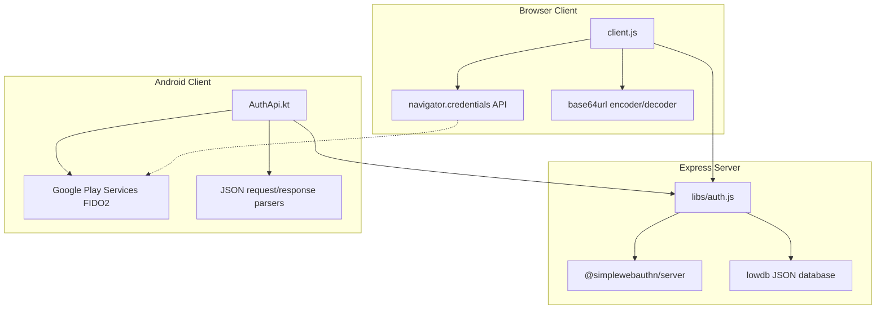
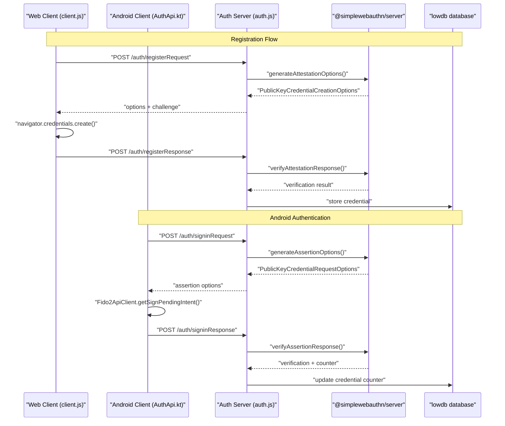
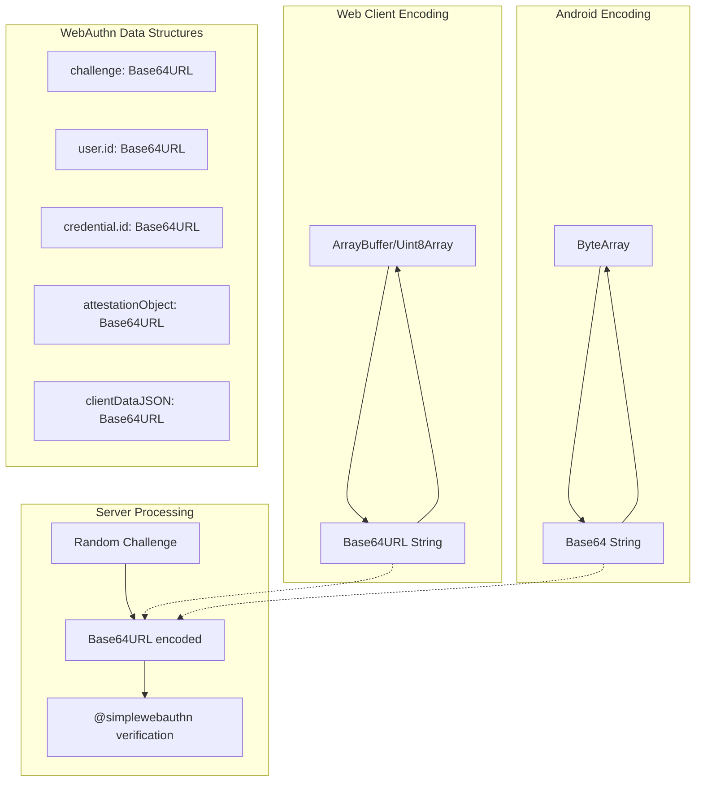
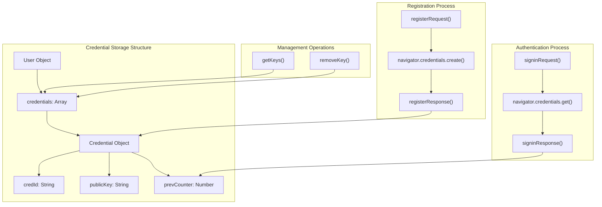
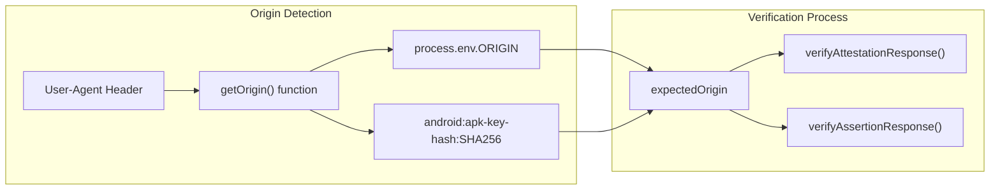
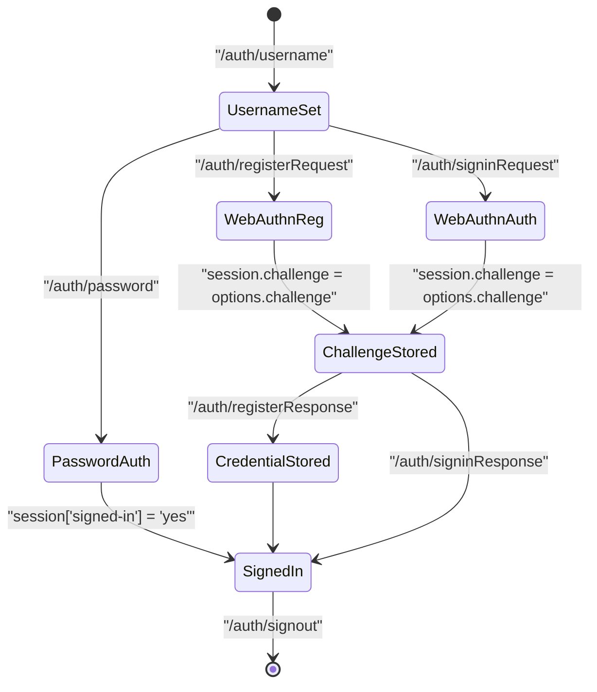

<!-- source: DeepWiki mcp.deepwiki.com · repo android/codelab-fido2 · page 4 WebAuthn and FIDO2 Implementation · fetched 2026-10-23 -->

# WebAuthn and FIDO2 Implementation

Relevant source files

The following files were used as context for generating this wiki page:

- [android/app/src/main/java/com/example/android/fido2/api/AuthApi.kt](android/app/src/main/java/com/example/android/fido2/api/AuthApi.kt)
- [libs/auth.js](libs/auth.js)
- [public/client.js](public/client.js)

This document provides a comprehensive technical overview of how WebAuthn and FIDO2 standards are implemented across the entire codelab system, including the web client, Express.js server, and Android application. It covers the authentication protocols, data flow, encoding/decoding processes, and integration points between the different platforms.

For detailed implementation specifics of individual components, see [Client-Side WebAuthn Integration](#4.1), [Server-Side WebAuthn Processing](#4.2), and [Android FIDO2 Integration](#4.3). For information about the build configuration and dependencies supporting these implementations, see [Build System and Configuration](#5).

## WebAuthn Protocol Implementation Overview

The codelab implements the WebAuthn specification across three main components that work together to provide FIDO2 authentication:

**WebAuthn Protocol Flow Implementation**

Sources: [public/client.js:1-162](), [libs/auth.js:1-483](), [android/app/src/main/java/com/example/android/fido2/api/AuthApi.kt:1-547]()

## Authentication Data Flow

The system implements the complete WebAuthn registration and authentication flows with proper challenge-response protocols:

**Key Protocol Endpoints**

| Endpoint | Purpose | Request Handler | Response Format |
|----------|---------|-----------------|-----------------|
| `/auth/registerRequest` | Initiate credential registration | [libs/auth.js:218-291]() | `PublicKeyCredentialCreationOptions` |
| `/auth/registerResponse` | Complete credential registration | [libs/auth.js:308-361]() | User credentials list |
| `/auth/signinRequest` | Initiate authentication | [libs/auth.js:377-422]() | `PublicKeyCredentialRequestOptions` |
| `/auth/signinResponse` | Complete authentication | [libs/auth.js:439-480]() | User credentials list |

Sources: [libs/auth.js:218-480](), [public/client.js:62-156](), [android/app/src/main/java/com/example/android/fido2/api/AuthApi.kt:124-277]()

## Data Encoding and Transformation

WebAuthn requires specific data encoding between client and server. The system implements Base64URL encoding/decoding across all platforms:

**Base64URL Implementation Details**

The web client implements custom Base64URL encoding:
- `base64url.encode()` converts `ArrayBuffer` to URL-safe base64 [public/client.js:22-25]()
- `base64url.decode()` converts base64 string back to `ArrayBuffer` [public/client.js:27-35]()

The Android client uses standard Base64 with extensions:
- `toBase64()` extension function for `ByteArray` conversion [android/app/src/main/java/com/example/android/fido2/api/AuthApi.kt:25]()
- `decodeBase64()` extension function for string decoding [android/app/src/main/java/com/example/android/fido2/api/AuthApi.kt:24]()

Sources: [public/client.js:21-36](), [android/app/src/main/java/com/example/android/fido2/api/AuthApi.kt:24-25]()

## Credential Management Implementation

The system provides comprehensive credential lifecycle management across all platforms:

**Platform-Specific Credential Handling**

| Platform | Storage Location | Format | Access Method |
|----------|------------------|--------|---------------|
| Web Client | `localStorage` | credential ID string | [public/client.js:102]() |
| Express Server | lowdb JSON file | credential objects | [libs/auth.js:344-349]() |
| Android Client | DataStore Preferences | serialized credential data | Repository pattern |

**Credential Verification Flow**

The server implements robust credential verification using `@simplewebauthn/server`:

1. **Registration Verification**: `verifyAttestationResponse()` validates attestation objects [libs/auth.js:319-324]()
2. **Authentication Verification**: `verifyAssertionResponse()` validates assertion signatures [libs/auth.js:455-461]()
3. **Counter Management**: Prevents replay attacks by tracking signature counters [libs/auth.js:469]()

Sources: [public/client.js:102](), [libs/auth.js:344-349,319-324,455-461,469](), [android/app/src/main/java/com/example/android/fido2/api/AuthApi.kt:441-477]()

## Cross-Platform Origin Handling

The system implements proper origin validation for both web and Android clients:

**Android SHA256 Hash Validation**

The server detects Android clients by checking for `okhttp` in the User-Agent header [libs/auth.js:64]() and constructs the appropriate origin using the app's SHA256 certificate hash [libs/auth.js:65-69]().

**Web Origin Validation**

Web clients use the standard HTTPS origin from environment variables, validated during WebAuthn verification [libs/auth.js:71]().

Sources: [libs/auth.js:62-74](), [libs/auth.js:311,442]()

## Session and State Management

The implementation maintains secure session state across the authentication process:

**Session Security Implementation**

- **CSRF Protection**: Custom header `X-Requested-With: XMLHttpRequest` required [libs/auth.js:42-48]()
- **Challenge Management**: WebAuthn challenges stored in session and cleared after use [libs/auth.js:279,353,416,473]()
- **Authentication State**: `session['signed-in']` flag controls access to protected endpoints [libs/auth.js:55-59]()

Sources: [libs/auth.js:42-48,55-59,279,353,416,473]()

---

