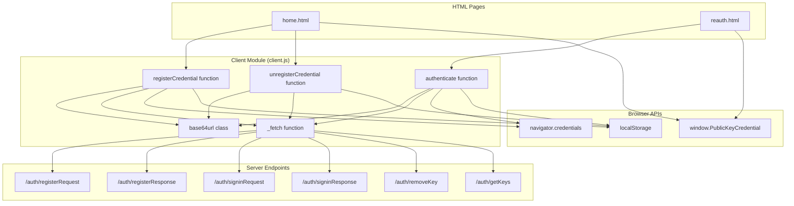
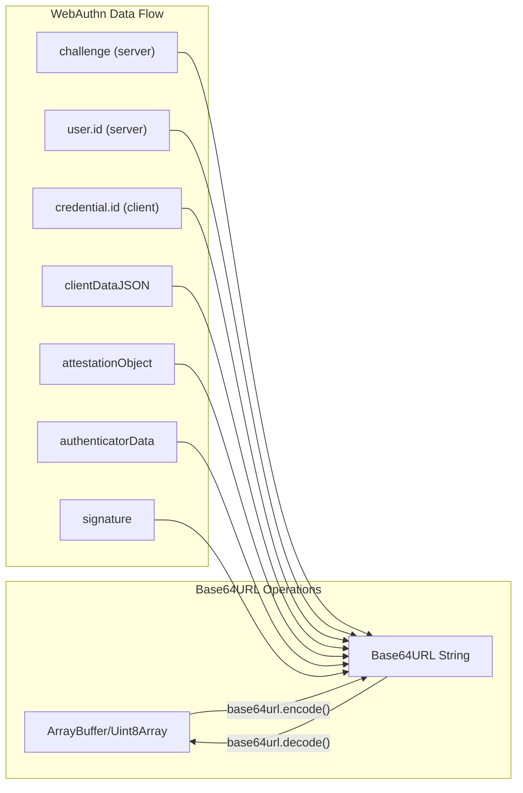
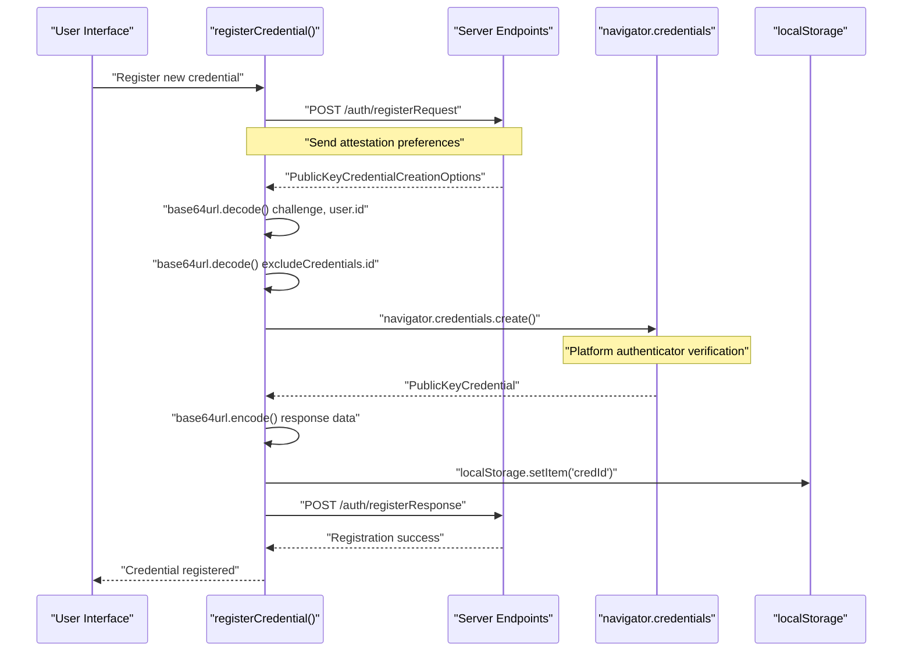
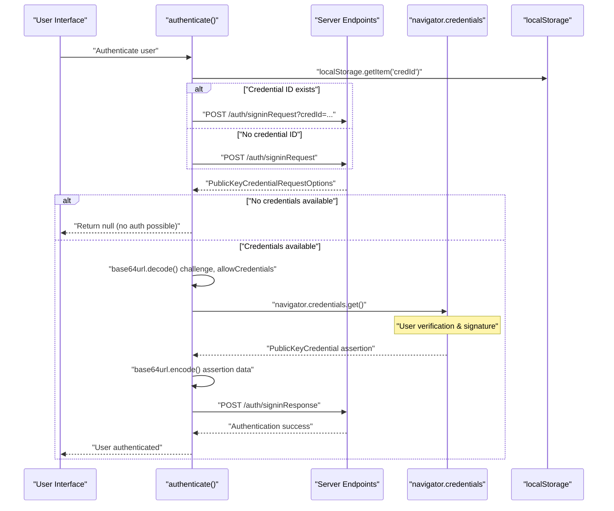
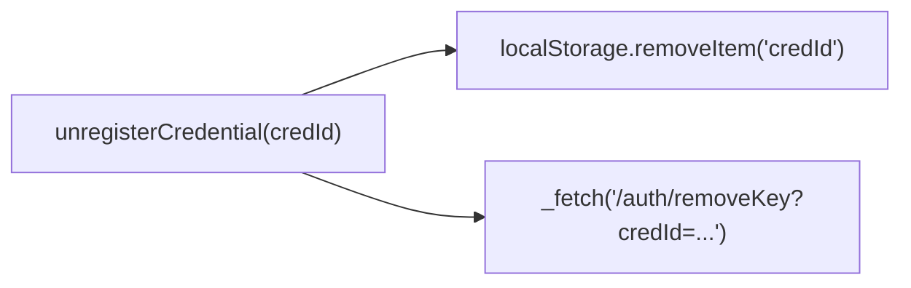
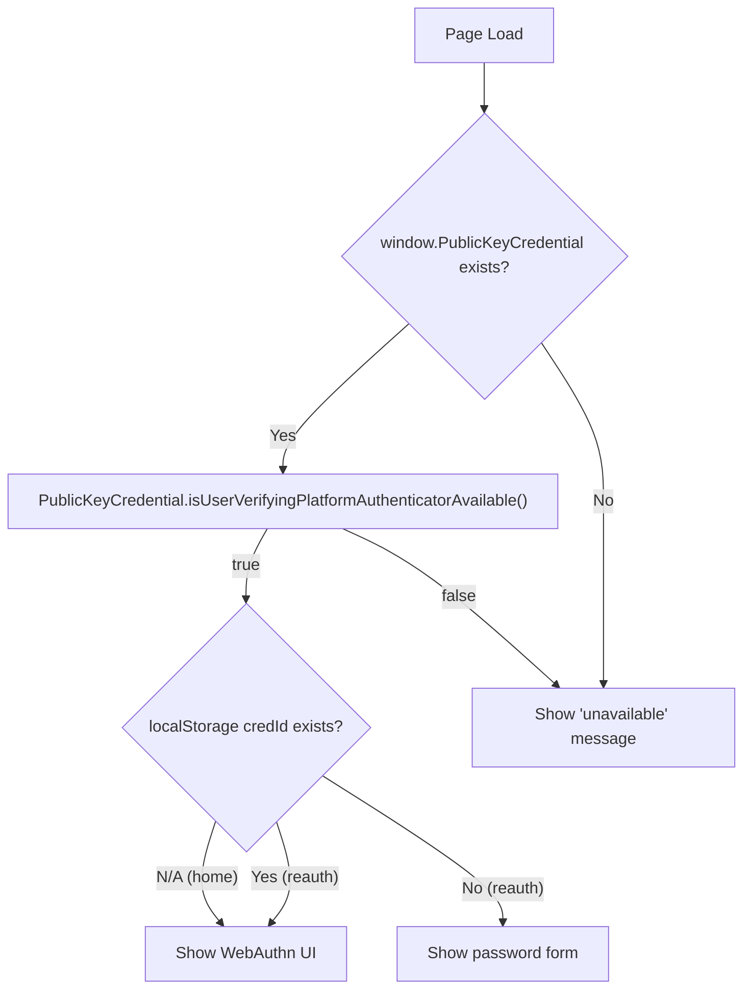

<!-- source: DeepWiki mcp.deepwiki.com · repo android/codelab-fido2 · page 4.1 Client-Side WebAuthn Integration · fetched 2026-10-23 -->

# Client-Side WebAuthn Integration

Relevant source files

The following files were used as context for generating this wiki page:

- [public/client.js](public/client.js)
- [views/home.html](views/home.html)
- [views/reauth.html](views/reauth.html)

This document covers the browser-based WebAuthn implementation in the web application, including the JavaScript API integration, data encoding utilities, and credential management flows. It focuses on the client-side logic that interacts with the WebAuthn browser APIs to enable FIDO2 authentication.

For server-side WebAuthn processing and verification, see [Server-Side WebAuthn Processing](#4.2). For the Android FIDO2 implementation, see [Android FIDO2 Integration](#4.3).

## Architecture Overview

The client-side WebAuthn implementation is centralized in a single JavaScript module that provides utilities for all WebAuthn operations. The architecture follows a functional approach with distinct utility functions for each WebAuthn operation.

Sources: [public/client.js:1-162](), [views/home.html:54-109](), [views/reauth.html:61-115]()

## Base64URL Encoding Utilities

The WebAuthn API requires binary data to be encoded as Base64URL strings for transmission over HTTP. The `base64url` class provides static methods for encoding and decoding binary data.

The encoding implementation handles the Base64URL format requirements by removing padding and replacing URL-unsafe characters:

- Removes `=` padding characters
- Replaces `+` with `-`
- Replaces `/` with `_`

Sources: [public/client.js:21-36]()

## HTTP Communication Utility

The `_fetch` function provides a standardized way to communicate with the server, handling JSON serialization, CSRF protection, and error responses.

| Feature | Implementation |
|---------|----------------|
| Method | Always POST |
| CSRF Protection | `X-Requested-With: XMLHttpRequest` header |
| Content Type | `application/json` for objects, form data otherwise |
| Credentials | `same-origin` for session cookies |
| Error Handling | Throws server error messages |

Sources: [public/client.js:38-60]()

## WebAuthn Credential Registration

The `registerCredential` function implements the WebAuthn credential creation flow, coordinating between the server and browser APIs.

The registration process includes specific authenticator selection criteria:

- `attestation: 'none'` - No attestation required
- `authenticatorAttachment: 'platform'` - Platform authenticator only
- `userVerification: 'required'` - User verification mandatory
- `requireResidentKey: false` - Non-resident keys allowed

Sources: [public/client.js:62-105]()

## WebAuthn Authentication

The `authenticate` function handles user authentication using existing WebAuthn credentials.

The authentication flow encodes multiple assertion components:
- `clientDataJSON` - Client-side challenge response
- `authenticatorData` - Authenticator metadata
- `signature` - Cryptographic signature
- `userHandle` - User identifier

Sources: [public/client.js:107-156]()

## Credential Management

The credential management system provides functions for listing and removing WebAuthn credentials.

### Credential Removal

The `unregisterCredential` function removes credentials from both local storage and the server:

### Credential Listing

The home page retrieves and displays all registered credentials through the `/auth/getKeys` endpoint, showing credential IDs and public keys with removal options.

Sources: [public/client.js:158-161](), [views/home.html:77-91]()

## Platform Authenticator Detection

Both home and reauth pages implement platform authenticator availability detection to conditionally show WebAuthn options.

The detection logic varies between pages:
- **Home page**: Shows registration button if UVPAA is available
- **Reauth page**: Shows authentication button only if UVPAA is available AND a credential ID exists in local storage

Sources: [views/home.html:60-75](), [views/reauth.html:77-90]()

## UI Integration Points

The client-side WebAuthn functions integrate with the HTML pages through event listeners and direct function calls:

| Page | Integration Points | Functions Used |
|------|-------------------|----------------|
| `home.html` | Register button click, Remove credential buttons, Page load credential list | `registerCredential`, `unregisterCredential`, `_fetch('/auth/getKeys')` |
| `reauth.html` | Authenticate button click, Cancel button fallback | `authenticate` |

The integration uses modern JavaScript features including:
- ES6 modules with `import` statements
- Template literals with `lit-html` library
- Async/await for promise handling
- Event delegation for dynamic content

Sources: [views/home.html:54-109](), [views/reauth.html:61-115]()

---

