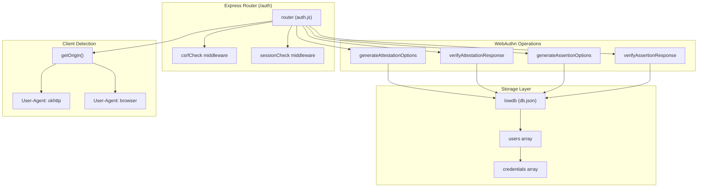
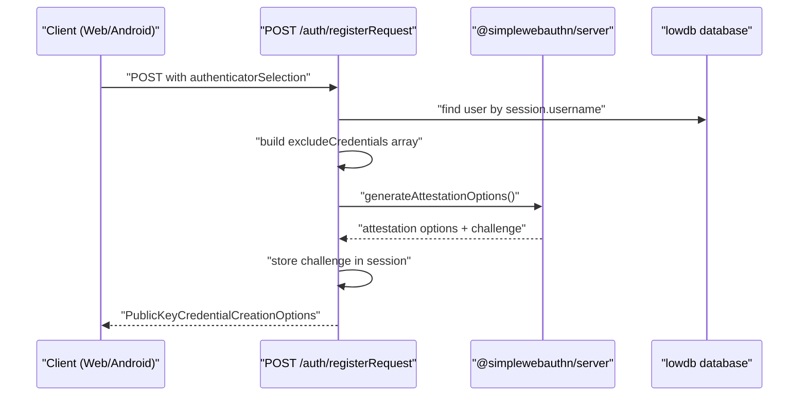
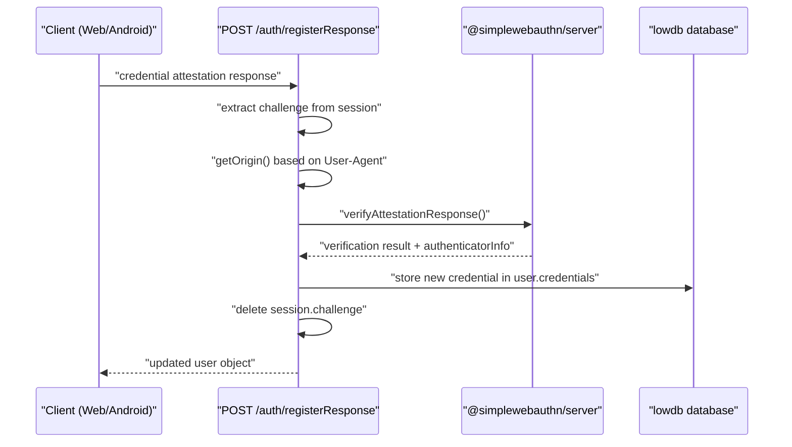
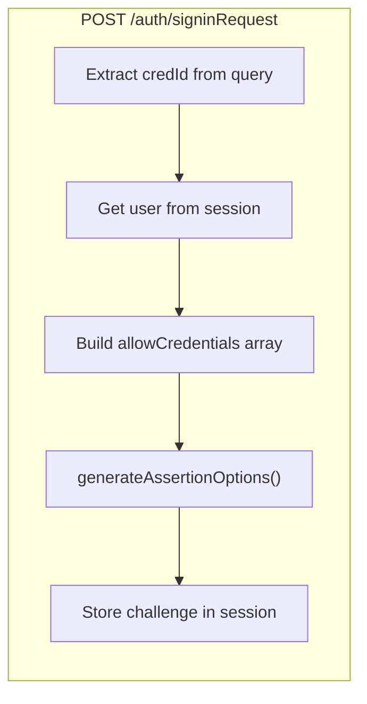
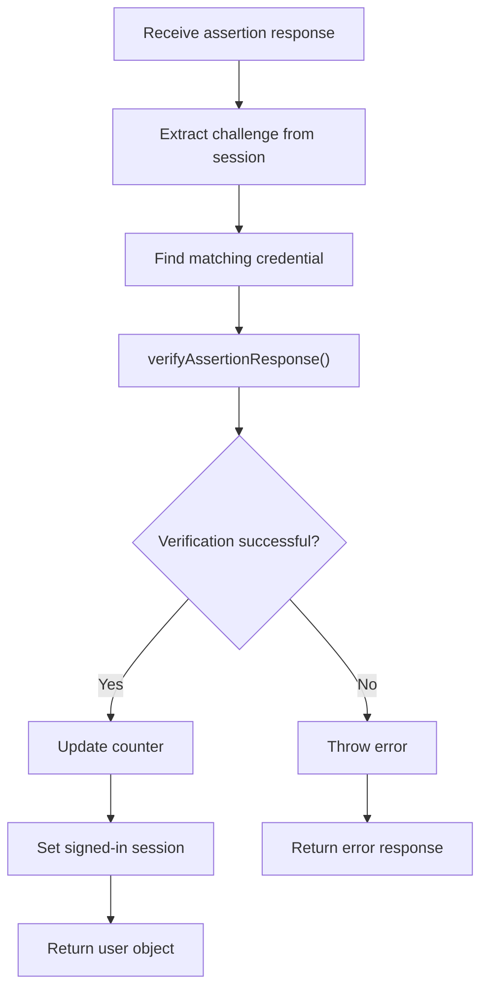
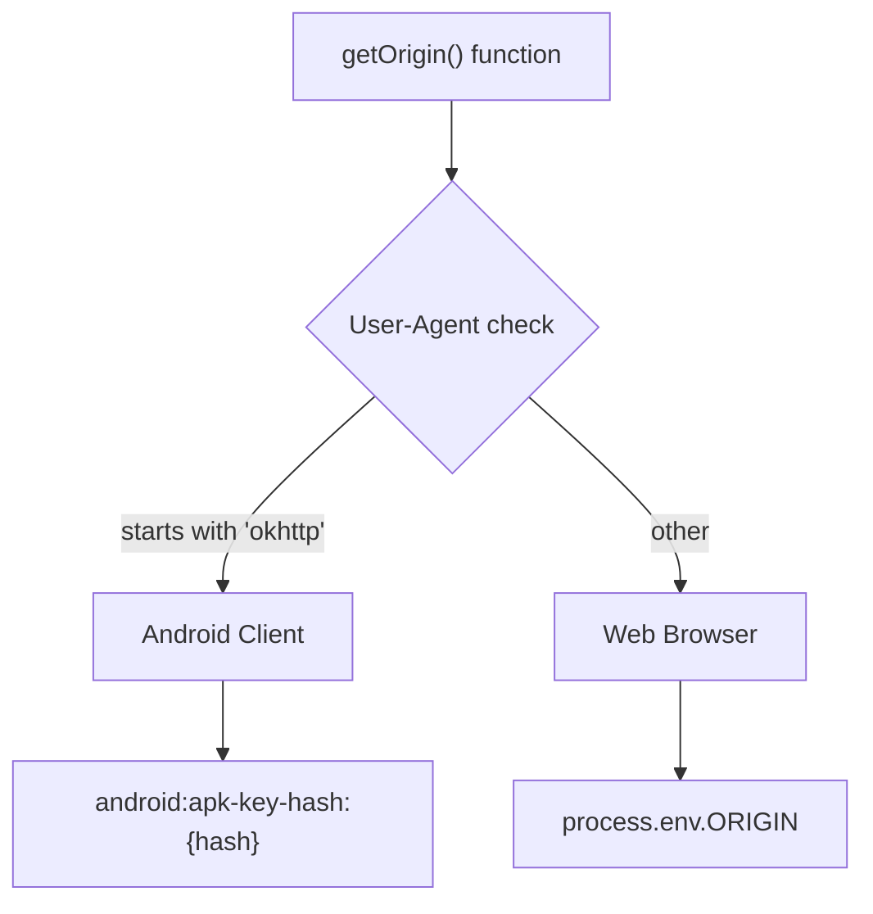

<!-- source: DeepWiki mcp.deepwiki.com · repo android/codelab-fido2 · page 4.2 Server-Side WebAuthn Processing · fetched 2026-10-23 -->

# Server-Side WebAuthn Processing

<details>
<summary>Relevant source files</summary>

The following files were used as context for generating this wiki page:

- [android/app-start/src/main/java/com/example/android/fido2/api/AuthApi.kt](android/app-start/src/main/java/com/example/android/fido2/api/AuthApi.kt)
- [libs/auth.js](libs/auth.js)

</details>


This document explains how the server handles WebAuthn registration and authentication requests, including challenge generation, credential verification, and integration with the SimpleWebAuthn library. For client-side WebAuthn implementation details, see [Client-Side WebAuthn Integration](#4.1). For Android-specific FIDO2 integration, see [Android FIDO2 Integration](#4.3).

## Overview

The server-side WebAuthn processing is implemented in an Express.js router that handles both web browser and Android client requests. The system uses the `@simplewebauthn/server` library to generate and verify WebAuthn challenges, with credential data stored in a lowdb JSON database.

## Server Architecture

The server-side WebAuthn processing centers around the authentication router with several key components working together:



Sources: [libs/auth.js:17-482]()

## Registration Flow Processing

The server handles WebAuthn credential registration through two main endpoints that work with the SimpleWebAuthn library:

### Registration Request Processing



The `registerRequest` endpoint processes registration initiation by:

1. **Session Validation**: Ensures user is authenticated via `sessionCheck` middleware
2. **User Lookup**: Retrieves user data from database using session username
3. **Exclude Credentials**: Builds array of existing credentials to prevent re-registration
4. **Options Generation**: Calls `fido2.generateAttestationOptions()` with configuration
5. **Challenge Storage**: Stores generated challenge in session for later verification

Sources: [libs/auth.js:218-291]()

### Registration Response Processing



The `registerResponse` endpoint handles credential verification by:

1. **Challenge Retrieval**: Gets expected challenge from session storage
2. **Origin Detection**: Uses `getOrigin()` to handle web vs Android clients differently
3. **Verification**: Calls `fido2.verifyAttestationResponse()` with credential data
4. **Credential Storage**: Stores verified credential with `base64PublicKey`, `base64CredentialID`, and `counter`
5. **Session Cleanup**: Removes challenge from session after processing

Sources: [libs/auth.js:308-361](), [libs/auth.js:62-74]()

## Authentication Flow Processing

The server processes WebAuthn authentication through assertion generation and verification:

### Authentication Request Processing



The `signinRequest` endpoint:

1. **Credential Filtering**: Optionally filters to specific credential ID via query parameter
2. **Allow List**: Builds `allowCredentials` array from user's registered credentials
3. **Options Generation**: Uses `fido2.generateAssertionOptions()` to create challenge
4. **Session Storage**: Stores challenge for subsequent verification

Sources: [libs/auth.js:377-422]()

### Authentication Response Processing

The `signinResponse` endpoint performs signature verification:



Key processing steps:

1. **Credential Lookup**: Finds stored credential matching the assertion's credential ID
2. **Verification**: Calls `fido2.verifyAssertionResponse()` with expected parameters
3. **Counter Update**: Updates `prevCounter` to prevent replay attacks
4. **Session Update**: Sets `signed-in` flag in session upon successful verification

Sources: [libs/auth.js:439-480]()

## Data Structures and Storage

### User Data Model

The server stores user data in a lowdb JSON database with the following structure:

| Field | Type | Description |
|-------|------|-------------|
| `username` | String | User identifier |
| `id` | String | Base64-encoded random user ID |
| `credentials` | Array | Array of registered credentials |

### Credential Data Model

Each credential object contains:

| Field | Type | Description |
|-------|------|-------------|
| `credId` | String | Base64-encoded credential ID |
| `publicKey` | String | Base64-encoded public key |
| `prevCounter` | Number | Signature counter for replay protection |

Sources: [libs/auth.js:90-96](), [libs/auth.js:344-348]()

## Client Platform Detection

The server supports both web and Android clients through origin detection:



The `getOrigin` function determines the expected origin based on the User-Agent header:
- **Android clients**: Uses `okhttp` User-Agent to generate APK key hash origin
- **Web browsers**: Uses configured `ORIGIN` environment variable

Sources: [libs/auth.js:62-74]()

## Security Middleware and Validation

### CSRF Protection

The `csrfCheck` middleware validates the `X-Requested-With` header to prevent cross-site request forgery:

```javascript
if (req.header('X-Requested-With') != 'XMLHttpRequest') {
  res.status(400).json({ error: 'invalid access.' });
}
```

### Session Validation

The `sessionCheck` middleware ensures user authentication for protected endpoints:

```javascript
if (!req.session['signed-in']) {
  res.status(401).json({ error: 'not signed in.' });
}
```

Sources: [libs/auth.js:42-60]()

## Configuration and Environment

Key configuration constants used throughout the WebAuthn processing:

| Constant | Value | Purpose |
|----------|-------|---------|
| `RP_NAME` | 'WebAuthn Codelab' | Relying party name for attestation |
| `TIMEOUT` | 30 * 1000 * 60 | Challenge timeout (30 minutes) |
| `process.env.HOSTNAME` | Runtime value | RP ID for WebAuthn operations |
| `process.env.ORIGIN` | Runtime value | Expected origin for web clients |
| `process.env.ANDROID_SHA256HASH` | Runtime value | Android app signature hash |

Sources: [libs/auth.js:35-36](), [libs/auth.js:65-72]()

---

