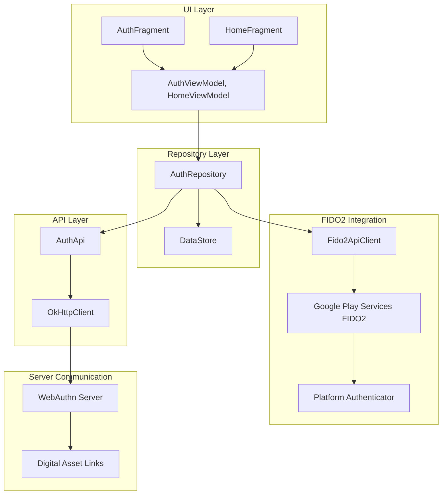
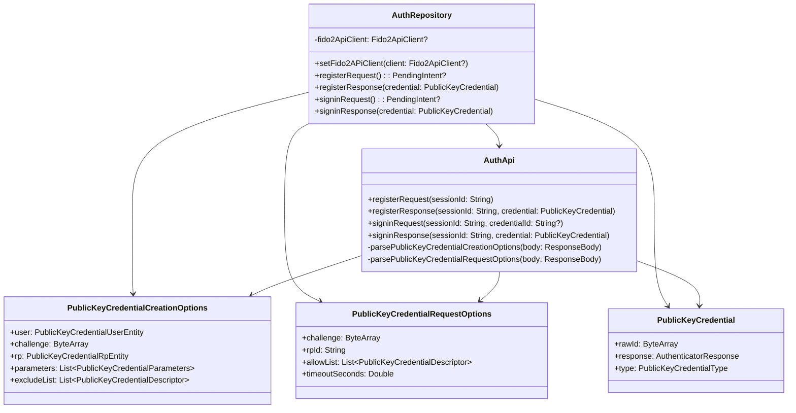
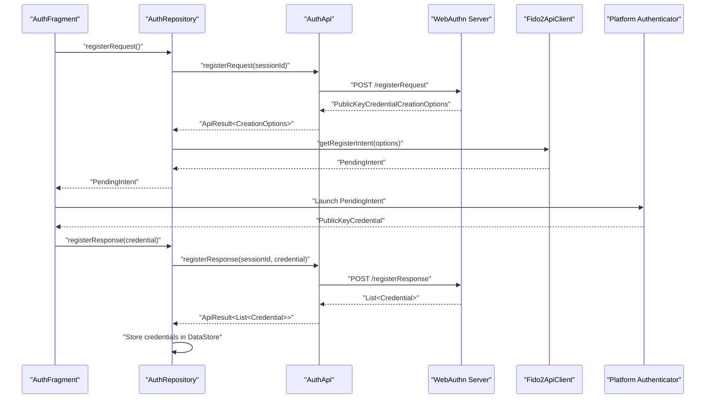
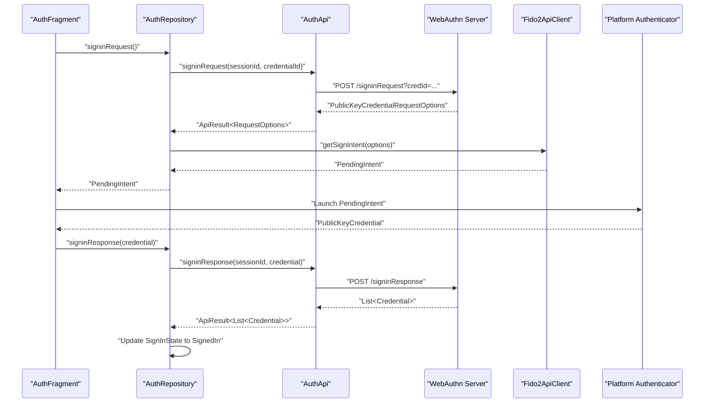
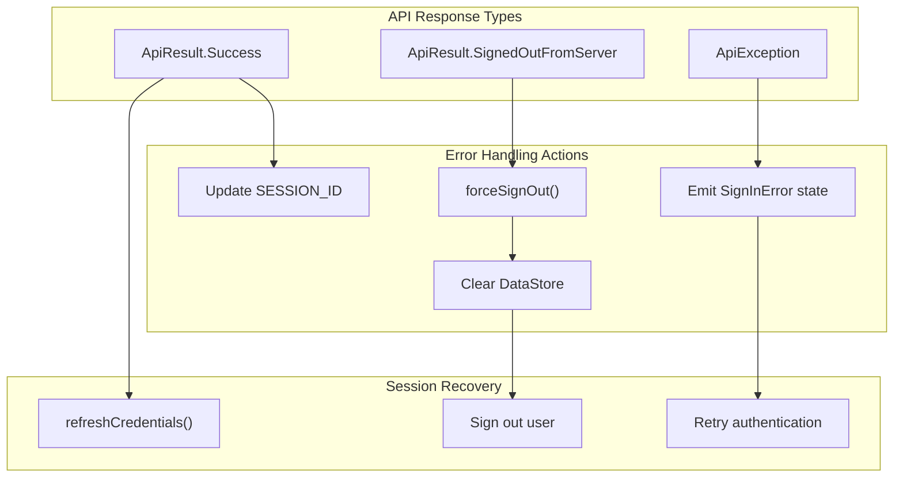

<!-- source: DeepWiki mcp.deepwiki.com · repo android/codelab-fido2 · page 4.3 Android FIDO2 Integration · fetched 2026-10-23 -->

# Android FIDO2 Integration

Relevant source files

The following files were used as context for generating this wiki page:

- [android/app-start/src/main/java/com/example/android/fido2/repository/AuthRepository.kt](android/app-start/src/main/java/com/example/android/fido2/repository/AuthRepository.kt)
- [android/app/build.gradle](android/app/build.gradle)
- [android/app/src/main/java/com/example/android/fido2/api/AuthApi.kt](android/app/src/main/java/com/example/android/fido2/api/AuthApi.kt)

This document covers the Android application's integration with the FIDO2/WebAuthn standard through Google Play Services. It explains how the Android client communicates with the WebAuthn server and manages platform authenticators for passwordless authentication.

For information about the web browser's WebAuthn implementation, see [Client-Side WebAuthn Integration](#4.1). For server-side WebAuthn processing details, see [Server-Side WebAuthn Processing](#4.2). For general Android application structure, see [Android Application](#3).

## Architecture Overview

The Android FIDO2 integration is built around Google Play Services FIDO2 API, which provides access to platform authenticators like fingerprint sensors and security keys. The integration consists of three main layers: the FIDO2 API client, the repository layer that coordinates operations, and the API layer that communicates with the WebAuthn server.

### Android FIDO2 Component Architecture

Sources: [android/app/src/main/java/com/example/android/fido2/api/AuthApi.kt:53-55](), [android/app-start/src/main/java/com/example/android/fido2/repository/AuthRepository.kt:46-50]()

## Dependencies and Configuration

The Android FIDO2 integration relies on Google Play Services FIDO2 library and is configured to communicate with the WebAuthn server through digital asset links.

### Key Dependencies

| Dependency | Version | Purpose |
|------------|---------|---------|
| `play-services-fido` | 20.0.1 | Google Play Services FIDO2 API |
| `kotlinx-coroutines-play-services` | 1.7.1 | Coroutine integration for Play Services |
| `okhttp` | 4.11.0 | HTTP client for server communication |
| `datastore-preferences` | 1.0.0 | Local credential storage |

The application is configured with a base API URL pointing to the WebAuthn server and includes digital asset links configuration for app verification.

Sources: [android/app/build.gradle:72](), [android/app/build.gradle:85](), [android/app/build.gradle:100-103](), [android/app/build.gradle:80](), [android/app/build.gradle:33-39]()

## Core FIDO2 Classes and Data Types

The Android integration uses several key classes from Google Play Services FIDO2 API to handle credential operations and communicate with authenticators.

### FIDO2 API Integration Classes

Sources: [android/app/src/main/java/com/example/android/fido2/api/AuthApi.kt:124-144](), [android/app/src/main/java/com/example/android/fido2/api/AuthApi.kt:209-233](), [android/app-start/src/main/java/com/example/android/fido2/repository/AuthRepository.kt:225-243](), [android/app/src/main/java/com/example/android/fido2/api/AuthApi.kt:30-37]()

## FIDO2 Registration Flow

The registration process involves requesting credential creation options from the server, invoking the platform authenticator through Google Play Services, and sending the resulting credential back to the server.

### Registration Sequence

The `AuthRepository.registerRequest()` method coordinates this flow by calling the server API to get credential creation options, then using `Fido2ApiClient.getRegisterIntent()` to create a `PendingIntent` that the UI can launch to invoke the platform authenticator.

Sources: [android/app-start/src/main/java/com/example/android/fido2/repository/AuthRepository.kt:225-243](), [android/app/src/main/java/com/example/android/fido2/api/AuthApi.kt:124-144](), [android/app-start/src/main/java/com/example/android/fido2/repository/AuthRepository.kt:249-263]()

## FIDO2 Authentication Flow

The authentication process follows a similar pattern, requesting assertion options from the server and using the platform authenticator to create a credential assertion.

### Authentication Sequence

The authentication flow uses `credentialId` from local storage to request specific credential assertion options, enabling the platform authenticator to use the correct key for signing.

Sources: [android/app-start/src/main/java/com/example/android/fido2/repository/AuthRepository.kt:284-298](), [android/app/src/main/java/com/example/android/fido2/api/AuthApi.kt:209-233](), [android/app-start/src/main/java/com/example/android/fido2/repository/AuthRepository.kt:304-322]()

## Data Serialization and API Communication

The `AuthApi` class handles complex JSON parsing and serialization of FIDO2 data structures, converting between server JSON responses and Google Play Services FIDO2 objects.

### Key Parsing Methods

| Method | Purpose | Input | Output |
|--------|---------|-------|---------|
| `parsePublicKeyCredentialCreationOptions()` | Parse registration options | `ResponseBody` | `PublicKeyCredentialCreationOptions` |
| `parsePublicKeyCredentialRequestOptions()` | Parse authentication options | `ResponseBody` | `PublicKeyCredentialRequestOptions` |
| `parseCredentialDescriptors()` | Parse credential lists | `JsonReader` | `List<PublicKeyCredentialDescriptor>` |
| `parseUserCredentials()` | Parse server credential list | `ResponseBody` | `List<Credential>` |

The API client handles base64 encoding/decoding of binary data and constructs proper JSON requests for credential registration and assertion responses.

Sources: [android/app/src/main/java/com/example/android/fido2/api/AuthApi.kt:300-326](), [android/app/src/main/java/com/example/android/fido2/api/AuthApi.kt:279-298](), [android/app/src/main/java/com/example/android/fido2/api/AuthApi.kt:359-386](), [android/app/src/main/java/com/example/android/fido2/api/AuthApi.kt:441-477]()

## Local Credential Storage

The `AuthRepository` uses Android DataStore to persist credential information and session state across app launches.

### DataStore Keys and Data Types

| Key | Type | Purpose |
|-----|------|---------|
| `USERNAME` | `String` | Current username |
| `SESSION_ID` | `String` | Server session identifier |
| `CREDENTIALS` | `Set<String>` | Serialized credential list |
| `LOCAL_CREDENTIAL_ID` | `String` | Device-specific credential ID |

Credentials are stored as serialized strings containing index, credential ID, and public key information, allowing the app to maintain a local cache of server-registered credentials.

Sources: [android/app-start/src/main/java/com/example/android/fido2/repository/AuthRepository.kt:55-59](), [android/app-start/src/main/java/com/example/android/fido2/repository/AuthRepository.kt:174-186]()

## Error Handling and Session Management

The FIDO2 integration includes comprehensive error handling for API failures, authentication timeouts, and server session expiration. The `ApiResult` sealed class provides structured error handling with specific handling for server sign-out scenarios.

### Session and Error Management

The repository maintains session state through `SignInState` sealed class instances and automatically handles session refresh and credential synchronization with the server.

Sources: [android/app/src/main/java/com/example/android/fido2/api/AuthApi.kt:520-531](), [android/app-start/src/main/java/com/example/android/fido2/repository/AuthRepository.kt:212-219](), [android/app-start/src/main/java/com/example/android/fido2/repository/AuthRepository.kt:140-153]()

---

