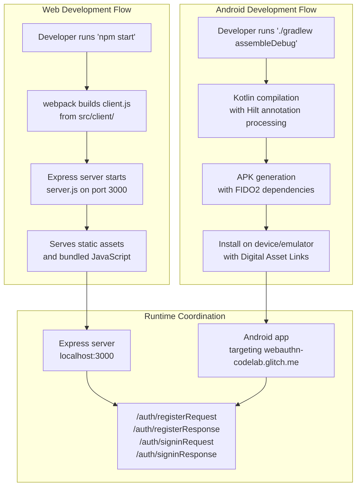

<!-- source: DeepWiki mcp.deepwiki.com · repo android/codelab-fido2 · page 5 Build System and Configuration · fetched 2026-10-23 -->

# Build System and Configuration

<details>
<summary>Relevant source files</summary>

The following files were used as context for generating this wiki page:

- [android/build.gradle](android/build.gradle)
- [package-lock.json](package-lock.json)
- [package.json](package.json)

</details>


This document covers the build system architecture and configuration for the WebAuthn codelab project, which consists of two distinct build environments: a Node.js-based web application and an Android application with Gradle build system. The build configurations enable development, dependency management, and deployment for both the web server/client and the Android FIDO2 demonstration app.

For detailed web application build setup, see [Web Build Configuration](#5.1). For Android-specific build configuration, see [Android Build Configuration](#5.2).

## Overview

The WebAuthn codelab employs a dual-platform build architecture where each platform maintains independent build systems while sharing common WebAuthn/FIDO2 implementation patterns. The web application uses a modern JavaScript build pipeline with webpack and Babel for client-side bundling, while the server runs directly on Node.js. The Android application uses the standard Gradle build system with Kotlin compilation and dependency injection.

**Dual Build System Architecture**

```mermaid
graph TB
    subgraph "Web Build System"
        PackageJSON[package.json<br/>"Main build config"]
        WebpackConfig[webpack.config.js<br/>"Client bundling"]
        NodeScripts["npm scripts<br/>build, start"]
        WebDeps["Web Dependencies<br/>express, @simplewebauthn/server<br/>@material/mwc-*"]
    end
    
    subgraph "Android Build System"
        RootBuildGradle[android/build.gradle<br/>"Project config"]
        AppBuildGradle[android/app/build.gradle<br/>"App module config"]
        GradleScripts["Gradle tasks<br/>assembleDebug, test"]
        AndroidDeps["Android Dependencies<br/>play-services-fido<br/>hilt, retrofit"]
    end
    
    subgraph "Shared Resources"
        WebAuthnStandards[WebAuthn/FIDO2 Standards]
        DigitalAssetLinks[.well-known/assetlinks.json]
        ServerEndpoints["/auth/* endpoints"]
    end
    
    PackageJSON --> NodeScripts
    PackageJSON --> WebDeps
    NodeScripts --> WebpackConfig
    
    RootBuildGradle --> AppBuildGradle
    RootBuildGradle --> AndroidDeps
    AppBuildGradle --> GradleScripts
    
    WebDeps --> WebAuthnStandards
    AndroidDeps --> WebAuthnStandards
    
    WebpackConfig --> DigitalAssetLinks
    AppBuildGradle --> DigitalAssetLinks
    
    NodeScripts --> ServerEndpoints
    GradleScripts --> ServerEndpoints
```

Sources: [package.json:1-45](), [android/build.gradle:1-40]()

## Build Process Flow

The build processes for both platforms follow distinct workflows but coordinate through shared web services and authentication endpoints.

**Build and Development Workflow**



Sources: [package.json:6-8](), [android/build.gradle:17-28]()

## Dependency Management

Both build systems manage distinct sets of dependencies that enable WebAuthn/FIDO2 functionality on their respective platforms.

| Component | Web Dependencies | Android Dependencies |
|-----------|------------------|---------------------|
| **Core Framework** | `express@^4.17.1` | `com.android.tools.build:gradle:8.0.2` |
| **WebAuthn/FIDO2** | `@simplewebauthn/server@^0.10.3` | `play-services-fido` (via Google Play Services) |
| **UI Components** | `@material/mwc-*@^0.19.1` | Material Design Components |
| **Build Tools** | `webpack@^4.44.1`, `babel-loader@^8.1.0` | `kotlin-gradle-plugin:1.8.22` |
| **Data Management** | `lowdb@^1.0.0`, `express-session@^1.17.1` | `androidx.datastore:datastore-preferences` |
| **Networking** | Built-in Node.js HTTP | `com.squareup.retrofit2:retrofit` |
| **Dependency Injection** | None (manual) | `com.google.dagger:hilt-android:2.47` |

Sources: [package.json:10-31](), [android/build.gradle:23-27]()

## Configuration Files Structure

The build configuration is distributed across multiple files that define different aspects of the build process:

**Web Application Configuration Files**

```mermaid
graph TB
    subgraph "Web Config Hierarchy"
        PackageJSON[package.json<br/>"Project metadata, dependencies, scripts"]
        WebpackConfig[webpack.config.js<br/>"Client-side bundling configuration"]
        BabelConfig[".babelrc or babel.config.js<br/>"JavaScript transpilation"]
        ServerJS[server.js<br/>"Express server entry point"]
    end
    
    subgraph "Android Config Hierarchy" 
        ProjectBuild[android/build.gradle<br/>"Project-level configuration"]
        AppBuild[android/app/build.gradle<br/>"App module configuration"]
        GradleProps[gradle.properties<br/>"Build properties"]
        AndroidManifest[AndroidManifest.xml<br/>"App metadata, permissions"]
    end
    
    PackageJSON --> WebpackConfig
    PackageJSON --> ServerJS
    WebpackConfig --> BabelConfig
    
    ProjectBuild --> AppBuild
    ProjectBuild --> GradleProps
    AppBuild --> AndroidManifest
```

Sources: [package.json:1-45](), [android/build.gradle:1-40]()

## Build Environment Specifications

The project defines specific environment requirements and compatibility constraints for both platforms:

**Node.js Environment**: The web application specifies Node.js version `10.x` in the engines field, ensuring compatibility with the Express server and WebAuthn dependencies. The build process uses webpack for client-side bundling with Babel transpilation for browser compatibility.

**Android Environment**: The Android build system uses Kotlin `1.8.22` with Android Gradle Plugin `8.0.2`, targeting modern Android SDK versions while maintaining compatibility with Google Play Services FIDO2 APIs. The build configuration includes Hilt dependency injection setup for managing authentication components.

**Shared Standards Compliance**: Both build systems ensure compliance with WebAuthn Level 2 specifications and FIDO2 standards through their respective dependency choices - `@simplewebauthn/server` for the web platform and Google Play Services FIDO2 APIs for Android.

Sources: [package.json:32-34](), [android/build.gradle:18-26]()

---

