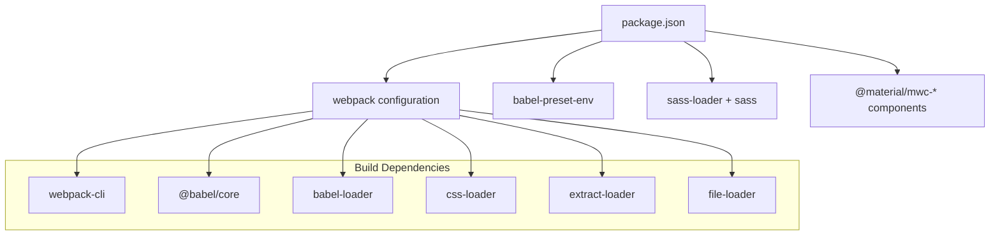
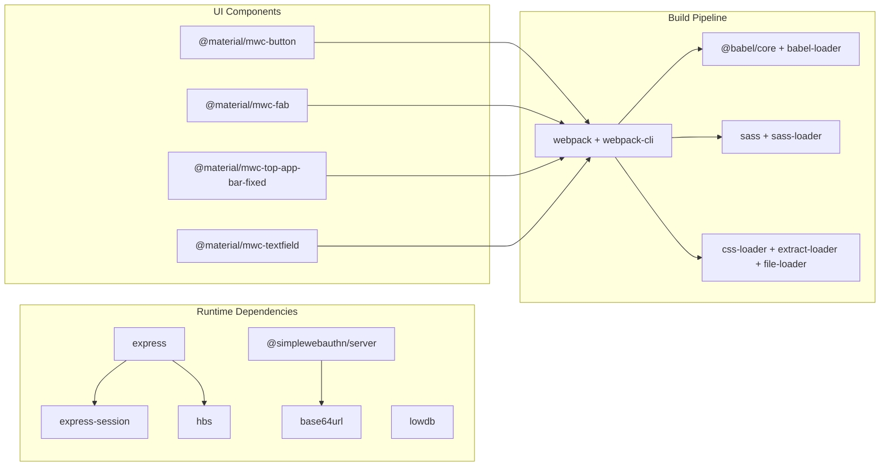
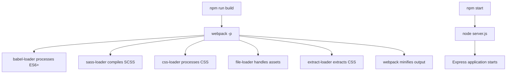
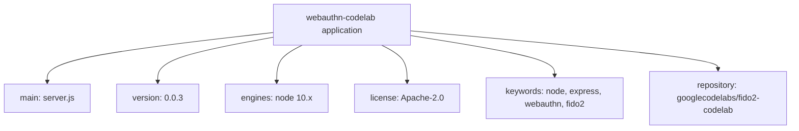

<!-- source: DeepWiki mcp.deepwiki.com · repo android/codelab-fido2 · page 5.1 Web Build Configuration · fetched 2026-10-23 -->

# Web Build Configuration

Relevant source files

The following files were used as context for generating this wiki page:

- [package-lock.json](package-lock.json)
- [package.json](package.json)

This document covers the Node.js build configuration and dependency management for the web application portion of the WebAuthn codelab. It details the `package.json` configuration, build scripts, dependency structure, and development toolchain setup. For Android build configuration, see [Android Build Configuration](#5.2).

## Package Configuration Overview

The web application is configured as a Node.js Express application with a comprehensive build system that processes client-side assets using Webpack and Babel. The main entry point is `server.js`, and the application supports both development and production builds.

**Build System Components**

Sources: [package.json:1-45]()

## Dependency Structure

The application dependencies are organized into several functional categories based on their runtime requirements and build-time usage.

| Category | Dependencies | Purpose |
|----------|-------------|---------|
| **Server Runtime** | `express`, `hbs`, `lowdb`, `express-session` | Core server functionality and templating |
| **WebAuthn/Security** | `@simplewebauthn/server`, `base64url` | FIDO2/WebAuthn protocol handling |
| **UI Components** | `@material/mwc-button`, `@material/mwc-fab`, `@material/mwc-top-app-bar-fixed`, `@material/mwc-textfield` | Material Web Components for UI |
| **Build Tools** | `webpack`, `webpack-cli`, `@babel/core`, `babel-loader` | JavaScript transpilation and bundling |
| **Asset Processing** | `css-loader`, `sass-loader`, `sass`, `extract-loader`, `file-loader` | CSS/Sass compilation and file handling |

**Dependency Flow in Application**

Sources: [package.json:10-31]()

## Build Scripts Configuration

The application defines two primary build scripts that handle different deployment scenarios.

### Production Build Script
The `build` script uses `webpack -p` to create an optimized production bundle with minification and optimization enabled.

### Development Server Script  
The `start` script directly executes `server.js` using Node.js, intended for development and production server startup.

**Build Process Flow**

Sources: [package.json:6-9]()

## Engine and Environment Configuration

The application specifies Node.js version 10.x as the target runtime environment, ensuring compatibility with the dependency versions and JavaScript features used throughout the codebase.

### Key Configuration Properties

- **Main Entry Point**: `server.js` serves as the application entry point
- **Version**: Currently at version 0.0.3 indicating active development
- **Node.js Engine**: Pinned to version 10.x for consistency
- **Repository**: References the Google Codelabs FIDO2 repository

**Application Metadata Structure**

Sources: [package.json:1-5](), [package.json:32-44]()

## Development Dependencies Analysis

The build system leverages modern JavaScript tooling to support ES6+ features, Sass preprocessing, and Material Design components integration.

### Babel Configuration
- `@babel/core` provides the core transformation engine
- `babel-loader` integrates Babel with Webpack
- `babel-preset-env` automatically determines required polyfills and transformations

### Webpack Asset Processing
- `css-loader` handles CSS imports and processing
- `sass-loader` compiles Sass/SCSS files to CSS  
- `extract-loader` extracts CSS from JavaScript bundles
- `file-loader` processes static assets like images and fonts

### Material Web Components Integration
The application uses four specific Material Web Components that provide consistent Material Design UI elements without requiring a full framework like React or Angular.

Sources: [package.json:14-30]()

---

