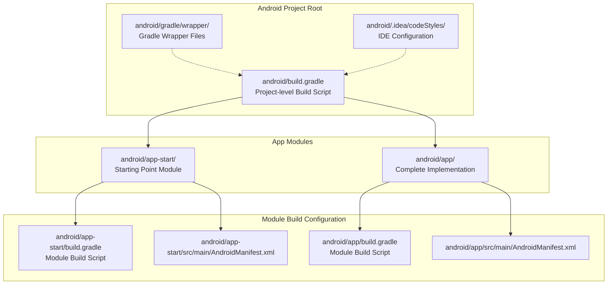
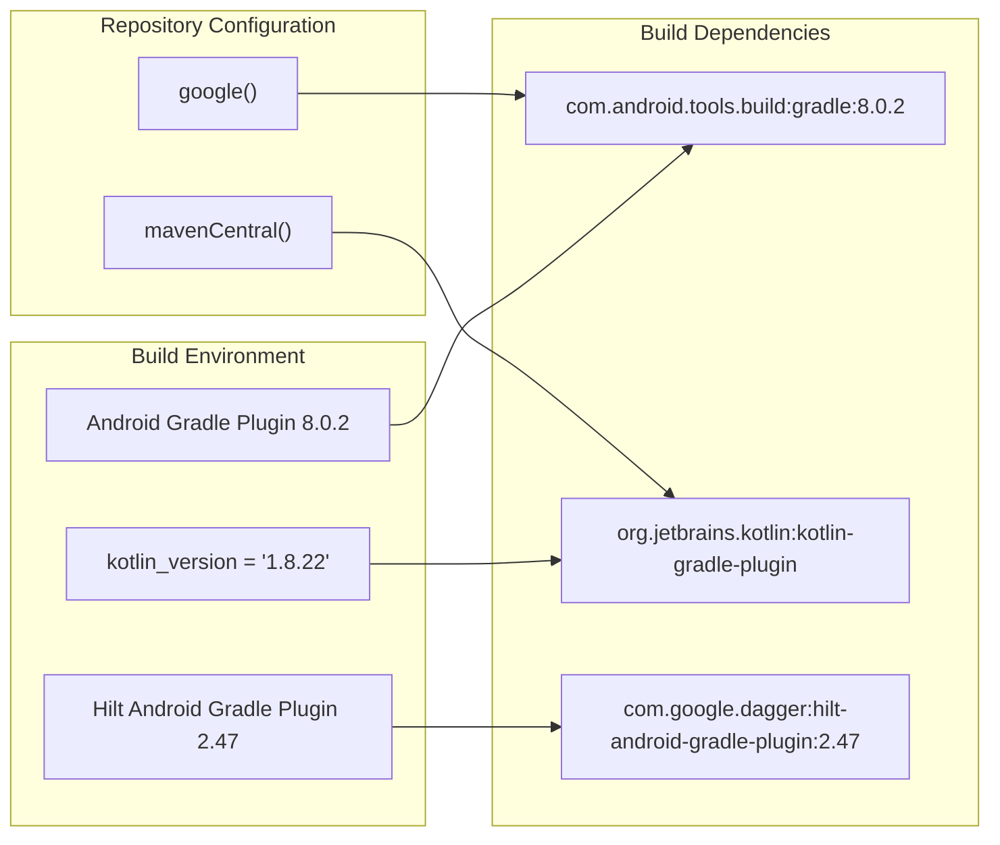
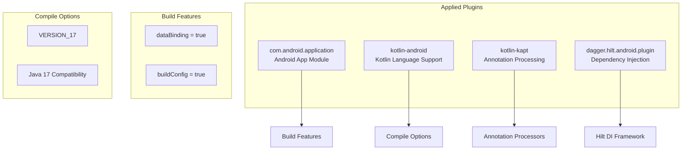
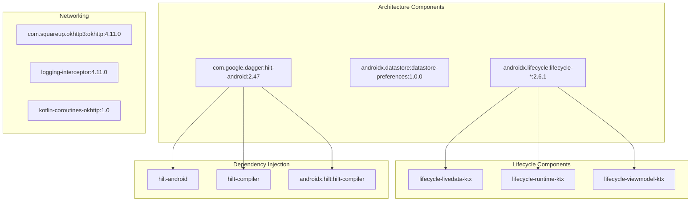
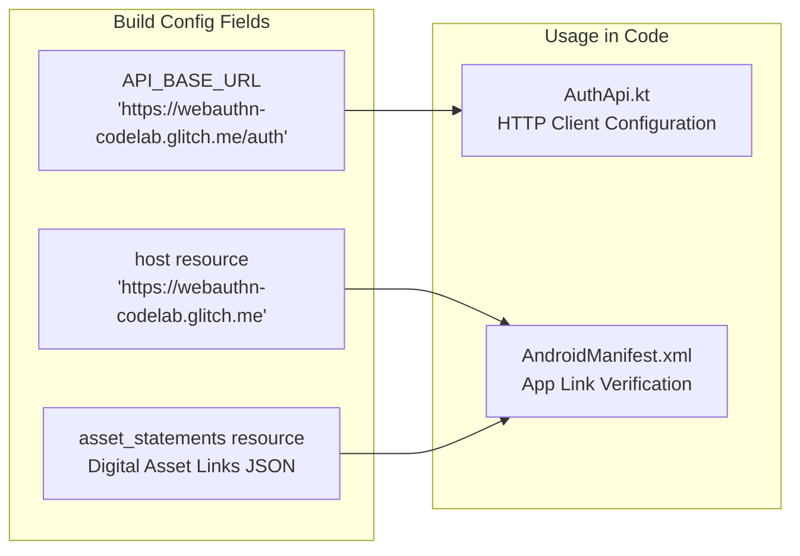
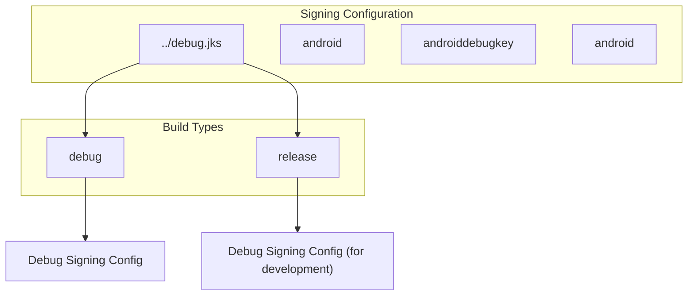
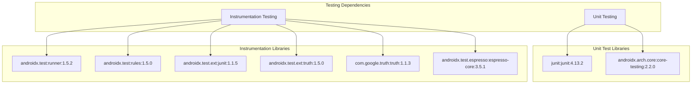

<!-- source: DeepWiki mcp.deepwiki.com · repo android/codelab-fido2 · page 5.2 Android Build Configuration · fetched 2026-10-23 -->

# Android Build Configuration

Relevant source files

The following files were used as context for generating this wiki page:

- [android/.idea/codeStyles/Project.xml](android/.idea/codeStyles/Project.xml)
- [android/app-start/build.gradle](android/app-start/build.gradle)
- [android/app-start/src/main/AndroidManifest.xml](android/app-start/src/main/AndroidManifest.xml)
- [android/app/build.gradle](android/app/build.gradle)
- [android/app/src/main/AndroidManifest.xml](android/app/src/main/AndroidManifest.xml)
- [android/build.gradle](android/build.gradle)
- [android/gradle/wrapper/gradle-wrapper.jar](android/gradle/wrapper/gradle-wrapper.jar)

This document covers the Android build system configuration for the FIDO2 codelab, including Gradle build scripts, dependencies, project structure, and development tooling setup. For information about the web application build configuration, see [Web Build Configuration](#5.1). For details about the Android application architecture and components, see [Android Application](#3).

## Purpose and Scope

The Android build configuration defines how the FIDO2 Android application is compiled, packaged, and configured for development and deployment. This includes Gradle build scripts, dependency management, Android-specific build features, signing configurations, and development environment settings.

## Project Structure Overview

The Android project follows a standard Gradle-based Android application structure with two main variants representing different stages of the codelab progression.

Sources: [android/build.gradle:1-40](), [android/app-start/build.gradle:1-115](), [android/app/build.gradle:1-115](), [android/app-start/src/main/AndroidManifest.xml:1-51](), [android/app/src/main/AndroidManifest.xml:1-51]()

## Gradle Build Configuration

### Project-Level Configuration

The project-level build script establishes the build environment and plugin versions for all modules in the project.

The project defines Kotlin version `1.8.22` and establishes repositories and classpath dependencies for the Android Gradle Plugin, Kotlin, and Hilt dependency injection framework.

Sources: [android/build.gradle:18-27]()

### Module-Level Configuration

Both app modules (`app-start` and `app`) share identical build configurations, representing the starting point and completed implementation of the codelab.

| Configuration | Value | Purpose |
|---------------|--------|---------|
| `namespace` | `com.example.android.fido2` | Application package namespace |
| `compileSdk` | `33` | Target compilation SDK version |
| `minSdk` | `21` | Minimum supported Android version |
| `targetSdk` | `33` | Target SDK for optimization |
| `versionCode` | `1` | Internal version number |
| `versionName` | `'1.0'` | User-visible version string |

Sources: [android/app/build.gradle:23-31](), [android/app-start/build.gradle:23-31]()

### Applied Plugins

The module applies several Gradle plugins to enable specific functionality:

Sources: [android/app/build.gradle:17-21](), [android/app-start/build.gradle:17-21]()

## Dependencies Configuration

The Android modules include comprehensive dependencies for FIDO2 authentication, modern Android development, and testing.

### Core Dependencies

| Category | Dependency | Version | Purpose |
|----------|------------|---------|---------|
| **FIDO2** | `com.google.android.gms:play-services-fido` | `20.0.1` | Google Play Services FIDO2 API |
| **Kotlin** | `org.jetbrains.kotlin:kotlin-stdlib` | `$kotlin_version` | Kotlin standard library |
| **Android Core** | `androidx.core:core-ktx` | `1.10.1` | Android KTX extensions |
| **UI** | `androidx.appcompat:appcompat` | `1.6.1` | Backward-compatible UI components |
| **Fragments** | `androidx.fragment:fragment-ktx` | `1.6.0` | Fragment KTX extensions |

Sources: [android/app/build.gradle:70-78](), [android/app-start/build.gradle:70-78]()

### Architecture Dependencies

Sources: [android/app/build.gradle:80-104](), [android/app-start/build.gradle:80-104]()

### Coroutines Configuration

The project uses Kotlin Coroutines for asynchronous programming with specific versions:

- `kotlinx-coroutines-android`: `1.7.1`
- `kotlinx-coroutines-core`: `1.7.1` 
- `kotlinx-coroutines-play-services`: `1.7.1`

This ensures compatibility between coroutines and Google Play Services APIs used for FIDO2 authentication.

Sources: [android/app/build.gradle:82-86](), [android/app-start/build.gradle:82-86]()

## Android-Specific Build Features

### Build Configuration Fields

The build configuration defines runtime constants accessible through `BuildConfig`:

The `API_BASE_URL` field configures the base URL for FIDO2 authentication endpoints, while resource values configure Digital Asset Links for app verification.

Sources: [android/app/build.gradle:33-40](), [android/app-start/build.gradle:33-40]()

### Signing Configuration

Both debug and release builds use the same debug signing configuration for development purposes:

Sources: [android/app/build.gradle:41-66](), [android/app-start/build.gradle:41-66]()

### Application Manifest Configuration

The Android manifest defines the application structure and permissions:

| Element | Value | Purpose |
|---------|--------|---------|
| **Package** | `com.example.android.fido2` | Application identifier |
| **Permission** | `android.permission.INTERNET` | Network access for FIDO2 API calls |
| **Application Class** | `.Fido2App` | Custom Application class with Hilt |
| **Main Activity** | `.ui.MainActivity` | Entry point activity |
| **Asset Statements** | `@string/asset_statements` | Digital Asset Links metadata |

Sources: [android/app/src/main/AndroidManifest.xml:20-50](), [android/app-start/src/main/AndroidManifest.xml:20-50]()

## Testing Configuration

The build includes comprehensive testing dependencies for unit and instrumentation testing:

Sources: [android/app/build.gradle:105-114](), [android/app-start/build.gradle:105-114]()

## Code Style Configuration

The project includes IntelliJ IDEA code style configuration to maintain consistent formatting across the development team.

### Kotlin Code Style

The configuration specifies `KOTLIN_OFFICIAL` as the default code style, ensuring consistency with Kotlin's official style guidelines.

### XML Formatting

XML files use specific formatting rules:
- Continuation indent: 4 spaces
- Attribute ordering by Android conventions
- Namespace declarations ordered logically

Sources: [android/.idea/codeStyles/Project.xml:9-129]()

## Summary

The Android build configuration establishes a modern Android development environment with:

- **Gradle 8.0.2** and **Kotlin 1.8.22** for the latest tooling
- **Hilt dependency injection** for clean architecture
- **FIDO2 Google Play Services** integration for biometric authentication
- **Modern Android Architecture Components** (Lifecycle, DataStore, etc.)
- **Comprehensive testing setup** with JUnit, Truth, and Espresso
- **Consistent code styling** through IDE configuration

This configuration supports the development of a secure, well-architected Android application demonstrating FIDO2 authentication patterns.