# Page: WebAuthn Codelab Overview

# WebAuthn Codelab Overview

<details>
<summary>Relevant source files</summary>

The following files were used as context for generating this wiki page:

- [libs/auth.js](libs/auth.js)
- [package.json](package.json)
- [public/client.js](public/client.js)
- [server.js](server.js)

</details>


## Purpose and Scope

This document provides an architectural overview of the WebAuthn Codelab, a comprehensive educational repository that demonstrates FIDO2/WebAuthn authentication across three platforms: web client, web server, and Android application. The codelab implements passwordless authentication using platform authenticators and cross-platform credential sharing.

For detailed implementation of specific components, see [Web Application](#2) for browser and server implementations, [Android Application](#3) for mobile client details, and [WebAuthn and FIDO2 Implementation](#4) for authentication protocol specifics.

## System Architecture

The WebAuthn Codelab consists of three interconnected systems that demonstrate modern passwordless authentication:

### Three-Platform Authentication System

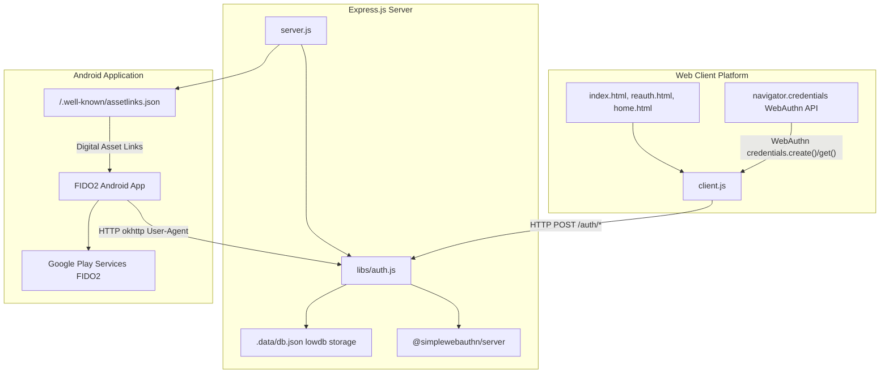

Sources: [server.js:1-128](), [libs/auth.js:1-483](), [public/client.js:1-162](), [package.json:1-45]()

### Core Authentication Flow

The system implements a complete WebAuthn authentication cycle with credential registration, authentication, and management:

#### Registration and Authentication Endpoints

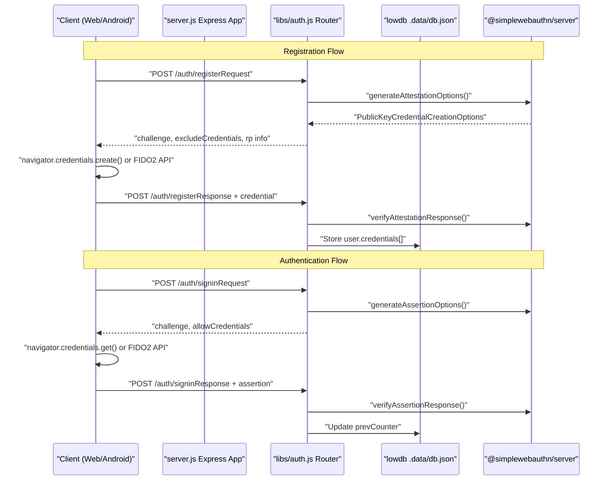

Sources: [libs/auth.js:186-291](), [libs/auth.js:308-361](), [libs/auth.js:377-422](), [libs/auth.js:439-480]()

## Platform-Specific Implementations

### Web Client Implementation

The web client uses standard WebAuthn APIs with base64url encoding utilities and HTTP communication:

| Component | File | Key Functions |
|-----------|------|---------------|
| WebAuthn Integration | `client.js` | `registerCredential()`, `authenticate()` |
| Base64URL Utilities | `client.js` | `base64url.encode()`, `base64url.decode()` |
| HTTP Communication | `client.js` | `_fetch()` utility |
| UI Templates | `views/*.html` | Login, reauth, credential management |

The client implementation handles WebAuthn credential creation and authentication through browser APIs:

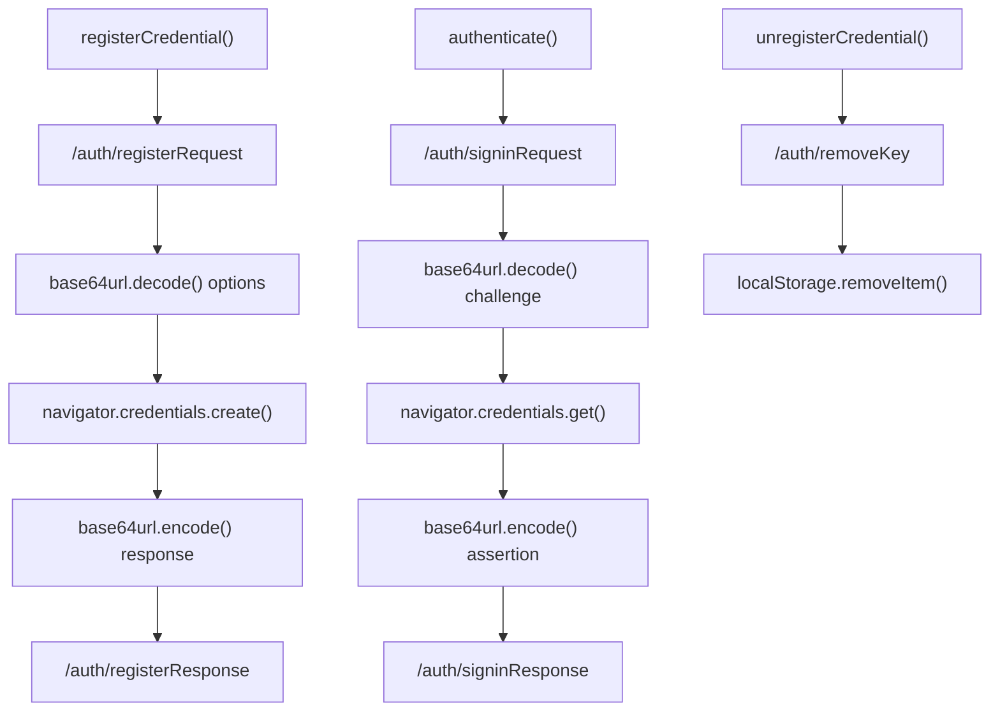

Sources: [public/client.js:62-105](), [public/client.js:107-156](), [public/client.js:158-161]()

### Server Architecture

The Express.js server provides WebAuthn endpoints, session management, and cross-platform origin handling:

| Component | Purpose | Implementation |
|-----------|---------|----------------|
| `server.js` | Main application, routing, session config | Express app with `express-session` |
| `libs/auth.js` | Authentication router and WebAuthn logic | SimpleWebAuthn integration |
| `lowdb` storage | User and credential persistence | JSON file database |
| Asset links | Android app verification | Digital Asset Links endpoint |

The server handles both web and Android clients through origin detection:

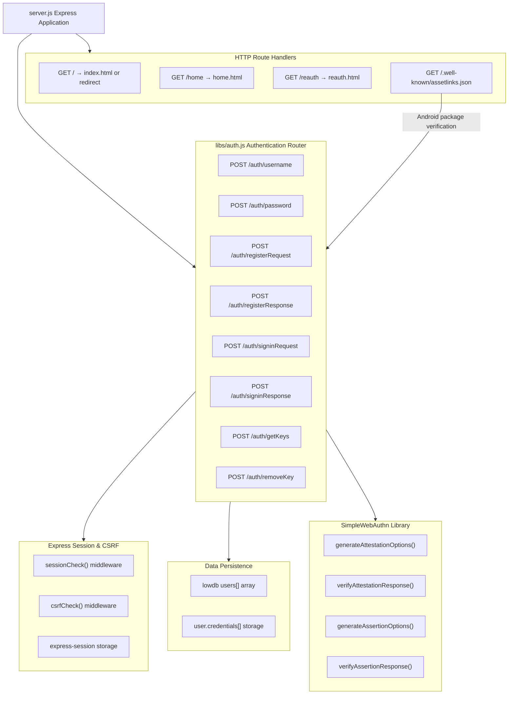

Sources: [server.js:18-128](), [libs/auth.js:17-48](), [libs/auth.js:266-277](), [libs/auth.js:406-415]()

## Cross-Platform Origin Handling

The server supports both web and Android clients through dynamic origin detection:

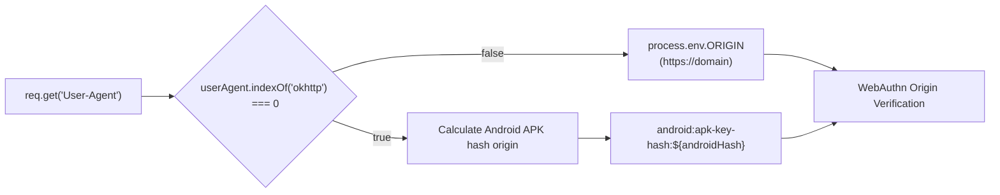

Sources: [libs/auth.js:62-74](), [server.js:95-119]()

## Database Schema and Storage

The codelab uses `lowdb` for simple JSON-based storage with the following structure:

| Entity | Schema | Purpose |
|--------|--------|---------|
| `users[]` | Array of user objects | Main user storage |
| `user.username` | String | User identifier |
| `user.id` | Base64URL string | WebAuthn user ID |
| `user.credentials[]` | Array of credential objects | Stored authenticators |
| `credential.credId` | Base64URL string | Credential identifier |
| `credential.publicKey` | Base64URL string | Public key for verification |
| `credential.prevCounter` | Integer | Signature counter |

Sources: [libs/auth.js:25-41](), [libs/auth.js:88-103](), [libs/auth.js:341-349]()

## Technology Stack

The codelab demonstrates WebAuthn across multiple technology stacks:

### Dependencies and Build System

| Platform | Core Dependencies | Purpose |
|----------|-------------------|---------|
| Web Server | `express`, `express-session`, `@simplewebauthn/server`, `lowdb` | HTTP server and WebAuthn |
| Web Client | `@material/mwc-*` components, `webpack`, `babel` | UI and build tooling |
| Android | Google Play Services FIDO2 API | Platform authentication |

Sources: [package.json:10-31]()

This codelab provides a complete educational foundation for implementing WebAuthn authentication across web and mobile platforms, with shared credential storage and cross-platform compatibility.

---

# Page: Web Application

# Web Application

<details>
<summary>Relevant source files</summary>

The following files were used as context for generating this wiki page:

- [libs/auth.js](libs/auth.js)
- [public/client.js](public/client.js)
- [server.js](server.js)

</details>


## Purpose and Scope

This document provides an overview of the web application components in the WebAuthn/FIDO2 codelab, covering both the browser-based client implementation and the Node.js server infrastructure. The web application demonstrates WebAuthn authentication flows through a complete full-stack implementation.

For detailed client-side implementation details, see [Client-Side Architecture](#2.1). For server-side implementation specifics, see [Server-Side Architecture](#2.2). For step-by-step authentication flows, see [Web Authentication Flow](#2.3).

## System Architecture

The web application consists of three main components: a browser client with WebAuthn integration, an Express.js server, and a JSON-based data persistence layer.

### Web Application Component Overview

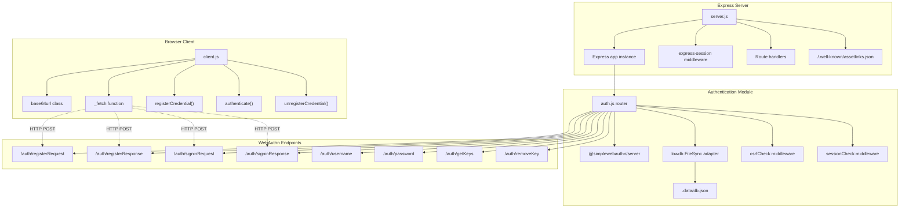

Sources: [public/client.js:1-162](), [server.js:1-128](), [libs/auth.js:1-483]()

### HTTP Route Structure

The server implements a clear separation between public routes and authentication-specific endpoints:

| Route Pattern | Handler Location | Purpose |
|---------------|------------------|---------|
| `/` | [server.js:62-71]() | Main entry point, redirects based on session state |
| `/home` | [server.js:73-81]() | Authenticated user dashboard |
| `/reauth` | [server.js:83-93]() | Re-authentication page for existing sessions |
| `/.well-known/assetlinks.json` | [server.js:95-119]() | Digital Asset Links for Android integration |
| `/auth/*` | [libs/auth.js:17-483]() | All WebAuthn authentication endpoints |

Sources: [server.js:62-119](), [libs/auth.js:17-18]()

## Client-Server Communication Flow

The web application implements a structured request/response pattern for WebAuthn operations, with specific data transformations at each step.

### WebAuthn Registration and Authentication Flow

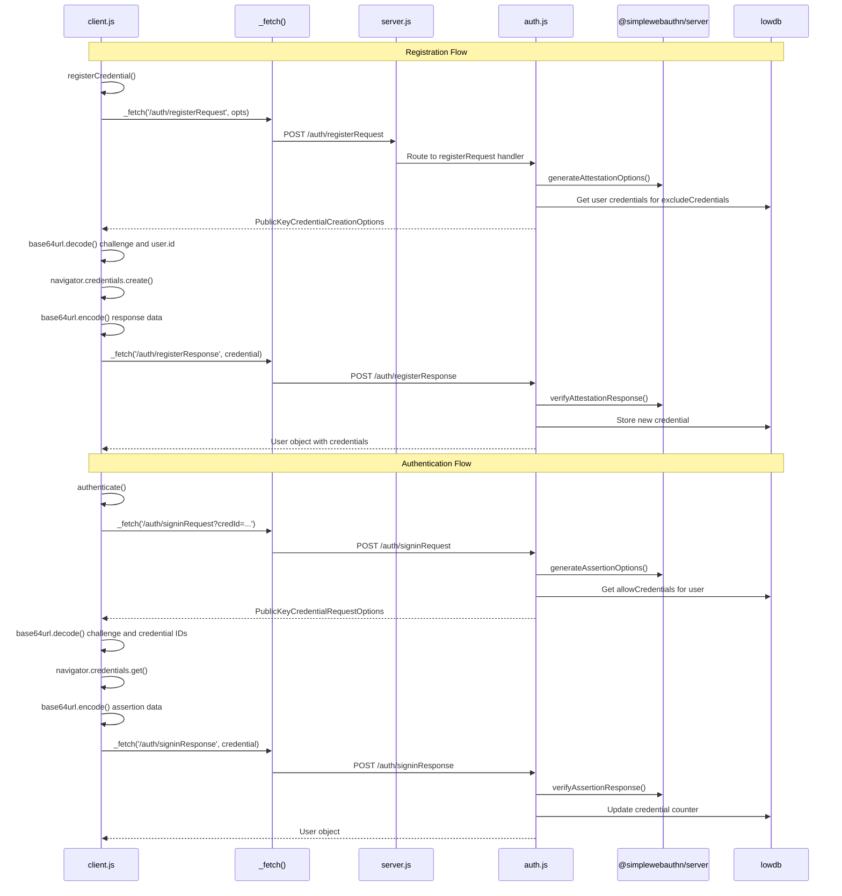

Sources: [public/client.js:62-156](), [libs/auth.js:218-480]()

## Data Management and Session Handling

The web application maintains both client-side and server-side state for WebAuthn operations.

### Session and Data Storage Architecture

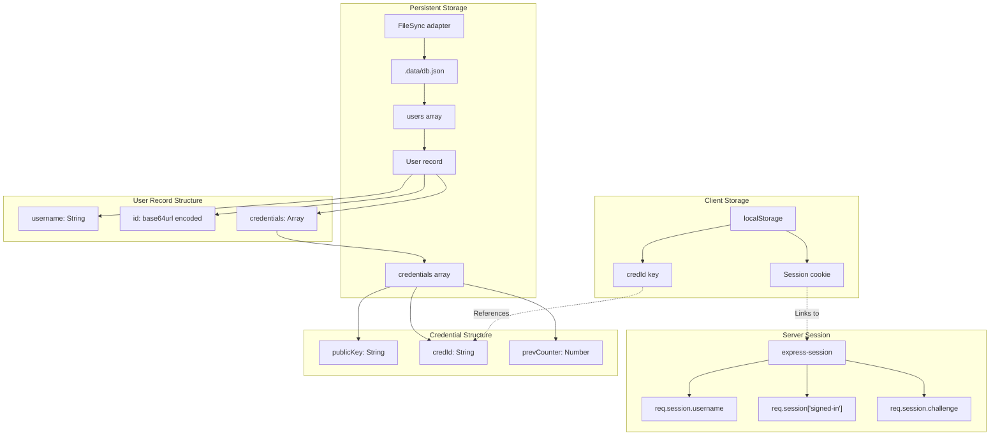

Sources: [public/client.js:102-103](), [server.js:31-41](), [libs/auth.js:25-41](), [libs/auth.js:344-348]()

## Security Implementation

The web application implements multiple layers of security controls for WebAuthn operations and general request handling.

### Security Middleware and Protection Mechanisms

| Security Control | Implementation | Location |
|------------------|----------------|----------|
| CSRF Protection | `X-Requested-With` header validation | [libs/auth.js:42-48]() |
| Session Validation | `sessionCheck` middleware | [libs/auth.js:54-60]() |
| Origin Validation | User-Agent based origin detection | [libs/auth.js:62-74]() |
| Secure Cookies | `httpOnly`, `secure`, `sameSite` flags | [server.js:36-40]() |
| HTTPS Enforcement | Redirect non-HTTPS requests | [server.js:51-56]() |

The `getOrigin()` function [libs/auth.js:62-74]() dynamically determines the expected origin based on the User-Agent, supporting both web browsers and Android applications through different origin formats.

Sources: [libs/auth.js:42-74](), [server.js:31-58]()

## Integration Points

The web application provides integration capabilities for Android applications through Digital Asset Links and supports cross-platform credential sharing.

### Android Integration Configuration

The server generates Dynamic Asset Links at `/.well-known/assetlinks.json` [server.js:95-119]() based on environment variables:

- `ANDROID_PACKAGENAME`: Android app package identifier
- `ANDROID_SHA256HASH`: App signing certificate fingerprint
- `ORIGIN`: Web application origin URL

This enables the Android application to authenticate against the same backend and share credentials with the web client through the common `lowdb` storage layer.

Sources: [server.js:95-119](), [libs/auth.js:64-69]()

---

# Page: Client-Side Architecture

# Client-Side Architecture

<details>
<summary>Relevant source files</summary>

The following files were used as context for generating this wiki page:

- [public/client.js](public/client.js)
- [views/home.html](views/home.html)
- [views/index.html](views/index.html)
- [views/reauth.html](views/reauth.html)

</details>


## Purpose and Scope

This document explains the browser-based client-side architecture for the WebAuthn codelab web application. It covers the JavaScript modules, HTML templates, WebAuthn API integration, and client-side data management that enable passwordless authentication in the browser.

For server-side authentication processing, see [Server-Side Architecture](#2.2). For Android client implementation, see [Android Application](#3).

## Architecture Overview

The client-side architecture consists of three main HTML pages that work together with a shared JavaScript module to provide WebAuthn functionality. Each page serves a specific purpose in the authentication flow.

### Client-Side Component Structure

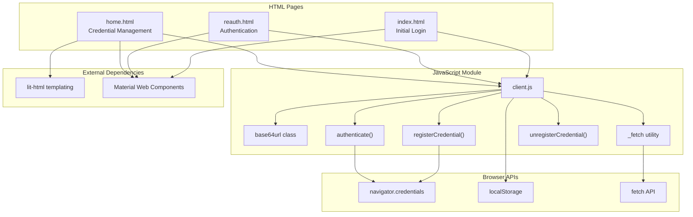

**Sources:** [public/client.js:1-162](), [views/index.html:1-67](), [views/reauth.html:1-118](), [views/home.html:1-112]()

## Core JavaScript Module

The `client.js` file serves as the central JavaScript module that provides WebAuthn functionality and utility functions shared across all HTML pages.

### Module Structure and Exports

| Export | Purpose | Usage |
|--------|---------|--------|
| `base64url` | Base64URL encoding/decoding utility class | WebAuthn data format conversion |
| `_fetch` | HTTP request utility function | Server communication |
| `registerCredential` | WebAuthn credential registration | New credential creation |
| `authenticate` | WebAuthn authentication | User verification |
| `unregisterCredential` | Credential removal | Credential management |

### Base64URL Utility Class

The `base64url` class handles the encoding and decoding requirements for WebAuthn data formats, which use Base64URL encoding instead of standard Base64.

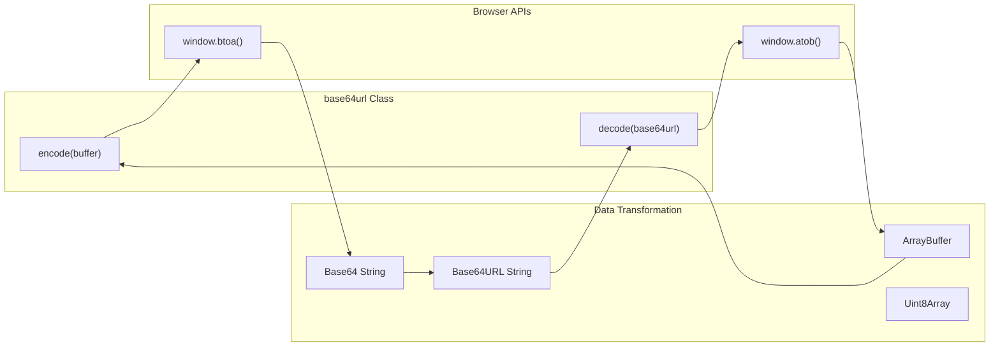

**Sources:** [public/client.js:21-36]()

### HTTP Communication Utility

The `_fetch` function provides a standardized way to communicate with the server, handling JSON serialization, CSRF protection, and error handling.

**Key features:**
- Sets `X-Requested-With` header for CSRF protection
- Handles both JSON and FormData payloads
- Includes credentials for session management
- Provides consistent error handling

**Sources:** [public/client.js:38-60]()

## HTML Pages and User Interface

Each HTML page serves a distinct role in the authentication workflow and incorporates Material Design components for consistent UI presentation.

### Page Responsibilities

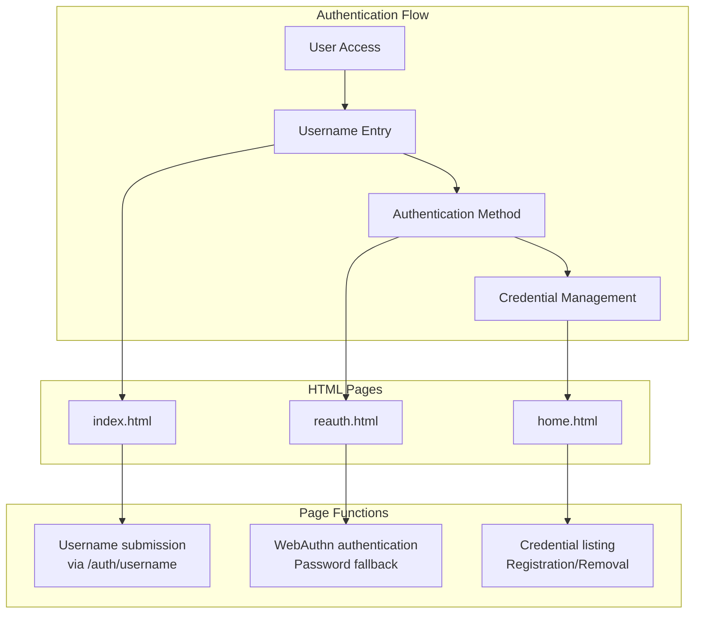

**Sources:** [views/index.html:37-45](), [views/reauth.html:34-58](), [views/home.html:47-52]()

### Material Design Integration

All pages use Material Web Components for consistent UI elements:

- **Top App Bar:** `mwc-top-app-bar-fixed` for page headers
- **Buttons:** `mwc-button` with various styles (raised, outlined)
- **Text Fields:** Material Design text input components
- **Cards:** `mdc-card` for credential display in home page

**Sources:** [views/index.html:30-44](), [views/reauth.html:30-56](), [views/home.html:33-52]()

## WebAuthn API Integration

The client-side WebAuthn integration handles the browser's native authentication APIs for both credential registration and authentication.

### Credential Registration Flow

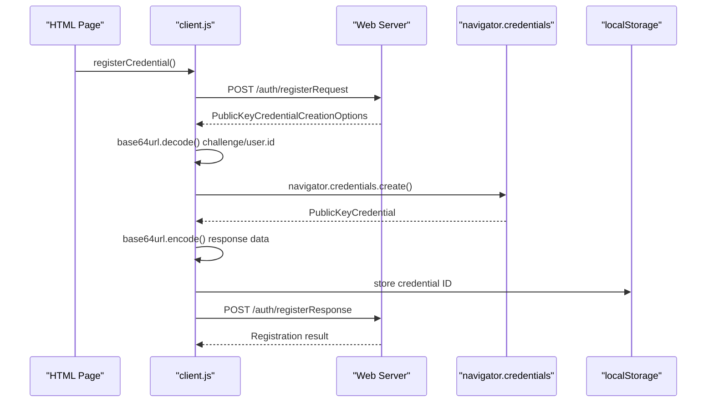

**Sources:** [public/client.js:62-105]()

### Authentication Flow

The authentication process retrieves existing credentials and performs user verification:

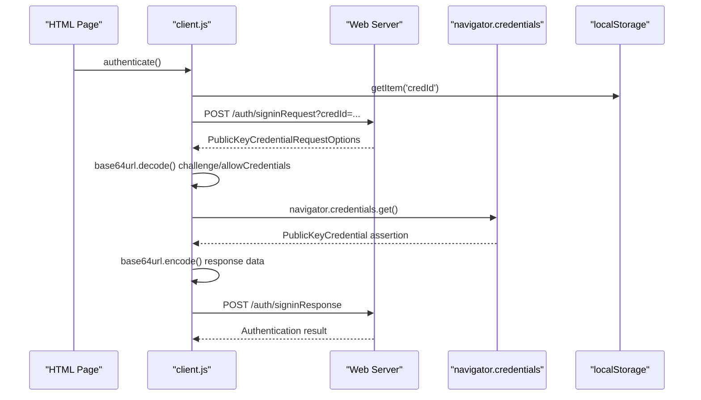

**Sources:** [public/client.js:107-156]()

### Platform Authenticator Detection

The client-side code checks for User Verifying Platform Authenticator (UVPA) availability before showing WebAuthn options:

```javascript
PublicKeyCredential.isUserVerifyingPlatformAuthenticatorAvailable()
```

This check is performed on both the reauth and home pages to conditionally display WebAuthn functionality.

**Sources:** [views/reauth.html:77-90](), [views/home.html:60-75]()

## Data Flow and State Management

### Local Storage Management

The client uses `localStorage` to maintain minimal state about registered credentials:

| Key | Value | Purpose |
|-----|-------|---------|
| `credId` | Credential ID string | Track user's primary credential |

**Storage operations:**
- **Set:** During credential registration [public/client.js:102]()
- **Get:** During authentication [public/client.js:111]()
- **Remove:** During credential removal [public/client.js:159]()

### Client-Server Data Exchange

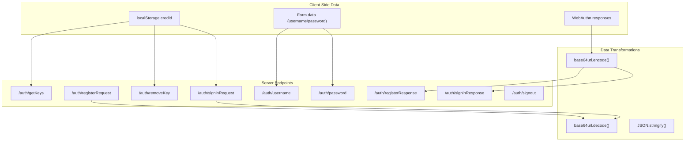

**Sources:** [public/client.js:38-161](), [views/index.html:49-62](), [views/reauth.html:63-115](), [views/home.html:77-108]()

### Dynamic UI Updates

The home page uses `lit-html` for dynamic credential list rendering, updating the UI based on server responses without full page reloads.

**Template rendering pattern:**
- Fetch credentials from server via `/auth/getKeys`
- Render credential list using `lit-html` templates
- Bind event handlers for credential removal

**Sources:** [views/home.html:55-102]()

---

# Page: Server-Side Architecture

# Server-Side Architecture

<details>
<summary>Relevant source files</summary>

The following files were used as context for generating this wiki page:

- [libs/auth.js](libs/auth.js)
- [package.json](package.json)
- [server.js](server.js)

</details>


This document covers the Express.js server implementation that handles WebAuthn authentication, user management, and serves the web client. The server provides REST endpoints for credential registration, authentication, and management while maintaining session state and integrating with the SimpleWebAuthn library.

For information about the client-side web components that interact with this server, see [Client-Side Architecture](#2.1). For details on the Android app's server communication, see [Android Application](#3).

## Core Server Components

The server architecture is built around Express.js with modular routing and middleware components. The main application bootstraps the web server and delegates authentication logic to a dedicated router module.

### Express Application Structure

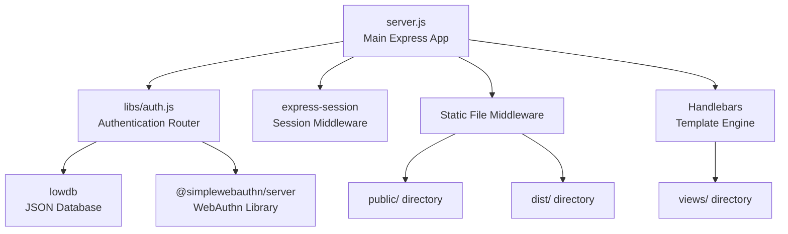

**Core Server Components**
Sources: [server.js:1-127](), [package.json:10-31]()

The main `server.js` file configures the Express application with essential middleware and routing. The application uses Handlebars for server-side templating, express-session for session management, and delegates all authentication logic to the `auth` router mounted at `/auth`.

### Authentication Router Architecture

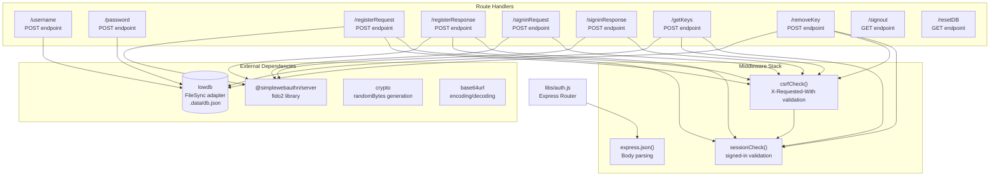

**Authentication Routing System**
Sources: [libs/auth.js:17-482]()

## Database and Session Management

The server uses LowDB for persistent user data storage and express-session for managing user sessions. The database schema and session handling provide the foundation for user account management and authentication state.

### Data Storage Schema

| Component | Technology | Purpose | Configuration |
|-----------|------------|---------|---------------|
| User Database | LowDB with FileSync | Persistent user and credential storage | `.data/db.json` |
| Session Store | express-session | HTTP session management | In-memory with secure cookies |
| Challenge Storage | Session-based | Temporary WebAuthn challenge storage | `req.session.challenge` |

**Database Structure and Session Management**
Sources: [libs/auth.js:23-40](), [server.js:31-41]()

The database initializes with a default structure containing a `users` array. Each user object contains a username, unique ID, and an array of registered credentials:

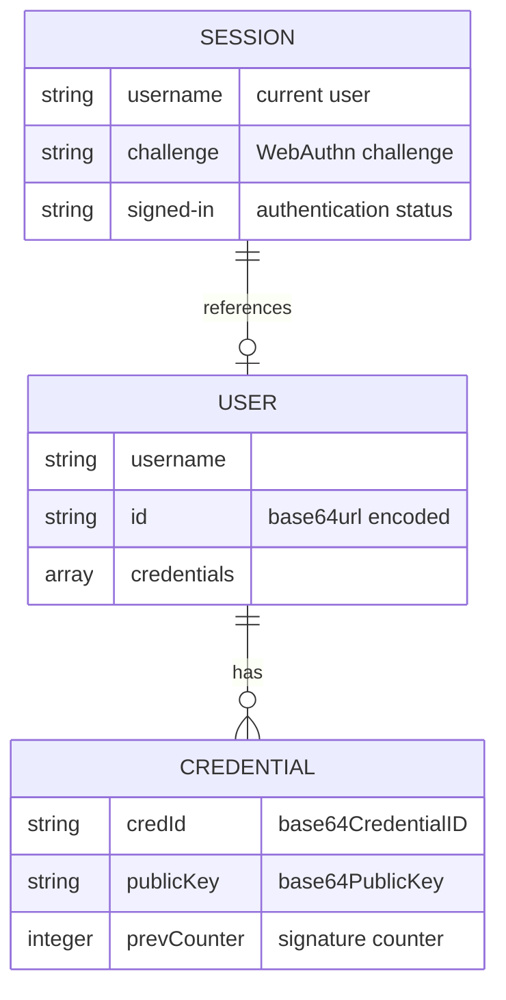

**User Data Model and Session Schema**
Sources: [libs/auth.js:88-96](), [libs/auth.js:344-348]()

## WebAuthn Integration

The server implements WebAuthn registration and authentication flows using the SimpleWebAuthn library. The integration handles challenge generation, credential verification, and response validation according to WebAuthn specifications.

### WebAuthn Endpoint Flow

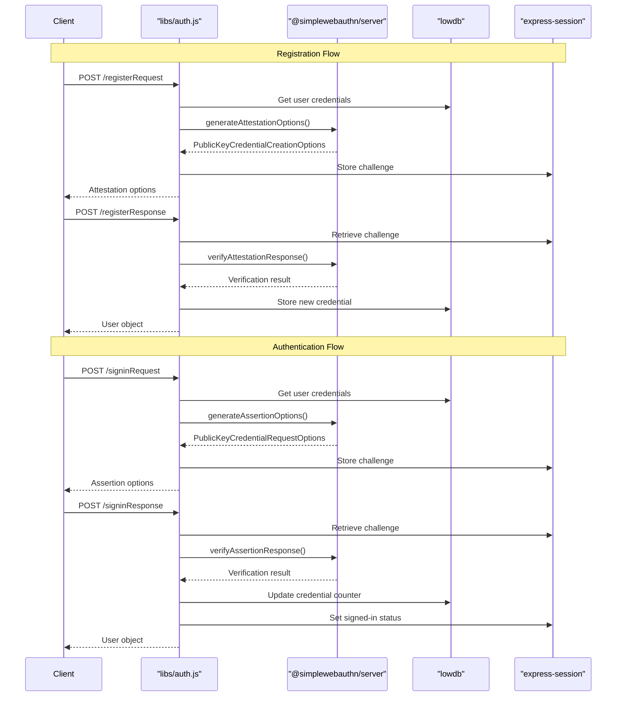

**WebAuthn Protocol Implementation**
Sources: [libs/auth.js:218-291](), [libs/auth.js:308-361](), [libs/auth.js:377-422](), [libs/auth.js:439-480]()

### WebAuthn Configuration Parameters

The server configures WebAuthn options based on environment variables and request parameters:

| Parameter | Source | Purpose |
|-----------|--------|---------|
| `RP_NAME` | Constant: 'WebAuthn Codelab' | Relying Party display name |
| `TIMEOUT` | Constant: 30 minutes | Challenge timeout duration |
| `expectedRPID` | `process.env.HOSTNAME` | Relying Party identifier |
| `expectedOrigin` | `getOrigin()` function | Origin validation (web/Android) |
| `pubKeyCredParams` | Hardcoded algorithms | Supported crypto algorithms (-7, -257) |

**WebAuthn Configuration and Parameters**
Sources: [libs/auth.js:35-36](), [libs/auth.js:62-74](), [libs/auth.js:266-277](), [libs/auth.js:406-415]()

## Security Mechanisms

The server implements multiple layers of security including CSRF protection, session validation, and origin verification. These mechanisms protect against common web vulnerabilities while ensuring WebAuthn protocol compliance.

### Security Middleware and Validation

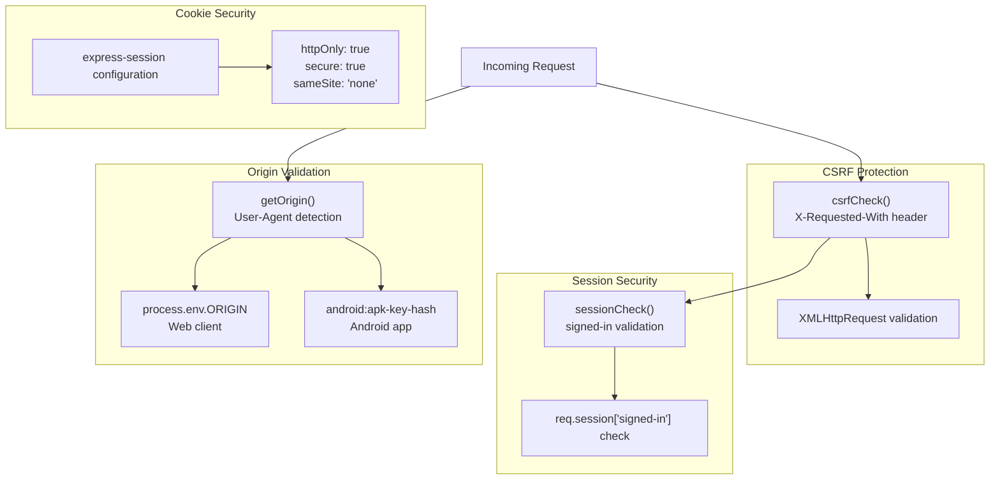

**Security Implementation Details**
Sources: [libs/auth.js:42-60](), [libs/auth.js:62-74](), [server.js:31-41]()

## Android Integration Support

The server provides specific support for Android FIDO2 clients through Digital Asset Links and origin validation. This enables seamless cross-platform credential sharing between web and Android applications.

### Digital Asset Links Configuration

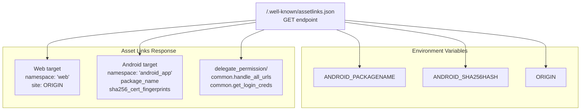

**Android Digital Asset Links Support**
Sources: [server.js:95-119](), [libs/auth.js:62-74]()

The server dynamically generates Digital Asset Links responses to establish trust relationships between the web domain and Android application. This enables Android apps to authenticate users using credentials registered on the web platform, supporting the cross-platform nature of WebAuthn.

---

# Page: Web Authentication Flow

# Web Authentication Flow

<details>
<summary>Relevant source files</summary>

The following files were used as context for generating this wiki page:

- [libs/auth.js](libs/auth.js)
- [public/client.js](public/client.js)
- [views/reauth.html](views/reauth.html)

</details>


## Purpose and Scope

This document describes the WebAuthn authentication flow implementation in the web application portion of the codelab. It covers the complete credential lifecycle from registration through authentication, including client-server interactions, data transformations, and session management. The flow demonstrates FIDO2/WebAuthn standards implementation using browser APIs and server-side verification.

For Android FIDO2 implementation details, see [Android FIDO2 Integration](#4.3). For server-side WebAuthn processing specifics, see [Server-Side WebAuthn Processing](#4.2).

## Authentication Flow Overview

The web authentication system implements a two-phase approach: credential registration followed by authentication. The flow supports both WebAuthn-based passwordless authentication and traditional password fallback.

### High-Level Authentication Sequence

```mermaid
sequenceDiagram
    participant "User" as user
    participant "Browser" as browser
    participant "client.js" as client
    participant "server.js" as server
    participant "auth.js" as auth
    participant "lowdb" as db

    user->>browser: "Navigate to application"
    browser->>server: "GET /"
    server-->>browser: "index.html"
    
    user->>browser: "Enter username"
    browser->>client: "Submit username"
    client->>auth: "POST /auth/username"
    auth->>db: "Find or create user"
    auth-->>client: "User object"
    
    alt "WebAuthn Available"
        client->>auth: "POST /auth/registerRequest"
        auth-->>client: "PublicKeyCredentialCreationOptions"
        client->>browser: "navigator.credentials.create()"
        browser-->>client: "PublicKeyCredential"
        client->>auth: "POST /auth/registerResponse"
        auth->>db: "Store credential"
        auth-->>client: "Success"
    else "Fallback to Password"
        client->>auth: "POST /auth/password"
        auth-->>client: "Success"
    end
    
    client->>browser: "Redirect to /home"
```

Sources: [public/client.js:62-105](), [libs/auth.js:80-103](), [libs/auth.js:218-291](), [libs/auth.js:308-361]()

## Registration Flow

### Client-Side Registration Process

The `registerCredential` function orchestrates the credential creation process, handling data encoding and server communication.

```mermaid
flowchart TD
    start["registerCredential() called"] --> options["Build attestation options"]
    options --> request["_fetch('/auth/registerRequest', opts)"]
    request --> decode["Decode base64url fields"]
    decode --> create["navigator.credentials.create()"]
    create --> encode["Encode response fields"]
    encode --> store["localStorage.setItem('credId')"]
    store --> submit["_fetch('/auth/registerResponse')"]
    submit --> end["Return user object"]
    
    decode --> decode1["options.user.id = base64url.decode()"]
    decode --> decode2["options.challenge = base64url.decode()"]
    decode --> decode3["excludeCredentials[].id = base64url.decode()"]
    
    encode --> encode1["credential.rawId = base64url.encode()"]
    encode --> encode2["credential.response.clientDataJSON = base64url.encode()"]
    encode --> encode3["credential.response.attestationObject = base64url.encode()"]
```

Sources: [public/client.js:62-105]()

### Server-Side Registration Handling

The server processes registration through two endpoints: `/auth/registerRequest` and `/auth/registerResponse`.

#### Registration Request (`/auth/registerRequest`)

```mermaid
flowchart TD
    request["POST /auth/registerRequest"] --> csrf["csrfCheck middleware"]
    csrf --> session["sessionCheck middleware"]
    session --> user["Get user from db.get('users')"]
    user --> exclude["Build excludeCredentials array"]
    exclude --> params["Build pubKeyCredParams"]
    params --> options["fido2.generateAttestationOptions()"]
    options --> challenge["Store challenge in req.session"]
    challenge --> response["Return attestation options"]
    
    exclude --> check["Check user.credentials.length > 0"]
    check --> loop["For each existing credential"]
    loop --> add["Add to excludeCredentials"]
    
    params --> algorithms["Support algorithms: [-7, -257]"]
```

Sources: [libs/auth.js:218-291]()

#### Registration Response (`/auth/registerResponse`)

```mermaid
flowchart TD
    request["POST /auth/registerResponse"] --> csrf["csrfCheck middleware"]
    csrf --> session["sessionCheck middleware"]
    session --> extract["Extract challenge and origin"]
    extract --> verify["fido2.verifyAttestationResponse()"]
    verify --> check["Check verification.verified"]
    check --> existing["Check for existing credential"]
    existing --> push["user.credentials.push()"]
    push --> write["db.get('users').assign(user).write()"]
    write --> cleanup["delete req.session.challenge"]
    cleanup --> response["Return user object"]
    
    extract --> challenge["expectedChallenge = req.session.challenge"]
    extract --> origin["expectedOrigin = getOrigin()"]
    extract --> rpid["expectedRPID = process.env.HOSTNAME"]
    
    verify --> info["Extract authenticatorInfo"]
    info --> pubkey["base64PublicKey"]
    info --> credid["base64CredentialID"] 
    info --> counter["counter"]
```

Sources: [libs/auth.js:308-361]()

## Authentication Flow

### Client-Side Authentication Process

The `authenticate` function handles credential-based sign-in, retrieving stored credential IDs and managing the authentication ceremony.

```mermaid
flowchart TD
    start["authenticate() called"] --> credid["Get credId from localStorage"]
    credid --> url["Build URL with credId parameter"]
    url --> request["_fetch('/auth/signinRequest')"]
    request --> check["Check allowCredentials.length"]
    check --> decode["Decode challenge and credential IDs"]
    decode --> get["navigator.credentials.get()"]
    get --> encode["Encode response fields"]
    encode --> submit["_fetch('/auth/signinResponse')"]
    submit --> end["Return user object"]
    
    check -->|"=== 0"| empty["Return Promise.resolve(null)"]
    
    decode --> decode1["options.challenge = base64url.decode()"]
    decode --> decode2["cred.id = base64url.decode()"]
    
    encode --> encode1["credential.rawId = base64url.encode()"]
    encode --> encode2["clientDataJSON = base64url.encode()"]
    encode --> encode3["authenticatorData = base64url.encode()"]
    encode --> encode4["signature = base64url.encode()"]
    encode --> encode5["userHandle = base64url.encode()"]
```

Sources: [public/client.js:107-156]()

### Server-Side Authentication Handling

Authentication processing involves generating assertion options and verifying the response.

#### Signin Request (`/auth/signinRequest`)

```mermaid
flowchart TD
    request["POST /auth/signinRequest"] --> csrf["csrfCheck middleware"]
    csrf --> user["Get user from db.get('users')"]
    user --> credid["Extract credId from query"]
    credid --> build["Build allowCredentials array"]
    build --> options["fido2.generateAssertionOptions()"]
    options --> challenge["Store challenge in req.session"]
    challenge --> response["Return assertion options"]
    
    user -->|"Not found"| error["Return error: 'User not found.'"]
    
    build --> match["Match credId with user.credentials"]
    match --> add["Add matching credential to allowCredentials"]
    
    options --> timeout["Set timeout: TIMEOUT"]
    options --> rpid["Set rpID: process.env.HOSTNAME"]
    options --> verification["Set userVerification"]
```

Sources: [libs/auth.js:377-422]()

#### Signin Response (`/auth/signinResponse`)

```mermaid
flowchart TD
    request["POST /auth/signinResponse"] --> csrf["csrfCheck middleware"]
    csrf --> extract["Extract expected values"]
    extract --> user["Get user from db.get('users')"]
    user --> find["Find credential by credId"]
    find --> verify["fido2.verifyAssertionResponse()"]
    verify --> check["Check verification.verified"]
    check --> update["Update credential.prevCounter"]
    update --> write["Write to database"]
    write --> signin["Set req.session['signed-in'] = 'yes'"]
    signin --> cleanup["delete req.session.challenge"]
    cleanup --> response["Return user object"]
    
    find -->|"Not found"| error["Throw 'Authenticating credential not found.'"]
    check -->|"false"| failed["Throw 'User verification failed.'"]
    
    extract --> challenge["expectedChallenge = req.session.challenge"]
    extract --> origin["expectedOrigin = getOrigin()"]
    extract --> rpid["expectedRPID = process.env.HOSTNAME"]
    
    verify --> counter["Extract authenticatorInfo.counter"]
```

Sources: [libs/auth.js:439-480]()

## Data Structures and Encoding

### Base64URL Encoding Utility

The client-side implementation includes a `base64url` class for proper WebAuthn data encoding.

| Method | Purpose | Implementation |
|--------|---------|----------------|
| `encode(buffer)` | Convert ArrayBuffer to base64url string | Uses `btoa()` with character replacements |
| `decode(base64url)` | Convert base64url string to ArrayBuffer | Uses `atob()` with character restoration |

Sources: [public/client.js:21-36]()

### Credential Data Flow

```mermaid
flowchart LR
    subgraph "Client Side"
        browser["Browser WebAuthn API"] --> raw["Raw ArrayBuffer Data"]
        raw --> encode["base64url.encode()"]
        encode --> json["JSON Payload"]
    end
    
    subgraph "Network"
        json --> http["HTTP POST"]
    end
    
    subgraph "Server Side"
        http --> body["req.body"]
        body --> verify["fido2.verifyAttestationResponse()"]
        verify --> info["authenticatorInfo"]
        info --> db["lowdb Storage"]
    end
    
    subgraph "Data Types"
        raw --> types1["clientDataJSON: ArrayBuffer"]
        raw --> types2["attestationObject: ArrayBuffer"]
        raw --> types3["signature: ArrayBuffer"]
        encode --> json1["clientDataJSON: String"]
        encode --> json2["attestationObject: String"]
        encode --> json3["signature: String"]
    end
```

Sources: [public/client.js:21-36](), [public/client.js:86-104](), [libs/auth.js:316-325]()

## Session Management and CSRF Protection

### Session State Management

The authentication system maintains session state across the registration and authentication flows.

| Session Key | Purpose | Set During | Cleared During |
|-------------|---------|------------|----------------|
| `username` | User identification | `/auth/username` | `/auth/signout` |
| `signed-in` | Authentication status | `/auth/password`, `/auth/signinResponse` | `/auth/signout` |
| `challenge` | WebAuthn challenge storage | `/auth/registerRequest`, `/auth/signinRequest` | After verification |

Sources: [libs/auth.js:99](), [libs/auth.js:122](), [libs/auth.js:279](), [libs/auth.js:416](), [libs/auth.js:474]()

### CSRF Protection

```mermaid
flowchart TD
    request["Incoming Request"] --> header["Check X-Requested-With header"]
    header -->|"!== 'XMLHttpRequest'"| reject["Status 400: 'invalid access.'"]
    header -->|"=== 'XMLHttpRequest'"| continue["Continue to next middleware"]
    
    continue --> session["sessionCheck (if required)"]
    session -->|"No req.session['signed-in']"| unauthorized["Status 401: 'not signed in.'"]
    session -->|"Has req.session['signed-in']"| proceed["Proceed to route handler"]
```

Sources: [libs/auth.js:42-48](), [libs/auth.js:54-60]()

## Error Handling and Fallback Authentication

### WebAuthn Availability Detection

The reauthentication page implements progressive enhancement with WebAuthn detection and password fallback.

```mermaid
flowchart TD
    load["Page Load"] --> check["Check window.PublicKeyCredential"]
    check -->|"Available"| uvpaa["PublicKeyCredential.isUserVerifyingPlatformAuthenticatorAvailable()"]
    check -->|"Not Available"| password["Show password form"]
    
    uvpaa -->|"true + credId exists"| webauthn["Show WebAuthn authentication"]
    uvpaa -->|"false"| password
    
    webauthn --> auth["User clicks 'Authenticate'"]
    auth --> attempt["Call authenticate()"]
    attempt -->|"Success"| redirect["Redirect to /home"]
    attempt -->|"Failure"| fallback["Show password form"]
    
    webauthn --> cancel["User clicks 'Sign-in with password'"]
    cancel --> password
```

Sources: [views/reauth.html:77-90](), [views/reauth.html:92-114]()

### Error Response Handling

Both client and server implement comprehensive error handling for authentication failures.

| Error Source | Error Type | Client Handling | Server Response |
|--------------|------------|-----------------|-----------------|
| Missing credential | Authentication | Promise resolve(null) | Empty allowCredentials array |
| Verification failure | Server validation | Alert and fallback | Status 400 with error message |
| Network issues | HTTP request | Catch and alert | Standard HTTP error codes |
| Session issues | State management | Redirect to login | Status 401 unauthorized |

Sources: [public/client.js:118-121](), [libs/auth.js:328-330](), [libs/auth.js:465-467](), [views/reauth.html:108-113]()

---

# Page: Android Application

# Android Application

<details>
<summary>Relevant source files</summary>

The following files were used as context for generating this wiki page:

- [android/app-start/build.gradle](android/app-start/build.gradle)
- [android/app-start/src/main/java/com/example/android/fido2/Fido2App.kt](android/app-start/src/main/java/com/example/android/fido2/Fido2App.kt)
- [android/app/build.gradle](android/app/build.gradle)
- [android/app/src/main/java/com/example/android/fido2/Fido2App.kt](android/app/src/main/java/com/example/android/fido2/Fido2App.kt)

</details>


The Android application demonstrates FIDO2 authentication using Google Play Services, providing a native mobile implementation that works alongside the web-based components of the WebAuthn codelab. This application showcases how to integrate passwordless authentication into Android apps using modern Android development patterns including Hilt dependency injection, Kotlin coroutines, and MVVM architecture.

For information about the web-based authentication flow, see [Web Application](#2). For details about the underlying WebAuthn implementation, see [WebAuthn and FIDO2 Implementation](#4).

## Application Overview

The Android application is built as a modern Android app using Kotlin and follows the recommended Android architecture patterns. It communicates with the same web server used by the web client, demonstrating cross-platform credential sharing in WebAuthn/FIDO2 implementations.

```mermaid
graph TB
    subgraph "Android Application Architecture"
        Fido2App["Fido2App<br/>(Application Class)"]
        AppModule["AppModule<br/>(Hilt DI Configuration)"]
        
        subgraph "Dependency Injection"
            OkHttpClient["OkHttpClient<br/>(Network Layer)"]
            DataStore["DataStore&lt;Preferences&gt;<br/>(Local Storage)"]
            CoroutineScope["CoroutineScope<br/>(Async Operations)"]
        end
        
        subgraph "Core Components"
            AuthRepository["AuthRepository<br/>(Data Management)"]
            AuthApi["AuthApi<br/>(Network Interface)"]
            Fragments["UI Fragments<br/>(User Interface)"]
            ViewModels["ViewModels<br/>(UI Logic)"]
        end
        
        subgraph "External Integration"
            PlayServicesFido["Google Play Services<br/>FIDO2 API"]
            WebAuthnServer["WebAuthn Server<br/>(webauthn-codelab.glitch.me)"]
        end
    end
    
    Fido2App --> AppModule
    AppModule --> OkHttpClient
    AppModule --> DataStore
    AppModule --> CoroutineScope
    
    OkHttpClient --> AuthApi
    DataStore --> AuthRepository
    AuthApi --> AuthRepository
    AuthRepository --> ViewModels
    ViewModels --> Fragments
    
    AuthRepository --> PlayServicesFido
    AuthApi --> WebAuthnServer
```

**Sources:** [android/app/src/main/java/com/example/android/fido2/Fido2App.kt:1-69](), [android/app/build.gradle:1-115]()

## Application Configuration

The Android application is configured with specific settings that enable FIDO2 authentication and integration with the web server.

### Build Configuration

| Configuration | Value | Purpose |
|---------------|--------|---------|
| `applicationId` | `com.example.android.fido2` | Unique app identifier |
| `compileSdk` | 33 | Target Android API level |
| `minSdk` | 21 | Minimum supported Android version |
| `API_BASE_URL` | `https://webauthn-codelab.glitch.me/auth` | Server endpoint for authentication |

### Digital Asset Links Integration

The application includes configuration for Digital Asset Links, which enables app-to-website association for WebAuthn:

```mermaid
graph LR
    AndroidApp["Android App<br/>(com.example.android.fido2)"]
    AssetLinks["/.well-known/assetlinks.json<br/>(Digital Asset Links)"]
    WebServer["Web Server<br/>(webauthn-codelab.glitch.me)"]
    
    AndroidApp -->|"Declares association"| AssetLinks
    AssetLinks -->|"Hosted on"| WebServer
    WebServer -->|"Validates app identity"| AndroidApp
```

**Sources:** [android/app/build.gradle:33-39]()

## Dependency Injection Setup

The application uses Hilt for dependency injection, with the main configuration in `AppModule`. The `Fido2App` class serves as the application entry point and enables Hilt integration.

### Core Dependencies

The `AppModule` provides three key singleton dependencies:

| Dependency | Type | Purpose |
|------------|------|---------|
| `OkHttpClient` | Network Client | HTTP communication with authentication server |
| `CoroutineScope` | Concurrency | Managing asynchronous operations |
| `DataStore<Preferences>` | Local Storage | Persisting authentication state and credentials |

### OkHttpClient Configuration

The HTTP client is configured with custom headers and timeouts for reliable communication:

```mermaid
graph TB
    OkHttpClient["OkHttpClient"]
    
    subgraph "Configuration"
        AddHeaderInterceptor["AddHeaderInterceptor<br/>(User-Agent Header)"]
        Timeouts["Timeout Configuration<br/>(Read: 30s, Write: 40s, Connect: 40s)"]
        UserAgent["User Agent String<br/>(App ID + Version + Device Info)"]
    end
    
    OkHttpClient --> AddHeaderInterceptor
    OkHttpClient --> Timeouts
    AddHeaderInterceptor --> UserAgent
```

**Sources:** [android/app/src/main/java/com/example/android/fido2/Fido2App.kt:44-55]()

## Key Dependencies and Libraries

The Android application leverages several important libraries to implement FIDO2 authentication:

### FIDO2 and Authentication
- `com.google.android.gms:play-services-fido:20.0.1` - Google Play Services FIDO2 API
- `androidx.datastore:datastore-preferences:1.0.0` - Local data persistence

### Networking and Async Operations
- `com.squareup.okhttp3:okhttp:4.11.0` - HTTP client library
- `org.jetbrains.kotlinx:kotlinx-coroutines-android:1.7.1` - Kotlin coroutines for Android
- `ru.gildor.coroutines:kotlin-coroutines-okhttp:1.0` - Coroutines integration with OkHttp

### Dependency Injection
- `com.google.dagger:hilt-android:2.47` - Hilt dependency injection framework

### Android Architecture Components
- `androidx.lifecycle:lifecycle-viewmodel-ktx:2.6.1` - ViewModel for UI logic
- `androidx.lifecycle:lifecycle-livedata-ktx:2.6.1` - LiveData for reactive UI updates
- `androidx.fragment:fragment-ktx:1.6.0` - Modern fragment APIs

**Sources:** [android/app/build.gradle:69-114]()

## Integration with Web Server

The Android application integrates with the same web server used by the web client, enabling cross-platform credential management. The server endpoint configuration demonstrates how the Android app connects to the WebAuthn service.

```mermaid
sequenceDiagram
    participant AndroidApp as "Android App"
    participant AuthApi as "AuthApi"
    participant WebServer as "WebAuthn Server"
    participant PlayServices as "Play Services FIDO2"
    
    AndroidApp->>AuthApi: "Initialize authentication"
    AuthApi->>WebServer: "POST /auth/signinRequest"
    WebServer-->>AuthApi: "PublicKeyCredentialRequestOptions"
    AuthApi-->>AndroidApp: "FIDO2 challenge data"
    AndroidApp->>PlayServices: "Begin FIDO2 authentication"
    PlayServices-->>AndroidApp: "Authentication result"
    AndroidApp->>AuthApi: "Submit authentication response"
    AuthApi->>WebServer: "POST /auth/signinResponse"
    WebServer-->>AuthApi: "Authentication success"
```

The `API_BASE_URL` build configuration field points to `https://webauthn-codelab.glitch.me/auth`, establishing the connection between the Android client and the shared authentication server.

**Sources:** [android/app/build.gradle:33-34]()

---

# Page: Application Structure and Configuration

# Application Structure and Configuration

<details>
<summary>Relevant source files</summary>

The following files were used as context for generating this wiki page:

- [android/.idea/compiler.xml](android/.idea/compiler.xml)
- [android/.idea/gradle.xml](android/.idea/gradle.xml)
- [android/app-start/build.gradle](android/app-start/build.gradle)
- [android/app-start/src/main/java/com/example/android/fido2/Fido2App.kt](android/app-start/src/main/java/com/example/android/fido2/Fido2App.kt)
- [android/app/build.gradle](android/app/build.gradle)
- [android/app/src/main/java/com/example/android/fido2/Fido2App.kt](android/app/src/main/java/com/example/android/fido2/Fido2App.kt)

</details>


This document covers the Android application's project structure, build configuration, dependency injection setup, and main application components. The Android app demonstrates FIDO2 authentication using Google Play Services and follows modern Android development practices with Hilt dependency injection and coroutines.

For detailed information about the authentication logic and API integration, see [Authentication Components](#3.2). For UI implementation details, see [User Interface Components](#3.3).

## Project Structure

The Android portion of the codelab consists of two modules that demonstrate a progressive learning approach:

```mermaid
graph TB
    subgraph "Android Project"
        Root["android/"]
        AppStart["app-start/"]
        App["app/"]
        
        Root --> AppStart
        Root --> App
        
        subgraph "app-start Module"
            StartBuild["build.gradle"]
            StartSrc["src/main/java/com/example/android/fido2/"]
            StartApp["Fido2App.kt"]
        end
        
        subgraph "app Module"
            FinalBuild["build.gradle"]
            FinalSrc["src/main/java/com/example/android/fido2/"]
            FinalApp["Fido2App.kt"]
        end
        
        AppStart --> StartBuild
        AppStart --> StartSrc
        StartSrc --> StartApp
        
        App --> FinalBuild
        App --> FinalSrc
        FinalSrc --> FinalApp
    end
```

**Module Breakdown**:
- **app-start**: Starting point for the codelab with basic configuration
- **app**: Complete implementation with full FIDO2 functionality

Sources: [android/.idea/gradle.xml:9-14]()

## Build Configuration

The application uses standard Android Gradle configuration with specific settings for FIDO2 integration:

### Core Build Settings

| Configuration | Value |
|---------------|-------|
| Application ID | `com.example.android.fido2` |
| Namespace | `com.example.android.fido2` |
| Minimum SDK | 21 |
| Target SDK | 33 |
| Compile SDK | 33 |
| Java Version | 17 |

### Build Features and Signing

The build configuration enables several key features:

```mermaid
graph LR
    subgraph "Build Features"
        DataBinding["dataBinding: true"]
        BuildConfig["buildConfig: true"]
        VectorDrawables["vectorDrawables.useSupportLibrary"]
    end
    
    subgraph "Signing Configuration"
        DebugKeystore["debug.jks"]
        StorePassword["android"]
        KeyAlias["androiddebugkey"]
    end
    
    subgraph "Build Types"
        Debug["debug"]
        Release["release"]
    end
    
    Debug --> DebugKeystore
    Release --> DebugKeystore
```

Sources: [android/app/build.gradle:22-66](), [android/app-start/build.gradle:22-66]()

### WebAuthn Service Configuration

The build configuration includes specific values for connecting to the WebAuthn service:

```mermaid
graph TB
    subgraph "Configuration Values"
        ApiBaseUrl["API_BASE_URL"]
        Host["host"]
        AssetStatements["asset_statements"]
    end
    
    subgraph "WebAuthn Service"
        GlitchUrl["https://webauthn-codelab.glitch.me"]
        AuthEndpoint["/auth"]
        AssetLinks["/.well-known/assetlinks.json"]
    end
    
    ApiBaseUrl --> GlitchUrl
    ApiBaseUrl --> AuthEndpoint
    Host --> GlitchUrl
    AssetStatements --> AssetLinks
```

Sources: [android/app/build.gradle:33-39](), [android/app-start/build.gradle:33-39]()

## Application Architecture

### Main Application Class

The `Fido2App` class serves as the application entry point and is configured for Hilt dependency injection:

```mermaid
graph TB
    subgraph "Application Layer"
        Fido2App["@HiltAndroidApp<br/>Fido2App : Application"]
    end
    
    subgraph "Dependency Injection"
        AppModule["@Module<br/>AppModule"]
        SingletonComponent["@InstallIn(SingletonComponent::class)"]
    end
    
    subgraph "Provided Dependencies"
        OkHttpClient["OkHttpClient"]
        CoroutineScope["CoroutineScope"]
        DataStore["DataStore<Preferences>"]
    end
    
    Fido2App --> AppModule
    AppModule --> SingletonComponent
    AppModule --> OkHttpClient
    AppModule --> CoroutineScope
    AppModule --> DataStore
```

Sources: [android/app/src/main/java/com/example/android/fido2/Fido2App.kt:37-38](), [android/app-start/src/main/java/com/example/android/fido2/Fido2App.kt:37-38]()

### Dependency Injection Configuration

The `AppModule` provides three singleton dependencies:

**OkHttpClient Configuration**:
- Custom User-Agent header with app version and device information
- Timeout configurations: 30s read, 40s write/connect
- Custom interceptor for adding headers

**CoroutineScope**:
- Application-level scope with `SupervisorJob`
- Used for background operations throughout the app

**DataStore**:
- Preferences-based data storage named "auth"
- Used for persisting authentication state and user preferences

Sources: [android/app/src/main/java/com/example/android/fido2/Fido2App.kt:42-68](), [android/app-start/src/main/java/com/example/android/fido2/Fido2App.kt:42-68]()

## Key Dependencies

The application relies on several major dependency categories:

### FIDO2 and Authentication
| Dependency | Version | Purpose |
|------------|---------|---------|
| `com.google.android.gms:play-services-fido` | 20.0.1 | Google Play Services FIDO2 API |

### Android Architecture Components
| Dependency | Version | Purpose |
|------------|---------|---------|
| `androidx.fragment:fragment-ktx` | 1.6.0 | Fragment extensions |
| `androidx.lifecycle:lifecycle-*` | 2.6.1 | ViewModel, LiveData, Runtime |
| `androidx.datastore:datastore-preferences` | 1.0.0 | Data persistence |

### Dependency Injection and Coroutines
| Dependency | Version | Purpose |
|------------|---------|---------|
| `com.google.dagger:hilt-android` | 2.47 | Dependency injection |
| `org.jetbrains.kotlinx:kotlinx-coroutines-*` | 1.7.1 | Asynchronous programming |

### Networking
| Dependency | Version | Purpose |
|------------|---------|---------|
| `com.squareup.okhttp3:okhttp` | 4.11.0 | HTTP client |
| `com.squareup.okhttp3:logging-interceptor` | 4.11.0 | Request/response logging |

Sources: [android/app/build.gradle:69-114](), [android/app-start/build.gradle:69-114]()

## Configuration Values and Digital Asset Links

The application includes specific configuration for WebAuthn integration:

### Build Configuration Fields

```mermaid
graph LR
    subgraph "Build Config"
        ApiBaseUrl["API_BASE_URL"]
        Host["host"]
        AssetStatements["asset_statements"]
    end
    
    subgraph "Runtime Values"
        BuildConfigApiBaseUrl["BuildConfig.API_BASE_URL"]
        ResourceHost["R.string.host"]
        ResourceAssetStatements["R.string.asset_statements"]
    end
    
    ApiBaseUrl --> BuildConfigApiBaseUrl
    Host --> ResourceHost
    AssetStatements --> ResourceAssetStatements
```

### Digital Asset Links Integration

The `asset_statements` resource value configures the app for Digital Asset Links verification, enabling the app to be associated with the WebAuthn service domain. This is crucial for FIDO2 authentication to work properly between the Android app and the web service.

Sources: [android/app/build.gradle:33-39](), [android/app-start/build.gradle:33-39]()

---

# Page: Authentication Components

# Authentication Components

<details>
<summary>Relevant source files</summary>

The following files were used as context for generating this wiki page:

- [android/app-start/src/main/java/com/example/android/fido2/repository/AuthRepository.kt](android/app-start/src/main/java/com/example/android/fido2/repository/AuthRepository.kt)
- [android/app/src/main/java/com/example/android/fido2/api/AuthApi.kt](android/app/src/main/java/com/example/android/fido2/api/AuthApi.kt)
- [android/app/src/main/java/com/example/android/fido2/repository/AuthRepository.kt](android/app/src/main/java/com/example/android/fido2/repository/AuthRepository.kt)

</details>


This document covers the core authentication logic components of the Android FIDO2 application, specifically the `AuthApi` and `AuthRepository` classes that handle server communication, local data persistence, and FIDO2 operations integration. For user interface components that interact with these authentication services, see [User Interface Components](#3.3).

## Overview

The authentication system in the Android application consists of two primary components that work together to implement FIDO2 authentication:

- **AuthApi**: HTTP client responsible for server communication and WebAuthn protocol handling
- **AuthRepository**: Central coordinator that manages authentication state, local data persistence, and FIDO2 API integration

## AuthApi - Server Communication Layer

The `AuthApi` class serves as the HTTP client layer, handling all server communication for the FIDO2 authentication flow. It encapsulates the WebAuthn protocol implementation and provides a clean interface for authentication operations.

```mermaid
graph TB
    AuthApi["AuthApi"]
    OkHttpClient["OkHttpClient"]
    ServerEndpoints["Server Endpoints"]
    JsonParsing["JSON Parsing"]
    Base64Utils["Base64 Encoding/Decoding"]
    
    AuthApi --> OkHttpClient
    AuthApi --> JsonParsing
    AuthApi --> Base64Utils
    
    subgraph "API Methods"
        Username["username()"]
        Password["password()"]
        GetKeys["getKeys()"]
        RegisterReq["registerRequest()"]
        RegisterRes["registerResponse()"]
        SigninReq["signinRequest()"]
        SigninRes["signinResponse()"]
        RemoveKey["removeKey()"]
    end
    
    AuthApi --> Username
    AuthApi --> Password
    AuthApi --> GetKeys
    AuthApi --> RegisterReq
    AuthApi --> RegisterRes
    AuthApi --> SigninReq
    AuthApi --> SigninRes
    AuthApi --> RemoveKey
    
    Username --> ServerEndpoints
    Password --> ServerEndpoints
    GetKeys --> ServerEndpoints
    RegisterReq --> ServerEndpoints
    RegisterRes --> ServerEndpoints
    SigninReq --> ServerEndpoints
    SigninRes --> ServerEndpoints
    RemoveKey --> ServerEndpoints
```

### Core API Operations

The `AuthApi` provides methods that correspond directly to the WebAuthn authentication flow:

| Method | Endpoint | Purpose |
|--------|----------|---------|
| `username()` | `/username` | Initialize session with username |
| `password()` | `/password` | Authenticate with password |
| `getKeys()` | `/getKeys` | Retrieve user's registered credentials |
| `registerRequest()` | `/registerRequest` | Get credential creation options |
| `registerResponse()` | `/registerResponse` | Submit new credential to server |
| `signinRequest()` | `/signinRequest` | Get credential request options |
| `signinResponse()` | `/signinResponse` | Submit authentication assertion |
| `removeKey()` | `/removeKey` | Remove credential from server |

### JSON Processing and FIDO2 Integration

The `AuthApi` handles complex JSON parsing to convert server responses into Google Play Services FIDO2 API objects:

```mermaid
graph LR
    ServerJSON["Server JSON Response"]
    JsonReader["JsonReader"]
    FIDO2Objects["FIDO2 API Objects"]
    
    ServerJSON --> JsonReader
    JsonReader --> FIDO2Objects
    
    subgraph "Parsed Objects"
        CreationOptions["PublicKeyCredentialCreationOptions"]
        RequestOptions["PublicKeyCredentialRequestOptions"]
        CredentialList["List<Credential>"]
    end
    
    FIDO2Objects --> CreationOptions
    FIDO2Objects --> RequestOptions
    FIDO2Objects --> CredentialList
```

The parsing methods include specialized handlers for WebAuthn data structures:
- `parsePublicKeyCredentialCreationOptions()` at [android/app/src/main/java/com/example/android/fido2/api/AuthApi.kt:300-326]()
- `parsePublicKeyCredentialRequestOptions()` at [android/app/src/main/java/com/example/android/fido2/api/AuthApi.kt:279-298]()
- `parseUserCredentials()` at [android/app/src/main/java/com/example/android/fido2/api/AuthApi.kt:441-477]()

Sources: [android/app/src/main/java/com/example/android/fido2/api/AuthApi.kt:1-547]()

## AuthRepository - Authentication Coordinator

The `AuthRepository` serves as the central coordinator for authentication operations, managing the interaction between the API layer, local data persistence, and FIDO2 operations.

```mermaid
graph TB
    AuthRepository["AuthRepository (@Singleton)"]
    
    subgraph "Dependencies"
        AuthApi["AuthApi"]
        DataStore["DataStore<Preferences>"]
        Fido2ApiClient["Fido2ApiClient"]
    end
    
    subgraph "State Management"
        SignInState["signInState: SharedFlow<SignInState>"]
        Credentials["credentials: Flow<List<Credential>>"]
    end
    
    subgraph "Data Storage Keys"
        USERNAME["USERNAME"]
        SESSION_ID["SESSION_ID"] 
        CREDENTIALS_KEY["CREDENTIALS"]
        LOCAL_CREDENTIAL_ID["LOCAL_CREDENTIAL_ID"]
    end
    
    AuthRepository --> AuthApi
    AuthRepository --> DataStore
    AuthRepository --> Fido2ApiClient
    AuthRepository --> SignInState
    AuthRepository --> Credentials
    
    DataStore --> USERNAME
    DataStore --> SESSION_ID
    DataStore --> CREDENTIALS_KEY
    DataStore --> LOCAL_CREDENTIAL_ID
```

### Authentication State Flow

The repository manages authentication state through a reactive flow system:

```mermaid
stateDiagram-v2
    [*] --> SignedOut
    SignedOut --> SigningIn : username()
    SigningIn --> SignedIn : password() success
    SigningIn --> SignedIn : signinResponse() success
    SigningIn --> SignInError : authentication failure
    SigningIn --> SignedOut : clearCredentials()
    SignedIn --> SigningIn : clearCredentials()
    SignedIn --> SignedOut : signOut()
    SignInError --> SignedOut : retry
    SignedOutFromServer --> SignInError : server rejection
```

### FIDO2 Registration Flow

The repository coordinates the two-phase FIDO2 registration process:

```mermaid
sequenceDiagram
    participant UI as "UI Layer"
    participant Repo as "AuthRepository"
    participant API as "AuthApi"
    participant FIDO2 as "Fido2ApiClient"
    participant Server as "WebAuthn Server"

    UI->>Repo: registerRequest()
    Repo->>API: registerRequest(sessionId)
    API->>Server: POST /registerRequest
    Server-->>API: PublicKeyCredentialCreationOptions
    API-->>Repo: CreationOptions
    Repo->>FIDO2: getRegisterPendingIntent(options)
    FIDO2-->>Repo: PendingIntent
    Repo-->>UI: PendingIntent
    
    Note over UI: User completes biometric auth
    
    UI->>Repo: registerResponse(credential)
    Repo->>API: registerResponse(sessionId, credential)
    API->>Server: POST /registerResponse
    Server-->>API: Updated credentials list
    API-->>Repo: List<Credential>
    Repo->>Repo: Update DataStore
```

### FIDO2 Authentication Flow

Similarly, the repository manages the authentication assertion process:

```mermaid
sequenceDiagram
    participant UI as "UI Layer"
    participant Repo as "AuthRepository"
    participant API as "AuthApi"
    participant FIDO2 as "Fido2ApiClient"
    participant Server as "WebAuthn Server"

    UI->>Repo: signinRequest()
    Repo->>API: signinRequest(sessionId, credentialId)
    API->>Server: POST /signinRequest
    Server-->>API: PublicKeyCredentialRequestOptions
    API-->>Repo: RequestOptions
    Repo->>FIDO2: getSignPendingIntent(options)
    FIDO2-->>Repo: PendingIntent
    Repo-->>UI: PendingIntent
    
    Note over UI: User completes biometric auth
    
    UI->>Repo: signinResponse(credential)
    Repo->>API: signinResponse(sessionId, credential)
    API->>Server: POST /signinResponse
    Server-->>API: Authentication result
    API-->>Repo: Success
    Repo->>Repo: Update state to SignedIn
```

Sources: [android/app/src/main/java/com/example/android/fido2/repository/AuthRepository.kt:1-329]()

## Data Persistence Layer

The authentication components use Android DataStore for persistent storage of authentication state and credentials:

| Key | Type | Purpose |
|-----|------|---------|
| `USERNAME` | String | Current user's username |
| `SESSION_ID` | String | Server session identifier |
| `CREDENTIALS` | StringSet | Serialized credential data |
| `LOCAL_CREDENTIAL_ID` | String | Device's credential identifier |

The repository implements custom serialization for credential data at [android/app/src/main/java/com/example/android/fido2/repository/AuthRepository.kt:171-186](), converting between `List<Credential>` objects and string sets for DataStore persistence.

## Error Handling and Session Management

Both components implement comprehensive error handling:

- **AuthApi**: Uses `ApiResult` sealed class to handle success/failure states and server session management
- **AuthRepository**: Implements automatic sign-out on server authentication failures and state recovery

The session management system tracks server-issued session cookies and automatically includes them in subsequent requests at [android/app/src/main/java/com/example/android/fido2/api/AuthApi.kt:533-545]().

Sources: [android/app/src/main/java/com/example/android/fido2/api/AuthApi.kt:53-62](), [android/app/src/main/java/com/example/android/fido2/repository/AuthRepository.kt:54-66]()

---

# Page: User Interface Components

# User Interface Components

<details>
<summary>Relevant source files</summary>

The following files were used as context for generating this wiki page:

- [android/app-start/src/main/java/com/example/android/fido2/ui/auth/AuthFragment.kt](android/app-start/src/main/java/com/example/android/fido2/ui/auth/AuthFragment.kt)
- [android/app-start/src/main/java/com/example/android/fido2/ui/home/HomeFragment.kt](android/app-start/src/main/java/com/example/android/fido2/ui/home/HomeFragment.kt)
- [android/app/src/main/java/com/example/android/fido2/ui/auth/AuthFragment.kt](android/app/src/main/java/com/example/android/fido2/ui/auth/AuthFragment.kt)
- [android/app/src/main/java/com/example/android/fido2/ui/home/HomeFragment.kt](android/app/src/main/java/com/example/android/fido2/ui/home/HomeFragment.kt)

</details>


## Purpose and Scope

This document covers the Android user interface implementation for the FIDO2 codelab application, including fragments, user interaction flows, and UI state management for authentication and credential management. The UI components are built using Android's modern architecture patterns with data binding and ViewModels.

For the underlying business logic and data management that powers these UI components, see [Authentication Components](#3.2). For the ViewModel implementations and MVVM architecture details, see [ViewModels and Data Binding](#3.4).

## Fragment Architecture Overview

The Android application uses a single-activity architecture with three main fragments that handle different aspects of the FIDO2 authentication flow:

```mermaid
graph TB
    MainActivity["MainActivity"]
    
    subgraph "UI Fragments"
        UsernameFragment["UsernameFragment<br/>(Username Entry)"]
        AuthFragment["AuthFragment<br/>(Authentication)"]
        HomeFragment["HomeFragment<br/>(Credential Management)"]
    end
    
    subgraph "Supporting Components"
        DeleteConfirmationFragment["DeleteConfirmationFragment<br/>(Confirmation Dialog)"]
        CredentialAdapter["CredentialAdapter<br/>(RecyclerView Adapter)"]
    end
    
    subgraph "ViewModels"
        AuthViewModel["AuthViewModel"]
        HomeViewModel["HomeViewModel"]
    end
    
    subgraph "Data Binding"
        AuthFragmentBinding["AuthFragmentBinding"]
        HomeFragmentBinding["HomeFragmentBinding"]
    end
    
    MainActivity --> UsernameFragment
    MainActivity --> AuthFragment
    MainActivity --> HomeFragment
    
    AuthFragment --> AuthViewModel
    HomeFragment --> HomeViewModel
    HomeFragment --> DeleteConfirmationFragment
    HomeFragment --> CredentialAdapter
    
    AuthFragment --> AuthFragmentBinding
    HomeFragment --> HomeFragmentBinding
    
    AuthViewModel -.->|"signin requests"| AuthFragment
    HomeViewModel -.->|"credentials data"| HomeFragment
```

Sources: [android/app/src/main/java/com/example/android/fido2/ui/auth/AuthFragment.kt:42-50](), [android/app/src/main/java/com/example/android/fido2/ui/home/HomeFragment.kt:42-55]()

## Authentication UI (AuthFragment)

The `AuthFragment` handles both password-based and FIDO2 biometric authentication. It provides a dual-mode interface where users can either enter a password or use their biometric authenticator.

### Fragment Structure and Binding

The fragment uses Android Data Binding to connect the UI elements with the `AuthViewModel`:

| Component | Purpose | Key Features |
|-----------|---------|--------------|
| `AuthFragmentBinding` | Data binding connection | Two-way binding with ViewModel |
| `inputPassword` | Password input field | IME action handling for "Go" button |
| `processing` | Progress indicator | Shows/hides during API calls |
| `signIntentLauncher` | Activity result launcher | Handles FIDO2 authentication results |

### FIDO2 Authentication Flow

```mermaid
sequenceDiagram
    participant User
    participant AuthFragment
    participant AuthViewModel
    participant "FIDO2 API"
    participant "Activity Result"
    
    User->>AuthFragment: "Trigger FIDO2 auth"
    AuthFragment->>AuthViewModel: "Request signin intent"
    AuthViewModel-->>AuthFragment: "IntentSender (signinRequests flow)"
    AuthFragment->>+signIntentLauncher: "launch(IntentSenderRequest)"
    signIntentLauncher->>+"FIDO2 API": "Start biometric dialog"
    "FIDO2 API"-->>-"Activity Result": "PublicKeyCredential bytes"
    "Activity Result"-->>-AuthFragment: "handleSignResult(ActivityResult)"
    AuthFragment->>AuthFragment: "deserialize credential"
    AuthFragment->>AuthViewModel: "signinResponse(credential)"
```

### Input Handling and User Experience

The fragment implements several UX patterns for smooth user interaction:

```kotlin
// Password input with IME action handling
binding.inputPassword.setOnEditorActionListener { _, actionId, _ ->
    if (actionId == EditorInfo.IME_ACTION_GO) {
        viewModel.submitPassword()
        true
    } else {
        false
    }
}
```

Sources: [android/app/src/main/java/com/example/android/fido2/ui/auth/AuthFragment.kt:64-71]()

### Activity Result Processing

The fragment handles FIDO2 authentication results through a structured error handling approach:

```mermaid
flowchart TD
    ActivityResult["ActivityResult received"]
    
    CheckResultCode{"resultCode == RESULT_OK?"}
    CheckBytes{"bytes != null?"}
    DeserializeCredential["Deserialize PublicKeyCredential"]
    CheckErrorResponse{"AuthenticatorErrorResponse?"}
    ShowErrorToast["Show error toast"]
    PassToViewModel["Pass credential to ViewModel"]
    ShowCancelledToast["Show cancelled toast"]
    ShowAuthErrorToast["Show auth error toast"]
    
    ActivityResult --> CheckResultCode
    CheckResultCode -->|No| ShowCancelledToast
    CheckResultCode -->|Yes| CheckBytes
    CheckBytes -->|No| ShowAuthErrorToast
    CheckBytes -->|Yes| DeserializeCredential
    DeserializeCredential --> CheckErrorResponse
    CheckErrorResponse -->|Yes| ShowErrorToast
    CheckErrorResponse -->|No| PassToViewModel
```

Sources: [android/app/src/main/java/com/example/android/fido2/ui/auth/AuthFragment.kt:91-109]()

## Home Screen UI (HomeFragment)

The `HomeFragment` serves as the main credential management interface, allowing users to view, add, and remove FIDO2 credentials after successful authentication.

### Layout Structure and Components

| UI Component | Purpose | Implementation |
|--------------|---------|----------------|
| App Bar with Menu | Navigation and actions | Reauth and Sign Out options |
| Credentials RecyclerView | Display credential list | Uses `CredentialAdapter` |
| Empty State View | Show when no credentials | Toggles visibility based on data |
| Floating Action Button | Add new credentials | Triggers FIDO2 registration |
| Progress Indicator | Show loading states | During API operations |

### credential Management Workflow

```mermaid
graph TD
    HomeFragment["HomeFragment"]
    
    subgraph "User Actions"
        ViewCredentials["View Credentials List"]
        AddCredential["Add New Credential"]
        DeleteCredential["Delete Credential"]
        ReauthAction["Re-authenticate"]
        SignOutAction["Sign Out"]
    end
    
    subgraph "UI Components"
        RecyclerView["credentials RecyclerView"]
        FAB["add FloatingActionButton"]
        AppBarMenu["appBar Menu"]
        CredentialAdapter["CredentialAdapter"]
        DeleteDialog["DeleteConfirmationFragment"]
    end
    
    subgraph "ViewModel Interactions"
        LoadCredentials["credentials Flow"]
        RegisterRequest["registerRequest()"]
        RemoveKey["removeKey()"]
        Reauth["reauth()"]
        SignOut["signOut()"]
    end
    
    HomeFragment --> ViewCredentials
    HomeFragment --> AddCredential
    HomeFragment --> DeleteCredential
    HomeFragment --> ReauthAction
    HomeFragment --> SignOutAction
    
    ViewCredentials --> RecyclerView
    AddCredential --> FAB
    DeleteCredential --> CredentialAdapter
    ReauthAction --> AppBarMenu
    SignOutAction --> AppBarMenu
    
    RecyclerView --> CredentialAdapter
    CredentialAdapter --> DeleteDialog
    
    ViewCredentials --> LoadCredentials
    AddCredential --> RegisterRequest
    DeleteCredential --> RemoveKey
    ReauthAction --> Reauth
    SignOutAction --> SignOut
```

### Credential List Management

The fragment uses a `CredentialAdapter` to display the list of user credentials in a RecyclerView. The list updates reactively based on the ViewModel's credential flow:

```kotlin
// Reactive credential list updates
viewLifecycleOwner.lifecycleScope.launchWhenStarted {
    viewModel.credentials.collect { credentials ->
        credentialAdapter.submitList(credentials)
        binding.emptyCredentials.isVisible = credentials.isEmpty()
        binding.credentialsCaption.isVisible = credentials.isNotEmpty()
    }
}
```

Sources: [android/app/src/main/java/com/example/android/fido2/ui/home/HomeFragment.kt:74-80]()

### FIDO2 Registration Flow

The home screen handles credential registration through the same activity result pattern as authentication:

```mermaid
sequenceDiagram
    participant User
    participant HomeFragment
    participant HomeViewModel
    participant "FIDO2 API"
    participant Server
    
    User->>HomeFragment: "Click add FAB"
    HomeFragment->>HomeViewModel: "registerRequest()"
    HomeViewModel->>Server: "Request registration options"
    Server-->>HomeViewModel: "PublicKeyCredentialCreationOptions"
    HomeViewModel-->>HomeFragment: "IntentSender"
    HomeFragment->>+"FIDO2 API": "Launch registration dialog"
    "FIDO2 API"-->>-HomeFragment: "PublicKeyCredential result"
    HomeFragment->>HomeViewModel: "registerResponse(credential)"
    HomeViewModel->>Server: "Complete registration"
    HomeViewModel-->>HomeFragment: "Update credentials list"
```

Sources: [android/app/src/main/java/com/example/android/fido2/ui/home/HomeFragment.kt:109-118](), [android/app/src/main/java/com/example/android/fido2/ui/home/HomeFragment.kt:125-144]()

## Supporting UI Components

### DeleteConfirmationFragment

A dialog fragment that handles credential deletion confirmation. It implements a listener pattern to communicate back to the `HomeFragment`:

```mermaid
classDiagram
    class DeleteConfirmationFragment {
        +newInstance(credentialId: String)
        +show(FragmentManager, String)
    }
    
    class Listener {
        <<interface>>
        +onDeleteConfirmed(credentialId: String)
    }
    
    class HomeFragment {
        +onDeleteConfirmed(credentialId: String)
    }
    
    DeleteConfirmationFragment --> Listener : callback
    HomeFragment ..|> Listener : implements
    HomeFragment --> DeleteConfirmationFragment : creates
```

### CredentialAdapter

A RecyclerView adapter that displays individual credentials and handles delete actions:

| Responsibility | Implementation |
|----------------|----------------|
| Display credential items | Binds credential data to list items |
| Handle delete clicks | Triggers delete confirmation dialog |
| List diff calculations | Uses `submitList()` for efficient updates |

Sources: [android/app/src/main/java/com/example/android/fido2/ui/home/HomeFragment.kt:64-71](), [android/app/src/main/java/com/example/android/fido2/ui/home/HomeFragment.kt:118-122]()

## User Interaction Flows

### Complete Authentication Journey

```mermaid
stateDiagram-v2
    [*] --> UsernameEntry : App Launch
    UsernameEntry --> Authentication : Username Submitted
    
    state Authentication {
        [*] --> PasswordAuth
        [*] --> FIDO2Auth
        PasswordAuth --> AuthSuccess : Valid Password
        FIDO2Auth --> AuthSuccess : Valid Biometric
        PasswordAuth --> AuthError : Invalid Password
        FIDO2Auth --> AuthError : Failed Biometric
        AuthError --> PasswordAuth : Retry
        AuthError --> FIDO2Auth : Retry
    }
    
    Authentication --> CredentialManagement : AuthSuccess
    
    state CredentialManagement {
        [*] --> ViewCredentials
        ViewCredentials --> AddCredential : FAB Click
        ViewCredentials --> DeleteCredential : Item Delete
        ViewCredentials --> Reauth : Menu Action
        ViewCredentials --> SignOut : Menu Action
        
        AddCredential --> FIDO2Registration : Registration Flow
        FIDO2Registration --> ViewCredentials : Success
        FIDO2Registration --> ViewCredentials : Cancelled
        
        DeleteCredential --> ConfirmDelete : Show Dialog
        ConfirmDelete --> ViewCredentials : Confirmed
        ConfirmDelete --> ViewCredentials : Cancelled
    }
    
    CredentialManagement --> Authentication : Reauth
    CredentialManagement --> [*] : SignOut
```

## Data Binding and Lifecycle Management

### Fragment Lifecycle Integration

Both main fragments follow consistent patterns for lifecycle-aware data binding and coroutine management:

| Lifecycle Phase | Operations |
|-----------------|------------|
| `onCreateView` | Initialize data binding, set lifecycle owner |
| `onViewCreated` | Set up UI listeners, launch coroutines |
| `launchWhenStarted` | Collect ViewModel flows safely |

### Coroutine Flow Collection

The fragments use structured concurrency to handle multiple data streams from ViewModels:

```kotlin
viewLifecycleOwner.lifecycleScope.launchWhenStarted {
    launch {
        viewModel.signinRequests.collect { intent ->
            // Handle FIDO2 signin requests
        }
    }
    launch {
        viewModel.processing.collect { processing ->
            // Update loading UI state
        }
    }
}
```

### Processing State Management

Both fragments implement consistent loading state management through their respective ViewModels' `processing` flows, showing/hiding progress indicators during network operations and FIDO2 API calls.

Sources: [android/app/src/main/java/com/example/android/fido2/ui/auth/AuthFragment.kt:73-88](), [android/app/src/main/java/com/example/android/fido2/ui/home/HomeFragment.kt:98-106]()

---

# Page: ViewModels and Data Binding

# ViewModels and Data Binding

<details>
<summary>Relevant source files</summary>

The following files were used as context for generating this wiki page:

- [android/app-start/src/main/java/com/example/android/fido2/ui/username/UsernameFragment.kt](android/app-start/src/main/java/com/example/android/fido2/ui/username/UsernameFragment.kt)
- [android/app-start/src/main/res/layout/auth_fragment.xml](android/app-start/src/main/res/layout/auth_fragment.xml)
- [android/app-start/src/main/res/layout/home_fragment.xml](android/app-start/src/main/res/layout/home_fragment.xml)
- [android/app-start/src/main/res/layout/username_fragment.xml](android/app-start/src/main/res/layout/username_fragment.xml)
- [android/app/src/main/java/com/example/android/fido2/ui/auth/AuthViewModel.kt](android/app/src/main/java/com/example/android/fido2/ui/auth/AuthViewModel.kt)
- [android/app/src/main/java/com/example/android/fido2/ui/home/HomeViewModel.kt](android/app/src/main/java/com/example/android/fido2/ui/home/HomeViewModel.kt)
- [android/app/src/main/java/com/example/android/fido2/ui/username/UsernameFragment.kt](android/app/src/main/java/com/example/android/fido2/ui/username/UsernameFragment.kt)
- [android/app/src/main/res/layout/auth_fragment.xml](android/app/src/main/res/layout/auth_fragment.xml)
- [android/app/src/main/res/layout/home_fragment.xml](android/app/src/main/res/layout/home_fragment.xml)
- [android/app/src/main/res/layout/username_fragment.xml](android/app/src/main/res/layout/username_fragment.xml)

</details>


This document covers the Android app's MVVM (Model-View-ViewModel) architecture implementation, focusing on the ViewModel classes that manage UI state and business logic, and how they integrate with Android's Data Binding framework. The ViewModels serve as intermediaries between the UI components and the authentication repository, managing reactive state flows and coordinating FIDO2 authentication operations.

For information about the Fragment implementations that consume these ViewModels, see [User Interface Components](#3.3). For details about the underlying authentication logic, see [Authentication Components](#3.2).

## MVVM Architecture Overview

The Android app implements a clean MVVM architecture where ViewModels manage UI state and business logic while remaining independent of Android UI frameworks. Each major screen has its own ViewModel that coordinates with the shared `AuthRepository`.

```mermaid
graph TB
    subgraph "View Layer"
        UF["UsernameFragment"]
        AF["AuthFragment"] 
        HF["HomeFragment"]
        UL["username_fragment.xml"]
        AL["auth_fragment.xml"]
        HL["home_fragment.xml"]
    end
    
    subgraph "ViewModel Layer"
        UV["UsernameViewModel"]
        AV["AuthViewModel"]
        HV["HomeViewModel"]
    end
    
    subgraph "Model Layer"
        AR["AuthRepository"]
        API["AuthApi"]
        DS["DataStore"]
    end
    
    UF --> UV
    AF --> AV
    HF --> HV
    UL -.->|"Data Binding"| UV
    AL -.->|"Data Binding"| AV
    HL -.->|"Data Binding"| HV
    
    UV --> AR
    AV --> AR
    HV --> AR
    AR --> API
    AR --> DS
```

**Sources:** [android/app/src/main/java/com/example/android/fido2/ui/home/HomeViewModel.kt:1-97](), [android/app/src/main/java/com/example/android/fido2/ui/auth/AuthViewModel.kt:1-97](), [android/app/src/main/res/layout/home_fragment.xml:22-28]()

## ViewModel Implementation Details

### HomeViewModel Architecture

The `HomeViewModel` manages the authenticated user's home screen state, including credential management and user information display.

```mermaid
graph TD
    subgraph "HomeViewModel State"
        PS["_processing: MutableStateFlow<Boolean>"]
        CU["currentUsername: StateFlow<String>"]
        CR["credentials: StateFlow<List<Credential>>"]
    end
    
    subgraph "Repository Integration"
        AR["AuthRepository"]
        SS["signInState: Flow<SignInState>"]
        CF["credentials: Flow<List<Credential>>"]
    end
    
    subgraph "UI Operations"
        RA["reauth()"]
        SO["signOut()"]
        RR["registerRequest()"]
        RRP["registerResponse()"]
        RK["removeKey()"]
    end
    
    AR --> SS
    AR --> CF
    SS --> CU
    CF --> CR
    PS --> |"exposes"| HomeFragment
    CU --> |"exposes"| HomeFragment
    CR --> |"exposes"| HomeFragment
    
    RA --> AR
    SO --> AR
    RR --> AR
    RRP --> AR
    RK --> AR
```

Key implementation details from `HomeViewModel`:
- Uses `@HiltViewModel` annotation for dependency injection at [android/app/src/main/java/com/example/android/fido2/ui/home/HomeViewModel.kt:34]()
- Manages processing state with `MutableStateFlow<Boolean>` at [android/app/src/main/java/com/example/android/fido2/ui/home/HomeViewModel.kt:39-40]()
- Transforms repository state flows using `map` operator at [android/app/src/main/java/com/example/android/fido2/ui/home/HomeViewModel.kt:42-48]()
- Exposes credentials list with `stateIn` for lifecycle-aware collection at [android/app/src/main/java/com/example/android/fido2/ui/home/HomeViewModel.kt:50-52]()

**Sources:** [android/app/src/main/java/com/example/android/fido2/ui/home/HomeViewModel.kt:34-97]()

### AuthViewModel Architecture 

The `AuthViewModel` manages authentication flow state, including both password-based and FIDO2 authentication methods.

```mermaid
graph TD
    subgraph "AuthViewModel State"
        PW["password: MutableStateFlow<String>"]
        PS["_processing: MutableStateFlow<Boolean>"]
        EM["_errorMessage: MutableStateFlow<String?>"]
        SE["signInEnabled: StateFlow<Boolean>"]
    end
    
    subgraph "FIDO2 Integration"
        SRC["signinRequestChannel: Channel<PendingIntent>"]
        SR["signinRequests: Flow<PendingIntent>"]
        INIT["init block - auto FIDO attempt"]
    end
    
    subgraph "Authentication Methods"
        SP["submitPassword()"]
        SRS["signinResponse()"]
    end
    
    PW --> SE
    PS --> SE
    SRC --> SR
    INIT --> SRC
    SP --> AuthRepository
    SRS --> AuthRepository
```

Key implementation details:
- Combines multiple flows to compute `signInEnabled` state at [android/app/src/main/java/com/example/android/fido2/ui/auth/AuthViewModel.kt:50-52]()
- Uses `Channel` for one-time events like FIDO2 sign-in requests at [android/app/src/main/java/com/example/android/fido2/ui/auth/AuthViewModel.kt:54-55]()
- Automatically attempts FIDO2 authentication in init block at [android/app/src/main/java/com/example/android/fido2/ui/auth/AuthViewModel.kt:57-65]()

**Sources:** [android/app/src/main/java/com/example/android/fido2/ui/auth/AuthViewModel.kt:34-97]()

## Data Binding Integration

The app uses Android Data Binding to connect ViewModels directly to XML layouts, enabling declarative UI updates and reducing boilerplate code.

### Data Binding Configuration

Each layout file declares its ViewModel dependency in a `<data>` section:

| Layout File | ViewModel Type | Binding Variable |
|-------------|----------------|------------------|
| `home_fragment.xml` | `HomeViewModel` | `viewModel` |
| `auth_fragment.xml` | `AuthViewModel` | `viewModel` |
| `username_fragment.xml` | `UsernameViewModel` | `viewModel` |

### Binding Expression Patterns

The layouts use several data binding expression types:

**One-way data binding** for displaying state:
- Welcome text: `android:text="@{@string/welcome(viewModel.currentUsername)}"` at [android/app/src/main/res/layout/home_fragment.xml:46]()
- Button enabled state: `android:enabled="@{viewModel.signInEnabled}"` at [android/app/src/main/res/layout/auth_fragment.xml:108]()

**Two-way data binding** for input fields:
- Password input: `android:text="@={viewModel.password}"` at [android/app/src/main/res/layout/auth_fragment.xml:70]()
- Username input: `android:text="@={viewModel.username}"` at [android/app/src/main/res/layout/username_fragment.xml:69]()

**Click handlers** for user actions:
- Sign in button: `android:onClick="@{() -> viewModel.submitPassword()}"` at [android/app/src/main/res/layout/auth_fragment.xml:109]()

**Sources:** [android/app/src/main/res/layout/home_fragment.xml:22-28](), [android/app/src/main/res/layout/auth_fragment.xml:22-28](), [android/app/src/main/res/layout/username_fragment.xml:22-28]()

## State Management Patterns

### Reactive State Flow Architecture

The ViewModels implement reactive state management using Kotlin coroutines and flows:

```mermaid
flowchart TD
    subgraph "Repository Layer"
        AS["AuthRepository.signInState"]
        AC["AuthRepository.credentials"]
    end
    
    subgraph "ViewModel Transformations"
        MS["map() operator"]
        SI["stateIn()"]
        CM["combine()"]
    end
    
    subgraph "UI State"
        CU["currentUsername"]
        CR["credentials"]
        SE["signInEnabled"]
    end
    
    subgraph "UI Layer"
        DB["Data Binding"]
        LC["lifecycleScope.collect{}"]
    end
    
    AS --> MS
    AC --> SI
    MS --> CU
    SI --> CR
    CM --> SE
    
    CU --> DB
    CR --> DB
    SE --> DB
    
    CU --> LC
    CR --> LC
    SE --> LC
```

### Processing State Management

Both ViewModels use a consistent pattern for managing async operation states:

```mermaid
sequenceDiagram
    participant UI as "UI Component"
    participant VM as "ViewModel"
    participant R as "Repository"
    
    UI->>VM: "User Action (e.g., registerRequest)"
    VM->>VM: "_processing.value = true"
    VM->>R: "Repository Operation"
    R-->>VM: "Result/Error"
    VM->>VM: "_processing.value = false"
    VM-->>UI: "State Update via Flow"
```

This pattern appears in methods like:
- `HomeViewModel.registerRequest()` at [android/app/src/main/java/com/example/android/fido2/ui/home/HomeViewModel.kt:66-73]()
- `AuthViewModel.submitPassword()` at [android/app/src/main/java/com/example/android/fido2/ui/auth/AuthViewModel.kt:75-84]()

**Sources:** [android/app/src/main/java/com/example/android/fido2/ui/home/HomeViewModel.kt:39-40](), [android/app/src/main/java/com/example/android/fido2/ui/auth/AuthViewModel.kt:44-45]()

## Fragment Integration Patterns

### Data Binding Setup

Fragments connect to their ViewModels through a standardized data binding setup pattern:

1. **ViewModel acquisition**: `private val viewModel: HomeViewModel by viewModels()` at [android/app/src/main/java/com/example/android/fido2/ui/username/UsernameFragment.kt:34]()
2. **Binding inflation**: `binding = UsernameFragmentBinding.inflate(inflater, container, false)` at [android/app/src/main/java/com/example/android/fido2/ui/username/UsernameFragment.kt:41]()
3. **Lifecycle owner assignment**: `binding.lifecycleOwner = viewLifecycleOwner` at [android/app/src/main/java/com/example/android/fido2/ui/username/UsernameFragment.kt:42]()
4. **ViewModel binding**: `binding.viewModel = viewModel` at [android/app/src/main/java/com/example/android/fido2/ui/username/UsernameFragment.kt:43]()

### Flow Collection Patterns

Fragments manually collect specific flows that require imperative handling (like showing/hiding progress indicators):

```kotlin
viewLifecycleOwner.lifecycleScope.launchWhenStarted {
    viewModel.sending.collect { sending ->
        if (sending) {
            binding.sending.show()
        } else {
            binding.sending.hide()
        }
    }
}
```

This pattern appears at [android/app/src/main/java/com/example/android/fido2/ui/username/UsernameFragment.kt:48-56]().

**Sources:** [android/app/src/main/java/com/example/android/fido2/ui/username/UsernameFragment.kt:34-66](), [android/app/src/main/res/layout/home_fragment.xml:94-104]()

---

# Page: WebAuthn and FIDO2 Implementation

# WebAuthn and FIDO2 Implementation

<details>
<summary>Relevant source files</summary>

The following files were used as context for generating this wiki page:

- [android/app/src/main/java/com/example/android/fido2/api/AuthApi.kt](android/app/src/main/java/com/example/android/fido2/api/AuthApi.kt)
- [libs/auth.js](libs/auth.js)
- [public/client.js](public/client.js)

</details>


This document provides a comprehensive technical overview of how WebAuthn and FIDO2 standards are implemented across the entire codelab system, including the web client, Express.js server, and Android application. It covers the authentication protocols, data flow, encoding/decoding processes, and integration points between the different platforms.

For detailed implementation specifics of individual components, see [Client-Side WebAuthn Integration](#4.1), [Server-Side WebAuthn Processing](#4.2), and [Android FIDO2 Integration](#4.3). For information about the build configuration and dependencies supporting these implementations, see [Build System and Configuration](#5).

## WebAuthn Protocol Implementation Overview

The codelab implements the WebAuthn specification across three main components that work together to provide FIDO2 authentication:

```mermaid
graph TB
    subgraph "Browser Client"
        ClientJS["client.js"]
        NavigatorAPI["navigator.credentials API"]
        Base64URL["base64url encoder/decoder"]
    end
    
    subgraph "Express Server"
        AuthRouter["libs/auth.js"]
        SimpleWebAuthn["@simplewebauthn/server"]
        LowDB["lowdb JSON database"]
    end
    
    subgraph "Android Client"
        AuthApi["AuthApi.kt"]
        PlayServices["Google Play Services FIDO2"]
        JsonParsers["JSON request/response parsers"]
    end
    
    ClientJS --> NavigatorAPI
    ClientJS --> Base64URL
    ClientJS --> AuthRouter
    
    AuthRouter --> SimpleWebAuthn
    AuthRouter --> LowDB
    
    AuthApi --> PlayServices
    AuthApi --> JsonParsers
    AuthApi --> AuthRouter
    
    NavigatorAPI -.-> PlayServices
```

**WebAuthn Protocol Flow Implementation**

Sources: [public/client.js:1-162](), [libs/auth.js:1-483](), [android/app/src/main/java/com/example/android/fido2/api/AuthApi.kt:1-547]()

## Authentication Data Flow

The system implements the complete WebAuthn registration and authentication flows with proper challenge-response protocols:

```mermaid
sequenceDiagram
    participant WC as "Web Client (client.js)"
    participant AC as "Android Client (AuthApi.kt)"
    participant AS as "Auth Server (auth.js)"
    participant SW as "@simplewebauthn/server"
    participant DB as "lowdb database"
    
    Note over WC,DB: Registration Flow
    WC->>AS: "POST /auth/registerRequest"
    AS->>SW: "generateAttestationOptions()"
    SW-->>AS: "PublicKeyCredentialCreationOptions"
    AS-->>WC: "options + challenge"
    WC->>WC: "navigator.credentials.create()"
    WC->>AS: "POST /auth/registerResponse"
    AS->>SW: "verifyAttestationResponse()"
    SW-->>AS: "verification result"
    AS->>DB: "store credential"
    
    Note over AC,DB: Android Authentication
    AC->>AS: "POST /auth/signinRequest"
    AS->>SW: "generateAssertionOptions()"
    SW-->>AS: "PublicKeyCredentialRequestOptions"
    AS-->>AC: "assertion options"
    AC->>AC: "Fido2ApiClient.getSignPendingIntent()"
    AC->>AS: "POST /auth/signinResponse"
    AS->>SW: "verifyAssertionResponse()"
    SW-->>AS: "verification + counter"
    AS->>DB: "update credential counter"
```

**Key Protocol Endpoints**

| Endpoint | Purpose | Request Handler | Response Format |
|----------|---------|-----------------|-----------------|
| `/auth/registerRequest` | Initiate credential registration | [libs/auth.js:218-291]() | `PublicKeyCredentialCreationOptions` |
| `/auth/registerResponse` | Complete credential registration | [libs/auth.js:308-361]() | User credentials list |
| `/auth/signinRequest` | Initiate authentication | [libs/auth.js:377-422]() | `PublicKeyCredentialRequestOptions` |
| `/auth/signinResponse` | Complete authentication | [libs/auth.js:439-480]() | User credentials list |

Sources: [libs/auth.js:218-480](), [public/client.js:62-156](), [android/app/src/main/java/com/example/android/fido2/api/AuthApi.kt:124-277]()

## Data Encoding and Transformation

WebAuthn requires specific data encoding between client and server. The system implements Base64URL encoding/decoding across all platforms:

```mermaid
flowchart TD
    subgraph "Web Client Encoding"
        WBinary["ArrayBuffer/Uint8Array"]
        WB64URL["Base64URL String"]
        WBinary --> WB64URL
        WB64URL --> WBinary
    end
    
    subgraph "Server Processing"
        SChallenge["Random Challenge"]
        SBase64["Base64URL encoded"]
        SVerification["@simplewebauthn verification"]
        SChallenge --> SBase64
        SBase64 --> SVerification
    end
    
    subgraph "Android Encoding"
        AByteArray["ByteArray"]
        ABase64["Base64 String"]
        AByteArray --> ABase64
        ABase64 --> AByteArray
    end
    
    WB64URL -.-> SBase64
    ABase64 -.-> SBase64
    
    subgraph "WebAuthn Data Structures"
        Challenge["challenge: Base64URL"]
        UserID["user.id: Base64URL"]
        CredID["credential.id: Base64URL"]
        AttestObj["attestationObject: Base64URL"]
        ClientData["clientDataJSON: Base64URL"]
    end
```

**Base64URL Implementation Details**

The web client implements custom Base64URL encoding:
- `base64url.encode()` converts `ArrayBuffer` to URL-safe base64 [public/client.js:22-25]()
- `base64url.decode()` converts base64 string back to `ArrayBuffer` [public/client.js:27-35]()

The Android client uses standard Base64 with extensions:
- `toBase64()` extension function for `ByteArray` conversion [android/app/src/main/java/com/example/android/fido2/api/AuthApi.kt:25]()
- `decodeBase64()` extension function for string decoding [android/app/src/main/java/com/example/android/fido2/api/AuthApi.kt:24]()

Sources: [public/client.js:21-36](), [android/app/src/main/java/com/example/android/fido2/api/AuthApi.kt:24-25]()

## Credential Management Implementation

The system provides comprehensive credential lifecycle management across all platforms:

```mermaid
graph TB
    subgraph "Credential Storage Structure"
        User["User Object"]
        Creds["credentials: Array"]
        CredObj["Credential Object"]
        
        User --> Creds
        Creds --> CredObj
        
        CredObj --> CredID["credId: String"]
        CredObj --> PubKey["publicKey: String"]
        CredObj --> Counter["prevCounter: Number"]
    end
    
    subgraph "Registration Process"
        RegReq["registerRequest()"]
        NavCreate["navigator.credentials.create()"]
        RegResp["registerResponse()"]
        
        RegReq --> NavCreate
        NavCreate --> RegResp
        RegResp --> CredObj
    end
    
    subgraph "Authentication Process"
        AuthReq["signinRequest()"]
        NavGet["navigator.credentials.get()"]
        AuthResp["signinResponse()"]
        
        AuthReq --> NavGet
        NavGet --> AuthResp
        AuthResp --> Counter
    end
    
    subgraph "Management Operations"
        GetKeys["getKeys()"]
        RemoveKey["removeKey()"]
        
        GetKeys --> Creds
        RemoveKey --> Creds
    end
```

**Platform-Specific Credential Handling**

| Platform | Storage Location | Format | Access Method |
|----------|------------------|--------|---------------|
| Web Client | `localStorage` | credential ID string | [public/client.js:102]() |
| Express Server | lowdb JSON file | credential objects | [libs/auth.js:344-349]() |
| Android Client | DataStore Preferences | serialized credential data | Repository pattern |

**Credential Verification Flow**

The server implements robust credential verification using `@simplewebauthn/server`:

1. **Registration Verification**: `verifyAttestationResponse()` validates attestation objects [libs/auth.js:319-324]()
2. **Authentication Verification**: `verifyAssertionResponse()` validates assertion signatures [libs/auth.js:455-461]()
3. **Counter Management**: Prevents replay attacks by tracking signature counters [libs/auth.js:469]()

Sources: [public/client.js:102](), [libs/auth.js:344-349,319-324,455-461,469](), [android/app/src/main/java/com/example/android/fido2/api/AuthApi.kt:441-477]()

## Cross-Platform Origin Handling

The system implements proper origin validation for both web and Android clients:

```mermaid
flowchart LR
    subgraph "Origin Detection"
        UserAgent["User-Agent Header"]
        OriginCheck["getOrigin() function"]
        WebOrigin["process.env.ORIGIN"]
        AndroidOrigin["android:apk-key-hash:SHA256"]
    end
    
    UserAgent --> OriginCheck
    OriginCheck --> WebOrigin
    OriginCheck --> AndroidOrigin
    
    subgraph "Verification Process"
        ExpectedOrigin["expectedOrigin"]
        VerifyAttestation["verifyAttestationResponse()"]
        VerifyAssertion["verifyAssertionResponse()"]
    end
    
    WebOrigin --> ExpectedOrigin
    AndroidOrigin --> ExpectedOrigin
    ExpectedOrigin --> VerifyAttestation
    ExpectedOrigin --> VerifyAssertion
```

**Android SHA256 Hash Validation**

The server detects Android clients by checking for `okhttp` in the User-Agent header [libs/auth.js:64]() and constructs the appropriate origin using the app's SHA256 certificate hash [libs/auth.js:65-69]().

**Web Origin Validation**

Web clients use the standard HTTPS origin from environment variables, validated during WebAuthn verification [libs/auth.js:71]().

Sources: [libs/auth.js:62-74](), [libs/auth.js:311,442]()

## Session and State Management

The implementation maintains secure session state across the authentication process:

```mermaid
stateDiagram-v2
    [*] --> UsernameSet: "/auth/username"
    
    UsernameSet --> PasswordAuth: "/auth/password"
    UsernameSet --> WebAuthnReg: "/auth/registerRequest"
    UsernameSet --> WebAuthnAuth: "/auth/signinRequest"
    
    PasswordAuth --> SignedIn: "session['signed-in'] = 'yes'"
    
    WebAuthnReg --> ChallengeStored: "session.challenge = options.challenge"
    ChallengeStored --> CredentialStored: "/auth/registerResponse"
    CredentialStored --> SignedIn
    
    WebAuthnAuth --> ChallengeStored: "session.challenge = options.challenge"
    ChallengeStored --> SignedIn: "/auth/signinResponse"
    
    SignedIn --> [*]: "/auth/signout"
```

**Session Security Implementation**

- **CSRF Protection**: Custom header `X-Requested-With: XMLHttpRequest` required [libs/auth.js:42-48]()
- **Challenge Management**: WebAuthn challenges stored in session and cleared after use [libs/auth.js:279,353,416,473]()
- **Authentication State**: `session['signed-in']` flag controls access to protected endpoints [libs/auth.js:55-59]()

Sources: [libs/auth.js:42-48,55-59,279,353,416,473]()

---

# Page: Client-Side WebAuthn Integration

# Client-Side WebAuthn Integration

<details>
<summary>Relevant source files</summary>

The following files were used as context for generating this wiki page:

- [public/client.js](public/client.js)
- [views/home.html](views/home.html)
- [views/reauth.html](views/reauth.html)

</details>


This document covers the browser-based WebAuthn implementation in the web application, including the JavaScript API integration, data encoding utilities, and credential management flows. It focuses on the client-side logic that interacts with the WebAuthn browser APIs to enable FIDO2 authentication.

For server-side WebAuthn processing and verification, see [Server-Side WebAuthn Processing](#4.2). For the Android FIDO2 implementation, see [Android FIDO2 Integration](#4.3).

## Architecture Overview

The client-side WebAuthn implementation is centralized in a single JavaScript module that provides utilities for all WebAuthn operations. The architecture follows a functional approach with distinct utility functions for each WebAuthn operation.

```mermaid
graph TB
    subgraph "Browser APIs"
        WebAuthnAPI["navigator.credentials"]
        StorageAPI["localStorage"]
        WindowAPI["window.PublicKeyCredential"]
    end
    
    subgraph "Client Module (client.js)"
        Base64URL["base64url class"]
        FetchUtil["_fetch function"]
        RegisterCred["registerCredential function"]
        AuthCred["authenticate function"]
        UnregCred["unregisterCredential function"]
    end
    
    subgraph "HTML Pages"
        HomeHTML["home.html"]
        ReauthHTML["reauth.html"]
    end
    
    subgraph "Server Endpoints"
        RegisterReq["/auth/registerRequest"]
        RegisterResp["/auth/registerResponse"]
        SigninReq["/auth/signinRequest"]
        SigninResp["/auth/signinResponse"]
        RemoveKey["/auth/removeKey"]
        GetKeys["/auth/getKeys"]
    end
    
    HomeHTML --> RegisterCred
    HomeHTML --> UnregCred
    ReauthHTML --> AuthCred
    
    RegisterCred --> Base64URL
    AuthCred --> Base64URL
    UnregCred --> Base64URL
    
    RegisterCred --> FetchUtil
    AuthCred --> FetchUtil
    UnregCred --> FetchUtil
    
    FetchUtil --> RegisterReq
    FetchUtil --> RegisterResp
    FetchUtil --> SigninReq
    FetchUtil --> SigninResp
    FetchUtil --> RemoveKey
    FetchUtil --> GetKeys
    
    RegisterCred --> WebAuthnAPI
    AuthCred --> WebAuthnAPI
    
    RegisterCred --> StorageAPI
    AuthCred --> StorageAPI
    UnregCred --> StorageAPI
    
    HomeHTML --> WindowAPI
    ReauthHTML --> WindowAPI
```

Sources: [public/client.js:1-162](), [views/home.html:54-109](), [views/reauth.html:61-115]()

## Base64URL Encoding Utilities

The WebAuthn API requires binary data to be encoded as Base64URL strings for transmission over HTTP. The `base64url` class provides static methods for encoding and decoding binary data.

```mermaid
graph LR
    subgraph "Base64URL Operations"
        ArrayBuffer["ArrayBuffer/Uint8Array"]
        Base64URLString["Base64URL String"]
        
        ArrayBuffer -->|"base64url.encode()"| Base64URLString
        Base64URLString -->|"base64url.decode()"| ArrayBuffer
    end
    
    subgraph "WebAuthn Data Flow"
        Challenge["challenge (server)"]
        UserID["user.id (server)"]
        CredID["credential.id (client)"]
        ClientData["clientDataJSON"]
        AttestationObj["attestationObject"]
        AuthData["authenticatorData"]
        Signature["signature"]
    end
    
    Challenge --> Base64URLString
    UserID --> Base64URLString
    CredID --> Base64URLString
    ClientData --> Base64URLString
    AttestationObj --> Base64URLString
    AuthData --> Base64URLString
    Signature --> Base64URLString
```

The encoding implementation handles the Base64URL format requirements by removing padding and replacing URL-unsafe characters:

- Removes `=` padding characters
- Replaces `+` with `-`
- Replaces `/` with `_`

Sources: [public/client.js:21-36]()

## HTTP Communication Utility

The `_fetch` function provides a standardized way to communicate with the server, handling JSON serialization, CSRF protection, and error responses.

| Feature | Implementation |
|---------|----------------|
| Method | Always POST |
| CSRF Protection | `X-Requested-With: XMLHttpRequest` header |
| Content Type | `application/json` for objects, form data otherwise |
| Credentials | `same-origin` for session cookies |
| Error Handling | Throws server error messages |

Sources: [public/client.js:38-60]()

## WebAuthn Credential Registration

The `registerCredential` function implements the WebAuthn credential creation flow, coordinating between the server and browser APIs.

```mermaid
sequenceDiagram
    participant UI as "User Interface"
    participant Client as "registerCredential()"
    participant Server as "Server Endpoints"
    participant WebAuthn as "navigator.credentials"
    participant Storage as "localStorage"
    
    UI->>Client: "Register new credential"
    Client->>Server: "POST /auth/registerRequest"
    Note over Client,Server: "Send attestation preferences"
    Server-->>Client: "PublicKeyCredentialCreationOptions"
    
    Client->>Client: "base64url.decode() challenge, user.id"
    Client->>Client: "base64url.decode() excludeCredentials.id"
    
    Client->>WebAuthn: "navigator.credentials.create()"
    Note over WebAuthn: "Platform authenticator verification"
    WebAuthn-->>Client: "PublicKeyCredential"
    
    Client->>Client: "base64url.encode() response data"
    Client->>Storage: "localStorage.setItem('credId')"
    Client->>Server: "POST /auth/registerResponse"
    Server-->>Client: "Registration success"
    Client-->>UI: "Credential registered"
```

The registration process includes specific authenticator selection criteria:

- `attestation: 'none'` - No attestation required
- `authenticatorAttachment: 'platform'` - Platform authenticator only
- `userVerification: 'required'` - User verification mandatory
- `requireResidentKey: false` - Non-resident keys allowed

Sources: [public/client.js:62-105]()

## WebAuthn Authentication

The `authenticate` function handles user authentication using existing WebAuthn credentials.

```mermaid
sequenceDiagram
    participant UI as "User Interface"
    participant Client as "authenticate()"
    participant Server as "Server Endpoints"
    participant WebAuthn as "navigator.credentials"
    participant Storage as "localStorage"
    
    UI->>Client: "Authenticate user"
    Client->>Storage: "localStorage.getItem('credId')"
    
    alt "Credential ID exists"
        Client->>Server: "POST /auth/signinRequest?credId=..."
    else "No credential ID"
        Client->>Server: "POST /auth/signinRequest"
    end
    
    Server-->>Client: "PublicKeyCredentialRequestOptions"
    
    alt "No credentials available"
        Client-->>UI: "Return null (no auth possible)"
    else "Credentials available"
        Client->>Client: "base64url.decode() challenge, allowCredentials"
        Client->>WebAuthn: "navigator.credentials.get()"
        Note over WebAuthn: "User verification & signature"
        WebAuthn-->>Client: "PublicKeyCredential assertion"
        
        Client->>Client: "base64url.encode() assertion data"
        Client->>Server: "POST /auth/signinResponse"
        Server-->>Client: "Authentication success"
        Client-->>UI: "User authenticated"
    end
```

The authentication flow encodes multiple assertion components:
- `clientDataJSON` - Client-side challenge response
- `authenticatorData` - Authenticator metadata
- `signature` - Cryptographic signature
- `userHandle` - User identifier

Sources: [public/client.js:107-156]()

## Credential Management

The credential management system provides functions for listing and removing WebAuthn credentials.

### Credential Removal

The `unregisterCredential` function removes credentials from both local storage and the server:

```mermaid
graph LR
    UnregisterCall["unregisterCredential(credId)"]
    LocalStorage["localStorage.removeItem('credId')"]
    ServerCall["_fetch('/auth/removeKey?credId=...')"]
    
    UnregisterCall --> LocalStorage
    UnregisterCall --> ServerCall
```

### Credential Listing

The home page retrieves and displays all registered credentials through the `/auth/getKeys` endpoint, showing credential IDs and public keys with removal options.

Sources: [public/client.js:158-161](), [views/home.html:77-91]()

## Platform Authenticator Detection

Both home and reauth pages implement platform authenticator availability detection to conditionally show WebAuthn options.

```mermaid
flowchart TD
    Start["Page Load"]
    CheckAPI{"window.PublicKeyCredential exists?"}
    CheckUVPAA["PublicKeyCredential.isUserVerifyingPlatformAuthenticatorAvailable()"]
    CheckCredID{"localStorage credId exists?"}
    ShowWebAuthn["Show WebAuthn UI"]
    ShowPassword["Show password form"]
    ShowUnavailable["Show 'unavailable' message"]
    
    Start --> CheckAPI
    CheckAPI -->|"Yes"| CheckUVPAA
    CheckAPI -->|"No"| ShowUnavailable
    
    CheckUVPAA -->|"true"| CheckCredID
    CheckUVPAA -->|"false"| ShowUnavailable
    
    CheckCredID -->|"Yes (reauth)"| ShowWebAuthn
    CheckCredID -->|"No (reauth)"| ShowPassword
    CheckCredID -->|"N/A (home)"| ShowWebAuthn
```

The detection logic varies between pages:
- **Home page**: Shows registration button if UVPAA is available
- **Reauth page**: Shows authentication button only if UVPAA is available AND a credential ID exists in local storage

Sources: [views/home.html:60-75](), [views/reauth.html:77-90]()

## UI Integration Points

The client-side WebAuthn functions integrate with the HTML pages through event listeners and direct function calls:

| Page | Integration Points | Functions Used |
|------|-------------------|----------------|
| `home.html` | Register button click, Remove credential buttons, Page load credential list | `registerCredential`, `unregisterCredential`, `_fetch('/auth/getKeys')` |
| `reauth.html` | Authenticate button click, Cancel button fallback | `authenticate` |

The integration uses modern JavaScript features including:
- ES6 modules with `import` statements
- Template literals with `lit-html` library
- Async/await for promise handling
- Event delegation for dynamic content

Sources: [views/home.html:54-109](), [views/reauth.html:61-115]()

---

# Page: Server-Side WebAuthn Processing

# Server-Side WebAuthn Processing

<details>
<summary>Relevant source files</summary>

The following files were used as context for generating this wiki page:

- [android/app-start/src/main/java/com/example/android/fido2/api/AuthApi.kt](android/app-start/src/main/java/com/example/android/fido2/api/AuthApi.kt)
- [libs/auth.js](libs/auth.js)

</details>


This document explains how the server handles WebAuthn registration and authentication requests, including challenge generation, credential verification, and integration with the SimpleWebAuthn library. For client-side WebAuthn implementation details, see [Client-Side WebAuthn Integration](#4.1). For Android-specific FIDO2 integration, see [Android FIDO2 Integration](#4.3).

## Overview

The server-side WebAuthn processing is implemented in an Express.js router that handles both web browser and Android client requests. The system uses the `@simplewebauthn/server` library to generate and verify WebAuthn challenges, with credential data stored in a lowdb JSON database.

## Server Architecture

The server-side WebAuthn processing centers around the authentication router with several key components working together:

```mermaid
graph TB
    subgraph "Express Router (/auth)"
        AuthRouter["router (auth.js)"]
        CSRF["csrfCheck middleware"]
        Session["sessionCheck middleware"]
    end
    
    subgraph "WebAuthn Operations"
        GenAtt["generateAttestationOptions"]
        VerAtt["verifyAttestationResponse"]
        GenAss["generateAssertionOptions"] 
        VerAss["verifyAssertionResponse"]
    end
    
    subgraph "Storage Layer"
        LowDB["lowdb (db.json)"]
        UserData["users array"]
        CredData["credentials array"]
    end
    
    subgraph "Client Detection"
        OriginCheck["getOrigin()"]
        AndroidCheck["User-Agent: okhttp"]
        WebCheck["User-Agent: browser"]
    end
    
    AuthRouter --> CSRF
    AuthRouter --> Session
    AuthRouter --> GenAtt
    AuthRouter --> VerAtt
    AuthRouter --> GenAss
    AuthRouter --> VerAss
    
    GenAtt --> LowDB
    VerAtt --> LowDB
    GenAss --> LowDB
    VerAss --> LowDB
    
    LowDB --> UserData
    UserData --> CredData
    
    AuthRouter --> OriginCheck
    OriginCheck --> AndroidCheck
    OriginCheck --> WebCheck
```

Sources: [libs/auth.js:17-482]()

## Registration Flow Processing

The server handles WebAuthn credential registration through two main endpoints that work with the SimpleWebAuthn library:

### Registration Request Processing

```mermaid
sequenceDiagram
    participant Client as "Client (Web/Android)"
    participant Router as "POST /auth/registerRequest"
    participant SimpleWebAuthn as "@simplewebauthn/server"
    participant DB as "lowdb database"
    
    Client->>Router: "POST with authenticatorSelection"
    Router->>DB: "find user by session.username"
    Router->>Router: "build excludeCredentials array"
    Router->>SimpleWebAuthn: "generateAttestationOptions()"
    SimpleWebAuthn-->>Router: "attestation options + challenge"
    Router->>Router: "store challenge in session"
    Router-->>Client: "PublicKeyCredentialCreationOptions"
```

The `registerRequest` endpoint processes registration initiation by:

1. **Session Validation**: Ensures user is authenticated via `sessionCheck` middleware
2. **User Lookup**: Retrieves user data from database using session username
3. **Exclude Credentials**: Builds array of existing credentials to prevent re-registration
4. **Options Generation**: Calls `fido2.generateAttestationOptions()` with configuration
5. **Challenge Storage**: Stores generated challenge in session for later verification

Sources: [libs/auth.js:218-291]()

### Registration Response Processing

```mermaid
sequenceDiagram
    participant Client as "Client (Web/Android)"
    participant Router as "POST /auth/registerResponse"
    participant SimpleWebAuthn as "@simplewebauthn/server"
    participant DB as "lowdb database"
    
    Client->>Router: "credential attestation response"
    Router->>Router: "extract challenge from session"
    Router->>Router: "getOrigin() based on User-Agent"
    Router->>SimpleWebAuthn: "verifyAttestationResponse()"
    SimpleWebAuthn-->>Router: "verification result + authenticatorInfo"
    Router->>DB: "store new credential in user.credentials"
    Router->>Router: "delete session.challenge"
    Router-->>Client: "updated user object"
```

The `registerResponse` endpoint handles credential verification by:

1. **Challenge Retrieval**: Gets expected challenge from session storage
2. **Origin Detection**: Uses `getOrigin()` to handle web vs Android clients differently
3. **Verification**: Calls `fido2.verifyAttestationResponse()` with credential data
4. **Credential Storage**: Stores verified credential with `base64PublicKey`, `base64CredentialID`, and `counter`
5. **Session Cleanup**: Removes challenge from session after processing

Sources: [libs/auth.js:308-361](), [libs/auth.js:62-74]()

## Authentication Flow Processing

The server processes WebAuthn authentication through assertion generation and verification:

### Authentication Request Processing

```mermaid
graph LR
    subgraph "POST /auth/signinRequest"
        A["Extract credId from query"]
        B["Get user from session"]
        C["Build allowCredentials array"]
        D["generateAssertionOptions()"]
        E["Store challenge in session"]
    end
    
    A --> B
    B --> C
    C --> D
    D --> E
```

The `signinRequest` endpoint:

1. **Credential Filtering**: Optionally filters to specific credential ID via query parameter
2. **Allow List**: Builds `allowCredentials` array from user's registered credentials
3. **Options Generation**: Uses `fido2.generateAssertionOptions()` to create challenge
4. **Session Storage**: Stores challenge for subsequent verification

Sources: [libs/auth.js:377-422]()

### Authentication Response Processing

The `signinResponse` endpoint performs signature verification:

```mermaid
flowchart TD
    A["Receive assertion response"] --> B["Extract challenge from session"]
    B --> C["Find matching credential"]
    C --> D["verifyAssertionResponse()"]
    D --> E{"Verification successful?"}
    E -->|Yes| F["Update counter"]
    E -->|No| G["Throw error"]
    F --> H["Set signed-in session"]
    H --> I["Return user object"]
    G --> J["Return error response"]
```

Key processing steps:

1. **Credential Lookup**: Finds stored credential matching the assertion's credential ID
2. **Verification**: Calls `fido2.verifyAssertionResponse()` with expected parameters
3. **Counter Update**: Updates `prevCounter` to prevent replay attacks
4. **Session Update**: Sets `signed-in` flag in session upon successful verification

Sources: [libs/auth.js:439-480]()

## Data Structures and Storage

### User Data Model

The server stores user data in a lowdb JSON database with the following structure:

| Field | Type | Description |
|-------|------|-------------|
| `username` | String | User identifier |
| `id` | String | Base64-encoded random user ID |
| `credentials` | Array | Array of registered credentials |

### Credential Data Model

Each credential object contains:

| Field | Type | Description |
|-------|------|-------------|
| `credId` | String | Base64-encoded credential ID |
| `publicKey` | String | Base64-encoded public key |
| `prevCounter` | Number | Signature counter for replay protection |

Sources: [libs/auth.js:90-96](), [libs/auth.js:344-348]()

## Client Platform Detection

The server supports both web and Android clients through origin detection:

```mermaid
graph TD
    A["getOrigin() function"] --> B{"User-Agent check"}
    B -->|"starts with 'okhttp'"| C["Android Client"]
    B -->|"other"| D["Web Browser"]
    C --> E["android:apk-key-hash:{hash}"]
    D --> F["process.env.ORIGIN"]
```

The `getOrigin` function determines the expected origin based on the User-Agent header:
- **Android clients**: Uses `okhttp` User-Agent to generate APK key hash origin
- **Web browsers**: Uses configured `ORIGIN` environment variable

Sources: [libs/auth.js:62-74]()

## Security Middleware and Validation

### CSRF Protection

The `csrfCheck` middleware validates the `X-Requested-With` header to prevent cross-site request forgery:

```javascript
if (req.header('X-Requested-With') != 'XMLHttpRequest') {
  res.status(400).json({ error: 'invalid access.' });
}
```

### Session Validation

The `sessionCheck` middleware ensures user authentication for protected endpoints:

```javascript
if (!req.session['signed-in']) {
  res.status(401).json({ error: 'not signed in.' });
}
```

Sources: [libs/auth.js:42-60]()

## Configuration and Environment

Key configuration constants used throughout the WebAuthn processing:

| Constant | Value | Purpose |
|----------|-------|---------|
| `RP_NAME` | 'WebAuthn Codelab' | Relying party name for attestation |
| `TIMEOUT` | 30 * 1000 * 60 | Challenge timeout (30 minutes) |
| `process.env.HOSTNAME` | Runtime value | RP ID for WebAuthn operations |
| `process.env.ORIGIN` | Runtime value | Expected origin for web clients |
| `process.env.ANDROID_SHA256HASH` | Runtime value | Android app signature hash |

Sources: [libs/auth.js:35-36](), [libs/auth.js:65-72]()

---

# Page: Android FIDO2 Integration

# Android FIDO2 Integration

<details>
<summary>Relevant source files</summary>

The following files were used as context for generating this wiki page:

- [android/app-start/src/main/java/com/example/android/fido2/repository/AuthRepository.kt](android/app-start/src/main/java/com/example/android/fido2/repository/AuthRepository.kt)
- [android/app/build.gradle](android/app/build.gradle)
- [android/app/src/main/java/com/example/android/fido2/api/AuthApi.kt](android/app/src/main/java/com/example/android/fido2/api/AuthApi.kt)

</details>


This document covers the Android application's integration with the FIDO2/WebAuthn standard through Google Play Services. It explains how the Android client communicates with the WebAuthn server and manages platform authenticators for passwordless authentication.

For information about the web browser's WebAuthn implementation, see [Client-Side WebAuthn Integration](#4.1). For server-side WebAuthn processing details, see [Server-Side WebAuthn Processing](#4.2). For general Android application structure, see [Android Application](#3).

## Architecture Overview

The Android FIDO2 integration is built around Google Play Services FIDO2 API, which provides access to platform authenticators like fingerprint sensors and security keys. The integration consists of three main layers: the FIDO2 API client, the repository layer that coordinates operations, and the API layer that communicates with the WebAuthn server.

### Android FIDO2 Component Architecture
```mermaid
graph TB
    subgraph "UI Layer"
        AuthFragment["AuthFragment"]
        HomeFragment["HomeFragment"]
        ViewModels["AuthViewModel, HomeViewModel"]
    end
    
    subgraph "Repository Layer"
        AuthRepository["AuthRepository"]
        DataStore["DataStore<Preferences>"]
    end
    
    subgraph "API Layer"
        AuthApi["AuthApi"]
        OkHttpClient["OkHttpClient"]
    end
    
    subgraph "FIDO2 Integration"
        Fido2ApiClient["Fido2ApiClient"]
        PlayServices["Google Play Services FIDO2"]
        PlatformAuth["Platform Authenticator"]
    end
    
    subgraph "Server Communication"
        WebAuthnServer["WebAuthn Server"]
        AssetLinks["Digital Asset Links"]
    end
    
    ViewModels --> AuthRepository
    AuthRepository --> DataStore
    AuthRepository --> AuthApi
    AuthRepository --> Fido2ApiClient
    AuthApi --> OkHttpClient
    Fido2ApiClient --> PlayServices
    PlayServices --> PlatformAuth
    OkHttpClient --> WebAuthnServer
    WebAuthnServer --> AssetLinks
    
    AuthFragment --> ViewModels
    HomeFragment --> ViewModels
```

Sources: [android/app/src/main/java/com/example/android/fido2/api/AuthApi.kt:53-55](), [android/app-start/src/main/java/com/example/android/fido2/repository/AuthRepository.kt:46-50]()

## Dependencies and Configuration

The Android FIDO2 integration relies on Google Play Services FIDO2 library and is configured to communicate with the WebAuthn server through digital asset links.

### Key Dependencies

| Dependency | Version | Purpose |
|------------|---------|---------|
| `play-services-fido` | 20.0.1 | Google Play Services FIDO2 API |
| `kotlinx-coroutines-play-services` | 1.7.1 | Coroutine integration for Play Services |
| `okhttp` | 4.11.0 | HTTP client for server communication |
| `datastore-preferences` | 1.0.0 | Local credential storage |

The application is configured with a base API URL pointing to the WebAuthn server and includes digital asset links configuration for app verification.

Sources: [android/app/build.gradle:72](), [android/app/build.gradle:85](), [android/app/build.gradle:100-103](), [android/app/build.gradle:80](), [android/app/build.gradle:33-39]()

## Core FIDO2 Classes and Data Types

The Android integration uses several key classes from Google Play Services FIDO2 API to handle credential operations and communicate with authenticators.

### FIDO2 API Integration Classes
```mermaid
classDiagram
    class AuthApi {
        +registerRequest(sessionId: String)
        +registerResponse(sessionId: String, credential: PublicKeyCredential)
        +signinRequest(sessionId: String, credentialId: String?)
        +signinResponse(sessionId: String, credential: PublicKeyCredential)
        -parsePublicKeyCredentialCreationOptions(body: ResponseBody)
        -parsePublicKeyCredentialRequestOptions(body: ResponseBody)
    }
    
    class AuthRepository {
        -fido2ApiClient: Fido2ApiClient?
        +setFido2APiClient(client: Fido2ApiClient?)
        +registerRequest(): PendingIntent?
        +registerResponse(credential: PublicKeyCredential)
        +signinRequest(): PendingIntent?
        +signinResponse(credential: PublicKeyCredential)
    }
    
    class PublicKeyCredentialCreationOptions {
        +user: PublicKeyCredentialUserEntity
        +challenge: ByteArray
        +rp: PublicKeyCredentialRpEntity
        +parameters: List~PublicKeyCredentialParameters~
        +excludeList: List~PublicKeyCredentialDescriptor~
    }
    
    class PublicKeyCredentialRequestOptions {
        +challenge: ByteArray
        +rpId: String
        +allowList: List~PublicKeyCredentialDescriptor~
        +timeoutSeconds: Double
    }
    
    class PublicKeyCredential {
        +rawId: ByteArray
        +response: AuthenticatorResponse
        +type: PublicKeyCredentialType
    }
    
    AuthRepository --> AuthApi
    AuthRepository --> PublicKeyCredentialCreationOptions
    AuthRepository --> PublicKeyCredentialRequestOptions
    AuthRepository --> PublicKeyCredential
    AuthApi --> PublicKeyCredentialCreationOptions
    AuthApi --> PublicKeyCredentialRequestOptions
    AuthApi --> PublicKeyCredential
```

Sources: [android/app/src/main/java/com/example/android/fido2/api/AuthApi.kt:124-144](), [android/app/src/main/java/com/example/android/fido2/api/AuthApi.kt:209-233](), [android/app-start/src/main/java/com/example/android/fido2/repository/AuthRepository.kt:225-243](), [android/app/src/main/java/com/example/android/fido2/api/AuthApi.kt:30-37]()

## FIDO2 Registration Flow

The registration process involves requesting credential creation options from the server, invoking the platform authenticator through Google Play Services, and sending the resulting credential back to the server.

### Registration Sequence
```mermaid
sequenceDiagram
    participant UI as "AuthFragment"
    participant Repo as "AuthRepository"
    participant API as "AuthApi"
    participant Server as "WebAuthn Server"
    participant FIDO2 as "Fido2ApiClient"
    participant Auth as "Platform Authenticator"
    
    UI->>Repo: "registerRequest()"
    Repo->>API: "registerRequest(sessionId)"
    API->>Server: "POST /registerRequest"
    Server-->>API: "PublicKeyCredentialCreationOptions"
    API-->>Repo: "ApiResult<CreationOptions>"
    Repo->>FIDO2: "getRegisterIntent(options)"
    FIDO2-->>Repo: "PendingIntent"
    Repo-->>UI: "PendingIntent"
    
    UI->>Auth: "Launch PendingIntent"
    Auth-->>UI: "PublicKeyCredential"
    UI->>Repo: "registerResponse(credential)"
    Repo->>API: "registerResponse(sessionId, credential)"
    API->>Server: "POST /registerResponse"
    Server-->>API: "List<Credential>"
    API-->>Repo: "ApiResult<List<Credential>>"
    Repo->>Repo: "Store credentials in DataStore"
```

The `AuthRepository.registerRequest()` method coordinates this flow by calling the server API to get credential creation options, then using `Fido2ApiClient.getRegisterIntent()` to create a `PendingIntent` that the UI can launch to invoke the platform authenticator.

Sources: [android/app-start/src/main/java/com/example/android/fido2/repository/AuthRepository.kt:225-243](), [android/app/src/main/java/com/example/android/fido2/api/AuthApi.kt:124-144](), [android/app-start/src/main/java/com/example/android/fido2/repository/AuthRepository.kt:249-263]()

## FIDO2 Authentication Flow

The authentication process follows a similar pattern, requesting assertion options from the server and using the platform authenticator to create a credential assertion.

### Authentication Sequence
```mermaid
sequenceDiagram
    participant UI as "AuthFragment"
    participant Repo as "AuthRepository"
    participant API as "AuthApi"
    participant Server as "WebAuthn Server"
    participant FIDO2 as "Fido2ApiClient"
    participant Auth as "Platform Authenticator"
    
    UI->>Repo: "signinRequest()"
    Repo->>API: "signinRequest(sessionId, credentialId)"
    API->>Server: "POST /signinRequest?credId=..."
    Server-->>API: "PublicKeyCredentialRequestOptions"
    API-->>Repo: "ApiResult<RequestOptions>"
    Repo->>FIDO2: "getSignIntent(options)"
    FIDO2-->>Repo: "PendingIntent"
    Repo-->>UI: "PendingIntent"
    
    UI->>Auth: "Launch PendingIntent"
    Auth-->>UI: "PublicKeyCredential"
    UI->>Repo: "signinResponse(credential)"
    Repo->>API: "signinResponse(sessionId, credential)"
    API->>Server: "POST /signinResponse"
    Server-->>API: "List<Credential>"
    API-->>Repo: "ApiResult<List<Credential>>"
    Repo->>Repo: "Update SignInState to SignedIn"
```

The authentication flow uses `credentialId` from local storage to request specific credential assertion options, enabling the platform authenticator to use the correct key for signing.

Sources: [android/app-start/src/main/java/com/example/android/fido2/repository/AuthRepository.kt:284-298](), [android/app/src/main/java/com/example/android/fido2/api/AuthApi.kt:209-233](), [android/app-start/src/main/java/com/example/android/fido2/repository/AuthRepository.kt:304-322]()

## Data Serialization and API Communication

The `AuthApi` class handles complex JSON parsing and serialization of FIDO2 data structures, converting between server JSON responses and Google Play Services FIDO2 objects.

### Key Parsing Methods

| Method | Purpose | Input | Output |
|--------|---------|-------|---------|
| `parsePublicKeyCredentialCreationOptions()` | Parse registration options | `ResponseBody` | `PublicKeyCredentialCreationOptions` |
| `parsePublicKeyCredentialRequestOptions()` | Parse authentication options | `ResponseBody` | `PublicKeyCredentialRequestOptions` |
| `parseCredentialDescriptors()` | Parse credential lists | `JsonReader` | `List<PublicKeyCredentialDescriptor>` |
| `parseUserCredentials()` | Parse server credential list | `ResponseBody` | `List<Credential>` |

The API client handles base64 encoding/decoding of binary data and constructs proper JSON requests for credential registration and assertion responses.

Sources: [android/app/src/main/java/com/example/android/fido2/api/AuthApi.kt:300-326](), [android/app/src/main/java/com/example/android/fido2/api/AuthApi.kt:279-298](), [android/app/src/main/java/com/example/android/fido2/api/AuthApi.kt:359-386](), [android/app/src/main/java/com/example/android/fido2/api/AuthApi.kt:441-477]()

## Local Credential Storage

The `AuthRepository` uses Android DataStore to persist credential information and session state across app launches.

### DataStore Keys and Data Types

| Key | Type | Purpose |
|-----|------|---------|
| `USERNAME` | `String` | Current username |
| `SESSION_ID` | `String` | Server session identifier |
| `CREDENTIALS` | `Set<String>` | Serialized credential list |
| `LOCAL_CREDENTIAL_ID` | `String` | Device-specific credential ID |

Credentials are stored as serialized strings containing index, credential ID, and public key information, allowing the app to maintain a local cache of server-registered credentials.

Sources: [android/app-start/src/main/java/com/example/android/fido2/repository/AuthRepository.kt:55-59](), [android/app-start/src/main/java/com/example/android/fido2/repository/AuthRepository.kt:174-186]()

## Error Handling and Session Management

The FIDO2 integration includes comprehensive error handling for API failures, authentication timeouts, and server session expiration. The `ApiResult` sealed class provides structured error handling with specific handling for server sign-out scenarios.

### Session and Error Management
```mermaid
graph TB
    subgraph "API Response Types"
        ApiSuccess["ApiResult.Success<T>"]
        ApiSignedOut["ApiResult.SignedOutFromServer"]
        ApiException["ApiException"]
    end
    
    subgraph "Error Handling Actions"
        ForceSignOut["forceSignOut()"]
        UpdateSession["Update SESSION_ID"]
        ClearData["Clear DataStore"]
        EmitError["Emit SignInError state"]
    end
    
    subgraph "Session Recovery"
        RefreshCreds["refreshCredentials()"]
        RetryAuth["Retry authentication"]
        SignOutUser["Sign out user"]
    end
    
    ApiSuccess --> UpdateSession
    ApiSuccess --> RefreshCreds
    ApiSignedOut --> ForceSignOut
    ApiException --> EmitError
    ForceSignOut --> ClearData
    ClearData --> SignOutUser
    EmitError --> RetryAuth
```

The repository maintains session state through `SignInState` sealed class instances and automatically handles session refresh and credential synchronization with the server.

Sources: [android/app/src/main/java/com/example/android/fido2/api/AuthApi.kt:520-531](), [android/app-start/src/main/java/com/example/android/fido2/repository/AuthRepository.kt:212-219](), [android/app-start/src/main/java/com/example/android/fido2/repository/AuthRepository.kt:140-153]()

---

# Page: Build System and Configuration

# Build System and Configuration

<details>
<summary>Relevant source files</summary>

The following files were used as context for generating this wiki page:

- [android/build.gradle](android/build.gradle)
- [package-lock.json](package-lock.json)
- [package.json](package.json)

</details>


This document covers the build system architecture and configuration for the WebAuthn codelab project, which consists of two distinct build environments: a Node.js-based web application and an Android application with Gradle build system. The build configurations enable development, dependency management, and deployment for both the web server/client and the Android FIDO2 demonstration app.

For detailed web application build setup, see [Web Build Configuration](#5.1). For Android-specific build configuration, see [Android Build Configuration](#5.2).

## Overview

The WebAuthn codelab employs a dual-platform build architecture where each platform maintains independent build systems while sharing common WebAuthn/FIDO2 implementation patterns. The web application uses a modern JavaScript build pipeline with webpack and Babel for client-side bundling, while the server runs directly on Node.js. The Android application uses the standard Gradle build system with Kotlin compilation and dependency injection.

**Dual Build System Architecture**

```mermaid
graph TB
    subgraph "Web Build System"
        PackageJSON[package.json<br/>"Main build config"]
        WebpackConfig[webpack.config.js<br/>"Client bundling"]
        NodeScripts["npm scripts<br/>build, start"]
        WebDeps["Web Dependencies<br/>express, @simplewebauthn/server<br/>@material/mwc-*"]
    end
    
    subgraph "Android Build System"
        RootBuildGradle[android/build.gradle<br/>"Project config"]
        AppBuildGradle[android/app/build.gradle<br/>"App module config"]
        GradleScripts["Gradle tasks<br/>assembleDebug, test"]
        AndroidDeps["Android Dependencies<br/>play-services-fido<br/>hilt, retrofit"]
    end
    
    subgraph "Shared Resources"
        WebAuthnStandards[WebAuthn/FIDO2 Standards]
        DigitalAssetLinks[.well-known/assetlinks.json]
        ServerEndpoints["/auth/* endpoints"]
    end
    
    PackageJSON --> NodeScripts
    PackageJSON --> WebDeps
    NodeScripts --> WebpackConfig
    
    RootBuildGradle --> AppBuildGradle
    RootBuildGradle --> AndroidDeps
    AppBuildGradle --> GradleScripts
    
    WebDeps --> WebAuthnStandards
    AndroidDeps --> WebAuthnStandards
    
    WebpackConfig --> DigitalAssetLinks
    AppBuildGradle --> DigitalAssetLinks
    
    NodeScripts --> ServerEndpoints
    GradleScripts --> ServerEndpoints
```

Sources: [package.json:1-45](), [android/build.gradle:1-40]()

## Build Process Flow

The build processes for both platforms follow distinct workflows but coordinate through shared web services and authentication endpoints.

**Build and Development Workflow**

```mermaid
flowchart TD
    subgraph "Web Development Flow"
        WebDev["Developer runs 'npm start'"]
        WebBuild["webpack builds client.js<br/>from src/client/"]
        ExpressStart["Express server starts<br/>server.js on port 3000"]
        StaticServe["Serves static assets<br/>and bundled JavaScript"]
    end
    
    subgraph "Android Development Flow"
        AndroidDev["Developer runs './gradlew assembleDebug'"]
        KotlinCompile["Kotlin compilation<br/>with Hilt annotation processing"]
        APKBuild["APK generation<br/>with FIDO2 dependencies"]
        DeviceInstall["Install on device/emulator<br/>with Digital Asset Links"]
    end
    
    subgraph "Runtime Coordination"
        WebServer["Express server<br/>localhost:3000"]
        AndroidApp["Android app<br/>targeting webauthn-codelab.glitch.me"]
        SharedEndpoints["/auth/registerRequest<br/>/auth/registerResponse<br/>/auth/signinRequest<br/>/auth/signinResponse"]
    end
    
    WebDev --> WebBuild
    WebBuild --> ExpressStart
    ExpressStart --> StaticServe
    StaticServe --> WebServer
    
    AndroidDev --> KotlinCompile
    KotlinCompile --> APKBuild
    APKBuild --> DeviceInstall
    DeviceInstall --> AndroidApp
    
    WebServer --> SharedEndpoints
    AndroidApp --> SharedEndpoints
```

Sources: [package.json:6-8](), [android/build.gradle:17-28]()

## Dependency Management

Both build systems manage distinct sets of dependencies that enable WebAuthn/FIDO2 functionality on their respective platforms.

| Component | Web Dependencies | Android Dependencies |
|-----------|------------------|---------------------|
| **Core Framework** | `express@^4.17.1` | `com.android.tools.build:gradle:8.0.2` |
| **WebAuthn/FIDO2** | `@simplewebauthn/server@^0.10.3` | `play-services-fido` (via Google Play Services) |
| **UI Components** | `@material/mwc-*@^0.19.1` | Material Design Components |
| **Build Tools** | `webpack@^4.44.1`, `babel-loader@^8.1.0` | `kotlin-gradle-plugin:1.8.22` |
| **Data Management** | `lowdb@^1.0.0`, `express-session@^1.17.1` | `androidx.datastore:datastore-preferences` |
| **Networking** | Built-in Node.js HTTP | `com.squareup.retrofit2:retrofit` |
| **Dependency Injection** | None (manual) | `com.google.dagger:hilt-android:2.47` |

Sources: [package.json:10-31](), [android/build.gradle:23-27]()

## Configuration Files Structure

The build configuration is distributed across multiple files that define different aspects of the build process:

**Web Application Configuration Files**

```mermaid
graph TB
    subgraph "Web Config Hierarchy"
        PackageJSON[package.json<br/>"Project metadata, dependencies, scripts"]
        WebpackConfig[webpack.config.js<br/>"Client-side bundling configuration"]
        BabelConfig[".babelrc or babel.config.js<br/>"JavaScript transpilation"]
        ServerJS[server.js<br/>"Express server entry point"]
    end
    
    subgraph "Android Config Hierarchy" 
        ProjectBuild[android/build.gradle<br/>"Project-level configuration"]
        AppBuild[android/app/build.gradle<br/>"App module configuration"]
        GradleProps[gradle.properties<br/>"Build properties"]
        AndroidManifest[AndroidManifest.xml<br/>"App metadata, permissions"]
    end
    
    PackageJSON --> WebpackConfig
    PackageJSON --> ServerJS
    WebpackConfig --> BabelConfig
    
    ProjectBuild --> AppBuild
    ProjectBuild --> GradleProps
    AppBuild --> AndroidManifest
```

Sources: [package.json:1-45](), [android/build.gradle:1-40]()

## Build Environment Specifications

The project defines specific environment requirements and compatibility constraints for both platforms:

**Node.js Environment**: The web application specifies Node.js version `10.x` in the engines field, ensuring compatibility with the Express server and WebAuthn dependencies. The build process uses webpack for client-side bundling with Babel transpilation for browser compatibility.

**Android Environment**: The Android build system uses Kotlin `1.8.22` with Android Gradle Plugin `8.0.2`, targeting modern Android SDK versions while maintaining compatibility with Google Play Services FIDO2 APIs. The build configuration includes Hilt dependency injection setup for managing authentication components.

**Shared Standards Compliance**: Both build systems ensure compliance with WebAuthn Level 2 specifications and FIDO2 standards through their respective dependency choices - `@simplewebauthn/server` for the web platform and Google Play Services FIDO2 APIs for Android.

Sources: [package.json:32-34](), [android/build.gradle:18-26]()

---

# Page: Web Build Configuration

# Web Build Configuration

<details>
<summary>Relevant source files</summary>

The following files were used as context for generating this wiki page:

- [package-lock.json](package-lock.json)
- [package.json](package.json)

</details>


This document covers the Node.js build configuration and dependency management for the web application portion of the WebAuthn codelab. It details the `package.json` configuration, build scripts, dependency structure, and development toolchain setup. For Android build configuration, see [Android Build Configuration](#5.2).

## Package Configuration Overview

The web application is configured as a Node.js Express application with a comprehensive build system that processes client-side assets using Webpack and Babel. The main entry point is `server.js`, and the application supports both development and production builds.

**Build System Components**
```mermaid
graph TB
    PackageJSON["package.json"]
    WebpackConfig["webpack configuration"]
    BabelPreset["babel-preset-env"]
    SassLoader["sass-loader + sass"]
    MaterialComponents["@material/mwc-* components"]
    
    PackageJSON --> WebpackConfig
    PackageJSON --> BabelPreset
    PackageJSON --> SassLoader
    PackageJSON --> MaterialComponents
    
    subgraph "Build Dependencies"
        WebpackCLI["webpack-cli"]
        BabelCore["@babel/core"]
        BabelLoader["babel-loader"]
        CSSLoader["css-loader"]
        ExtractLoader["extract-loader"]
        FileLoader["file-loader"]
    end
    
    WebpackConfig --> WebpackCLI
    WebpackConfig --> BabelCore
    WebpackConfig --> BabelLoader
    WebpackConfig --> CSSLoader
    WebpackConfig --> ExtractLoader
    WebpackConfig --> FileLoader
```

Sources: [package.json:1-45]()

## Dependency Structure

The application dependencies are organized into several functional categories based on their runtime requirements and build-time usage.

| Category | Dependencies | Purpose |
|----------|-------------|---------|
| **Server Runtime** | `express`, `hbs`, `lowdb`, `express-session` | Core server functionality and templating |
| **WebAuthn/Security** | `@simplewebauthn/server`, `base64url` | FIDO2/WebAuthn protocol handling |
| **UI Components** | `@material/mwc-button`, `@material/mwc-fab`, `@material/mwc-top-app-bar-fixed`, `@material/mwc-textfield` | Material Web Components for UI |
| **Build Tools** | `webpack`, `webpack-cli`, `@babel/core`, `babel-loader` | JavaScript transpilation and bundling |
| **Asset Processing** | `css-loader`, `sass-loader`, `sass`, `extract-loader`, `file-loader` | CSS/Sass compilation and file handling |

**Dependency Flow in Application**
```mermaid
graph LR
    subgraph "Runtime Dependencies"
        Express["express"]
        HBS["hbs"]
        LowDB["lowdb"]
        ExpressSession["express-session"]
        SimpleWebAuthn["@simplewebauthn/server"]
        Base64URL["base64url"]
    end
    
    subgraph "UI Components"
        MWCButton["@material/mwc-button"]
        MWCFab["@material/mwc-fab"]
        MWCTopBar["@material/mwc-top-app-bar-fixed"]
        MWCTextField["@material/mwc-textfield"]
    end
    
    subgraph "Build Pipeline"
        Webpack["webpack + webpack-cli"]
        Babel["@babel/core + babel-loader"]
        Sass["sass + sass-loader"]
        Loaders["css-loader + extract-loader + file-loader"]
    end
    
    Express --> ExpressSession
    Express --> HBS
    SimpleWebAuthn --> Base64URL
    
    MWCButton --> Webpack
    MWCFab --> Webpack
    MWCTopBar --> Webpack
    MWCTextField --> Webpack
    
    Webpack --> Babel
    Webpack --> Sass
    Webpack --> Loaders
```

Sources: [package.json:10-31]()

## Build Scripts Configuration

The application defines two primary build scripts that handle different deployment scenarios.

### Production Build Script
The `build` script uses `webpack -p` to create an optimized production bundle with minification and optimization enabled.

### Development Server Script  
The `start` script directly executes `server.js` using Node.js, intended for development and production server startup.

**Build Process Flow**
```mermaid
graph TD
    NPMRun["npm run build"]
    WebpackP["webpack -p"]
    BabelTranspile["babel-loader processes ES6+"]
    SassCompile["sass-loader compiles SCSS"]
    CSSProcess["css-loader processes CSS"]
    FileProcess["file-loader handles assets"]
    ExtractAssets["extract-loader extracts CSS"]
    MinifyBundle["webpack minifies output"]
    
    NPMRun --> WebpackP
    WebpackP --> BabelTranspile
    WebpackP --> SassCompile
    WebpackP --> CSSProcess
    WebpackP --> FileProcess
    WebpackP --> ExtractAssets
    WebpackP --> MinifyBundle
    
    NPMStart["npm start"]
    NodeServer["node server.js"]
    ExpressApp["Express application starts"]
    
    NPMStart --> NodeServer
    NodeServer --> ExpressApp
```

Sources: [package.json:6-9]()

## Engine and Environment Configuration

The application specifies Node.js version 10.x as the target runtime environment, ensuring compatibility with the dependency versions and JavaScript features used throughout the codebase.

### Key Configuration Properties

- **Main Entry Point**: `server.js` serves as the application entry point
- **Version**: Currently at version 0.0.3 indicating active development
- **Node.js Engine**: Pinned to version 10.x for consistency
- **Repository**: References the Google Codelabs FIDO2 repository

**Application Metadata Structure**
```mermaid
graph TB
    AppConfig["webauthn-codelab application"]
    MainEntry["main: server.js"]
    Version["version: 0.0.3"]
    NodeEngine["engines: node 10.x"]
    License["license: Apache-2.0"]
    Keywords["keywords: node, express, webauthn, fido2"]
    Repository["repository: googlecodelabs/fido2-codelab"]
    
    AppConfig --> MainEntry
    AppConfig --> Version
    AppConfig --> NodeEngine
    AppConfig --> License
    AppConfig --> Keywords
    AppConfig --> Repository
```

Sources: [package.json:1-5](), [package.json:32-44]()

## Development Dependencies Analysis

The build system leverages modern JavaScript tooling to support ES6+ features, Sass preprocessing, and Material Design components integration.

### Babel Configuration
- `@babel/core` provides the core transformation engine
- `babel-loader` integrates Babel with Webpack
- `babel-preset-env` automatically determines required polyfills and transformations

### Webpack Asset Processing
- `css-loader` handles CSS imports and processing
- `sass-loader` compiles Sass/SCSS files to CSS  
- `extract-loader` extracts CSS from JavaScript bundles
- `file-loader` processes static assets like images and fonts

### Material Web Components Integration
The application uses four specific Material Web Components that provide consistent Material Design UI elements without requiring a full framework like React or Angular.

Sources: [package.json:14-30]()

---

# Page: Android Build Configuration

# Android Build Configuration

<details>
<summary>Relevant source files</summary>

The following files were used as context for generating this wiki page:

- [android/.idea/codeStyles/Project.xml](android/.idea/codeStyles/Project.xml)
- [android/app-start/build.gradle](android/app-start/build.gradle)
- [android/app-start/src/main/AndroidManifest.xml](android/app-start/src/main/AndroidManifest.xml)
- [android/app/build.gradle](android/app/build.gradle)
- [android/app/src/main/AndroidManifest.xml](android/app/src/main/AndroidManifest.xml)
- [android/build.gradle](android/build.gradle)
- [android/gradle/wrapper/gradle-wrapper.jar](android/gradle/wrapper/gradle-wrapper.jar)

</details>


This document covers the Android build system configuration for the FIDO2 codelab, including Gradle build scripts, dependencies, project structure, and development tooling setup. For information about the web application build configuration, see [Web Build Configuration](#5.1). For details about the Android application architecture and components, see [Android Application](#3).

## Purpose and Scope

The Android build configuration defines how the FIDO2 Android application is compiled, packaged, and configured for development and deployment. This includes Gradle build scripts, dependency management, Android-specific build features, signing configurations, and development environment settings.

## Project Structure Overview

The Android project follows a standard Gradle-based Android application structure with two main variants representing different stages of the codelab progression.

```mermaid
graph TB
    subgraph "Android Project Root"
        ProjectBuild["android/build.gradle<br/>Project-level Build Script"]
        GradleWrapper["android/gradle/wrapper/<br/>Gradle Wrapper Files"]
        CodeStyles["android/.idea/codeStyles/<br/>IDE Configuration"]
    end
    
    subgraph "App Modules"
        AppStart["android/app-start/<br/>Starting Point Module"]
        AppComplete["android/app/<br/>Complete Implementation"]
    end
    
    subgraph "Module Build Configuration"
        AppStartBuild["android/app-start/build.gradle<br/>Module Build Script"]
        AppBuild["android/app/build.gradle<br/>Module Build Script"]
        AppStartManifest["android/app-start/src/main/AndroidManifest.xml"]
        AppManifest["android/app/src/main/AndroidManifest.xml"]
    end
    
    ProjectBuild --> AppStart
    ProjectBuild --> AppComplete
    AppStart --> AppStartBuild
    AppStart --> AppStartManifest
    AppComplete --> AppBuild
    AppComplete --> AppManifest
    GradleWrapper -.-> ProjectBuild
    CodeStyles -.-> ProjectBuild
```

Sources: [android/build.gradle:1-40](), [android/app-start/build.gradle:1-115](), [android/app/build.gradle:1-115](), [android/app-start/src/main/AndroidManifest.xml:1-51](), [android/app/src/main/AndroidManifest.xml:1-51]()

## Gradle Build Configuration

### Project-Level Configuration

The project-level build script establishes the build environment and plugin versions for all modules in the project.

```mermaid
graph LR
    subgraph "Build Environment"
        KotlinVersion["kotlin_version = '1.8.22'"]
        AGP["Android Gradle Plugin 8.0.2"]
        HiltPlugin["Hilt Android Gradle Plugin 2.47"]
    end
    
    subgraph "Repository Configuration"
        Google["google()"]
        MavenCentral["mavenCentral()"]
    end
    
    subgraph "Build Dependencies"
        ClasspathAGP["com.android.tools.build:gradle:8.0.2"]
        ClasspathKotlin["org.jetbrains.kotlin:kotlin-gradle-plugin"]
        ClasspathHilt["com.google.dagger:hilt-android-gradle-plugin:2.47"]
    end
    
    KotlinVersion --> ClasspathKotlin
    AGP --> ClasspathAGP
    HiltPlugin --> ClasspathHilt
    Google --> ClasspathAGP
    MavenCentral --> ClasspathKotlin
```

The project defines Kotlin version `1.8.22` and establishes repositories and classpath dependencies for the Android Gradle Plugin, Kotlin, and Hilt dependency injection framework.

Sources: [android/build.gradle:18-27]()

### Module-Level Configuration

Both app modules (`app-start` and `app`) share identical build configurations, representing the starting point and completed implementation of the codelab.

| Configuration | Value | Purpose |
|---------------|--------|---------|
| `namespace` | `com.example.android.fido2` | Application package namespace |
| `compileSdk` | `33` | Target compilation SDK version |
| `minSdk` | `21` | Minimum supported Android version |
| `targetSdk` | `33` | Target SDK for optimization |
| `versionCode` | `1` | Internal version number |
| `versionName` | `'1.0'` | User-visible version string |

Sources: [android/app/build.gradle:23-31](), [android/app-start/build.gradle:23-31]()

### Applied Plugins

The module applies several Gradle plugins to enable specific functionality:

```mermaid
graph TD
    subgraph "Applied Plugins"
        AndroidApp["com.android.application<br/>Android App Module"]
        KotlinAndroid["kotlin-android<br/>Kotlin Language Support"]
        KotlinKapt["kotlin-kapt<br/>Annotation Processing"]
        HiltAndroid["dagger.hilt.android.plugin<br/>Dependency Injection"]
    end
    
    AndroidApp --> BuildFeatures["Build Features"]
    KotlinAndroid --> CompileOptions["Compile Options"]
    KotlinKapt --> AnnotationProcessors["Annotation Processors"]
    HiltAndroid --> DependencyInjection["Hilt DI Framework"]
    
    subgraph "Build Features"
        DataBinding["dataBinding = true"]
        BuildConfig["buildConfig = true"]
    end
    
    subgraph "Compile Options"
        JavaVersion["VERSION_17"]
        KotlinTarget["Java 17 Compatibility"]
    end
```

Sources: [android/app/build.gradle:17-21](), [android/app-start/build.gradle:17-21]()

## Dependencies Configuration

The Android modules include comprehensive dependencies for FIDO2 authentication, modern Android development, and testing.

### Core Dependencies

| Category | Dependency | Version | Purpose |
|----------|------------|---------|---------|
| **FIDO2** | `com.google.android.gms:play-services-fido` | `20.0.1` | Google Play Services FIDO2 API |
| **Kotlin** | `org.jetbrains.kotlin:kotlin-stdlib` | `$kotlin_version` | Kotlin standard library |
| **Android Core** | `androidx.core:core-ktx` | `1.10.1` | Android KTX extensions |
| **UI** | `androidx.appcompat:appcompat` | `1.6.1` | Backward-compatible UI components |
| **Fragments** | `androidx.fragment:fragment-ktx` | `1.6.0` | Fragment KTX extensions |

Sources: [android/app/build.gradle:70-78](), [android/app-start/build.gradle:70-78]()

### Architecture Dependencies

```mermaid
graph TB
    subgraph "Architecture Components"
        Lifecycle["androidx.lifecycle:lifecycle-*:2.6.1"]
        DataStore["androidx.datastore:datastore-preferences:1.0.0"]
        Hilt["com.google.dagger:hilt-android:2.47"]
    end
    
    subgraph "Lifecycle Components"
        LiveData["lifecycle-livedata-ktx"]
        Runtime["lifecycle-runtime-ktx"]
        ViewModel["lifecycle-viewmodel-ktx"]
    end
    
    subgraph "Dependency Injection"
        HiltAndroid["hilt-android"]
        HiltCompiler["hilt-compiler"]
        HiltAndroidCompiler["androidx.hilt:hilt-compiler"]
    end
    
    subgraph "Networking"
        OkHttp["com.squareup.okhttp3:okhttp:4.11.0"]
        LoggingInterceptor["logging-interceptor:4.11.0"]
        CoroutinesOkHttp["kotlin-coroutines-okhttp:1.0"]
    end
    
    Lifecycle --> LiveData
    Lifecycle --> Runtime
    Lifecycle --> ViewModel
    
    Hilt --> HiltAndroid
    Hilt --> HiltCompiler
    Hilt --> HiltAndroidCompiler
```

Sources: [android/app/build.gradle:80-104](), [android/app-start/build.gradle:80-104]()

### Coroutines Configuration

The project uses Kotlin Coroutines for asynchronous programming with specific versions:

- `kotlinx-coroutines-android`: `1.7.1`
- `kotlinx-coroutines-core`: `1.7.1` 
- `kotlinx-coroutines-play-services`: `1.7.1`

This ensures compatibility between coroutines and Google Play Services APIs used for FIDO2 authentication.

Sources: [android/app/build.gradle:82-86](), [android/app-start/build.gradle:82-86]()

## Android-Specific Build Features

### Build Configuration Fields

The build configuration defines runtime constants accessible through `BuildConfig`:

```mermaid
graph LR
    subgraph "Build Config Fields"
        ApiBaseUrl["API_BASE_URL<br/>'https://webauthn-codelab.glitch.me/auth'"]
        HostResource["host resource<br/>'https://webauthn-codelab.glitch.me'"]
        AssetStatements["asset_statements resource<br/>Digital Asset Links JSON"]
    end
    
    subgraph "Usage in Code"
        AuthApi["AuthApi.kt<br/>HTTP Client Configuration"]
        Manifest["AndroidManifest.xml<br/>App Link Verification"]
    end
    
    ApiBaseUrl --> AuthApi
    HostResource --> Manifest
    AssetStatements --> Manifest
```

The `API_BASE_URL` field configures the base URL for FIDO2 authentication endpoints, while resource values configure Digital Asset Links for app verification.

Sources: [android/app/build.gradle:33-40](), [android/app-start/build.gradle:33-40]()

### Signing Configuration

Both debug and release builds use the same debug signing configuration for development purposes:

```mermaid
graph TD
    subgraph "Signing Configuration"
        DebugKeystore["../debug.jks"]
        StorePassword["android"]
        KeyAlias["androiddebugkey"]
        KeyPassword["android"]
    end
    
    subgraph "Build Types"
        Debug["debug"]
        Release["release"]
    end
    
    DebugKeystore --> Debug
    DebugKeystore --> Release
    Debug --> DebugSigning["Debug Signing Config"]
    Release --> ReleaseSigning["Debug Signing Config (for development)"]
```

Sources: [android/app/build.gradle:41-66](), [android/app-start/build.gradle:41-66]()

### Application Manifest Configuration

The Android manifest defines the application structure and permissions:

| Element | Value | Purpose |
|---------|--------|---------|
| **Package** | `com.example.android.fido2` | Application identifier |
| **Permission** | `android.permission.INTERNET` | Network access for FIDO2 API calls |
| **Application Class** | `.Fido2App` | Custom Application class with Hilt |
| **Main Activity** | `.ui.MainActivity` | Entry point activity |
| **Asset Statements** | `@string/asset_statements` | Digital Asset Links metadata |

Sources: [android/app/src/main/AndroidManifest.xml:20-50](), [android/app-start/src/main/AndroidManifest.xml:20-50]()

## Testing Configuration

The build includes comprehensive testing dependencies for unit and instrumentation testing:

```mermaid
graph TB
    subgraph "Testing Dependencies"
        UnitTest["Unit Testing"]
        InstrumentTest["Instrumentation Testing"]
    end
    
    subgraph "Unit Test Libraries"
        JUnit["junit:junit:4.13.2"]
        ArchCore["androidx.arch.core:core-testing:2.2.0"]
    end
    
    subgraph "Instrumentation Libraries"
        TestRunner["androidx.test:runner:1.5.2"]
        TestRules["androidx.test:rules:1.5.0"]
        TestExtJUnit["androidx.test.ext:junit:1.1.5"]
        TestExtTruth["androidx.test.ext:truth:1.5.0"]
        GoogleTruth["com.google.truth:truth:1.1.3"]
        Espresso["androidx.test.espresso:espresso-core:3.5.1"]
    end
    
    UnitTest --> JUnit
    UnitTest --> ArchCore
    
    InstrumentTest --> TestRunner
    InstrumentTest --> TestRules
    InstrumentTest --> TestExtJUnit
    InstrumentTest --> TestExtTruth
    InstrumentTest --> GoogleTruth
    InstrumentTest --> Espresso
```

Sources: [android/app/build.gradle:105-114](), [android/app-start/build.gradle:105-114]()

## Code Style Configuration

The project includes IntelliJ IDEA code style configuration to maintain consistent formatting across the development team.

### Kotlin Code Style

The configuration specifies `KOTLIN_OFFICIAL` as the default code style, ensuring consistency with Kotlin's official style guidelines.

### XML Formatting

XML files use specific formatting rules:
- Continuation indent: 4 spaces
- Attribute ordering by Android conventions
- Namespace declarations ordered logically

Sources: [android/.idea/codeStyles/Project.xml:9-129]()

## Summary

The Android build configuration establishes a modern Android development environment with:

- **Gradle 8.0.2** and **Kotlin 1.8.22** for the latest tooling
- **Hilt dependency injection** for clean architecture
- **FIDO2 Google Play Services** integration for biometric authentication
- **Modern Android Architecture Components** (Lifecycle, DataStore, etc.)
- **Comprehensive testing setup** with JUnit, Truth, and Espresso
- **Consistent code styling** through IDE configuration

This configuration supports the development of a secure, well-architected Android application demonstrating FIDO2 authentication patterns.