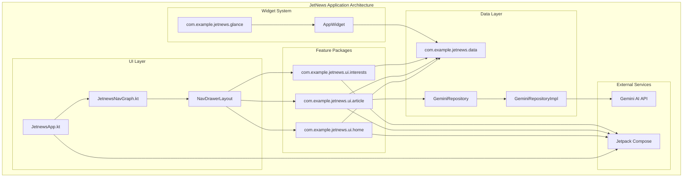
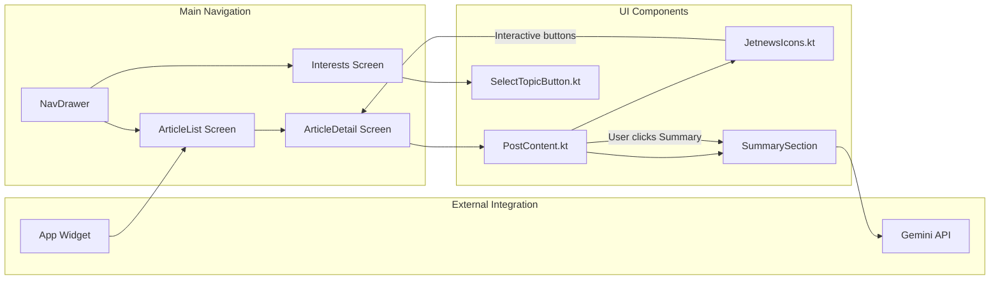

<!-- source: DeepWiki mcp.deepwiki.com · repo android/codelab-gemini-summary · page 1 JetNews Overview · fetched 2026-10-23 -->

# JetNews Overview

Relevant source files

The following files were used as context for generating this wiki page:

- [README.md](README.md)

## Purpose and Scope

This document provides a comprehensive overview of the JetNews Android application, explaining its architecture, features, and implementation approach. JetNews is a sample news reading application built with Jetpack Compose that demonstrates modern Android development patterns and UI capabilities. The application integrates AI-powered article summarization through Google's Gemini API.

This overview covers the high-level structure and key components of the application. For detailed information about specific subsystems, see:
- Project configuration and build system: [Project Setup and Configuration](#2)
- UI component implementation: [User Interface Architecture](#3)
- AI integration details: [Data Layer and AI Integration](#4)
- Development guidelines: [Development and Contribution](#5)

## Application Overview

JetNews is a modern Android news reader application that serves as a showcase for Jetpack Compose UI capabilities. The application demonstrates best practices in Android development, including modern UI design, adaptive layouts, and integration with AI services for content enhancement.

The application is structured as a multi-screen news reader with AI-powered summarization capabilities, built entirely using Jetpack Compose and following Material Design 3 principles.

**Core Technologies:**
- **Jetpack Compose** - Modern declarative UI framework
- **Material Design 3** - Google's latest design system
- **Gemini AI API** - Article summarization service
- **Glance** - App widget framework
- **Navigation Component** - Screen navigation management

Sources: [README.md:1-14]()

## Key Features

JetNews provides a comprehensive news reading experience with the following capabilities:

| Feature | Description | Implementation |
|---------|-------------|----------------|
| **Article List** | Scrollable list of news articles with custom layouts | Compose `LazyColumn` with custom `Card` components |
| **Article Detail** | Full article view with rich text formatting | Custom text rendering with `Typography` and `ColorScheme` |
| **AI Summarization** | Gemini-powered article summaries | Repository pattern with `GeminiRepository` |
| **Navigation Drawer** | Side navigation for screen switching | `NavDrawerLayout` with navigation routes |
| **Interests Screen** | Topic subscription management | Custom `SelectTopicButton` with `Toggleable` composable |
| **App Widgets** | Home screen widgets for quick access | Glance-based widgets with Material 3 theming |
| **Adaptive UI** | Responsive design for all screen sizes | Compose adaptive layouts with split-screen support |

Sources: [README.md:16-21](), [README.md:102-114]()

## Application Architecture

The following diagram illustrates the high-level architecture of JetNews, showing the relationship between major components and their corresponding code entities:

### JetNews System Architecture

Sources: [README.md:22-33]()

## Screen Navigation Flow

The application follows a structured navigation pattern managed through Jetpack Compose Navigation. The following diagram shows the screen flow and navigation relationships:

### Navigation Structure

Sources: [README.md:34-48](), [README.md:50-58](), [README.md:60-72]()

## Package Organization

JetNews is organized into clearly defined packages, each serving specific functionality:

### Core UI Packages

| Package | Purpose | Key Components |
|---------|---------|----------------|
| `com.example.jetnews.ui` | App scaffolding and navigation | `JetnewsApp.kt`, `JetnewsNavGraph.kt` |
| `com.example.jetnews.ui.home` | Article list screen | Custom Composables, scrolling lists |
| `com.example.jetnews.ui.article` | Article detail view | Text API usage, bottom app bar |
| `com.example.jetnews.ui.interests` | Topic subscription | Tabs, custom checkbox buttons |
| `com.example.jetnews.ui.theme` | Design system | `Type.kt`, color schemes |

### Supporting Packages

| Package | Purpose | Key Components |
|---------|---------|----------------|
| `com.example.jetnews.data` | Static data management | Sample news data |
| `com.example.jetnews.glance` | App widget implementation | Glance composables, Material 3 theming |

Sources: [README.md:24-33](), [README.md:36-48](), [README.md:52-72](), [README.md:74-89](), [README.md:91-94]()

## Adaptive UI Implementation

JetNews demonstrates modern adaptive UI principles, ensuring optimal user experience across all device types and screen configurations. The application dynamically adjusts its layout based on available screen space rather than simply detecting device type.

**Key Adaptive Features:**
- **Split-screen compatibility** - Proper layout adaptation when running in split-screen mode
- **Dynamic layout selection** - UI adapts to actual available space, not just device category
- **Responsive design** - Consistent experience across phones, tablets, and foldable devices
- **Context-aware navigation** - Navigation patterns adjust based on screen real estate

This approach ensures that JetNews provides an optimal experience whether running on a small phone, a large tablet, or in split-screen mode on any device.

Sources: [README.md:106-114]()

## Testing Infrastructure

The application includes comprehensive testing capabilities supporting both instrumented and unit testing approaches:

| Test Type | Framework | Execution Method |
|-----------|-----------|------------------|
| **Instrumented Tests** | Android Testing Framework | Device/emulator execution via `./gradlew connectedCheck` |
| **Robolectric Tests** | Robolectric JVM testing | Local JVM execution via `./gradlew testDebug` |

Both testing approaches are configured with dedicated run configurations in Android Studio for developer convenience.

Sources: [README.md:95-101]()

## Development Requirements

To work with JetNews, developers need:

- **Android Studio** - Latest stable version recommended
- **Jetpack Compose** - Modern UI toolkit knowledge
- **Kotlin** - Primary development language
- **Material Design 3** - UI design system understanding

The project can be cloned directly or imported through Android Studio's project import functionality.

Sources: [README.md:5-11]()

---

