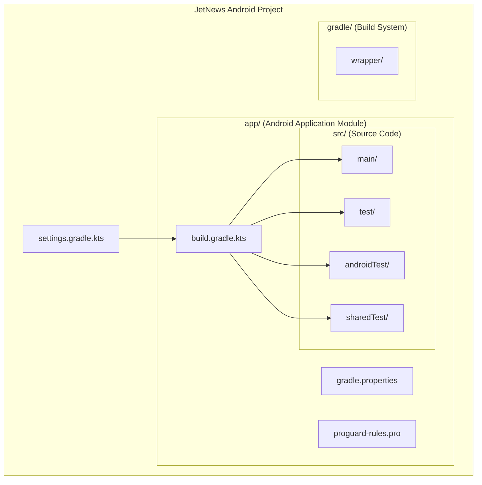
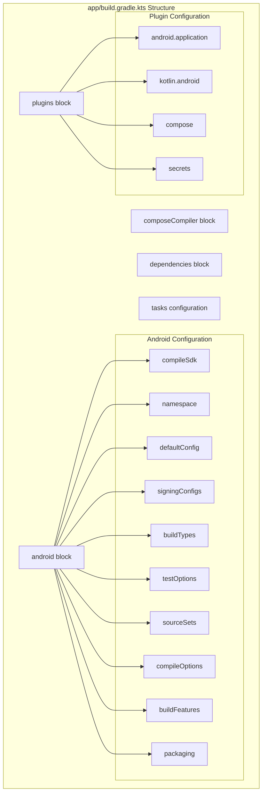
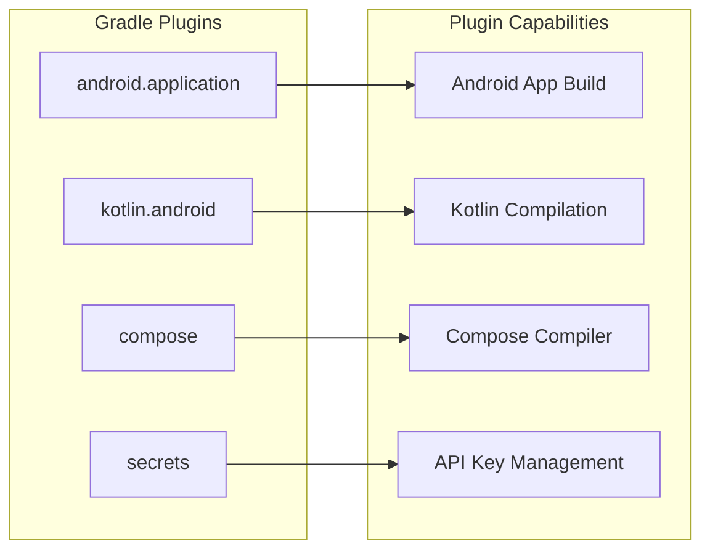
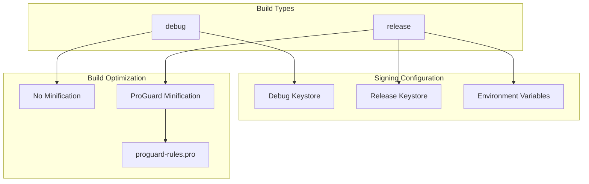
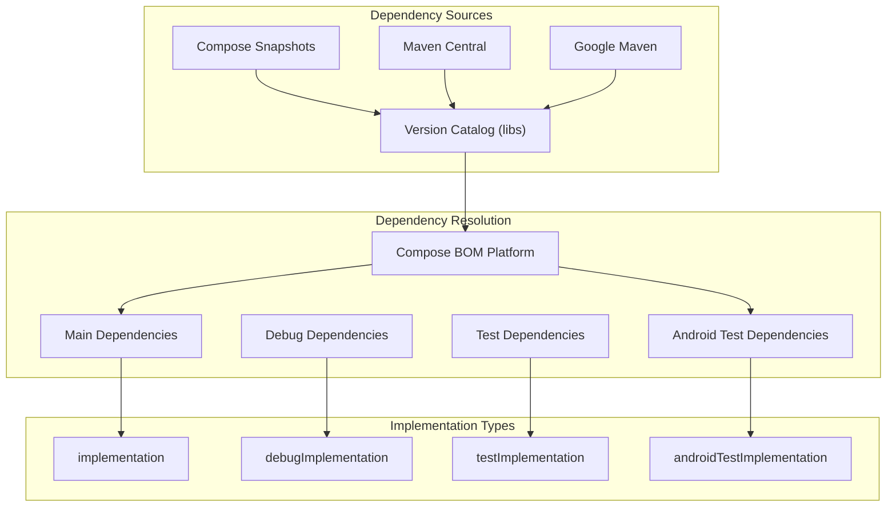
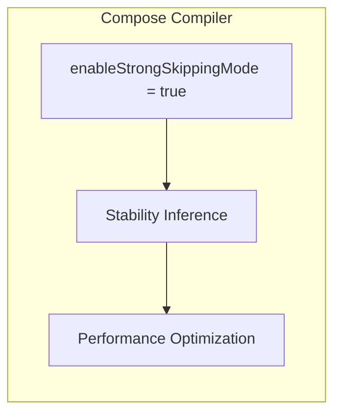
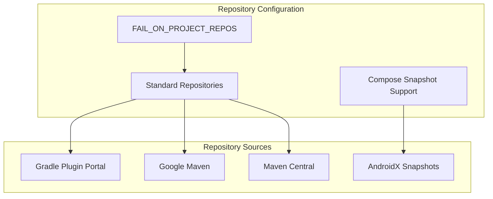

<!-- source: DeepWiki mcp.deepwiki.com · repo android/codelab-gemini-summary · page 2 Project Setup and Configuration · fetched 2026-10-23 -->

# Project Setup and Configuration

Relevant source files

The following files were used as context for generating this wiki page:

- [app/build.gradle.kts](app/build.gradle.kts)
- [settings.gradle.kts](settings.gradle.kts)

This page covers the essential build system configuration, project structure, and setup requirements for the JetNews Android application. It focuses on the Gradle build system, dependency management, and core project configuration files that enable the application to build and run successfully.

For detailed information about the Gradle build system internals, see [Gradle Build System](#2.1). For version control configuration, see [Version Control Configuration](#2.2). For information about contributing to the project, see [Contributing Guidelines](#5.1).

## Project Structure Overview

The JetNews project follows a standard Android application structure with Gradle-based build configuration. The project uses Kotlin DSL for build scripts and integrates modern Android development tools.

### Project Structure Diagram

**Sources:** [settings.gradle.kts:1-40](), [app/build.gradle.kts:1-161]()

## Core Configuration Files

### settings.gradle.kts Configuration

The project-level settings file defines the basic project structure and repository configuration:

| Configuration Aspect | Value | Purpose |
|----------------------|-------|---------|
| Project Name | `"JetNews"` | Root project identifier |
| Included Modules | `":app"` | Single application module |
| Repository Mode | `FAIL_ON_PROJECT_REPOS` | Enforces centralized dependency resolution |

The settings file also includes support for Compose snapshot builds through the `COMPOSE_SNAPSHOT_ID` environment variable, enabling testing with bleeding-edge Compose versions.

**Sources:** [settings.gradle.kts:16-40]()

### app/build.gradle.kts Configuration

The application module build file contains the core Android application configuration:

**Sources:** [app/build.gradle.kts:17-98]()

## Build System Architecture

### Plugin Configuration

The application uses four key Gradle plugins configured through version catalogs:

**Sources:** [app/build.gradle.kts:17-22]()

### Android Configuration Details

| Configuration | Value | Description |
|---------------|-------|-------------|
| `compileSdk` | From version catalog | Target Android API level |
| `namespace` | `"com.example.jetnews"` | Application package namespace |
| `applicationId` | `"com.example.jetnews"` | Unique application identifier |
| `minSdk` | From version catalog | Minimum supported Android version |
| `targetSdk` | From version catalog | Target Android version |
| `versionCode` | `1` | Internal version number |
| `versionName` | `"1.0"` | User-facing version string |

**Sources:** [app/build.gradle.kts:24-36]()

### Build Types and Signing

The project defines two build types with different optimization settings:

**Sources:** [app/build.gradle.kts:38-62]()

## Dependency Management

### Dependency Categories

The project organizes dependencies into distinct categories using a Bill of Materials (BOM) approach:

| Category | Purpose | Key Dependencies |
|----------|---------|------------------|
| Compose BOM | UI Framework | `androidx.compose.bom` |
| Kotlin | Language Support | `kotlin.stdlib`, `kotlinx.coroutines.android` |
| Compose UI | User Interface | `material3`, `animation`, `foundation.layout` |
| AndroidX | Android Framework | `appcompat`, `activity.ktx`, `core.ktx` |
| Glance | Widget Framework | `androidx.glance`, `androidx.glance.appwidget` |
| Lifecycle | Component Lifecycle | `lifecycle.viewmodel.ktx`, `lifecycle.livedata.ktx` |
| Navigation | App Navigation | `androidx.navigation.compose` |
| Testing | Test Framework | `junit`, `androidx.test.core`, `robolectric` |

**Sources:** [app/build.gradle.kts:104-156]()

### Dependency Resolution Flow

**Sources:** [app/build.gradle.kts:104-156](), [settings.gradle.kts:25-36]()

## Advanced Configuration

### Test Configuration

The project includes comprehensive test support with shared test directories:

- **Unit Tests**: Robolectric-based tests with Android resource access
- **Instrumented Tests**: On-device tests using Espresso
- **Shared Test Code**: Common test utilities in `src/sharedTest/java`

**Sources:** [app/build.gradle.kts:64-80]()

### Compose Compiler Configuration

The Compose compiler is configured with performance optimizations:

**Sources:** [app/build.gradle.kts:100-102]()

### Repository Configuration

The project uses centralized repository management with snapshot support:

**Sources:** [settings.gradle.kts:18-36]()

---

