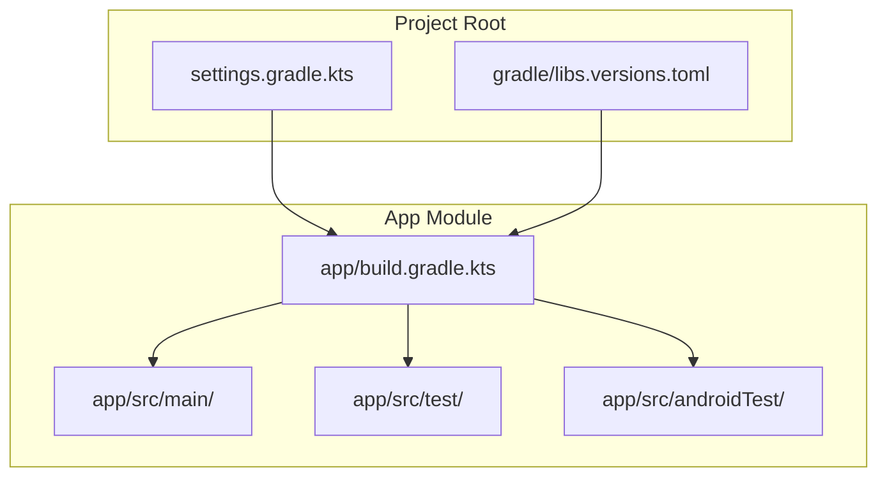
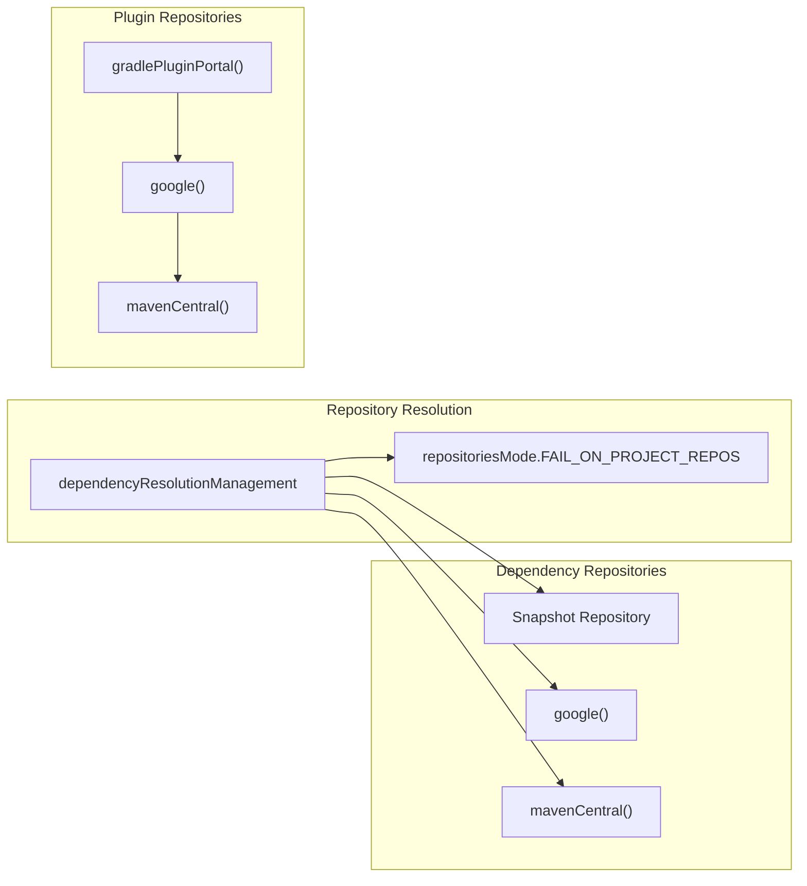
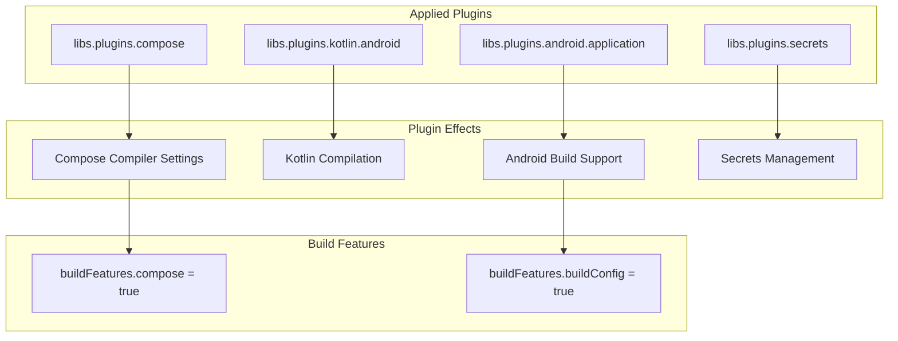
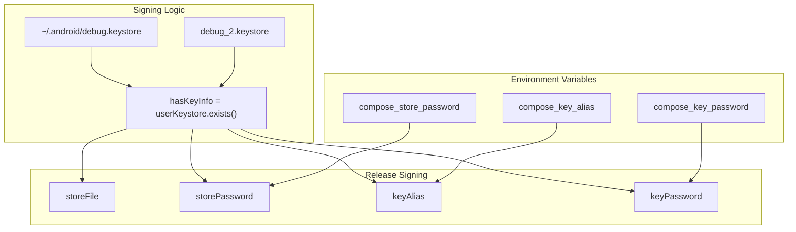
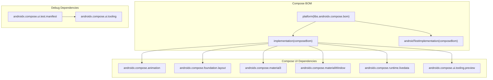
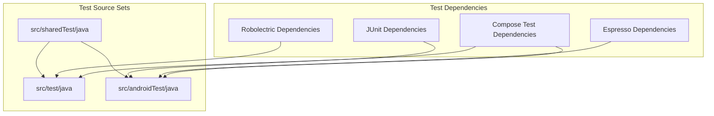
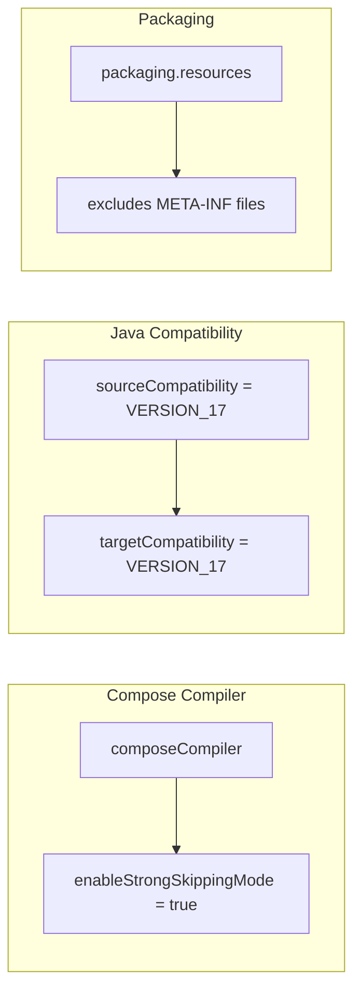

<!-- source: DeepWiki mcp.deepwiki.com · repo android/codelab-gemini-summary · page 2.1 Gradle Build System · fetched 2026-10-23 -->

# Gradle Build System

Relevant source files

The following files were used as context for generating this wiki page:

- [app/build.gradle.kts](app/build.gradle.kts)
- [settings.gradle.kts](settings.gradle.kts)

## Purpose and Scope

This document explains the Gradle build system configuration for the JetNews Android application. It covers the multi-module project setup, Android-specific build configuration, dependency management, and compilation settings. The build system is configured using Kotlin DSL (`.kts` files) and supports both debug and release builds with Jetpack Compose integration.

For version control aspects of the project configuration, see [Version Control Configuration](#2.2).

## Project Structure and Settings

The JetNews project uses a standard Android Gradle project structure with centralized configuration management. The root-level settings establish the project identity and repository configuration.

### Multi-Module Configuration

The project is defined in [settings.gradle.kts:37]() with `rootProject.name = "JetNews"` and includes a single app module via [settings.gradle.kts:38]() `include(":app")`.

### Repository Management

The build system uses centralized repository management with snapshot support for Compose development:

The snapshot repository is conditionally included based on the `COMPOSE_SNAPSHOT_ID` environment variable [settings.gradle.kts:16,28-31]().

Sources: [settings.gradle.kts:16-40]()

## Android Application Configuration

The app module configuration defines the Android-specific build settings and application metadata.

### Core Android Settings

| Setting | Value | Source |
|---------|-------|---------|
| `namespace` | `"com.example.jetnews"` | [app/build.gradle.kts:26]() |
| `applicationId` | `"com.example.jetnews"` | [app/build.gradle.kts:29]() |
| `versionCode` | `1` | [app/build.gradle.kts:32]() |
| `versionName` | `"1.0"` | [app/build.gradle.kts:33]() |

The SDK versions are managed through the version catalog system:
- `compileSdk` - [app/build.gradle.kts:25]()
- `minSdk` - [app/build.gradle.kts:30]()
- `targetSdk` - [app/build.gradle.kts:31]()

### Plugin Configuration

The plugins are applied using the version catalog aliases pattern [app/build.gradle.kts:17-22]().

Sources: [app/build.gradle.kts:17-22,87-90]()

## Build Variants and Signing

The build system supports debug and release variants with different signing configurations and optimization settings.

### Signing Configuration

The signing configuration logic [app/build.gradle.kts:38-49]() uses the user's debug keystore if available, otherwise falls back to environment variables for production signing.

### Build Type Configuration

| Build Type | Minification | Signing | ProGuard |
|------------|--------------|---------|----------|
| `debug` | `false` | debug | none |
| `release` | `true` | release | `proguard-android-optimize.txt` |

The release build type enables minification and applies ProGuard rules [app/build.gradle.kts:56-61]().

Sources: [app/build.gradle.kts:38-62]()

## Dependencies Management

The project uses Compose BOM (Bill of Materials) for coordinated dependency versions and organizes dependencies by functional groups.

### Compose Dependencies Structure

### AndroidX and Third-Party Dependencies

The project includes comprehensive AndroidX libraries organized by functionality:

| Category | Dependencies |
|----------|-------------|
| **Core AndroidX** | `androidx.core.ktx`, `androidx.appcompat`, `androidx.activity.ktx` |
| **Lifecycle** | `androidx.lifecycle.viewmodel.ktx`, `androidx.lifecycle.livedata.ktx` |
| **Navigation** | `androidx.navigation.compose` |
| **Glance Widgets** | `androidx.glance`, `androidx.glance.appwidget`, `androidx.glance.material3` |
| **Accompanist** | `accompanist.swiperefresh`, `accompanist.systemuicontroller` |

Sources: [app/build.gradle.kts:104-156]()

## Testing Configuration

The build system supports both unit tests and instrumented tests with shared test sources and Robolectric integration.

### Test Source Configuration

The test configuration includes shared test sources [app/build.gradle.kts:72-80]() and comprehensive test dependencies for both unit and instrumented testing.

### Test Options

| Option | Value | Purpose |
|--------|-------|---------|
| `isReturnDefaultValues` | `true` | Mock Android framework calls |
| `isIncludeAndroidResources` | `true` | Access Android resources in tests |
| `robolectric.logging` | `"stdout"` | Robolectric logging output |

Sources: [app/build.gradle.kts:64-80,144-160]()

## Compilation Settings

The build system uses modern compilation settings optimized for Jetpack Compose and Android development.

### Compose Compiler Configuration

The Compose compiler is configured with strong skipping mode enabled [app/build.gradle.kts:100-102]() for improved performance during recomposition.

### Resource Packaging

The packaging configuration excludes duplicate META-INF files [app/build.gradle.kts:92-97]() to prevent build conflicts when multiple dependencies include the same license files.

Sources: [app/build.gradle.kts:82-102]()

---

