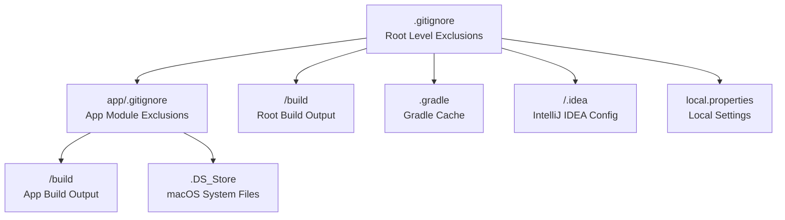
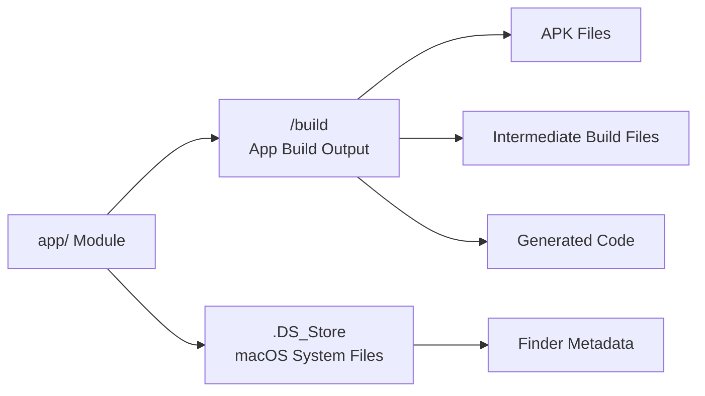
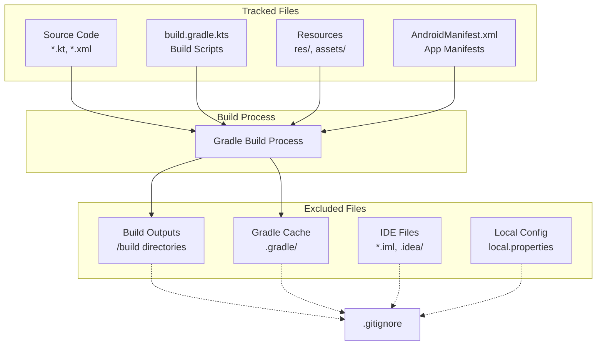

<!-- source: DeepWiki mcp.deepwiki.com · repo android/codelab-gemini-summary · page 2.2 Version Control Configuration · fetched 2026-10-23 -->

# Version Control Configuration

Relevant source files

The following files were used as context for generating this wiki page:

- [.gitignore](.gitignore)
- [app/.gitignore](app/.gitignore)

## Purpose and Scope

This document explains the version control configuration for the JetNews Android application, specifically focusing on the `.gitignore` files that determine which files and directories are excluded from version control. This configuration ensures that build artifacts, IDE-specific files, and local configuration remain untracked while preserving the essential source code and project files.

For information about the overall project structure and Gradle build configuration, see [Gradle Build System](#2.1).

## Version Control Structure Overview

The JetNews project uses a hierarchical `.gitignore` configuration with exclusions defined at both the root project level and individual module levels. This approach provides comprehensive coverage while maintaining modularity for multi-module Android projects.

### GitIgnore File Hierarchy

**Sources:** [.gitignore:1-10](), [app/.gitignore:1-2]()

## Root Level Version Control Configuration

The root `.gitignore` file manages project-wide exclusions that apply to the entire repository structure. This includes build system artifacts, IDE configurations, and platform-specific files.

### Build System Exclusions

| Pattern | Purpose | Impact |
|---------|---------|---------|
| `*.iml` | IntelliJ IDEA module files | Prevents IDE-generated module configuration from being tracked |
| `.gradle` | Gradle daemon and cache files | Excludes Gradle's local cache and daemon files |
| `/build` | Root build output directory | Prevents root-level build artifacts from being committed |
| `.externalNativeBuild` | External native build files | Excludes C/C++ build intermediates |
| `.cxx` | C++ build system files | Excludes CMake and ndk-build artifacts |
| `.kotlin/` | Kotlin compiler cache | Excludes Kotlin compiler incremental compilation cache |

### Development Environment Exclusions

| Pattern | Purpose | Impact |
|---------|---------|---------|
| `/.idea` | IntelliJ IDEA configuration | Prevents IDE workspace settings from being shared |
| `local.properties` | Local SDK/NDK paths | Excludes machine-specific Android SDK configuration |
| `.DS_Store` | macOS system files | Prevents macOS Finder metadata from being tracked |
| `/captures` | Android profiling data | Excludes performance profiling and debugging captures |

**Sources:** [.gitignore:1-10]()

## App Module Version Control Configuration

The app-level `.gitignore` file provides module-specific exclusions that complement the root configuration. This modular approach allows for fine-grained control over what gets tracked in different parts of the project.

### App Module Exclusions

The app module excludes:
- `/build` - All build outputs including APKs, intermediate files, and generated code
- `.DS_Store` - macOS Finder metadata files that may be created within the app directory

**Sources:** [app/.gitignore:1-2]()

## Version Control Integration with Build System

The version control configuration integrates closely with the Gradle build system to ensure that generated artifacts are properly excluded while maintaining the ability to reproduce builds.

### Build Artifact Management

This configuration ensures that:
- Source code and build scripts are tracked for reproducibility
- Generated artifacts are excluded to prevent repository bloat
- Local development environment files remain untracked
- Build outputs can be regenerated from tracked sources

**Sources:** [.gitignore:1-10](), [app/.gitignore:1-2]()

## Best Practices and Rationale

The version control configuration follows Android development best practices by maintaining a clean separation between source code and generated artifacts.

### Key Design Principles

1. **Reproducible Builds**: Only essential files needed to reproduce the build are tracked
2. **Developer Independence**: Local configuration and IDE settings are excluded
3. **Platform Neutrality**: Platform-specific files (`.DS_Store`) are excluded
4. **Build Efficiency**: Gradle cache and intermediate files are excluded to prevent conflicts
5. **Modularity**: Module-specific exclusions allow for fine-grained control

### Integration with CI/CD

The version control configuration supports continuous integration by ensuring that:
- Build environments start with a clean slate
- No local configuration interferes with automated builds
- Generated artifacts don't cause merge conflicts
- Repository size remains manageable

**Sources:** [.gitignore:1-10](), [app/.gitignore:1-2]()

---

