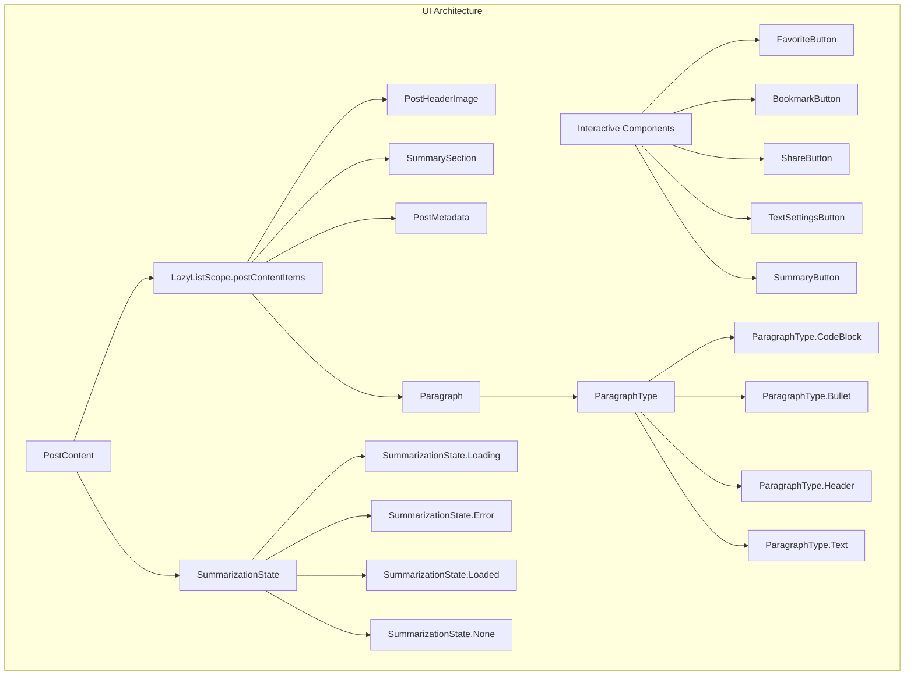
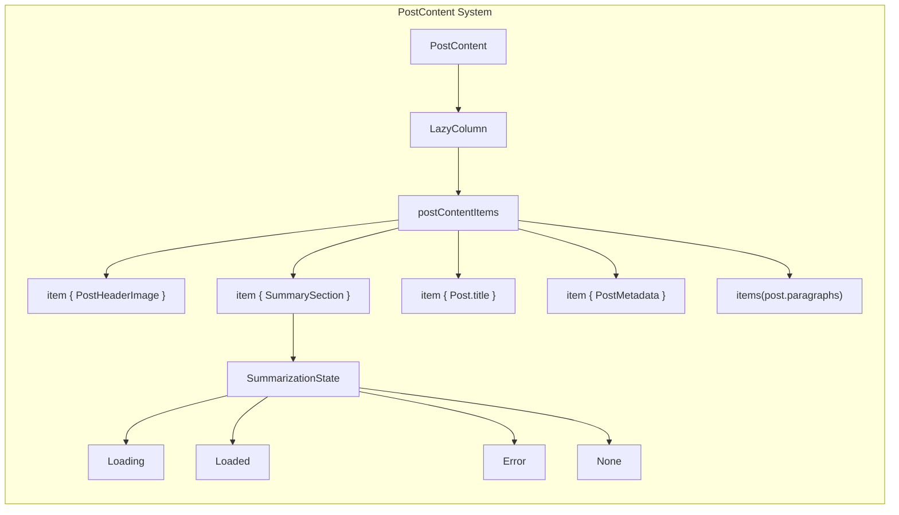
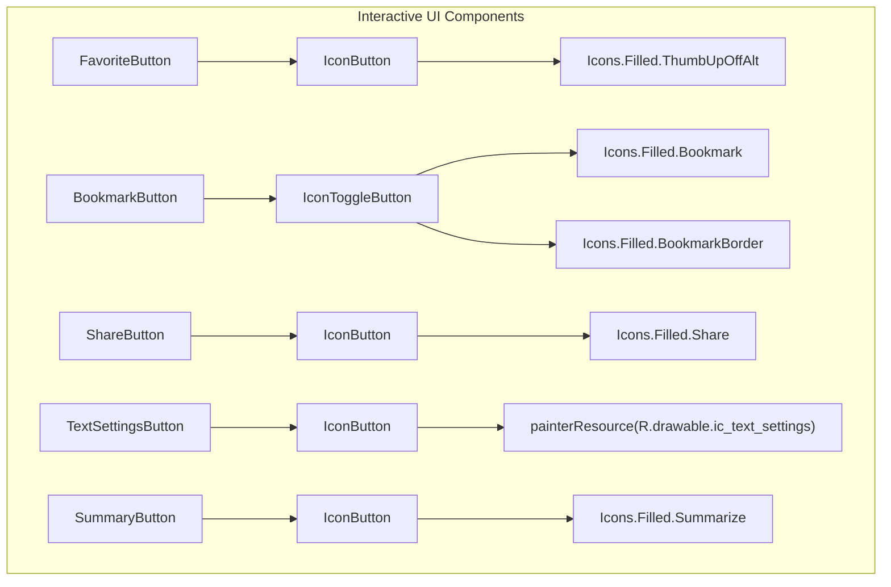
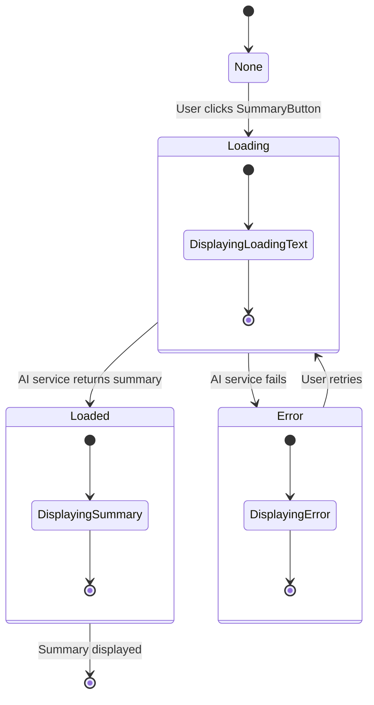
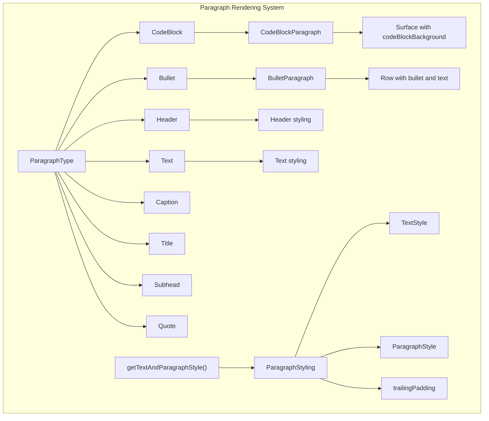
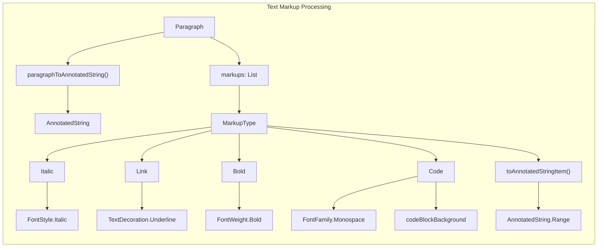
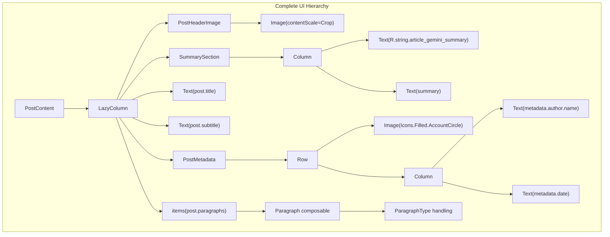

<!-- source: DeepWiki mcp.deepwiki.com · repo android/codelab-gemini-summary · page 3 User Interface Architecture · fetched 2026-10-23 -->

# User Interface Architecture

<details>
<summary>Relevant source files</summary>

The following files were used as context for generating this wiki page:

- [app/src/main/java/com/example/jetnews/ui/article/PostContent.kt](app/src/main/java/com/example/jetnews/ui/article/PostContent.kt)
- [app/src/main/java/com/example/jetnews/ui/utils/JetnewsIcons.kt](app/src/main/java/com/example/jetnews/ui/utils/JetnewsIcons.kt)

</details>


## Purpose and Scope

This document covers the user interface architecture of the JetNews Android application, which is built entirely using Jetpack Compose. The UI architecture encompasses the composable component hierarchy, state management patterns, and the integration of Material Design 3 theming throughout the application.

For information about the underlying data layer that feeds the UI components, see [Data Layer and AI Integration](#4). For details about the specific AI integration components, see [Gemini AI Integration](#4.1).

## Overview

The JetNews UI architecture follows a composable-first approach built on Jetpack Compose, with a clear separation between presentation logic and UI components. The architecture is designed around efficient content rendering using `LazyColumn` for scrollable content and state-driven UI updates for AI-powered features.



**Sources:** [app/src/main/java/com/example/jetnews/ui/article/PostContent.kt:84-98](), [app/src/main/java/com/example/jetnews/ui/utils/JetnewsIcons.kt:36-99]()

## Core Components

### Article Display System

The primary UI component is the `PostContent` composable, which serves as the main container for article rendering. It utilizes a `LazyColumn` for efficient scrolling performance and integrates with the AI summarization system.



The `PostContent` function accepts several key parameters:

| Parameter | Type | Purpose |
|-----------|------|---------|
| `post` | `Post` | The article data to display |
| `contentPadding` | `PaddingValues` | Padding for the scrollable content |
| `state` | `LazyListState` | Controls scroll state and position |
| `summarizationState` | `SummarizationState` | Manages AI summary display state |

**Sources:** [app/src/main/java/com/example/jetnews/ui/article/PostContent.kt:84-98](), [app/src/main/java/com/example/jetnews/ui/article/PostContent.kt:100-122]()

### Interactive Components

The application provides a set of reusable interactive components defined in `JetnewsIcons.kt`. These components follow Material Design 3 patterns and include proper accessibility support.



Each component includes proper semantic labeling for accessibility:
- `FavoriteButton` uses `R.string.cd_add_to_favorites`
- `BookmarkButton` dynamically changes between "bookmark" and "unbookmark" labels
- `ShareButton` uses `R.string.cd_share`
- `TextSettingsButton` and `SummaryButton` use `R.string.cd_text_settings`

**Sources:** [app/src/main/java/com/example/jetnews/ui/utils/JetnewsIcons.kt:36-99]()

## State Management

### Summarization State Flow

The UI architecture includes a sophisticated state management system for AI-powered article summarization. The `SummarizationState` sealed class drives the UI updates in the `SummarySection` component.



The state transitions are handled in the `postContentItems` function:

```kotlin
when (summarizationState) {
    is SummarizationState.Loading -> SummarySection("Loading...")
    is SummarizationState.Loaded -> SummarySection(summarizationState.summary)
    is SummarizationState.Error -> SummarySection(summarizationState.error)
    else -> { /* noop */ }
}
```

**Sources:** [app/src/main/java/com/example/jetnews/ui/article/PostContent.kt:107-112](), [app/src/main/java/com/example/jetnews/ui/article/PostContent.kt:368-385]()

## Typography and Theming

### Paragraph Type System

The article rendering system supports multiple paragraph types with distinct styling through the `ParagraphType` enumeration and associated styling functions.



### Typography Mapping

The paragraph types map to Material Design 3 typography scales:

| Paragraph Type | Typography Scale | Special Properties |
|---------------|------------------|-------------------|
| `Caption` | `labelMedium` | - |
| `Title` | `headlineLarge` | - |
| `Subhead` | `headlineSmall` | 16.dp trailing padding |
| `Text` | `bodyLarge` | 28.sp line height |
| `Header` | `headlineMedium` | 16.dp trailing padding |
| `CodeBlock` | `bodyLarge` | `FontFamily.Monospace` |
| `Quote` | `bodyLarge` | - |
| `Bullet` | `bodyLarge` | 8.sp text indent |

**Sources:** [app/src/main/java/com/example/jetnews/ui/article/PostContent.kt:267-301](), [app/src/main/java/com/example/jetnews/ui/article/PostContent.kt:177-211]()

## Component Relationships

### Markup Processing System

The UI architecture includes a sophisticated text markup processing system that converts `Markup` objects into `AnnotatedString` formatting for rich text display.



The markup system supports four primary text formatting types:
- **Italic**: Applied using `FontStyle.Italic`
- **Link**: Applied using `TextDecoration.Underline`
- **Bold**: Applied using `FontWeight.Bold`
- **Code**: Applied using `FontFamily.Monospace` with background color

**Sources:** [app/src/main/java/com/example/jetnews/ui/article/PostContent.kt:303-351](), [app/src/main/java/com/example/jetnews/ui/article/PostContent.kt:353-354]()

### Layout Structure

The complete UI component hierarchy follows this structure:



This architecture provides a scalable, maintainable UI system that efficiently handles complex article layouts while integrating seamlessly with AI-powered features.

**Sources:** [app/src/main/java/com/example/jetnews/ui/article/PostContent.kt:100-122](), [app/src/main/java/com/example/jetnews/ui/article/PostContent.kt:124-174]()

---

