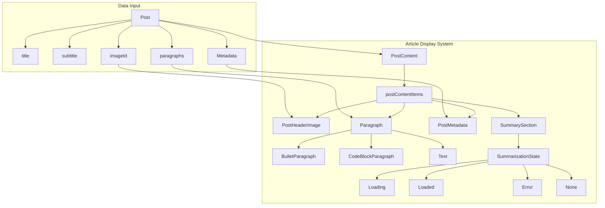
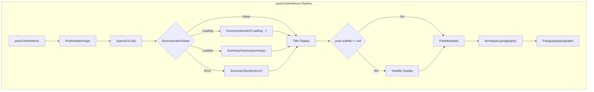
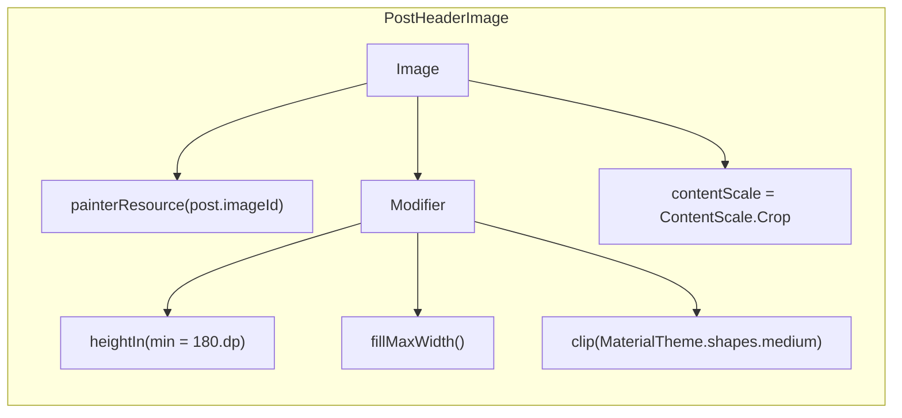
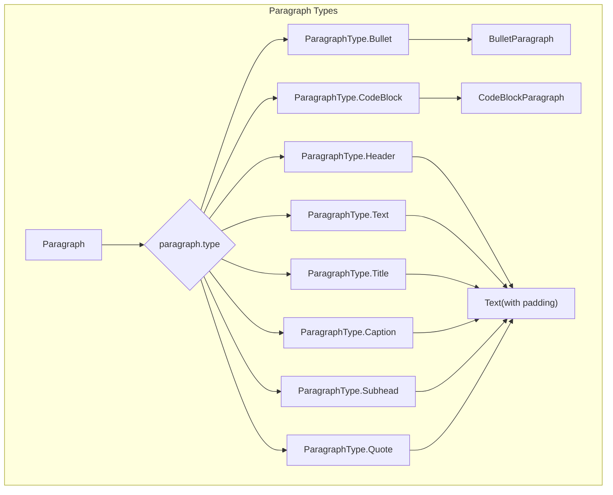
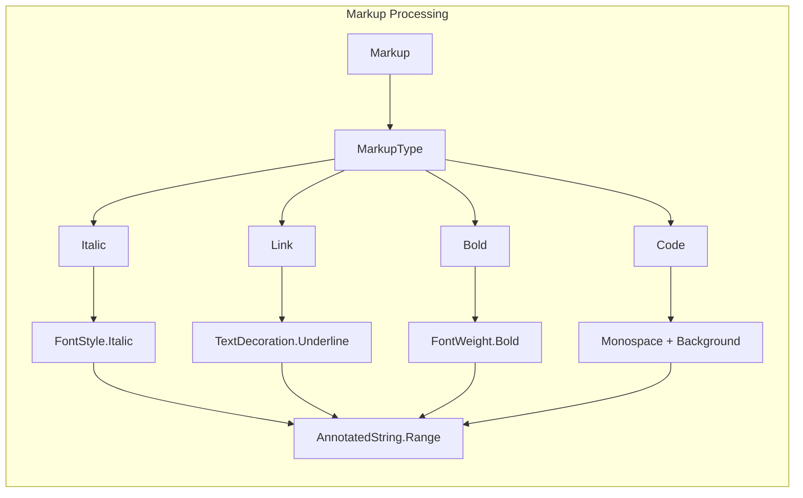
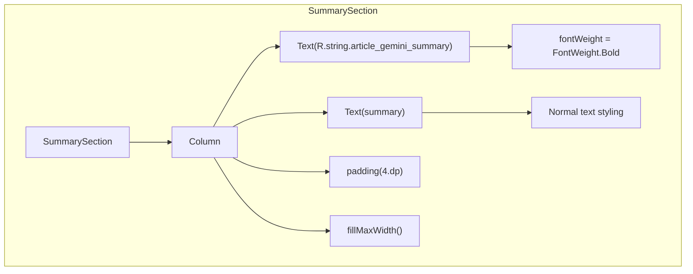
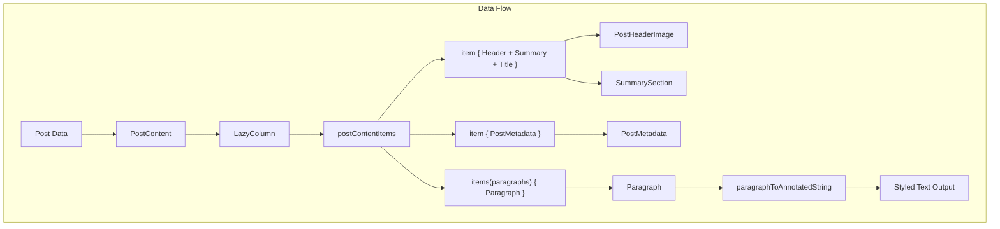

<!-- source: DeepWiki mcp.deepwiki.com · repo android/codelab-gemini-summary · page 3.1 Article Display System · fetched 2026-10-23 -->

# Article Display System

Relevant source files

The following files were used as context for generating this wiki page:

- [app/src/main/java/com/example/jetnews/ui/article/PostContent.kt](app/src/main/java/com/example/jetnews/ui/article/PostContent.kt)

## Purpose and Scope

The Article Display System is responsible for rendering news articles in the JetNews application. This system handles the complete presentation of article content, including header images, metadata, rich text formatting, and AI-generated summaries. The system is built using Jetpack Compose and implements efficient scrolling through `LazyColumn` with support for various paragraph types and text markup.

For information about the broader UI architecture, see [User Interface Architecture](#3). For details about the AI summarization integration, see [Gemini AI Integration](#4.1).

## System Overview

The Article Display System centers around the `PostContent` composable, which orchestrates the rendering of all article elements. The system processes `Post` data objects and transforms them into a scrollable UI with proper typography, spacing, and interactive elements.

**Sources:** [app/src/main/java/com/example/jetnews/ui/article/PostContent.kt:84-98]()

## Core Components

### PostContent Composable

The `PostContent` composable serves as the main entry point for article rendering. It accepts a `Post` object and optional parameters for layout customization and summarization state.

| Parameter | Type | Purpose |
|-----------|------|---------|
| `post` | `Post` | The article data to display |
| `modifier` | `Modifier` | Optional styling modifications |
| `contentPadding` | `PaddingValues` | Padding for the scrollable content |
| `state` | `LazyListState` | State management for scroll position |
| `summarizationState` | `SummarizationState` | Current AI summarization status |

The component uses `LazyColumn` for efficient scrolling and delegates content generation to `postContentItems`.

**Sources:** [app/src/main/java/com/example/jetnews/ui/article/PostContent.kt:83-98]()

### Content Structure Pipeline

The `postContentItems` function defines the article's content structure using Compose's `LazyListScope`. This function orchestrates the rendering order and handles conditional display based on summarization state.

**Sources:** [app/src/main/java/com/example/jetnews/ui/article/PostContent.kt:100-122]()

### Header and Metadata Components

#### PostHeaderImage

The `PostHeaderImage` composable renders the article's featured image with consistent styling and aspect ratio constraints.

**Sources:** [app/src/main/java/com/example/jetnews/ui/article/PostContent.kt:124-136]()

#### PostMetadata

The `PostMetadata` composable displays author information and reading time in a horizontal layout with accessibility considerations.

| Element | Purpose |
|---------|---------|
| `AccountCircle` icon | Visual representation of author |
| Author name | Displayed with `labelLarge` typography |
| Date and read time | Formatted string with `bodySmall` typography |

**Sources:** [app/src/main/java/com/example/jetnews/ui/article/PostContent.kt:138-174]()

## Typography and Paragraph Rendering

### Paragraph Type System

The system supports multiple paragraph types, each with distinct styling characteristics:

**Sources:** [app/src/main/java/com/example/jetnews/ui/article/PostContent.kt:177-211]()

### ParagraphStyling System

The `ParagraphType.getTextAndParagraphStyle()` extension function maps paragraph types to their corresponding `TextStyle`, `ParagraphStyle`, and trailing padding values.

| Paragraph Type | Text Style | Special Properties |
|---------------|------------|-------------------|
| `Caption` | `labelMedium` | Standard padding |
| `Title` | `headlineLarge` | Standard padding |
| `Subhead` | `headlineSmall` | Reduced padding (16.dp) |
| `Text` | `bodyLarge` | Custom line height (28.sp) |
| `Header` | `headlineMedium` | Reduced padding (16.dp) |
| `CodeBlock` | `bodyLarge` | Monospace font family |
| `Quote` | `bodyLarge` | Standard styling |
| `Bullet` | `bodyLarge` | Text indent (8.sp) |

**Sources:** [app/src/main/java/com/example/jetnews/ui/article/PostContent.kt:267-301]()

### Rich Text Markup System

The system processes text markup through `AnnotatedString` with support for multiple formatting types:

**Sources:** [app/src/main/java/com/example/jetnews/ui/article/PostContent.kt:303-351]()

## AI Summarization Integration

### SummarySection Component

The `SummarySection` composable handles the display of AI-generated summaries with a consistent layout and typography.

**Sources:** [app/src/main/java/com/example/jetnews/ui/article/PostContent.kt:367-385]()

### SummarizationState Management

The system handles four distinct summarization states through conditional rendering:

| State | Display Behavior |
|-------|-----------------|
| `SummarizationState.Loading` | Shows "Loading..." message |
| `SummarizationState.Loaded` | Displays the generated summary |
| `SummarizationState.Error` | Shows error message |
| `SummarizationState.None` | No summary section displayed |

**Sources:** [app/src/main/java/com/example/jetnews/ui/article/PostContent.kt:107-112]()

## Component Relationships and Data Flow

The Article Display System follows a hierarchical composition pattern where data flows from the `Post` object through specialized rendering components:

**Sources:** [app/src/main/java/com/example/jetnews/ui/article/PostContent.kt:84-122]()

---

