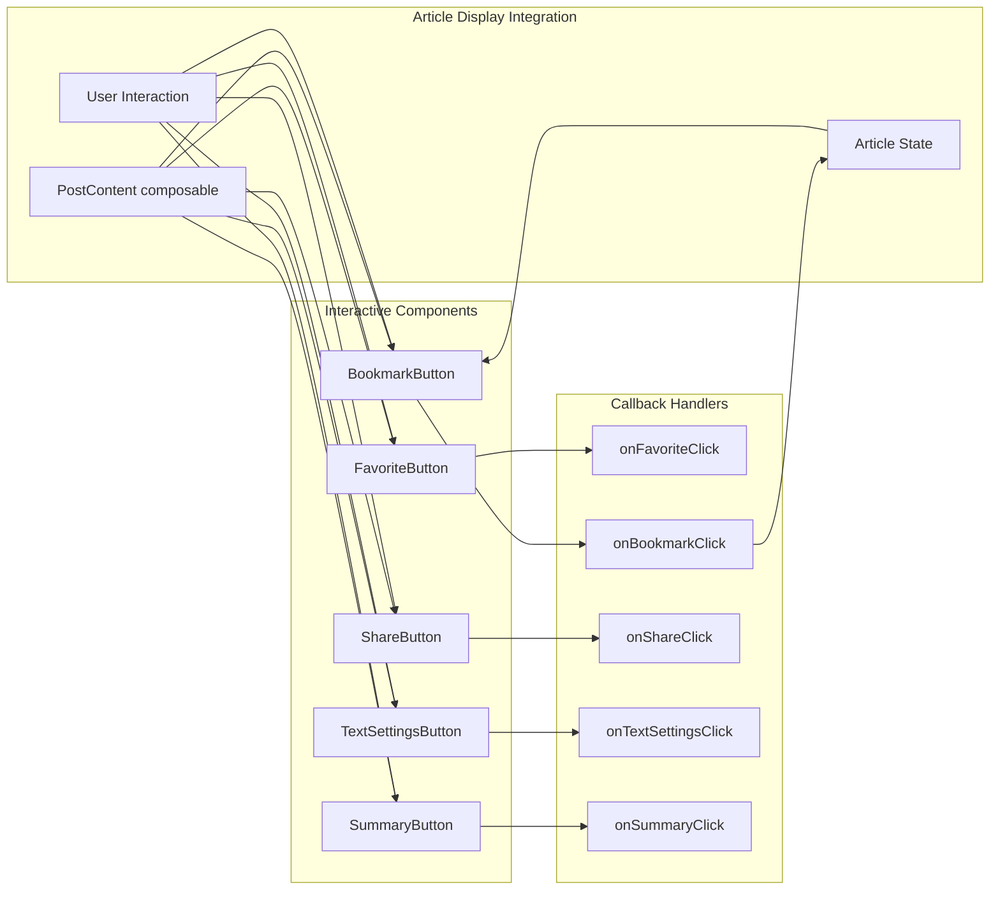

<!-- source: DeepWiki mcp.deepwiki.com · repo android/codelab-gemini-summary · page 3.2 Interactive UI Components · fetched 2026-10-23 -->

# Interactive UI Components

<details>
<summary>Relevant source files</summary>

The following files were used as context for generating this wiki page:

- [app/src/main/java/com/example/jetnews/ui/utils/JetnewsIcons.kt](app/src/main/java/com/example/jetnews/ui/utils/JetnewsIcons.kt)

</details>


## Purpose and Scope

This document covers the reusable interactive UI components in the JetNews application, specifically the icon-based buttons and controls that enable user interaction with articles. These components are primarily defined in the `JetnewsIcons.kt` file and provide functionality for favoriting, bookmarking, sharing, text settings, and AI summarization.

For information about the overall article display layout and content rendering, see [Article Display System](#3.1). For broader UI architecture concepts, see [User Interface Architecture](#3).

## Component Architecture Overview

The interactive UI components in JetNews are built using Jetpack Compose's Material Design 3 components, specifically `IconButton` and `IconToggleButton`. These components are designed as reusable composable functions that can be easily integrated throughout the application.

### Interactive Component System

```mermaid
graph TB
    subgraph "JetnewsIcons.kt Component System"
        FB["FavoriteButton()"]
        BB["BookmarkButton()"]
        SB["ShareButton()"]
        TSB["TextSettingsButton()"]
        SUB["SummaryButton()"]
    end
    
    subgraph "Material Design 3 Foundation"
        IB["IconButton"]
        ITB["IconToggleButton"]
    end
    
    subgraph "Material Icons"
        TUA["Icons.Filled.ThumbUpOffAlt"]
        BM["Icons.Filled.Bookmark"]
        BMB["Icons.Filled.BookmarkBorder"]
        SH["Icons.Filled.Share"]
        SM["Icons.Filled.Summarize"]
    end
    
    subgraph "Custom Resources"
        TSI["ic_text_settings drawable"]
    end
    
    subgraph "Accessibility"
        SR["stringResource()"]
        SEM["semantics{}"]
    end
    
    FB --> IB
    BB --> ITB
    SB --> IB
    TSB --> IB
    SUB --> IB
    
    FB --> TUA
    BB --> BM
    BB --> BMB
    SB --> SH
    SUB --> SM
    TSB --> TSI
    
    FB --> SR
    BB --> SR
    BB --> SEM
    SB --> SR
    TSB --> SR
    SUB --> SR
```



Sources: [app/src/main/java/com/example/jetnews/ui/utils/JetnewsIcons.kt:1-100]()

## Component Implementation Details

### FavoriteButton

The `FavoriteButton` component provides a simple action button for adding articles to favorites.

| Property | Type | Description |
|----------|------|-------------|
| `onClick` | `() -> Unit` | Callback function triggered when button is pressed |
| Icon | `Icons.Filled.ThumbUpOffAlt` | Material Design thumbs up icon |
| Content Description | `R.string.cd_add_to_favorites` | Accessibility label |

The implementation uses `IconButton` as the base component and provides a thumbs up icon to indicate the favorite action.

Sources: [app/src/main/java/com/example/jetnews/ui/utils/JetnewsIcons.kt:36-44]()

### BookmarkButton

The `BookmarkButton` is a stateful toggle button that manages bookmark state for articles.

| Property | Type | Description |
|----------|------|-------------|
| `isBookmarked` | `Boolean` | Current bookmark state |
| `onClick` | `() -> Unit` | Callback function for state changes |
| `modifier` | `Modifier` | Optional modifier for styling |

This component uses `IconToggleButton` and displays different icons based on state:
- `Icons.Filled.Bookmark` when bookmarked
- `Icons.Filled.BookmarkBorder` when not bookmarked

The component includes enhanced accessibility features with custom click labels that change based on the current state.

Sources: [app/src/main/java/com/example/jetnews/ui/utils/JetnewsIcons.kt:46-69]()

### ShareButton

The `ShareButton` provides article sharing functionality through a standard share icon.

| Property | Type | Description |
|----------|------|-------------|
| `onClick` | `() -> Unit` | Callback function for share action |
| Icon | `Icons.Filled.Share` | Material Design share icon |
| Content Description | `R.string.cd_share` | Accessibility label |

Sources: [app/src/main/java/com/example/jetnews/ui/utils/JetnewsIcons.kt:71-79]()

### TextSettingsButton

The `TextSettingsButton` opens text configuration options for articles.

| Property | Type | Description |
|----------|------|-------------|
| `onClick` | `() -> Unit` | Callback function for settings action |
| Icon | `ic_text_settings` | Custom drawable resource |
| Content Description | `R.string.cd_text_settings` | Accessibility label |

This component uses a custom drawable icon rather than Material Design icons, loaded via `painterResource()`.

Sources: [app/src/main/java/com/example/jetnews/ui/utils/JetnewsIcons.kt:81-89]()

### SummaryButton

The `SummaryButton` triggers AI-powered article summarization functionality.

| Property | Type | Description |
|----------|------|-------------|
| `onClick` | `() -> Unit` | Callback function for summarization |
| Icon | `Icons.Filled.Summarize` | Material Design summarize icon |
| Content Description | `R.string.cd_text_settings` | Accessibility label |

**Note:** There appears to be an inconsistency in the content description string resource, which uses `R.string.cd_text_settings` instead of a summarization-specific string.

Sources: [app/src/main/java/com/example/jetnews/ui/utils/JetnewsIcons.kt:91-99]()

## Component Integration Pattern

The interactive components follow a consistent integration pattern within the JetNews application:



Sources: [app/src/main/java/com/example/jetnews/ui/utils/JetnewsIcons.kt:1-100]()

## Accessibility Implementation

The interactive components implement several accessibility best practices:

### Semantic Labels
All components provide content descriptions using `stringResource()` to support screen readers and other assistive technologies.

### Custom Click Actions
The `BookmarkButton` implements custom semantics with dynamic click labels that change based on the current bookmark state:

```kotlin
modifier.semantics {
    this.onClick(label = clickLabel, action = null)
}
```

### State-Aware Descriptions
The bookmark component uses conditional string resources to provide contextually appropriate accessibility labels:
- `R.string.unbookmark` when currently bookmarked
- `R.string.bookmark` when not bookmarked

Sources: [app/src/main/java/com/example/jetnews/ui/utils/JetnewsIcons.kt:52-62]()

## Design Patterns

### Composable Function Structure
All interactive components follow a consistent pattern:
1. Accept callback functions for actions
2. Use Material Design 3 base components
3. Provide accessibility support
4. Use appropriate icons for visual representation

### Icon Selection Strategy
The components use a mix of:
- **Material Design filled icons** for primary actions (favorite, bookmark, share, summarize)
- **Custom drawable resources** for specialized functions (text settings)
- **Conditional icons** for state-dependent display (bookmark filled vs. border)

### Parameter Design
Components accept minimal, focused parameters:
- Action callbacks are always required
- State parameters only where needed (bookmark state)
- Modifiers are optional with sensible defaults

Sources: [app/src/main/java/com/example/jetnews/ui/utils/JetnewsIcons.kt:1-100]()

---

