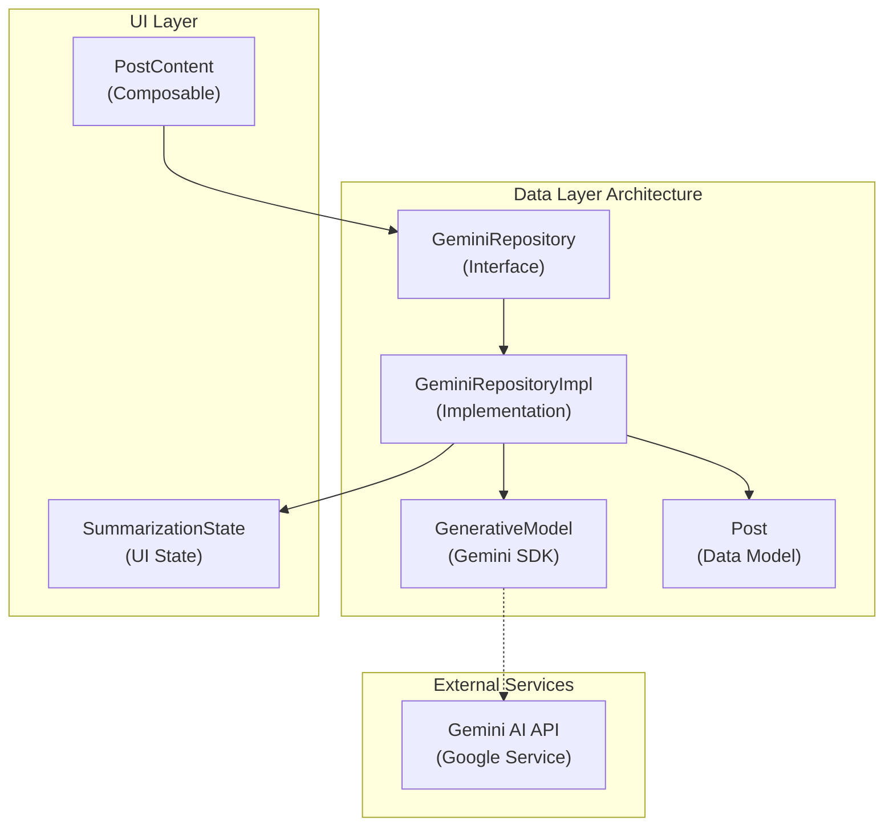
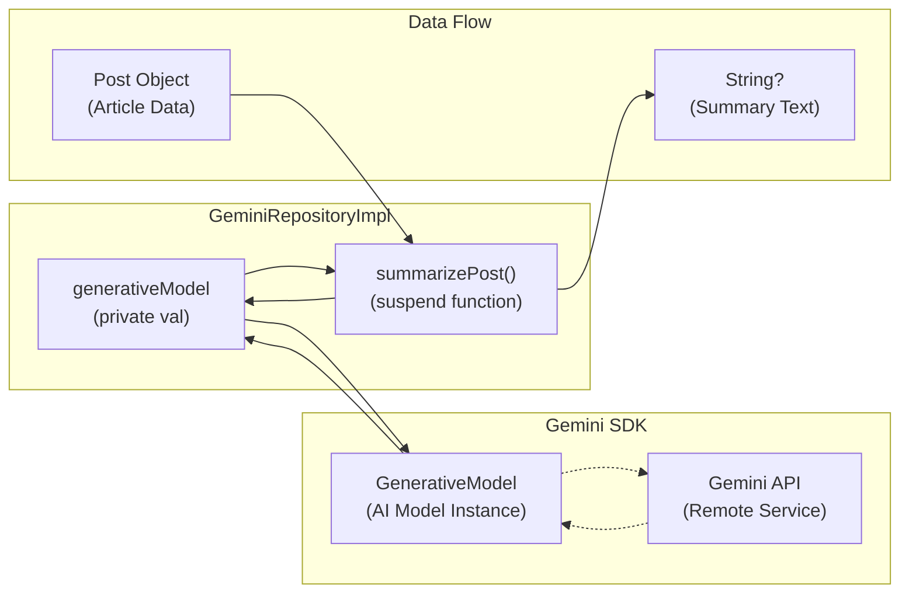
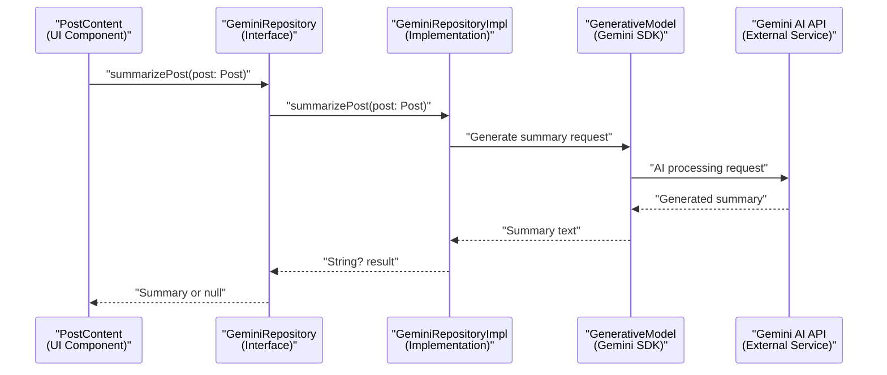

<!-- source: DeepWiki mcp.deepwiki.com · repo android/codelab-gemini-summary · page 4 Data Layer and AI Integration · fetched 2026-10-23 -->

# Data Layer and AI Integration

<details>
<summary>Relevant source files</summary>

The following files were used as context for generating this wiki page:

- [app/src/main/java/com/example/jetnews/data/gemini/GeminiRepository.kt](app/src/main/java/com/example/jetnews/data/gemini/GeminiRepository.kt)
- [app/src/main/java/com/example/jetnews/data/gemini/impl/GeminiRepositoryImpl.kt](app/src/main/java/com/example/jetnews/data/gemini/impl/GeminiRepositoryImpl.kt)

</details>


## Purpose and Scope

This document covers the data layer architecture and AI integration components of the JetNews application. It focuses on the repository pattern implementation for managing data access and the integration with Google's Gemini AI service for article summarization functionality. 

For information about how the UI components consume this data layer, see [User Interface Architecture](#3). For specific details about the Gemini AI implementation, see [Gemini AI Integration](#4.1).

## Data Layer Architecture

The JetNews application implements a clean architecture pattern with a dedicated data layer that abstracts external service interactions from the UI components. The data layer uses the repository pattern to provide a consistent interface for data operations.

### Repository Pattern Implementation

The data layer centers around the `GeminiRepository` interface, which defines the contract for AI-powered article summarization:



**Sources:** [app/src/main/java/com/example/jetnews/data/gemini/GeminiRepository.kt:22-25](), [app/src/main/java/com/example/jetnews/data/gemini/impl/GeminiRepositoryImpl.kt:22-31]()

### Core Data Components

| Component | Type | Purpose | Location |
|-----------|------|---------|----------|
| `GeminiRepository` | Interface | Defines contract for AI summarization | `data/gemini/` |
| `GeminiRepositoryImpl` | Class | Implements Gemini AI integration | `data/gemini/impl/` |
| `GenerativeModel` | External | Gemini SDK model instance | Third-party |
| `Post` | Model | Article data structure | `model/` |

**Sources:** [app/src/main/java/com/example/jetnews/data/gemini/GeminiRepository.kt:18-25](), [app/src/main/java/com/example/jetnews/data/gemini/impl/GeminiRepositoryImpl.kt:17-31]()

## AI Integration Design

The AI integration follows a repository pattern where the `GeminiRepository` interface abstracts the complexity of the Gemini AI service from consuming components.

### Interface Definition

The `GeminiRepository` interface defines a single method for post summarization:

```kotlin
suspend fun summarizePost(post: Post): String?
```

This design provides:
- **Abstraction**: UI components don't need to know about Gemini API details
- **Testability**: Interface can be mocked for testing
- **Flexibility**: Implementation can be swapped without affecting consumers
- **Async Support**: Uses suspend functions for non-blocking operations

**Sources:** [app/src/main/java/com/example/jetnews/data/gemini/GeminiRepository.kt:22-25]()

### Implementation Structure

The `GeminiRepositoryImpl` class provides the concrete implementation:



**Sources:** [app/src/main/java/com/example/jetnews/data/gemini/impl/GeminiRepositoryImpl.kt:22-31]()

## Data Flow Architecture

The data flow for AI summarization follows this pattern:



**Sources:** [app/src/main/java/com/example/jetnews/data/gemini/GeminiRepository.kt:22-25](), [app/src/main/java/com/example/jetnews/data/gemini/impl/GeminiRepositoryImpl.kt:22-31]()

## Implementation Status

The current implementation is in a stub state, with the `GeminiRepositoryImpl` class containing placeholder code:

### Current State

| Component | Status | Details |
|-----------|--------|---------|
| `GeminiRepository` | Complete | Interface fully defined |
| `GeminiRepositoryImpl` | Stub | Implementation returns `null` |
| `generativeModel` | Placeholder | Set to `null` with comment |
| `summarizePost()` | Stub | Returns `null` with TODO comment |

### Implementation Requirements

The `GeminiRepositoryImpl` requires:

1. **Gemini SDK Integration**: Initialize `GenerativeModel` with proper configuration
2. **Post Content Processing**: Extract and format article content for AI processing
3. **API Communication**: Handle requests and responses with Gemini AI service
4. **Error Handling**: Manage network failures and API errors
5. **Response Processing**: Parse and validate AI-generated summaries

**Sources:** [app/src/main/java/com/example/jetnews/data/gemini/impl/GeminiRepositoryImpl.kt:24-30]()

## Dependencies and Integration Points

The data layer integrates with several system components:

### External Dependencies

- **Gemini AI SDK**: Required for `GenerativeModel` instantiation
- **Kotlin Coroutines**: For suspend function support
- **Post Model**: Data structure from the model layer

### Integration Points

- **UI Layer**: PostContent and related composables consume the repository
- **Model Layer**: Post data structure definition
- **Dependency Injection**: Repository implementation wiring (implied)

**Sources:** [app/src/main/java/com/example/jetnews/data/gemini/GeminiRepository.kt:20](), [app/src/main/java/com/example/jetnews/data/gemini/impl/GeminiRepositoryImpl.kt:19-20]()

---

