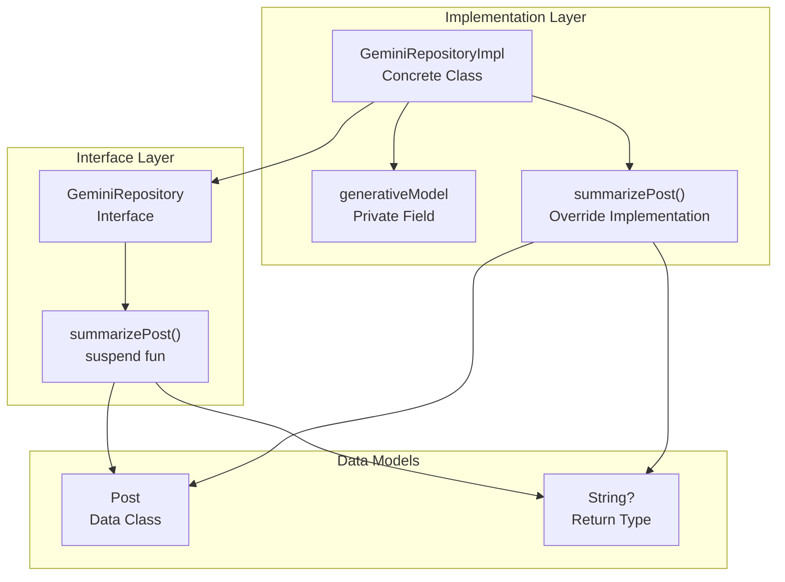
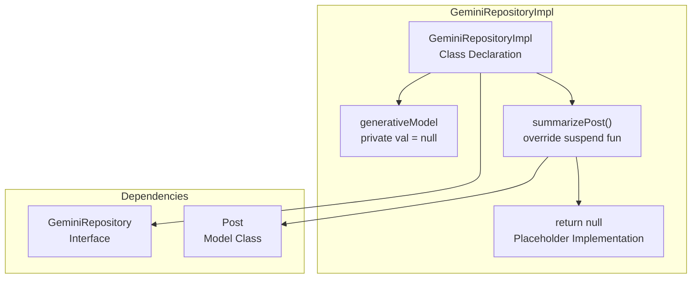
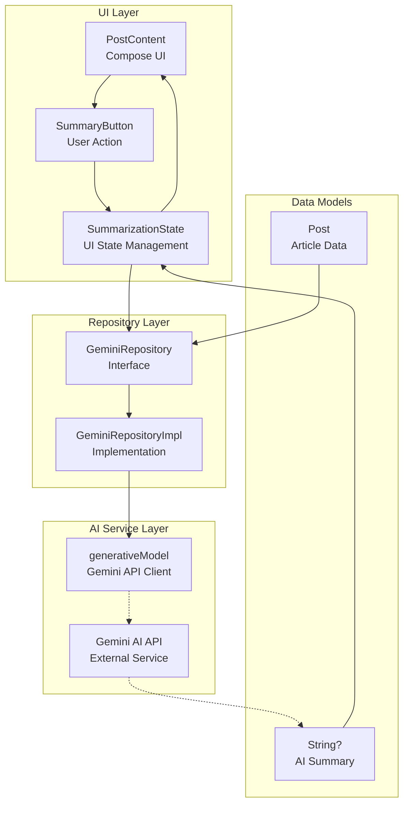

<!-- source: DeepWiki mcp.deepwiki.com · repo android/codelab-gemini-summary · page 4.1 Gemini AI Integration · fetched 2026-10-23 -->

# Gemini AI Integration

Relevant source files

The following files were used as context for generating this wiki page:

- [app/src/main/java/com/example/jetnews/data/gemini/GeminiRepository.kt](app/src/main/java/com/example/jetnews/data/gemini/GeminiRepository.kt)
- [app/src/main/java/com/example/jetnews/data/gemini/impl/GeminiRepositoryImpl.kt](app/src/main/java/com/example/jetnews/data/gemini/impl/GeminiRepositoryImpl.kt)

## Purpose and Scope

This document covers the integration of Google's Gemini AI service into the JetNews application for article summarization functionality. The system implements a repository pattern that abstracts the Gemini API interaction, allowing the UI layer to request article summaries without direct knowledge of the underlying AI service implementation.

For information about the UI components that consume these summaries, see [Article Display System](#3.1). For broader data architecture patterns, see [Data Layer and AI Integration](#4).

## Repository Pattern Architecture

The Gemini AI integration follows a clean repository pattern with a clear separation between interface definition and implementation. This architecture allows for easy testing, dependency injection, and potential future changes to the AI service provider.

### Repository Interface Structure

Sources: [app/src/main/java/com/example/jetnews/data/gemini/GeminiRepository.kt:22-24](), [app/src/main/java/com/example/jetnews/data/gemini/impl/GeminiRepositoryImpl.kt:22-31]()

## Interface Definition

The `GeminiRepository` interface provides a single, focused contract for AI-powered article summarization:

| Method | Parameters | Return Type | Description |
|--------|------------|-------------|-------------|
| `summarizePost` | `post: Post` | `String?` | Generates AI summary of article content |

The interface is defined in [app/src/main/java/com/example/jetnews/data/gemini/GeminiRepository.kt:22-24]() and follows suspend function conventions for asynchronous operations. The nullable return type allows for graceful handling of summarization failures.

Sources: [app/src/main/java/com/example/jetnews/data/gemini/GeminiRepository.kt:22-24]()

## Implementation Structure

The `GeminiRepositoryImpl` class provides the concrete implementation of the repository interface, though the current codebase appears to be a template for developers to complete:

### Class Structure

Sources: [app/src/main/java/com/example/jetnews/data/gemini/impl/GeminiRepositoryImpl.kt:22-31]()

### Key Implementation Details

The implementation class structure includes:

- **Package**: `com.example.jetnews.data.gemini.impl`
- **Inheritance**: Implements `GeminiRepository` interface
- **Private Fields**: `generativeModel` field for API client (currently null)
- **Method Implementation**: `summarizePost()` override with placeholder return

The current implementation at [app/src/main/java/com/example/jetnews/data/gemini/impl/GeminiRepositoryImpl.kt:25-29]() contains placeholder code that developers need to replace with actual Gemini API integration.

Sources: [app/src/main/java/com/example/jetnews/data/gemini/impl/GeminiRepositoryImpl.kt:22-31]()

## Data Flow Integration

The Gemini AI integration connects to the broader application architecture through a well-defined data flow:

### AI Service Integration Flow

Sources: [app/src/main/java/com/example/jetnews/data/gemini/GeminiRepository.kt:20-24](), [app/src/main/java/com/example/jetnews/data/gemini/impl/GeminiRepositoryImpl.kt:22-31]()

## Package Organization

The Gemini AI integration follows a layered package structure:

| Package | Purpose | Files |
|---------|---------|-------|
| `com.example.jetnews.data.gemini` | Interface definitions | `GeminiRepository.kt` |
| `com.example.jetnews.data.gemini.impl` | Concrete implementations | `GeminiRepositoryImpl.kt` |

This organization separates contracts from implementations, supporting dependency inversion and easier testing.

Sources: [app/src/main/java/com/example/jetnews/data/gemini/GeminiRepository.kt:18](), [app/src/main/java/com/example/jetnews/data/gemini/impl/GeminiRepositoryImpl.kt:17]()

## Integration Points

The `GeminiRepository` interface serves as the primary integration point between the UI layer and AI services. The system expects:

- **Input**: `Post` objects containing article content
- **Output**: Optional `String` containing AI-generated summaries
- **Error Handling**: Null return values for failed summarization attempts
- **Concurrency**: Suspend function support for coroutine-based async operations

The current implementation appears to be a codelab template where developers implement the actual Gemini API integration by replacing the null placeholders with functional code.

Sources: [app/src/main/java/com/example/jetnews/data/gemini/GeminiRepository.kt:22-24](), [app/src/main/java/com/example/jetnews/data/gemini/impl/GeminiRepositoryImpl.kt:25-29]()

---

