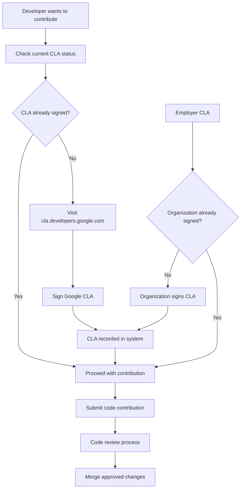
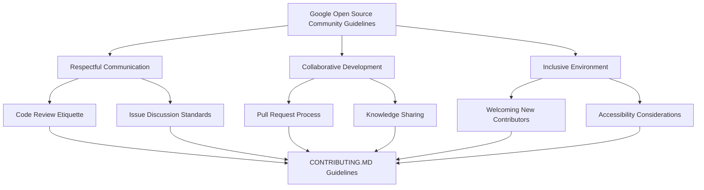
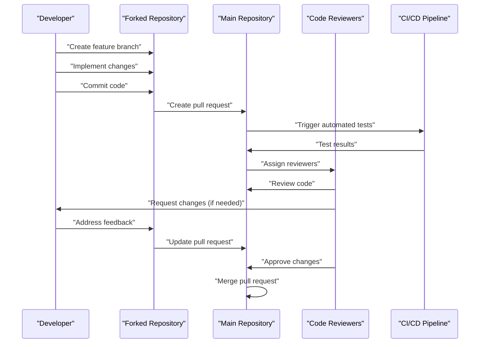
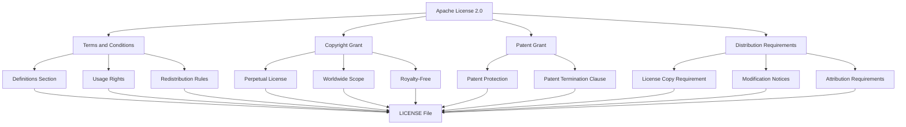
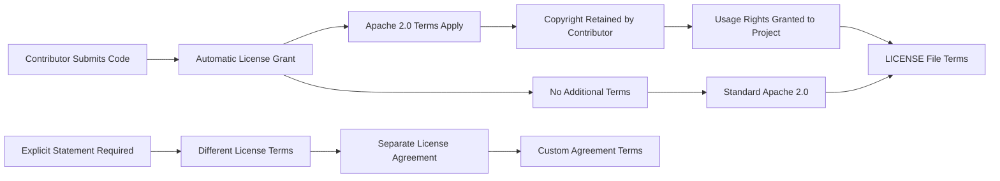
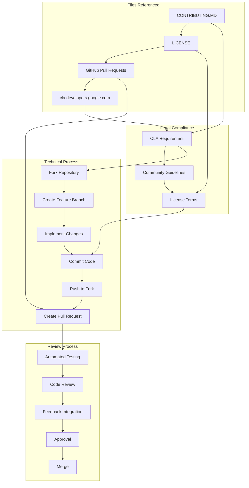

<!-- source: DeepWiki mcp.deepwiki.com · repo android/codelab-gemini-summary · page 5 Development and Contribution · fetched 2026-10-23 -->

# Development and Contribution

Relevant source files

The following files were used as context for generating this wiki page:

- [CONTRIBUTING.MD](CONTRIBUTING.MD)
- [LICENSE](LICENSE)

## Purpose and Scope

This document provides comprehensive information for developers who wish to contribute to the JetNews Android application. It covers the legal requirements, contribution process, and development workflow necessary to successfully submit code changes to the project.

For technical details about the project's build configuration, see [Project Setup and Configuration](#2). For information about the application's architecture and components, see [User Interface Architecture](#3) and [Data Layer and AI Integration](#4).

## Contributing Guidelines

The JetNews project welcomes contributions from the community. All contributions must follow Google's established processes and community standards to ensure code quality and legal compliance.

### Legal Requirements

Before contributing any code to the JetNews project, developers must complete the legal compliance process outlined in the project's contribution guidelines.

#### Contributor License Agreement Process

**CLA Requirements Process**

Sources: [CONTRIBUTING.MD:9-19]()

| Step | Action | Reference |
|------|--------|-----------|
| 1 | Visit CLA portal | `https://cla.developers.google.com/` |
| 2 | Check existing agreements | Individual or employer CLA |
| 3 | Sign new CLA if needed | Required for first-time contributors |
| 4 | Verification | CLA system records agreement |

### Community Guidelines Compliance

The project follows Google's Open Source Community Guidelines, which establish behavioral expectations for all contributors.

#### Community Standards Framework

Sources: [CONTRIBUTING.MD:23-24]()

### Code Review Process

All code submissions undergo mandatory review through GitHub's pull request system, ensuring code quality and project consistency.

#### Pull Request Workflow

Sources: [CONTRIBUTING.MD:28-33]()

**Review Requirements**

| Requirement | Description | Authority |
|-------------|-------------|-----------|
| **Mandatory Review** | All submissions require review | Project maintainers |
| **GitHub PRs** | Use GitHub pull request system | GitHub platform |
| **Project Member Reviews** | Even project members need reviews | Google policy |
| **Documentation Review** | GitHub Help documentation | External reference |

## License Information

The JetNews project is distributed under the Apache License, Version 2.0, which provides specific terms for use, modification, and distribution of the codebase.

### Apache License 2.0 Structure

Sources: [LICENSE:1-176]()

### Key License Terms

**Copyright and Patent Grants**

| Grant Type | Scope | Conditions |
|------------|-------|------------|
| **Copyright License** | Perpetual, worldwide, non-exclusive | Subject to license terms |
| **Patent License** | Royalty-free, irrevocable | Patent claims in contributions |
| **Distribution Rights** | Reproduce, modify, distribute | Must include license copy |
| **Sublicensing** | Prepare derivative works | Attribution requirements |

Sources: [LICENSE:66-87]()

**Redistribution Requirements**

The license establishes specific obligations for distributing the work or derivative works:

1. **License Copy Distribution** - Must provide Apache License copy to recipients
2. **Modification Notices** - Modified files must carry prominent change notices  
3. **Attribution Preservation** - Retain copyright, patent, trademark notices
4. **NOTICE File Handling** - Include attribution notices in derivative works

Sources: [LICENSE:89-121]()

### Contribution Licensing Terms

Sources: [LICENSE:130-136]()

**Submission Terms**

| Aspect | Default Behavior | Alternative |
|--------|------------------|-------------|
| **License Terms** | Apache 2.0 without additional terms | Explicit separate agreement |
| **Copyright Ownership** | Contributor retains copyright | No transfer required |
| **Usage Rights** | Project gains usage/distribution rights | Defined by license |
| **Modification Rights** | Project can modify contributions | Standard Apache 2.0 terms |

### Development Workflow Integration

The contribution process integrates legal compliance with technical development workflows to ensure both code quality and legal requirements are met.

#### Complete Development Lifecycle

Sources: [CONTRIBUTING.MD:1-33](), [LICENSE:1-176]()

This comprehensive development and contribution framework ensures that the JetNews project maintains high code quality while meeting all legal and community requirements for open source development.

---

