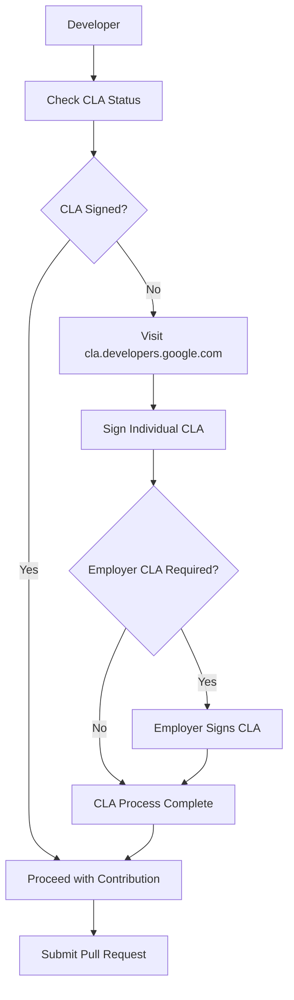
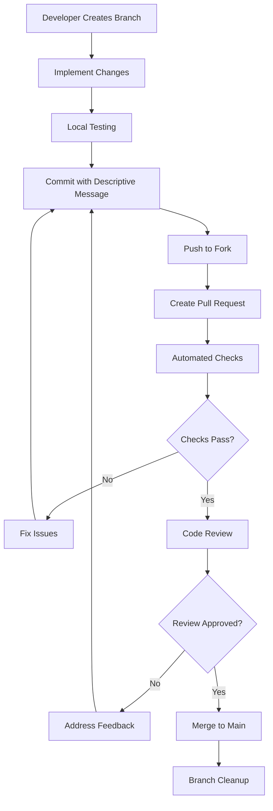
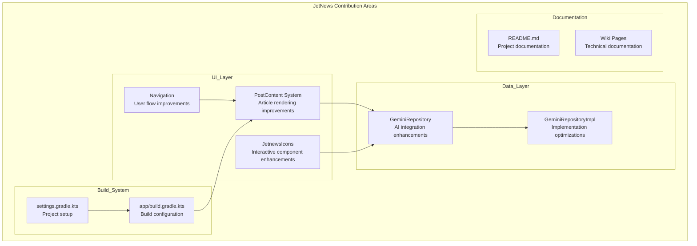

<!-- source: DeepWiki mcp.deepwiki.com · repo android/codelab-gemini-summary · page 5.1 Contributing Guidelines · fetched 2026-10-23 -->

# Contributing Guidelines

Relevant source files

The following files were used as context for generating this wiki page:

- [CONTRIBUTING.MD](CONTRIBUTING.MD)

## Purpose and Scope

This document outlines the legal, technical, and procedural requirements for contributing to the JetNews Android application. It covers the mandatory Contributor License Agreement (CLA) process, community guidelines, and code review procedures that all contributors must follow.

For information about the project's overall structure and architecture, see [Project Setup and Configuration](#2). For details about the Apache 2.0 license under which this project is distributed, see [License Information](#5.2).

## Legal Requirements

### Contributor License Agreement (CLA)

All contributions to the JetNews project must be accompanied by a signed Contributor License Agreement. This legal requirement ensures that Google has the necessary permissions to use and redistribute contributions while preserving the contributor's copyright ownership.

The CLA process involves:
- Visiting the Google CLA portal at https://cla.developers.google.com/
- Signing the agreement if you haven't already done so for another Google project
- Verifying that your current employer (if applicable) has also signed the CLA

**Note**: If you or your employer have previously signed the Google CLA for any other project, you typically do not need to sign it again.

Sources: [CONTRIBUTING.MD:9-19]()

### CLA Workflow

Sources: [CONTRIBUTING.MD:9-19]()

## Community Standards

### Code of Conduct

The JetNews project adheres to Google's Open Source Community Guidelines, which establish behavioral expectations for all participants in the project community. These guidelines cover:

- Respectful communication and collaboration
- Constructive feedback and criticism
- Inclusive participation regardless of background
- Professional conduct in all project interactions

Contributors are expected to familiarize themselves with these guidelines before participating in the project.

Sources: [CONTRIBUTING.MD:21-24]()

## Code Review Process

### Pull Request Requirements

All code submissions, including those from project maintainers, must undergo review through GitHub pull requests. This process ensures code quality, architectural consistency, and adherence to project standards.

The review process includes:
- **Technical Review**: Code functionality, performance, and architecture
- **Style Review**: Adherence to Android and Kotlin coding standards
- **Documentation Review**: Inline comments and documentation updates
- **Testing Review**: Unit tests and integration test coverage

### Review Workflow

Sources: [CONTRIBUTING.MD:26-33]()

## Technical Contribution Guidelines

### Development Environment Setup

Contributors should ensure their development environment is properly configured to work with the JetNews codebase:

| Component | Requirement | Purpose |
|-----------|-------------|---------|
| Android Studio | Latest stable version | IDE support for Jetpack Compose |
| JDK | Version 11 or higher | Kotlin compilation |
| Android SDK | API level 21+ | Target platform compatibility |
| Gradle | Managed by wrapper | Build system consistency |

### Code Quality Standards

Contributors must maintain consistency with the existing codebase architecture:

- **UI Components**: Follow the established patterns in `PostContent.kt` and `JetnewsIcons.kt`
- **Data Layer**: Implement repository pattern as demonstrated in `GeminiRepository.kt`
- **AI Integration**: Maintain compatibility with existing Gemini AI integration patterns
- **Build Configuration**: Preserve compatibility with existing Gradle configuration

### Contribution Areas

The JetNews project welcomes contributions in several areas:

Sources: [CONTRIBUTING.MD:1-33]()

## Submission Process

### Pre-Submission Checklist

Before submitting a pull request, contributors should verify:

1. **Legal Compliance**: CLA signed and current
2. **Code Quality**: Follows project coding standards
3. **Testing**: All existing tests pass, new tests added for new functionality
4. **Documentation**: Code comments and wiki updates as needed
5. **Build Verification**: Clean build with no warnings
6. **Compatibility**: Changes work with existing UI components and data layer

### Pull Request Template

When creating a pull request, include:
- **Description**: Clear explanation of changes made
- **Testing**: How the changes were verified
- **Screenshots**: For UI changes, include before/after screenshots
- **Breaking Changes**: Any API or behavior modifications
- **Related Issues**: Link to GitHub issues addressed

Sources: [CONTRIBUTING.MD:28-33]()

## Review Timeline and Process

### Expected Response Times

| Review Stage | Timeline | Responsibility |
|--------------|----------|----------------|
| Initial Review | 1-2 business days | Project maintainers |
| Technical Review | 3-5 business days | Technical reviewers |
| Final Approval | 1-2 business days | Project leads |
| Merge | Same day | Automated or manual |

### Reviewer Responsibilities

Project reviewers evaluate submissions across multiple dimensions:
- **Functional Correctness**: Code performs intended behavior
- **Architectural Consistency**: Follows established patterns
- **Performance Impact**: No degradation to app performance
- **Security Considerations**: No introduction of vulnerabilities
- **Maintainability**: Code is readable and well-structured

Sources: [CONTRIBUTING.MD:28-33]()

---

