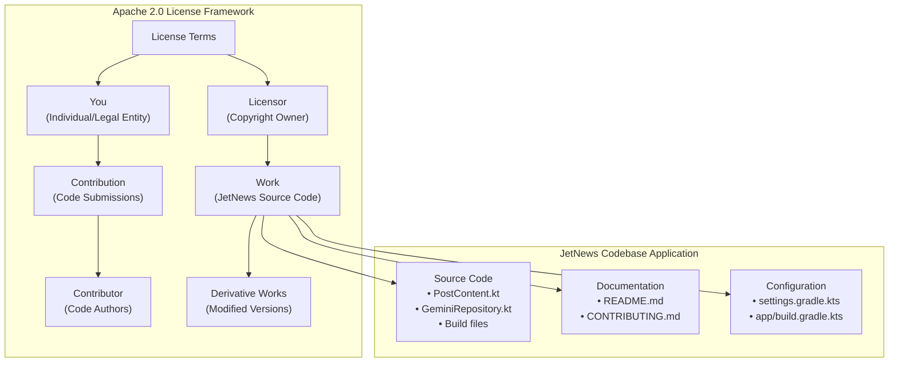
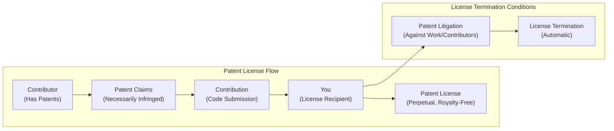
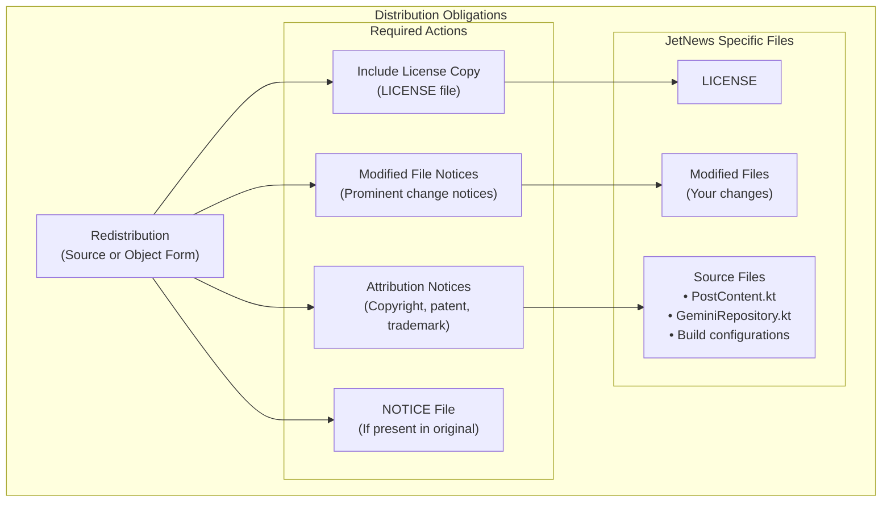
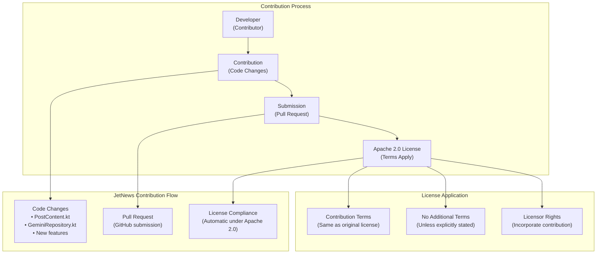

<!-- source: DeepWiki mcp.deepwiki.com · repo android/codelab-gemini-summary · page 5.2 License Information · fetched 2026-10-23 -->

# License Information

<details>
<summary>Relevant source files</summary>

The following files were used as context for generating this wiki page:

- [LICENSE](LICENSE)

</details>


## Purpose and Scope

This document describes the licensing terms that govern the JetNews Android application codebase. It covers the Apache 2.0 license under which the project is distributed, the rights and obligations of users and contributors, and the legal framework that applies to all code modifications and distributions.

For information about contributing code to the project, see [Contributing Guidelines](#5.1).

## License Overview

The JetNews project is distributed under the Apache License, Version 2.0. This license is located in the root directory of the repository and governs all source code, documentation, and associated materials unless explicitly stated otherwise.

| License Property | Value |
|------------------|-------|
| **License Type** | Apache License 2.0 |
| **License File** | `LICENSE` |
| **Effective Date** | January 2004 |
| **License URL** | http://www.apache.org/licenses/ |

The Apache 2.0 license is a permissive open-source license that allows for both commercial and non-commercial use, modification, and distribution of the software.

Sources: [LICENSE:1-3]()

## License Structure and Key Definitions

The Apache 2.0 license defines several key terms that establish the legal framework for the project:



Sources: [LICENSE:7-64]()

## Rights and Permissions

The Apache 2.0 license grants users comprehensive rights to use, modify, and distribute the JetNews codebase:

### Copyright License Grant

The license provides a perpetual, worldwide, non-exclusive, royalty-free copyright license with the following permissions:

| Permission | Description | Application to JetNews |
|------------|-------------|------------------------|
| **Reproduce** | Make copies of the work | Create local copies of the repository |
| **Prepare Derivative Works** | Modify and adapt the code | Create custom versions of the app |
| **Publicly Display** | Show the software publicly | Deploy the app to app stores |
| **Publicly Perform** | Execute the software publicly | Run the app in production |
| **Sublicense** | Grant rights to others | Include in larger projects |
| **Distribute** | Share copies with others | Redistribute modified versions |

Sources: [LICENSE:66-71]()

### Patent License Grant

The license includes patent protection, granting users rights to any patents that contributors might hold that are necessarily infringed by their contributions:



Sources: [LICENSE:73-87]()

## Obligations and Restrictions

### Distribution Requirements

When redistributing the JetNews codebase or derivative works, you must comply with specific obligations:



Sources: [LICENSE:89-121]()

### Trademark Restrictions

The license explicitly does not grant permission to use trade names, trademarks, service marks, or product names of the licensor, except for reasonable and customary use in describing the origin of the work.

| Restricted Use | Permitted Use |
|----------------|---------------|
| Using "JetNews" as your app name | Stating "Based on JetNews" |
| Using Google trademarks | Describing the original work |
| Claiming endorsement | Academic or technical references |

Sources: [LICENSE:138-141]()

## Warranty and Liability Disclaimers

The Apache 2.0 license includes important disclaimers that affect users of the JetNews codebase:

### Disclaimer of Warranty

The software is provided "AS IS" without warranties of any kind, including:

- **Title**: No guarantee of ownership rights
- **Non-infringement**: No guarantee against IP violations  
- **Merchantability**: No guarantee of fitness for sale
- **Fitness for Purpose**: No guarantee of suitability for specific use

### Limitation of Liability

Contributors are not liable for damages arising from use of the software, including:

- Direct damages
- Indirect damages  
- Special damages
- Incidental damages
- Consequential damages

Sources: [LICENSE:143-163]()

## Contributing Under the License

### Contribution Submission

When contributing code to the JetNews project, the Apache 2.0 license establishes the following framework:



Unless explicitly stated otherwise, any contribution submitted for inclusion in the JetNews project will be under the terms and conditions of the Apache 2.0 license, without any additional terms or conditions.

Sources: [LICENSE:130-136]()

## License Application Instructions

The Apache 2.0 license includes standardized instructions for applying the license to new works. For the JetNews project, this means:

### Standard License Header

When creating new files in the JetNews codebase, the recommended practice is to include the Apache 2.0 license header:

```
Copyright [yyyy] [name of copyright owner]

Licensed under the Apache License, Version 2.0 (the "License");
you may not use this file except in compliance with the License.
You may obtain a copy of the License at

    http://www.apache.org/licenses/LICENSE-2.0

Unless required by applicable law or agreed to in writing, software
distributed under the License is distributed on an "AS IS" BASIS,
WITHOUT WARRANTIES OR CONDITIONS OF ANY KIND, either express or implied.
See the License for the specific language governing permissions and
limitations under the License.
```

### File-Level License Application

The license applies to all files in the JetNews repository, including:

- Source code files (`.kt`, `.java`)
- Build configuration files (`.gradle.kts`, `.gradle`)
- Documentation files (`.md`)
- Configuration files (`.xml`, `.properties`)

Sources: [LICENSE:178-201]()