# Page: JetNews Overview

# JetNews Overview

<details>
<summary>Relevant source files</summary>

The following files were used as context for generating this wiki page:

- [README.md](README.md)

</details>


## Purpose and Scope

This document provides a comprehensive overview of the JetNews Android application, explaining its architecture, features, and implementation approach. JetNews is a sample news reading application built with Jetpack Compose that demonstrates modern Android development patterns and UI capabilities. The application integrates AI-powered article summarization through Google's Gemini API.

This overview covers the high-level structure and key components of the application. For detailed information about specific subsystems, see:
- Project configuration and build system: [Project Setup and Configuration](#2)
- UI component implementation: [User Interface Architecture](#3)
- AI integration details: [Data Layer and AI Integration](#4)
- Development guidelines: [Development and Contribution](#5)

## Application Overview

JetNews is a modern Android news reader application that serves as a showcase for Jetpack Compose UI capabilities. The application demonstrates best practices in Android development, including modern UI design, adaptive layouts, and integration with AI services for content enhancement.

The application is structured as a multi-screen news reader with AI-powered summarization capabilities, built entirely using Jetpack Compose and following Material Design 3 principles.

**Core Technologies:**
- **Jetpack Compose** - Modern declarative UI framework
- **Material Design 3** - Google's latest design system
- **Gemini AI API** - Article summarization service
- **Glance** - App widget framework
- **Navigation Component** - Screen navigation management

Sources: [README.md:1-14]()

## Key Features

JetNews provides a comprehensive news reading experience with the following capabilities:

| Feature | Description | Implementation |
|---------|-------------|----------------|
| **Article List** | Scrollable list of news articles with custom layouts | Compose `LazyColumn` with custom `Card` components |
| **Article Detail** | Full article view with rich text formatting | Custom text rendering with `Typography` and `ColorScheme` |
| **AI Summarization** | Gemini-powered article summaries | Repository pattern with `GeminiRepository` |
| **Navigation Drawer** | Side navigation for screen switching | `NavDrawerLayout` with navigation routes |
| **Interests Screen** | Topic subscription management | Custom `SelectTopicButton` with `Toggleable` composable |
| **App Widgets** | Home screen widgets for quick access | Glance-based widgets with Material 3 theming |
| **Adaptive UI** | Responsive design for all screen sizes | Compose adaptive layouts with split-screen support |

Sources: [README.md:16-21](), [README.md:102-114]()

## Application Architecture

The following diagram illustrates the high-level architecture of JetNews, showing the relationship between major components and their corresponding code entities:

### JetNews System Architecture

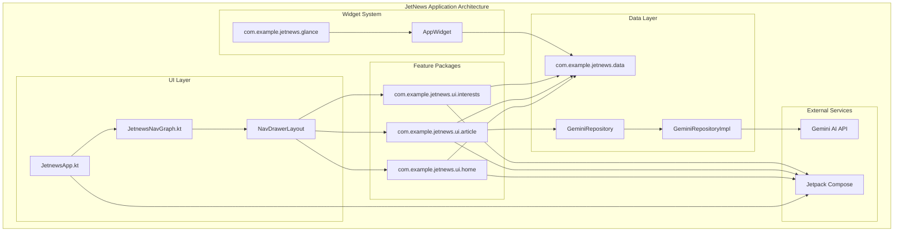

Sources: [README.md:22-33]()

## Screen Navigation Flow

The application follows a structured navigation pattern managed through Jetpack Compose Navigation. The following diagram shows the screen flow and navigation relationships:

### Navigation Structure

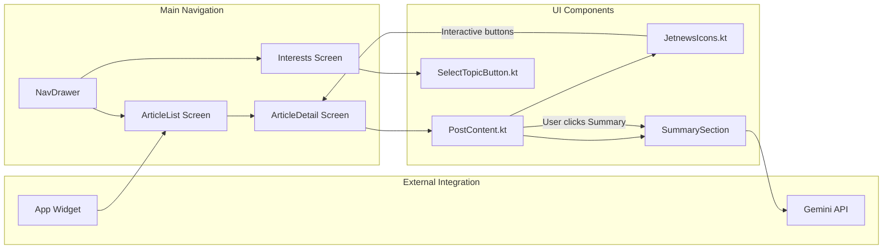

Sources: [README.md:34-48](), [README.md:50-58](), [README.md:60-72]()

## Package Organization

JetNews is organized into clearly defined packages, each serving specific functionality:

### Core UI Packages

| Package | Purpose | Key Components |
|---------|---------|----------------|
| `com.example.jetnews.ui` | App scaffolding and navigation | `JetnewsApp.kt`, `JetnewsNavGraph.kt` |
| `com.example.jetnews.ui.home` | Article list screen | Custom Composables, scrolling lists |
| `com.example.jetnews.ui.article` | Article detail view | Text API usage, bottom app bar |
| `com.example.jetnews.ui.interests` | Topic subscription | Tabs, custom checkbox buttons |
| `com.example.jetnews.ui.theme` | Design system | `Type.kt`, color schemes |

### Supporting Packages

| Package | Purpose | Key Components |
|---------|---------|----------------|
| `com.example.jetnews.data` | Static data management | Sample news data |
| `com.example.jetnews.glance` | App widget implementation | Glance composables, Material 3 theming |

Sources: [README.md:24-33](), [README.md:36-48](), [README.md:52-72](), [README.md:74-89](), [README.md:91-94]()

## Adaptive UI Implementation

JetNews demonstrates modern adaptive UI principles, ensuring optimal user experience across all device types and screen configurations. The application dynamically adjusts its layout based on available screen space rather than simply detecting device type.

**Key Adaptive Features:**
- **Split-screen compatibility** - Proper layout adaptation when running in split-screen mode
- **Dynamic layout selection** - UI adapts to actual available space, not just device category
- **Responsive design** - Consistent experience across phones, tablets, and foldable devices
- **Context-aware navigation** - Navigation patterns adjust based on screen real estate

This approach ensures that JetNews provides an optimal experience whether running on a small phone, a large tablet, or in split-screen mode on any device.

Sources: [README.md:106-114]()

## Testing Infrastructure

The application includes comprehensive testing capabilities supporting both instrumented and unit testing approaches:

| Test Type | Framework | Execution Method |
|-----------|-----------|------------------|
| **Instrumented Tests** | Android Testing Framework | Device/emulator execution via `./gradlew connectedCheck` |
| **Robolectric Tests** | Robolectric JVM testing | Local JVM execution via `./gradlew testDebug` |

Both testing approaches are configured with dedicated run configurations in Android Studio for developer convenience.

Sources: [README.md:95-101]()

## Development Requirements

To work with JetNews, developers need:

- **Android Studio** - Latest stable version recommended
- **Jetpack Compose** - Modern UI toolkit knowledge
- **Kotlin** - Primary development language
- **Material Design 3** - UI design system understanding

The project can be cloned directly or imported through Android Studio's project import functionality.

Sources: [README.md:5-11]()

---

# Page: Project Setup and Configuration

# Project Setup and Configuration

<details>
<summary>Relevant source files</summary>

The following files were used as context for generating this wiki page:

- [app/build.gradle.kts](app/build.gradle.kts)
- [settings.gradle.kts](settings.gradle.kts)

</details>


This page covers the essential build system configuration, project structure, and setup requirements for the JetNews Android application. It focuses on the Gradle build system, dependency management, and core project configuration files that enable the application to build and run successfully.

For detailed information about the Gradle build system internals, see [Gradle Build System](#2.1). For version control configuration, see [Version Control Configuration](#2.2). For information about contributing to the project, see [Contributing Guidelines](#5.1).

## Project Structure Overview

The JetNews project follows a standard Android application structure with Gradle-based build configuration. The project uses Kotlin DSL for build scripts and integrates modern Android development tools.

### Project Structure Diagram

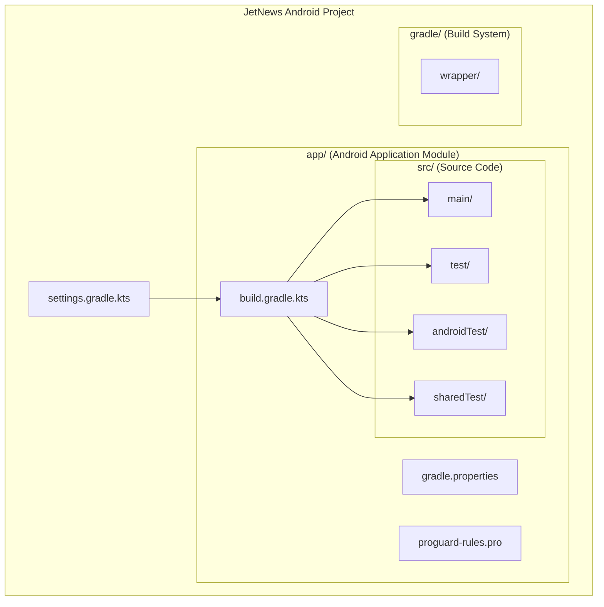

**Sources:** [settings.gradle.kts:1-40](), [app/build.gradle.kts:1-161]()

## Core Configuration Files

### settings.gradle.kts Configuration

The project-level settings file defines the basic project structure and repository configuration:

| Configuration Aspect | Value | Purpose |
|----------------------|-------|---------|
| Project Name | `"JetNews"` | Root project identifier |
| Included Modules | `":app"` | Single application module |
| Repository Mode | `FAIL_ON_PROJECT_REPOS` | Enforces centralized dependency resolution |

The settings file also includes support for Compose snapshot builds through the `COMPOSE_SNAPSHOT_ID` environment variable, enabling testing with bleeding-edge Compose versions.

**Sources:** [settings.gradle.kts:16-40]()

### app/build.gradle.kts Configuration

The application module build file contains the core Android application configuration:

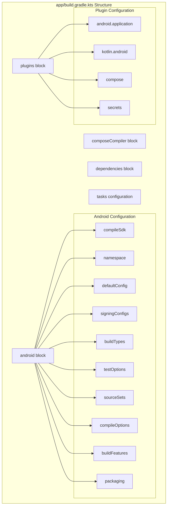

**Sources:** [app/build.gradle.kts:17-98]()

## Build System Architecture

### Plugin Configuration

The application uses four key Gradle plugins configured through version catalogs:

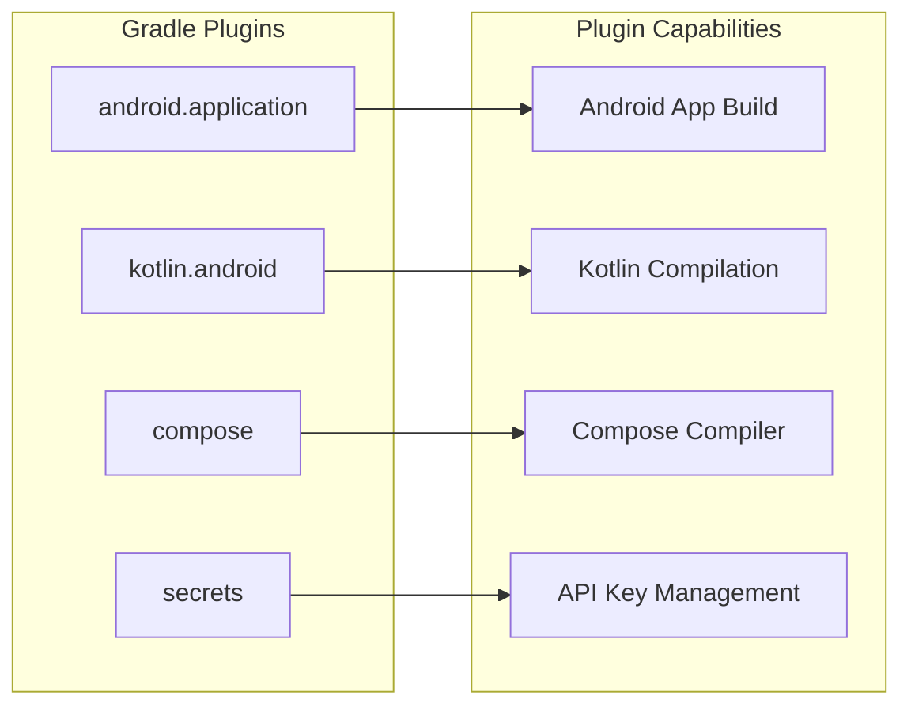

**Sources:** [app/build.gradle.kts:17-22]()

### Android Configuration Details

| Configuration | Value | Description |
|---------------|-------|-------------|
| `compileSdk` | From version catalog | Target Android API level |
| `namespace` | `"com.example.jetnews"` | Application package namespace |
| `applicationId` | `"com.example.jetnews"` | Unique application identifier |
| `minSdk` | From version catalog | Minimum supported Android version |
| `targetSdk` | From version catalog | Target Android version |
| `versionCode` | `1` | Internal version number |
| `versionName` | `"1.0"` | User-facing version string |

**Sources:** [app/build.gradle.kts:24-36]()

### Build Types and Signing

The project defines two build types with different optimization settings:

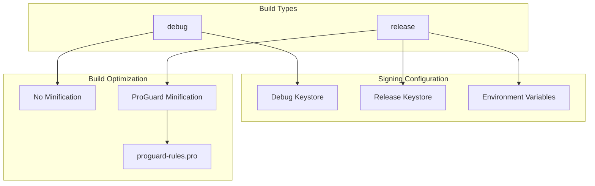

**Sources:** [app/build.gradle.kts:38-62]()

## Dependency Management

### Dependency Categories

The project organizes dependencies into distinct categories using a Bill of Materials (BOM) approach:

| Category | Purpose | Key Dependencies |
|----------|---------|------------------|
| Compose BOM | UI Framework | `androidx.compose.bom` |
| Kotlin | Language Support | `kotlin.stdlib`, `kotlinx.coroutines.android` |
| Compose UI | User Interface | `material3`, `animation`, `foundation.layout` |
| AndroidX | Android Framework | `appcompat`, `activity.ktx`, `core.ktx` |
| Glance | Widget Framework | `androidx.glance`, `androidx.glance.appwidget` |
| Lifecycle | Component Lifecycle | `lifecycle.viewmodel.ktx`, `lifecycle.livedata.ktx` |
| Navigation | App Navigation | `androidx.navigation.compose` |
| Testing | Test Framework | `junit`, `androidx.test.core`, `robolectric` |

**Sources:** [app/build.gradle.kts:104-156]()

### Dependency Resolution Flow

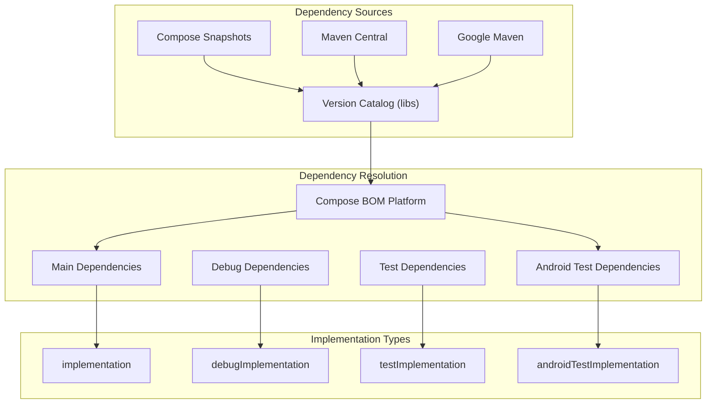

**Sources:** [app/build.gradle.kts:104-156](), [settings.gradle.kts:25-36]()

## Advanced Configuration

### Test Configuration

The project includes comprehensive test support with shared test directories:

- **Unit Tests**: Robolectric-based tests with Android resource access
- **Instrumented Tests**: On-device tests using Espresso
- **Shared Test Code**: Common test utilities in `src/sharedTest/java`

**Sources:** [app/build.gradle.kts:64-80]()

### Compose Compiler Configuration

The Compose compiler is configured with performance optimizations:

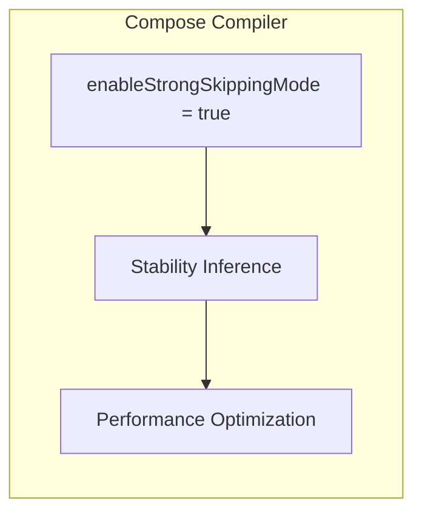

**Sources:** [app/build.gradle.kts:100-102]()

### Repository Configuration

The project uses centralized repository management with snapshot support:

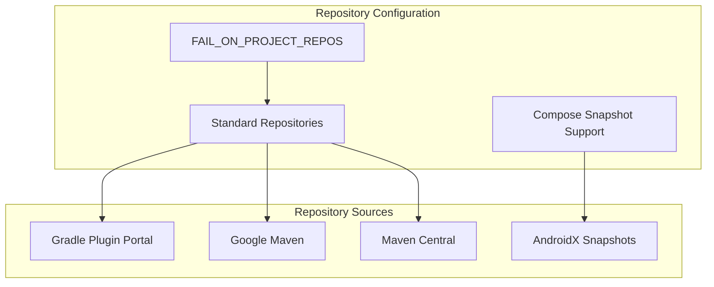

**Sources:** [settings.gradle.kts:18-36]()

---

# Page: Gradle Build System

# Gradle Build System

<details>
<summary>Relevant source files</summary>

The following files were used as context for generating this wiki page:

- [app/build.gradle.kts](app/build.gradle.kts)
- [settings.gradle.kts](settings.gradle.kts)

</details>


## Purpose and Scope

This document explains the Gradle build system configuration for the JetNews Android application. It covers the multi-module project setup, Android-specific build configuration, dependency management, and compilation settings. The build system is configured using Kotlin DSL (`.kts` files) and supports both debug and release builds with Jetpack Compose integration.

For version control aspects of the project configuration, see [Version Control Configuration](#2.2).

## Project Structure and Settings

The JetNews project uses a standard Android Gradle project structure with centralized configuration management. The root-level settings establish the project identity and repository configuration.

### Multi-Module Configuration

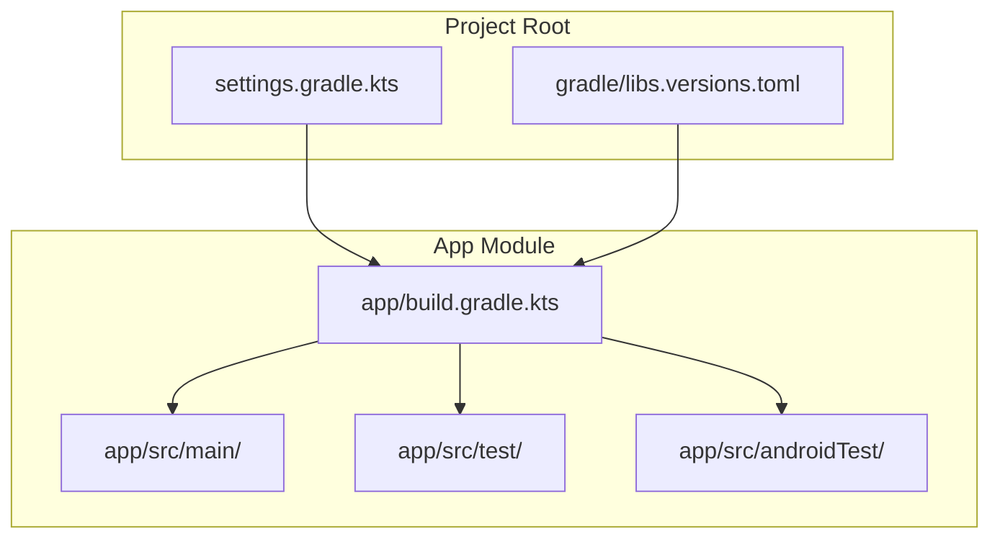

The project is defined in [settings.gradle.kts:37]() with `rootProject.name = "JetNews"` and includes a single app module via [settings.gradle.kts:38]() `include(":app")`.

### Repository Management

The build system uses centralized repository management with snapshot support for Compose development:

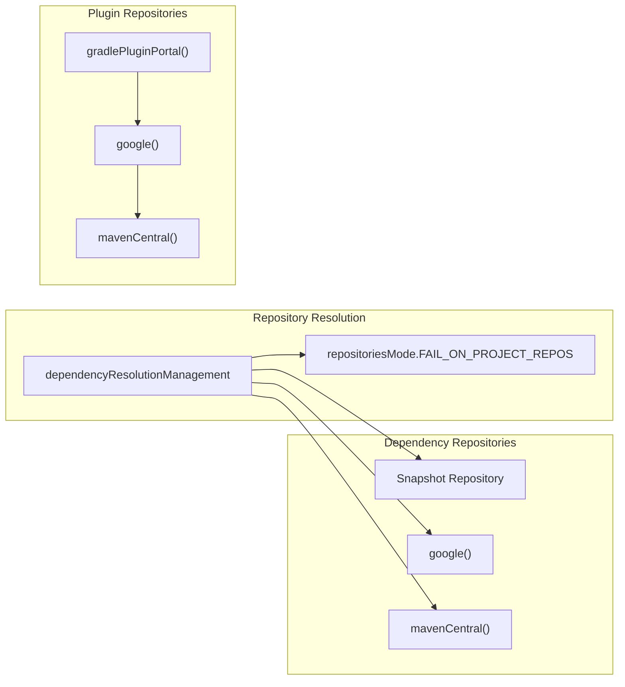

The snapshot repository is conditionally included based on the `COMPOSE_SNAPSHOT_ID` environment variable [settings.gradle.kts:16,28-31]().

Sources: [settings.gradle.kts:16-40]()

## Android Application Configuration

The app module configuration defines the Android-specific build settings and application metadata.

### Core Android Settings

| Setting | Value | Source |
|---------|-------|---------|
| `namespace` | `"com.example.jetnews"` | [app/build.gradle.kts:26]() |
| `applicationId` | `"com.example.jetnews"` | [app/build.gradle.kts:29]() |
| `versionCode` | `1` | [app/build.gradle.kts:32]() |
| `versionName` | `"1.0"` | [app/build.gradle.kts:33]() |

The SDK versions are managed through the version catalog system:
- `compileSdk` - [app/build.gradle.kts:25]()
- `minSdk` - [app/build.gradle.kts:30]()
- `targetSdk` - [app/build.gradle.kts:31]()

### Plugin Configuration

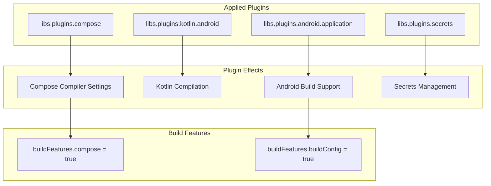

The plugins are applied using the version catalog aliases pattern [app/build.gradle.kts:17-22]().

Sources: [app/build.gradle.kts:17-22,87-90]()

## Build Variants and Signing

The build system supports debug and release variants with different signing configurations and optimization settings.

### Signing Configuration

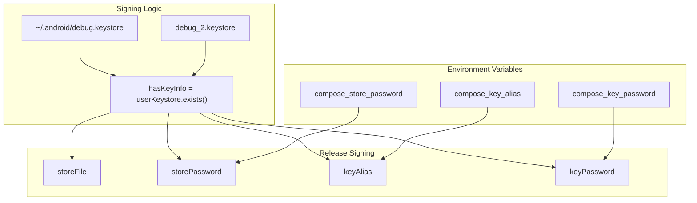

The signing configuration logic [app/build.gradle.kts:38-49]() uses the user's debug keystore if available, otherwise falls back to environment variables for production signing.

### Build Type Configuration

| Build Type | Minification | Signing | ProGuard |
|------------|--------------|---------|----------|
| `debug` | `false` | debug | none |
| `release` | `true` | release | `proguard-android-optimize.txt` |

The release build type enables minification and applies ProGuard rules [app/build.gradle.kts:56-61]().

Sources: [app/build.gradle.kts:38-62]()

## Dependencies Management

The project uses Compose BOM (Bill of Materials) for coordinated dependency versions and organizes dependencies by functional groups.

### Compose Dependencies Structure

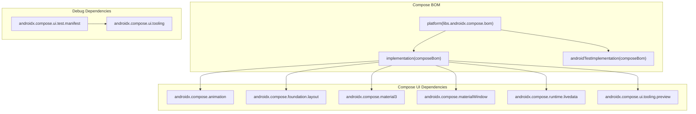

### AndroidX and Third-Party Dependencies

The project includes comprehensive AndroidX libraries organized by functionality:

| Category | Dependencies |
|----------|-------------|
| **Core AndroidX** | `androidx.core.ktx`, `androidx.appcompat`, `androidx.activity.ktx` |
| **Lifecycle** | `androidx.lifecycle.viewmodel.ktx`, `androidx.lifecycle.livedata.ktx` |
| **Navigation** | `androidx.navigation.compose` |
| **Glance Widgets** | `androidx.glance`, `androidx.glance.appwidget`, `androidx.glance.material3` |
| **Accompanist** | `accompanist.swiperefresh`, `accompanist.systemuicontroller` |

Sources: [app/build.gradle.kts:104-156]()

## Testing Configuration

The build system supports both unit tests and instrumented tests with shared test sources and Robolectric integration.

### Test Source Configuration

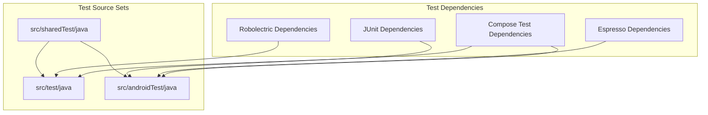

The test configuration includes shared test sources [app/build.gradle.kts:72-80]() and comprehensive test dependencies for both unit and instrumented testing.

### Test Options

| Option | Value | Purpose |
|--------|-------|---------|
| `isReturnDefaultValues` | `true` | Mock Android framework calls |
| `isIncludeAndroidResources` | `true` | Access Android resources in tests |
| `robolectric.logging` | `"stdout"` | Robolectric logging output |

Sources: [app/build.gradle.kts:64-80,144-160]()

## Compilation Settings

The build system uses modern compilation settings optimized for Jetpack Compose and Android development.

### Compose Compiler Configuration

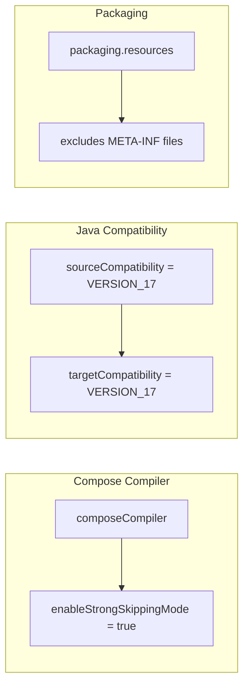

The Compose compiler is configured with strong skipping mode enabled [app/build.gradle.kts:100-102]() for improved performance during recomposition.

### Resource Packaging

The packaging configuration excludes duplicate META-INF files [app/build.gradle.kts:92-97]() to prevent build conflicts when multiple dependencies include the same license files.

Sources: [app/build.gradle.kts:82-102]()

---

# Page: Version Control Configuration

# Version Control Configuration

<details>
<summary>Relevant source files</summary>

The following files were used as context for generating this wiki page:

- [.gitignore](.gitignore)
- [app/.gitignore](app/.gitignore)

</details>


## Purpose and Scope

This document explains the version control configuration for the JetNews Android application, specifically focusing on the `.gitignore` files that determine which files and directories are excluded from version control. This configuration ensures that build artifacts, IDE-specific files, and local configuration remain untracked while preserving the essential source code and project files.

For information about the overall project structure and Gradle build configuration, see [Gradle Build System](#2.1).

## Version Control Structure Overview

The JetNews project uses a hierarchical `.gitignore` configuration with exclusions defined at both the root project level and individual module levels. This approach provides comprehensive coverage while maintaining modularity for multi-module Android projects.

### GitIgnore File Hierarchy

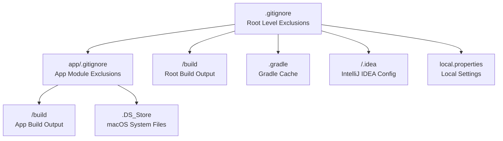

**Sources:** [.gitignore:1-10](), [app/.gitignore:1-2]()

## Root Level Version Control Configuration

The root `.gitignore` file manages project-wide exclusions that apply to the entire repository structure. This includes build system artifacts, IDE configurations, and platform-specific files.

### Build System Exclusions

| Pattern | Purpose | Impact |
|---------|---------|---------|
| `*.iml` | IntelliJ IDEA module files | Prevents IDE-generated module configuration from being tracked |
| `.gradle` | Gradle daemon and cache files | Excludes Gradle's local cache and daemon files |
| `/build` | Root build output directory | Prevents root-level build artifacts from being committed |
| `.externalNativeBuild` | External native build files | Excludes C/C++ build intermediates |
| `.cxx` | C++ build system files | Excludes CMake and ndk-build artifacts |
| `.kotlin/` | Kotlin compiler cache | Excludes Kotlin compiler incremental compilation cache |

### Development Environment Exclusions

| Pattern | Purpose | Impact |
|---------|---------|---------|
| `/.idea` | IntelliJ IDEA configuration | Prevents IDE workspace settings from being shared |
| `local.properties` | Local SDK/NDK paths | Excludes machine-specific Android SDK configuration |
| `.DS_Store` | macOS system files | Prevents macOS Finder metadata from being tracked |
| `/captures` | Android profiling data | Excludes performance profiling and debugging captures |

**Sources:** [.gitignore:1-10]()

## App Module Version Control Configuration

The app-level `.gitignore` file provides module-specific exclusions that complement the root configuration. This modular approach allows for fine-grained control over what gets tracked in different parts of the project.

### App Module Exclusions

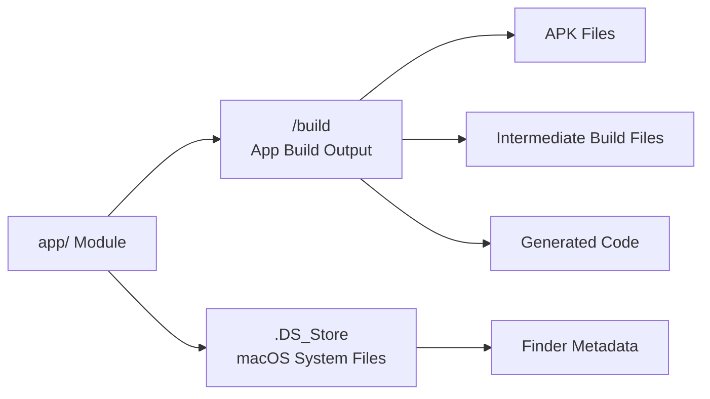

The app module excludes:
- `/build` - All build outputs including APKs, intermediate files, and generated code
- `.DS_Store` - macOS Finder metadata files that may be created within the app directory

**Sources:** [app/.gitignore:1-2]()

## Version Control Integration with Build System

The version control configuration integrates closely with the Gradle build system to ensure that generated artifacts are properly excluded while maintaining the ability to reproduce builds.

### Build Artifact Management

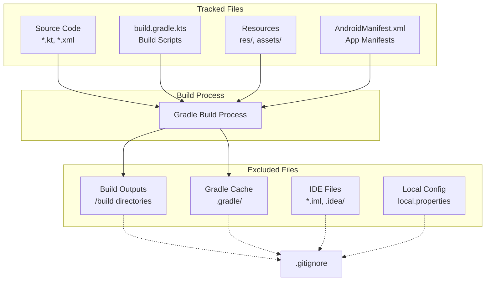

This configuration ensures that:
- Source code and build scripts are tracked for reproducibility
- Generated artifacts are excluded to prevent repository bloat
- Local development environment files remain untracked
- Build outputs can be regenerated from tracked sources

**Sources:** [.gitignore:1-10](), [app/.gitignore:1-2]()

## Best Practices and Rationale

The version control configuration follows Android development best practices by maintaining a clean separation between source code and generated artifacts.

### Key Design Principles

1. **Reproducible Builds**: Only essential files needed to reproduce the build are tracked
2. **Developer Independence**: Local configuration and IDE settings are excluded
3. **Platform Neutrality**: Platform-specific files (`.DS_Store`) are excluded
4. **Build Efficiency**: Gradle cache and intermediate files are excluded to prevent conflicts
5. **Modularity**: Module-specific exclusions allow for fine-grained control

### Integration with CI/CD

The version control configuration supports continuous integration by ensuring that:
- Build environments start with a clean slate
- No local configuration interferes with automated builds
- Generated artifacts don't cause merge conflicts
- Repository size remains manageable

**Sources:** [.gitignore:1-10](), [app/.gitignore:1-2]()

---

# Page: User Interface Architecture

# User Interface Architecture

<details>
<summary>Relevant source files</summary>

The following files were used as context for generating this wiki page:

- [app/src/main/java/com/example/jetnews/ui/article/PostContent.kt](app/src/main/java/com/example/jetnews/ui/article/PostContent.kt)
- [app/src/main/java/com/example/jetnews/ui/utils/JetnewsIcons.kt](app/src/main/java/com/example/jetnews/ui/utils/JetnewsIcons.kt)

</details>


## Purpose and Scope

This document covers the user interface architecture of the JetNews Android application, which is built entirely using Jetpack Compose. The UI architecture encompasses the composable component hierarchy, state management patterns, and the integration of Material Design 3 theming throughout the application.

For information about the underlying data layer that feeds the UI components, see [Data Layer and AI Integration](#4). For details about the specific AI integration components, see [Gemini AI Integration](#4.1).

## Overview

The JetNews UI architecture follows a composable-first approach built on Jetpack Compose, with a clear separation between presentation logic and UI components. The architecture is designed around efficient content rendering using `LazyColumn` for scrollable content and state-driven UI updates for AI-powered features.

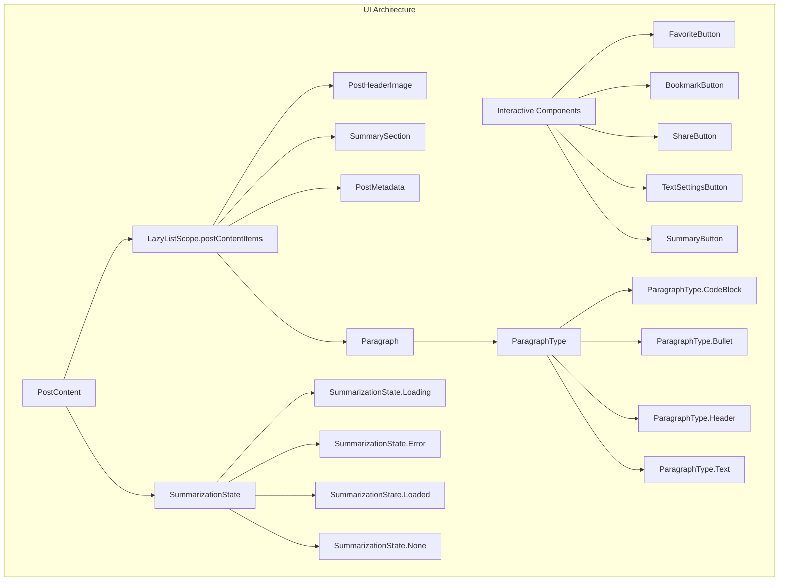

**Sources:** [app/src/main/java/com/example/jetnews/ui/article/PostContent.kt:84-98](), [app/src/main/java/com/example/jetnews/ui/utils/JetnewsIcons.kt:36-99]()

## Core Components

### Article Display System

The primary UI component is the `PostContent` composable, which serves as the main container for article rendering. It utilizes a `LazyColumn` for efficient scrolling performance and integrates with the AI summarization system.

```mermaid
graph LR
    subgraph "PostContent System"
        PC["PostContent"] --> LC["LazyColumn"]
        LC --> PCHI["postContentItems"]
        
        PCHI --> ITEM1["item { PostHeaderImage }"]
        PCHI --> ITEM2["item { SummarySection }"]
        PCHI --> ITEM3["item { Post.title }"]
        PCHI --> ITEM4["item { PostMetadata }"]
        PCHI --> ITEM5["items(post.paragraphs)"]
        
        ITEM2 --> SUMSTATE["SummarizationState"]
        SUMSTATE --> LOADING["Loading"]
        SUMSTATE --> LOADED["Loaded"]
        SUMSTATE --> ERROR["Error"]
        SUMSTATE --> NONE["None"]
    end
```

The `PostContent` function accepts several key parameters:

| Parameter | Type | Purpose |
|-----------|------|---------|
| `post` | `Post` | The article data to display |
| `contentPadding` | `PaddingValues` | Padding for the scrollable content |
| `state` | `LazyListState` | Controls scroll state and position |
| `summarizationState` | `SummarizationState` | Manages AI summary display state |

**Sources:** [app/src/main/java/com/example/jetnews/ui/article/PostContent.kt:84-98](), [app/src/main/java/com/example/jetnews/ui/article/PostContent.kt:100-122]()

### Interactive Components

The application provides a set of reusable interactive components defined in `JetnewsIcons.kt`. These components follow Material Design 3 patterns and include proper accessibility support.

```mermaid
graph TD
    subgraph "Interactive UI Components"
        FB["FavoriteButton"] --> IB1["IconButton"]
        IB1 --> TUO["Icons.Filled.ThumbUpOffAlt"]
        
        BB["BookmarkButton"] --> ITB["IconToggleButton"]
        ITB --> BM["Icons.Filled.Bookmark"]
        ITB --> BMB["Icons.Filled.BookmarkBorder"]
        
        SB["ShareButton"] --> IB2["IconButton"]
        IB2 --> SHARE["Icons.Filled.Share"]
        
        TSB["TextSettingsButton"] --> IB3["IconButton"]
        IB3 --> PAINTER["painterResource(R.drawable.ic_text_settings)"]
        
        SUMB["SummaryButton"] --> IB4["IconButton"]
        IB4 --> SUM["Icons.Filled.Summarize"]
    end
```

Each component includes proper semantic labeling for accessibility:
- `FavoriteButton` uses `R.string.cd_add_to_favorites`
- `BookmarkButton` dynamically changes between "bookmark" and "unbookmark" labels
- `ShareButton` uses `R.string.cd_share`
- `TextSettingsButton` and `SummaryButton` use `R.string.cd_text_settings`

**Sources:** [app/src/main/java/com/example/jetnews/ui/utils/JetnewsIcons.kt:36-99]()

## State Management

### Summarization State Flow

The UI architecture includes a sophisticated state management system for AI-powered article summarization. The `SummarizationState` sealed class drives the UI updates in the `SummarySection` component.

```mermaid
stateDiagram-v2
    [*] --> None
    None --> Loading : User clicks SummaryButton
    Loading --> Loaded : AI service returns summary
    Loading --> Error : AI service fails
    Error --> Loading : User retries
    Loaded --> [*] : Summary displayed
    
    state Loading {
        [*] --> DisplayingLoadingText
        DisplayingLoadingText --> [*]
    }
    
    state Loaded {
        [*] --> DisplayingSummary
        DisplayingSummary --> [*]
    }
    
    state Error {
        [*] --> DisplayingError
        DisplayingError --> [*]
    }
```

The state transitions are handled in the `postContentItems` function:

```kotlin
when (summarizationState) {
    is SummarizationState.Loading -> SummarySection("Loading...")
    is SummarizationState.Loaded -> SummarySection(summarizationState.summary)
    is SummarizationState.Error -> SummarySection(summarizationState.error)
    else -> { /* noop */ }
}
```

**Sources:** [app/src/main/java/com/example/jetnews/ui/article/PostContent.kt:107-112](), [app/src/main/java/com/example/jetnews/ui/article/PostContent.kt:368-385]()

## Typography and Theming

### Paragraph Type System

The article rendering system supports multiple paragraph types with distinct styling through the `ParagraphType` enumeration and associated styling functions.

```mermaid
graph TD
    subgraph "Paragraph Rendering System"
        PT["ParagraphType"] --> PTC["CodeBlock"]
        PT --> PTB["Bullet"]
        PT --> PTH["Header"]
        PT --> PTT["Text"]
        PT --> PTCAP["Caption"]
        PT --> PTTITLE["Title"]
        PT --> PTSUB["Subhead"]
        PT --> PTQ["Quote"]
        
        PTC --> CBP["CodeBlockParagraph"]
        PTB --> BP["BulletParagraph"]
        PTH --> HP["Header styling"]
        PTT --> TP["Text styling"]
        
        CBP --> SURFACE["Surface with codeBlockBackground"]
        BP --> ROW["Row with bullet and text"]
        
        STYLE["getTextAndParagraphStyle()"] --> PS["ParagraphStyling"]
        PS --> TS["TextStyle"]
        PS --> PSTYLE["ParagraphStyle"]
        PS --> TP_PAD["trailingPadding"]
    end
```

### Typography Mapping

The paragraph types map to Material Design 3 typography scales:

| Paragraph Type | Typography Scale | Special Properties |
|---------------|------------------|-------------------|
| `Caption` | `labelMedium` | - |
| `Title` | `headlineLarge` | - |
| `Subhead` | `headlineSmall` | 16.dp trailing padding |
| `Text` | `bodyLarge` | 28.sp line height |
| `Header` | `headlineMedium` | 16.dp trailing padding |
| `CodeBlock` | `bodyLarge` | `FontFamily.Monospace` |
| `Quote` | `bodyLarge` | - |
| `Bullet` | `bodyLarge` | 8.sp text indent |

**Sources:** [app/src/main/java/com/example/jetnews/ui/article/PostContent.kt:267-301](), [app/src/main/java/com/example/jetnews/ui/article/PostContent.kt:177-211]()

## Component Relationships

### Markup Processing System

The UI architecture includes a sophisticated text markup processing system that converts `Markup` objects into `AnnotatedString` formatting for rich text display.

```mermaid
graph LR
    subgraph "Text Markup Processing"
        P["Paragraph"] --> PTAS["paragraphToAnnotatedString()"]
        PTAS --> AS["AnnotatedString"]
        
        P --> ML["markups: List<Markup>"]
        ML --> MT["MarkupType"]
        MT --> ITALIC["Italic"]
        MT --> LINK["Link"]
        MT --> BOLD["Bold"]
        MT --> CODE["Code"]
        
        ITALIC --> FSI["FontStyle.Italic"]
        LINK --> TD["TextDecoration.Underline"]
        BOLD --> FWB["FontWeight.Bold"]
        CODE --> FM["FontFamily.Monospace"]
        CODE --> CBB["codeBlockBackground"]
        
        MT --> TASI["toAnnotatedStringItem()"]
        TASI --> ASR["AnnotatedString.Range<SpanStyle>"]
    end
```

The markup system supports four primary text formatting types:
- **Italic**: Applied using `FontStyle.Italic`
- **Link**: Applied using `TextDecoration.Underline`
- **Bold**: Applied using `FontWeight.Bold`
- **Code**: Applied using `FontFamily.Monospace` with background color

**Sources:** [app/src/main/java/com/example/jetnews/ui/article/PostContent.kt:303-351](), [app/src/main/java/com/example/jetnews/ui/article/PostContent.kt:353-354]()

### Layout Structure

The complete UI component hierarchy follows this structure:

```mermaid
graph TD
    subgraph "Complete UI Hierarchy"
        PC["PostContent"] --> LC["LazyColumn"]
        LC --> PHI["PostHeaderImage"]
        LC --> SS["SummarySection"]
        LC --> TITLE["Text(post.title)"]
        LC --> SUBTITLE["Text(post.subtitle)"]
        LC --> PM["PostMetadata"]
        LC --> PARAGRAPHS["items(post.paragraphs)"]
        
        PHI --> IMG["Image(contentScale=Crop)"]
        
        SS --> COL["Column"]
        COL --> HEADER["Text(R.string.article_gemini_summary)"]
        COL --> CONTENT["Text(summary)"]
        
        PM --> ROW["Row"]
        ROW --> AVATAR["Image(Icons.Filled.AccountCircle)"]
        ROW --> METACOL["Column"]
        METACOL --> AUTHOR["Text(metadata.author.name)"]
        METACOL --> DATE["Text(metadata.date)"]
        
        PARAGRAPHS --> PCOMP["Paragraph composable"]
        PCOMP --> PTYPE["ParagraphType handling"]
    end
```

This architecture provides a scalable, maintainable UI system that efficiently handles complex article layouts while integrating seamlessly with AI-powered features.

**Sources:** [app/src/main/java/com/example/jetnews/ui/article/PostContent.kt:100-122](), [app/src/main/java/com/example/jetnews/ui/article/PostContent.kt:124-174]()

---

# Page: Article Display System

# Article Display System

<details>
<summary>Relevant source files</summary>

The following files were used as context for generating this wiki page:

- [app/src/main/java/com/example/jetnews/ui/article/PostContent.kt](app/src/main/java/com/example/jetnews/ui/article/PostContent.kt)

</details>


## Purpose and Scope

The Article Display System is responsible for rendering news articles in the JetNews application. This system handles the complete presentation of article content, including header images, metadata, rich text formatting, and AI-generated summaries. The system is built using Jetpack Compose and implements efficient scrolling through `LazyColumn` with support for various paragraph types and text markup.

For information about the broader UI architecture, see [User Interface Architecture](#3). For details about the AI summarization integration, see [Gemini AI Integration](#4.1).

## System Overview

The Article Display System centers around the `PostContent` composable, which orchestrates the rendering of all article elements. The system processes `Post` data objects and transforms them into a scrollable UI with proper typography, spacing, and interactive elements.

```mermaid
graph TB
    subgraph "Article Display System"
        PC["PostContent"] --> PCI["postContentItems"]
        PCI --> PHI["PostHeaderImage"]
        PCI --> SS["SummarySection"]
        PCI --> PM["PostMetadata"]
        PCI --> P["Paragraph"]
        
        P --> BUL["BulletParagraph"]
        P --> CB["CodeBlockParagraph"]
        P --> TXT["Text"]
        
        SS --> SUM_STATE["SummarizationState"]
        SUM_STATE --> LOAD["Loading"]
        SUM_STATE --> LOADED["Loaded"]
        SUM_STATE --> ERROR["Error"]
        SUM_STATE --> NONE["None"]
    end
    
    subgraph "Data Input"
        POST["Post"] --> TITLE["title"]
        POST --> SUBTITLE["subtitle"]
        POST --> META["Metadata"]
        POST --> PARAS["paragraphs"]
        POST --> IMG["imageId"]
    end
    
    POST --> PC
    META --> PM
    PARAS --> P
    IMG --> PHI
```

**Sources:** [app/src/main/java/com/example/jetnews/ui/article/PostContent.kt:84-98]()

## Core Components

### PostContent Composable

The `PostContent` composable serves as the main entry point for article rendering. It accepts a `Post` object and optional parameters for layout customization and summarization state.

| Parameter | Type | Purpose |
|-----------|------|---------|
| `post` | `Post` | The article data to display |
| `modifier` | `Modifier` | Optional styling modifications |
| `contentPadding` | `PaddingValues` | Padding for the scrollable content |
| `state` | `LazyListState` | State management for scroll position |
| `summarizationState` | `SummarizationState` | Current AI summarization status |

The component uses `LazyColumn` for efficient scrolling and delegates content generation to `postContentItems`.

**Sources:** [app/src/main/java/com/example/jetnews/ui/article/PostContent.kt:83-98]()

### Content Structure Pipeline

The `postContentItems` function defines the article's content structure using Compose's `LazyListScope`. This function orchestrates the rendering order and handles conditional display based on summarization state.

```mermaid
graph TD
    subgraph "postContentItems Pipeline"
        START["postContentItems"] --> HEADER["PostHeaderImage"]
        HEADER --> SPACER1["Spacer(16.dp)"]
        SPACER1 --> SUM_CHECK{"SummarizationState"}
        
        SUM_CHECK -->|Loading| SUM_LOAD["SummarySection('Loading...')"]
        SUM_CHECK -->|Loaded| SUM_LOADED["SummarySection(summary)"]
        SUM_CHECK -->|Error| SUM_ERR["SummarySection(error)"]
        SUM_CHECK -->|None| TITLE["Title Display"]
        
        SUM_LOAD --> TITLE
        SUM_LOADED --> TITLE
        SUM_ERR --> TITLE
        
        TITLE --> SUBTITLE_CHECK{"post.subtitle != null"}
        SUBTITLE_CHECK -->|Yes| SUBTITLE["Subtitle Display"]
        SUBTITLE_CHECK -->|No| METADATA["PostMetadata"]
        SUBTITLE --> METADATA
        
        METADATA --> PARAGRAPHS["items(post.paragraphs)"]
        PARAGRAPHS --> PARA_RENDER["Paragraph(paragraph)"]
    end
```

**Sources:** [app/src/main/java/com/example/jetnews/ui/article/PostContent.kt:100-122]()

### Header and Metadata Components

#### PostHeaderImage

The `PostHeaderImage` composable renders the article's featured image with consistent styling and aspect ratio constraints.

```mermaid
graph LR
    subgraph "PostHeaderImage"
        IMG["Image"] --> PAINT["painterResource(post.imageId)"]
        IMG --> MOD["Modifier"]
        MOD --> HEIGHT["heightIn(min = 180.dp)"]
        MOD --> WIDTH["fillMaxWidth()"]
        MOD --> CLIP["clip(MaterialTheme.shapes.medium)"]
        IMG --> SCALE["contentScale = ContentScale.Crop"]
    end
```

**Sources:** [app/src/main/java/com/example/jetnews/ui/article/PostContent.kt:124-136]()

#### PostMetadata

The `PostMetadata` composable displays author information and reading time in a horizontal layout with accessibility considerations.

| Element | Purpose |
|---------|---------|
| `AccountCircle` icon | Visual representation of author |
| Author name | Displayed with `labelLarge` typography |
| Date and read time | Formatted string with `bodySmall` typography |

**Sources:** [app/src/main/java/com/example/jetnews/ui/article/PostContent.kt:138-174]()

## Typography and Paragraph Rendering

### Paragraph Type System

The system supports multiple paragraph types, each with distinct styling characteristics:

```mermaid
graph TB
    subgraph "Paragraph Types"
        PARA["Paragraph"] --> TYPE_CHECK{"paragraph.type"}
        
        TYPE_CHECK --> BULLET["ParagraphType.Bullet"]
        TYPE_CHECK --> CODE["ParagraphType.CodeBlock"]
        TYPE_CHECK --> HEADER["ParagraphType.Header"]
        TYPE_CHECK --> TEXT["ParagraphType.Text"]
        TYPE_CHECK --> TITLE["ParagraphType.Title"]
        TYPE_CHECK --> CAPTION["ParagraphType.Caption"]
        TYPE_CHECK --> SUBHEAD["ParagraphType.Subhead"]
        TYPE_CHECK --> QUOTE["ParagraphType.Quote"]
        
        BULLET --> BULLET_COMP["BulletParagraph"]
        CODE --> CODE_COMP["CodeBlockParagraph"]
        HEADER --> TEXT_COMP["Text(with padding)"]
        TEXT --> TEXT_COMP
        TITLE --> TEXT_COMP
        CAPTION --> TEXT_COMP
        SUBHEAD --> TEXT_COMP
        QUOTE --> TEXT_COMP
    end
```

**Sources:** [app/src/main/java/com/example/jetnews/ui/article/PostContent.kt:177-211]()

### ParagraphStyling System

The `ParagraphType.getTextAndParagraphStyle()` extension function maps paragraph types to their corresponding `TextStyle`, `ParagraphStyle`, and trailing padding values.

| Paragraph Type | Text Style | Special Properties |
|---------------|------------|-------------------|
| `Caption` | `labelMedium` | Standard padding |
| `Title` | `headlineLarge` | Standard padding |
| `Subhead` | `headlineSmall` | Reduced padding (16.dp) |
| `Text` | `bodyLarge` | Custom line height (28.sp) |
| `Header` | `headlineMedium` | Reduced padding (16.dp) |
| `CodeBlock` | `bodyLarge` | Monospace font family |
| `Quote` | `bodyLarge` | Standard styling |
| `Bullet` | `bodyLarge` | Text indent (8.sp) |

**Sources:** [app/src/main/java/com/example/jetnews/ui/article/PostContent.kt:267-301]()

### Rich Text Markup System

The system processes text markup through `AnnotatedString` with support for multiple formatting types:

```mermaid
graph LR
    subgraph "Markup Processing"
        MARKUP["Markup"] --> TYPE["MarkupType"]
        TYPE --> ITALIC["Italic"]
        TYPE --> LINK["Link"]
        TYPE --> BOLD["Bold"]
        TYPE --> CODE["Code"]
        
        ITALIC --> ITALIC_STYLE["FontStyle.Italic"]
        LINK --> LINK_STYLE["TextDecoration.Underline"]
        BOLD --> BOLD_STYLE["FontWeight.Bold"]
        CODE --> CODE_STYLE["Monospace + Background"]
        
        ITALIC_STYLE --> SPAN["AnnotatedString.Range<SpanStyle>"]
        LINK_STYLE --> SPAN
        BOLD_STYLE --> SPAN
        CODE_STYLE --> SPAN
    end
```

**Sources:** [app/src/main/java/com/example/jetnews/ui/article/PostContent.kt:303-351]()

## AI Summarization Integration

### SummarySection Component

The `SummarySection` composable handles the display of AI-generated summaries with a consistent layout and typography.

```mermaid
graph TB
    subgraph "SummarySection"
        SS["SummarySection"] --> COL["Column"]
        COL --> HEADER_TEXT["Text(R.string.article_gemini_summary)"]
        COL --> SUMMARY_TEXT["Text(summary)"]
        
        HEADER_TEXT --> BOLD["fontWeight = FontWeight.Bold"]
        SUMMARY_TEXT --> NORMAL["Normal text styling"]
        
        COL --> PADDING["padding(4.dp)"]
        COL --> FILL["fillMaxWidth()"]
    end
```

**Sources:** [app/src/main/java/com/example/jetnews/ui/article/PostContent.kt:367-385]()

### SummarizationState Management

The system handles four distinct summarization states through conditional rendering:

| State | Display Behavior |
|-------|-----------------|
| `SummarizationState.Loading` | Shows "Loading..." message |
| `SummarizationState.Loaded` | Displays the generated summary |
| `SummarizationState.Error` | Shows error message |
| `SummarizationState.None` | No summary section displayed |

**Sources:** [app/src/main/java/com/example/jetnews/ui/article/PostContent.kt:107-112]()

## Component Relationships and Data Flow

The Article Display System follows a hierarchical composition pattern where data flows from the `Post` object through specialized rendering components:

```mermaid
graph TB
    subgraph "Data Flow"
        POST_DATA["Post Data"] --> POST_CONTENT["PostContent"]
        POST_CONTENT --> LAZY_COL["LazyColumn"]
        LAZY_COL --> POST_ITEMS["postContentItems"]
        
        POST_ITEMS --> ITEM1["item { Header + Summary + Title }"]
        POST_ITEMS --> ITEM2["item { PostMetadata }"]
        POST_ITEMS --> ITEM3["items(paragraphs) { Paragraph }"]
        
        ITEM1 --> HEADER_IMG["PostHeaderImage"]
        ITEM1 --> SUMMARY_SEC["SummarySection"]
        ITEM2 --> META_COMP["PostMetadata"]
        ITEM3 --> PARA_COMP["Paragraph"]
        
        PARA_COMP --> MARKUP_PROC["paragraphToAnnotatedString"]
        MARKUP_PROC --> STYLED_TEXT["Styled Text Output"]
    end
```

**Sources:** [app/src/main/java/com/example/jetnews/ui/article/PostContent.kt:84-122]()

---

# Page: Interactive UI Components

# Interactive UI Components

<details>
<summary>Relevant source files</summary>

The following files were used as context for generating this wiki page:

- [app/src/main/java/com/example/jetnews/ui/utils/JetnewsIcons.kt](app/src/main/java/com/example/jetnews/ui/utils/JetnewsIcons.kt)

</details>


## Purpose and Scope

This document covers the reusable interactive UI components in the JetNews application, specifically the icon-based buttons and controls that enable user interaction with articles. These components are primarily defined in the `JetnewsIcons.kt` file and provide functionality for favoriting, bookmarking, sharing, text settings, and AI summarization.

For information about the overall article display layout and content rendering, see [Article Display System](#3.1). For broader UI architecture concepts, see [User Interface Architecture](#3).

## Component Architecture Overview

The interactive UI components in JetNews are built using Jetpack Compose's Material Design 3 components, specifically `IconButton` and `IconToggleButton`. These components are designed as reusable composable functions that can be easily integrated throughout the application.

### Interactive Component System

```mermaid
graph TB
    subgraph "JetnewsIcons.kt Component System"
        FB["FavoriteButton()"]
        BB["BookmarkButton()"]
        SB["ShareButton()"]
        TSB["TextSettingsButton()"]
        SUB["SummaryButton()"]
    end
    
    subgraph "Material Design 3 Foundation"
        IB["IconButton"]
        ITB["IconToggleButton"]
    end
    
    subgraph "Material Icons"
        TUA["Icons.Filled.ThumbUpOffAlt"]
        BM["Icons.Filled.Bookmark"]
        BMB["Icons.Filled.BookmarkBorder"]
        SH["Icons.Filled.Share"]
        SM["Icons.Filled.Summarize"]
    end
    
    subgraph "Custom Resources"
        TSI["ic_text_settings drawable"]
    end
    
    subgraph "Accessibility"
        SR["stringResource()"]
        SEM["semantics{}"]
    end
    
    FB --> IB
    BB --> ITB
    SB --> IB
    TSB --> IB
    SUB --> IB
    
    FB --> TUA
    BB --> BM
    BB --> BMB
    SB --> SH
    SUB --> SM
    TSB --> TSI
    
    FB --> SR
    BB --> SR
    BB --> SEM
    SB --> SR
    TSB --> SR
    SUB --> SR
```

Sources: [app/src/main/java/com/example/jetnews/ui/utils/JetnewsIcons.kt:1-100]()

## Component Implementation Details

### FavoriteButton

The `FavoriteButton` component provides a simple action button for adding articles to favorites.

| Property | Type | Description |
|----------|------|-------------|
| `onClick` | `() -> Unit` | Callback function triggered when button is pressed |
| Icon | `Icons.Filled.ThumbUpOffAlt` | Material Design thumbs up icon |
| Content Description | `R.string.cd_add_to_favorites` | Accessibility label |

The implementation uses `IconButton` as the base component and provides a thumbs up icon to indicate the favorite action.

Sources: [app/src/main/java/com/example/jetnews/ui/utils/JetnewsIcons.kt:36-44]()

### BookmarkButton

The `BookmarkButton` is a stateful toggle button that manages bookmark state for articles.

| Property | Type | Description |
|----------|------|-------------|
| `isBookmarked` | `Boolean` | Current bookmark state |
| `onClick` | `() -> Unit` | Callback function for state changes |
| `modifier` | `Modifier` | Optional modifier for styling |

This component uses `IconToggleButton` and displays different icons based on state:
- `Icons.Filled.Bookmark` when bookmarked
- `Icons.Filled.BookmarkBorder` when not bookmarked

The component includes enhanced accessibility features with custom click labels that change based on the current state.

Sources: [app/src/main/java/com/example/jetnews/ui/utils/JetnewsIcons.kt:46-69]()

### ShareButton

The `ShareButton` provides article sharing functionality through a standard share icon.

| Property | Type | Description |
|----------|------|-------------|
| `onClick` | `() -> Unit` | Callback function for share action |
| Icon | `Icons.Filled.Share` | Material Design share icon |
| Content Description | `R.string.cd_share` | Accessibility label |

Sources: [app/src/main/java/com/example/jetnews/ui/utils/JetnewsIcons.kt:71-79]()

### TextSettingsButton

The `TextSettingsButton` opens text configuration options for articles.

| Property | Type | Description |
|----------|------|-------------|
| `onClick` | `() -> Unit` | Callback function for settings action |
| Icon | `ic_text_settings` | Custom drawable resource |
| Content Description | `R.string.cd_text_settings` | Accessibility label |

This component uses a custom drawable icon rather than Material Design icons, loaded via `painterResource()`.

Sources: [app/src/main/java/com/example/jetnews/ui/utils/JetnewsIcons.kt:81-89]()

### SummaryButton

The `SummaryButton` triggers AI-powered article summarization functionality.

| Property | Type | Description |
|----------|------|-------------|
| `onClick` | `() -> Unit` | Callback function for summarization |
| Icon | `Icons.Filled.Summarize` | Material Design summarize icon |
| Content Description | `R.string.cd_text_settings` | Accessibility label |

**Note:** There appears to be an inconsistency in the content description string resource, which uses `R.string.cd_text_settings` instead of a summarization-specific string.

Sources: [app/src/main/java/com/example/jetnews/ui/utils/JetnewsIcons.kt:91-99]()

## Component Integration Pattern

The interactive components follow a consistent integration pattern within the JetNews application:

```mermaid
graph LR
    subgraph "Article Display Integration"
        PC["PostContent composable"]
        AS["Article State"]
        UI["User Interaction"]
    end
    
    subgraph "Interactive Components"
        FB["FavoriteButton"]
        BB["BookmarkButton"]
        SB["ShareButton"]
        TSB["TextSettingsButton"]
        SUB["SummaryButton"]
    end
    
    subgraph "Callback Handlers"
        FCH["onFavoriteClick"]
        BCH["onBookmarkClick"]
        SCH["onShareClick"]
        TCH["onTextSettingsClick"]
        SUCH["onSummaryClick"]
    end
    
    PC --> FB
    PC --> BB
    PC --> SB
    PC --> TSB
    PC --> SUB
    
    FB --> FCH
    BB --> BCH
    SB --> SCH
    TSB --> TCH
    SUB --> SUCH
    
    UI --> FB
    UI --> BB
    UI --> SB
    UI --> TSB
    UI --> SUB
    
    AS --> BB
    BCH --> AS
```

Sources: [app/src/main/java/com/example/jetnews/ui/utils/JetnewsIcons.kt:1-100]()

## Accessibility Implementation

The interactive components implement several accessibility best practices:

### Semantic Labels
All components provide content descriptions using `stringResource()` to support screen readers and other assistive technologies.

### Custom Click Actions
The `BookmarkButton` implements custom semantics with dynamic click labels that change based on the current bookmark state:

```kotlin
modifier.semantics {
    this.onClick(label = clickLabel, action = null)
}
```

### State-Aware Descriptions
The bookmark component uses conditional string resources to provide contextually appropriate accessibility labels:
- `R.string.unbookmark` when currently bookmarked
- `R.string.bookmark` when not bookmarked

Sources: [app/src/main/java/com/example/jetnews/ui/utils/JetnewsIcons.kt:52-62]()

## Design Patterns

### Composable Function Structure
All interactive components follow a consistent pattern:
1. Accept callback functions for actions
2. Use Material Design 3 base components
3. Provide accessibility support
4. Use appropriate icons for visual representation

### Icon Selection Strategy
The components use a mix of:
- **Material Design filled icons** for primary actions (favorite, bookmark, share, summarize)
- **Custom drawable resources** for specialized functions (text settings)
- **Conditional icons** for state-dependent display (bookmark filled vs. border)

### Parameter Design
Components accept minimal, focused parameters:
- Action callbacks are always required
- State parameters only where needed (bookmark state)
- Modifiers are optional with sensible defaults

Sources: [app/src/main/java/com/example/jetnews/ui/utils/JetnewsIcons.kt:1-100]()

---

# Page: Data Layer and AI Integration

# Data Layer and AI Integration

<details>
<summary>Relevant source files</summary>

The following files were used as context for generating this wiki page:

- [app/src/main/java/com/example/jetnews/data/gemini/GeminiRepository.kt](app/src/main/java/com/example/jetnews/data/gemini/GeminiRepository.kt)
- [app/src/main/java/com/example/jetnews/data/gemini/impl/GeminiRepositoryImpl.kt](app/src/main/java/com/example/jetnews/data/gemini/impl/GeminiRepositoryImpl.kt)

</details>


## Purpose and Scope

This document covers the data layer architecture and AI integration components of the JetNews application. It focuses on the repository pattern implementation for managing data access and the integration with Google's Gemini AI service for article summarization functionality. 

For information about how the UI components consume this data layer, see [User Interface Architecture](#3). For specific details about the Gemini AI implementation, see [Gemini AI Integration](#4.1).

## Data Layer Architecture

The JetNews application implements a clean architecture pattern with a dedicated data layer that abstracts external service interactions from the UI components. The data layer uses the repository pattern to provide a consistent interface for data operations.

### Repository Pattern Implementation

The data layer centers around the `GeminiRepository` interface, which defines the contract for AI-powered article summarization:

```mermaid
graph TB
    subgraph "Data Layer Architecture"
        GR["GeminiRepository<br/>(Interface)"]
        GRI["GeminiRepositoryImpl<br/>(Implementation)"]
        GM["GenerativeModel<br/>(Gemini SDK)"]
        POST["Post<br/>(Data Model)"]
    end
    
    subgraph "UI Layer"
        PC["PostContent<br/>(Composable)"]
        SS["SummarizationState<br/>(UI State)"]
    end
    
    subgraph "External Services"
        GA["Gemini AI API<br/>(Google Service)"]
    end
    
    PC --> GR
    GR --> GRI
    GRI --> GM
    GM -.-> GA
    GRI --> POST
    GRI --> SS
```

**Sources:** [app/src/main/java/com/example/jetnews/data/gemini/GeminiRepository.kt:22-25](), [app/src/main/java/com/example/jetnews/data/gemini/impl/GeminiRepositoryImpl.kt:22-31]()

### Core Data Components

| Component | Type | Purpose | Location |
|-----------|------|---------|----------|
| `GeminiRepository` | Interface | Defines contract for AI summarization | `data/gemini/` |
| `GeminiRepositoryImpl` | Class | Implements Gemini AI integration | `data/gemini/impl/` |
| `GenerativeModel` | External | Gemini SDK model instance | Third-party |
| `Post` | Model | Article data structure | `model/` |

**Sources:** [app/src/main/java/com/example/jetnews/data/gemini/GeminiRepository.kt:18-25](), [app/src/main/java/com/example/jetnews/data/gemini/impl/GeminiRepositoryImpl.kt:17-31]()

## AI Integration Design

The AI integration follows a repository pattern where the `GeminiRepository` interface abstracts the complexity of the Gemini AI service from consuming components.

### Interface Definition

The `GeminiRepository` interface defines a single method for post summarization:

```kotlin
suspend fun summarizePost(post: Post): String?
```

This design provides:
- **Abstraction**: UI components don't need to know about Gemini API details
- **Testability**: Interface can be mocked for testing
- **Flexibility**: Implementation can be swapped without affecting consumers
- **Async Support**: Uses suspend functions for non-blocking operations

**Sources:** [app/src/main/java/com/example/jetnews/data/gemini/GeminiRepository.kt:22-25]()

### Implementation Structure

The `GeminiRepositoryImpl` class provides the concrete implementation:

```mermaid
graph LR
    subgraph "GeminiRepositoryImpl"
        GM["generativeModel<br/>(private val)"]
        SP["summarizePost()<br/>(suspend function)"]
    end
    
    subgraph "Gemini SDK"
        GEN["GenerativeModel<br/>(AI Model Instance)"]
        API["Gemini API<br/>(Remote Service)"]
    end
    
    subgraph "Data Flow"
        INPUT["Post Object<br/>(Article Data)"]
        OUTPUT["String?<br/>(Summary Text)"]
    end
    
    INPUT --> SP
    SP --> GM
    GM --> GEN
    GEN -.-> API
    API -.-> GEN
    GEN --> GM
    GM --> SP
    SP --> OUTPUT
```

**Sources:** [app/src/main/java/com/example/jetnews/data/gemini/impl/GeminiRepositoryImpl.kt:22-31]()

## Data Flow Architecture

The data flow for AI summarization follows this pattern:

```mermaid
sequenceDiagram
    participant UI as "PostContent<br/>(UI Component)"
    participant REPO as "GeminiRepository<br/>(Interface)"
    participant IMPL as "GeminiRepositoryImpl<br/>(Implementation)"
    participant MODEL as "GenerativeModel<br/>(Gemini SDK)"
    participant API as "Gemini AI API<br/>(External Service)"
    
    UI->>REPO: "summarizePost(post: Post)"
    REPO->>IMPL: "summarizePost(post: Post)"
    IMPL->>MODEL: "Generate summary request"
    MODEL->>API: "AI processing request"
    API-->>MODEL: "Generated summary"
    MODEL-->>IMPL: "Summary text"
    IMPL-->>REPO: "String? result"
    REPO-->>UI: "Summary or null"
```

**Sources:** [app/src/main/java/com/example/jetnews/data/gemini/GeminiRepository.kt:22-25](), [app/src/main/java/com/example/jetnews/data/gemini/impl/GeminiRepositoryImpl.kt:22-31]()

## Implementation Status

The current implementation is in a stub state, with the `GeminiRepositoryImpl` class containing placeholder code:

### Current State

| Component | Status | Details |
|-----------|--------|---------|
| `GeminiRepository` | Complete | Interface fully defined |
| `GeminiRepositoryImpl` | Stub | Implementation returns `null` |
| `generativeModel` | Placeholder | Set to `null` with comment |
| `summarizePost()` | Stub | Returns `null` with TODO comment |

### Implementation Requirements

The `GeminiRepositoryImpl` requires:

1. **Gemini SDK Integration**: Initialize `GenerativeModel` with proper configuration
2. **Post Content Processing**: Extract and format article content for AI processing
3. **API Communication**: Handle requests and responses with Gemini AI service
4. **Error Handling**: Manage network failures and API errors
5. **Response Processing**: Parse and validate AI-generated summaries

**Sources:** [app/src/main/java/com/example/jetnews/data/gemini/impl/GeminiRepositoryImpl.kt:24-30]()

## Dependencies and Integration Points

The data layer integrates with several system components:

### External Dependencies

- **Gemini AI SDK**: Required for `GenerativeModel` instantiation
- **Kotlin Coroutines**: For suspend function support
- **Post Model**: Data structure from the model layer

### Integration Points

- **UI Layer**: PostContent and related composables consume the repository
- **Model Layer**: Post data structure definition
- **Dependency Injection**: Repository implementation wiring (implied)

**Sources:** [app/src/main/java/com/example/jetnews/data/gemini/GeminiRepository.kt:20](), [app/src/main/java/com/example/jetnews/data/gemini/impl/GeminiRepositoryImpl.kt:19-20]()

---

# Page: Gemini AI Integration

# Gemini AI Integration

<details>
<summary>Relevant source files</summary>

The following files were used as context for generating this wiki page:

- [app/src/main/java/com/example/jetnews/data/gemini/GeminiRepository.kt](app/src/main/java/com/example/jetnews/data/gemini/GeminiRepository.kt)
- [app/src/main/java/com/example/jetnews/data/gemini/impl/GeminiRepositoryImpl.kt](app/src/main/java/com/example/jetnews/data/gemini/impl/GeminiRepositoryImpl.kt)

</details>


## Purpose and Scope

This document covers the integration of Google's Gemini AI service into the JetNews application for article summarization functionality. The system implements a repository pattern that abstracts the Gemini API interaction, allowing the UI layer to request article summaries without direct knowledge of the underlying AI service implementation.

For information about the UI components that consume these summaries, see [Article Display System](#3.1). For broader data architecture patterns, see [Data Layer and AI Integration](#4).

## Repository Pattern Architecture

The Gemini AI integration follows a clean repository pattern with a clear separation between interface definition and implementation. This architecture allows for easy testing, dependency injection, and potential future changes to the AI service provider.

### Repository Interface Structure

```mermaid
graph TB
    subgraph "Interface Layer"
        GR["GeminiRepository<br/>Interface"]
        SPM["summarizePost()<br/>suspend fun"]
    end
    
    subgraph "Implementation Layer"
        GRI["GeminiRepositoryImpl<br/>Concrete Class"]
        GM["generativeModel<br/>Private Field"]
        SPI["summarizePost()<br/>Override Implementation"]
    end
    
    subgraph "Data Models"
        POST["Post<br/>Data Class"]
        STR["String?<br/>Return Type"]
    end
    
    GR --> SPM
    GRI --> GR
    GRI --> GM
    GRI --> SPI
    SPM --> POST
    SPM --> STR
    SPI --> POST
    SPI --> STR
```

Sources: [app/src/main/java/com/example/jetnews/data/gemini/GeminiRepository.kt:22-24](), [app/src/main/java/com/example/jetnews/data/gemini/impl/GeminiRepositoryImpl.kt:22-31]()

## Interface Definition

The `GeminiRepository` interface provides a single, focused contract for AI-powered article summarization:

| Method | Parameters | Return Type | Description |
|--------|------------|-------------|-------------|
| `summarizePost` | `post: Post` | `String?` | Generates AI summary of article content |

The interface is defined in [app/src/main/java/com/example/jetnews/data/gemini/GeminiRepository.kt:22-24]() and follows suspend function conventions for asynchronous operations. The nullable return type allows for graceful handling of summarization failures.

Sources: [app/src/main/java/com/example/jetnews/data/gemini/GeminiRepository.kt:22-24]()

## Implementation Structure

The `GeminiRepositoryImpl` class provides the concrete implementation of the repository interface, though the current codebase appears to be a template for developers to complete:

### Class Structure

```mermaid
graph TB
    subgraph "GeminiRepositoryImpl"
        CLASS["GeminiRepositoryImpl<br/>Class Declaration"]
        FIELD["generativeModel<br/>private val = null"]
        METHOD["summarizePost()<br/>override suspend fun"]
        RETURN["return null<br/>Placeholder Implementation"]
    end
    
    subgraph "Dependencies"
        IFACE["GeminiRepository<br/>Interface"]
        POST["Post<br/>Model Class"]
    end
    
    CLASS --> IFACE
    CLASS --> FIELD
    CLASS --> METHOD
    METHOD --> RETURN
    METHOD --> POST
```

Sources: [app/src/main/java/com/example/jetnews/data/gemini/impl/GeminiRepositoryImpl.kt:22-31]()

### Key Implementation Details

The implementation class structure includes:

- **Package**: `com.example.jetnews.data.gemini.impl`
- **Inheritance**: Implements `GeminiRepository` interface
- **Private Fields**: `generativeModel` field for API client (currently null)
- **Method Implementation**: `summarizePost()` override with placeholder return

The current implementation at [app/src/main/java/com/example/jetnews/data/gemini/impl/GeminiRepositoryImpl.kt:25-29]() contains placeholder code that developers need to replace with actual Gemini API integration.

Sources: [app/src/main/java/com/example/jetnews/data/gemini/impl/GeminiRepositoryImpl.kt:22-31]()

## Data Flow Integration

The Gemini AI integration connects to the broader application architecture through a well-defined data flow:

### AI Service Integration Flow

```mermaid
flowchart TD
    subgraph "UI Layer"
        UI["PostContent<br/>Compose UI"]
        BTN["SummaryButton<br/>User Action"]
        STATE["SummarizationState<br/>UI State Management"]
    end
    
    subgraph "Repository Layer"
        REPO["GeminiRepository<br/>Interface"]
        IMPL["GeminiRepositoryImpl<br/>Implementation"]
    end
    
    subgraph "AI Service Layer"
        MODEL["generativeModel<br/>Gemini API Client"]
        API["Gemini AI API<br/>External Service"]
    end
    
    subgraph "Data Models"
        POST["Post<br/>Article Data"]
        SUMMARY["String?<br/>AI Summary"]
    end
    
    UI --> BTN
    BTN --> STATE
    STATE --> REPO
    REPO --> IMPL
    IMPL --> MODEL
    MODEL -.-> API
    API -.-> SUMMARY
    SUMMARY --> STATE
    STATE --> UI
    POST --> REPO
```

Sources: [app/src/main/java/com/example/jetnews/data/gemini/GeminiRepository.kt:20-24](), [app/src/main/java/com/example/jetnews/data/gemini/impl/GeminiRepositoryImpl.kt:22-31]()

## Package Organization

The Gemini AI integration follows a layered package structure:

| Package | Purpose | Files |
|---------|---------|-------|
| `com.example.jetnews.data.gemini` | Interface definitions | `GeminiRepository.kt` |
| `com.example.jetnews.data.gemini.impl` | Concrete implementations | `GeminiRepositoryImpl.kt` |

This organization separates contracts from implementations, supporting dependency inversion and easier testing.

Sources: [app/src/main/java/com/example/jetnews/data/gemini/GeminiRepository.kt:18](), [app/src/main/java/com/example/jetnews/data/gemini/impl/GeminiRepositoryImpl.kt:17]()

## Integration Points

The `GeminiRepository` interface serves as the primary integration point between the UI layer and AI services. The system expects:

- **Input**: `Post` objects containing article content
- **Output**: Optional `String` containing AI-generated summaries
- **Error Handling**: Null return values for failed summarization attempts
- **Concurrency**: Suspend function support for coroutine-based async operations

The current implementation appears to be a codelab template where developers implement the actual Gemini API integration by replacing the null placeholders with functional code.

Sources: [app/src/main/java/com/example/jetnews/data/gemini/GeminiRepository.kt:22-24](), [app/src/main/java/com/example/jetnews/data/gemini/impl/GeminiRepositoryImpl.kt:25-29]()

---

# Page: Development and Contribution

# Development and Contribution

<details>
<summary>Relevant source files</summary>

The following files were used as context for generating this wiki page:

- [CONTRIBUTING.MD](CONTRIBUTING.MD)
- [LICENSE](LICENSE)

</details>


## Purpose and Scope

This document provides comprehensive information for developers who wish to contribute to the JetNews Android application. It covers the legal requirements, contribution process, and development workflow necessary to successfully submit code changes to the project.

For technical details about the project's build configuration, see [Project Setup and Configuration](#2). For information about the application's architecture and components, see [User Interface Architecture](#3) and [Data Layer and AI Integration](#4).

## Contributing Guidelines

The JetNews project welcomes contributions from the community. All contributions must follow Google's established processes and community standards to ensure code quality and legal compliance.

### Legal Requirements

Before contributing any code to the JetNews project, developers must complete the legal compliance process outlined in the project's contribution guidelines.

#### Contributor License Agreement Process

```mermaid
flowchart TD
    A["Developer wants to contribute"] --> B["Check current CLA status"]
    B --> C{"CLA already signed?"}
    C -->|Yes| D["Proceed with contribution"]
    C -->|No| E["Visit cla.developers.google.com"]
    E --> F["Sign Google CLA"]
    F --> G["CLA recorded in system"]
    G --> D
    D --> H["Submit code contribution"]
    H --> I["Code review process"]
    I --> J["Merge approved changes"]
    
    K["Employer CLA"] --> L{"Organization already signed?"}
    L -->|Yes| D
    L -->|No| M["Organization signs CLA"]
    M --> G
```

**CLA Requirements Process**

Sources: [CONTRIBUTING.MD:9-19]()

| Step | Action | Reference |
|------|--------|-----------|
| 1 | Visit CLA portal | `https://cla.developers.google.com/` |
| 2 | Check existing agreements | Individual or employer CLA |
| 3 | Sign new CLA if needed | Required for first-time contributors |
| 4 | Verification | CLA system records agreement |

### Community Guidelines Compliance

The project follows Google's Open Source Community Guidelines, which establish behavioral expectations for all contributors.

#### Community Standards Framework

```mermaid
graph TB
    A["Google Open Source Community Guidelines"] --> B["Respectful Communication"]
    A --> C["Collaborative Development"]
    A --> D["Inclusive Environment"]
    
    B --> E["Code Review Etiquette"]
    B --> F["Issue Discussion Standards"]
    
    C --> G["Pull Request Process"]
    C --> H["Knowledge Sharing"]
    
    D --> I["Welcoming New Contributors"]
    D --> J["Accessibility Considerations"]
    
    E --> K["CONTRIBUTING.MD Guidelines"]
    F --> K
    G --> K
    H --> K
    I --> K
    J --> K
```

Sources: [CONTRIBUTING.MD:23-24]()

### Code Review Process

All code submissions undergo mandatory review through GitHub's pull request system, ensuring code quality and project consistency.

#### Pull Request Workflow

```mermaid
sequenceDiagram
    participant Dev as "Developer"
    participant Fork as "Forked Repository"
    participant Main as "Main Repository"
    participant Rev as "Code Reviewers"
    participant CI as "CI/CD Pipeline"
    
    Dev->>Fork: "Create feature branch"
    Dev->>Fork: "Implement changes"
    Dev->>Fork: "Commit code"
    Fork->>Main: "Create pull request"
    Main->>CI: "Trigger automated tests"
    CI->>Main: "Test results"
    Main->>Rev: "Assign reviewers"
    Rev->>Main: "Review code"
    Rev->>Dev: "Request changes (if needed)"
    Dev->>Fork: "Address feedback"
    Fork->>Main: "Update pull request"
    Rev->>Main: "Approve changes"
    Main->>Main: "Merge pull request"
```

Sources: [CONTRIBUTING.MD:28-33]()

**Review Requirements**

| Requirement | Description | Authority |
|-------------|-------------|-----------|
| **Mandatory Review** | All submissions require review | Project maintainers |
| **GitHub PRs** | Use GitHub pull request system | GitHub platform |
| **Project Member Reviews** | Even project members need reviews | Google policy |
| **Documentation Review** | GitHub Help documentation | External reference |

## License Information

The JetNews project is distributed under the Apache License, Version 2.0, which provides specific terms for use, modification, and distribution of the codebase.

### Apache License 2.0 Structure

```mermaid
graph TD
    A["Apache License 2.0"] --> B["Terms and Conditions"]
    A --> C["Copyright Grant"]
    A --> D["Patent Grant"]
    A --> E["Distribution Requirements"]
    
    B --> F["Definitions Section"]
    B --> G["Usage Rights"]
    B --> H["Redistribution Rules"]
    
    C --> I["Perpetual License"]
    C --> J["Worldwide Scope"]
    C --> K["Royalty-Free"]
    
    D --> L["Patent Protection"]
    D --> M["Patent Termination Clause"]
    
    E --> N["License Copy Requirement"]
    E --> O["Modification Notices"]
    E --> P["Attribution Requirements"]
    
    F --> Q["LICENSE File"]
    G --> Q
    H --> Q
    I --> Q
    J --> Q
    K --> Q
    L --> Q
    M --> Q
    N --> Q
    O --> Q
    P --> Q
```

Sources: [LICENSE:1-176]()

### Key License Terms

**Copyright and Patent Grants**

| Grant Type | Scope | Conditions |
|------------|-------|------------|
| **Copyright License** | Perpetual, worldwide, non-exclusive | Subject to license terms |
| **Patent License** | Royalty-free, irrevocable | Patent claims in contributions |
| **Distribution Rights** | Reproduce, modify, distribute | Must include license copy |
| **Sublicensing** | Prepare derivative works | Attribution requirements |

Sources: [LICENSE:66-87]()

**Redistribution Requirements**

The license establishes specific obligations for distributing the work or derivative works:

1. **License Copy Distribution** - Must provide Apache License copy to recipients
2. **Modification Notices** - Modified files must carry prominent change notices  
3. **Attribution Preservation** - Retain copyright, patent, trademark notices
4. **NOTICE File Handling** - Include attribution notices in derivative works

Sources: [LICENSE:89-121]()

### Contribution Licensing Terms

```mermaid
flowchart LR
    A["Contributor Submits Code"] --> B["Automatic License Grant"]
    B --> C["Apache 2.0 Terms Apply"]
    C --> D["Copyright Retained by Contributor"]
    D --> E["Usage Rights Granted to Project"]
    
    F["Explicit Statement Required"] --> G["Different License Terms"]
    G --> H["Separate License Agreement"]
    
    B --> I["No Additional Terms"]
    I --> J["Standard Apache 2.0"]
    
    E --> K["LICENSE File Terms"]
    J --> K
    H --> L["Custom Agreement Terms"]
```

Sources: [LICENSE:130-136]()

**Submission Terms**

| Aspect | Default Behavior | Alternative |
|--------|------------------|-------------|
| **License Terms** | Apache 2.0 without additional terms | Explicit separate agreement |
| **Copyright Ownership** | Contributor retains copyright | No transfer required |
| **Usage Rights** | Project gains usage/distribution rights | Defined by license |
| **Modification Rights** | Project can modify contributions | Standard Apache 2.0 terms |

### Development Workflow Integration

The contribution process integrates legal compliance with technical development workflows to ensure both code quality and legal requirements are met.

#### Complete Development Lifecycle

```mermaid
graph TB
    subgraph "Legal Compliance"
        A["CLA Requirement"] --> B["Community Guidelines"]
        B --> C["License Terms"]
    end
    
    subgraph "Technical Process"
        D["Fork Repository"] --> E["Create Feature Branch"]
        E --> F["Implement Changes"]
        F --> G["Commit Code"]
        G --> H["Push to Fork"]
        H --> I["Create Pull Request"]
    end
    
    subgraph "Review Process"
        I --> J["Automated Testing"]
        J --> K["Code Review"]
        K --> L["Feedback Integration"]
        L --> M["Approval"]
        M --> N["Merge"]
    end
    
    subgraph "Files Referenced"
        O["CONTRIBUTING.MD"] --> P["LICENSE"]
        P --> Q["GitHub Pull Requests"]
        Q --> R["cla.developers.google.com"]
    end
    
    A --> D
    C --> G
    O --> A
    P --> C
    Q --> I
    R --> A
```

Sources: [CONTRIBUTING.MD:1-33](), [LICENSE:1-176]()

This comprehensive development and contribution framework ensures that the JetNews project maintains high code quality while meeting all legal and community requirements for open source development.

---

# Page: Contributing Guidelines

# Contributing Guidelines

<details>
<summary>Relevant source files</summary>

The following files were used as context for generating this wiki page:

- [CONTRIBUTING.MD](CONTRIBUTING.MD)

</details>


## Purpose and Scope

This document outlines the legal, technical, and procedural requirements for contributing to the JetNews Android application. It covers the mandatory Contributor License Agreement (CLA) process, community guidelines, and code review procedures that all contributors must follow.

For information about the project's overall structure and architecture, see [Project Setup and Configuration](#2). For details about the Apache 2.0 license under which this project is distributed, see [License Information](#5.2).

## Legal Requirements

### Contributor License Agreement (CLA)

All contributions to the JetNews project must be accompanied by a signed Contributor License Agreement. This legal requirement ensures that Google has the necessary permissions to use and redistribute contributions while preserving the contributor's copyright ownership.

The CLA process involves:
- Visiting the Google CLA portal at https://cla.developers.google.com/
- Signing the agreement if you haven't already done so for another Google project
- Verifying that your current employer (if applicable) has also signed the CLA

**Note**: If you or your employer have previously signed the Google CLA for any other project, you typically do not need to sign it again.

Sources: [CONTRIBUTING.MD:9-19]()

### CLA Workflow

```mermaid
flowchart TD
    A[Developer] --> B["Check CLA Status"]
    B --> C{"CLA Signed?"}
    C -->|Yes| D["Proceed with Contribution"]
    C -->|No| E["Visit cla.developers.google.com"]
    E --> F["Sign Individual CLA"]
    F --> G{"Employer CLA Required?"}
    G -->|Yes| H["Employer Signs CLA"]
    G -->|No| I["CLA Process Complete"]
    H --> I
    I --> D
    D --> J["Submit Pull Request"]
```

Sources: [CONTRIBUTING.MD:9-19]()

## Community Standards

### Code of Conduct

The JetNews project adheres to Google's Open Source Community Guidelines, which establish behavioral expectations for all participants in the project community. These guidelines cover:

- Respectful communication and collaboration
- Constructive feedback and criticism
- Inclusive participation regardless of background
- Professional conduct in all project interactions

Contributors are expected to familiarize themselves with these guidelines before participating in the project.

Sources: [CONTRIBUTING.MD:21-24]()

## Code Review Process

### Pull Request Requirements

All code submissions, including those from project maintainers, must undergo review through GitHub pull requests. This process ensures code quality, architectural consistency, and adherence to project standards.

The review process includes:
- **Technical Review**: Code functionality, performance, and architecture
- **Style Review**: Adherence to Android and Kotlin coding standards
- **Documentation Review**: Inline comments and documentation updates
- **Testing Review**: Unit tests and integration test coverage

### Review Workflow

```mermaid
flowchart TD
    A["Developer Creates Branch"] --> B["Implement Changes"]
    B --> C["Local Testing"]
    C --> D["Commit with Descriptive Message"]
    D --> E["Push to Fork"]
    E --> F["Create Pull Request"]
    F --> G["Automated Checks"]
    G --> H{"Checks Pass?"}
    H -->|No| I["Fix Issues"]
    I --> D
    H -->|Yes| J["Code Review"]
    J --> K{"Review Approved?"}
    K -->|No| L["Address Feedback"]
    L --> D
    K -->|Yes| M["Merge to Main"]
    M --> N["Branch Cleanup"]
```

Sources: [CONTRIBUTING.MD:26-33]()

## Technical Contribution Guidelines

### Development Environment Setup

Contributors should ensure their development environment is properly configured to work with the JetNews codebase:

| Component | Requirement | Purpose |
|-----------|-------------|---------|
| Android Studio | Latest stable version | IDE support for Jetpack Compose |
| JDK | Version 11 or higher | Kotlin compilation |
| Android SDK | API level 21+ | Target platform compatibility |
| Gradle | Managed by wrapper | Build system consistency |

### Code Quality Standards

Contributors must maintain consistency with the existing codebase architecture:

- **UI Components**: Follow the established patterns in `PostContent.kt` and `JetnewsIcons.kt`
- **Data Layer**: Implement repository pattern as demonstrated in `GeminiRepository.kt`
- **AI Integration**: Maintain compatibility with existing Gemini AI integration patterns
- **Build Configuration**: Preserve compatibility with existing Gradle configuration

### Contribution Areas

The JetNews project welcomes contributions in several areas:

```mermaid
graph TB
    subgraph "JetNews Contribution Areas"
        subgraph "UI_Layer"
            PC["PostContent System<br/>Article rendering improvements"]
            JI["JetnewsIcons<br/>Interactive component enhancements"]
            NAV["Navigation<br/>User flow improvements"]
        end
        
        subgraph "Data_Layer"
            GR["GeminiRepository<br/>AI integration enhancements"]
            GRI["GeminiRepositoryImpl<br/>Implementation optimizations"]
        end
        
        subgraph "Build_System"
            ABG["app/build.gradle.kts<br/>Build configuration"]
            SG["settings.gradle.kts<br/>Project setup"]
        end
        
        subgraph "Documentation"
            DOC["README.md<br/>Project documentation"]
            WIKI["Wiki Pages<br/>Technical documentation"]
        end
    end
    
    PC --> GR
    JI --> GR
    NAV --> PC
    GR --> GRI
    ABG --> PC
    SG --> ABG
```

Sources: [CONTRIBUTING.MD:1-33]()

## Submission Process

### Pre-Submission Checklist

Before submitting a pull request, contributors should verify:

1. **Legal Compliance**: CLA signed and current
2. **Code Quality**: Follows project coding standards
3. **Testing**: All existing tests pass, new tests added for new functionality
4. **Documentation**: Code comments and wiki updates as needed
5. **Build Verification**: Clean build with no warnings
6. **Compatibility**: Changes work with existing UI components and data layer

### Pull Request Template

When creating a pull request, include:
- **Description**: Clear explanation of changes made
- **Testing**: How the changes were verified
- **Screenshots**: For UI changes, include before/after screenshots
- **Breaking Changes**: Any API or behavior modifications
- **Related Issues**: Link to GitHub issues addressed

Sources: [CONTRIBUTING.MD:28-33]()

## Review Timeline and Process

### Expected Response Times

| Review Stage | Timeline | Responsibility |
|--------------|----------|----------------|
| Initial Review | 1-2 business days | Project maintainers |
| Technical Review | 3-5 business days | Technical reviewers |
| Final Approval | 1-2 business days | Project leads |
| Merge | Same day | Automated or manual |

### Reviewer Responsibilities

Project reviewers evaluate submissions across multiple dimensions:
- **Functional Correctness**: Code performs intended behavior
- **Architectural Consistency**: Follows established patterns
- **Performance Impact**: No degradation to app performance
- **Security Considerations**: No introduction of vulnerabilities
- **Maintainability**: Code is readable and well-structured

Sources: [CONTRIBUTING.MD:28-33]()

---

# Page: License Information

# License Information

<details>
<summary>Relevant source files</summary>

The following files were used as context for generating this wiki page:

- [LICENSE](LICENSE)

</details>


## Purpose and Scope

This document describes the licensing terms that govern the JetNews Android application codebase. It covers the Apache 2.0 license under which the project is distributed, the rights and obligations of users and contributors, and the legal framework that applies to all code modifications and distributions.

For information about contributing code to the project, see [Contributing Guidelines](#5.1).

## License Overview

The JetNews project is distributed under the Apache License, Version 2.0. This license is located in the root directory of the repository and governs all source code, documentation, and associated materials unless explicitly stated otherwise.

| License Property | Value |
|------------------|-------|
| **License Type** | Apache License 2.0 |
| **License File** | `LICENSE` |
| **Effective Date** | January 2004 |
| **License URL** | http://www.apache.org/licenses/ |

The Apache 2.0 license is a permissive open-source license that allows for both commercial and non-commercial use, modification, and distribution of the software.

Sources: [LICENSE:1-3]()

## License Structure and Key Definitions

The Apache 2.0 license defines several key terms that establish the legal framework for the project:

```mermaid
graph TB
    subgraph "Apache 2.0 License Framework"
        License["License Terms"]
        Licensor["Licensor<br/>(Copyright Owner)"]
        You["You<br/>(Individual/Legal Entity)"]
        Work["Work<br/>(JetNews Source Code)"]
        Contribution["Contribution<br/>(Code Submissions)"]
        Contributor["Contributor<br/>(Code Authors)"]
        DerivativeWorks["Derivative Works<br/>(Modified Versions)"]
    end
    
    subgraph "JetNews Codebase Application"
        SourceCode["Source Code<br/>• PostContent.kt<br/>• GeminiRepository.kt<br/>• Build files"]
        Documentation["Documentation<br/>• README.md<br/>• CONTRIBUTING.md"]
        Configuration["Configuration<br/>• settings.gradle.kts<br/>• app/build.gradle.kts"]
    end
    
    License --> Licensor
    License --> You
    Licensor --> Work
    Work --> SourceCode
    Work --> Documentation
    Work --> Configuration
    You --> Contribution
    Contribution --> Contributor
    Work --> DerivativeWorks
```

Sources: [LICENSE:7-64]()

## Rights and Permissions

The Apache 2.0 license grants users comprehensive rights to use, modify, and distribute the JetNews codebase:

### Copyright License Grant

The license provides a perpetual, worldwide, non-exclusive, royalty-free copyright license with the following permissions:

| Permission | Description | Application to JetNews |
|------------|-------------|------------------------|
| **Reproduce** | Make copies of the work | Create local copies of the repository |
| **Prepare Derivative Works** | Modify and adapt the code | Create custom versions of the app |
| **Publicly Display** | Show the software publicly | Deploy the app to app stores |
| **Publicly Perform** | Execute the software publicly | Run the app in production |
| **Sublicense** | Grant rights to others | Include in larger projects |
| **Distribute** | Share copies with others | Redistribute modified versions |

Sources: [LICENSE:66-71]()

### Patent License Grant

The license includes patent protection, granting users rights to any patents that contributors might hold that are necessarily infringed by their contributions:

```mermaid
graph LR
    subgraph "Patent License Flow"
        Contributor["Contributor<br/>(Has Patents)"]
        Patent["Patent Claims<br/>(Necessarily Infringed)"]
        Contribution["Contribution<br/>(Code Submission)"]
        You["You<br/>(License Recipient)"]
        PatentLicense["Patent License<br/>(Perpetual, Royalty-Free)"]
    end
    
    subgraph "License Termination Conditions"
        PatentLitigation["Patent Litigation<br/>(Against Work/Contributors)"]
        LicenseTermination["License Termination<br/>(Automatic)"]
    end
    
    Contributor --> Patent
    Patent --> Contribution
    Contribution --> You
    You --> PatentLicense
    You --> PatentLitigation
    PatentLitigation --> LicenseTermination
```

Sources: [LICENSE:73-87]()

## Obligations and Restrictions

### Distribution Requirements

When redistributing the JetNews codebase or derivative works, you must comply with specific obligations:

```mermaid
graph TD
    subgraph "Distribution Obligations"
        Redistribution["Redistribution<br/>(Source or Object Form)"]
        
        subgraph "Required Actions"
            LicenseCopy["Include License Copy<br/>(LICENSE file)"]
            FileNotices["Modified File Notices<br/>(Prominent change notices)"]
            AttributionNotices["Attribution Notices<br/>(Copyright, patent, trademark)"]
            NoticeFile["NOTICE File<br/>(If present in original)"]
        end
        
        subgraph "JetNews Specific Files"
            LicenseFile["LICENSE"]
            SourceFiles["Source Files<br/>• PostContent.kt<br/>• GeminiRepository.kt<br/>• Build configurations"]
            ModifiedFiles["Modified Files<br/>(Your changes)"]
        end
    end
    
    Redistribution --> LicenseCopy
    Redistribution --> FileNotices
    Redistribution --> AttributionNotices
    Redistribution --> NoticeFile
    
    LicenseCopy --> LicenseFile
    FileNotices --> ModifiedFiles
    AttributionNotices --> SourceFiles
```

Sources: [LICENSE:89-121]()

### Trademark Restrictions

The license explicitly does not grant permission to use trade names, trademarks, service marks, or product names of the licensor, except for reasonable and customary use in describing the origin of the work.

| Restricted Use | Permitted Use |
|----------------|---------------|
| Using "JetNews" as your app name | Stating "Based on JetNews" |
| Using Google trademarks | Describing the original work |
| Claiming endorsement | Academic or technical references |

Sources: [LICENSE:138-141]()

## Warranty and Liability Disclaimers

The Apache 2.0 license includes important disclaimers that affect users of the JetNews codebase:

### Disclaimer of Warranty

The software is provided "AS IS" without warranties of any kind, including:

- **Title**: No guarantee of ownership rights
- **Non-infringement**: No guarantee against IP violations  
- **Merchantability**: No guarantee of fitness for sale
- **Fitness for Purpose**: No guarantee of suitability for specific use

### Limitation of Liability

Contributors are not liable for damages arising from use of the software, including:

- Direct damages
- Indirect damages  
- Special damages
- Incidental damages
- Consequential damages

Sources: [LICENSE:143-163]()

## Contributing Under the License

### Contribution Submission

When contributing code to the JetNews project, the Apache 2.0 license establishes the following framework:

```mermaid
graph TD
    subgraph "Contribution Process"
        Developer["Developer<br/>(Contributor)"]
        Contribution["Contribution<br/>(Code Changes)"]
        Submission["Submission<br/>(Pull Request)"]
        License["Apache 2.0 License<br/>(Terms Apply)"]
    end
    
    subgraph "License Application"
        ContributionTerms["Contribution Terms<br/>(Same as original license)"]
        NoAdditionalTerms["No Additional Terms<br/>(Unless explicitly stated)"]
        LicensorRights["Licensor Rights<br/>(Incorporate contribution)"]
    end
    
    subgraph "JetNews Contribution Flow"
        CodeChanges["Code Changes<br/>• PostContent.kt<br/>• GeminiRepository.kt<br/>• New features"]
        PRSubmission["Pull Request<br/>(GitHub submission)"]
        LicenseCompliance["License Compliance<br/>(Automatic under Apache 2.0)"]
    end
    
    Developer --> Contribution
    Contribution --> Submission
    Submission --> License
    License --> ContributionTerms
    License --> NoAdditionalTerms
    License --> LicensorRights
    
    Contribution --> CodeChanges
    Submission --> PRSubmission
    License --> LicenseCompliance
```

Unless explicitly stated otherwise, any contribution submitted for inclusion in the JetNews project will be under the terms and conditions of the Apache 2.0 license, without any additional terms or conditions.

Sources: [LICENSE:130-136]()

## License Application Instructions

The Apache 2.0 license includes standardized instructions for applying the license to new works. For the JetNews project, this means:

### Standard License Header

When creating new files in the JetNews codebase, the recommended practice is to include the Apache 2.0 license header:

```
Copyright [yyyy] [name of copyright owner]

Licensed under the Apache License, Version 2.0 (the "License");
you may not use this file except in compliance with the License.
You may obtain a copy of the License at

    http://www.apache.org/licenses/LICENSE-2.0

Unless required by applicable law or agreed to in writing, software
distributed under the License is distributed on an "AS IS" BASIS,
WITHOUT WARRANTIES OR CONDITIONS OF ANY KIND, either express or implied.
See the License for the specific language governing permissions and
limitations under the License.
```

### File-Level License Application

The license applies to all files in the JetNews repository, including:

- Source code files (`.kt`, `.java`)
- Build configuration files (`.gradle.kts`, `.gradle`)
- Documentation files (`.md`)
- Configuration files (`.xml`, `.properties`)

Sources: [LICENSE:178-201]()