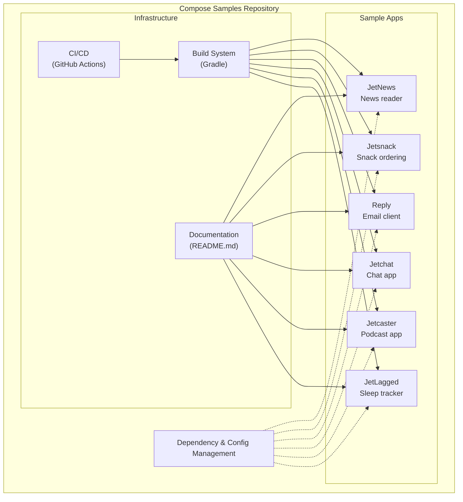
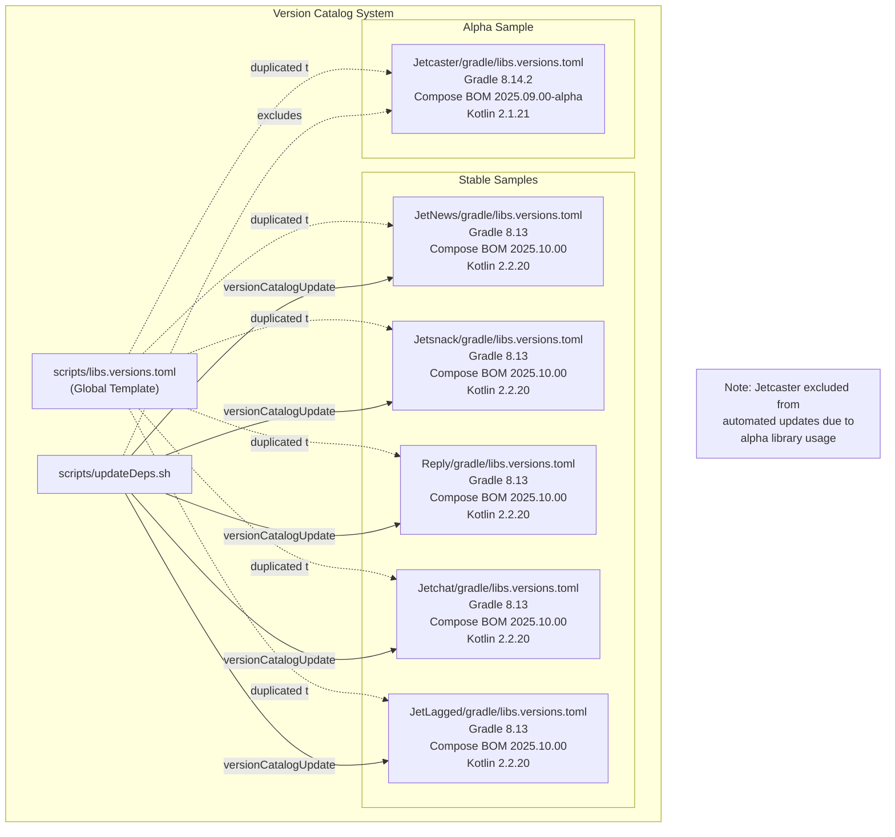
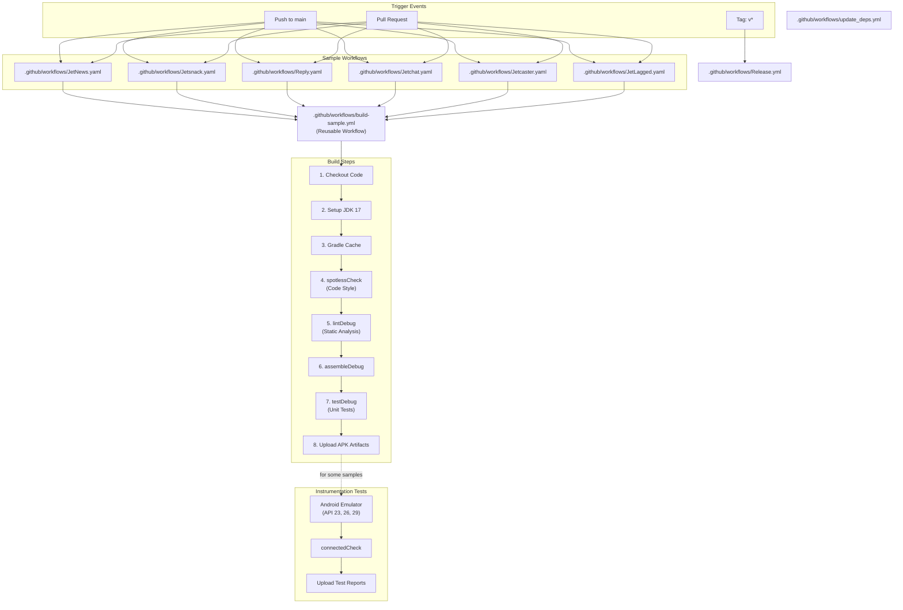

<!-- source: DeepWiki mcp.deepwiki.com · repo android/compose-samples · page 1 Overview · fetched 2026-10-23 -->

# Overview

Relevant source files

The following files were used as context for generating this wiki page:

- [JetLagged/gradle/libs.versions.toml](JetLagged/gradle/libs.versions.toml)
- [JetNews/README.md](JetNews/README.md)
- [JetNews/gradle/libs.versions.toml](JetNews/gradle/libs.versions.toml)
- [Jetcaster/README.md](Jetcaster/README.md)
- [Jetcaster/docs/tabletop.png](Jetcaster/docs/tabletop.png)
- [Jetcaster/gradle/libs.versions.toml](Jetcaster/gradle/libs.versions.toml)
- [Jetchat/README.md](Jetchat/README.md)
- [Jetchat/gradle/libs.versions.toml](Jetchat/gradle/libs.versions.toml)
- [Jetchat/screenshots/widget.png](Jetchat/screenshots/widget.png)
- [Jetchat/screenshots/widget_discoverability.png](Jetchat/screenshots/widget_discoverability.png)
- [Jetsnack/README.md](Jetsnack/README.md)
- [Jetsnack/gradle/libs.versions.toml](Jetsnack/gradle/libs.versions.toml)
- [README.md](README.md)
- [Reply/gradle/libs.versions.toml](Reply/gradle/libs.versions.toml)
- [readme/jetcaster-hero.png](readme/jetcaster-hero.png)
- [scripts/updateDeps.sh](scripts/updateDeps.sh)

This wiki page provides an introduction to the Compose-Samples repository, a collection of Jetpack Compose sample applications for Android developers. The repository demonstrates different use cases, complexity levels, and APIs through standalone sample applications that showcase various aspects of Jetpack Compose.

This page covers the high-level structure of the repository, the purpose of each sample application, common architectural patterns used across samples, and the build infrastructure that ties them all together.

Sources: [README.md:1-14]()

## Repository Organization

The Compose-Samples repository is structured as a collection of independent Android Studio projects, each demonstrating different features and patterns of Jetpack Compose.

### Repository Structure Diagram

Sources: [README.md:1-43]()

### Version Catalog System

The repository uses Gradle Version Catalogs for centralized dependency management. The system has a hub-and-spoke architecture where `scripts/libs.versions.toml` serves as the global template that is duplicated to each sample's `gradle/libs.versions.toml` file.

#### Version Catalog Hub-and-Spoke Pattern

**Key characteristics:**
- Five stable samples share common versions (Gradle 8.13, Compose BOM 2025.10.00, Kotlin 2.2.20, AGP 8.13.0)
- Jetcaster uses alpha/preview libraries (Compose BOM 2025.09.00-alpha, Gradle 8.14.2, Kotlin 2.1.21, AGP 8.10.1)
- The `updateDeps.sh` script runs `./gradlew versionCatalogUpdate` on stable samples but explicitly excludes Jetcaster
- All samples converge on common SDK targets: `compileSdk = 36`, `minSdk = 23`

Sources: [scripts/updateDeps.sh:1-35](), [Jetcaster/gradle/libs.versions.toml:1-11](), [JetNews/gradle/libs.versions.toml:1-11](), [Jetsnack/gradle/libs.versions.toml:1-11](), [README.md:82-90]()

## Sample Applications

The repository contains six active sample applications, each demonstrating different aspects of Jetpack Compose at varying complexity levels. The samples are independent Android Studio projects that can be imported and run separately.

### Active Samples

| Sample | Description | Complexity | Key Demonstrations | Importance Score |
|--------|-------------|------------|-------------------|------------------|
| **JetNews** | Blog/news reader with Material Design 3 | Medium | Adaptive layouts, Navigation drawer, Glance widgets, Custom layouts | 191.20 |
| **Jetsnack** | Food/snack ordering app | Medium | Custom design system (`JetsnackTheme`), Shared element transitions, Custom layouts (`CollapsingImageLayout`) | 154.58 |
| **Jetchat** | Chat application | Low-Medium | Text input management, Fragment integration, `BackHandler`, Emoji selector, Material 3 | 110.57 |
| **Reply** | Email client | Medium | Adaptive UI (`WindowSizeClass`), Foldable support (`DevicePosture`), Navigation Suite (Bottom/Rail/Drawer) | 104.67 |
| **Jetcaster** | Podcast app (mobile, TV, Wear) | Advanced | Redux-style architecture, Room database, Dynamic theming, Multi-platform (`SupportingPaneScaffold`) | 88.17 |
| **JetLagged** | Sleep tracker | Medium | Custom graphics (`RuntimeShader`), Data visualization, Predictive back gesture | 51.76 |

All samples target Android API levels: `compileSdk = 36`, `minSdk = 23`, with `targetSdk` ranging from 33-36.

Sources: [README.md:16-31](), [Jetcaster/gradle/libs.versions.toml:34-60](), [JetNews/gradle/libs.versions.toml:33-58](), [Jetsnack/gradle/libs.versions.toml:29-56](), [Reply/gradle/libs.versions.toml:33-58](), [Jetchat/gradle/libs.versions.toml:33-58](), [JetLagged/gradle/libs.versions.toml:29-54]()

### Obsolete Samples

Four samples were removed from the repository in 2024 to keep it maintainable but remain accessible in the git history:

| Sample | Purpose | Removed Date | Commit |
|--------|---------|--------------|--------|
| Crane | Travel app | 2024-08-02 | ee8e272 |
| Owl | Learning app | 2024-08-02 | ee8e272 |
| Jetsurvey | Survey app | 2024-08-02 | ee8e272 |
| Rally | Finance app | 2024-08-02 | ee8e272 |

Sources: [README.md:92-104]()

### Architecture Patterns Across Samples

Each sample demonstrates distinct architectural patterns and UI approaches:

#### Architecture Pattern Mapping

```mermaid
flowchart TB
    subgraph "Jetcaster - Redux Architecture"
        JCHomeVM["HomeViewModel"]
        JCHomeViewState["StateFlow&lt;HomeViewState&gt;"]
        JCPodcastStore["PodcastStore"]
        JCEpisodeStore["EpisodeStore"]
        JCRoom["JetcasterDatabase<br/>(Room)"]
        JCHomeUI["Home.kt"]
        
        JCHomeVM -->|exposes| JCHomeViewState
        JCHomeVM --> JCPodcastStore
        JCHomeVM --> JCEpisodeStore
        JCPodcastStore --> JCRoom
        JCEpisodeStore --> JCRoom
        JCHomeViewState -->|collectAsStateWithLifecycle| JCHomeUI
    end
    
    subgraph "Reply - Adaptive UI"
        ReplyApp["ReplyApp.kt"]
        WSC["WindowSizeClass"]
        DevicePosture["DevicePosture<br/>(BookPosture/Tabletop)"]
        NavSuite["NavigationSuiteScaffold<br/>(Bottom/Rail/Drawer)"]
        ContentType["ContentType<br/>(Single/Dual Pane)"]
        
        ReplyApp --> WSC
        ReplyApp --> DevicePosture
        WSC --> NavSuite
        DevicePosture --> ContentType
    end
    
    subgraph "Jetsnack - Custom Design System"
        JSTheme["JetsnackTheme.kt"]
        JSColorPalette["JetsnackColorPalette"]
        JSComponents["Wrapped Material Components<br/>(Button.kt, Card.kt)"]
        JSCustomLayouts["Custom Layouts<br/>(CollapsingImageLayout,<br/>JetsnackBottomNavLayout)"]
        SharedTrans["SharedTransitionLayout"]
        
        JSTheme --> JSColorPalette
        JSTheme --> JSComponents
        JSComponents --> JSCustomLayouts
        JSCustomLayouts --> SharedTrans
    end
    
    subgraph "Jetchat - Fragment Integration"
        NavActivity["NavActivity"]
        NavComponent["Navigation Component<br/>(Fragments)"]
        ComposeView["ComposeView in Fragments"]
        ConvVM["ConversationViewModel<br/>(LiveData)"]
        
        NavActivity --> NavComponent
        NavComponent --> ComposeView
        ComposeView --> ConvVM
    end
    
    subgraph "JetNews - Material 3"
        JNApp["JetnewsApp.kt"]
        JNNavGraph["JetnewsNavGraph.kt"]
        JNScreens["Home/Article/Interests"]
        JNAdaptive["calculateWindowSizeClass"]
        JNWidget["JetnewsGlanceWidget"]
        
        JNApp --> JNNavGraph
        JNNavGraph --> JNScreens
        JNScreens --> JNAdaptive
        JNApp -.separate.-> JNWidget
    end
    
    subgraph "JetLagged - Custom Graphics"
        JLHome["HomeScreenCards.kt"]
        RuntimeShader["RuntimeShader<br/>(Mesh gradients)"]
        CustomLayouts["Custom Layouts<br/>(SleepGraphRow,<br/>HeartRateGraph)"]
        PredictiveBack["Predictive Back Gesture"]
        
        JLHome --> RuntimeShader
        JLHome --> CustomLayouts
        JLHome --> PredictiveBack
    end
```

Sources: [Jetcaster/README.md:43-62](), [Jetsnack/README.md:26-41](), [JetNews/README.md:22-32](), [Jetchat/README.md:38-47](), [README.md:43-73]()

## Shared Infrastructure

The repository includes shared infrastructure components that support all samples:

### Build System

All samples use a consistent build configuration:

| Component | Configuration |
|-----------|---------------|
| **Gradle Version** | 8.13 (stable samples), 8.14.2 (Jetcaster) |
| **Android Gradle Plugin** | 8.13.0 (stable), 8.10.1 (Jetcaster) |
| **Kotlin** | 2.2.20 (stable), 2.1.21 (Jetcaster) |
| **Compose Compiler** | Kotlin plugin: `org.jetbrains.kotlin.plugin.compose` |
| **Compose BOM** | 2025.10.00 (stable), 2025.09.00-alpha (Jetcaster) |

**Common Plugins Applied:**
- `com.android.application` (all samples)
- `org.jetbrains.kotlin.android` (all samples)
- `org.jetbrains.kotlin.plugin.compose` (all samples)
- `com.diffplug.spotless` (code formatting, all samples)
- `org.jetbrains.kotlin.plugin.parcelize` (Jetsnack, JetLagged)
- `org.jetbrains.kotlin.plugin.serialization` (Reply)
- `com.google.dagger.hilt.android` + `com.google.devtools.ksp` (Jetcaster only)

Sources: [Jetcaster/gradle/libs.versions.toml:172-187](), [Jetsnack/gradle/libs.versions.toml:157-172](), [JetNews/gradle/libs.versions.toml:162-177]()

### Code Formatting

All samples use Spotless for consistent code formatting:
- Configuration: `spotless/copyright.kt` defines the copyright header
- Format all: `./scripts/format.sh` runs `spotlessApply` on all samples
- Check format: Navigate to sample and run `./gradlew spotlessCheck`

Sources: [README.md:76-80]()

## CI/CD System

The repository uses GitHub Actions with a reusable workflow pattern to build and test samples:

### CI/CD Pipeline Architecture

**Quality Gates (Sequential):**
1. **Code Style:** `spotlessCheck` enforces consistent formatting via ktlint
2. **Static Analysis:** `lintDebug` runs Android Lint checks
3. **Compilation:** `assembleDebug` verifies the build succeeds
4. **Unit Tests:** `testDebug` runs local JUnit tests
5. **Instrumentation Tests:** `connectedCheck` runs UI tests on emulators (API levels 23, 26, 29) for JetNews, Jetchat, Reply, and JetLagged

**Additional Workflows:**
- `update_deps.yml`: Automated dependency updates via pull requests
- `Release.yml`: Builds all sample APKs on version tags and publishes to GitHub Releases

Sources: [README.md:76-90]()

## Key High-Level Features

The sample applications collectively demonstrate a range of Jetpack Compose features:

1. **Custom Layouts**
   - `InterestsScreen` in JetNews [JetNews/app/src/main/java/com/example/jetnews/ui/interests/InterestsScreen.kt]()
   - `AnimatedFabContent` in Jetchat [Jetchat/app/src/main/java/com/example/compose/jetchat/components/AnimatingFabContent.kt]()
   - `Grid` in Jetsnack [Jetsnack/app/src/main/java/com/example/jetsnack/ui/components/Grid.kt]()
   - `CollapsingImageLayout` in Jetsnack [Jetsnack/app/src/main/java/com/example/jetsnack/ui/snackdetail/SnackDetail.kt]()

2. **Theming**
   - Material 3 in Jetchat [Jetchat/app/src/main/java/com/example/compose/jetchat/theme/Themes.kt]()
   - Dynamic theming in Jetcaster [Jetcaster/app/src/main/java/com/example/jetcaster/util/DynamicTheming.kt]()
   - Custom design system in Jetsnack [Jetsnack/app/src/main/java/com/example/jetsnack/ui/theme/Theme.kt]()

3. **Adaptive UI**
   - Supporting pane in Jetcaster [Jetcaster/app/src/main/java/com/example/jetcaster/ui/home/Home.kt]()
   - Window size classes in JetNews [JetNews/app/src/main/java/com/example/jetnews/ui/MainActivity.kt]()

4. **Platform Support**
   - TV support in Jetcaster [Jetcaster/tv-app]()
   - Wear OS support in Jetcaster [Jetcaster/wear]()

Sources: [README.md:43-73]()

---

