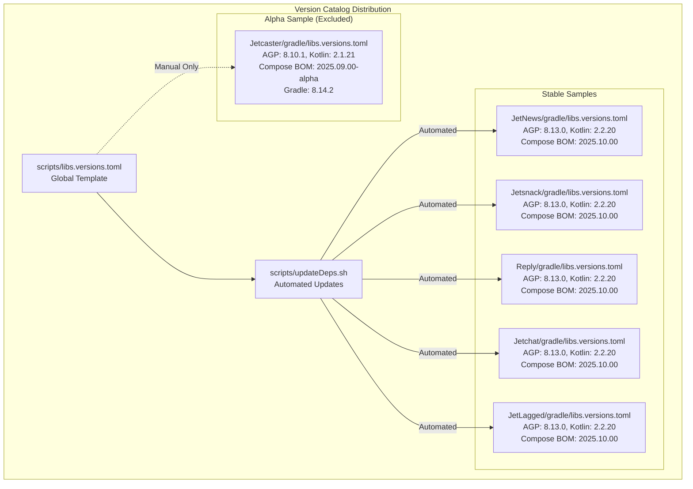
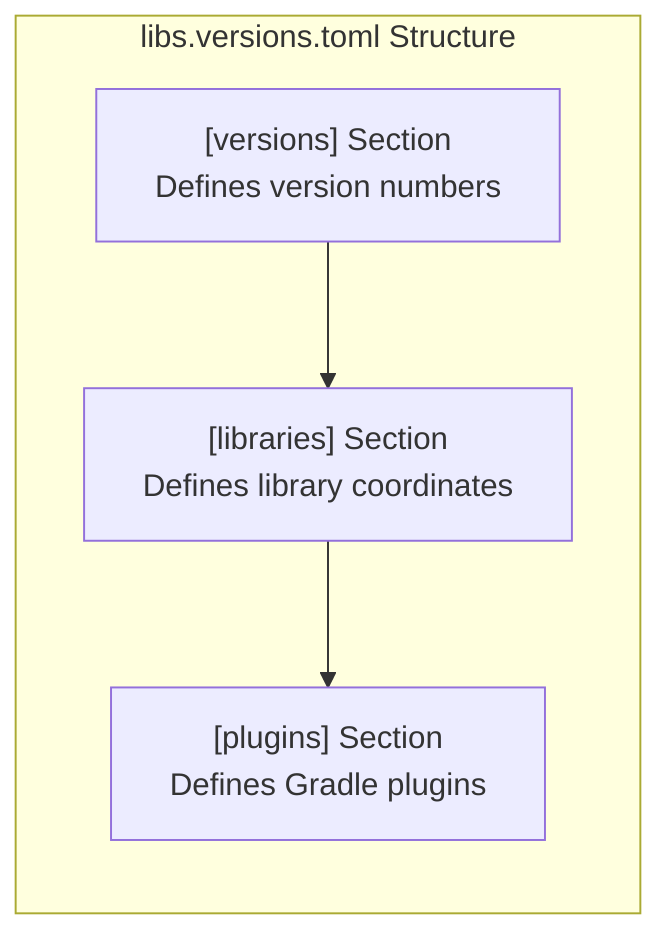
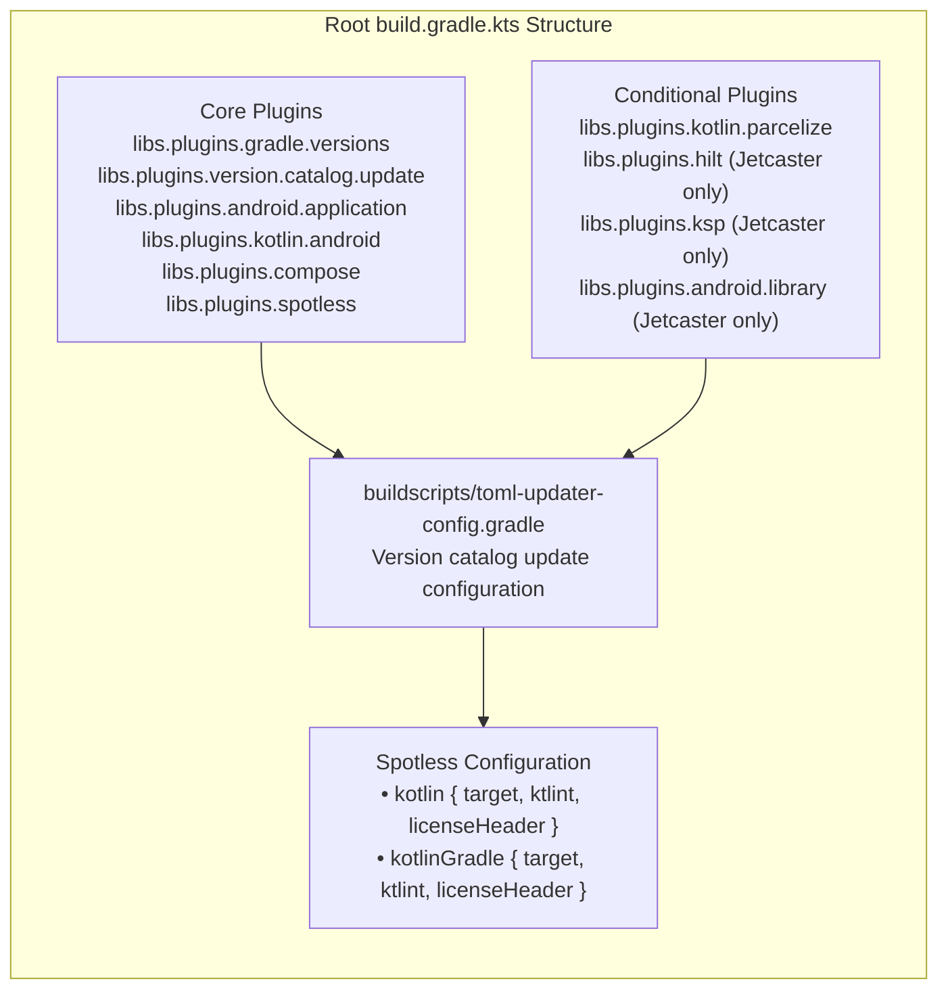
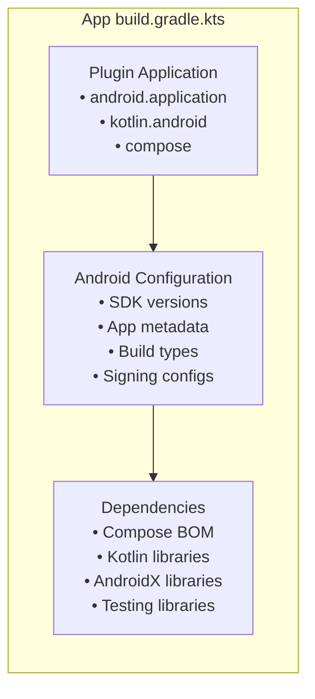
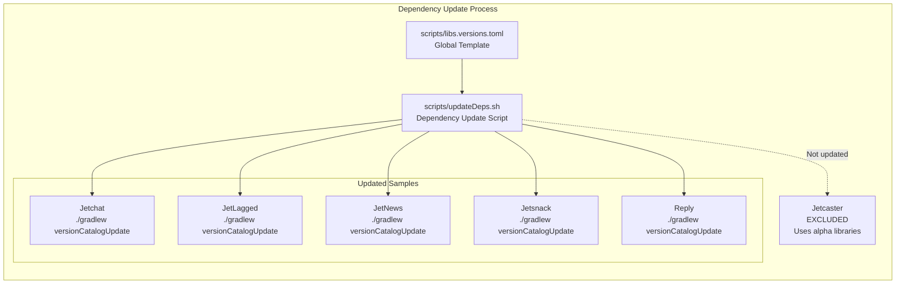
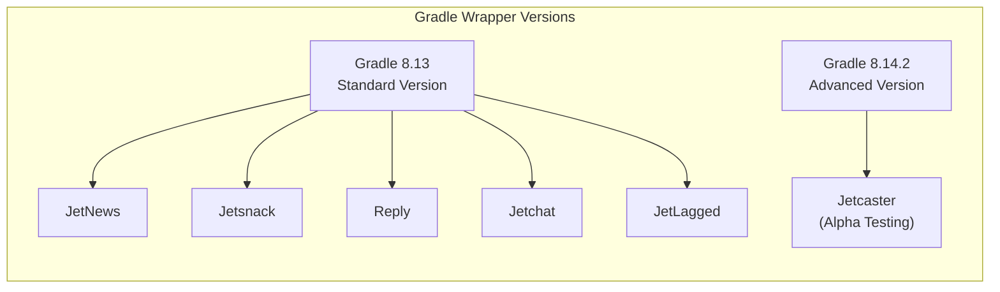
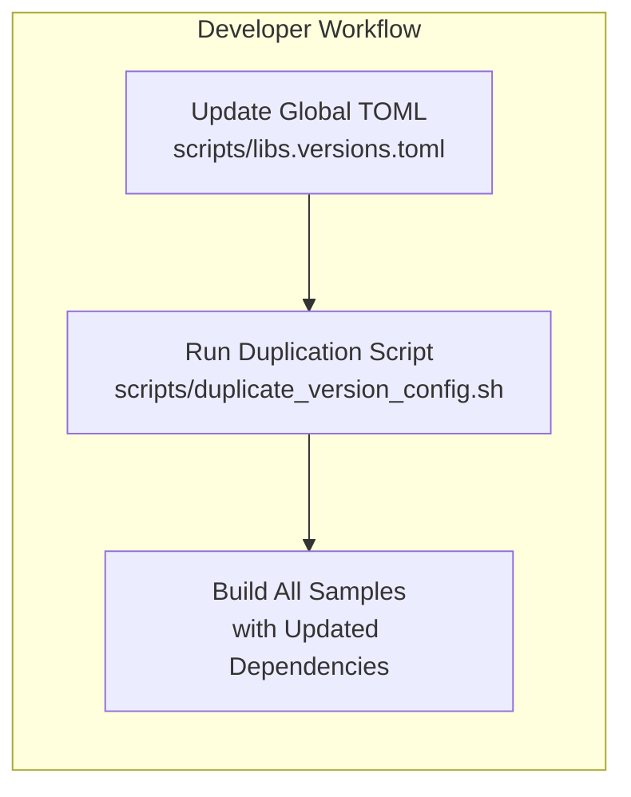

<!-- source: DeepWiki mcp.deepwiki.com · repo android/compose-samples · page 2 Build System and Dependency Management · fetched 2026-10-23 -->

# Build System and Dependency Management

<details>
<summary>Relevant source files</summary>

The following files were used as context for generating this wiki page:

- [JetLagged/build.gradle.kts](JetLagged/build.gradle.kts)
- [JetLagged/gradle/libs.versions.toml](JetLagged/gradle/libs.versions.toml)
- [JetNews/build.gradle.kts](JetNews/build.gradle.kts)
- [JetNews/gradle/libs.versions.toml](JetNews/gradle/libs.versions.toml)
- [Jetcaster/build.gradle.kts](Jetcaster/build.gradle.kts)
- [Jetcaster/gradle/libs.versions.toml](Jetcaster/gradle/libs.versions.toml)
- [Jetchat/build.gradle.kts](Jetchat/build.gradle.kts)
- [Jetchat/gradle/libs.versions.toml](Jetchat/gradle/libs.versions.toml)
- [Jetsnack/build.gradle.kts](Jetsnack/build.gradle.kts)
- [Jetsnack/gradle/libs.versions.toml](Jetsnack/gradle/libs.versions.toml)
- [Reply/build.gradle.kts](Reply/build.gradle.kts)
- [Reply/gradle/libs.versions.toml](Reply/gradle/libs.versions.toml)
- [scripts/updateDeps.sh](scripts/updateDeps.sh)

</details>


This document provides a technical overview of the build system and dependency management infrastructure used across the Jetpack Compose samples repository. It explains how dependencies and build configurations are centralized, maintained, and distributed to ensure consistency across all sample applications.

## Centralized Dependency Management Architecture

The Compose Samples repository implements a centralized dependency management system to maintain consistency across most sample projects. This hub-and-spoke architecture uses a global version catalog that is duplicated to individual samples, with special handling for samples that require different dependency versions.

### Hub-and-Spoke Distribution Pattern



The repository maintains two tiers of samples with different dependency strategies:

- **Stable Samples** (5 projects): JetNews, Jetsnack, Reply, Jetchat, JetLagged receive automated dependency updates through the `updateDeps.sh` script and use stable Compose releases
- **Alpha Sample** (1 project): Jetcaster is excluded from automated updates and uses alpha-stage Compose libraries for early adoption testing

Sources: [scripts/updateDeps.sh:1-35](), [Jetcaster/gradle/libs.versions.toml:1-188](), [Jetsnack/gradle/libs.versions.toml:1-173](), [Reply/gradle/libs.versions.toml:1-178](), [Jetchat/gradle/libs.versions.toml:1-178](), [JetNews/gradle/libs.versions.toml:1-178](), [JetLagged/gradle/libs.versions.toml:1-174]()

## Version Catalog System

The repository uses Gradle's Version Catalog feature to manage dependencies through TOML files. The primary source of truth is the global `scripts/libs.versions.toml` file, which is then duplicated to each sample application.

### Version Catalog Structure

Each `libs.versions.toml` file follows the same structure with three main sections:



1. **Versions Section**: Defines version constants for dependencies
2. **Libraries Section**: Defines library coordinates with references to versions
3. **Plugins Section**: Defines Gradle plugins with version references

### Key Version Declarations

The version catalog defines crucial SDK and dependency versions. All samples converge on common compilation targets but diverge in framework versions:

#### Stable Samples (JetNews, Jetsnack, Reply, Jetchat, JetLagged)

| Configuration | Version |
|---------------|---------|
| `compileSdk` | 36 |
| `minSdk` | 23 |
| `targetSdk` | 33 or 36 |
| `androidGradlePlugin` | 8.13.0 |
| `kotlin` | 2.2.20 |
| `androidx-compose-bom` | 2025.10.00 |
| `coroutines` | 1.10.2 |
| Gradle Wrapper | 8.13 |

#### Alpha Sample (Jetcaster)

| Configuration | Version |
|---------------|---------|
| `compileSdk` | 36 |
| `minSdk` | 23 |
| `targetSdk` | 33 |
| `androidGradlePlugin` | 8.10.1 |
| `kotlin` | 2.1.21 |
| `androidx-compose-bom` | 2025.09.00 (alpha) |
| `coroutines` | 1.10.2 |
| Gradle Wrapper | 8.14.2 |

The version divergence allows Jetcaster to serve as an early adoption testing ground for alpha-stage Compose libraries while other samples maintain stability with production-ready releases.

Sources: [Jetcaster/gradle/libs.versions.toml:5-60](), [Jetsnack/gradle/libs.versions.toml:1-56](), [Reply/gradle/libs.versions.toml:5-59](), [Jetchat/gradle/libs.versions.toml:5-59](), [JetNews/gradle/libs.versions.toml:5-59](), [JetLagged/gradle/libs.versions.toml:1-55]()

### Library Declarations

Libraries are declared with references to the version constants:

```toml
# Compose libraries
androidx-compose-bom = { module = "androidx.compose:compose-bom", version.ref = "androidx-compose-bom" }
androidx-compose-ui = { module = "androidx.compose.ui:ui" }
androidx-compose-material3 = { module = "androidx.compose.material3:material3" }
```

Sources: [scripts/libs.versions.toml:60-159]()

### Plugin Declarations

Gradle plugins are declared with their IDs and versions:

```toml
android-application = { id = "com.android.application", version.ref = "androidGradlePlugin" }
kotlin-android = { id = "org.jetbrains.kotlin.android", version.ref = "kotlin" }
compose = { id = "org.jetbrains.kotlin.plugin.compose", version.ref = "kotlin" }
```

Sources: [scripts/libs.versions.toml:160-175]()

## Gradle Configuration Patterns

Each sample application follows a common pattern for its build configuration, with a hierarchical plugin architecture that provides both core and conditional plugins based on sample requirements.

### Root Project Configuration

The root `build.gradle.kts` in each sample applies plugins and configures code formatting:

#### Core Plugins Applied to All Samples



#### Plugin Distribution by Sample

| Sample | Core Plugins | Additional Plugins |
|--------|-------------|-------------------|
| JetNews | ✓ | `kotlin.parcelize` |
| Jetsnack | ✓ | `kotlin.parcelize` |
| Reply | ✓ | `kotlin.parcelize`, `kotlin.serialization` |
| Jetchat | ✓ | `kotlin.parcelize` |
| JetLagged | ✓ | `kotlin.parcelize` |
| Jetcaster | ✓ | `kotlin.parcelize`, `hilt`, `ksp`, `android.library` |

The Spotless plugin enforces consistent code formatting across all samples, with configurations for both Kotlin source files and Gradle build scripts. All samples apply the license header from `spotless/copyright.kt`.

Sources: [JetNews/build.gradle.kts:17-47](), [Jetsnack/build.gradle.kts:17-47](), [Reply/build.gradle.kts:17-47](), [Jetchat/build.gradle.kts:17-47](), [JetLagged/build.gradle.kts:17-47](), [Jetcaster/build.gradle.kts:17-50]()

### App Module Configuration

The app module's `build.gradle.kts` follows a consistent pattern across all samples:



Key configurations include:

1. **SDK Versions**: Referenced from the version catalog
   ```kotlin
   compileSdk = libs.versions.compileSdk.get().toInt()
   minSdk = libs.versions.minSdk.get().toInt()
   targetSdk = libs.versions.targetSdk.get().toInt()
   ```

2. **Build Features**:
   ```kotlin
   buildFeatures {
       compose = true
   }
   ```

3. **Dependencies via Compose BOM**:
   ```kotlin
   val composeBom = platform(libs.androidx.compose.bom)
   implementation(composeBom)
   androidTestImplementation(composeBom)
   ```

4. **Signing Configuration**: Standardized across all samples
   ```kotlin
   signingConfigs {
       val userKeystore = File(System.getProperty("user.home"), ".android/debug.keystore")
       val localKeystore = rootProject.file("debug_2.keystore")
       val hasKeyInfo = userKeystore.exists()
       create("release") {
           storeFile = if (hasKeyInfo) userKeystore else localKeystore
           // Additional configuration...
       }
   }
   ```

Sources: [JetNews/app/build.gradle.kts:17-129](), [Jetsnack/app/build.gradle.kts:17-135](), [Reply/app/build.gradle.kts:17-137](), [Jetchat/app/build.gradle.kts:17-125](), [JetLagged/app/build.gradle.kts:17-139]()

## Dependency Update Mechanism

The repository implements an automated dependency update system with selective application based on library maturity.

### Automated Update Workflow



### Update Script Implementation

The `updateDeps.sh` script explicitly excludes Jetcaster from automated updates:

```bash
# Note: Jetcaster is temporarily excluded as it is using alpha libraries
# which we don't want to upgrade in parallel with stable releases.

cd Jetchat; ./gradlew versionCatalogUpdate; cd ..
cd JetLagged; ./gradlew versionCatalogUpdate; cd ..
cd JetNews; ./gradlew versionCatalogUpdate; cd ..
cd Jetsnack; ./gradlew versionCatalogUpdate; cd ..
cd Reply; ./gradlew versionCatalogUpdate; cd ..
```

This exclusion prevents alpha-stage dependencies in Jetcaster from being automatically upgraded to stable releases, allowing it to serve as an early adoption testing ground.

### Version Catalog Headers

Most samples include a header comment indicating duplication policy:

```toml
#####
# This file is duplicated to individual samples from the global scripts/libs.versions.toml
# Do not add a dependency to an individual sample, edit the global version instead.
#####
```

This comment appears in: Jetcaster, Reply, Jetchat, and JetNews. Jetsnack and JetLagged use the same system but lack this specific comment header.

Sources: [scripts/updateDeps.sh:17-35](), [Jetcaster/gradle/libs.versions.toml:1-4](), [Reply/gradle/libs.versions.toml:1-4](), [Jetchat/gradle/libs.versions.toml:1-4](), [JetNews/gradle/libs.versions.toml:1-4]()

## Gradle Wrapper Configuration

The repository uses different Gradle wrapper versions across samples, reflecting different upgrade cadences:

### Gradle Version Distribution



| Sample | Gradle Version | Distribution URL |
|--------|---------------|------------------|
| JetNews | 8.13 | `gradle-8.13-bin.zip` |
| Jetsnack | 8.13 | `gradle-8.13-bin.zip` |
| Reply | 8.13 | `gradle-8.13-bin.zip` |
| Jetchat | 8.13 | `gradle-8.13-bin.zip` |
| JetLagged | 8.13 | `gradle-8.13-bin.zip` |
| Jetcaster | 8.14.2 | `gradle-8.14.2-bin.zip` |

Jetcaster's use of Gradle 8.14.2 aligns with its role as an early adoption testing ground, staying ahead of other samples on the upgrade path.

### Build Types

Samples define standard build type configurations consistently:

1. **Debug**: Default development configuration
2. **Release**: Production configuration with minification enabled, ProGuard rules applied, and release signing configuration

The release build type follows this pattern across samples:

```kotlin
buildTypes {
    release {
        isMinifyEnabled = true
        signingConfig = signingConfigs.getByName("release")
        proguardFiles(
            getDefaultProguardFile("proguard-android-optimize.txt"),
            "proguard-rules.pro"
        )
    }
}
```

Sources: [Jetcaster/gradle/libs.versions.toml:8](), [Jetsnack/gradle/libs.versions.toml:4](), [Reply/gradle/libs.versions.toml:8](), [Jetchat/gradle/libs.versions.toml:8](), [JetNews/gradle/libs.versions.toml:8](), [JetLagged/gradle/libs.versions.toml:4]()

## Dependency Management in Action

The Compose Samples repository's dependency management system ensures that:

1. All samples use the same version of dependencies
2. Updates can be made globally and propagated to all samples
3. Build configurations remain consistent across samples
4. SDK versions and build tools are standardized

This system allows the samples to focus on demonstrating Jetpack Compose features while maintaining a consistent technical foundation.



Sources: [scripts/libs.versions.toml:1-175](), [JetNews/gradle/libs.versions.toml:1-177](), [Jetsnack/gradle/libs.versions.toml:1-177](), [Reply/gradle/libs.versions.toml:1-177](), [Jetchat/gradle/libs.versions.toml:1-177](), [Jetcaster/gradle/libs.versions.toml:1-177](), [JetLagged/gradle/libs.versions.toml:1-177]()

---

