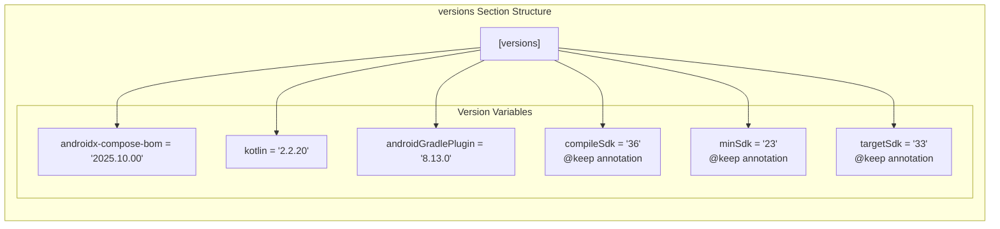
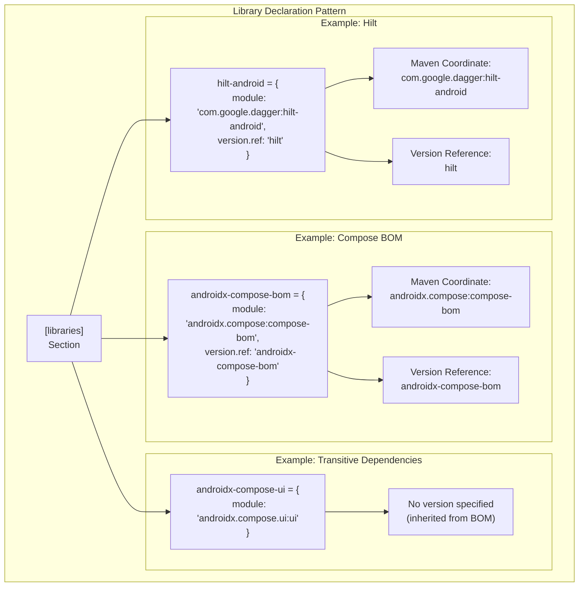
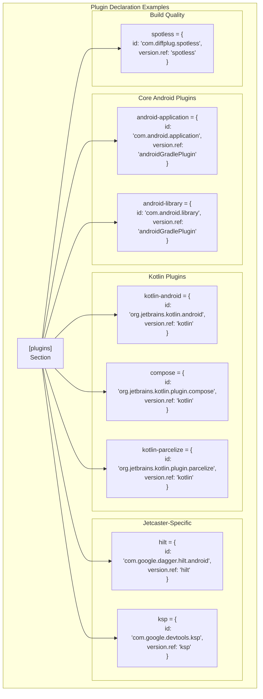
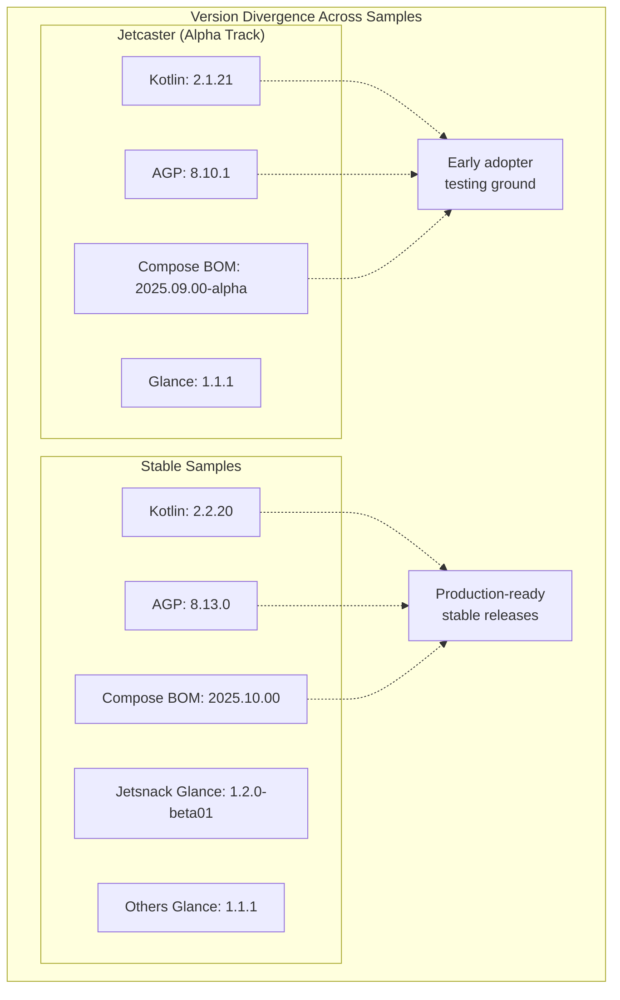
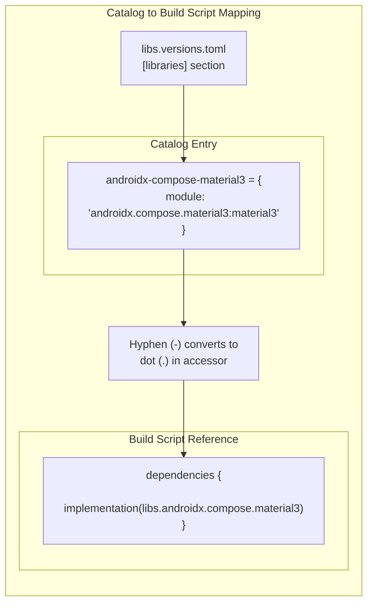

<!-- source: DeepWiki mcp.deepwiki.com · repo android/compose-samples · page 2.1 Version Catalog System · fetched 2026-10-23 -->

# Version Catalog System

<details>
<summary>Relevant source files</summary>

The following files were used as context for generating this wiki page:

- [JetLagged/gradle/libs.versions.toml](JetLagged/gradle/libs.versions.toml)
- [JetNews/gradle/libs.versions.toml](JetNews/gradle/libs.versions.toml)
- [Jetcaster/gradle/libs.versions.toml](Jetcaster/gradle/libs.versions.toml)
- [Jetchat/gradle/libs.versions.toml](Jetchat/gradle/libs.versions.toml)
- [Jetsnack/gradle/libs.versions.toml](Jetsnack/gradle/libs.versions.toml)
- [Reply/gradle/libs.versions.toml](Reply/gradle/libs.versions.toml)
- [scripts/updateDeps.sh](scripts/updateDeps.sh)

</details>


## Purpose and Scope

This document describes the version catalog system used across all sample projects in the compose-samples repository. The system centralizes dependency version management using Gradle's version catalog feature with TOML files located at `[sample]/gradle/libs.versions.toml`. This page covers the catalog file structure, hub-and-spoke duplication pattern, automated update mechanism via `scripts/updateDeps.sh`, and special handling for alpha library versions in Jetcaster.

For information about how these catalogs are consumed in Gradle build scripts, see [Gradle Build Configuration](#2.2). For Gradle Wrapper version management, see [Gradle Wrapper Configuration](#2.3).

---

## Version Catalog Architecture

The repository implements a hub-and-spoke pattern where a global template is duplicated to individual sample projects, with automated synchronization for stable releases and manual management for bleeding-edge dependencies.

```mermaid
graph TB
    subgraph "Version Catalog Hub-and-Spoke Pattern"
        GLOBAL["scripts/libs.versions.toml<br/>(Global Template)"]
        UPDATE["scripts/updateDeps.sh<br/>(Automation Script)"]
        
        subgraph "Stable Samples (Auto-Updated)"
            JN_TOML["JetNews/gradle/<br/>libs.versions.toml"]
            JS_TOML["Jetsnack/gradle/<br/>libs.versions.toml"]
            JCHT_TOML["Jetchat/gradle/<br/>libs.versions.toml"]
            R_TOML["Reply/gradle/<br/>libs.versions.toml"]
            JL_TOML["JetLagged/gradle/<br/>libs.versions.toml"]
        end
        
        subgraph "Alpha Sample (Manual)"
            JC_TOML["Jetcaster/gradle/<br/>libs.versions.toml<br/>(Alpha Libraries)"]
        end
        
        GLOBAL -.."duplicated to".-> JN_TOML
        GLOBAL -.."duplicated to".-> JS_TOML
        GLOBAL -.."duplicated to".-> JCHT_TOML
        GLOBAL -.."duplicated to".-> R_TOML
        GLOBAL -.."duplicated to".-> JL_TOML
        GLOBAL -.."manually synced to".-> JC_TOML
        
        UPDATE -->|"runs versionCatalogUpdate"| JN_TOML
        UPDATE -->|"runs versionCatalogUpdate"| JS_TOML
        UPDATE -->|"runs versionCatalogUpdate"| JCHT_TOML
        UPDATE -->|"runs versionCatalogUpdate"| R_TOML
        UPDATE -->|"runs versionCatalogUpdate"| JL_TOML
        UPDATE -.."excludes".-> JC_TOML
    end
```

**Sources:** [scripts/updateDeps.sh:1-35](), [Jetcaster/gradle/libs.versions.toml:1-4](), [JetNews/gradle/libs.versions.toml:1-4]()

---

## TOML File Structure

Each `libs.versions.toml` file follows Gradle's version catalog format with three primary sections: `[versions]`, `[libraries]`, and `[plugins]`.

### Version Declaration Section

The `[versions]` section declares all version strings with optional `@keep` annotations to prevent automated updates.



**Key Version Variables:**

| Variable | Purpose | Typical Value (Stable) | Typical Value (Jetcaster) |
|----------|---------|------------------------|---------------------------|
| `androidx-compose-bom` | Compose Bill of Materials | `2025.10.00` | `2025.09.00` (alpha) |
| `kotlin` | Kotlin language version | `2.2.20` | `2.1.21` |
| `androidGradlePlugin` | Android Gradle Plugin | `8.13.0` | `8.10.1` |
| `compileSdk` | Target API level for compilation | `36` | `36` |
| `minSdk` | Minimum supported API level | `23` | `23` |
| `targetSdk` | Target API level for runtime | `33` | `33` |

**Sources:** [Jetsnack/gradle/libs.versions.toml:1-56](), [Jetcaster/gradle/libs.versions.toml:5-61]()

### Library Declaration Section

The `[libraries]` section maps dependency coordinates to version references using `version.ref` syntax.



**Compose BOM Usage Pattern:**

The `androidx-compose-bom` library uses Bill of Materials (BOM) to manage transitive Compose library versions. Individual Compose libraries like `androidx-compose-ui`, `androidx-compose-material3`, and `androidx-compose-foundation` inherit their versions from the BOM and do not specify explicit versions.

**Sources:** [Jetsnack/gradle/libs.versions.toml:58-156](), [Jetcaster/gradle/libs.versions.toml:63-170]()

### Plugin Declaration Section

The `[plugins]` section declares Gradle plugins with their IDs and versions.



**Sources:** [Jetsnack/gradle/libs.versions.toml:157-173](), [Jetcaster/gradle/libs.versions.toml:172-187]()

---

## Automated Update Mechanism

The `scripts/updateDeps.sh` script automates dependency updates for stable samples using the `versionCatalogUpdate` Gradle task.

### Update Script Workflow

```mermaid
graph TB
    subgraph "updateDeps.sh Execution Flow"
        START["./scripts/updateDeps.sh"]
        
        subgraph "Sequential Updates"
            JCHT["cd Jetchat<br/>./gradlew versionCatalogUpdate"]
            JL["cd JetLagged<br/>./gradlew versionCatalogUpdate"]
            JN["cd JetNews<br/>./gradlew versionCatalogUpdate"]
            JS["cd Jetsnack<br/>./gradlew versionCatalogUpdate"]
            R["cd Reply<br/>./gradlew versionCatalogUpdate"]
        end
        
        SKIP["Jetcaster<br/>(EXCLUDED)"]
        REASON["Reason: Uses alpha libraries<br/>that should not auto-update"]
        
        START --> JCHT
        JCHT --> JL
        JL --> JN
        JN --> JS
        JS --> R
        
        START -.."skips".-> SKIP
        SKIP --> REASON
    end
```

**Script Contents:**

The script at [scripts/updateDeps.sh:1-35]() executes `versionCatalogUpdate` for five samples:
- Line 30: Jetchat
- Line 31: JetLagged
- Line 32: JetNews
- Line 33: Jetsnack
- Line 34: Reply

**Exclusion Rationale:**

Lines 20-21 document the exclusion: "Note: Jetcaster is temporarily excluded as it is using alpha libraries which we don't want to upgrade in parallel with stable releases."

**Sources:** [scripts/updateDeps.sh:1-35]()

---

## Version Divergence Patterns

Different samples use different dependency versions based on their stability requirements and feature needs.

### Compose BOM Version Comparison

| Sample | BOM Version | Type | Location |
|--------|-------------|------|----------|
| Jetcaster | `2025.09.00` | Alpha (compose-bom-alpha) | [Jetcaster/gradle/libs.versions.toml:71]() |
| JetNews | `2025.10.00` | Stable (compose-bom) | [JetNews/gradle/libs.versions.toml:69]() |
| Jetsnack | `2025.10.00` | Stable | [Jetsnack/gradle/libs.versions.toml:66]() |
| Jetchat | `2025.10.00` | Stable | [Jetchat/gradle/libs.versions.toml:69]() |
| Reply | `2025.10.00` | Stable | [Reply/gradle/libs.versions.toml:69]() |
| JetLagged | `2025.10.00` | Stable | [JetLagged/gradle/libs.versions.toml:65]() |

**Key Difference:** Jetcaster uses `androidx.compose:compose-bom-alpha` while others use `androidx.compose:compose-bom`.

### Core Dependency Version Matrix



**Sources:** [Jetcaster/gradle/libs.versions.toml:8-11,43](), [Jetsnack/gradle/libs.versions.toml:4-7,39](), [JetNews/gradle/libs.versions.toml:8-11,42]()

---

## SDK Configuration Management

SDK version variables use `@keep` annotations to prevent automated updates, ensuring consistent compilation targets across all samples.

### SDK Version Table

| Variable | Value | Protected | Applied To |
|----------|-------|-----------|------------|
| `compileSdk` | `36` | Yes (@keep) | All samples |
| `minSdk` | `23` | Yes (@keep) | All samples |
| `targetSdk` | `33` or `36` | Yes (@keep) | Varies by sample |

**Target SDK Variations:**

- **targetSdk = 33:** JetNews, Jetchat, Reply, JetLagged
- **targetSdk = 36:** Jetsnack

**Keep Annotation Example:**

```toml
# @keep
compileSdk = "36"
```

Lines with `# @keep` comments (e.g., [Jetsnack/gradle/libs.versions.toml:28-29,44-45,54-55]()) prevent the `versionCatalogUpdate` task from modifying these values.

**Sources:** [Jetsnack/gradle/libs.versions.toml:28-55](), [Jetcaster/gradle/libs.versions.toml:34-60](), [JetNews/gradle/libs.versions.toml:32-58]()

---

## Catalog Usage in Build Scripts

Build scripts reference catalog entries using the `libs` accessor with dot notation.

### Dependency Declaration Pattern



**Naming Convention:**

Catalog entry names use hyphens (e.g., `androidx-compose-material3`), which are accessed in build scripts with dots (e.g., `libs.androidx.compose.material3`).

**Plugin Application:**

```kotlin
plugins {
    alias(libs.plugins.android.application)
    alias(libs.plugins.kotlin.android)
    alias(libs.plugins.compose)
}
```

**Sources:** [Jetsnack/gradle/libs.versions.toml:69]()

---

## Special Library Categories

### Jetcaster-Exclusive Dependencies

Jetcaster includes dependencies not present in other samples due to its advanced architecture:

| Library | Purpose | Version Variable |
|---------|---------|------------------|
| `hilt-android` | Dependency injection runtime | `hilt = "2.56.2"` |
| `hilt-compiler` | Hilt annotation processor | `hilt = "2.56.2"` |
| `androidx-room-*` | Local database | `room = "2.7.1"` |
| `rometools-rome` | RSS feed parsing | `rome = "2.1.0"` |
| `okhttp3` | HTTP client | `okhttp = "4.12.0"` |
| Media3 libraries | Audio playback | `media3 = "1.7.1"` |

**Sources:** [Jetcaster/gradle/libs.versions.toml:38,48,51,55,56,136-139,159-170]()

### Wear OS and TV Dependencies

Several samples include Wear OS and Android TV libraries that are not actively used:

```toml
androidx-tv-foundation = { module = "androidx.tv:tv-foundation", version.ref = "androidx-tv-foundation" }
androidx-tv-material = { module = "androidx.tv:tv-material", version.ref = "androidx-tv-material" }
androidx-wear-compose-foundation = { module = "androidx.wear.compose:compose-foundation", version.ref = "androidx-wear-compose" }
androidx-wear-compose-material = { module = "androidx.wear.compose:compose-material", version.ref = "androidx-wear-compose" }
```

These dependencies are included in the global template but typically unused in the sample app modules.

**Sources:** [Jetsnack/gradle/libs.versions.toml:115-120]()

---

## Maintenance Workflow

### Adding New Dependencies

1. Add version variable to `[versions]` section
2. Add library entry to `[libraries]` section with `version.ref`
3. Run `./gradlew versionCatalogUpdate` to validate
4. Manually sync to `scripts/libs.versions.toml` if maintaining global template

### Updating Dependencies

**For Stable Samples:**
```bash
./scripts/updateDeps.sh
```

**For Jetcaster:**
```bash
cd Jetcaster
./gradlew versionCatalogUpdate
# Review and approve alpha library updates manually
```

### Version Pinning Strategy

Use `@keep` annotations for versions that should not be automatically updated:

```toml
# @keep
compileSdk = "36"
```

**Sources:** [scripts/updateDeps.sh:1-35](), [Jetsnack/gradle/libs.versions.toml:28-29]()

---

## Integration with CI/CD

The version catalog system integrates with the CI/CD pipeline through the `versionCatalogUpdate` task, which can detect outdated dependencies. The `update_deps.yml` workflow (referenced in the high-level diagrams) creates automated PRs when updates are available.

**Workflow Integration Points:**

1. **Build Phase:** Catalog versions are resolved during Gradle sync
2. **Update Phase:** `versionCatalogUpdate` task checks for newer versions
3. **PR Creation:** Automated workflow creates PRs with updated catalogs
4. **Manual Review:** Jetcaster updates require manual approval

**Sources:** [scripts/updateDeps.sh:20-21]()

---

