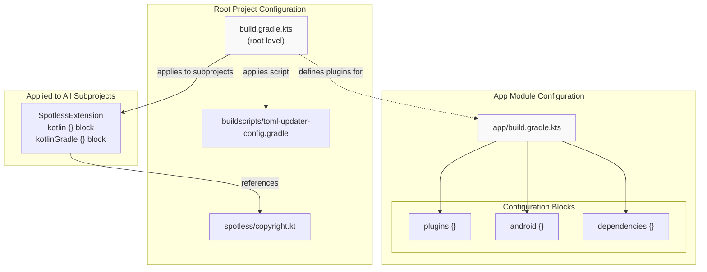
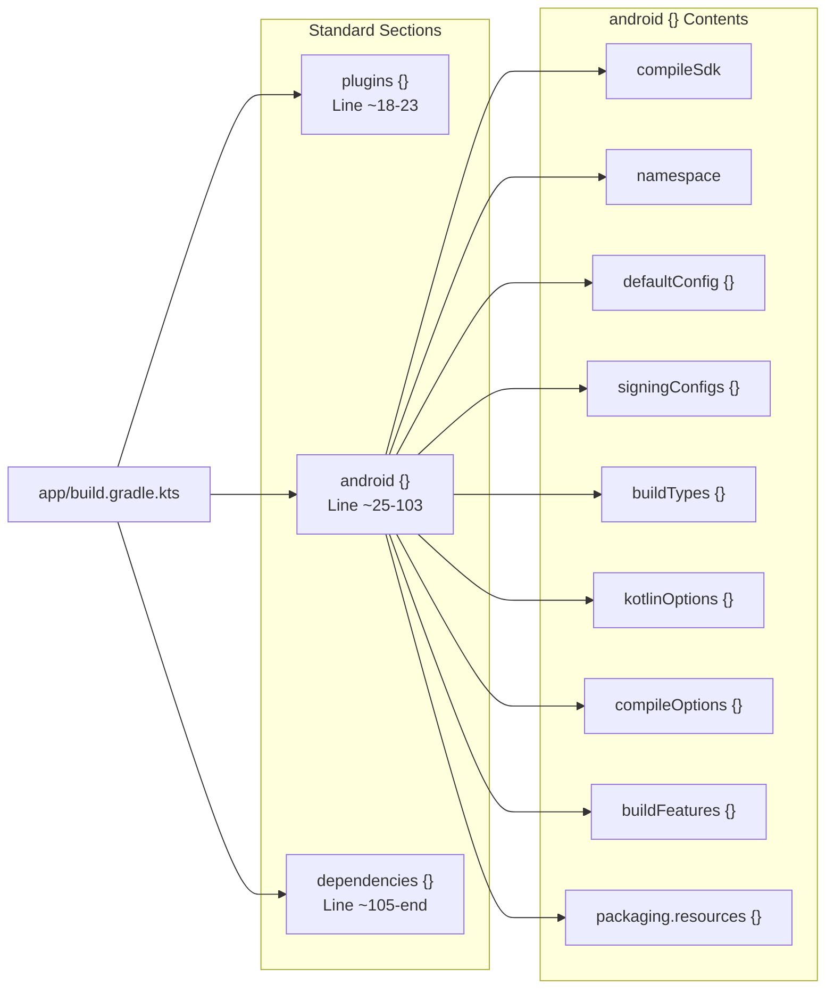
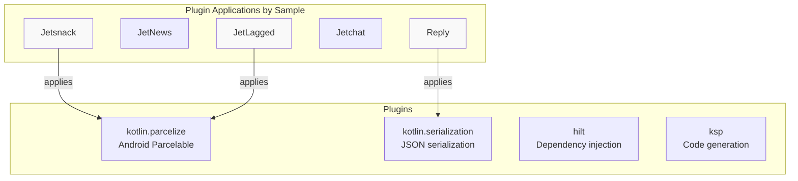
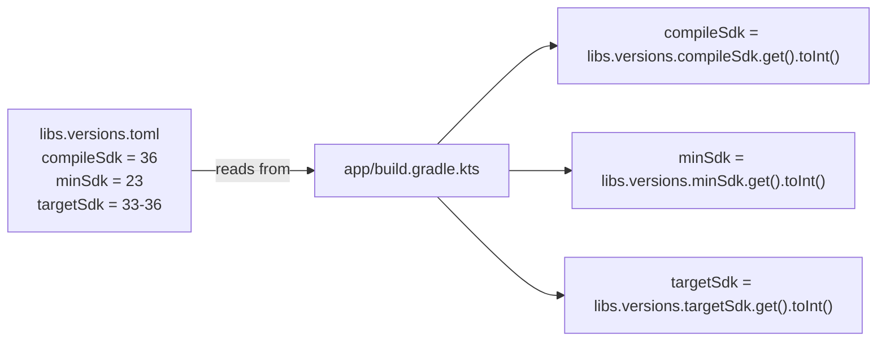
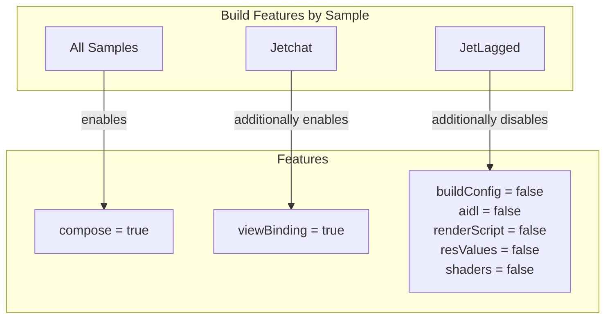
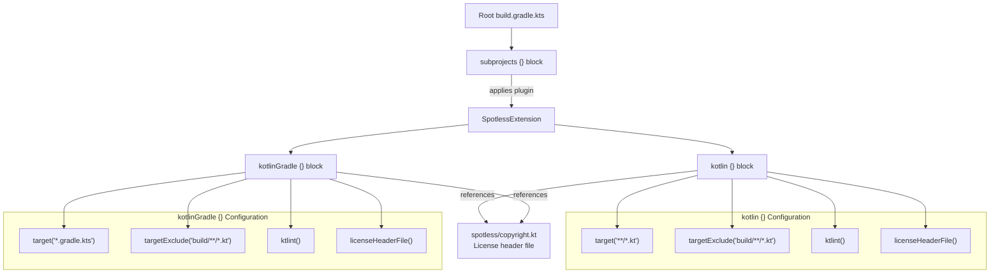

<!-- source: DeepWiki mcp.deepwiki.com · repo android/compose-samples · page 2.2 Gradle Build Configuration · fetched 2026-10-23 -->

# Gradle Build Configuration

<details>
<summary>Relevant source files</summary>

The following files were used as context for generating this wiki page:

- [JetLagged/app/build.gradle.kts](JetLagged/app/build.gradle.kts)
- [JetLagged/build.gradle.kts](JetLagged/build.gradle.kts)
- [JetNews/app/build.gradle.kts](JetNews/app/build.gradle.kts)
- [JetNews/build.gradle.kts](JetNews/build.gradle.kts)
- [Jetcaster/build.gradle.kts](Jetcaster/build.gradle.kts)
- [Jetchat/app/build.gradle.kts](Jetchat/app/build.gradle.kts)
- [Jetchat/build.gradle.kts](Jetchat/build.gradle.kts)
- [Jetsnack/app/build.gradle.kts](Jetsnack/app/build.gradle.kts)
- [Jetsnack/build.gradle.kts](Jetsnack/build.gradle.kts)
- [Reply/app/build.gradle.kts](Reply/app/build.gradle.kts)
- [Reply/build.gradle.kts](Reply/build.gradle.kts)

</details>


## Purpose and Scope

This page documents the Gradle build script structure used across the Jetpack Compose Samples repository, covering root-level `build.gradle.kts` files, app-level module configurations, plugin application patterns, and common build configurations. The build scripts follow a hierarchical pattern with shared configurations applied consistently across all sample projects.

For information about version catalogs and dependency version management, see [Version Catalog System](#2.1). For Gradle Wrapper configuration details, see [Gradle Wrapper Configuration](#2.3).

## Build Configuration Hierarchy

The repository uses a two-tier Gradle configuration structure: root project files define plugins and apply shared configurations to all subprojects, while app module files contain specific application configurations and dependency declarations.



**Sources:** [JetNews/build.gradle.kts:1-47](), [Jetsnack/build.gradle.kts:1-47](), [Jetsnack/app/build.gradle.kts:1-146]()

### Root Project Build Files

Each sample project contains a root `build.gradle.kts` that defines plugins and applies shared configurations. The root file does not directly apply plugins to itself but makes them available for subprojects.

| Sample | Root Build File | Special Plugins |
|--------|----------------|-----------------|
| JetNews | [JetNews/build.gradle.kts:17-25]() | None |
| Jetsnack | [Jetsnack/build.gradle.kts:17-25]() | None |
| Reply | [Reply/build.gradle.kts:17-25]() | None |
| Jetchat | [Jetchat/build.gradle.kts:17-25]() | None |
| JetLagged | [JetLagged/build.gradle.kts:17-25]() | None |
| Jetcaster | [Jetcaster/build.gradle.kts:17-28]() | `android.library`, `hilt`, `ksp` |

All root files declare plugins with `apply false`, making them available to subprojects without applying them at the root level:

```kotlin
plugins {
    alias(libs.plugins.gradle.versions)
    alias(libs.plugins.version.catalog.update)
    alias(libs.plugins.android.application) apply false
    alias(libs.plugins.kotlin.android) apply false
    alias(libs.plugins.compose) apply false
    alias(libs.plugins.spotless) apply false
}
```

The root build files perform two critical configurations:
1. **Apply TOML updater configuration**: [JetNews/build.gradle.kts:27]() applies `buildscripts/toml-updater-config.gradle` for version catalog maintenance
2. **Configure Spotless**: [JetNews/build.gradle.kts:29-46]() applies Spotless to all subprojects

**Sources:** [JetNews/build.gradle.kts:17-47](), [Jetcaster/build.gradle.kts:17-50]()

### App Module Build Files

App modules contain `app/build.gradle.kts` files with actual plugin applications and Android-specific configurations. These files follow a consistent structure across all samples.



**Sources:** [Jetsnack/app/build.gradle.kts:1-146](), [JetNews/app/build.gradle.kts:1-129]()

## Plugin Application Patterns

### Core Plugins

All sample app modules apply four core plugins using version catalog aliases:

| Plugin | Catalog Alias | Purpose |
|--------|--------------|---------|
| Android Application | `libs.plugins.android.application` | Android app configuration |
| Kotlin Android | `libs.plugins.kotlin.android` | Kotlin language support |
| Compose Compiler | `libs.plugins.compose` | Compose compiler plugin |
| Spotless | Applied at root level | Code formatting (ktlint) |

Example from [Jetsnack/app/build.gradle.kts:18-23]():
```kotlin
plugins {
    alias(libs.plugins.android.application)
    alias(libs.plugins.kotlin.android)
    alias(libs.plugins.kotlin.parcelize)
    alias(libs.plugins.compose)
}
```

**Sources:** [Jetsnack/app/build.gradle.kts:18-23](), [JetNews/app/build.gradle.kts:18-22]()

### Conditional Plugins

Different samples apply additional plugins based on their requirements:



| Plugin | Samples | Declaration Example |
|--------|---------|---------------------|
| `kotlin.parcelize` | Jetsnack, JetLagged | [Jetsnack/app/build.gradle.kts:21]() |
| `kotlin.serialization` | Reply | [Reply/app/build.gradle.kts:21]() |
| `hilt` | Jetcaster only | Declared at [Jetcaster/build.gradle.kts:24]() |
| `ksp` | Jetcaster only | Declared at [Jetcaster/build.gradle.kts:25]() |

**Sources:** [Jetsnack/app/build.gradle.kts:21](), [JetLagged/app/build.gradle.kts:21](), [Reply/app/build.gradle.kts:21](), [Jetcaster/build.gradle.kts:24-25]()

## Android Configuration Block

### SDK Configuration

All samples retrieve SDK versions from the version catalog using the `libs.versions` accessor. This pattern ensures consistency with the centralized version management described in [Version Catalog System](#2.1).



Example from [Jetsnack/app/build.gradle.kts:26-41]():
```kotlin
android {
    compileSdk = libs.versions.compileSdk.get().toInt()
    namespace = "com.example.jetsnack"

    defaultConfig {
        applicationId = "com.example.jetsnack"
        minSdk = libs.versions.minSdk.get().toInt()
        targetSdk = libs.versions.targetSdk.get().toInt()
        versionCode = 1
        versionName = "1.0"
        testInstrumentationRunner = "androidx.test.runner.AndroidJUnitRunner"
    }
}
```

**Sources:** [Jetsnack/app/build.gradle.kts:26-45](), [JetNews/app/build.gradle.kts:24-36](), [Reply/app/build.gradle.kts:25-37]()

### Signing Configuration

All samples implement an identical signing configuration pattern that supports both local development and CI/CD builds. The configuration checks for a user's debug keystore first, then falls back to a project-local keystore with credentials from environment variables.

From [Jetsnack/app/build.gradle.kts:47-58]():
```kotlin
signingConfigs {
    val userKeystore = File(System.getProperty("user.home"), ".android/debug.keystore")
    val localKeystore = rootProject.file("debug_2.keystore")
    val hasKeyInfo = userKeystore.exists()
    create("release") {
        storeFile = if (hasKeyInfo) userKeystore else localKeystore
        storePassword = if (hasKeyInfo) "android" else System.getenv("compose_store_password")
        keyAlias = if (hasKeyInfo) "androiddebugkey" else System.getenv("compose_key_alias")
        keyPassword = if (hasKeyInfo) "android" else System.getenv("compose_key_password")
    }
}
```

This pattern is identical across [JetNews/app/build.gradle.kts:38-49](), [Reply/app/build.gradle.kts:39-51](), [Jetchat/app/build.gradle.kts:39-50](), and [JetLagged/app/build.gradle.kts:38-49]().

**Sources:** [Jetsnack/app/build.gradle.kts:47-58](), [JetNews/app/build.gradle.kts:38-49]()

### Build Types

Samples define two or three build types depending on whether they support benchmarking:

| Build Type | Samples | Configuration |
|------------|---------|---------------|
| `debug` | All | Empty configuration, uses defaults |
| `release` | All | `isMinifyEnabled = true`, ProGuard rules |
| `benchmark` | Jetsnack, JetLagged | Extends `release`, custom ProGuard rules |

#### Standard Release Configuration

From [JetNews/app/build.gradle.kts:51-62]():
```kotlin
buildTypes {
    getByName("debug") {
    }

    getByName("release") {
        isMinifyEnabled = true
        signingConfig = signingConfigs.getByName("release")
        proguardFiles(
            getDefaultProguardFile("proguard-android-optimize.txt"),
            "proguard-rules.pro",
        )
    }
}
```

#### Benchmark Build Type

Jetsnack and JetLagged add a `benchmark` build type for performance testing. From [Jetsnack/app/build.gradle.kts:73-82]():
```kotlin
create("benchmark") {
    initWith(getByName("release"))
    signingConfig = signingConfigs.getByName("release")
    matchingFallbacks.add("release")
    proguardFiles(
        getDefaultProguardFile("proguard-android-optimize.txt"),
        "proguard-benchmark-rules.pro",
    )
    isDebuggable = false
}
```

**Sources:** [Jetsnack/app/build.gradle.kts:60-83](), [JetLagged/app/build.gradle.kts:51-74](), [JetNews/app/build.gradle.kts:51-63]()

### Build Features

All samples enable Compose, but some enable or disable additional features:



**Standard Compose Configuration** from [JetNews/app/build.gradle.kts:72-75]():
```kotlin
buildFeatures {
    compose = true
}
```

**Jetchat with ViewBinding** from [Jetchat/app/build.gradle.kts:74-77]():
```kotlin
buildFeatures {
    compose = true
    viewBinding = true
}
```

Jetchat enables `viewBinding` to support interoperability between Compose and traditional View-based UI components.

**JetLagged with Disabled Features** from [JetLagged/app/build.gradle.kts:84-92]():
```kotlin
buildFeatures {
    compose = true
    // Disable unused AGP features
    buildConfig = false
    aidl = false
    renderScript = false
    resValues = false
    shaders = false
}
```

JetLagged explicitly disables unused Android Gradle Plugin features to optimize build performance.

**Sources:** [Jetchat/app/build.gradle.kts:74-77](), [JetLagged/app/build.gradle.kts:84-92](), [JetNews/app/build.gradle.kts:72-75]()

### Compilation Options

All samples target Java 17 with identical Kotlin and Java compiler configurations:

From [Jetsnack/app/build.gradle.kts:85-91]():
```kotlin
kotlinOptions {
    jvmTarget = "17"
}
compileOptions {
    sourceCompatibility = JavaVersion.VERSION_17
    targetCompatibility = JavaVersion.VERSION_17
}
```

This configuration is consistent across [JetNews/app/build.gradle.kts:64-71](), [Reply/app/build.gradle.kts:85-92](), [Jetchat/app/build.gradle.kts:66-72](), and [JetLagged/app/build.gradle.kts:75-83]().

#### Core Library Desugaring

JetLagged uniquely enables core library desugaring to support Java 8+ APIs on older Android versions. From [JetLagged/app/build.gradle.kts:79-83]():
```kotlin
compileOptions {
    isCoreLibraryDesugaringEnabled = true
    sourceCompatibility = JavaVersion.VERSION_17
    targetCompatibility = JavaVersion.VERSION_17
}
```

The desugaring dependency is added in the dependencies block: [JetLagged/app/build.gradle.kts:106]().

**Sources:** [Jetsnack/app/build.gradle.kts:85-91](), [JetLagged/app/build.gradle.kts:79-83]()

### Test Configuration

Reply includes special test configuration to support shared test code between unit and instrumented tests. From [Reply/app/build.gradle.kts:67-83]():
```kotlin
testOptions {
    unitTests {
        isReturnDefaultValues = true
        isIncludeAndroidResources = true
    }
}

sourceSets {
    val sharedTestDir = "src/sharedTest/java"
    getByName("test") {
        java.srcDir(sharedTestDir)
    }
    getByName("androidTest") {
        java.srcDir(sharedTestDir)
    }
}
```

This configuration allows test utilities to be shared between Robolectric unit tests and instrumented tests.

**Sources:** [Reply/app/build.gradle.kts:67-83]()

### Packaging Configuration

Most samples exclude duplicate license files from the APK to avoid build conflicts. From [Jetsnack/app/build.gradle.kts:97-102]():
```kotlin
packaging.resources {
    // Multiple dependency bring these files in. Exclude them to enable
    // our test APK to build (has no effect on our AARs)
    excludes += "/META-INF/AL2.0"
    excludes += "/META-INF/LGPL2.1"
}
```

This pattern appears in [JetNews/app/build.gradle.kts:77-82](), [Jetchat/app/build.gradle.kts:79-84](), and [JetLagged/app/build.gradle.kts:94-99]().

**Sources:** [Jetsnack/app/build.gradle.kts:97-102](), [JetNews/app/build.gradle.kts:77-82]()

## Code Formatting with Spotless

### Configuration Structure

All samples apply Spotless formatting at the root project level to all subprojects. The configuration targets Kotlin source files and Kotlin Gradle scripts, applying ktlint formatting and license headers.



### Kotlin Source File Configuration

From [JetNews/build.gradle.kts:29-37]():
```kotlin
subprojects {
    apply(plugin = "com.diffplug.spotless")
    configure<com.diffplug.gradle.spotless.SpotlessExtension> {
        kotlin {
            target("**/*.kt")
            targetExclude("${layout.buildDirectory}/**/*.kt")
            ktlint()
            licenseHeaderFile(rootProject.file("spotless/copyright.kt"))
        }
    }
}
```

This configuration:
- Targets all Kotlin files (`**/*.kt`)
- Excludes generated files in the build directory
- Applies ktlint code style rules
- Adds Apache 2.0 license headers from `spotless/copyright.kt`

### Kotlin Gradle Script Configuration

From [JetNews/build.gradle.kts:38-44]():
```kotlin
kotlinGradle {
    target("*.gradle.kts")
    targetExclude("${layout.buildDirectory}/**/*.kt")
    ktlint()
    // Look for the first line that doesn't have a block comment (assumed to be the license)
    licenseHeaderFile(rootProject.file("spotless/copyright.kt"), "(^(?![\\/ ]\\*).*$)")
}
```

The Gradle script configuration uses a regex pattern `(^(?![\\/ ]\\*).*$)` to correctly identify where to insert the license header, skipping any existing block comments.

This pattern is identical across all samples: [Jetsnack/build.gradle.kts:29-46](), [Reply/build.gradle.kts:29-46](), [Jetchat/build.gradle.kts:29-46](), [JetLagged/build.gradle.kts:29-46](), [Jetcaster/build.gradle.kts:32-49]().

**Sources:** [JetNews/build.gradle.kts:29-46](), [Jetcaster/build.gradle.kts:32-49]()

## Dependency Declaration Patterns

### Compose BOM Platform

All samples use the Compose Bill of Materials (BOM) to ensure compatible Compose library versions. The BOM is declared as a platform dependency and applied to both main and test configurations.

From [Jetsnack/app/build.gradle.kts:105-108]():
```kotlin
dependencies {
    val composeBom = platform(libs.androidx.compose.bom)
    implementation(composeBom)
    androidTestImplementation(composeBom)
}
```

This pattern ensures that all Compose dependencies use compatible versions without specifying individual version numbers. The actual BOM version is managed in the version catalog (see [Version Catalog System](#2.1)).

**Sources:** [Jetsnack/app/build.gradle.kts:105-108](), [JetNews/app/build.gradle.kts:85-88](), [Reply/app/build.gradle.kts:99-102]()

### Dependency Categories

Dependencies are organized by category following a consistent pattern:

| Category | Example Dependencies | Purpose |
|----------|---------------------|---------|
| Kotlin stdlib | `kotlin.stdlib`, `kotlinx.coroutines.android` | Core Kotlin libraries |
| AndroidX Core | `androidx.core.ktx`, `androidx.activity.compose` | Android core functionality |
| Compose UI | `androidx.compose.runtime`, `androidx.compose.ui`, `androidx.compose.material3` | Compose UI components |
| Lifecycle | `androidx.lifecycle.viewModelCompose`, `androidx.lifecycle.runtime.compose` | Lifecycle-aware components |
| Navigation | `androidx.navigation.compose` | Navigation framework |
| Debug | `androidx.compose.ui.tooling` | Debug tools |
| Test | `junit`, `androidx.test.*`, `androidx.compose.ui.test.junit4` | Testing libraries |

### Debug and Test Dependencies

All samples follow a consistent pattern for debug and test dependencies:

From [JetNews/app/build.gradle.kts:98-127]():
```kotlin
debugImplementation(libs.androidx.compose.ui.test.manifest)
debugImplementation(libs.androidx.compose.ui.tooling)

androidTestImplementation(libs.junit)
androidTestImplementation(libs.androidx.test.core)
androidTestImplementation(libs.androidx.test.runner)
androidTestImplementation(libs.androidx.test.espresso.core)
androidTestImplementation(libs.androidx.test.rules)
androidTestImplementation(libs.androidx.test.ext.junit)
androidTestImplementation(libs.kotlinx.coroutines.test)
androidTestImplementation(libs.androidx.compose.ui.test)
androidTestImplementation(libs.androidx.compose.ui.test.junit4)
```

Key patterns:
- `debugImplementation` for UI tooling and test manifests (required for Compose previews and UI testing)
- `androidTestImplementation` for instrumented test dependencies
- Consistent use of version catalog aliases (`libs.*`)

For more details on test infrastructure and how these dependencies are used, see [Testing Infrastructure](#6).

**Sources:** [JetNews/app/build.gradle.kts:98-127](), [Jetsnack/app/build.gradle.kts:129-142](), [Reply/app/build.gradle.kts:109-137]()

### Sample-Specific Dependencies

Certain samples include unique dependencies for specialized features:

| Sample | Special Dependency | Purpose |
|--------|-------------------|---------|
| Reply | `androidx.compose.material3.adaptive.navigationSuite` | Adaptive navigation suite |
| Reply | `androidx.compose.materialWindow` | Window metrics |
| Reply | `kotlinx.serialization.json` | JSON serialization |
| Jetchat | `androidx.compose.ui.viewbinding` | Compose-View interop |
| Jetchat | `androidx.navigation.fragment`, `androidx.navigation.ui.ktx` | Fragment-based navigation |
| JetLagged | `androidx.compose.ui.googlefonts` | Downloadable fonts |
| JetLagged | `androidx.constraintlayout.compose` | ConstraintLayout in Compose |
| JetNews | `androidx.glance.*` | Glance app widgets |
| Jetsnack | `androidx.glance.appwidget`, `androidx.glance.preview` | Glance widgets |

**Sources:** [Reply/app/build.gradle.kts:113-114](), [Jetchat/app/build.gradle.kts:104-113](), [JetLagged/app/build.gradle.kts:124](), [JetNews/app/build.gradle.kts:107-109](), [Jetsnack/app/build.gradle.kts:143-145]()

---

