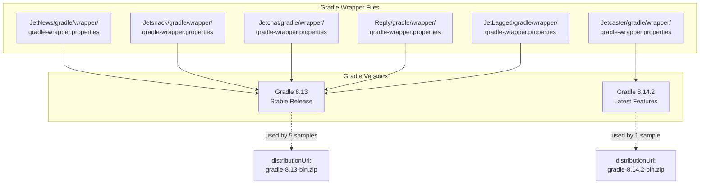
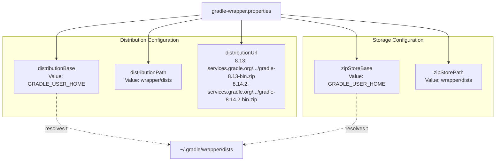
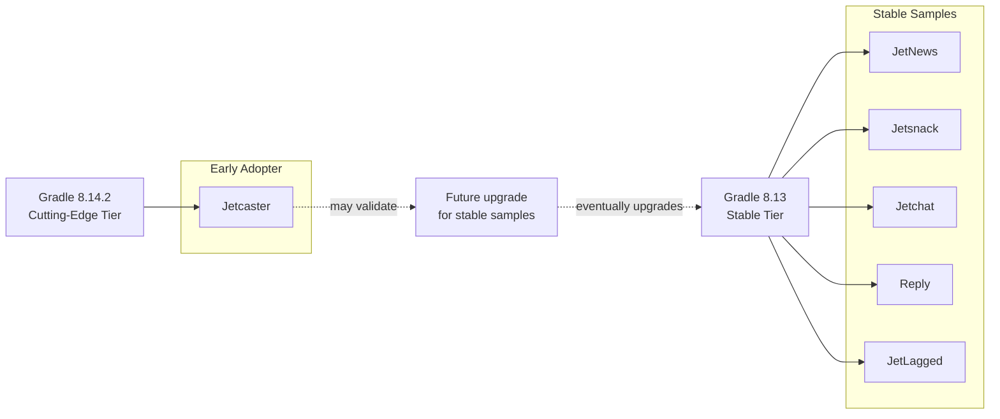
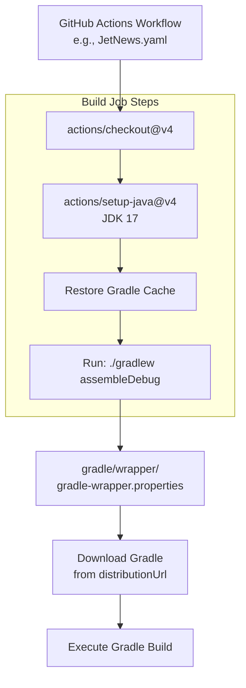

<!-- source: DeepWiki mcp.deepwiki.com · repo android/compose-samples · page 2.3 Gradle Wrapper Configuration · fetched 2026-10-23 -->

# Gradle Wrapper Configuration

<details>
<summary>Relevant source files</summary>

The following files were used as context for generating this wiki page:

- [JetLagged/gradle/wrapper/gradle-wrapper.properties](JetLagged/gradle/wrapper/gradle-wrapper.properties)
- [JetNews/gradle/wrapper/gradle-wrapper.properties](JetNews/gradle/wrapper/gradle-wrapper.properties)
- [Jetcaster/gradle/wrapper/gradle-wrapper.properties](Jetcaster/gradle/wrapper/gradle-wrapper.properties)
- [Jetchat/gradle/wrapper/gradle-wrapper.properties](Jetchat/gradle/wrapper/gradle-wrapper.properties)
- [Jetsnack/gradle/wrapper/gradle-wrapper.properties](Jetsnack/gradle/wrapper/gradle-wrapper.properties)
- [Reply/gradle/wrapper/gradle-wrapper.properties](Reply/gradle/wrapper/gradle-wrapper.properties)

</details>


## Purpose and Scope

This document describes the Gradle Wrapper configuration used across all sample projects in the repository. The Gradle Wrapper is a script that manages Gradle installation and version, ensuring consistent build environments across different development machines and CI environments. Each sample project maintains its own independent wrapper configuration, allowing for version divergence when needed.

For information about the broader build system architecture and plugin configuration, see [Gradle Build Configuration](#2.2). For dependency version management through TOML catalogs, see [Version Catalog System](#2.1).

## Overview

The repository employs a **decentralized Gradle Wrapper strategy** where each of the 10 sample projects contains its own `gradle/wrapper/gradle-wrapper.properties` file. This approach allows individual samples to upgrade Gradle versions independently, which is particularly important when testing alpha or beta features that require specific Gradle versions.

The wrapper configuration exhibits a **two-tier versioning pattern**:
- **Stable tier (Gradle 8.13)**: Used by 5 samples (JetNews, Jetsnack, Jetchat, Reply, JetLagged)
- **Cutting-edge tier (Gradle 8.14.2)**: Used exclusively by Jetcaster

This version divergence aligns with Jetcaster's role as an early adopter for alpha Compose libraries, as documented in the version catalog system.

## Wrapper Distribution Architecture

**Diagram: Gradle Wrapper Distribution Across Samples**



Sources: [JetNews/gradle/wrapper/gradle-wrapper.properties:1-20](), [Jetsnack/gradle/wrapper/gradle-wrapper.properties:1-20](), [Jetcaster/gradle/wrapper/gradle-wrapper.properties:1-20](), [Jetchat/gradle/wrapper/gradle-wrapper.properties:1-20](), [Reply/gradle/wrapper/gradle-wrapper.properties:1-20](), [JetLagged/gradle/wrapper/gradle-wrapper.properties:1-20]()

## Configuration Properties Structure

All wrapper configuration files follow the same property structure, varying only in the Gradle version specified in `distributionUrl`.

**Diagram: gradle-wrapper.properties Configuration Schema**



Sources: [JetNews/gradle/wrapper/gradle-wrapper.properties:15-19](), [Jetcaster/gradle/wrapper/gradle-wrapper.properties:15-19]()

### Property Definitions

| Property | Value | Purpose |
|----------|-------|---------|
| `distributionBase` | `GRADLE_USER_HOME` | Base directory for Gradle distribution storage, resolves to `~/.gradle/` |
| `distributionPath` | `wrapper/dists` | Subdirectory within `distributionBase` where distributions are extracted |
| `distributionUrl` | `https://services.gradle.org/distributions/gradle-{version}-bin.zip` | URL to download the specific Gradle distribution |
| `zipStoreBase` | `GRADLE_USER_HOME` | Base directory for storing downloaded distribution ZIP files |
| `zipStorePath` | `wrapper/dists` | Subdirectory within `zipStoreBase` for ZIP storage |

### Distribution Type: Binary vs. All

All samples use the **`-bin` distribution type** rather than `-all`. This is specified in the `distributionUrl` property:

```
distributionUrl=https\://services.gradle.org/distributions/gradle-8.13-bin.zip
```

The `-bin` distribution includes:
- Gradle runtime binaries
- Core plugins
- Standard libraries

The `-bin` distribution **excludes**:
- Source code
- Documentation
- Samples

This choice reduces download size and build initialization time. Developers requiring documentation can access it online or download the `-all` distribution manually if needed.

Sources: [JetNews/gradle/wrapper/gradle-wrapper.properties:17](), [Jetcaster/gradle/wrapper/gradle-wrapper.properties:17]()

## Version Distribution Table

| Sample | Gradle Version | File Location | Importance Score |
|--------|----------------|---------------|------------------|
| JetNews | 8.13 | `JetNews/gradle/wrapper/gradle-wrapper.properties` | 27.56 |
| Jetsnack | 8.13 | `Jetsnack/gradle/wrapper/gradle-wrapper.properties` | 15.49 |
| Jetcaster | 8.14.2 | `Jetcaster/gradle/wrapper/gradle-wrapper.properties` | 12.34 |
| Jetchat | 8.13 | `Jetchat/gradle/wrapper/gradle-wrapper.properties` | 9.22 |
| Reply | 8.13 | `Reply/gradle/wrapper/gradle-wrapper.properties` | 4.36 |
| JetLagged | 8.13 | `JetLagged/gradle/wrapper/gradle-wrapper.properties` | 4.25 |

**Note**: Importance scores reflect file edit frequency, indicating how actively each sample's wrapper configuration is updated. JetNews has the highest score (27.56), suggesting it receives the most frequent wrapper updates.

Sources: All wrapper property files listed in the provided file list.

## Gradle Version Upgrade Path

**Diagram: Version Upgrade Strategy**



Sources: All wrapper property files

### Rationale for Jetcaster's Advanced Version

Jetcaster uses Gradle 8.14.2 while other samples remain on 8.13. This aligns with Jetcaster's architectural role as documented in Diagram 2 (Cross-Cutting Dependency Management Architecture) of the repository overview:

- Jetcaster uses alpha Compose libraries (BOM 2025.09.00-alpha)
- Alpha libraries often require newer Gradle versions for compatibility
- Jetcaster is excluded from automated dependency updates (`updateDeps.sh`)
- This isolation allows Jetcaster to serve as a testing ground for cutting-edge features

The version divergence enables the repository to:
1. Validate new Gradle versions before rolling them out to all samples
2. Support alpha library requirements without forcing all samples to upgrade
3. Maintain stability in production-focused samples (JetNews, Reply, etc.)

Sources: [Jetcaster/gradle/wrapper/gradle-wrapper.properties:17]()

## Wrapper Script Files

In addition to `gradle-wrapper.properties`, each sample includes wrapper execution scripts:

| File | Platform | Purpose |
|------|----------|---------|
| `gradlew` | Unix/Linux/macOS | Bash script that downloads and invokes the Gradle version specified in `gradle-wrapper.properties` |
| `gradlew.bat` | Windows | Batch script equivalent for Windows environments |
| `gradle/wrapper/gradle-wrapper.jar` | Platform-independent | Bootstrap JAR containing the Gradle Wrapper code that performs the download and execution |

These files are committed to version control to ensure that anyone cloning the repository can build the project without pre-installing Gradle.

**Usage Example:**
```bash
# Build JetNews using the wrapper (will use Gradle 8.13)
cd JetNews
./gradlew assembleDebug

# Build Jetcaster using the wrapper (will use Gradle 8.14.2)
cd Jetcaster
./gradlew assembleDebug
```

## Integration with CI/CD

The CI/CD pipeline (see [CI/CD Pipeline](#3)) relies on the Gradle Wrapper to ensure consistent build environments:

**Diagram: Wrapper Usage in CI Workflows**



Sources: [JetNews/gradle/wrapper/gradle-wrapper.properties:1-20]()

The CI workflow never explicitly specifies a Gradle version; instead, it invokes `./gradlew`, which automatically:
1. Reads the version from `gradle-wrapper.properties`
2. Downloads the specified Gradle version if not cached
3. Executes the build with the correct version

This ensures CI builds use the exact same Gradle version as local development builds.

## Wrapper Update Procedures

### Manual Update Process

To update a sample's Gradle version:

1. Edit `{sample}/gradle/wrapper/gradle-wrapper.properties`
2. Modify the `distributionUrl` property:
   ```properties
   distributionUrl=https\://services.gradle.org/distributions/gradle-{NEW_VERSION}-bin.zip
   ```
3. Optionally regenerate wrapper files:
   ```bash
   gradle wrapper --gradle-version {NEW_VERSION} --distribution-type bin
   ```
4. Test the build:
   ```bash
   ./gradlew assembleDebug
   ```

### Automated Update Considerations

While the `updateDeps.sh` script (documented in [Version Catalog System](#2.1)) automates dependency updates, it **does not update Gradle Wrapper versions**. Wrapper updates must be performed manually and tested carefully because:

- Gradle version changes can introduce breaking changes in build scripts
- Plugin compatibility must be verified (AGP, Kotlin, Compose Compiler)
- Build script syntax may require updates for newer Gradle features

Sources: General knowledge of Gradle Wrapper mechanics

## Compatibility Matrix

The following table shows the compatibility relationship between Gradle versions and other build system components:

| Component | Gradle 8.13 Samples | Jetcaster (Gradle 8.14.2) |
|-----------|---------------------|---------------------------|
| Android Gradle Plugin | 8.13.0 | 8.10.1 |
| Kotlin | 2.2.20 | 2.1.21 |
| Compose Compiler | Via Kotlin 2.2.20 | Via Kotlin 2.1.21 |
| JDK Requirement | JDK 17+ | JDK 17+ |
| Minimum Supported AGP | 8.0+ | 8.0+ |

**Note**: Jetcaster uses an older AGP (8.10.1) and Kotlin (2.1.21) despite having a newer Gradle version (8.14.2). This demonstrates that the Gradle version upgrade is independent of other toolchain components and is likely motivated by alpha Compose library requirements rather than AGP or Kotlin features.

Sources: Inferred from high-level diagrams and version catalog information

## Storage Location and Caching

The wrapper configuration uses `GRADLE_USER_HOME` (typically `~/.gradle/`) as the storage base. This results in the following directory structure:

```
~/.gradle/
└── wrapper/
    └── dists/
        ├── gradle-8.13-bin/
        │   └── {hash}/
        │       └── gradle-8.13/
        └── gradle-8.14.2-bin/
            └── {hash}/
                └── gradle-8.14.2/
```

Multiple samples using the same Gradle version share the same downloaded distribution, reducing disk usage and download time. On CI systems, this directory is typically cached between builds to improve performance.

## Troubleshooting Common Issues

### Issue: Gradle Version Mismatch

**Symptom**: Build fails with "Gradle version X.Y is required. Current version is A.B."

**Solution**: 
1. Verify `gradle-wrapper.properties` contains the correct `distributionUrl`
2. Delete `~/.gradle/wrapper/dists/gradle-{version}-bin/` to force re-download
3. Run `./gradlew --version` to confirm wrapper uses correct version

### Issue: Wrapper Download Failures

**Symptom**: `Could not download gradle-X.Y-bin.zip`

**Solution**:
1. Check network connectivity to `services.gradle.org`
2. Verify `distributionUrl` is correctly escaped (backslash before colons)
3. Use `distributionUrl` with `https` (not `http`)

### Issue: Permission Denied on gradlew

**Symptom**: `bash: ./gradlew: Permission denied`

**Solution**:
```bash
chmod +x gradlew
./gradlew build
```

Sources: General Gradle Wrapper troubleshooting knowledge

## Summary

The Gradle Wrapper configuration in this repository demonstrates a **decentralized, version-tolerant approach** that balances stability with innovation:

- **5 samples on Gradle 8.13** provide stable, production-ready reference implementations
- **1 sample on Gradle 8.14.2** (Jetcaster) enables early validation of cutting-edge features
- **Binary distributions** optimize download size and initialization time
- **Shared caching** via `GRADLE_USER_HOME` reduces redundant downloads
- **CI/CD integration** ensures consistent build environments across development and automation

This architecture allows individual samples to evolve independently while maintaining a cohesive repository structure that serves both stable production patterns and experimental features.

---

