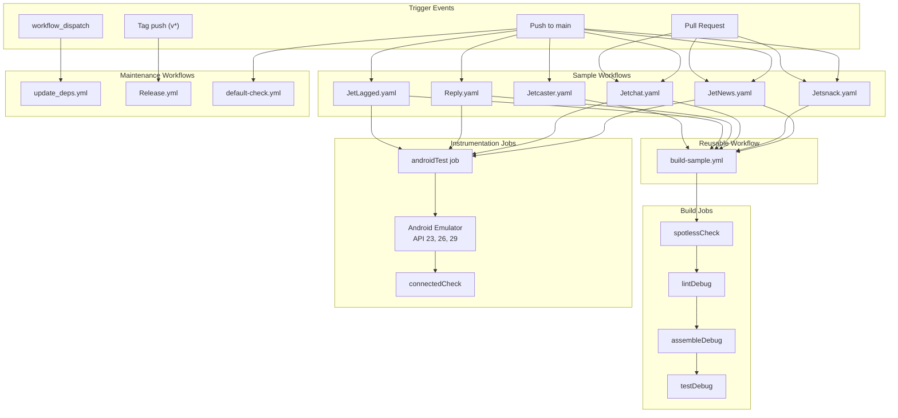
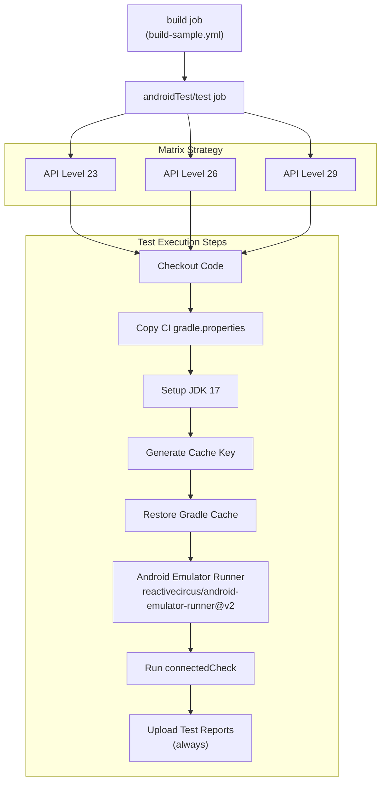
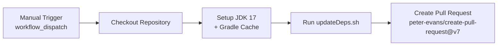
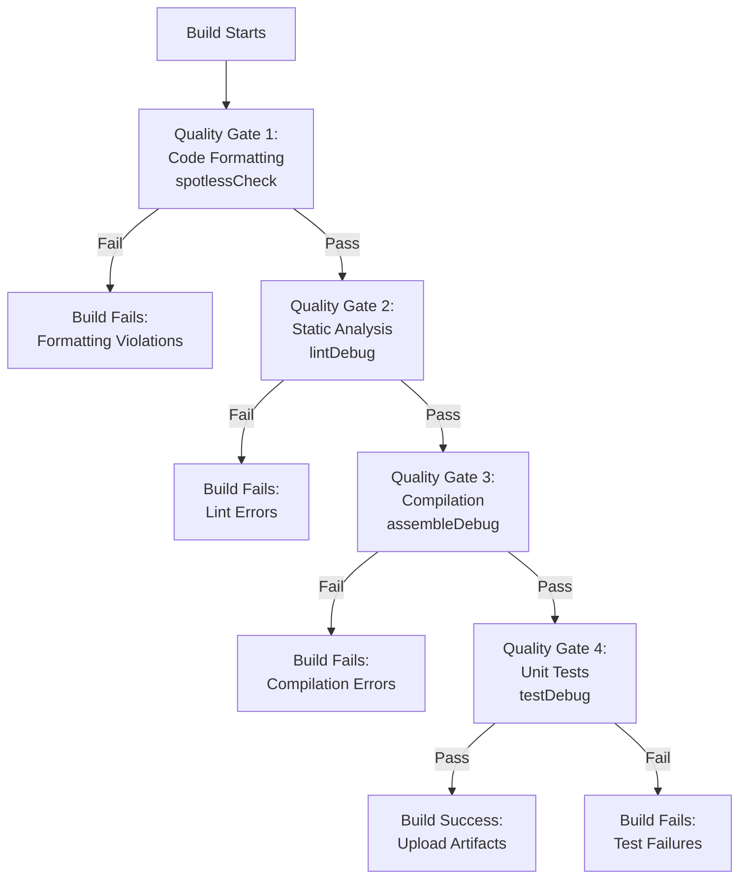

<!-- source: DeepWiki mcp.deepwiki.com · repo android/compose-samples · page 3 CI/CD Pipeline · fetched 2026-10-23 -->

# CI/CD Pipeline

<details>
<summary>Relevant source files</summary>

The following files were used as context for generating this wiki page:

- [.github/workflows/JetLagged.yaml](.github/workflows/JetLagged.yaml)
- [.github/workflows/JetNews.yaml](.github/workflows/JetNews.yaml)
- [.github/workflows/Jetcaster.yaml](.github/workflows/Jetcaster.yaml)
- [.github/workflows/Jetchat.yaml](.github/workflows/Jetchat.yaml)
- [.github/workflows/Jetsnack.yaml](.github/workflows/Jetsnack.yaml)
- [.github/workflows/Release.yml](.github/workflows/Release.yml)
- [.github/workflows/Reply.yaml](.github/workflows/Reply.yaml)
- [.github/workflows/build-sample.yml](.github/workflows/build-sample.yml)
- [.github/workflows/default-check.yml](.github/workflows/default-check.yml)
- [.github/workflows/update_deps.yml](.github/workflows/update_deps.yml)

</details>


## Purpose and Scope

This document describes the Continuous Integration and Continuous Deployment (CI/CD) pipeline implemented using GitHub Actions workflows for the Jetpack Compose Samples repository. The CI/CD system automates building, testing, code quality checks, and release distribution for all sample applications.

This page covers the workflow architecture, build steps, testing strategies, and automation workflows. For information about dependency management automation, see [Version Catalog System](#2.1). For details about the testing infrastructure and test utilities used within these workflows, see [Testing Infrastructure](#6).

## Workflow Architecture Overview

The CI/CD system uses a hub-and-spoke pattern where individual sample workflows delegate to a centralized reusable workflow. This architecture eliminates code duplication across 6+ sample projects while allowing sample-specific customization.



**Workflow Organization**

Sources: [.github/workflows/build-sample.yml:1-96](), [.github/workflows/JetNews.yaml:1-82]()

## Reusable Build Workflow

The `build-sample.yml` workflow serves as the centralized build template that all sample workflows invoke. It accepts sample-specific parameters and executes a standardized build pipeline.

### Workflow Inputs and Secrets

[.github/workflows/build-sample.yml:4-24]() defines the workflow interface:

| Input | Type | Required | Default | Description |
|-------|------|----------|---------|-------------|
| `name` | string | Yes | - | Sample display name |
| `path` | string | Yes | - | Sample directory path |
| `module` | string | No | `"app"` | Module name to build |

| Secret | Description |
|--------|-------------|
| `compose_store_password` | Keystore password |
| `compose_key_alias` | Keystore alias |
| `compose_key_password` | Key password |

### Concurrency Control

[.github/workflows/build-sample.yml:25-27]() implements concurrency management to prevent redundant builds:

```yaml
concurrency:
  group: ${{ inputs.name }}-build-${{ github.ref }}
  cancel-in-progress: true
```

This ensures that when multiple commits are pushed to the same branch, only the most recent build runs, canceling any in-progress builds for the same sample and branch combination.

Sources: [.github/workflows/build-sample.yml:1-31]()

## Build Pipeline Stages

The reusable workflow executes a sequential build pipeline with quality gates at each stage. Each stage must pass before proceeding to the next.

```mermaid
graph LR
    CHECKOUT["Checkout<br/>actions/checkout@v5<br/>fetch-depth: 0"]
    SETUP["Setup Environment<br/>Copy ci-gradle.properties<br/>JDK 17 (Zulu)"]
    CACHE_KEY["Generate Cache Key<br/>scripts/checksum.sh"]
    CACHE["Gradle Cache<br/>actions/cache@v4"]
    SPOTLESS["Code Formatting<br/>spotlessCheck"]
    LINT["Static Analysis<br/>lintDebug"]
    BUILD["Compilation<br/>assembleDebug"]
    UNIT["Unit Tests<br/>testDebug"]
    ARTIFACTS["Upload Artifacts<br/>APKs + Reports"]
    
    CHECKOUT --> SETUP
    SETUP --> CACHE_KEY
    CACHE_KEY --> CACHE
    CACHE --> SPOTLESS
    SPOTLESS --> LINT
    LINT --> BUILD
    BUILD --> UNIT
    UNIT --> ARTIFACTS
```



### Stage Details

**1. Checkout** [.github/workflows/build-sample.yml:37-42]()
- Uses `actions/checkout@v5` with `fetch-depth: 0` to checkout full history
- Full history required for Spotless ratcheting feature (see [diffplug/spotless#710](https://github.com/diffplug/spotless/issues/710))

**2. Environment Setup** [.github/workflows/build-sample.yml:44-51]()
- Copies [.github/ci-gradle.properties]() to `~/.gradle/gradle.properties`
- Sets up JDK 17 (Zulu distribution)

**3. Cache Key Generation** [.github/workflows/build-sample.yml:53-54]()
- Executes [scripts/checksum.sh]() to generate deterministic cache key
- Cache key based on sample-specific file checksums

**4. Gradle Caching** [.github/workflows/build-sample.yml:56-62]()
- Caches three Gradle directories:
  - `~/.gradle/caches/modules-*` (dependency modules)
  - `~/.gradle/caches/jars-*` (JAR files)
  - `~/.gradle/caches/build-cache-*` (build cache)
- Key: `gradle-${{ hashFiles('checksum.txt') }}`

**5. Code Formatting Check** [.github/workflows/build-sample.yml:64-66]()
- Command: `./gradlew spotlessCheck --stacktrace`
- Enforces code style using Spotless + ktlint
- Fails build if formatting violations detected

**6. Static Analysis** [.github/workflows/build-sample.yml:68-70]()
- Command: `./gradlew lintDebug --stacktrace`
- Runs Android Lint checks on debug variant

**7. Compilation** [.github/workflows/build-sample.yml:72-74]()
- Command: `./gradlew assembleDebug --stacktrace`
- Builds debug APK

**8. Unit Tests** [.github/workflows/build-sample.yml:75-82]()
- Enables KVM group permissions for potential emulator usage
- Command: `./gradlew testDebug --stacktrace`
- Runs local unit tests (JUnit)

**9. Artifact Upload** [.github/workflows/build-sample.yml:84-95]()
- Uploads build outputs (APKs) from `{path}/{module}/build/outputs`
- Uploads build reports from `{path}/{module}/build/reports`
- Reports uploaded even if build fails (`if: always()`)

Sources: [.github/workflows/build-sample.yml:36-96]()

## Sample-Specific Workflows

Each sample application has a dedicated workflow file that triggers on relevant events and calls the reusable workflow.

### Workflow Comparison Table

| Sample | Workflow File | Build Job | Instrumentation Tests | Module Override |
|--------|---------------|-----------|----------------------|-----------------|
| JetNews | JetNews.yaml | ✓ | ✓ (API 23, 26, 29) | No |
| Jetsnack | Jetsnack.yaml | ✓ | ✗ | No |
| Jetchat | Jetchat.yaml | ✓ | ✓ (API 23, 26, 29) | No |
| Reply | Reply.yaml | ✓ | ✓ (API 23, 26, 29) | No |
| JetLagged | JetLagged.yaml | ✓ | ✓ (API 23, 26, 29) | No |
| Jetcaster | Jetcaster.yaml | ✓ | ✗ | Yes (`mobile`) |

### Trigger Configuration

All sample workflows share common trigger patterns [.github/workflows/JetNews.yaml:3-14]():

```yaml
on:
  push:
    branches:
      - main
    paths:
      - '.github/workflows/{Sample}.yaml'
      - '{Sample}/**'
  pull_request:
    paths:
      - '.github/workflows/{Sample}.yaml'
      - '{Sample}/**'
  workflow_dispatch:
```

This configuration:
- Triggers on pushes to `main` branch affecting the sample
- Triggers on pull requests modifying the sample
- Allows manual workflow execution via GitHub UI
- Uses path filters to prevent unnecessary builds

### Jetcaster Module Configuration

Jetcaster requires a non-default module parameter [.github/workflows/Jetcaster.yaml:16-26]():

```yaml
jobs:
  build:
    uses: ./.github/workflows/build-sample.yml
    with:
      name: Jetcaster
      path: Jetcaster
      module: mobile  # Non-default module
```

This is necessary because Jetcaster has a multi-module structure with separate `mobile`, `tv`, and `wear` modules, and the workflow targets the mobile module specifically.

Sources: [.github/workflows/JetNews.yaml:1-31](), [.github/workflows/Jetsnack.yaml:1-26](), [.github/workflows/Jetcaster.yaml:1-27]()

## Instrumentation Testing

Four samples (JetNews, Jetchat, Reply, JetLagged) include additional instrumentation test jobs that run after the main build job completes successfully.

### Instrumentation Test Job Architecture



### Test Job Configuration

[.github/workflows/JetNews.yaml:32-38]() defines the test job structure:

```yaml
androidTest:
  needs: build
  runs-on: ubuntu-latest
  timeout-minutes: 30
  strategy:
    matrix:
      api-level: [23, 26, 29]
```

Key configuration points:
- **Dependency**: `needs: build` ensures build job completes first
- **Runner**: `ubuntu-latest` enables hardware acceleration
- **Timeout**: 30 minutes maximum execution time
- **Matrix**: Tests run in parallel across three API levels

### Emulator Configuration

[.github/workflows/JetNews.yaml:67-74]() configures the Android emulator:

```yaml
- name: Run instrumentation tests
  uses: reactivecircus/android-emulator-runner@v2
  with:
    api-level: ${{ matrix.api-level }}
    arch: x86
    disable-animations: true
    script: ./gradlew connectedCheck --stacktrace
    working-directory: ${{ env.SAMPLE_PATH }}
```

Configuration details:
- **Architecture**: x86 for better performance on CI
- **Animations**: Disabled to stabilize UI tests
- **Script**: Runs `connectedCheck` Gradle task
- **Working Directory**: Sample-specific path

### KVM Setup

[.github/workflows/JetNews.yaml:43-47]() enables KVM for hardware acceleration:

```bash
echo 'KERNEL=="kvm", GROUP="kvm", MODE="0666", OPTIONS+="static_node=kvm"' | sudo tee /etc/udev/rules.d/99-kvm4all.rules
sudo udevadm control --reload-rules
sudo udevadm trigger --name-match=kvm
```

This configuration allows the emulator to use hardware acceleration, significantly improving test execution speed.

### Test Report Artifacts

[.github/workflows/JetNews.yaml:76-81]() uploads test reports:

```yaml
- name: Upload test reports
  if: always()
  uses: actions/upload-artifact@v4
  with:
    name: test-reports-jetnews-${{ matrix.api-level }}
    path: ${{ env.SAMPLE_PATH }}/app/build/reports/androidTests
```

Report artifacts are:
- Named with sample and API level: `test-reports-{sample}-{api-level}`
- Uploaded regardless of test outcome (`if: always()`)
- Contain full test execution reports from Android Test Framework

Sources: [.github/workflows/JetNews.yaml:32-82](), [.github/workflows/Jetchat.yaml:31-78](), [.github/workflows/Reply.yaml:32-79]()

## Maintenance Workflows

### Automated Dependency Updates

The `update_deps.yml` workflow automates dependency updates across stable samples.



[.github/workflows/update_deps.yml:1-39]() implements the workflow:

**Workflow Configuration**:
- **Trigger**: Manual only (`workflow_dispatch`)
- **Script**: Executes [scripts/updateDeps.sh]()
- **PR Creation**: Uses `peter-evans/create-pull-request@v7`
- **Bot Identity**: `compose-devrel-github-bot`
- **Branch**: `bot-update-deps` (deleted after merge)
- **Reviewers**: Automatically assigns workflow initiator

**PR Details**:
- Title: "🤖 Update Dependencies"
- Body: "Updated depedencies"
- Commit message: "🤖 Update Dependencies"
- Committer/Author: compose-devrel-github-bot

The `updateDeps.sh` script updates [libs.versions.toml]() files across samples, excluding Jetcaster due to its alpha library usage (see [Version Catalog System](#2.1)).

Sources: [.github/workflows/update_deps.yml:1-39]()

### Release Workflow

The `Release.yml` workflow builds all samples and publishes APKs to GitHub Releases when version tags are pushed.

**Trigger Configuration** [.github/workflows/Release.yml:3-7]():
```yaml
on:
  workflow_dispatch:
  push:
    tags:
    - 'v*'
```

Triggers on:
- Tag pushes matching pattern `v*` (e.g., `v1.0.0`, `v2.3.1`)
- Manual execution via GitHub UI

**Build Process** [.github/workflows/Release.yml:30-31]():
```bash
./scripts/gradlew_recursive.sh assembleDebug
```

This script recursively builds all samples in the repository.

**Release Creation** [.github/workflows/Release.yml:33-42]():
- Uses `actions/create-release@v1`
- Creates draft release (requires manual publishing)
- Release name matches tag name
- Not marked as prerelease

**APK Uploads**:
The workflow uploads debug APKs for multiple samples [.github/workflows/Release.yml:44-82]():

| Sample | APK Path | Asset Name |
|--------|----------|------------|
| Jetcaster | `Jetcaster/mobile/build/outputs/apk/debug/app-debug.apk` | `jetcaster-debug.apk` |
| Jetchat | `Jetchat/app/build/outputs/apk/debug/app-debug.apk` | `jetchat-debug.apk` |
| JetNews | `JetNews/app/build/outputs/apk/debug/app-debug.apk` | `jetnews-debug.apk` |
| Jetsnack | `Jetsnack/app/build/outputs/apk/debug/app-debug.apk` | `jetsnack-debug.apk` |

Sources: [.github/workflows/Release.yml:1-83]()

### Default Check Workflow

The `default-check.yml` workflow runs when files outside sample directories are modified [.github/workflows/default-check.yml:1-33]():

**Path Exclusions**:
```yaml
paths-ignore:
  - 'Jetcaster/**'
  - 'Jetchat/**'
  - 'JetLagged/**'
  - 'JetNews/**'
  - 'Jetsnack/**'
  - 'Reply/**'
```

This ensures that changes to repository-level files (root build scripts, documentation, CI configuration) trigger a check, even though the check itself is currently minimal.

Sources: [.github/workflows/default-check.yml:1-33]()

## Environment Configuration

### Secrets Management

All workflows require three secrets for signing configurations:

| Secret Name | Environment Variable | Purpose |
|-------------|---------------------|---------|
| `COMPOSE_STORE_PASSWORD` | `compose_store_password` | Keystore password |
| `COMPOSE_KEY_ALIAS` | `compose_key_alias` | Keystore alias identifier |
| `COMPOSE_KEY_PASSWORD` | `compose_key_password` | Key password |

These secrets are:
- Stored at the repository level in GitHub
- Passed as environment variables to workflows [.github/workflows/JetNews.yaml:16-20]()
- Forwarded to the reusable workflow via the `secrets` parameter [.github/workflows/JetNews.yaml:27-30]()

### CI-Specific Gradle Properties

[.github/workflows/build-sample.yml:44-45]() copies CI-specific Gradle configuration:

```bash
mkdir -p ~/.gradle ; cp .github/ci-gradle.properties ~/.gradle/gradle.properties
```

The [.github/ci-gradle.properties]() file likely contains CI-optimized settings such as:
- Daemon configuration
- Parallel build settings
- Memory allocation
- Build cache configuration

Sources: [.github/workflows/JetNews.yaml:16-30](), [.github/workflows/build-sample.yml:28-31](), [.github/workflows/build-sample.yml:44-45]()

## Caching Strategy

The CI pipeline implements a multi-layer caching strategy to minimize build times.

### Cache Key Generation

[.github/workflows/build-sample.yml:53-54]() generates sample-specific cache keys:

```bash
./scripts/checksum.sh ${{ inputs.path }} checksum.txt
```

The [scripts/checksum.sh]() script:
- Calculates checksums of files in the sample directory
- Outputs deterministic checksum to `checksum.txt`
- Ensures cache invalidates when sample dependencies change
- Prevents cache pollution between samples

### Cached Directories

[.github/workflows/build-sample.yml:56-62]() defines cached Gradle directories:

```yaml
path: |
  ~/.gradle/caches/modules-*
  ~/.gradle/caches/jars-*
  ~/.gradle/caches/build-cache-*
key: gradle-${{ hashFiles('checksum.txt') }}
```

**Cache Types**:
1. **`modules-*`**: Downloaded dependency modules
2. **`jars-*`**: Transformed JARs
3. **`build-cache-*`**: Gradle build cache (task outputs)

### Cache Benefits

The caching strategy provides:
- **Faster dependency resolution**: Modules downloaded once, reused across builds
- **Incremental builds**: Build cache enables task output reuse
- **Sample isolation**: Sample-specific keys prevent cross-contamination
- **Automatic invalidation**: Cache updates when dependencies change

Sources: [.github/workflows/build-sample.yml:53-62](), [.github/workflows/JetNews.yaml:58-66]()

## Quality Gates

The build pipeline enforces three sequential quality gates that must all pass for a build to succeed.



### Gate 1: Code Formatting (spotlessCheck)

[.github/workflows/build-sample.yml:64-66]()

**Command**: `./gradlew spotlessCheck --stacktrace`

**Purpose**: Enforces consistent code style using Spotless + ktlint

**Failure Conditions**:
- Kotlin files not formatted per ktlint rules
- Copyright headers missing or incorrect
- License file violations

**Configuration**: [spotless/copyright.kt]() defines copyright header format

### Gate 2: Static Analysis (lintDebug)

[.github/workflows/build-sample.yml:68-70]()

**Command**: `./gradlew lintDebug --stacktrace`

**Purpose**: Catches potential bugs and code quality issues without compilation

**Failure Conditions**:
- Android Lint errors (high-severity issues)
- API usage violations
- Resource issues
- Security vulnerabilities
- Accessibility problems

**Artifact**: Lint reports uploaded to build-reports artifact

### Gate 3: Compilation (assembleDebug)

[.github/workflows/build-sample.yml:72-74]()

**Command**: `./gradlew assembleDebug --stacktrace`

**Purpose**: Verifies code compiles successfully

**Failure Conditions**:
- Compilation errors
- Resource processing failures
- Manifest merge conflicts
- Code generation errors

**Output**: Debug APK uploaded to build-outputs artifact

### Gate 4: Unit Tests (testDebug)

[.github/workflows/build-sample.yml:80-82]()

**Command**: `./gradlew testDebug --stacktrace`

**Purpose**: Validates business logic and unit-testable code

**Failure Conditions**:
- JUnit test failures
- Assertion errors
- Test exceptions

**Artifact**: Test reports uploaded to build-reports artifact

Sources: [.github/workflows/build-sample.yml:64-82]()

## Workflow Execution Matrix

The following table summarizes the complete workflow execution for each sample:

| Sample | Build Job | Formatting | Lint | Compile | Unit Tests | Instrumentation Tests | API Levels |
|--------|-----------|------------|------|---------|------------|----------------------|------------|
| JetNews | ✓ | ✓ | ✓ | ✓ | ✓ | ✓ | 23, 26, 29 |
| Jetsnack | ✓ | ✓ | ✓ | ✓ | ✓ | ✗ | - |
| Jetchat | ✓ | ✓ | ✓ | ✓ | ✓ | ✓ | 23, 26, 29 |
| Reply | ✓ | ✓ | ✓ | ✓ | ✓ | ✓ | 23, 26, 29 |
| JetLagged | ✓ | ✓ | ✓ | ✓ | ✓ | ✓ | 23, 26, 29 |
| Jetcaster | ✓ | ✓ | ✓ | ✓ | ✓ | ✗ | - |

**Notes**:
- All samples execute the four build quality gates (formatting, lint, compile, unit tests)
- Four samples (JetNews, Jetchat, Reply, JetLagged) include instrumentation tests
- Instrumentation tests run in parallel across three Android API levels
- Jetsnack and Jetcaster omit instrumentation tests (no `test` or `androidTest` job defined)

Sources: [.github/workflows/JetNews.yaml:1-82](), [.github/workflows/Jetsnack.yaml:1-26](), [.github/workflows/Jetchat.yaml:1-78](), [.github/workflows/Reply.yaml:1-79](), [.github/workflows/JetLagged.yaml:1-79](), [.github/workflows/Jetcaster.yaml:1-27]()

---

