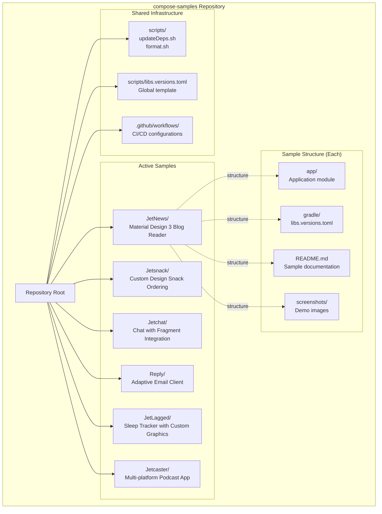
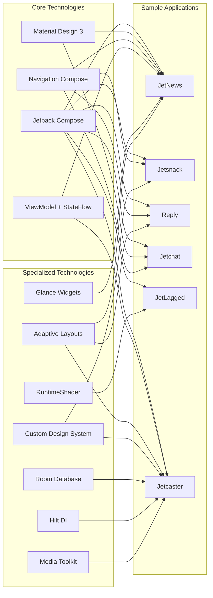
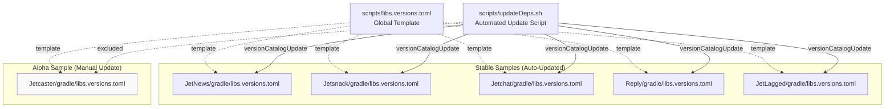

<!-- source: DeepWiki mcp.deepwiki.com · repo android/compose-samples · page 4 Sample Applications · fetched 2026-10-23 -->

# Sample Applications

<details>
<summary>Relevant source files</summary>

The following files were used as context for generating this wiki page:

- [JetLagged/gradle/libs.versions.toml](JetLagged/gradle/libs.versions.toml)
- [JetNews/README.md](JetNews/README.md)
- [JetNews/gradle/libs.versions.toml](JetNews/gradle/libs.versions.toml)
- [Jetcaster/README.md](Jetcaster/README.md)
- [Jetcaster/docs/tabletop.png](Jetcaster/docs/tabletop.png)
- [Jetcaster/gradle/libs.versions.toml](Jetcaster/gradle/libs.versions.toml)
- [Jetchat/README.md](Jetchat/README.md)
- [Jetchat/gradle/libs.versions.toml](Jetchat/gradle/libs.versions.toml)
- [Jetchat/screenshots/widget.png](Jetchat/screenshots/widget.png)
- [Jetchat/screenshots/widget_discoverability.png](Jetchat/screenshots/widget_discoverability.png)
- [Jetsnack/README.md](Jetsnack/README.md)
- [Jetsnack/gradle/libs.versions.toml](Jetsnack/gradle/libs.versions.toml)
- [README.md](README.md)
- [Reply/gradle/libs.versions.toml](Reply/gradle/libs.versions.toml)
- [readme/jetcaster-hero.png](readme/jetcaster-hero.png)
- [scripts/updateDeps.sh](scripts/updateDeps.sh)

</details>


This page provides an overview of all sample applications in the Jetpack Compose Samples repository. Each sample demonstrates different aspects of Jetpack Compose, from basic UI patterns to production-ready architectures. For detailed documentation on individual samples, see their respective child pages (sections 4.1-4.6).

For information about shared architectural patterns across samples, see [Shared Architecture Patterns](#5). For dependency management across samples, see [Version Catalog System](#2.1).

## Sample Overview

The repository contains six actively maintained sample applications, each targeting different use cases and complexity levels:

| Sample | Complexity | Primary Focus | Key Technologies | Documentation |
|--------|-----------|---------------|------------------|---------------|
| **JetNews** | Medium | Material Design 3, Adaptive UI, News Reader | M3 theming, WindowSizeClass, Glance widgets, Navigation Drawer | [JetNews](#4.1) |
| **Jetsnack** | Medium | Custom Design System, Animations | Custom ColorPalette, Shared element transitions, Custom layouts | [Jetsnack](#4.2) |
| **Reply** | Medium | Adaptive UI, Large Screens, Foldables | Navigation Suite, Device posture, Dual-pane layouts | [Reply](#4.3) |
| **Jetchat** | Low-Medium | Chat UI, Fragment Integration | LiveData, Navigation Component, Text input, Emoji selector | [Jetchat](#4.4) |
| **JetLagged** | Medium | Custom Graphics, Data Visualization | RuntimeShader, Custom layouts, Predictive back | [JetLagged](#4.5) |
| **Jetcaster** | Advanced | Redux Architecture, Multi-Platform | StateFlow, Room, Hilt, Multi-platform (mobile/TV/Wear) | [Jetcaster](#4.6) |

Sources: [README.md:16-32]()

## Repository Structure



**Directory Structure Mapping**

Each sample follows a consistent directory layout:
- `{Sample}/app/` - Main application module with source code
- `{Sample}/gradle/libs.versions.toml` - Version catalog for dependencies
- `{Sample}/build.gradle.kts` - Project-level Gradle configuration
- `{Sample}/app/build.gradle.kts` - Module-level Gradle configuration
- `{Sample}/README.md` - Sample-specific documentation
- `{Sample}/screenshots/` - Screenshots and demo images

Sources: [README.md:1-42](), [Jetcaster/gradle/libs.versions.toml:1-4](), [JetNews/gradle/libs.versions.toml:1-4]()

## Complexity Classification

### Low-Medium Complexity: Jetchat
- Fragment-based navigation with Compose integration
- Traditional Architecture Components (LiveData, ViewModel)
- Focus on fundamental UI patterns (text input, emoji selector)
- Entry point for developers transitioning from View system

### Medium Complexity: JetNews, Jetsnack, Reply, JetLagged
- **JetNews**: Material Design 3 showcase with adaptive layouts
- **Jetsnack**: Custom design system implementation
- **Reply**: Adaptive UI for multiple form factors
- **JetLagged**: Custom graphics and data visualization

### Advanced Complexity: Jetcaster
- Production-ready Redux-style architecture
- Multi-platform support (mobile, TV, Wear)
- Dependency injection with Hilt
- Room database integration
- RSS feed parsing with network layer

Sources: [README.md:16-32](), [Jetcaster/README.md:1-6]()

## Technology Matrix by Sample



### Detailed Technology Mapping

| Technology | JetNews | Jetsnack | Reply | Jetchat | JetLagged | Jetcaster |
|------------|---------|----------|-------|---------|-----------|-----------|
| **Compose BOM** | 2025.10.00 | 2025.10.00 | 2025.10.00 | 2025.10.00 | 2025.10.00 | 2025.09.00-alpha |
| **Kotlin** | 2.2.20 | 2.2.20 | 2.2.20 | 2.2.20 | 2.2.20 | 2.1.21 |
| **AGP** | 8.13.0 | 8.13.0 | 8.13.0 | 8.13.0 | 8.13.0 | 8.10.1 |
| **Material 3** | ✓ | ✓ | ✓ | ✓ | ✓ | ✓ |
| **Navigation** | 2.9.5 | 2.9.5 | 2.9.5 | 2.9.5 | 2.9.5 | 2.9.0 |
| **Room** | - | - | - | - | - | 2.7.1 |
| **Hilt** | - | - | - | - | - | 2.56.2 |
| **Glance** | 1.1.1 | - | - | - | - | 1.1.1 |
| **Window** | 1.5.0 | 1.5.0 | 1.5.0 | 1.5.0 | 1.5.0 | 1.4.0 |
| **Adaptive** | ✓ | - | ✓ | - | - | ✓ |
| **Parcelize** | - | ✓ | - | - | ✓ | - |
| **Serialization** | - | - | ✓ | - | - | - |

Sources: [JetNews/gradle/libs.versions.toml:5-60](), [Jetsnack/gradle/libs.versions.toml:1-57](), [Reply/gradle/libs.versions.toml:5-60](), [Jetchat/gradle/libs.versions.toml:5-60](), [JetLagged/gradle/libs.versions.toml:1-56](), [Jetcaster/gradle/libs.versions.toml:5-61]()

## Key Features by Sample

### JetNews: Material Design 3 & Adaptive UI
**Entry Point**: `com.example.jetnews.JetnewsApplication`
**Main Screens**: 
- `HomeScreen` - Article list with navigation drawer
- `ArticleScreen` - Article detail view
- `InterestsScreen` - Topic subscription management
- `JetnewsAppWidget` - Glance-based home screen widget

**Demonstrates**:
- Material Design 3 theming and components
- Window size class handling for responsive layouts
- Navigation drawer with modal/permanent modes
- Glance API for app widgets
- Custom layouts for interests screen

Sources: [JetNews/README.md:1-133](), [README.md:21]()

### Jetsnack: Custom Design System
**Entry Point**: `com.example.jetsnack.ui.JetsnackApp`
**Key Components**:
- `JetsnackColorPalette` - Custom color system (not Material)
- `JetsnackTheme` - Theme implementation
- `CollapsingImageLayout` - Custom collapsing header layout
- `SnackDetail` - Shared element transitions

**Demonstrates**:
- Custom design system bypassing Material color theming
- Shared element transitions between screens
- Custom layout implementations
- Gradient modifiers and visual effects
- Bottom navigation with animated width changes

Sources: [Jetsnack/README.md:1-81](), [README.md:25]()

### Reply: Adaptive UI & Foldables
**Entry Point**: `com.example.reply.ui.ReplyApp`
**Adaptive Components**:
- `ReplyNavigationWrapper` - Adaptive navigation suite
- `ReplyListPane` - Email list view
- `ReplyDetailPane` - Email detail view

**Demonstrates**:
- Window size class responsive layouts
- Device posture detection (BookPosture, Tabletop)
- Navigation suite adaptation (bottom bar, rail, drawer)
- Single/dual pane content switching
- Foldable device support

Sources: [README.md:29](), [Reply/gradle/libs.versions.toml:1-178]()

### Jetchat: Fragment Integration
**Entry Point**: `com.example.compose.jetchat.NavActivity`
**Key Screens**:
- `ConversationFragment` - Chat conversation screen
- `ProfileFragment` - User profile screen
- `ConversationContent` - Compose UI within Fragment
- `UserInput` - Text input with emoji selector

**Demonstrates**:
- Compose within Fragment architecture
- Navigation Component integration
- LiveData to Compose state conversion
- Text input and keyboard management
- Back button handling with `BackHandler`
- IME synchronized transitions

Sources: [Jetchat/README.md:1-105](), [README.md:23]()

### JetLagged: Custom Graphics
**Entry Point**: `com.example.jetlagged.MainActivity`
**Custom Components**:
- `RuntimeShader` backgrounds for visual effects
- Custom sleep graph layouts
- Heart rate visualization
- Predictive back gesture with navigation drawer

**Demonstrates**:
- RuntimeShader for advanced graphics
- Custom layout measurement and positioning
- Data visualization patterns
- Predictive back animations
- Complex custom UI implementations

Sources: [README.md:31](), [JetLagged/gradle/libs.versions.toml:1-174]()

### Jetcaster: Production Architecture
**Entry Point**: `com.example.jetcaster.JetcasterApplication`
**Architecture Components**:
- `HomeViewModel` - StateFlow-based view state
- `PodcastStore` - Repository for podcast data
- `EpisodeStore` - Repository for episode data
- `JetcasterDatabase` - Room database
- `PodcastFetcher` - RSS feed network layer

**Platforms**:
- `mobile/` - Phone/tablet application
- `tv-app/` - Android TV application
- `wear/` - Wear OS application

**Demonstrates**:
- Redux-style architecture with StateFlow
- Hilt dependency injection
- Room database with TypeConverters
- RSS feed parsing with Rome library
- Multi-platform Compose (mobile, TV, Wear)
- Supporting pane scaffold for adaptive layouts
- Media Toolkit integration for Wear

Sources: [Jetcaster/README.md:1-158](), [README.md:27]()

## Dependency Version Management

All samples share a common dependency management strategy through version catalogs:



### Version Catalog Structure

Each sample's `gradle/libs.versions.toml` file contains three sections:

1. **`[versions]`** - Version numbers for all dependencies
2. **`[libraries]`** - Library artifact declarations referencing versions
3. **`[plugins]`** - Gradle plugin declarations

**Common SDK Configuration** (all samples):
```toml
compileSdk = "36"
minSdk = "23"
targetSdk = "33" or "36"  # Varies by sample
```

**Jetcaster Exception**: Uses alpha Compose BOM (`2025.09.00-alpha`) and is excluded from automated updates via `scripts/updateDeps.sh` to allow testing of pre-release Compose features.

Sources: [scripts/updateDeps.sh:17-35](), [Jetcaster/gradle/libs.versions.toml:1-4](), [JetNews/gradle/libs.versions.toml:1-4]()

## Sample Selection Guide

### Choose JetNews if:
- Learning Material Design 3 theming
- Building news/blog reader applications
- Implementing adaptive layouts for tablets
- Creating Glance app widgets
- Need drawer navigation patterns

### Choose Jetsnack if:
- Implementing custom design systems
- Building e-commerce/ordering apps
- Need shared element transitions
- Creating custom color palettes
- Implementing complex animations

### Choose Reply if:
- Building email/messaging clients
- Targeting tablets and foldables
- Need adaptive navigation patterns
- Implementing dual-pane layouts
- Supporting device posture changes

### Choose Jetchat if:
- Migrating from Fragment-based architecture
- Building chat/messaging interfaces
- Need LiveData integration examples
- Implementing text input patterns
- Learning Compose basics within existing apps

### Choose JetLagged if:
- Creating data visualization apps
- Need custom graphics with shaders
- Implementing health/fitness tracking
- Building custom measurement/layout logic
- Learning advanced drawing APIs

### Choose Jetcaster if:
- Building production-ready apps
- Need multi-platform support (mobile/TV/Wear)
- Implementing complex state management
- Integrating Room database
- Using dependency injection with Hilt
- Parsing RSS/XML feeds
- Need advanced architectural patterns

Sources: [README.md:16-75](), [Jetcaster/README.md:1-158](), [JetNews/README.md:1-133]()

## Obsolete Samples

The following samples were removed in August 2024 to maintain repository focus:

| Sample | Removed Date | Last Commit | Note |
|--------|--------------|-------------|------|
| Crane | 2024-08-02 | ee8e272 | Travel booking app |
| Owl | 2024-08-02 | ee8e272 | Learning/course app |
| Jetsurvey | 2024-08-02 | ee8e272 | Survey form app |
| Rally | 2024-08-02 | ee8e272 | Finance tracking app |

These samples remain accessible in the git history via the `v2024.05.00` tag.

Sources: [README.md:92-105]()

## Related Documentation

- For detailed architecture of individual samples, see their respective pages: [JetNews](#4.1), [Jetsnack](#4.2), [Reply](#4.3), [Jetchat](#4.4), [JetLagged](#4.5), [Jetcaster](#4.6)
- For shared architectural patterns across samples, see [Shared Architecture Patterns](#5)
- For dependency management details, see [Version Catalog System](#2.1)
- For CI/CD pipeline information, see [CI/CD Pipeline](#3)
- For testing infrastructure used across samples, see [Testing Infrastructure](#6)

---

