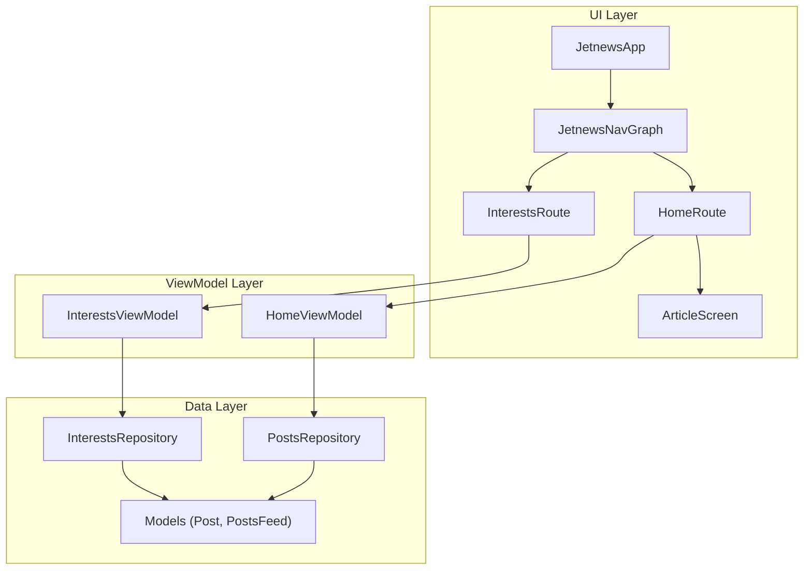
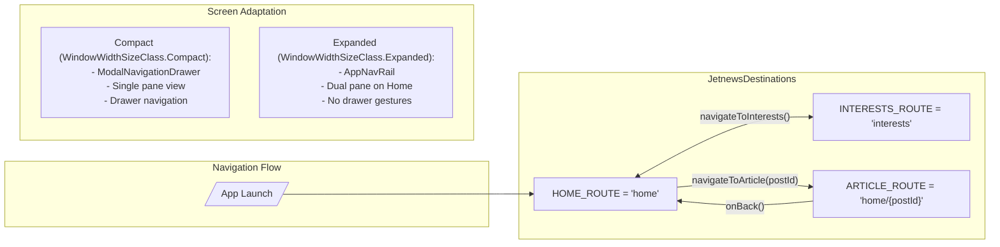
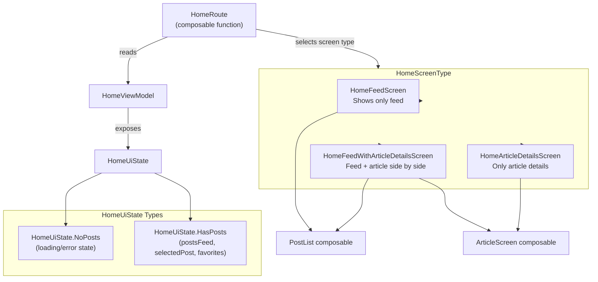
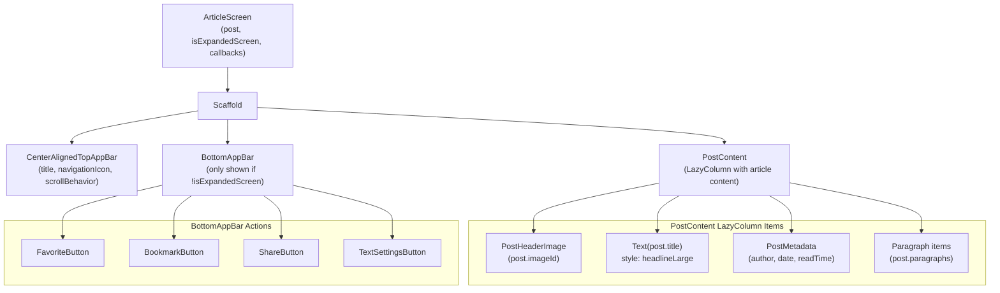
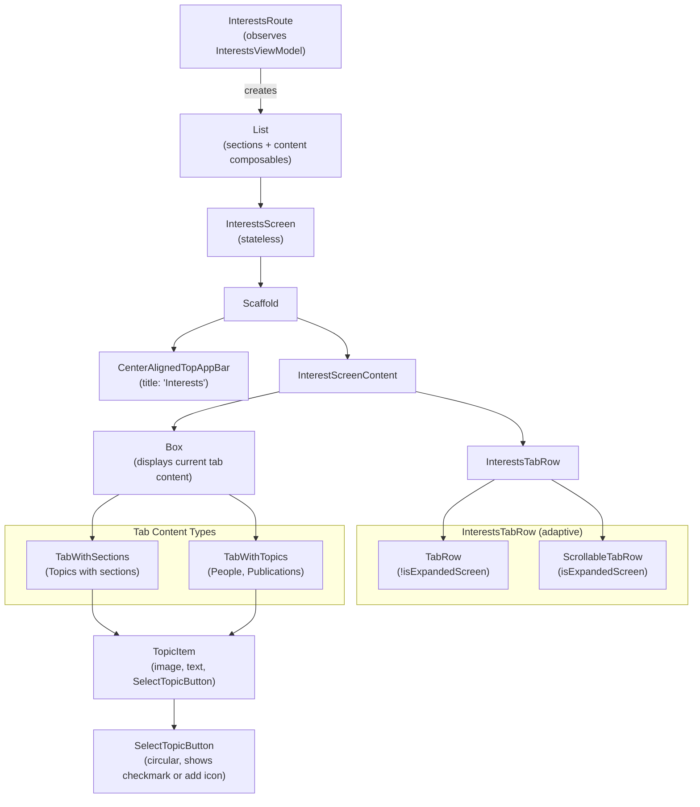
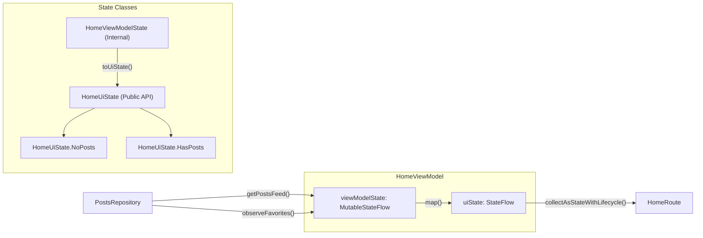
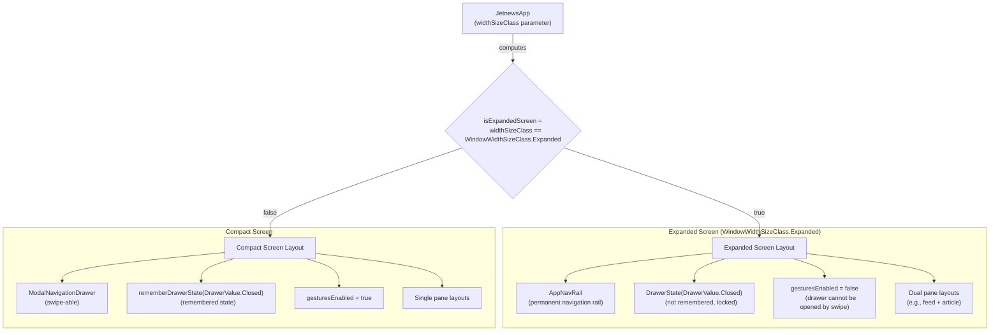
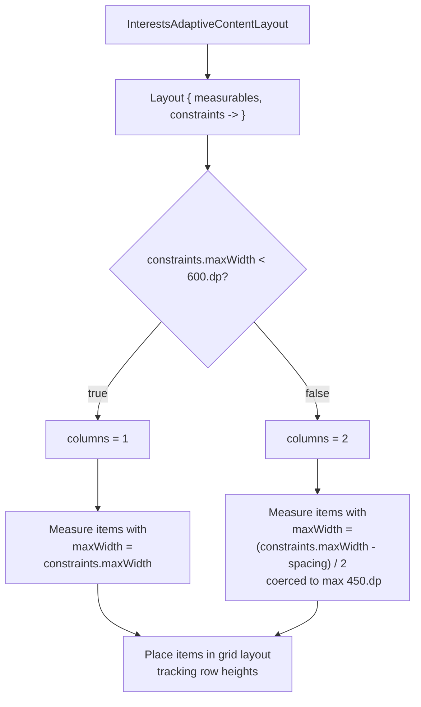
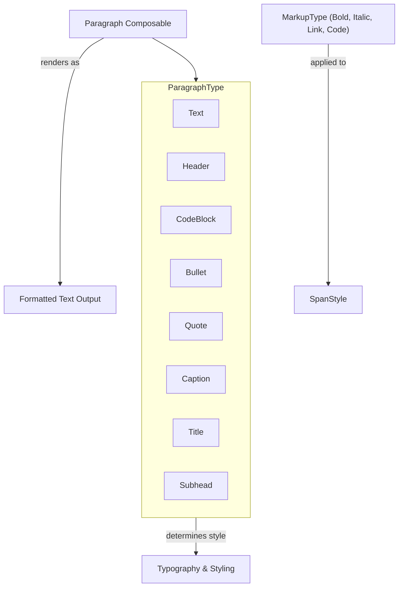

<!-- source: DeepWiki mcp.deepwiki.com · repo android/compose-samples · page 4.1 JetNews · fetched 2026-10-23 -->

# JetNews

Relevant source files

The following files were used as context for generating this wiki page:

- [JetNews/app/src/main/java/com/example/jetnews/ui/JetnewsApp.kt](JetNews/app/src/main/java/com/example/jetnews/ui/JetnewsApp.kt)
- [JetNews/app/src/main/java/com/example/jetnews/ui/article/ArticleScreen.kt](JetNews/app/src/main/java/com/example/jetnews/ui/article/ArticleScreen.kt)
- [JetNews/app/src/main/java/com/example/jetnews/ui/article/PostContent.kt](JetNews/app/src/main/java/com/example/jetnews/ui/article/PostContent.kt)
- [JetNews/app/src/main/java/com/example/jetnews/ui/home/PostCardTop.kt](JetNews/app/src/main/java/com/example/jetnews/ui/home/PostCardTop.kt)
- [JetNews/app/src/main/java/com/example/jetnews/ui/home/PostCardYourNetwork.kt](JetNews/app/src/main/java/com/example/jetnews/ui/home/PostCardYourNetwork.kt)
- [JetNews/app/src/main/java/com/example/jetnews/ui/home/PostCards.kt](JetNews/app/src/main/java/com/example/jetnews/ui/home/PostCards.kt)
- [JetNews/app/src/main/java/com/example/jetnews/ui/interests/InterestsScreen.kt](JetNews/app/src/main/java/com/example/jetnews/ui/interests/InterestsScreen.kt)
- [JetNews/app/src/main/java/com/example/jetnews/ui/interests/SelectTopicButton.kt](JetNews/app/src/main/java/com/example/jetnews/ui/interests/SelectTopicButton.kt)
- [JetNews/app/src/main/res/values/strings.xml](JetNews/app/src/main/res/values/strings.xml)

## Purpose and Overview

JetNews is a sample news reader application that demonstrates Material Design 3 implementation with Jetpack Compose. The application showcases adaptive layouts using `WindowWidthSizeClass`, drawer and navigation rail navigation patterns, and Material 3 theming. JetNews also includes a Glance AppWidget implementation for displaying content on the home screen.

Key features demonstrated:
- Material 3 components (`CenterAlignedTopAppBar`, `ModalNavigationDrawer`, `BottomAppBar`, `Scaffold`)
- Adaptive navigation (drawer for compact screens, navigation rail for expanded screens)
- `WindowWidthSizeClass`-based responsive layouts
- Glance AppWidget for home screen widgets
- Rich text rendering with formatted paragraphs and markup

This document provides technical details about the architecture, components, and features of the JetNews sample application.

For information on other sample applications in the compose-samples repository, see [Sample Applications](#4).

Sources:
[JetNews/app/src/main/java/com/example/jetnews/ui/JetnewsApp.kt:37-84]()
[JetNews/app/src/main/res/values/strings.xml:16]()
[JetNews/app/src/main/java/com/example/jetnews/ui/article/ArticleScreen.kt:79-127]()

## Architecture Overview

JetNews follows the MVVM (Model-View-ViewModel) architecture pattern with a clear separation between the UI layer and data layer. The application uses StateFlow for reactive UI updates and the Repository pattern for data management.

Sources:
[JetNews/app/src/main/java/com/example/jetnews/ui/JetnewsApp.kt:37-87]()
[JetNews/app/src/main/java/com/example/jetnews/ui/JetnewsNavGraph.kt:37-82]()
[JetNews/app/src/main/java/com/example/jetnews/ui/home/HomeViewModel.kt:121-249]()
[JetNews/app/src/main/java/com/example/jetnews/ui/interests/InterestsViewModel.kt:45-137]()

## Application Structure

JetNews uses Jetpack Navigation Compose with route-based navigation. The app's entry point is `JetnewsApp`, which sets up the `ModalNavigationDrawer` and determines navigation structure based on `WindowWidthSizeClass`.

**Navigation Routes and Destinations**

The `JetnewsNavigationActions` class encapsulates navigation operations and is created from the `NavController`.

Sources:
[JetNews/app/src/main/java/com/example/jetnews/ui/JetnewsNavGraph.kt:30-35]()
[JetNews/app/src/main/java/com/example/jetnews/ui/JetnewsNavGraph.kt:96-128]()
[JetNews/app/src/main/java/com/example/jetnews/ui/JetnewsApp.kt:37-84]()
[JetNews/app/src/main/java/com/example/jetnews/ui/home/HomeRoute.kt:43-113]()

## Key Components

### Home Screen

The Home screen displays a feed of news articles with different sections including highlighted posts, recommended posts, popular posts, and recent history. The UI adapts between expanded and compact layouts based on `isExpandedScreen` parameter.

**Home Screen Architecture**

**HomeViewModel State Management**

The `HomeViewModel` manages the following state:
- `uiState: StateFlow<HomeUiState>` - Main UI state
- `selectedArticle: StateFlow<String?>` - Currently selected article ID
- `isArticleOpen: StateFlow<Boolean>` - Whether article detail view is open
- `searchInput: StateFlow<String>` - Search query input

It also handles events such as:
- `selectArticle(postId: String)` - Navigate to article
- `toggleFavourite(postId: String)` - Toggle bookmark
- `onSearchInputChanged(searchInput: String)` - Update search query
- `interactedWithFeed()` - User scrolled feed
- `interactedWithArticleDetails(postId: String)` - User viewed article

Sources:
[JetNews/app/src/main/java/com/example/jetnews/ui/home/HomeRoute.kt:43-113]()
[JetNews/app/src/main/java/com/example/jetnews/ui/home/HomeRoute.kt:190-208]()
[JetNews/app/src/main/java/com/example/jetnews/ui/home/HomeViewModel.kt:121-163]()
[JetNews/app/src/main/java/com/example/jetnews/ui/home/HomeViewModel.kt:42-116]()

#### Post Cards & Feed Layout

The Home screen displays posts in various formats:
- `PostCardTop`: Featured post with large image and details
- `PostCardPopular`: Horizontal scrolling cards for popular posts
- `PostCardSimple`: Simple list items for recommended posts 
- `PostCardHistory`: Posts based on user history

Each card type is designed to display different amounts of information and visual prominence based on its role in the feed.

Sources:
[JetNews/app/src/main/java/com/example/jetnews/ui/home/PostCardTop.kt:44-85]()
[JetNews/app/src/main/java/com/example/jetnews/ui/home/PostCardYourNetwork.kt:54-103]()
[JetNews/app/src/main/java/com/example/jetnews/ui/home/PostCards.kt:97-137]()
[JetNews/app/src/main/java/com/example/jetnews/ui/home/PostCards.kt:140-201]()

### Article Screen

The Article screen displays the full content of a selected article using Material 3 components. On compact screens, it includes a `BottomAppBar` with action buttons. On expanded screens, the bottom bar is hidden.

**Article Screen Component Structure**

The `TopAppBar` uses `TopAppBarDefaults.enterAlwaysScrollBehavior()` to hide/show based on scroll position. The `PostContent` uses `nestedScroll` modifier to coordinate with the scroll behavior.

Sources:
[JetNews/app/src/main/java/com/example/jetnews/ui/article/ArticleScreen.kt:79-127]()
[JetNews/app/src/main/java/com/example/jetnews/ui/article/ArticleScreen.kt:136-164]()
[JetNews/app/src/main/java/com/example/jetnews/ui/article/PostContent.kt:82-95]()

### Interests Screen

The Interests screen allows users to select and manage topics, people, and publications they are interested in. It uses Material 3 `TabRow` or `ScrollableTabRow` based on screen size and custom topic selection UI.

**Interests Screen Component Structure**

**InterestsViewModel State**

The `InterestsViewModel` exposes:
- `uiState: StateFlow<InterestsUiState>` - Contains `topics: List<InterestSection>`, `people: List<String>`, `publications: List<String>`
- `selectedTopics: StateFlow<Set<TopicSelection>>` 
- `selectedPeople: StateFlow<Set<String>>`
- `selectedPublications: StateFlow<Set<String>>`

Sources:
[JetNews/app/src/main/java/com/example/jetnews/ui/interests/InterestsScreen.kt:113-170]()
[JetNews/app/src/main/java/com/example/jetnews/ui/interests/InterestsScreen.kt:224-242]()
[JetNews/app/src/main/java/com/example/jetnews/ui/interests/InterestsScreen.kt:350-381]()
[JetNews/app/src/main/java/com/example/jetnews/ui/interests/SelectTopicButton.kt:37-67]()
[JetNews/app/src/main/java/com/example/jetnews/ui/interests/InterestsViewModel.kt:45-70]()

## State Management

JetNews uses Kotlin StateFlow for state management and follows a unidirectional data flow pattern. ViewModels expose UI state that the composables observe and render.

### HomeViewModel State Flow

The `HomeViewModel` uses two main state types:
- `HomeViewModelState`: Internal representation with nullable fields
- `HomeUiState`: Public API with two sealed subtypes:
  - `NoPosts`: When there are no posts to display
  - `HasPosts`: When posts are available

Sources:
[JetNews/app/src/main/java/com/example/jetnews/ui/home/HomeViewModel.kt:42-116]()
[JetNews/app/src/main/java/com/example/jetnews/ui/home/HomeViewModel.kt:121-249]()

### InterestsViewModel State Flow

The `InterestsViewModel` manages:
- `InterestsUiState`: Containing lists of topics, people, and publications
- Three separate StateFlow objects for selected topics, people, and publications

Sources:
[JetNews/app/src/main/java/com/example/jetnews/ui/interests/InterestsViewModel.kt:45-137]()

## Data Layer

JetNews uses repositories to handle data operations and provide separation from the UI layer.

### PostsRepository

The `PostsRepository` interface defines methods for:
- Getting individual posts by ID
- Getting the posts feed
- Observing favorited posts
- Toggling post favorites

For the sample application, this is implemented by `FakePostsRepository` which provides hardcoded test data.

Sources:
[JetNews/app/src/main/java/com/example/jetnews/data/posts/PostsRepository.kt:27-53]()
[JetNews/app/src/main/java/com/example/jetnews/data/posts/impl/FakePostsRepository.kt:35-86]()

### InterestsRepository

The `InterestsRepository` interface handles:
- Getting topics, people, and publications
- Toggling selections for topics, people, and publications
- Observing current selections

For the sample, this is implemented by `FakeInterestsRepository` which provides test data.

Sources:
[JetNews/app/src/main/java/com/example/jetnews/data/interests/InterestsRepository.kt:27-75]()
[JetNews/app/src/main/java/com/example/jetnews/data/interests/impl/FakeInterestsRepository.kt:34-115]()

## Material 3 Adaptive Navigation

JetNews demonstrates Material 3's adaptive navigation patterns using `WindowWidthSizeClass` to determine screen size.

### Navigation Adaptation Pattern

**Implementation in JetnewsApp**

The `JetnewsApp` composable receives `widthSizeClass` and computes:
- `isExpandedScreen = widthSizeClass == WindowWidthSizeClass.Expanded`
- `sizeAwareDrawerState = rememberSizeAwareDrawerState(isExpandedScreen)`

When expanded, the drawer is locked closed and a navigation rail is shown. When compact, the drawer can be opened via gestures.

Sources:
[JetNews/app/src/main/java/com/example/jetnews/ui/JetnewsApp.kt:37-84]()
[JetNews/app/src/main/java/com/example/jetnews/ui/JetnewsApp.kt:89-103]()
[JetNews/app/src/main/java/com/example/jetnews/ui/components/AppNavRail.kt:41-75]()
[JetNews/app/src/main/java/com/example/jetnews/ui/AppDrawer.kt:40-101]()

## Material 3 Components and Patterns

### Material 3 Component Usage

JetNews extensively uses Material 3 components:

| Component | Location | Purpose |
|-----------|----------|---------|
| `CenterAlignedTopAppBar` | InterestsScreen, ArticleScreen | Top app bar with centered title |
| `Scaffold` | InterestsScreen, ArticleScreen | Layout structure with top/bottom bars |
| `BottomAppBar` | ArticleScreen | Action buttons on compact screens |
| `ModalNavigationDrawer` | JetnewsApp | Swipe-able drawer for compact screens |
| `TabRow` / `ScrollableTabRow` | InterestsScreen | Tab navigation (adaptive) |
| `Card` | PostCardPopular | Clickable cards for popular posts |
| `AlertDialog` | ArticleScreen, PostCardHistory | Confirmation and info dialogs |
| `HorizontalDivider` | InterestsScreen, PostCards | Visual separators |

Sources:
[JetNews/app/src/main/java/com/example/jetnews/ui/interests/InterestsScreen.kt:38-48]()
[JetNews/app/src/main/java/com/example/jetnews/ui/article/ArticleScreen.kt:30-42]()
[JetNews/app/src/main/java/com/example/jetnews/ui/JetnewsApp.kt:20-24]()
[JetNews/app/src/main/java/com/example/jetnews/ui/home/PostCardYourNetwork.kt:27-28]()

### Custom Adaptive Layout

The Interests screen uses a custom `InterestsAdaptiveContentLayout` that implements adaptive column layout using Compose's `Layout` composable.

**Adaptive Column Logic**

This custom layout arranges topic items in 1 or 2 columns based on available width, with a breakpoint at 600.dp.

Sources:
[JetNews/app/src/main/java/com/example/jetnews/ui/interests/InterestsScreen.kt:420-483]()

### TabContent Pattern

JetNews uses a custom `TabContent` class to encapsulate tab definitions with their content:

The `Sections` enum defines three tabs with string resource IDs:
- `Topics` (R.string.interests_section_topics)
- `People` (R.string.interests_section_people)  
- `Publications` (R.string.interests_section_publications)

The `TabContent` class pairs a `Sections` value with a composable lambda, allowing the stateful `rememberTabContent()` function to create tab content that observes ViewModel state.

Sources:
[JetNews/app/src/main/java/com/example/jetnews/ui/interests/InterestsScreen.kt:81-97]()
[JetNews/app/src/main/java/com/example/jetnews/ui/interests/InterestsScreen.kt:176-212]()

## Content Rendering

### Article Paragraph Rendering

JetNews uses a sophisticated system for rendering different types of paragraph content with appropriate styling:

Sources:
[JetNews/app/src/main/java/com/example/jetnews/ui/article/PostContent.kt:167-201]()
[JetNews/app/src/main/java/com/example/jetnews/ui/article/PostContent.kt:258-291]()

## Conclusion

JetNews demonstrates best practices for building a news reader application with Jetpack Compose. It showcases:

1. MVVM architecture with clear separation of concerns
2. StateFlow for reactive UI updates
3. Responsive layouts that adapt to different screen sizes
4. Material 3 design components
5. Rich text rendering
6. Tab-based navigation for organizing content

The sample provides a comprehensive example of how to structure a moderately complex application using Jetpack Compose while following Android architectural best practices.

Sources:
[JetNews/app/src/main/java/com/example/jetnews/ui/JetnewsApp.kt:37-87]()
[JetNews/app/src/main/java/com/example/jetnews/ui/home/HomeViewModel.kt:121-249]()
[JetNews/app/src/main/java/com/example/jetnews/ui/article/ArticleScreen.kt:81-129]()
[JetNews/app/src/main/java/com/example/jetnews/ui/interests/InterestsScreen.kt:115-172]()

---

