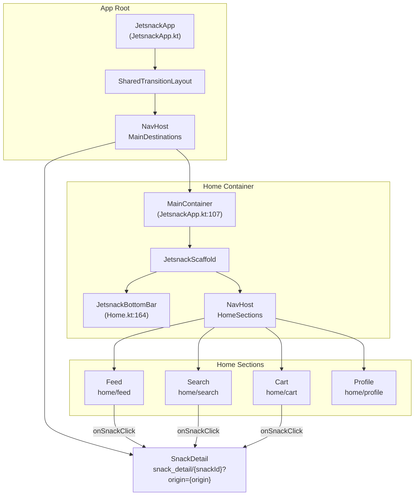
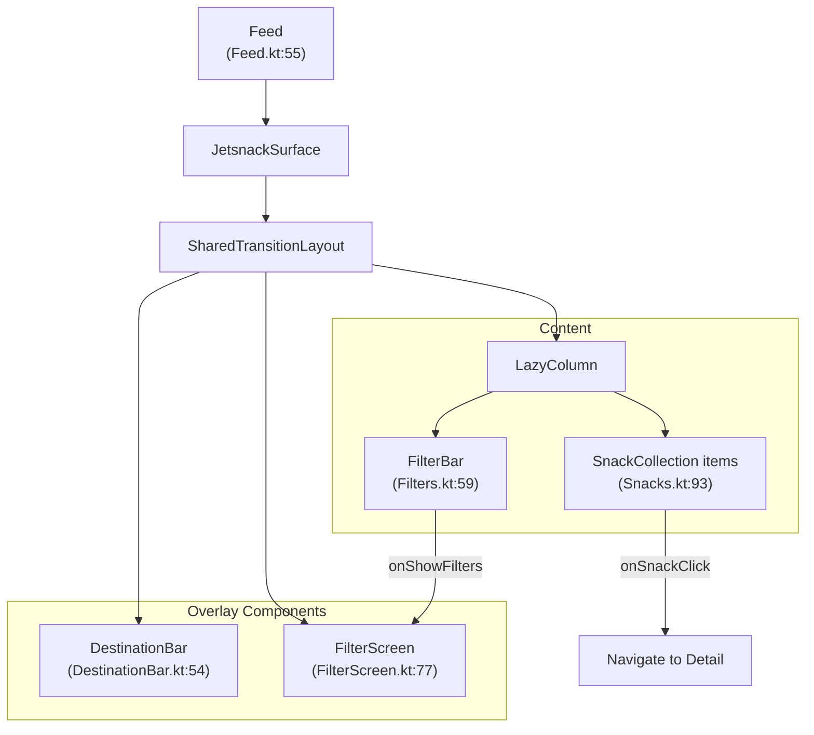
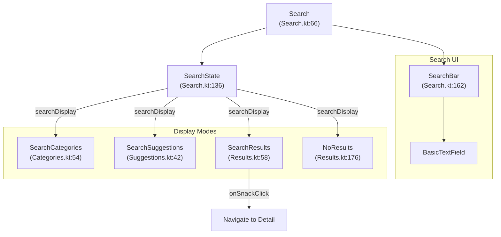
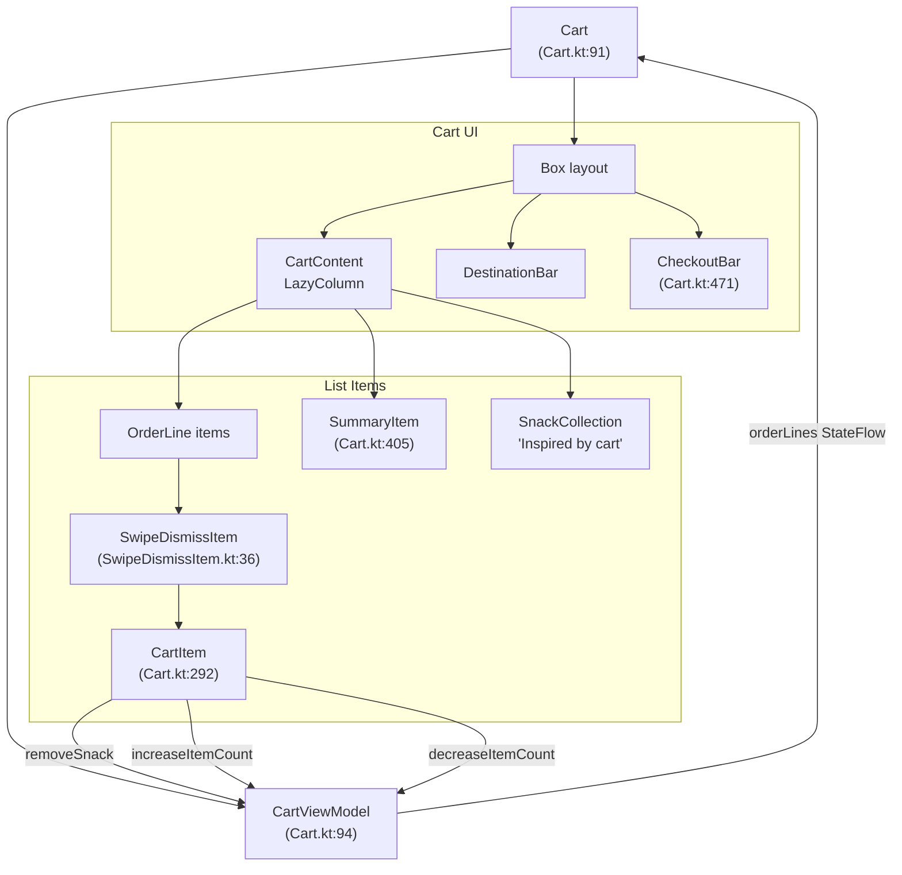
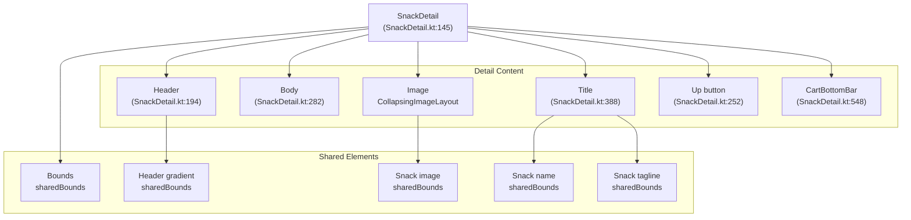
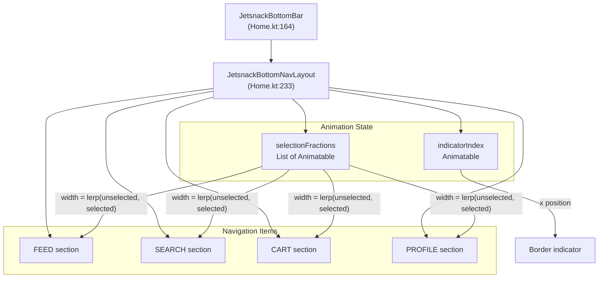
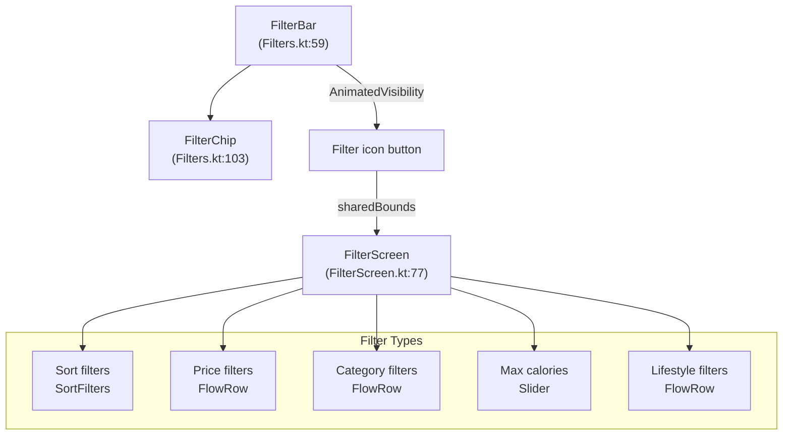
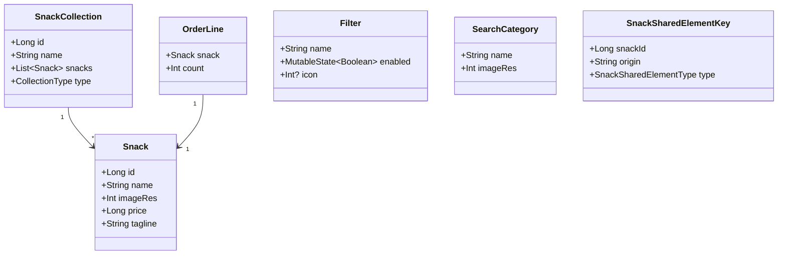

<!-- source: DeepWiki mcp.deepwiki.com · repo android/compose-samples · page 4.2 Jetsnack · fetched 2026-10-23 -->

# Jetsnack

<details>
<summary>Relevant source files</summary>

The following files were used as context for generating this wiki page:

- [Jetsnack/app/src/main/java/com/example/jetsnack/model/Filter.kt](Jetsnack/app/src/main/java/com/example/jetsnack/model/Filter.kt)
- [Jetsnack/app/src/main/java/com/example/jetsnack/model/SnackbarManager.kt](Jetsnack/app/src/main/java/com/example/jetsnack/model/SnackbarManager.kt)
- [Jetsnack/app/src/main/java/com/example/jetsnack/ui/JetsnackApp.kt](Jetsnack/app/src/main/java/com/example/jetsnack/ui/JetsnackApp.kt)
- [Jetsnack/app/src/main/java/com/example/jetsnack/ui/SnackSharedElementKey.kt](Jetsnack/app/src/main/java/com/example/jetsnack/ui/SnackSharedElementKey.kt)
- [Jetsnack/app/src/main/java/com/example/jetsnack/ui/components/Filters.kt](Jetsnack/app/src/main/java/com/example/jetsnack/ui/components/Filters.kt)
- [Jetsnack/app/src/main/java/com/example/jetsnack/ui/components/GradientTintedIconButton.kt](Jetsnack/app/src/main/java/com/example/jetsnack/ui/components/GradientTintedIconButton.kt)
- [Jetsnack/app/src/main/java/com/example/jetsnack/ui/components/QuantitySelector.kt](Jetsnack/app/src/main/java/com/example/jetsnack/ui/components/QuantitySelector.kt)
- [Jetsnack/app/src/main/java/com/example/jetsnack/ui/components/Snackbar.kt](Jetsnack/app/src/main/java/com/example/jetsnack/ui/components/Snackbar.kt)
- [Jetsnack/app/src/main/java/com/example/jetsnack/ui/components/Snacks.kt](Jetsnack/app/src/main/java/com/example/jetsnack/ui/components/Snacks.kt)
- [Jetsnack/app/src/main/java/com/example/jetsnack/ui/home/DestinationBar.kt](Jetsnack/app/src/main/java/com/example/jetsnack/ui/home/DestinationBar.kt)
- [Jetsnack/app/src/main/java/com/example/jetsnack/ui/home/Feed.kt](Jetsnack/app/src/main/java/com/example/jetsnack/ui/home/Feed.kt)
- [Jetsnack/app/src/main/java/com/example/jetsnack/ui/home/FilterScreen.kt](Jetsnack/app/src/main/java/com/example/jetsnack/ui/home/FilterScreen.kt)
- [Jetsnack/app/src/main/java/com/example/jetsnack/ui/home/Home.kt](Jetsnack/app/src/main/java/com/example/jetsnack/ui/home/Home.kt)
- [Jetsnack/app/src/main/java/com/example/jetsnack/ui/home/Profile.kt](Jetsnack/app/src/main/java/com/example/jetsnack/ui/home/Profile.kt)
- [Jetsnack/app/src/main/java/com/example/jetsnack/ui/home/cart/Cart.kt](Jetsnack/app/src/main/java/com/example/jetsnack/ui/home/cart/Cart.kt)
- [Jetsnack/app/src/main/java/com/example/jetsnack/ui/home/cart/SwipeDismissItem.kt](Jetsnack/app/src/main/java/com/example/jetsnack/ui/home/cart/SwipeDismissItem.kt)
- [Jetsnack/app/src/main/java/com/example/jetsnack/ui/home/search/Categories.kt](Jetsnack/app/src/main/java/com/example/jetsnack/ui/home/search/Categories.kt)
- [Jetsnack/app/src/main/java/com/example/jetsnack/ui/home/search/Results.kt](Jetsnack/app/src/main/java/com/example/jetsnack/ui/home/search/Results.kt)
- [Jetsnack/app/src/main/java/com/example/jetsnack/ui/home/search/Search.kt](Jetsnack/app/src/main/java/com/example/jetsnack/ui/home/search/Search.kt)
- [Jetsnack/app/src/main/java/com/example/jetsnack/ui/home/search/Suggestions.kt](Jetsnack/app/src/main/java/com/example/jetsnack/ui/home/search/Suggestions.kt)
- [Jetsnack/app/src/main/java/com/example/jetsnack/ui/snackdetail/SnackDetail.kt](Jetsnack/app/src/main/java/com/example/jetsnack/ui/snackdetail/SnackDetail.kt)

</details>


Jetsnack is a food ordering sample application demonstrating Jetpack Compose UI patterns for custom design systems, shared element transitions, and modern Android app architecture. The app allows users to browse snack collections, search for items, manage a shopping cart, and view detailed product information with smooth animated transitions.

**Scope**: This document covers the overall architecture, navigation structure, screen components, and data model of Jetsnack. For detailed information about the custom theming system, see [Jetsnack Custom Design System](#4.2.1). For implementation details of shared element transitions, see [Jetsnack Shared Element Transitions](#4.2.2).

## Application Structure

Jetsnack is organized around a bottom navigation pattern with four main sections accessed through the home screen, plus a detail screen accessible from multiple entry points.

### Navigation Architecture



**Sources**: [Jetsnack/app/src/main/java/com/example/jetsnack/ui/JetsnackApp.kt:62-171](), [Jetsnack/app/src/main/java/com/example/jetsnack/ui/home/Home.kt:127-154]()

The app uses a nested navigation architecture:
- Outer `NavHost` handles routes between `MainContainer` (home sections) and `SnackDetail`
- Inner `NavHost` within `MainContainer` switches between the four bottom navigation tabs
- `SharedTransitionLayout` wraps the entire app to enable shared element transitions across navigation boundaries
- Route constants defined in `HomeSections` enum (FEED, SEARCH, CART, PROFILE) and `MainDestinations` object

### Main Application Entry Point

| Component | File | Purpose |
|-----------|------|---------|
| `JetsnackApp` | JetsnackApp.kt:62 | Root composable, sets up theme and navigation |
| `MainContainer` | JetsnackApp.kt:108 | Contains bottom bar and home sections |
| `SharedTransitionLayout` | JetsnackApp.kt:65 | Enables shared element animations |
| `LocalSharedTransitionScope` | JetsnackApp.kt:170 | CompositionLocal for shared transitions |
| `LocalNavAnimatedVisibilityScope` | JetsnackApp.kt:169 | CompositionLocal for nav animations |

**Sources**: [Jetsnack/app/src/main/java/com/example/jetsnack/ui/JetsnackApp.kt:1-171]()

## Screen Components

### Feed Screen

The Feed screen displays curated collections of snacks organized by category. It serves as the primary landing page.



**Sources**: [Jetsnack/app/src/main/java/com/example/jetsnack/ui/home/Feed.kt:1-148](), [Jetsnack/app/src/main/java/com/example/jetsnack/ui/components/Snacks.kt:93-134]()

Key components:
- **FilterBar**: Horizontal scrollable list of filter chips with animated filter icon
- **SnackCollection**: Displays collections with either highlighted cards or standard grid layout
- **DestinationBar**: Top app bar showing delivery address, rendered in overlay with slide animations
- **FilterScreen**: Modal filter interface that appears as `AnimatedVisibility` with shared bounds transition

### Search Screen

The Search screen provides dynamic search with categories, suggestions, and results.



**Sources**: [Jetsnack/app/src/main/java/com/example/jetsnack/ui/home/search/Search.kt:1-264](), [Jetsnack/app/src/main/java/com/example/jetsnack/ui/home/search/Results.kt:58-173]()

Search state management:
- `SearchState` class tracks `query`, `focused`, `searching`, and `searchResults`
- `searchDisplay` computed property determines which UI mode to show based on focus and query
- `LaunchedEffect` triggers search on query text changes via `SearchRepo.search()`
- Display modes: Categories (default), Suggestions (focused empty), Results (has results), NoResults (empty results)

| State | Condition | Display |
|-------|-----------|---------|
| Categories | `!focused && query.isEmpty()` | Grid of search categories |
| Suggestions | `focused && query.isEmpty()` | Recent/popular suggestions |
| Results | `!searchResults.isEmpty()` | List of matching snacks |
| NoResults | `searchResults.isEmpty() && hasQuery` | Empty state message |

### Cart Screen

The Cart screen displays order items with swipe-to-dismiss functionality and order summary.



**Sources**: [Jetsnack/app/src/main/java/com/example/jetsnack/ui/home/cart/Cart.kt:1-515](), [Jetsnack/app/src/main/java/com/example/jetsnack/ui/home/cart/SwipeDismissItem.kt:1-63]()

Cart functionality:
- **CartViewModel**: Manages order state via `StateFlow<List<OrderLine>>`, provides actions for add/remove/update
- **SwipeDismissItem**: Wraps each cart item with Material 3 `SwipeToDismissBox`, animates removal
- **Background animation**: Shows red delete indicator with icon/text based on swipe progress
- **SummaryItem**: Calculates subtotal, shipping, and total costs
- **Inspired collection**: Shows related products at bottom of cart

### Detail Screen

The SnackDetail screen showcases shared element transitions between the list and detail views.



**Sources**: [Jetsnack/app/src/main/java/com/example/jetsnack/ui/snackdetail/SnackDetail.kt:1-616]()

Detail screen features:
- **Collapsing layout**: Image scales from 300dp to 150dp, title offsets based on scroll position
- **Shared elements**: Five distinct shared element types (Bounds, Background, Image, Title, Tagline) identified by `SnackSharedElementKey`
- **Origin tracking**: `origin` parameter passed from source screen to create unique shared element keys
- **Custom layout**: `CollapsingImageLayout` uses `Layout` composable for custom measurement and positioning
- **Animated corner radius**: Bounds transition from 20dp rounded corners (list item) to 0dp (full screen)

| Element Type | Source | Destination | Animation |
|--------------|--------|-------------|-----------|
| Bounds | Card shape | Full screen box | `snackDetailBoundsTransform` with spring |
| Background | Card gradient | Header gradient | Scale to bounds with blur |
| Image | 120dp circular | 150-300dp circular (collapsing) | Fade in/out |
| Title | Card text | Detail header | Bounds transform |
| Tagline | Card text | Detail subheader | Bounds transform |

### Profile Screen

The Profile screen is a placeholder showing work-in-progress state.

**Sources**: [Jetsnack/app/src/main/java/com/example/jetsnack/ui/home/Profile.kt:1-80]()

## Key UI Components

### Bottom Navigation

The custom bottom navigation implementation provides animated selection indicators and responsive item sizing.



**Sources**: [Jetsnack/app/src/main/java/com/example/jetsnack/ui/home/Home.kt:164-230](), [Jetsnack/app/src/main/java/com/example/jetsnack/ui/home/Home.kt:233-307]()

Bottom navigation features:
- **Custom layout measurement**: Divides width into n+1 slots, gives selected item 2 slots
- **Animated selection**: Each item has `Animatable<Float>` tracking selection fraction (0.0 to 1.0)
- **Animated indicator**: Border indicator position animates using `Animatable` with spring spec
- **Item content animation**: Icon/text scale and alpha animated based on selection progress
- **Expressive springs**: Uses `spatialExpressiveSpring()` for position, `nonSpatialExpressiveSpring()` for appearance

### Snack Collection Components

Snack collections display products in either highlighted card format or standard grid format.

| Component | File:Lines | Purpose |
|-----------|------------|---------|
| `SnackCollection` | Snacks.kt:93-134 | Container that switches between highlight/standard layout |
| `HighlightedSnacks` | Snacks.kt:137-175 | Horizontal `LazyRow` of large cards with parallax gradients |
| `Snacks` | Snacks.kt:178-187 | Horizontal `LazyRow` of standard 120dp cards |
| `SnackItem` | Snacks.kt:190-257 | Standard snack card with image and name |
| `HighlightSnackItem` | Snacks.kt:260-439 | Large card with gradient background, image, title, and tagline |
| `SnackImage` | Snacks.kt:449-473 | Circular image with `AsyncImage` from Coil |

**Sources**: [Jetsnack/app/src/main/java/com/example/jetsnack/ui/components/Snacks.kt:1-508]()

Highlight card features:
- **Parallax gradient**: Background gradient spans 6 cards, scrolls at 1/3 speed of card scroll
- **Shared elements**: All five element types (Bounds, Background, Image, Title, Tagline) participate in transitions
- **Rounded corner animation**: Corners animate from 0dp (pre-enter) to 20dp (visible) to match card state
- **Gradient selection**: Alternates between `gradient6_1` and `gradient6_2` based on collection index

### Filter Components

Filters are implemented as chip-based selections with animated states.



**Sources**: [Jetsnack/app/src/main/java/com/example/jetsnack/ui/components/Filters.kt:1-182](), [Jetsnack/app/src/main/java/com/example/jetsnack/ui/home/FilterScreen.kt:1-322]()

Filter implementation:
- **Shared element transition**: Filter icon button and filter screen share bounds via `FilterSharedElementKey`
- **FilterChip**: Toggleable chips with animated background color and border gradient
- **Press feedback**: Shows gradient background on press using `collectIsPressedAsState()`
- **Filter state**: Each filter has `mutableStateOf(Boolean)` for enabled state
- **Filter categories**: Sort (radio), Price (multi-select), Category (multi-select), Calories (slider), Lifestyle (multi-select)

### QuantitySelector

Reusable component for incrementing/decrementing quantities with gradient-tinted buttons.

**Sources**: [Jetsnack/app/src/main/java/com/example/jetsnack/ui/components/QuantitySelector.kt:1-105](), [Jetsnack/app/src/main/java/com/example/jetsnack/ui/components/GradientTintedIconButton.kt:1-112]()

Components:
- **QuantitySelector**: Row with label, decrease button, count display, increase button
- **Crossfade animation**: Count number animates between values
- **JetsnackGradientTintedIconButton**: Custom button with diagonal gradient tint on icon, border animation, press state

## Data Model

### Core Data Classes



**Sources**: [Jetsnack/app/src/main/java/com/example/jetsnack/model/](), [Jetsnack/app/src/main/java/com/example/jetsnack/ui/SnackSharedElementKey.kt:1-30]()

### Shared Element Key System

The `SnackSharedElementKey` data class uniquely identifies shared elements across navigation transitions:

| Field | Type | Purpose |
|-------|------|---------|
| `snackId` | Long | Unique identifier for the snack |
| `origin` | String | Source screen identifier (e.g., "feed", "cart", "1" for collection ID) |
| `type` | SnackSharedElementType | Element type: Bounds, Image, Title, Tagline, Background |

This key system enables multiple instances of the same snack to exist on different screens with distinct shared element transitions. For example, a snack can appear in both the feed (origin="1") and cart (origin="cart"), and each will have separate shared element transitions to the detail screen.

**Sources**: [Jetsnack/app/src/main/java/com/example/jetsnack/ui/SnackSharedElementKey.kt:1-30]()

### Repository Pattern

Data is provided through static repository objects:

| Repository | File | Purpose |
|------------|------|---------|
| `SnackRepo` | model/SnackRepo.kt | Provides snack data, collections, filters, cart items |
| `SearchRepo` | model/SearchRepo.kt | Provides search categories, suggestions, search results |
| `SnackbarManager` | model/SnackbarManager.kt | Manages snackbar message queue |

**Sources**: [Jetsnack/app/src/main/java/com/example/jetsnack/model/SnackbarManager.kt:1-51]()

Note: These repositories use hardcoded data for demonstration purposes. In a production app, they would integrate with a backend API or local database.

## Composition Locals

Jetsnack uses `CompositionLocal` to provide shared element scopes throughout the composable hierarchy:

```kotlin
val LocalNavAnimatedVisibilityScope = compositionLocalOf<AnimatedVisibilityScope?> { null }
val LocalSharedTransitionScope = compositionLocalOf<SharedTransitionScope?> { null }
```

These locals are provided at the navigation level and consumed by components that need to participate in shared element transitions. Components access them via:

```kotlin
val sharedTransitionScope = LocalSharedTransitionScope.current
    ?: throw IllegalStateException("No Scope found")
val animatedVisibilityScope = LocalNavAnimatedVisibilityScope.current
    ?: throw IllegalStateException("No Scope found")
```

**Sources**: [Jetsnack/app/src/main/java/com/example/jetsnack/ui/JetsnackApp.kt:169-171]()

## Navigation Extensions

Custom navigation extensions enhance the standard Navigation Compose API:

| Extension | Purpose |
|-----------|---------|
| `composableWithCompositionLocal` | Wraps `composable()` to provide `LocalNavAnimatedVisibilityScope` |
| `addHomeGraph` | Adds all four home section destinations with deep link support |

The `composableWithCompositionLocal` extension provides default fade in/out transitions using expressive springs and automatically provides the animated visibility scope to child composables.

**Sources**: [Jetsnack/app/src/main/java/com/example/jetsnack/ui/home/Home.kt:86-125](), [Jetsnack/app/src/main/java/com/example/jetsnack/ui/home/Home.kt:127-154]()

---

