<!-- source: DeepWiki mcp.deepwiki.com · repo android/compose-samples · page 4.3 Reply · fetched 2026-10-23 -->

# Reply

<details>
<summary>Relevant source files</summary>

The following files were used as context for generating this wiki page:

- [Reply/app/src/main/AndroidManifest.xml](Reply/app/src/main/AndroidManifest.xml)
- [Reply/app/src/main/java/com/example/reply/ui/EmptyComingSoon.kt](Reply/app/src/main/java/com/example/reply/ui/EmptyComingSoon.kt)
- [Reply/app/src/main/java/com/example/reply/ui/MainActivity.kt](Reply/app/src/main/java/com/example/reply/ui/MainActivity.kt)
- [Reply/app/src/main/java/com/example/reply/ui/ReplyApp.kt](Reply/app/src/main/java/com/example/reply/ui/ReplyApp.kt)
- [Reply/app/src/main/java/com/example/reply/ui/ReplyHomeViewModel.kt](Reply/app/src/main/java/com/example/reply/ui/ReplyHomeViewModel.kt)
- [Reply/app/src/main/java/com/example/reply/ui/ReplyListContent.kt](Reply/app/src/main/java/com/example/reply/ui/ReplyListContent.kt)
- [Reply/app/src/main/java/com/example/reply/ui/components/ReplyAppBars.kt](Reply/app/src/main/java/com/example/reply/ui/components/ReplyAppBars.kt)
- [Reply/app/src/main/java/com/example/reply/ui/components/ReplyEmailListItem.kt](Reply/app/src/main/java/com/example/reply/ui/components/ReplyEmailListItem.kt)
- [Reply/app/src/main/java/com/example/reply/ui/components/ReplyEmailThreadItem.kt](Reply/app/src/main/java/com/example/reply/ui/components/ReplyEmailThreadItem.kt)
- [Reply/app/src/main/java/com/example/reply/ui/components/ReplyProfileImage.kt](Reply/app/src/main/java/com/example/reply/ui/components/ReplyProfileImage.kt)
- [Reply/app/src/main/java/com/example/reply/ui/navigation/ReplyNavigationActions.kt](Reply/app/src/main/java/com/example/reply/ui/navigation/ReplyNavigationActions.kt)
- [Reply/app/src/main/java/com/example/reply/ui/navigation/ReplyNavigationComponents.kt](Reply/app/src/main/java/com/example/reply/ui/navigation/ReplyNavigationComponents.kt)
- [Reply/app/src/main/java/com/example/reply/ui/theme/Color.kt](Reply/app/src/main/java/com/example/reply/ui/theme/Color.kt)
- [Reply/app/src/main/java/com/example/reply/ui/theme/Theme.kt](Reply/app/src/main/java/com/example/reply/ui/theme/Theme.kt)
- [Reply/app/src/main/java/com/example/reply/ui/theme/Type.kt](Reply/app/src/main/java/com/example/reply/ui/theme/Type.kt)
- [Reply/app/src/main/java/com/example/reply/ui/utils/WindowStateUtils.kt](Reply/app/src/main/java/com/example/reply/ui/utils/WindowStateUtils.kt)
- [Reply/app/src/main/res/values/strings.xml](Reply/app/src/main/res/values/strings.xml)

</details>


## Purpose and Scope

This document describes the **Reply** sample application, an email client demonstrating adaptive UI capabilities for different screen sizes and device postures including foldable devices. Reply showcases how to build responsive layouts that adapt navigation components (bottom bar, navigation rail, permanent drawer) and content presentation (single-pane, dual-pane) based on device characteristics.

For detailed information about Reply's adaptive layout implementation including `WindowSizeClass` handling and device posture detection, see [Reply Adaptive Layout System](#4.3.1).

For information about shared adaptive UI patterns across multiple samples, see [Adaptive and Responsive UI Design](#5.2).

## Overview

Reply is a medium-complexity sample application (importance score: 104.67) that demonstrates Material Design 3 implementation with a focus on adaptive UI patterns. The app presents an email inbox interface that automatically adjusts its navigation structure and content layout based on device size and folding state.

**Key Features:**
- Adaptive navigation suite (bottom bar, rail, permanent/modal drawer)
- Single-pane and dual-pane content layouts
- Foldable device support with posture detection
- Email search functionality
- Multi-select email management
- Material Design 3 theming with contrast awareness

**Architecture Pattern:** MVVM with StateFlow-based state management

**Sources:** [Reply/app/src/main/AndroidManifest.xml:1-39](), [Reply/app/src/main/res/values/strings.xml:1-40]()

## Application Entry Point

### MainActivity

The `MainActivity` class serves as the application's entry point and coordinates the setup of window-aware UI components.

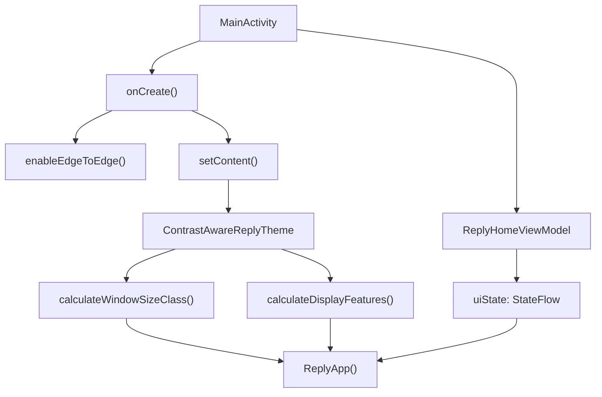

**MainActivity Responsibilities:**

| Responsibility | Implementation |
|---------------|----------------|
| Window metrics | Uses `calculateWindowSizeClass()` to determine device size category |
| Display features | Uses `calculateDisplayFeatures()` to detect foldable device characteristics |
| State management | Initializes `ReplyHomeViewModel` via `viewModels()` delegate |
| Edge-to-edge | Calls `enableEdgeToEdge()` for immersive UI |
| State collection | Observes `viewModel.uiState` via `collectAsStateWithLifecycle()` |

**Sources:** [Reply/app/src/main/java/com/example/reply/ui/MainActivity.kt:37-69]()

### Theme System

Reply implements a contrast-aware theming system that adapts to system contrast settings and supports dynamic color on Android 12+.

**Theme Selection Logic:**

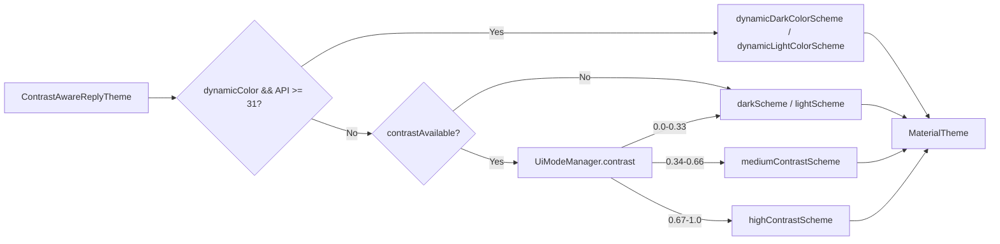

The `ContrastAwareReplyTheme` composable provides three contrast levels (standard, medium, high) for both light and dark themes, enabling better accessibility on devices running Android 14 (API 34) and above.

**Sources:** [Reply/app/src/main/java/com/example/reply/ui/theme/Theme.kt:265-326](), [Reply/app/src/main/java/com/example/reply/ui/theme/Color.kt:1-238]()

## UI State Management

### ReplyHomeViewModel

The `ReplyHomeViewModel` manages the application's UI state using a `StateFlow`-based architecture pattern.

**ViewModel Structure:**

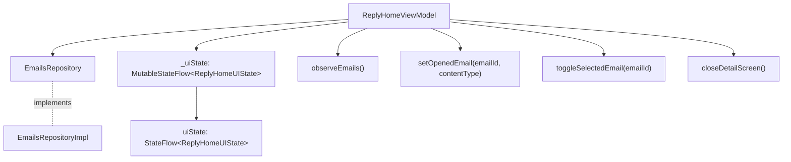

**ReplyHomeUIState Data Class:**

| Field | Type | Purpose |
|-------|------|---------|
| `emails` | `List<Email>` | Complete list of emails in the inbox |
| `selectedEmails` | `Set<Long>` | IDs of emails selected for batch operations |
| `openedEmail` | `Email?` | Currently displayed email in detail view |
| `isDetailOnlyOpen` | `Boolean` | Whether detail view is full-screen (single-pane mode) |
| `loading` | `Boolean` | Loading state indicator |
| `error` | `String?` | Error message if data loading fails |

**Key ViewModel Operations:**

- **Initial Load:** `observeEmails()` fetches emails from repository and sets first email as opened by default for large screens
- **Email Navigation:** `setOpenedEmail()` updates opened email and sets `isDetailOnlyOpen` based on content type (single vs dual pane)
- **Multi-Select:** `toggleSelectedEmail()` adds/removes email IDs from selection set
- **Back Navigation:** `closeDetailScreen()` resets detail-only state and returns to first email

**Sources:** [Reply/app/src/main/java/com/example/reply/ui/ReplyHomeViewModel.kt:30-94]()

## Navigation Architecture

### Route Definitions and Navigation Actions

Reply uses type-safe navigation with Kotlin serialization for route definitions.

**Route Hierarchy:**

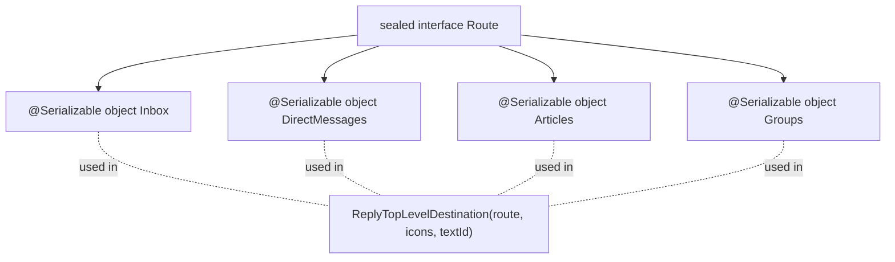

**Top-Level Destinations:**

| Destination | Icon | String Resource | Implementation Status |
|-------------|------|----------------|----------------------|
| Inbox | `ic_inbox` | `tab_inbox` | Implemented |
| Articles | `ic_article` | `tab_article` | Coming soon placeholder |
| Direct Messages | `ic_chat_bubble_outline` | `tab_dm` | Coming soon placeholder |
| Groups | `ic_group` | `tab_groups` | Coming soon placeholder |

**Navigation Actions:**

The `ReplyNavigationActions` class wraps `NavHostController` and provides a single `navigateTo()` method that implements proper navigation behavior:
- Pops to start destination to avoid deep back stacks
- Uses `launchSingleTop = true` to prevent duplicate destinations
- Enables `saveState` and `restoreState` for proper state preservation

**Sources:** [Reply/app/src/main/java/com/example/reply/ui/navigation/ReplyNavigationActions.kt:24-79]()

### ReplyApp Navigation Setup

The `ReplyApp` composable orchestrates the navigation structure based on device characteristics.

**ReplyApp Architecture:**

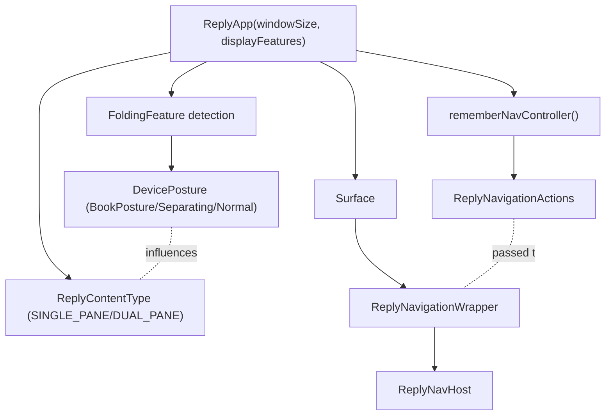

**Device Posture Detection Logic:**

The app examines `DisplayFeature` list to determine if device is in a special posture:

| Posture | Detection Criteria | UI Behavior |
|---------|-------------------|-------------|
| `BookPosture` | `FoldingFeature.State.HALF_OPENED` + `Orientation.VERTICAL` | Content avoids hinge area |
| `Separating` | `FoldingFeature.State.FLAT` + `isSeparating = true` | Two distinct display areas |
| `NormalPosture` | No folding features detected | Standard layout |

**Content Type Selection:**

```
WindowWidthSizeClass.Compact → SINGLE_PANE
WindowWidthSizeClass.Medium → DUAL_PANE if posture != Normal, else SINGLE_PANE
WindowWidthSizeClass.Expanded → DUAL_PANE
```

**Sources:** [Reply/app/src/main/java/com/example/reply/ui/ReplyApp.kt:50-111](), [Reply/app/src/main/java/com/example/reply/ui/utils/WindowStateUtils.kt:24-72]()

### ReplyNavigationWrapper

The `ReplyNavigationWrapper` implements the adaptive navigation suite pattern using Material 3's `NavigationSuiteScaffoldLayout`.

**Navigation Type Selection:**

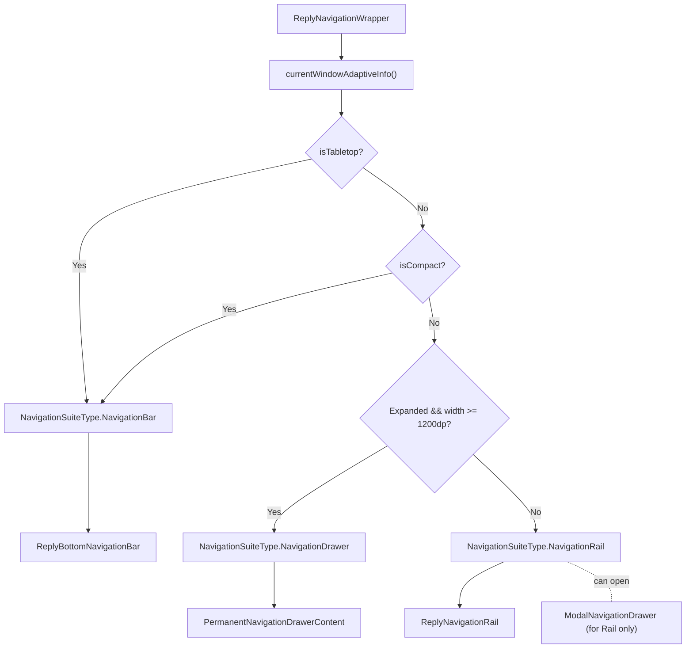

**Navigation Content Position:**

The vertical position of navigation content adapts to window height:

| Height Size Class | Position |
|------------------|----------|
| `COMPACT` | `TOP` |
| `MEDIUM` | `CENTER` |
| `EXPANDED` | `CENTER` |

This positioning is applied using a custom `MeasurePolicy` that places header content at the top and centers main navigation content when space permits.

**Sources:** [Reply/app/src/main/java/com/example/reply/ui/navigation/ReplyNavigationComponents.kt:84-168]()

### Navigation Component Implementations

**ReplyBottomNavigationBar:**
- Uses Material 3 `NavigationBar`
- Shows icons only (no labels)
- Used on compact devices and in tabletop mode

**ReplyNavigationRail:**
- Uses Material 3 `NavigationRail`
- Includes menu icon that opens modal drawer
- Contains FAB for composing new emails
- Custom layout positioning based on `ReplyNavigationContentPosition`

**PermanentNavigationDrawerContent:**
- Uses Material 3 `PermanentDrawerSheet`
- Shows app name header and compose FAB
- Navigation items with both icons and labels
- Width constrained between 200dp and 300dp

**ModalNavigationDrawerContent:**
- Appears when menu icon clicked in rail mode
- Similar content to permanent drawer
- Includes close button in header
- Managed via `DrawerState` with gesture support

**Sources:** [Reply/app/src/main/java/com/example/reply/ui/navigation/ReplyNavigationComponents.kt:170-432]()

## Adaptive Layout System

### Single-Pane vs Dual-Pane Layouts

Reply's primary adaptive feature is switching between single-pane and dual-pane layouts based on available space.

**Layout Decision Flow:**

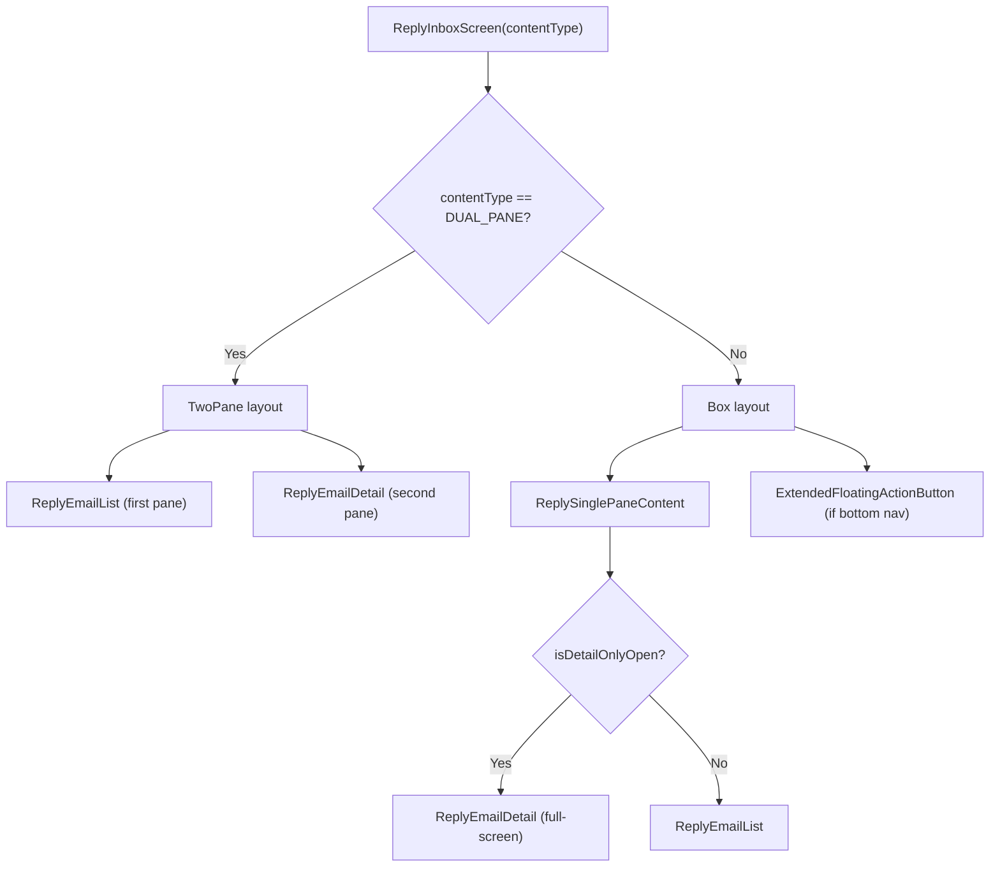

**Dual-Pane Layout:**

Uses `TwoPane` composable from Accompanist Adaptive library with:
- **Split fraction:** 0.5 (50/50 split)
- **Gap width:** 16.dp separation between panes
- **First pane:** Email list with selection state
- **Second pane:** Email detail view (non-full-screen mode)
- **Display features:** Respects folding hinge boundaries

**Single-Pane Layout:**

- Shows either list OR detail, never both
- Uses `isDetailOnlyOpen` flag to determine current view
- `BackHandler` integration returns from detail to list
- FAB shown only with bottom navigation
- FAB expands/collapses based on scroll state

**LaunchedEffect State Synchronization:**

When transitioning from dual-pane to single-pane, a `LaunchedEffect` automatically closes the detail view to prevent showing detail without a list.

**Sources:** [Reply/app/src/main/java/com/example/reply/ui/ReplyListContent.kt:59-132](), [Reply/app/src/main/java/com/example/reply/ui/ReplyListContent.kt:135-161]()

### Email List Implementation

**ReplyEmailList Component Structure:**

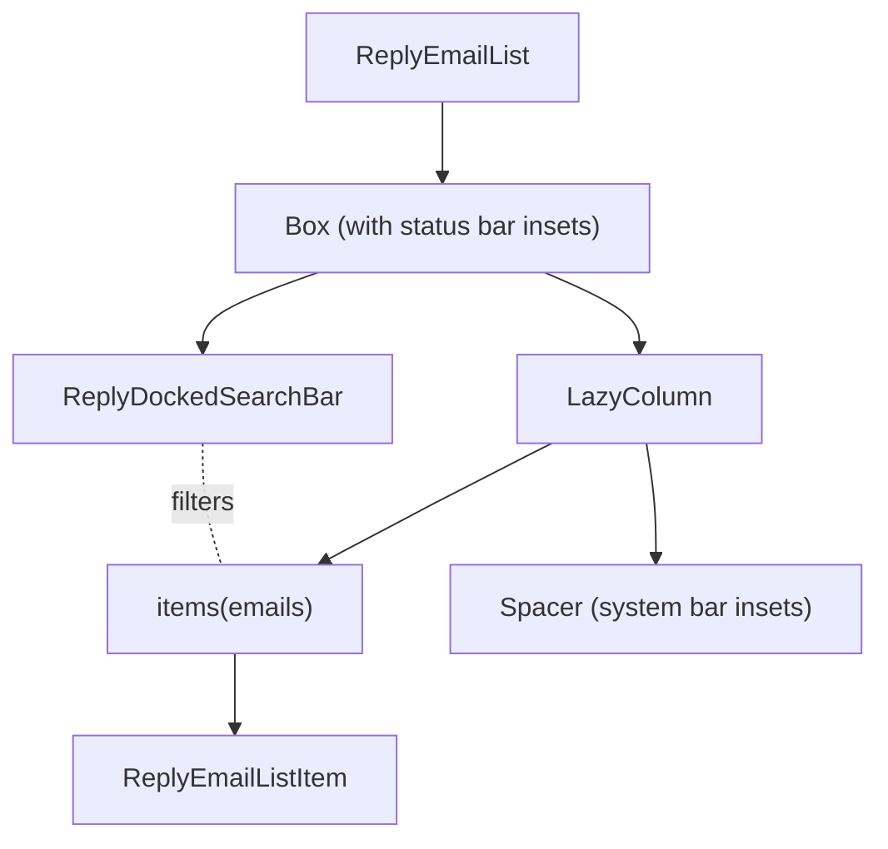

**Key Features:**

| Feature | Implementation |
|---------|----------------|
| Search | `ReplyDockedSearchBar` with real-time filtering |
| Status bar insets | `WindowInsets.statusBars` padding on container |
| System bar insets | `windowInsetsBottomHeight` spacer at end |
| Item state | Shows opened state with `secondaryContainer` color |
| Selection | Shows selected state with `primaryContainer` color |
| Keyed items | Uses `email.id` as stable key for animations |

**ReplyDockedSearchBar:**

- Material 3 `DockedSearchBar` component
- Filters by email subject and sender name (case-insensitive)
- Shows profile image in trailing icon slot
- Displays search results in `LazyColumn` when expanded
- Back arrow in leading icon when expanded

**Sources:** [Reply/app/src/main/java/com/example/reply/ui/ReplyListContent.kt:164-207](), [Reply/app/src/main/java/com/example/reply/ui/components/ReplyAppBars.kt:55-169]()

### Email Detail Implementation

**ReplyEmailDetail Component:**

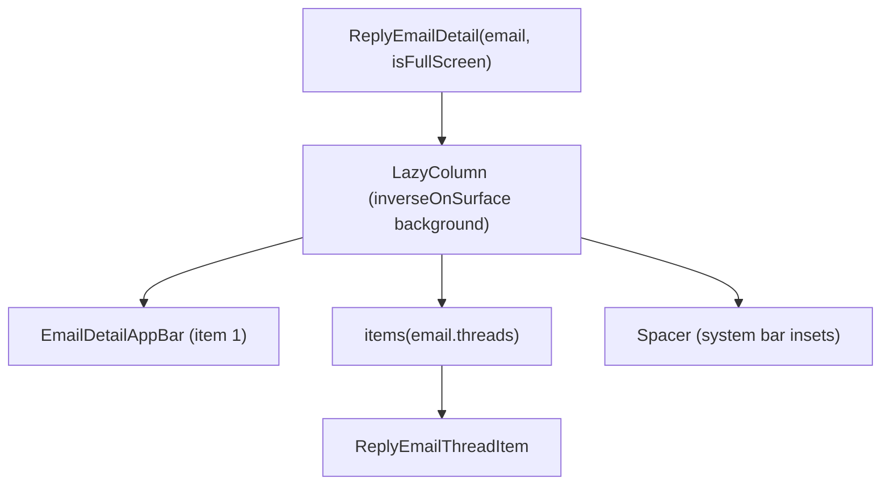

**EmailDetailAppBar Variants:**

| Full-Screen Mode | Navigation Icon | Title Alignment |
|-----------------|-----------------|-----------------|
| `true` | Back button (FilledIconButton) | Center |
| `false` | None | Start |

The app bar displays:
- Email subject as title
- Thread count as subtitle
- More options menu button

**ReplyEmailThreadItem:**

Each thread item in the conversation displays:
- Sender profile image and name
- Timestamp ("20 mins ago" - currently hardcoded)
- Email subject (styled as outline color)
- Email body text
- Reply and Reply All buttons
- Star button for favoriting

**Sources:** [Reply/app/src/main/java/com/example/reply/ui/ReplyListContent.kt:210-227](), [Reply/app/src/main/java/com/example/reply/ui/components/ReplyAppBars.kt:171-228](), [Reply/app/src/main/java/com/example/reply/ui/components/ReplyEmailThreadItem.kt:44-136]()

## Email List Item Component

### ReplyEmailListItem

The `ReplyEmailListItem` is a Material 3 `Card` composable that displays email preview information with selection support.

**Component Structure:**

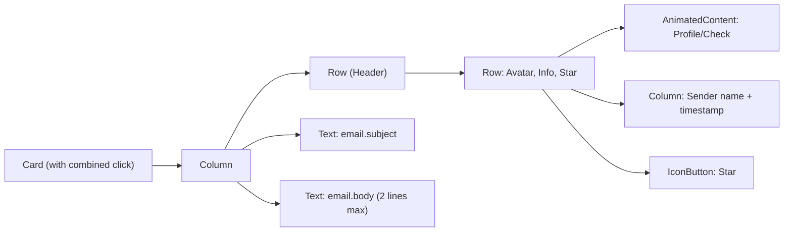

**Interaction Handling:**

| Interaction | Handler | Behavior |
|------------|---------|----------|
| Click | `navigateToDetail(email.id)` | Opens email detail view |
| Long-click | `toggleSelection(email.id)` | Enters/exits selection mode |
| Avatar click | `toggleSelection(email.id)` | Quick selection toggle |

**Visual State Indicators:**

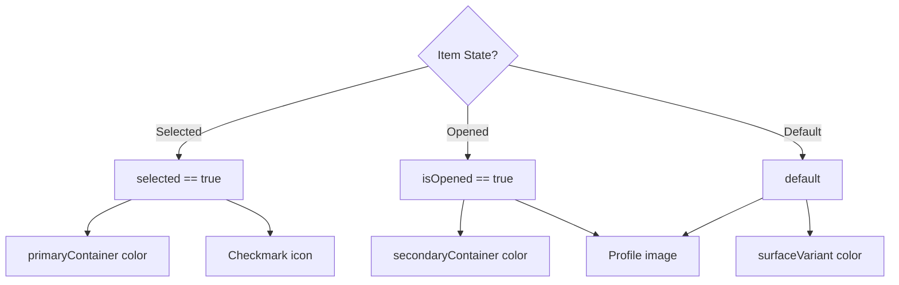

**AnimatedContent Transition:**

The avatar area uses `AnimatedContent` to smoothly transition between profile image and checkmark icon when selection state changes. The animation is labeled "avatar" for debugging purposes.

**Text Truncation:**

The email body uses `maxLines = 2` and `overflow = TextOverflow.Ellipsis` to maintain consistent card height while previewing content.

**Sources:** [Reply/app/src/main/java/com/example/reply/ui/components/ReplyEmailListItem.kt:52-162]()

## NavHost and Route Handling

### ReplyNavHost Implementation

The `ReplyNavHost` defines the navigation graph and composable destinations.

**Navigation Graph:**

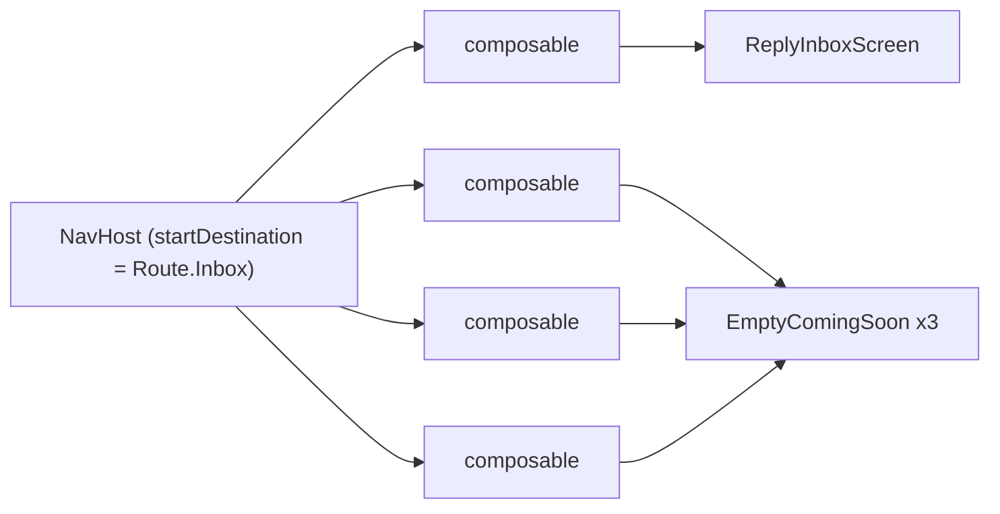

**Parameters Passed to ReplyInboxScreen:**

| Parameter | Type | Purpose |
|-----------|------|---------|
| `contentType` | `ReplyContentType` | Determines single vs dual pane layout |
| `replyHomeUIState` | `ReplyHomeUIState` | Current UI state from ViewModel |
| `navigationType` | `ReplyNavigationType` | Current navigation component type |
| `displayFeatures` | `List<DisplayFeature>` | Foldable device characteristics |
| `closeDetailScreen` | `() -> Unit` | Callback to close detail view |
| `navigateToDetail` | `(Long, ReplyContentType) -> Unit` | Callback to open email |
| `toggleSelectedEmail` | `(Long) -> Unit` | Callback to toggle selection |

**EmptyComingSoon Placeholder:**

Three destinations (DirectMessages, Articles, Groups) display a placeholder screen indicating they are under construction, with text explaining that the sample focuses on adaptive layouts.

**Sources:** [Reply/app/src/main/java/com/example/reply/ui/ReplyApp.kt:113-151](), [Reply/app/src/main/java/com/example/reply/ui/EmptyComingSoon.kt:34-56]()

## Data Layer

### Email Data Model

Reply uses a simple local data provider pattern without persistent storage.

**Email Class Structure:**

The `Email` data class (not shown in provided files but referenced throughout) contains:
- `id: Long` - Unique identifier
- `sender: EmailAttachment` - Sender information with name and avatar
- `subject: String` - Email subject line  
- `body: String` - Email body preview text
- `threads: List<Email>` - Reply threads for conversation view
- `createdAt: String` - Timestamp string

**EmailsRepository Pattern:**

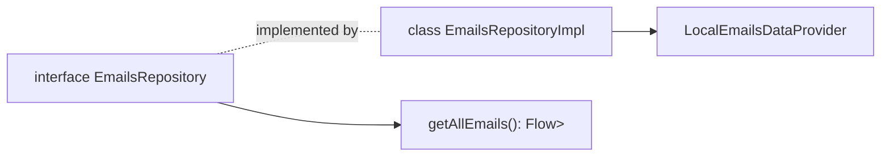

The repository provides a `Flow<List<Email>>` for reactive data observation. The `EmailsRepositoryImpl` returns data from `LocalEmailsDataProvider`, which contains hardcoded sample email data used throughout the app.

**Sources:** [Reply/app/src/main/java/com/example/reply/ui/ReplyHomeViewModel.kt:22-23](), [Reply/app/src/main/java/com/example/reply/ui/MainActivity.kt:33]()

## Typography and Shapes

### Typography System

Reply uses Material 3's typography system with custom specifications.

**Typography Scale:**

| Style | Weight | Size | Line Height | Letter Spacing |
|-------|--------|------|-------------|----------------|
| headlineLarge | SemiBold | 32sp | 40sp | 0sp |
| headlineMedium | SemiBold | 28sp | 36sp | 0sp |
| headlineSmall | SemiBold | 24sp | 32sp | 0sp |
| titleLarge | SemiBold | 22sp | 28sp | 0sp |
| titleMedium | SemiBold | 16sp | 24sp | 0.15sp |
| titleSmall | Bold | 14sp | 20sp | 0.1sp |
| bodyLarge | Normal | 16sp | 24sp | 0.15sp |
| bodyMedium | Medium | 14sp | 20sp | 0.25sp |
| bodySmall | Bold | 12sp | 16sp | 0.4sp |
| labelLarge | SemiBold | 14sp | 20sp | 0.1sp |
| labelMedium | SemiBold | 12sp | 16sp | 0.5sp |
| labelSmall | SemiBold | 11sp | 16sp | 0.5sp |

The typography emphasizes semibold weights for headlines and titles, creating clear visual hierarchy in the email list and detail views.

**Sources:** [Reply/app/src/main/java/com/example/reply/ui/theme/Type.kt:25-98]()

## Summary

Reply demonstrates production-ready adaptive UI implementation in Jetpack Compose, showcasing:

1. **Window Size Class Integration:** Proper use of `WindowSizeClass` to determine layout strategies
2. **Foldable Device Support:** Detection and handling of `FoldingFeature` states for book posture and separating screens
3. **Navigation Suite Pattern:** Material 3's `NavigationSuiteScaffoldLayout` for automatic navigation component selection
4. **TwoPane Layout:** Accompanist Adaptive's `TwoPane` for dual-pane layouts with hinge awareness
5. **State Management:** ViewModel with `StateFlow` for reactive UI updates
6. **Edge-to-Edge UI:** Proper window insets handling for modern Android UI
7. **Material Design 3:** Full MD3 implementation with contrast awareness and dynamic color support

The app serves as a reference implementation for building responsive email clients and similar list-detail applications that need to adapt to various device form factors.

**Sources:** [Reply/app/src/main/java/com/example/reply/ui/ReplyApp.kt:1-152](), [Reply/app/src/main/java/com/example/reply/ui/ReplyListContent.kt:1-228](), [Reply/app/src/main/java/com/example/reply/ui/navigation/ReplyNavigationComponents.kt:1-477]()

---

