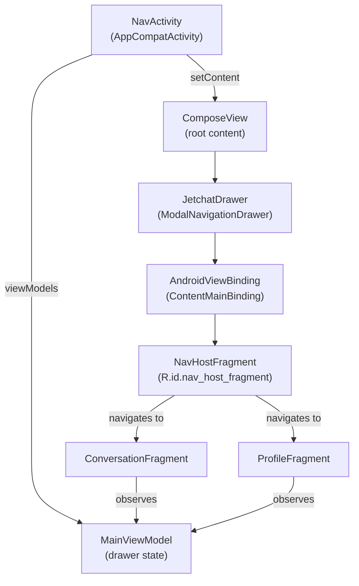
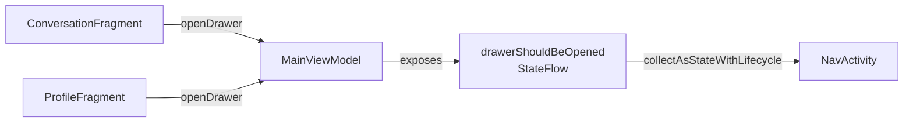
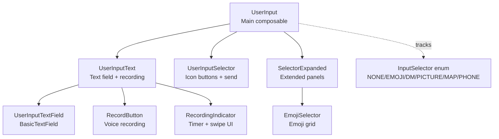
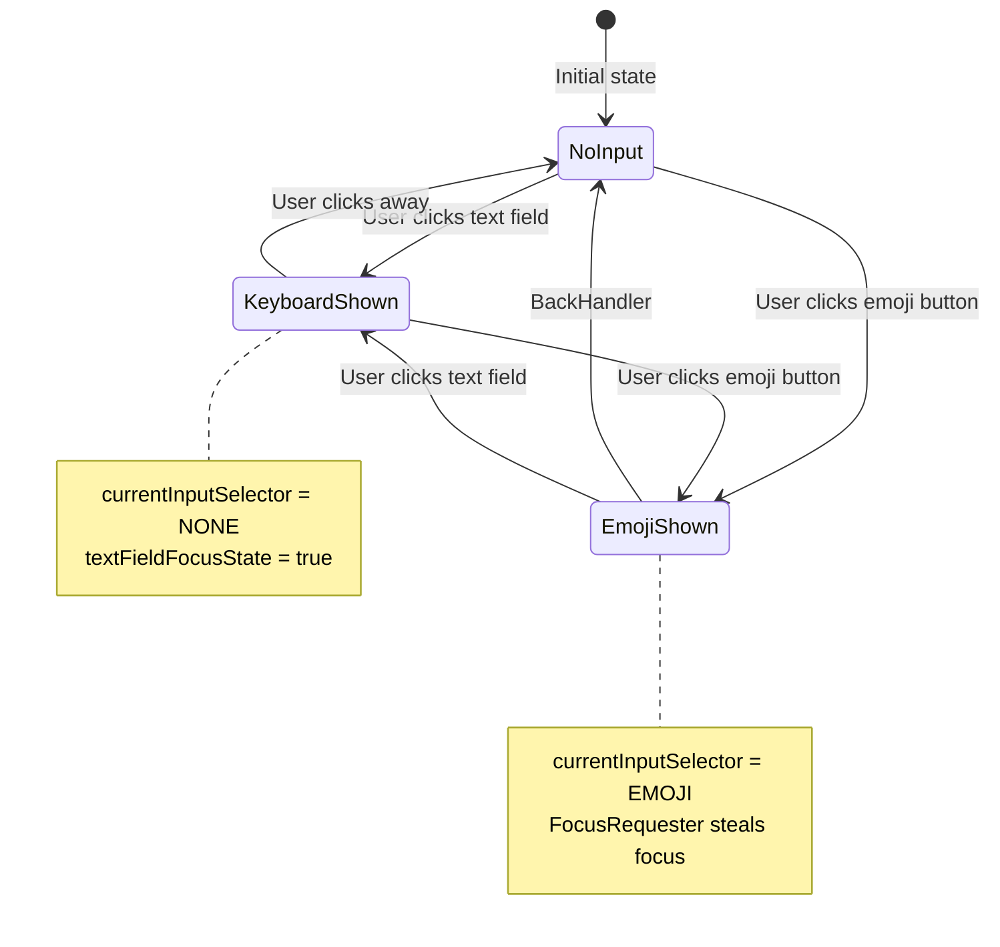
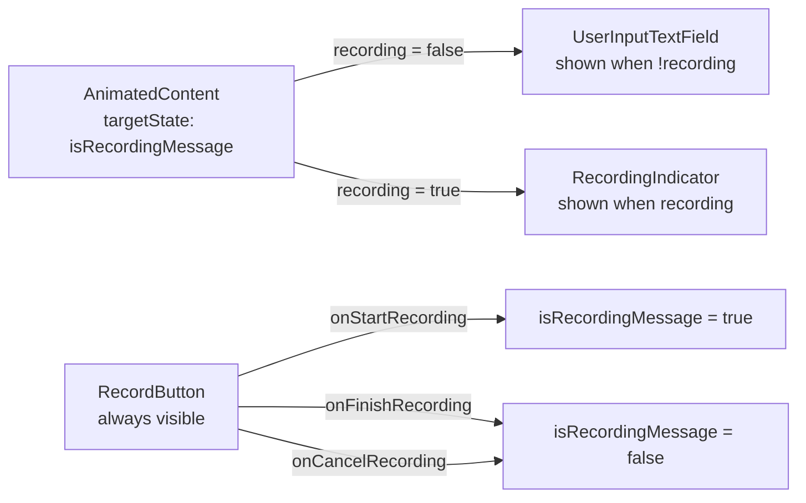
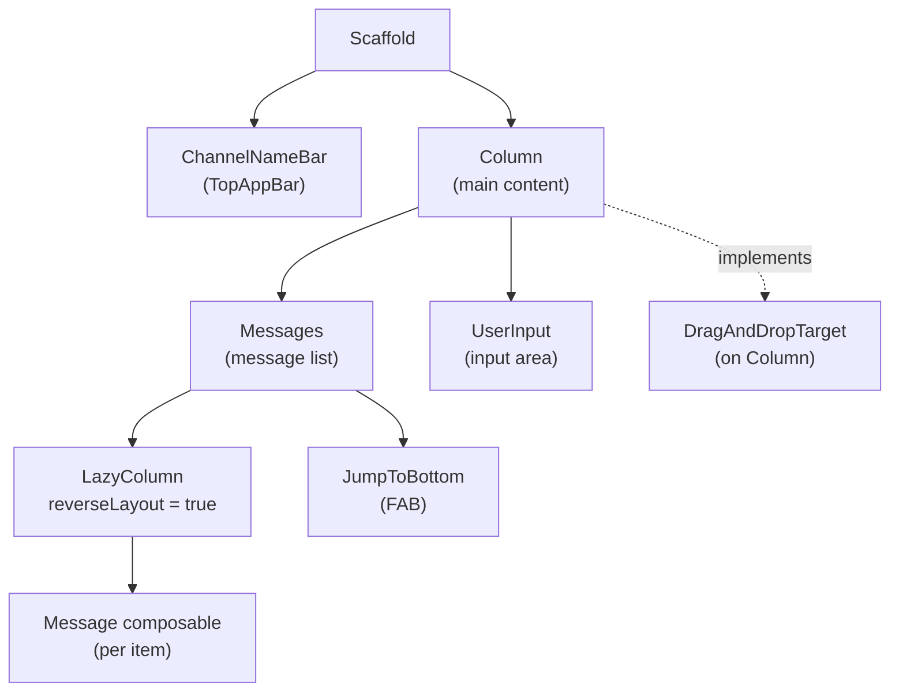
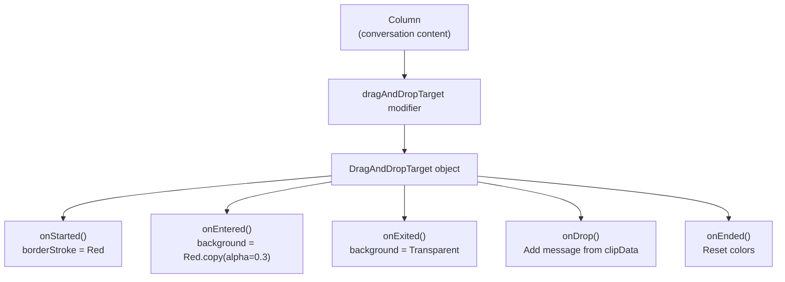
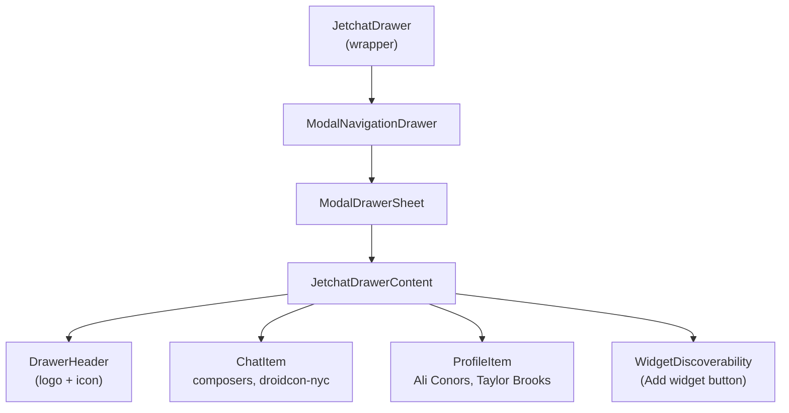
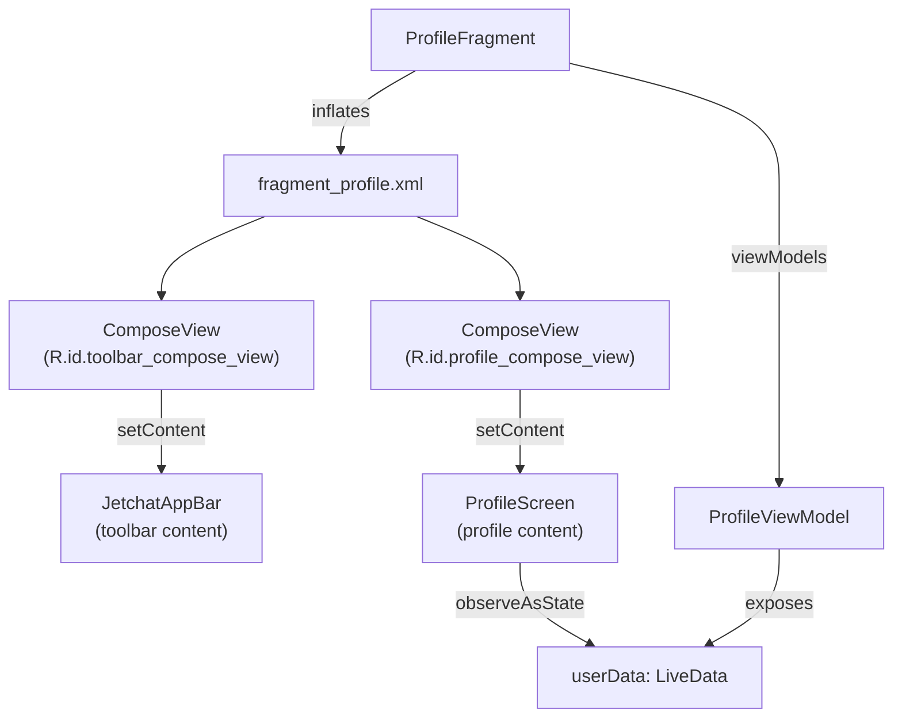
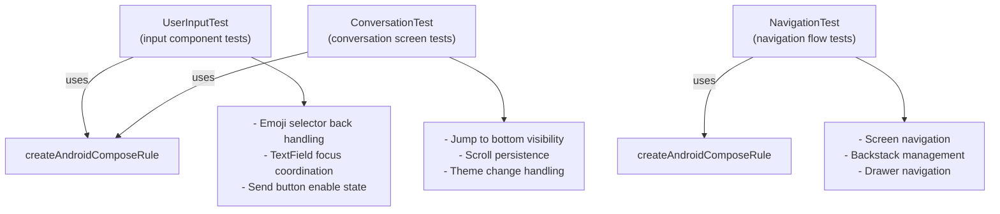

<!-- source: DeepWiki mcp.deepwiki.com · repo android/compose-samples · page 4.4 Jetchat · fetched 2026-10-23 -->

# Jetchat

<details>
<summary>Relevant source files</summary>

The following files were used as context for generating this wiki page:

- [Jetchat/app/src/androidTest/java/com/example/compose/jetchat/ConversationTest.kt](Jetchat/app/src/androidTest/java/com/example/compose/jetchat/ConversationTest.kt)
- [Jetchat/app/src/androidTest/java/com/example/compose/jetchat/NavigationTest.kt](Jetchat/app/src/androidTest/java/com/example/compose/jetchat/NavigationTest.kt)
- [Jetchat/app/src/androidTest/java/com/example/compose/jetchat/UserInputTest.kt](Jetchat/app/src/androidTest/java/com/example/compose/jetchat/UserInputTest.kt)
- [Jetchat/app/src/main/java/com/example/compose/jetchat/MainViewModel.kt](Jetchat/app/src/main/java/com/example/compose/jetchat/MainViewModel.kt)
- [Jetchat/app/src/main/java/com/example/compose/jetchat/NavActivity.kt](Jetchat/app/src/main/java/com/example/compose/jetchat/NavActivity.kt)
- [Jetchat/app/src/main/java/com/example/compose/jetchat/components/AnimatingFabContent.kt](Jetchat/app/src/main/java/com/example/compose/jetchat/components/AnimatingFabContent.kt)
- [Jetchat/app/src/main/java/com/example/compose/jetchat/components/JetchatAppBar.kt](Jetchat/app/src/main/java/com/example/compose/jetchat/components/JetchatAppBar.kt)
- [Jetchat/app/src/main/java/com/example/compose/jetchat/components/JetchatDrawer.kt](Jetchat/app/src/main/java/com/example/compose/jetchat/components/JetchatDrawer.kt)
- [Jetchat/app/src/main/java/com/example/compose/jetchat/components/JetchatScaffold.kt](Jetchat/app/src/main/java/com/example/compose/jetchat/components/JetchatScaffold.kt)
- [Jetchat/app/src/main/java/com/example/compose/jetchat/conversation/Conversation.kt](Jetchat/app/src/main/java/com/example/compose/jetchat/conversation/Conversation.kt)
- [Jetchat/app/src/main/java/com/example/compose/jetchat/conversation/ConversationFragment.kt](Jetchat/app/src/main/java/com/example/compose/jetchat/conversation/ConversationFragment.kt)
- [Jetchat/app/src/main/java/com/example/compose/jetchat/conversation/ConversationUiState.kt](Jetchat/app/src/main/java/com/example/compose/jetchat/conversation/ConversationUiState.kt)
- [Jetchat/app/src/main/java/com/example/compose/jetchat/conversation/JumpToBottom.kt](Jetchat/app/src/main/java/com/example/compose/jetchat/conversation/JumpToBottom.kt)
- [Jetchat/app/src/main/java/com/example/compose/jetchat/conversation/UserInput.kt](Jetchat/app/src/main/java/com/example/compose/jetchat/conversation/UserInput.kt)
- [Jetchat/app/src/main/java/com/example/compose/jetchat/profile/Profile.kt](Jetchat/app/src/main/java/com/example/compose/jetchat/profile/Profile.kt)
- [Jetchat/app/src/main/java/com/example/compose/jetchat/profile/ProfileFragment.kt](Jetchat/app/src/main/java/com/example/compose/jetchat/profile/ProfileFragment.kt)
- [Jetchat/app/src/main/java/com/example/compose/jetchat/profile/ProfileViewModel.kt](Jetchat/app/src/main/java/com/example/compose/jetchat/profile/ProfileViewModel.kt)
- [Jetchat/app/src/main/res/layout/content_main.xml](Jetchat/app/src/main/res/layout/content_main.xml)

</details>


## Purpose and Scope

Jetchat is a messaging application sample that demonstrates how to integrate Jetpack Compose with traditional Android components, specifically Fragments and the Navigation Component. This sample showcases a hybrid architecture approach where Compose UI is embedded within Fragments, making it particularly useful for teams migrating existing Fragment-based applications to Compose.

Jetchat focuses on complex text input management, including an emoji selector with focus coordination, voice recording UI, and keyboard interactions. The sample also demonstrates Material Design 3 theming, drag-and-drop functionality, and a navigation drawer pattern.

For information about fully Compose-based navigation patterns, see [Navigation Patterns](#5.3). For adaptive UI approaches, see [Reply](#4.3).

Sources: [Jetchat/app/src/main/java/com/example/compose/jetchat/NavActivity.kt:1-118](), [Jetchat/app/src/main/java/com/example/compose/jetchat/conversation/ConversationFragment.kt:1-63]()

## Application Architecture

### Fragment-Based Navigation Model

Jetchat uses a Fragment-based architecture orchestrated by `NavActivity`, which hosts a `NavHostFragment` that manages navigation between different screens. This differs from other samples in the repository that use Compose Navigation exclusively.



**Diagram: Jetchat Navigation Architecture**

The `NavActivity` creates a `ComposeView` as its root content, which contains the `JetchatDrawer` (a Material 3 `ModalNavigationDrawer`). Inside the drawer, an `AndroidViewBinding` inflates `content_main.xml`, which contains the `NavHostFragment`. This fragment container hosts either `ConversationFragment` or `ProfileFragment` based on navigation state.

Sources: [Jetchat/app/src/main/java/com/example/compose/jetchat/NavActivity.kt:47-117](), [Jetchat/app/src/main/res/layout/content_main.xml:19-34]()

### ViewModel and State Management

Jetchat uses traditional Android architecture components rather than modern StateFlow patterns:

| Component | State Type | Purpose |
|-----------|------------|---------|
| `MainViewModel` | `MutableStateFlow<Boolean>` | Coordinates drawer open/close actions between fragments |
| `ProfileViewModel` | `LiveData<ProfileScreenState>` | Manages profile data display |
| `ConversationUiState` | Mutable state list | Manages conversation messages |

The `MainViewModel` serves as a communication bridge between fragments, particularly for drawer state coordination:



**Diagram: ViewModel Communication Pattern**

Sources: [Jetchat/app/src/main/java/com/example/compose/jetchat/MainViewModel.kt:17-39](), [Jetchat/app/src/main/java/com/example/compose/jetchat/NavActivity.kt:48-103]()

## User Input System

The user input system in Jetchat is the most complex component in the sample, demonstrating advanced text field management, focus coordination, and input mode switching.

### Input Components Overview



**Diagram: User Input Component Hierarchy**

The `UserInput` composable ([Jetchat/app/src/main/java/com/example/compose/jetchat/conversation/UserInput.kt:135-195]()) orchestrates three main areas:
1. **UserInputText**: Text field and voice recording button
2. **UserInputSelector**: Action buttons (emoji, DM, picture, map, phone) and send button
3. **SelectorExpanded**: Extended panels (emoji selector, etc.)

Sources: [Jetchat/app/src/main/java/com/example/compose/jetchat/conversation/UserInput.kt:113-120](), [Jetchat/app/src/main/java/com/example/compose/jetchat/conversation/UserInput.kt:135-195]()

### Text Field and Focus Management

The text input system implements sophisticated focus coordination between the keyboard and emoji selector:



**Diagram: Focus State Machine**

The focus management logic ([Jetchat/app/src/main/java/com/example/compose/jetchat/conversation/UserInput.kt:136-195]()) uses several key mechanisms:

1. **currentInputSelector**: Tracks which extended selector is shown (`InputSelector.NONE`, `InputSelector.EMOJI`, etc.)
2. **textFieldFocusState**: Tracks whether the text field has focus
3. **keyboardShown**: Derived from `currentInputSelector == InputSelector.NONE && textFieldFocusState`
4. **BackHandler**: Intercepts back navigation when an input selector is visible ([line 140-142]())

When the emoji selector opens, a `FocusRequester` ([Jetchat/app/src/main/java/com/example/compose/jetchat/conversation/UserInput.kt:216-222]()) requests focus using a `SideEffect`, causing the text field to lose focus and hide the keyboard.

Sources: [Jetchat/app/src/main/java/com/example/compose/jetchat/conversation/UserInput.kt:136-195](), [Jetchat/app/src/main/java/com/example/compose/jetchat/conversation/UserInput.kt:212-236]()

### Emoji Selector Implementation

The `EmojiSelector` composable ([Jetchat/app/src/main/java/com/example/compose/jetchat/conversation/UserInput.kt:572-608]()) displays a grid of emoji characters that can be inserted into the text field:

| Component | Implementation | Purpose |
|-----------|----------------|---------|
| **EmojiTable** | 4 rows × 10 columns grid | Displays 40 hardcoded emoji characters |
| **ExtendedSelectorInnerButton** | Tab buttons | Switches between "Emojis" and "Stickers" (stickers not implemented) |
| **FocusRequester** | Focus management | Steals focus from text field when opened |
| **onTextAdded callback** | Text insertion | Uses `TextFieldValue.addText()` extension function |

The emoji grid uses a simple layout with `clickable` text elements ([lines 644-655]()):

```
Column {
    repeat(4) { x ->
        Row {
            repeat(EMOJI_COLUMNS) { y ->
                Text(emoji[x * EMOJI_COLUMNS + y])
                    .clickable { onTextAdded(emoji) }
            }
        }
    }
}
```

The `addText` extension function ([Jetchat/app/src/main/java/com/example/compose/jetchat/conversation/UserInput.kt:197-209]()) handles text insertion at the current cursor position by replacing the selected range and updating the selection.

Sources: [Jetchat/app/src/main/java/com/example/compose/jetchat/conversation/UserInput.kt:572-608](), [Jetchat/app/src/main/java/com/example/compose/jetchat/conversation/UserInput.kt:635-659](), [Jetchat/app/src/main/java/com/example/compose/jetchat/conversation/UserInput.kt:197-209]()

### Voice Recording UI

The voice recording feature demonstrates mode switching using `AnimatedContent`:



**Diagram: Recording Mode Switching**

The `RecordingIndicator` ([Jetchat/app/src/main/java/com/example/compose/jetchat/conversation/UserInput.kt:507-569]()) displays:
- An animated pulsing red dot using `rememberInfiniteTransition`
- A timer that increments every second using `LaunchedEffect`
- A "Swipe to cancel" text that translates and fades based on swipe offset

The `RecordButton` component (referenced but not shown in provided files) handles drag gestures to control the recording state.

Sources: [Jetchat/app/src/main/java/com/example/compose/jetchat/conversation/UserInput.kt:411-456](), [Jetchat/app/src/main/java/com/example/compose/jetchat/conversation/UserInput.kt:507-569]()

### Send Button State

The send button in `UserInputSelector` ([Jetchat/app/src/main/java/com/example/compose/jetchat/conversation/UserInput.kt:267-344]()) is enabled only when text is present:

```kotlin
sendMessageEnabled = textState.text.isNotBlank()
```

When disabled, it displays with a transparent background and a 1dp border ([lines 312-319]()). The button triggers both the `onMessageSent` callback and resets the text state ([lines 178-184]()).

Sources: [Jetchat/app/src/main/java/com/example/compose/jetchat/conversation/UserInput.kt:267-344]()

## Conversation Screen

The `ConversationContent` composable ([Jetchat/app/src/main/java/com/example/compose/jetchat/conversation/Conversation.kt:106-218]()) displays a chat interface with messages, app bar, and user input.

### Message Display Architecture



**Diagram: Conversation Screen Layout**

The screen uses `Scaffold` with window insets handling to ensure the input area respects the keyboard and navigation bar ([lines 177-180]()). The `nestedScroll` modifier on the Scaffold coordinates scrolling with the collapsing top bar.

Sources: [Jetchat/app/src/main/java/com/example/compose/jetchat/conversation/Conversation.kt:106-218]()

### Message List Implementation

The `Messages` composable ([Jetchat/app/src/main/java/com/example/compose/jetchat/conversation/Conversation.kt:280-347]()) uses a reverse-layout `LazyColumn`:

```kotlin
LazyColumn(
    reverseLayout = true,
    state = scrollState,
    modifier = Modifier.testTag(ConversationTestTag).fillMaxSize()
)
```

The reverse layout places the most recent message at the bottom (index 0), making it easy to add new messages without scrolling. The code determines message grouping by comparing adjacent authors:

| Variable | Calculation | Purpose |
|----------|-------------|---------|
| `isFirstMessageByAuthor` | `prevAuthor != content.author` | Adds spacing after message group |
| `isLastMessageByAuthor` | `nextAuthor != content.author` | Shows avatar and timestamp |

Day headers are hardcoded at specific indices ([lines 300-308]()) for demonstration purposes.

Sources: [Jetchat/app/src/main/java/com/example/compose/jetchat/conversation/Conversation.kt:280-347](), [Jetchat/app/src/main/java/com/example/compose/jetchat/conversation/Conversation.kt:350-395]()

### Message Bubbles

The `Message` composable ([Jetchat/app/src/main/java/com/example/compose/jetchat/conversation/Conversation.kt:350-395]()) displays:
- Avatar image (only for last message by author)
- Author name and timestamp (only for last message by author)
- Message bubble with text content
- Optional attached image

The `ChatItemBubble` ([Jetchat/app/src/main/java/com/example/compose/jetchat/conversation/Conversation.kt:473-508]()) uses different background colors for the current user vs. others:

```kotlin
val backgroundBubbleColor = if (isUserMe) {
    MaterialTheme.colorScheme.primary
} else {
    MaterialTheme.colorScheme.surfaceVariant
}
```

The `ClickableMessage` composable ([lines 511-536]()) uses `ClickableText` with `messageFormatter` to handle clickable links and @mentions within message text.

Sources: [Jetchat/app/src/main/java/com/example/compose/jetchat/conversation/Conversation.kt:350-395](), [Jetchat/app/src/main/java/com/example/compose/jetchat/conversation/Conversation.kt:473-536]()

### Drag-and-Drop Support

The conversation screen implements drag-and-drop functionality to accept text dropped from other apps:



**Diagram: Drag-and-Drop Event Flow**

The implementation ([Jetchat/app/src/main/java/com/example/compose/jetchat/conversation/Conversation.kt:128-194]()) uses a `DragAndDropTarget` callback object that:
1. Changes border color to red when drag starts
2. Changes background to translucent red when drag enters the column
3. Resets background when drag exits
4. Adds a new message with the dropped text on drop
5. Filters for `MIMETYPE_TEXT_PLAIN` in `shouldStartDragAndDrop`

Sources: [Jetchat/app/src/main/java/com/example/compose/jetchat/conversation/Conversation.kt:120-194]()

### Jump to Bottom Button

The `JumpToBottom` composable ([Jetchat/app/src/main/java/com/example/compose/jetchat/conversation/JumpToBottom.kt:45-78]()) appears when the user scrolls away from the bottom:

```kotlin
val jumpToBottomButtonEnabled by remember {
    derivedStateOf {
        scrollState.firstVisibleItemIndex != 0 ||
            scrollState.firstVisibleItemScrollOffset > jumpThreshold
    }
}
```

The button uses an animated offset transition to slide in/out ([lines 51-57]()) and calls `scrollState.animateScrollToItem(0)` to return to the bottom.

Sources: [Jetchat/app/src/main/java/com/example/compose/jetchat/conversation/Conversation.kt:322-346](), [Jetchat/app/src/main/java/com/example/compose/jetchat/conversation/JumpToBottom.kt:45-78]()

## Navigation Drawer

The `JetchatDrawer` composable ([Jetchat/app/src/main/java/com/example/compose/jetchat/components/JetchatScaffold.kt:29-55]()) wraps the application content in a Material 3 `ModalNavigationDrawer`.

### Drawer Structure



**Diagram: Drawer Component Hierarchy**

The `JetchatDrawerContent` ([Jetchat/app/src/main/java/com/example/compose/jetchat/components/JetchatDrawer.kt:65-99]()) displays:
- **DrawerHeader**: Jetchat logo and icon
- **ChatItem**: Two hardcoded chat rooms ("composers" and "droidcon-nyc")
- **ProfileItem**: Two user profiles (current user and colleague)
- **WidgetDiscoverability**: Button to add app widget (API 26+)

Each item highlights when selected using `selectedMenu == itemId` and applies a `primaryContainer` background.

Sources: [Jetchat/app/src/main/java/com/example/compose/jetchat/components/JetchatScaffold.kt:29-55](), [Jetchat/app/src/main/java/com/example/compose/jetchat/components/JetchatDrawer.kt:65-99]()

### Drawer State Management

The drawer state is managed by the `MainViewModel` ([Jetchat/app/src/main/java/com/example/compose/jetchat/MainViewModel.kt:23-38]()):

```kotlin
private val _drawerShouldBeOpened = MutableStateFlow(false)
val drawerShouldBeOpened = _drawerShouldBeOpened.asStateFlow()

fun openDrawer() {
    _drawerShouldBeOpened.value = true
}

fun resetOpenDrawerAction() {
    _drawerShouldBeOpened.value = false
}
```

In `NavActivity`, when `drawerShouldBeOpened` is true, a `LaunchedEffect` opens the drawer and resets the state ([Jetchat/app/src/main/java/com/example/compose/jetchat/NavActivity.kt:64-75]()):

```kotlin
if (drawerOpen) {
    LaunchedEffect(Unit) {
        try {
            drawerState.open()
        } finally {
            viewModel.resetOpenDrawerAction()
        }
    }
}
```

This pattern allows fragments to trigger drawer opening through the shared ViewModel.

Sources: [Jetchat/app/src/main/java/com/example/compose/jetchat/MainViewModel.kt:17-39](), [Jetchat/app/src/main/java/com/example/compose/jetchat/NavActivity.kt:60-75]()

### Widget Discoverability

The `WidgetDiscoverability` composable ([Jetchat/app/src/main/java/com/example/compose/jetchat/components/JetchatDrawer.kt:245-266]()) provides a button to add a Jetchat widget to the home screen. It's only shown on API 26+ where `AppWidgetManager.isRequestPinAppWidgetSupported` returns true.

Sources: [Jetchat/app/src/main/java/com/example/compose/jetchat/components/JetchatDrawer.kt:93-97](), [Jetchat/app/src/main/java/com/example/compose/jetchat/components/JetchatDrawer.kt:244-281]()

## Profile Screen

The profile screen is implemented as a Fragment that hosts Compose content, demonstrating View-Compose interop.

### Profile Fragment Structure



**Diagram: Profile Screen Architecture**

The `ProfileFragment` ([Jetchat/app/src/main/java/com/example/compose/jetchat/profile/ProfileFragment.kt:52-119]()) inflates an XML layout containing two `ComposeView` elements:
1. **toolbar_compose_view**: Contains the app bar with navigation icon and menu
2. **profile_compose_view**: Contains the scrollable profile content

This split allows the toolbar to remain fixed while the profile content scrolls. The `ProfileViewModel` uses `LiveData<ProfileScreenState>` ([lines 43-44]()) which is observed using `observeAsState()` in the Compose content ([line 102]()).

Sources: [Jetchat/app/src/main/java/com/example/compose/jetchat/profile/ProfileFragment.kt:52-119](), [Jetchat/app/src/main/java/com/example/compose/jetchat/profile/ProfileViewModel.kt:27-45]()

### Profile Screen Layout

The `ProfileScreen` composable ([Jetchat/app/src/main/java/com/example/compose/jetchat/profile/Profile.kt:73-117]()) uses a parallax scrolling effect:

| Component | Behavior | Implementation |
|-----------|----------|----------------|
| **ProfileHeader** | Image with parallax offset | `offset = scrollState.value / 2` converted to Dp |
| **UserInfoFields** | Standard scrolling | Name, position, properties list |
| **ProfileFab** | Extended when at top | `fabExtended = scrollState.value == 0` |

The profile header image ([lines 178-199]()) applies half the scroll offset as padding, creating a parallax effect as the user scrolls.

The `ProfileFab` ([lines 230-262]()) uses `AnimatingFabContent` to expand/collapse based on scroll position, displaying either "Edit profile" (for current user) or "Message" (for others).

Sources: [Jetchat/app/src/main/java/com/example/compose/jetchat/profile/Profile.kt:73-117](), [Jetchat/app/src/main/java/com/example/compose/jetchat/profile/Profile.kt:178-199](), [Jetchat/app/src/main/java/com/example/compose/jetchat/profile/Profile.kt:230-262]()

### Profile Data Model

The `ProfileScreenState` ([Jetchat/app/src/main/java/com/example/compose/jetchat/profile/ProfileViewModel.kt:48-60]()) is an immutable data class:

```kotlin
@Immutable
data class ProfileScreenState(
    val userId: String,
    @DrawableRes val photo: Int?,
    val name: String,
    val status: String,
    val displayName: String,
    val position: String,
    val twitter: String = "",
    val timeZone: String?, // Null if me
    val commonChannels: String?, // Null if me
) {
    fun isMe() = userId == meProfile.userId
}
```

The sample includes two hardcoded profiles: `meProfile` and `colleagueProfile` in the data package.

Sources: [Jetchat/app/src/main/java/com/example/compose/jetchat/profile/ProfileViewModel.kt:47-61]()

## Testing Strategy

Jetchat includes comprehensive UI tests demonstrating Compose testing with Fragment integration.

### Test Structure



**Diagram: Test Organization**

Sources: [Jetchat/app/src/androidTest/java/com/example/compose/jetchat/UserInputTest.kt:1-164](), [Jetchat/app/src/androidTest/java/com/example/compose/jetchat/ConversationTest.kt:1-167](), [Jetchat/app/src/androidTest/java/com/example/compose/jetchat/NavigationTest.kt:1-109]()

### User Input Testing

The `UserInputTest` ([Jetchat/app/src/androidTest/java/com/example/compose/jetchat/UserInputTest.kt:47-163]()) verifies complex input interactions:

**Emoji Selector Tests**:
- `emojiSelector_isClosedWithBack()`: Verifies back button closes emoji selector ([lines 69-91]())
- `extendedUserInputShown_textFieldClicked_extendedUserInputHides()`: Verifies text field click closes emoji selector ([lines 94-102]())
- `keyboardShown_emojiSelectorOpened_keyboardHides()`: Verifies opening emoji selector hides keyboard ([lines 105-120]())

The tests use a custom `KeyboardShownKey` semantic property ([Jetchat/app/src/main/java/com/example/compose/jetchat/conversation/UserInput.kt:387-388]()) to verify keyboard visibility, though keyboard synchronization issues are noted ([lines 69, 109]()).

**Send Button Test**:
- `sendButton_enableToggles()`: Verifies send button is disabled when text is empty and enabled when text is present ([lines 123-134]())

Sources: [Jetchat/app/src/androidTest/java/com/example/compose/jetchat/UserInputTest.kt:47-163]()

### Conversation Testing

The `ConversationTest` ([Jetchat/app/src/androidTest/java/com/example/compose/jetchat/ConversationTest.kt:43-167]()) verifies message list behavior:

| Test | Verification | Line Reference |
|------|--------------|----------------|
| `app_launches()` | Conversation screen displays on launch | 64-68 |
| `userScrollsUp_jumpToBottomAppears()` | Jump button shows after scrolling | 71-83 |
| `jumpToBottom_snapsToBottomAndDisappears()` | Jump button returns to bottom and hides | 86-100 |
| `jumpToBottom_snapsToBottomAfterUserInteracted()` | Jump button persists after emoji selector interaction | 103-123 |
| `changeTheme_scrollIsPersisted()` | Scroll position maintained across theme changes | 126-144 |

The tests use `performTouchInput` with `swipe` gestures to scroll the message list and verify the jump-to-bottom button's visibility.

Sources: [Jetchat/app/src/androidTest/java/com/example/compose/jetchat/ConversationTest.kt:43-167]()

### Navigation Testing

The `NavigationTest` ([Jetchat/app/src/androidTest/java/com/example/compose/jetchat/NavigationTest.kt:38-109]()) verifies Fragment navigation:

**Key Tests**:
- `app_launches()`: Verifies app starts at `R.id.nav_home` ([lines 44-47]())
- `profileScreen_back_conversationScreen()`: Verifies back navigation from profile to conversation ([lines 50-66]())
- `drawer_conversationScreen_backstackPopUp()`: Regression test for backstack management when navigating between screens via drawer ([lines 72-80]())

The tests use `findNavController()` to verify the current destination and use semantics matchers to interact with drawer items ([lines 90-95]()).

Sources: [Jetchat/app/src/androidTest/java/com/example/compose/jetchat/NavigationTest.kt:38-109]()

## Key Takeaways

Jetchat demonstrates several important patterns for Compose adoption:

1. **Fragment Integration**: Shows how to embed Compose in existing Fragment-based architecture using `ComposeView` in both programmatic and XML layouts
2. **Focus Management**: Implements sophisticated focus coordination between keyboard and custom input selectors using `FocusRequester` and `onFocusChanged`
3. **Back Handling**: Uses `BackHandler` to intercept back navigation for custom behavior (closing emoji selector)
4. **LiveData Bridge**: Shows how to observe `LiveData` in Compose using `observeAsState()` for gradual migration
5. **Fragment Communication**: Uses shared `ViewModel` with `StateFlow` to coordinate between fragments
6. **Drag-and-Drop**: Implements Material 3 drag-and-drop target with visual feedback
7. **Reverse Layout**: Uses `LazyColumn(reverseLayout = true)` for chat-style message display

This sample is particularly valuable for teams with existing Fragment-based codebases looking to adopt Compose incrementally.

Sources: [Jetchat/app/src/main/java/com/example/compose/jetchat/NavActivity.kt:1-118](), [Jetchat/app/src/main/java/com/example/compose/jetchat/conversation/UserInput.kt:1-793](), [Jetchat/app/src/main/java/com/example/compose/jetchat/conversation/Conversation.kt:1-564]()

---

