<!-- source: DeepWiki mcp.deepwiki.com · repo android/compose-samples · page 4.5 JetLagged · fetched 2026-10-23 -->

# JetLagged

<details>
<summary>Relevant source files</summary>

The following files were used as context for generating this wiki page:

- [JetLagged/app/src/main/java/com/example/jetlagged/HomeScreenCards.kt](JetLagged/app/src/main/java/com/example/jetlagged/HomeScreenCards.kt)
- [JetLagged/app/src/main/java/com/example/jetlagged/JetLaggedDrawer.kt](JetLagged/app/src/main/java/com/example/jetlagged/JetLaggedDrawer.kt)
- [JetLagged/app/src/main/java/com/example/jetlagged/JetLaggedScreen.kt](JetLagged/app/src/main/java/com/example/jetlagged/JetLaggedScreen.kt)
- [JetLagged/app/src/main/java/com/example/jetlagged/MainActivity.kt](JetLagged/app/src/main/java/com/example/jetlagged/MainActivity.kt)
- [JetLagged/app/src/main/java/com/example/jetlagged/backgrounds/SimpleGradientBackground.kt](JetLagged/app/src/main/java/com/example/jetlagged/backgrounds/SimpleGradientBackground.kt)
- [JetLagged/app/src/main/java/com/example/jetlagged/backgrounds/SolarFlareShaderBackground.kt](JetLagged/app/src/main/java/com/example/jetlagged/backgrounds/SolarFlareShaderBackground.kt)
- [JetLagged/app/src/main/java/com/example/jetlagged/backgrounds/StripesShaderBackground.kt](JetLagged/app/src/main/java/com/example/jetlagged/backgrounds/StripesShaderBackground.kt)
- [JetLagged/app/src/main/java/com/example/jetlagged/heartrate/HeartRateCard.kt](JetLagged/app/src/main/java/com/example/jetlagged/heartrate/HeartRateCard.kt)
- [JetLagged/app/src/main/java/com/example/jetlagged/heartrate/HeartRateGraph.kt](JetLagged/app/src/main/java/com/example/jetlagged/heartrate/HeartRateGraph.kt)
- [JetLagged/app/src/main/java/com/example/jetlagged/sleep/JetLaggedHeader.kt](JetLagged/app/src/main/java/com/example/jetlagged/sleep/JetLaggedHeader.kt)
- [JetLagged/app/src/main/java/com/example/jetlagged/sleep/JetLaggedHeaderTabs.kt](JetLagged/app/src/main/java/com/example/jetlagged/sleep/JetLaggedHeaderTabs.kt)
- [JetLagged/app/src/main/java/com/example/jetlagged/sleep/JetLaggedTimeGraph.kt](JetLagged/app/src/main/java/com/example/jetlagged/sleep/JetLaggedTimeGraph.kt)
- [JetLagged/app/src/main/java/com/example/jetlagged/sleep/SleepBar.kt](JetLagged/app/src/main/java/com/example/jetlagged/sleep/SleepBar.kt)
- [JetLagged/app/src/main/java/com/example/jetlagged/sleep/SleepData.kt](JetLagged/app/src/main/java/com/example/jetlagged/sleep/SleepData.kt)
- [JetLagged/app/src/main/java/com/example/jetlagged/ui/theme/Color.kt](JetLagged/app/src/main/java/com/example/jetlagged/ui/theme/Color.kt)
- [JetLagged/app/src/main/java/com/example/jetlagged/ui/theme/Theme.kt](JetLagged/app/src/main/java/com/example/jetlagged/ui/theme/Theme.kt)
- [JetLagged/app/src/main/res/drawable/ic_bedtime.xml](JetLagged/app/src/main/res/drawable/ic_bedtime.xml)
- [JetLagged/app/src/main/res/drawable/ic_home.xml](JetLagged/app/src/main/res/drawable/ic_home.xml)
- [JetLagged/app/src/main/res/drawable/ic_leaderboard.xml](JetLagged/app/src/main/res/drawable/ic_leaderboard.xml)
- [JetLagged/app/src/main/res/drawable/ic_menu.xml](JetLagged/app/src/main/res/drawable/ic_menu.xml)
- [JetLagged/app/src/main/res/drawable/ic_settings.xml](JetLagged/app/src/main/res/drawable/ic_settings.xml)
- [JetLagged/app/src/main/res/drawable/ic_single_bed.xml](JetLagged/app/src/main/res/drawable/ic_single_bed.xml)
- [JetLagged/app/src/main/res/drawable/ic_watch.xml](JetLagged/app/src/main/res/drawable/ic_watch.xml)

</details>


## Purpose and Scope

JetLagged is a sleep tracking sample application that demonstrates advanced Compose graphics capabilities, custom data visualization, and sophisticated gesture handling. The sample showcases RuntimeShader-based animated backgrounds, complex custom layouts for sleep and heart rate data, and a custom navigation drawer implementation with predictive back gesture support.

This document covers the JetLagged-specific implementation details. For information about shared architectural patterns across samples, see [Shared Architecture Patterns](#5). For testing infrastructure, see [Testing Infrastructure](#6).

**Sources:** [JetLagged/app/src/main/java/com/example/jetlagged/MainActivity.kt:1-48]()

---

## Application Architecture

JetLagged follows a straightforward single-activity architecture with a custom drawer navigation system. The application is structured around a home screen displaying multiple data visualization cards within a custom drawer scaffold.

### Component Overview

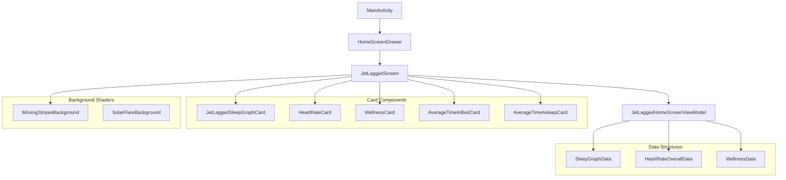

**Sources:** [JetLagged/app/src/main/java/com/example/jetlagged/MainActivity.kt:28-47](), [JetLagged/app/src/main/java/com/example/jetlagged/JetLaggedScreen.kt:54-128]()

### Main Entry Point

The `MainActivity` enables edge-to-edge display and calculates the window size class for adaptive layouts. The activity sets up the theme and launches the drawer navigation system:

| Component | Responsibility |
|-----------|---------------|
| `MainActivity` | Hosts the entire application, enables edge-to-edge, calculates `WindowSizeClass` |
| `calculateWindowSizeClass()` | Determines device window size category for adaptive UI |
| `JetLaggedTheme` | Provides custom theme with extended color palette |
| `HomeScreenDrawer()` | Entry point for drawer navigation system |

**Sources:** [JetLagged/app/src/main/java/com/example/jetlagged/MainActivity.kt:28-47]()

---

## Custom Navigation Drawer System

JetLagged implements a fully custom navigation drawer rather than using Material's built-in `ModalNavigationDrawer`. This custom implementation demonstrates advanced gesture handling, including predictive back gesture support and custom drag animations.

### Drawer Architecture

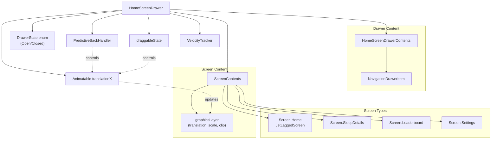

**Sources:** [JetLagged/app/src/main/java/com/example/jetlagged/JetLaggedDrawer.kt:57-192]()

### Drawer State Management

The drawer uses an `Animatable<Float>` to track the horizontal translation from 0f (closed) to `DrawerWidth` (300.dp, open). State is managed through a simple enum:

```
DrawerState.Closed: translationX = 0f
DrawerState.Open:   translationX = 300.dp (DrawerWidth)
```

Key state management functions:

| Function | Line Reference | Purpose |
|----------|---------------|---------|
| `closeDrawer(velocity)` | [JetLaggedDrawer.kt:81-84]() | Animates drawer to closed position |
| `openDrawer(velocity)` | [JetLaggedDrawer.kt:85-88]() | Animates drawer to open position |
| `toggleDrawerState()` | [JetLaggedDrawer.kt:89-97]() | Switches between open and closed |

**Sources:** [JetLagged/app/src/main/java/com/example/jetlagged/JetLaggedDrawer.kt:63-97](), [JetLagged/app/src/main/java/com/example/jetlagged/JetLaggedDrawer.kt:231-234]()

### Predictive Back Gesture Integration

JetLagged demonstrates Android's predictive back gesture API, which provides visual feedback during the back gesture before committing:

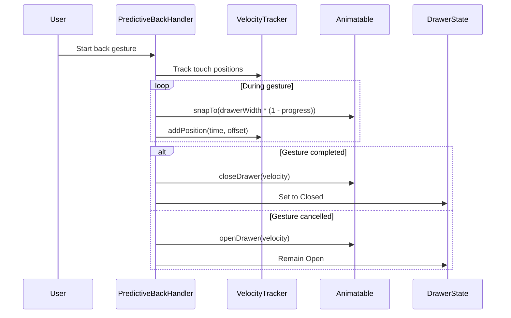

The implementation tracks back gesture progress and updates the drawer position in real-time. A `VelocityTracker` records touch positions to provide smooth velocity-based animations when the gesture completes or cancels.

**Sources:** [JetLagged/app/src/main/java/com/example/jetlagged/JetLaggedDrawer.kt:98-116]()

### Custom Drag Gesture Handling

The drawer supports direct drag gestures with physics-based animations. The implementation calculates whether the fling velocity will naturally reach the target position or requires additional animation:

| Drag Feature | Implementation |
|--------------|----------------|
| Drag tracking | `rememberDraggableState` updates `translationX` on each drag delta |
| Snap threshold | If drag ends past 50% of drawer width, snaps to open; otherwise closes |
| Decay animation | Uses `rememberSplineBasedDecay` for natural fling physics |
| Velocity calculation | Determines if decay animation alone can reach target or needs explicit animation |

**Sources:** [JetLagged/app/src/main/java/com/example/jetlagged/JetLaggedDrawer.kt:125-189]()

### Screen Content Transformation

As the drawer opens, the screen content applies multiple transformations via `graphicsLayer`:

```
translationX: Linear from 0 to drawerWidth
scaleX/scaleY: Lerp from 1.0 to 0.8 (shrinks to 80%)
shape: RoundedCornerShape lerp from 0.dp to 32.dp
clip: true (enables corner clipping)
shadowElevation: 32f (adds depth)
```

This creates a visual effect where the screen content slides, shrinks, and gains rounded corners as the drawer opens, providing clear visual feedback of the navigation hierarchy.

**Sources:** [JetLagged/app/src/main/java/com/example/jetlagged/JetLaggedDrawer.kt:136-145]()

### Navigation Drawer Content

The drawer displays four navigation items using Material 3 `NavigationDrawerItem` components:

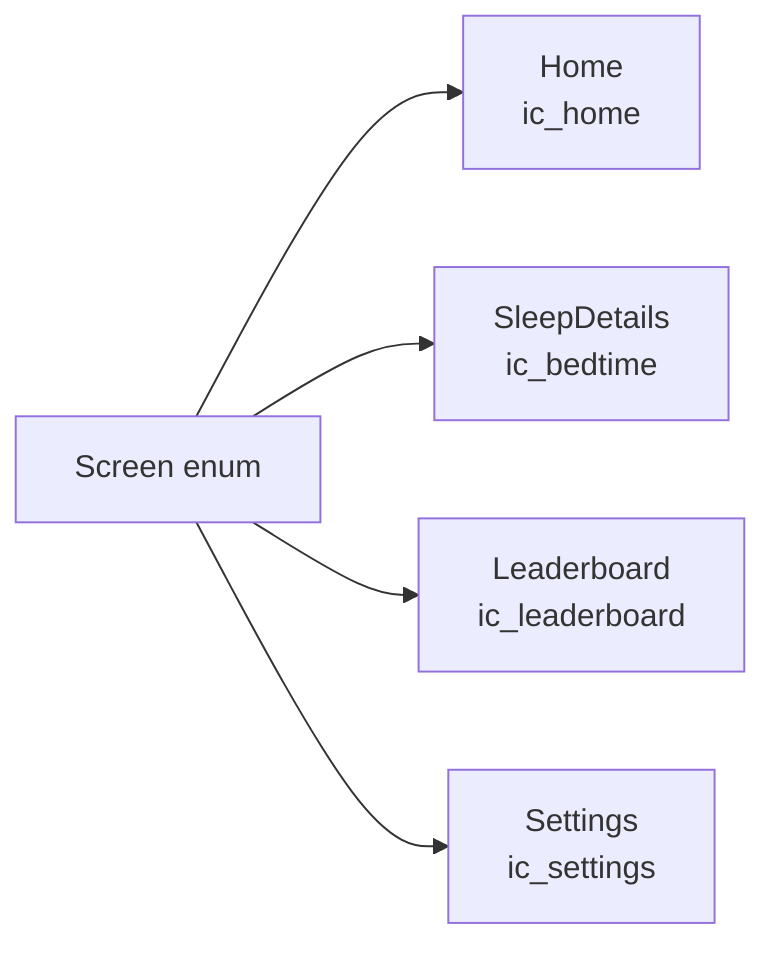

**Sources:** [JetLagged/app/src/main/java/com/example/jetlagged/JetLaggedDrawer.kt:237-268]()

---

## RuntimeShader Graphics System

JetLagged showcases Android 13+ `RuntimeShader` API for advanced animated backgrounds. The application includes two shader implementations with fallback gradients for older Android versions.

### Shader Implementation Pattern

Both shader backgrounds follow a consistent architecture pattern:

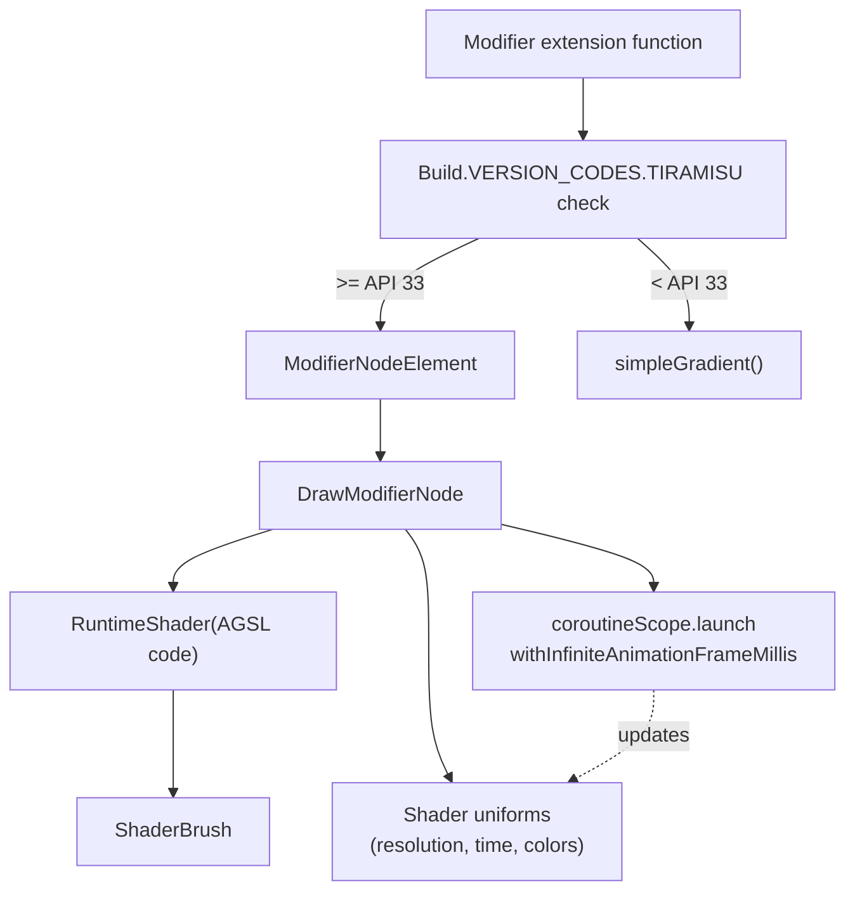

**Sources:** [JetLagged/app/src/main/java/com/example/jetlagged/backgrounds/StripesShaderBackground.kt:34-103](), [JetLagged/app/src/main/java/com/example/jetlagged/backgrounds/SolarFlareShaderBackground.kt:37-103]()

### Moving Stripes Background

The `movingStripesBackground` modifier creates animated horizontal waves that move across the screen. The shader is implemented using AGSL (Android Graphics Shading Language):

| Shader Component | Purpose |
|-----------------|---------|
| `resolution` uniform | Canvas width/height in pixels |
| `time` uniform | Animation time in seconds |
| `stripeColor` uniform | Color for stripe waves |
| `backgroundColor` uniform | Base background color |
| `backgroundLuminance` uniform | Determines fade direction (dark vs light) |

The shader generates multiple sine waves that move horizontally, creating a layered wave effect. The shader automatically adapts to light/dark themes by checking background luminance.

**Sources:** [JetLagged/app/src/main/java/com/example/jetlagged/backgrounds/StripesShaderBackground.kt:106-168]()

### Solar Flare Background

The `solarFlareShaderBackground` creates an animated radial effect with iterative calculations producing a solar flare appearance:

```
ITERATIONS = 2
INTENSITY = 100.0
TIME_MULTIPLIER = 0.25 (slows animation)

For each iteration:
  - Calculate iterative position changes based on sin/cos of time
  - Accumulate color intensity
  - Create radial gradient effect

Apply fade-out on bottom using curve (1.0 - uv.y * uv.y)
Mix with base color and background
Clamp all channels to [0.0, 1.0]
```

**Sources:** [JetLagged/app/src/main/java/com/example/jetlagged/backgrounds/SolarFlareShaderBackground.kt:106-157]()

### Shader Node Lifecycle

The custom modifier node pattern manages shader animation lifecycle:

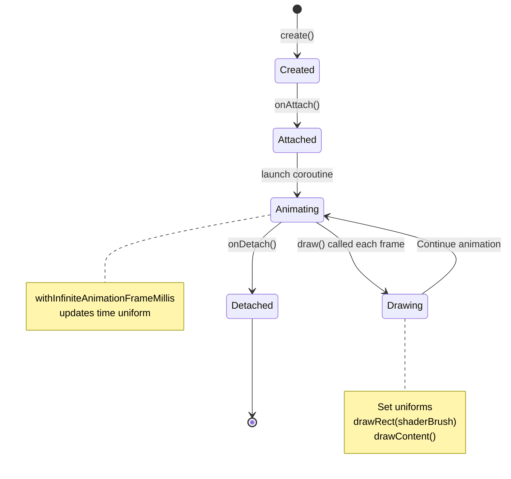

The animation coroutine runs continuously while the node is attached, updating the `time` uniform each frame. The `draw()` method sets all uniforms, renders the shader, then draws child content on top.

**Sources:** [JetLagged/app/src/main/java/com/example/jetlagged/backgrounds/StripesShaderBackground.kt:44-96](), [JetLagged/app/src/main/java/com/example/jetlagged/backgrounds/SolarFlareShaderBackground.kt:54-103]()

### Android Version Compatibility

For devices running Android 12 and below (API < 33), the shader modifiers fall back to `simpleGradient()`, which uses a basic vertical gradient:

```
Gradient colors: Yellow -> YellowVariant -> White
Direction: Vertical top to bottom
```

**Sources:** [JetLagged/app/src/main/java/com/example/jetlagged/backgrounds/StripesShaderBackground.kt:98-103](), [JetLagged/app/src/main/java/com/example/jetlagged/backgrounds/SimpleGradientBackground.kt:26-31]()

---

## Data Visualization Components

JetLagged implements several custom-drawn data visualization components demonstrating advanced Compose drawing APIs.

### Sleep Graph Visualization

The sleep graph displays sleep periods across multiple days with a custom time-based layout system:

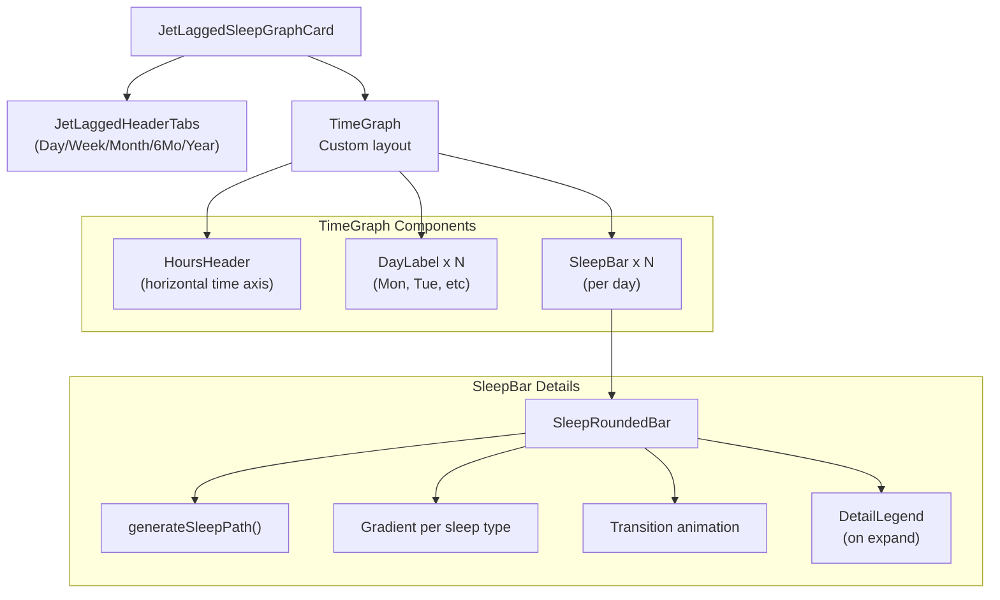

**Sources:** [JetLagged/app/src/main/java/com/example/jetlagged/sleep/JetLaggedTimeGraph.kt:50-149]()

### Sleep Data Model

The sleep visualization uses a hierarchical data model:

| Type | Properties | Purpose |
|------|-----------|---------|
| `SleepGraphData` | `sleepDayData: List<SleepDayData>`<br/>`earliestStartHour: Int`<br/>`latestEndHour: Int` | Container for all sleep data, calculates hour range |
| `SleepDayData` | `startDate: LocalDateTime`<br/>`sleepPeriods: List<SleepPeriod>`<br/>`sleepScore: Int`<br/>`sleepScoreEmoji: String` | Single day's sleep data with emoji indicator |
| `SleepPeriod` | `startTime: LocalDateTime`<br/>`endTime: LocalDateTime`<br/>`type: SleepType`<br/>`duration: Duration` | Individual sleep period segment |
| `SleepType` | Awake, REM, Light, Deep | Sleep stage enumeration |

**Sources:** [JetLagged/app/src/main/java/com/example/jetlagged/sleep/SleepData.kt:23-77]()

### Sleep Bar Drawing

Each `SleepBar` visualizes one day of sleep data as a custom-drawn rounded bar. The bar expands on click to show a detailed legend:

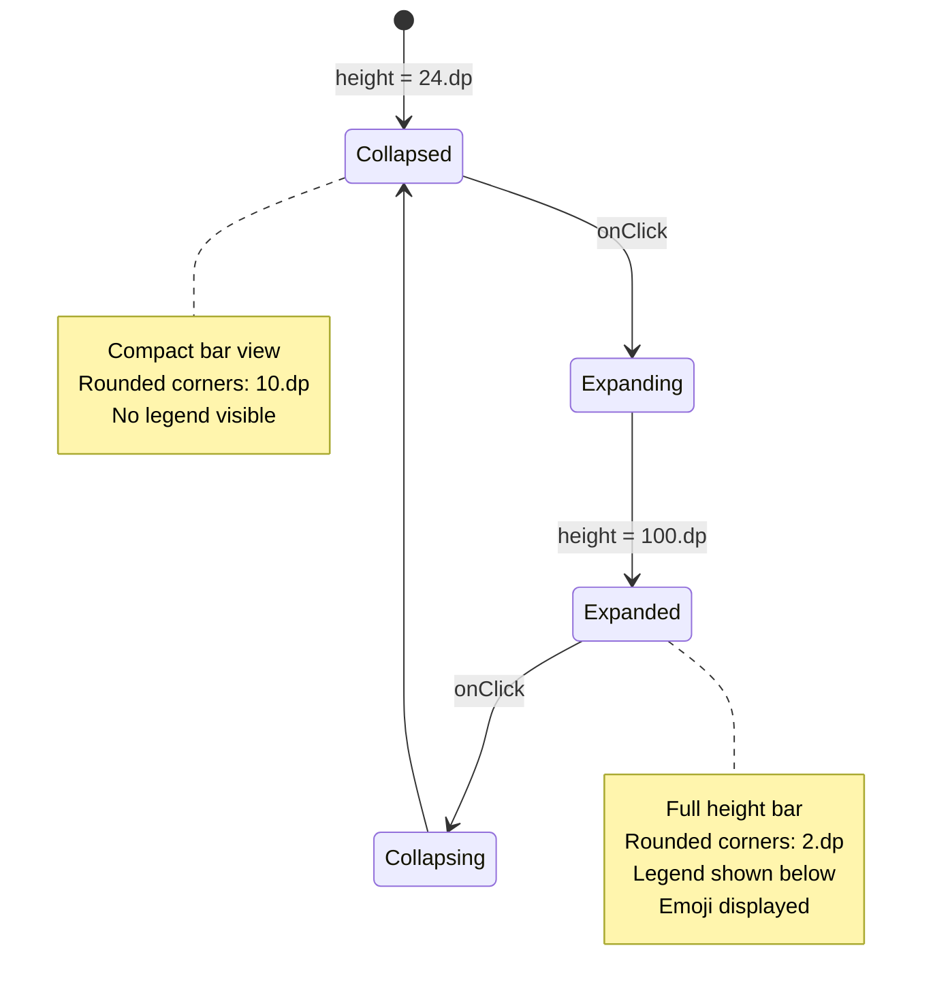

The drawing algorithm in `generateSleepPath()` creates a path that connects different sleep stages:

1. Iterate through each `SleepPeriod`
2. Calculate x-position based on time offset from sleep start
3. Calculate y-position based on sleep type (Awake=0%, REM=25%, Light=50%, Deep=75%)
4. Draw line from previous period to current period
5. Add rectangle for current period
6. Move to midpoint of current period for next connection

**Sources:** [JetLagged/app/src/main/java/com/example/jetlagged/sleep/SleepBar.kt:82-231](), [JetLagged/app/src/main/java/com/example/jetlagged/sleep/SleepBar.kt:236-291]()

### Heart Rate Graph

The heart rate graph displays continuous heart rate measurements using smooth cubic Bézier curves:

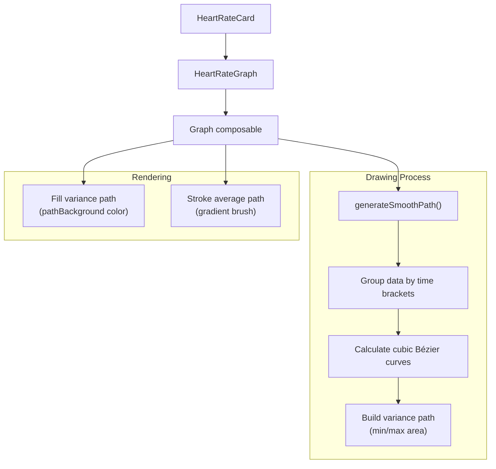

**Sources:** [JetLagged/app/src/main/java/com/example/jetlagged/heartrate/HeartRateGraph.kt:50-90]()

### Heart Rate Path Generation

The `generateSmoothPath()` function creates two paths:

1. **Average heart rate path**: Main line showing average BPM over time
2. **Variance path**: Filled area showing min-to-max BPM range

The algorithm groups measurements into 48 time brackets (30-minute intervals) and calculates:

```
DataPoint.Measurement:
  - averageMeasurementTime: Mean time of all measurements in bracket
  - minHeartRate: Minimum BPM in bracket
  - maxHeartRate: Maximum BPM in bracket  
  - averageHeartRate: Mean BPM in bracket

DataPoint.NoMeasurement: Used when no data exists for bracket
```

Cubic Bézier curves are used for smooth transitions between data points:

```
controlPoint1 = ((currentX + previousX) / 2, previousY)
controlPoint2 = ((currentX + previousX) / 2, currentY)
path.cubicTo(controlPoint1.x, controlPoint1.y, controlPoint2.x, controlPoint2.y, currentX, currentY)
```

**Sources:** [JetLagged/app/src/main/java/com/example/jetlagged/heartrate/HeartRateGraph.kt:92-202]()

---

## Home Screen Card System

The home screen displays multiple informational cards in an adaptive layout. All cards extend the `BasicInformationalCard` base component.

### Card Architecture

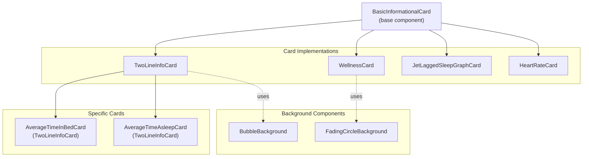

**Sources:** [JetLagged/app/src/main/java/com/example/jetlagged/HomeScreenCards.kt:69-84]()

### BasicInformationalCard

The base card component provides consistent styling across all cards:

| Property | Value |
|----------|-------|
| Shape | `RoundedCornerShape(24.dp)` |
| Background | `JetLaggedTheme.extraColors.cardBackground` |
| Border | 2.dp with color parameter |
| Padding | 8.dp |

**Sources:** [JetLagged/app/src/main/java/com/example/jetlagged/HomeScreenCards.kt:68-84]()

### TwoLineInfoCard

A reusable card displaying an icon with two lines of text. The card adapts its layout based on available width:

```
Width > 400.dp: Row layout (icon beside text)
Width ≤ 400.dp: Column layout (icon above text)
```

The card uses `BoxWithConstraints` to access the `maxWidth` constraint and choose the appropriate layout.

**Sources:** [JetLagged/app/src/main/java/com/example/jetlagged/HomeScreenCards.kt:87-163]()

### WellnessCard

The wellness card displays three circular metrics (snoring, coughing, respiration) using `FlowRow` for automatic wrapping:

```
WellnessBubble components:
  - titleText: Metric name
  - countText: Numeric value (large, 36.sp)
  - metric: Unit label (e.g., "min", "times", "rpm")
  - Background: Circular shape drawn with drawBehind { drawCircle() }
```

**Sources:** [JetLagged/app/src/main/java/com/example/jetlagged/HomeScreenCards.kt:196-261]()

### Adaptive Card Layout

The `JetLaggedScreen` uses `FlowRow` with `maxItemsInEachRow = 3` to create an adaptive card layout. Additional logic handles window size class variations:

| Window Size Class | Layout Behavior |
|------------------|-----------------|
| `Compact` | Cards flow individually in `FlowRow` |
| `Medium`/`Expanded` | Time cards and wellness/heart rate cards grouped in `FlowColumn` containers |

This creates a more organized layout on larger screens by grouping related cards vertically.

**Sources:** [JetLagged/app/src/main/java/com/example/jetlagged/JetLaggedScreen.kt:83-126]()

---

## Theme System

JetLagged extends Material 3 theming with custom colors for the various data visualization elements.

### Extended Color System

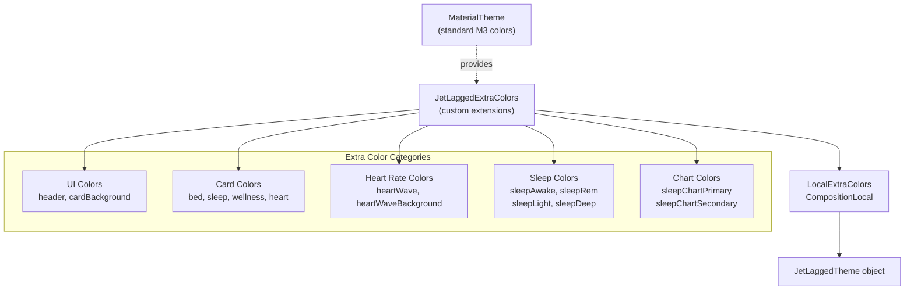

**Sources:** [JetLagged/app/src/main/java/com/example/jetlagged/ui/theme/Theme.kt:46-96]()

### Theme Color Definitions

The `JetLaggedExtraColors` data class defines all custom colors with separate light and dark theme variants:

| Color Category | Light Theme Example | Dark Theme Example |
|----------------|--------------------|--------------------|
| Header | Yellow (#FFCB66) | Red (#B40000) |
| Card Background | White | Black |
| Bed | Lilac (#CCB6DC) | DarkLilac (#715386) |
| Sleep | MintGreen (#ACD6B8) | DarkMintGreen (#537C5E) |
| Wellness | LightBlue (#BBDEFB) | DarkBlue (#56738B) |
| Heart | Coral (#F3A397) | DarkCoral (#8F554C) |

The theme also defines gradient colors for the heart rate wave: `[Pink, Purple, Green]` in light theme, `[DarkPink, DarkPurple, DarkGreen]` in dark theme.

**Sources:** [JetLagged/app/src/main/java/com/example/jetlagged/ui/theme/Theme.kt:65-96](), [JetLagged/app/src/main/java/com/example/jetlagged/ui/theme/Color.kt:21-51]()

### Theme Access Pattern

Custom colors are accessed through the `JetLaggedTheme` object:

```
JetLaggedTheme.extraColors.header
JetLaggedTheme.extraColors.sleep
JetLaggedTheme.extraColors.heartWave
```

This pattern is used consistently throughout the application to ensure theme colors are applied correctly to all components.

**Sources:** [JetLagged/app/src/main/java/com/example/jetlagged/ui/theme/Theme.kt:125-129]()

---

## UI State Management

JetLagged uses a simple ViewModel pattern to manage UI state without complex state machines or repositories.

### ViewModel Architecture

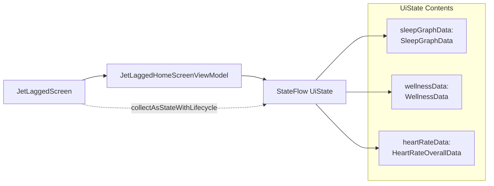

The `JetLaggedHomeScreenViewModel` exposes a single `StateFlow<UiState>` containing all data needed by the screen. The screen collects this state using `collectAsStateWithLifecycle()` for lifecycle-aware observation.

**Sources:** [JetLagged/app/src/main/java/com/example/jetlagged/JetLaggedScreen.kt:78-79]()

### Data Model Structure

The data models are simple data classes without business logic:

| Model | Properties | Purpose |
|-------|-----------|---------|
| `WellnessData` | `snoring: Int`<br/>`coughing: Int`<br/>`respiration: Int` | Wellness metrics for display |
| `HeartRateOverallData` | `averageBpm: Int`<br/>`listData: List<HeartRateData>` | Heart rate summary and time series |
| `HeartRateData` | `date: LocalTime`<br/>`amount: Int` | Single heart rate measurement |

**Sources:** [JetLagged/app/src/main/java/com/example/jetlagged/HomeScreenCards.kt:199](), [JetLagged/app/src/main/java/com/example/jetlagged/heartrate/HeartRateCard.kt:43]()

---

## Key Technical Features Summary

| Feature | Implementation | API Level |
|---------|---------------|-----------|
| Custom Navigation Drawer | Manual implementation with `Animatable`, `draggable`, `graphicsLayer` | All |
| Predictive Back Gesture | `PredictiveBackHandler` with `VelocityTracker` | API 33+ |
| RuntimeShader Backgrounds | AGSL shaders with `RuntimeShader` and `ShaderBrush` | API 33+ |
| Shader Fallback | `simpleGradient()` using basic gradients | API < 33 |
| Sleep Visualization | Custom path drawing with animated transitions | All |
| Heart Rate Graph | Cubic Bézier curves with variance area | All |
| Adaptive Layout | `WindowSizeClass` and `FlowRow`/`FlowColumn` | All |
| Extended Theming | `CompositionLocal` for custom color categories | All |
| Edge-to-Edge | `enableEdgeToEdge()` with `WindowInsets` | API 30+ |

**Sources:** [JetLagged/app/src/main/java/com/example/jetlagged/JetLaggedDrawer.kt:1-269](), [JetLagged/app/src/main/java/com/example/jetlagged/backgrounds/StripesShaderBackground.kt:1-169](), [JetLagged/app/src/main/java/com/example/jetlagged/MainActivity.kt:28-47]()

---

