<!-- source: DeepWiki mcp.deepwiki.com · repo android/compose-samples · page 4.6 Jetcaster · fetched 2026-10-23 -->

# Jetcaster

<details>
<summary>Relevant source files</summary>

The following files were used as context for generating this wiki page:

- [JetNews/README.md](JetNews/README.md)
- [Jetcaster/README.md](Jetcaster/README.md)
- [Jetcaster/core/data/src/main/java/com/example/jetcaster/core/data/repository/EpisodeStore.kt](Jetcaster/core/data/src/main/java/com/example/jetcaster/core/data/repository/EpisodeStore.kt)
- [Jetcaster/core/designsystem/src/main/java/com/example/jetcaster/designsystem/component/PodcastImage.kt](Jetcaster/core/designsystem/src/main/java/com/example/jetcaster/designsystem/component/PodcastImage.kt)
- [Jetcaster/core/designsystem/src/main/java/com/example/jetcaster/designsystem/theme/Type.kt](Jetcaster/core/designsystem/src/main/java/com/example/jetcaster/designsystem/theme/Type.kt)
- [Jetcaster/core/designsystem/src/main/java/com/example/jetcaster/designsystem/theme/Typography.kt](Jetcaster/core/designsystem/src/main/java/com/example/jetcaster/designsystem/theme/Typography.kt)
- [Jetcaster/core/designsystem/src/main/res/font/roboto_flex.ttf](Jetcaster/core/designsystem/src/main/res/font/roboto_flex.ttf)
- [Jetcaster/docs/tabletop.png](Jetcaster/docs/tabletop.png)
- [Jetcaster/mobile/src/main/java/com/example/jetcaster/ui/home/Home.kt](Jetcaster/mobile/src/main/java/com/example/jetcaster/ui/home/Home.kt)
- [Jetcaster/mobile/src/main/java/com/example/jetcaster/ui/home/HomeViewModel.kt](Jetcaster/mobile/src/main/java/com/example/jetcaster/ui/home/HomeViewModel.kt)
- [Jetcaster/mobile/src/main/java/com/example/jetcaster/ui/home/category/PodcastCategory.kt](Jetcaster/mobile/src/main/java/com/example/jetcaster/ui/home/category/PodcastCategory.kt)
- [Jetcaster/mobile/src/main/java/com/example/jetcaster/ui/home/discover/Discover.kt](Jetcaster/mobile/src/main/java/com/example/jetcaster/ui/home/discover/Discover.kt)
- [Jetcaster/mobile/src/main/java/com/example/jetcaster/ui/home/library/Library.kt](Jetcaster/mobile/src/main/java/com/example/jetcaster/ui/home/library/Library.kt)
- [Jetcaster/mobile/src/main/java/com/example/jetcaster/ui/player/PlayerScreen.kt](Jetcaster/mobile/src/main/java/com/example/jetcaster/ui/player/PlayerScreen.kt)
- [Jetcaster/mobile/src/main/java/com/example/jetcaster/ui/podcast/PodcastDetailsScreen.kt](Jetcaster/mobile/src/main/java/com/example/jetcaster/ui/podcast/PodcastDetailsScreen.kt)
- [Jetcaster/mobile/src/main/java/com/example/jetcaster/ui/podcast/PodcastDetailsViewModel.kt](Jetcaster/mobile/src/main/java/com/example/jetcaster/ui/podcast/PodcastDetailsViewModel.kt)
- [Jetcaster/mobile/src/main/java/com/example/jetcaster/ui/theme/Theme.kt](Jetcaster/mobile/src/main/java/com/example/jetcaster/ui/theme/Theme.kt)
- [Jetcaster/mobile/src/main/java/com/example/jetcaster/ui/tooling/DevicePreviews.kt](Jetcaster/mobile/src/main/java/com/example/jetcaster/ui/tooling/DevicePreviews.kt)
- [Jetchat/README.md](Jetchat/README.md)
- [Jetchat/screenshots/widget.png](Jetchat/screenshots/widget.png)
- [Jetchat/screenshots/widget_discoverability.png](Jetchat/screenshots/widget_discoverability.png)
- [Jetsnack/README.md](Jetsnack/README.md)
- [README.md](README.md)
- [readme/jetcaster-hero.png](readme/jetcaster-hero.png)

</details>


## Purpose and Scope

This document covers the Jetcaster podcast application sample, demonstrating production-ready Redux-style architecture with Jetpack Compose. Jetcaster showcases full-featured architecture across multiple form factors (mobile, TV, Wear) with sophisticated state management, adaptive layouts, and Material Expressive design elements.

For information about other sample applications and their architectural patterns, see [Sample Applications](#4). For Redux architecture implementation details specific to Jetcaster, see [Jetcaster Redux Architecture](#4.6.1). For adaptive UI patterns, see [Jetcaster Adaptive UI](#4.6.2).

**Sources:** [Jetcaster/README.md:1-158]()

## Application Overview

Jetcaster is classified as an **Advanced** sample with importance score 88.17. It demonstrates:

- Redux-style architecture with StateFlow-based state management
- Multi-platform structure (mobile, TV, Wear OS)
- Dynamic theming based on podcast artwork
- Adaptive layouts using `SupportingPaneScaffold` for dual-pane support
- Local storage with Room database
- RSS feed fetching and parsing
- WindowInsets support and foldable device adaptations
- Material Expressive components

The application does **not** actually play media; playback behavior is mocked for demonstration purposes.

**Sources:** [README.md:27-27](), [Jetcaster/README.md:5-8]()

## Multi-Platform Structure

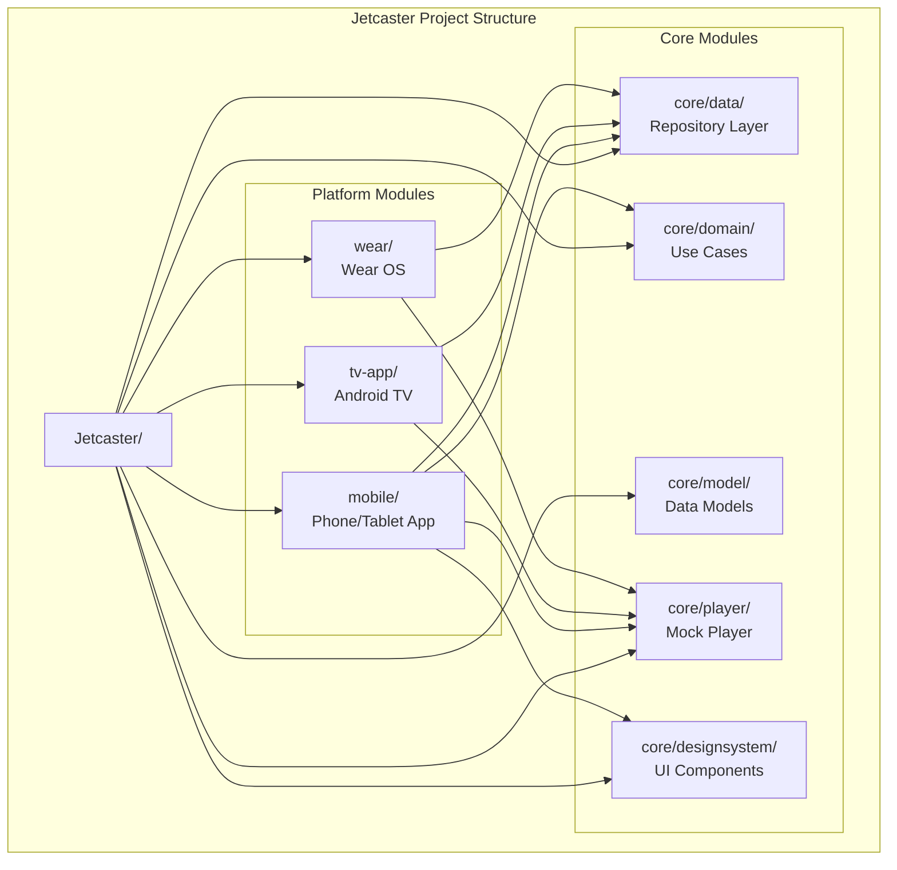

The Jetcaster project uses a modularized multi-platform architecture where platform-specific modules (mobile, TV, Wear) depend on shared core modules. The TV implementation uses Media Toolkit from Horologist, while Wear showcases a 2-screen pager with player and library views.

**Sources:** [Jetcaster/README.md:65-90](), [README.md:71-74]()

## Redux-Style Architecture

### Architecture Overview

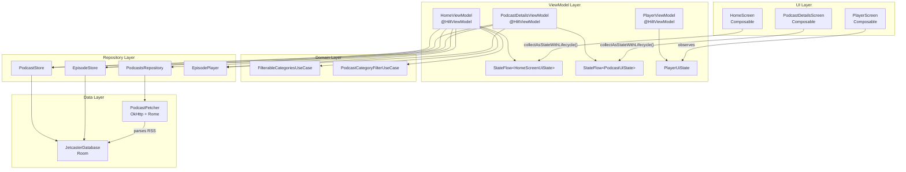

Jetcaster implements a unidirectional data flow pattern where each screen has a dedicated `ViewModel` that exposes a single `StateFlow` containing the complete view state. The UI observes this state using `collectAsStateWithLifecycle()` and sends events/actions back to the ViewModel.

**Sources:** [Jetcaster/README.md:45-64](), [Jetcaster/mobile/src/main/java/com/example/jetcaster/ui/home/HomeViewModel.kt:1-239]()

### HomeViewModel State Management

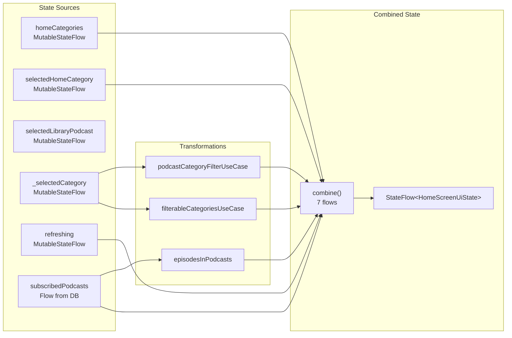

`HomeViewModel` combines seven separate flows into a single `HomeScreenUiState` using Kotlin's `combine` operator. State sources include:

- `homeCategories`: Available home categories (Library, Discover)
- `selectedHomeCategory`: Currently selected category
- `subscribedPodcasts`: Flow from `PodcastStore.followedPodcastsSortedByLastEpisode()`
- `refreshing`: Loading indicator state
- Filtered categories from `FilterableCategoriesUseCase`
- Filtered podcasts from `PodcastCategoryFilterUseCase`
- Library episodes from `EpisodeStore.episodesInPodcasts()`

**Sources:** [Jetcaster/mobile/src/main/java/com/example/jetcaster/ui/home/HomeViewModel.kt:54-147]()

### State Data Classes

```kotlin
// Immutable state container
@Immutable
data class HomeScreenUiState(
    val isLoading: Boolean = true,
    val errorMessage: String? = null,
    val featuredPodcasts: ImmutableList<PodcastInfo> = persistentListOf(),
    val selectedHomeCategory: HomeCategory = HomeCategory.Discover,
    val homeCategories: List<HomeCategory> = emptyList(),
    val filterableCategoriesModel: FilterableCategoriesModel = FilterableCategoriesModel(),
    val podcastCategoryFilterResult: PodcastCategoryFilterResult = PodcastCategoryFilterResult(),
    val library: LibraryInfo = LibraryInfo()
)
```

State is represented as `@Immutable` data classes using `ImmutableList` from kotlinx.collections.immutable for efficient recomposition. The `@Immutable` annotation indicates to Compose that the class is deeply immutable.

**Sources:** [Jetcaster/mobile/src/main/java/com/example/jetcaster/ui/home/HomeViewModel.kt:228-239]()

### Action Handling

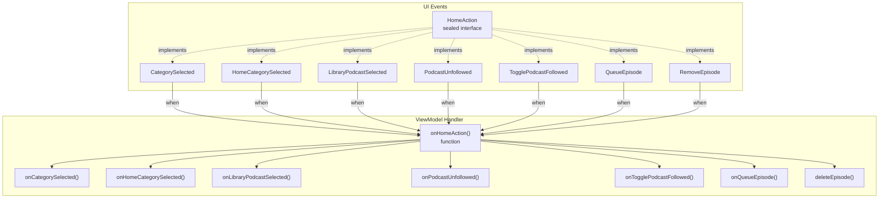

User interactions are represented as sealed interface implementations of `HomeAction`. The ViewModel exposes a single `onHomeAction()` function that dispatches to appropriate handlers using a when expression. This provides type-safe action handling with exhaustive checking.

**Sources:** [Jetcaster/mobile/src/main/java/com/example/jetcaster/ui/home/HomeViewModel.kt:161-206](), [Jetcaster/mobile/src/main/java/com/example/jetcaster/ui/home/HomeViewModel.kt:217-226]()

## UI Structure

### Main Home Screen Navigation

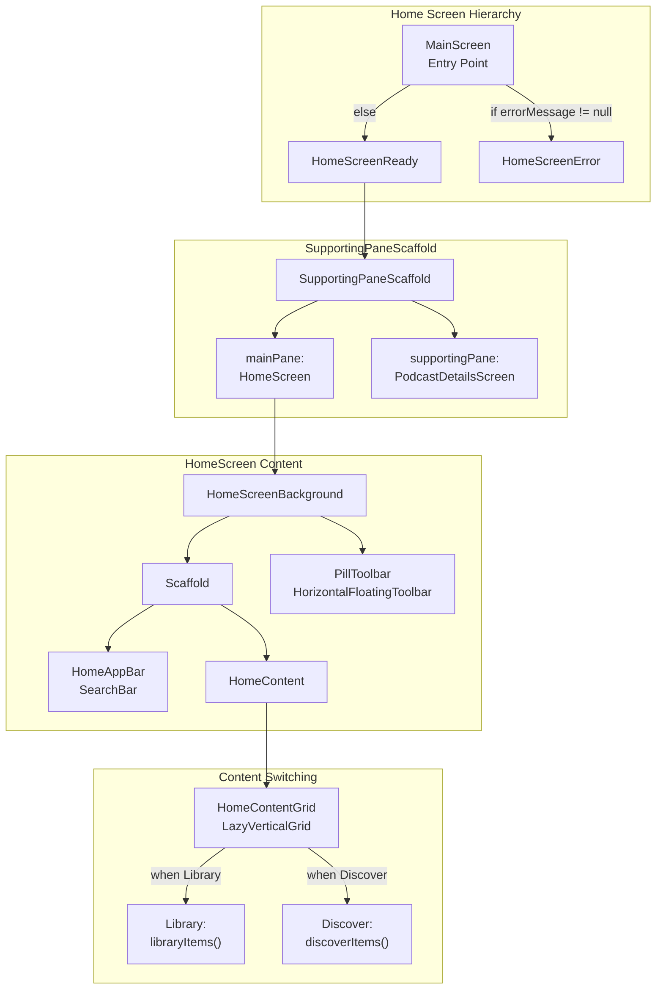

The main screen uses `SupportingPaneScaffold` for dual-pane layouts on larger screens. The main pane shows the home feed while the supporting pane displays podcast details when selected.

**Sources:** [Jetcaster/mobile/src/main/java/com/example/jetcaster/ui/home/Home.kt:195-308](), [Jetcaster/mobile/src/main/java/com/example/jetcaster/ui/home/Home.kt:373-451]()

### Home Screen Components

| Component | Purpose | Key Features |
|-----------|---------|-------------|
| `HomeAppBar` | Search and account access | Uses Material3 `SearchBar` with search icon and account button |
| `HomeScreenBackground` | Visual foundation | Applies `radialGradientScrim` with primary color at 0.15 alpha |
| `FollowedPodcasts` | Subscribed podcasts carousel | `HorizontalMultiBrowseCarousel` with 205dp item width |
| `PillToolbar` | Category navigation | `HorizontalFloatingToolbar` with Library/Discover toggle buttons |
| `HomeContentGrid` | Main content area | `LazyVerticalGrid` with `GridCells.Adaptive(362.dp)` |

**Sources:** [Jetcaster/mobile/src/main/java/com/example/jetcaster/ui/home/Home.kt:310-355](), [Jetcaster/mobile/src/main/java/com/example/jetcaster/ui/home/Home.kt:453-537](), [Jetcaster/mobile/src/main/java/com/example/jetcaster/ui/home/Home.kt:652-690]()

### Player Screen Layout

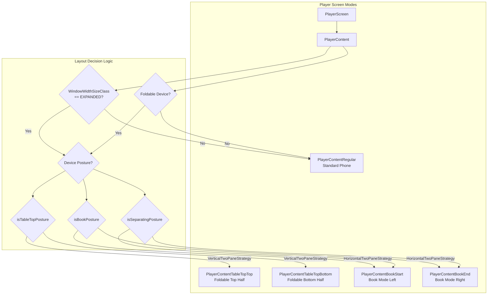

The player screen adapts to device configuration using `WindowSizeClass` and `FoldingFeature` detection. It provides specialized layouts for:

- **Regular**: Standard single-pane layout for phones
- **Tabletop**: Split vertical layout for table-top posture (fold horizontal)
- **Book**: Split horizontal layout for book posture or separating folds (fold vertical)

**Sources:** [Jetcaster/mobile/src/main/java/com/example/jetcaster/ui/player/PlayerScreen.kt:244-334]()

### Player UI Components

The player screen contains several reusable components:

- `PlayerImage`: Podcast artwork display with shared element transition support
- `PodcastDescription`: Episode title and podcast name
- `PlayerSlider`: Playback position control with time display
- `PlayerButtons`: Play/pause, skip, rewind controls using Material3 Expressive components
- `TopAppBar`: Back button and queue management

The regular player layout follows this structure:

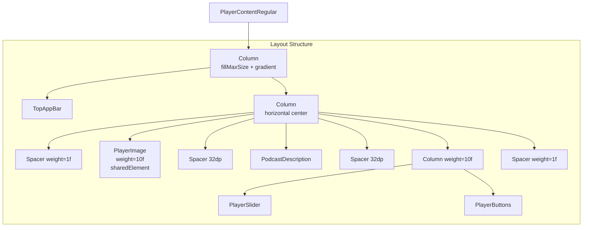

**Sources:** [Jetcaster/mobile/src/main/java/com/example/jetcaster/ui/player/PlayerScreen.kt:336-424](), [Jetcaster/mobile/src/main/java/com/example/jetcaster/ui/player/PlayerScreen.kt:600-705]()

## Data Layer Architecture

### Data Flow

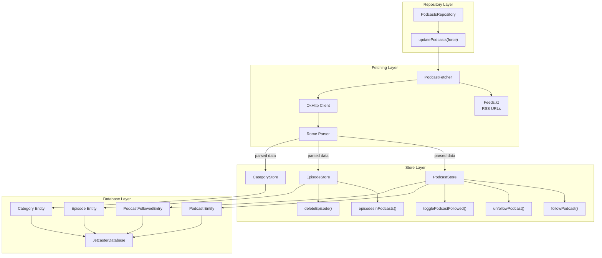

The data layer implements a three-tier architecture:

1. **Repository Layer**: `PodcastsRepository` orchestrates data fetching
2. **Store Layer**: Domain-specific stores (`PodcastStore`, `EpisodeStore`, `CategoryStore`) manage CRUD operations
3. **Database Layer**: Room database with DAOs for persistence

**Sources:** [Jetcaster/README.md:96-113]()

### RSS Feed Processing

Podcast data is dynamically fetched from RSS feeds defined in `Feeds.kt`. The fetching process:

1. `PodcastFetcher` uses OkHttp to download RSS feeds
2. Rome library parses XML into structured data
3. Parsed entities are stored in Room via Store classes

The stores expose Flow-based APIs for reactive data access, enabling ViewModels to observe database changes automatically.

**Sources:** [Jetcaster/README.md:99-104]()

### Follow/Unfollow Pattern

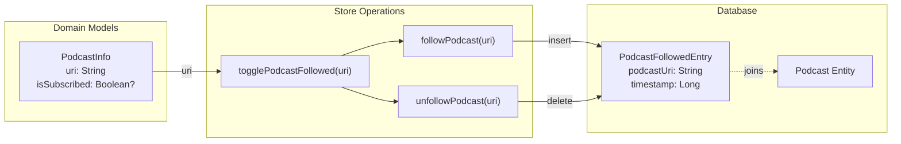

The follow/unfollow feature uses a separate `PodcastFollowedEntry` entity that maintains a many-to-many relationship with podcasts. This pattern allows tracking follow timestamps and provides flexibility for future features like follow history.

**Sources:** [Jetcaster/README.md:106-108]()

## Adaptive Layout System

### Supporting Pane Scaffold

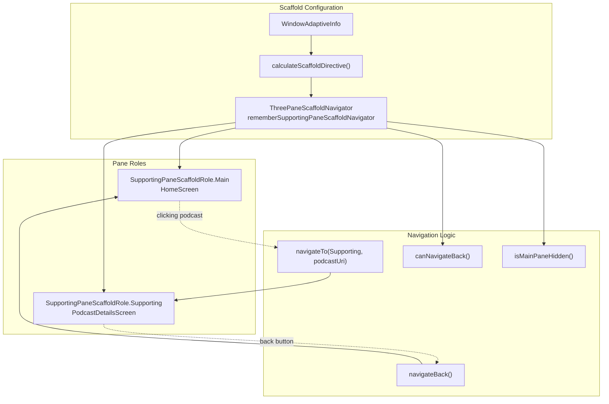

Jetcaster uses `SupportingPaneScaffold` for adaptive two-pane layouts. The scaffold automatically determines whether to show one or two panes based on available space. Navigation is managed by `ThreePaneScaffoldNavigator` with type-safe content keys.

**Sources:** [Jetcaster/mobile/src/main/java/com/example/jetcaster/ui/home/Home.kt:239-308]()

### Custom Scaffold Directive Calculation

The custom `calculateScaffoldDirective()` function modifies the standard Material3 adaptive behavior:

```kotlin
fun calculateScaffoldDirective(
    windowAdaptiveInfo: WindowAdaptiveInfo,
    verticalHingePolicy: HingePolicy = HingePolicy.AvoidSeparating,
): PaneScaffoldDirective {
    val maxHorizontalPartitions: Int
    val verticalSpacerSize: Dp
    if (windowAdaptiveInfo.windowSizeClass.isCompact) {
        // Window width OR height is compact. Limit to 1 pane horizontally.
        maxHorizontalPartitions = 1
        verticalSpacerSize = 0.dp
    } else {
        when (windowAdaptiveInfo.windowSizeClass.windowWidthSizeClass) {
            WindowWidthSizeClass.COMPACT -> {
                maxHorizontalPartitions = 1
                verticalSpacerSize = 0.dp
            }
            WindowWidthSizeClass.MEDIUM -> {
                maxHorizontalPartitions = 1
                verticalSpacerSize = 0.dp
            }
            else -> {
                maxHorizontalPartitions = 2
                verticalSpacerSize = 24.dp
            }
        }
    }
    // ... tabletop handling
}
```

Key modification: The function checks both width **and** height compact status via a custom `isCompact` extension, ensuring proper single-pane display even on tablets in portrait split-screen mode.

**Sources:** [Jetcaster/mobile/src/main/java/com/example/jetcaster/ui/home/Home.kt:133-182]()

### Foldable Device Support

The player screen implements sophisticated foldable device detection:

| Posture Type | Detection Function | Layout Strategy | Visual Split |
|--------------|-------------------|-----------------|-------------|
| Tabletop | `isTableTopPosture()` | `VerticalTwoPaneStrategy` | Horizontal fold, content above/below |
| Book | `isBookPosture()` | `HorizontalTwoPaneStrategy` | Vertical fold, content left/right |
| Separating | `isSeparatingPosture()` | `HorizontalTwoPaneStrategy` | Any separating fold |

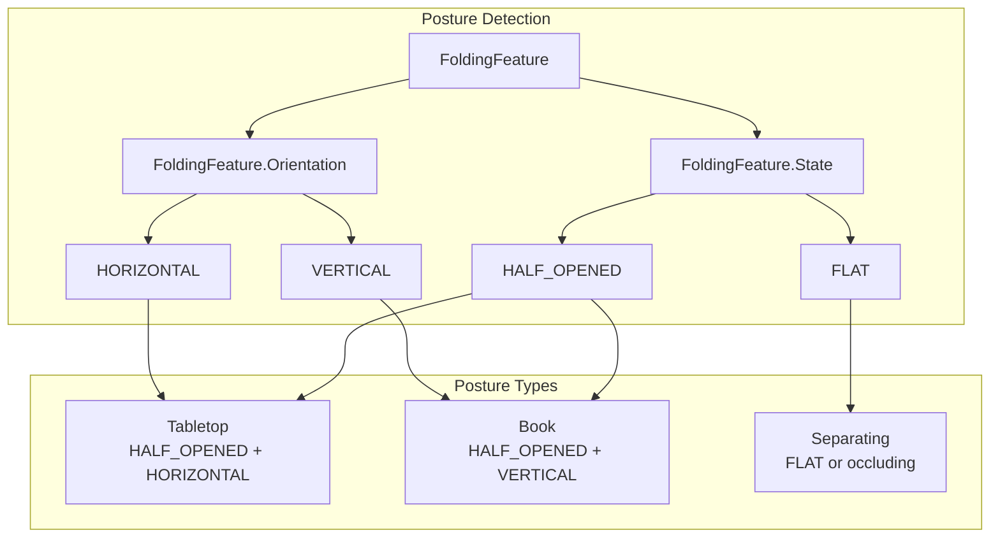

**Sources:** [Jetcaster/mobile/src/main/java/com/example/jetcaster/ui/player/PlayerScreen.kt:254-274]()

## Theming and Design System

### Material Expressive Theme

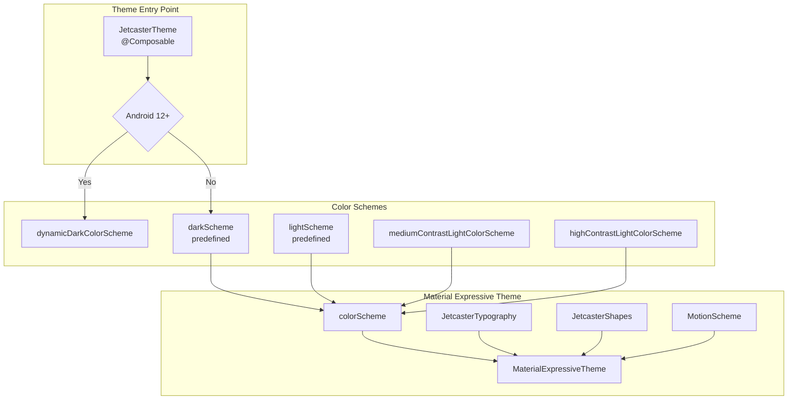

Jetcaster uses `MaterialExpressiveTheme` (experimental) which extends Material3 with enhanced motion and expressive components. The theme supports:

- Dynamic color schemes on Android 12+ via `dynamicDarkColorScheme()`
- Custom dark theme as default (recommended for media apps)
- Contrast variants (medium, high) for accessibility
- Custom typography using Montserrat and RobotoFlex fonts
- Expressive motion scheme

**Sources:** [Jetcaster/mobile/src/main/java/com/example/jetcaster/ui/theme/Theme.kt:1-440](), [Jetcaster/README.md:8-8]()

### Typography System

| Style | Font Family | Size | Weight | Usage |
|-------|-------------|------|--------|-------|
| `displayLarge` | RobotoFlex | 64sp | 738 | Hero text |
| `displayMedium` | RobotoFlex | 45sp | 400 | Large titles |
| `headlineMedium` | Montserrat | 28sp | 500 | Section headers |
| `bodyLarge` | Montserrat | 16sp | 500 | Primary body text |
| `bodyMedium` | Montserrat | 14sp | 500 | Secondary text |

The typography system uses two font families:
- **RobotoFlex**: Variable font for display text with weight 738 for emphasis
- **Montserrat**: Clean sans-serif for headlines and body text

**Sources:** [Jetcaster/core/designsystem/src/main/java/com/example/jetcaster/designsystem/theme/Typography.kt:1-34](), [Jetcaster/core/designsystem/src/main/java/com/example/jetcaster/designsystem/theme/Type.kt:1-125]()

### Expressive Components

Jetcaster showcases Material3 Expressive components including:

**HorizontalFloatingToolbar** - Pill-shaped bottom toolbar
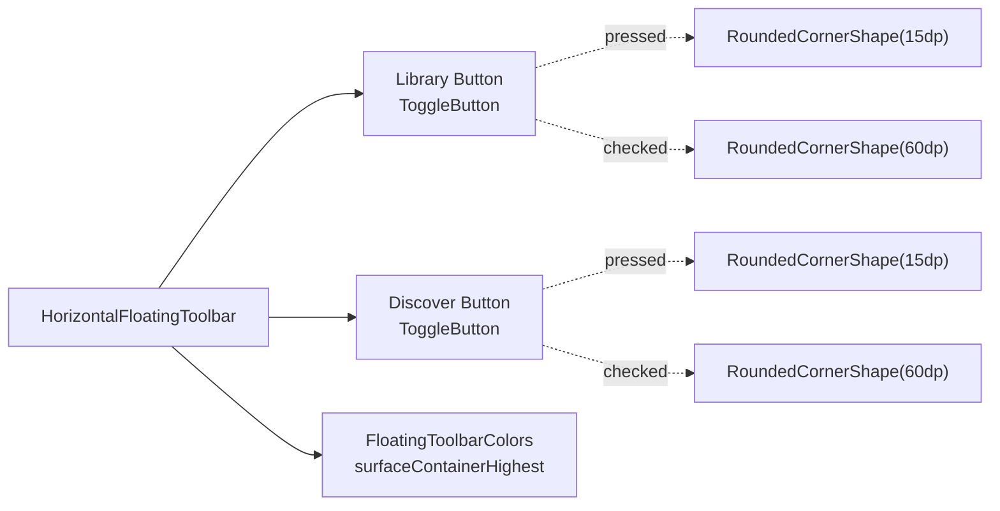

**ButtonGroup** - Grouped action buttons with animation
- Custom interaction sources for width animation
- Expressive shape transitions on press/check
- Used in player controls and podcast details

**ToggleButton** - Enhanced toggle with shape morphing
- Animates between shapes (15dp → 60dp corners) on state change
- Custom colors for container and content

**Sources:** [Jetcaster/mobile/src/main/java/com/example/jetcaster/ui/home/Home.kt:453-537](), [Jetcaster/mobile/src/main/java/com/example/jetcaster/ui/player/PlayerScreen.kt:708-818](), [Jetcaster/mobile/src/main/java/com/example/jetcaster/ui/podcast/PodcastDetailsScreen.kt:285-365]()

## Image Loading and Caching

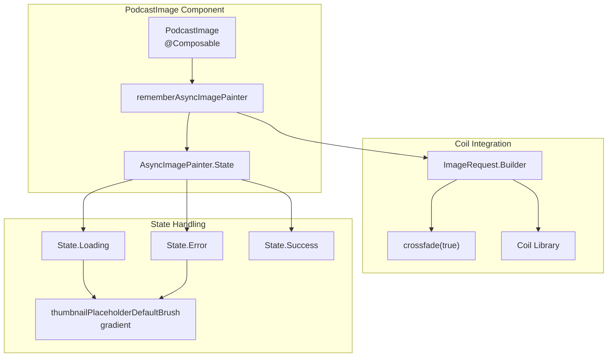

The `PodcastImage` composable uses Coil for efficient image loading with:
- Automatic crossfade transitions
- Gradient placeholder during loading/error states
- Content scale customization
- Inspection mode support (shows solid color in previews)

**Sources:** [Jetcaster/core/designsystem/src/main/java/com/example/jetcaster/designsystem/component/PodcastImage.kt:1-95](), [Jetcaster/README.md:43-43]()

## Build Configuration

Jetcaster uses specialized build configuration distinguishing it from other samples:

| Configuration | Value | Comparison to Other Samples |
|--------------|-------|---------------------------|
| Gradle Version | 8.14.2 | Most samples use 8.13 |
| Compose BOM | 2025.09.00-alpha | Others use 2025.10.00 stable |
| Kotlin | 2.1.21 | JetNews uses 2.2.20 |
| AGP | 8.10.1 | Others use 8.13.0 |
| Hilt | Yes | Unique to Jetcaster |
| KSP | Yes | For Hilt annotation processing |

**Jetcaster is excluded from `updateDeps.sh` automated dependency updates** due to its use of alpha-stage libraries, allowing it to serve as an early adopter testing ground for new Compose APIs.

**Sources:** Diagram 2 in high-level system architecture diagrams

### Dependency Injection

Jetcaster is the only sample using Hilt for dependency injection:

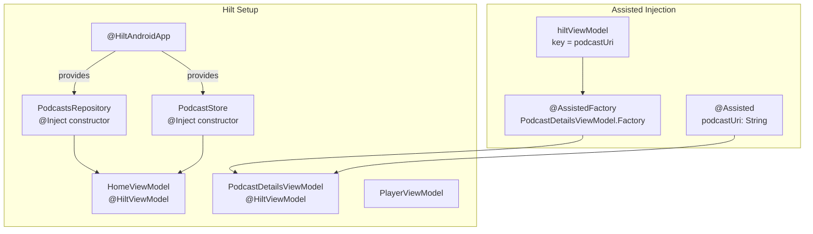

`PodcastDetailsViewModel` uses Hilt's assisted injection pattern to accept a `podcastUri` parameter while still benefiting from dependency injection for other constructor parameters.

**Sources:** [Jetcaster/mobile/src/main/java/com/example/jetcaster/ui/home/HomeViewModel.kt:39-62](), [Jetcaster/mobile/src/main/java/com/example/jetcaster/ui/podcast/PodcastDetailsViewModel.kt:50-96]()

## Testing Approach

Unlike samples like JetNews with extensive UI tests, Jetcaster does not include test files in the provided sources. The sample focuses on demonstrating production architecture patterns rather than testing infrastructure. For testing patterns, refer to [Testing Infrastructure](#6).

**Sources:** No test files present in provided sources

---

This documentation covers the Jetcaster application's architecture, UI implementation, state management, data layer, adaptive layouts, theming, and build configuration. For comparison with other architectural approaches, see [Shared Architecture Patterns](#5).

---

