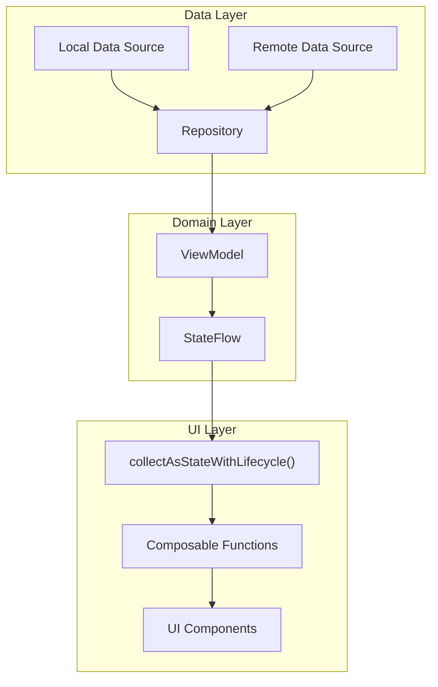
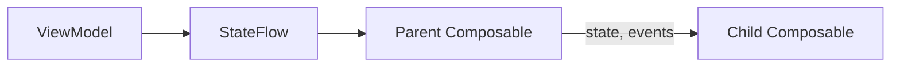
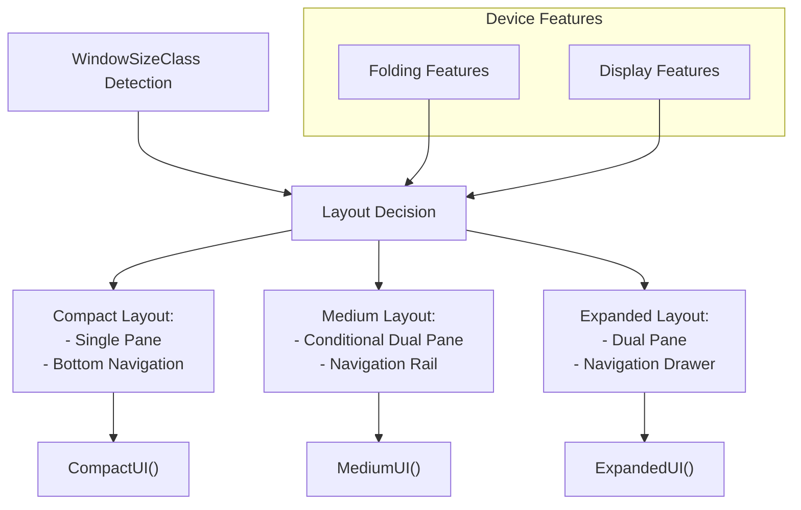
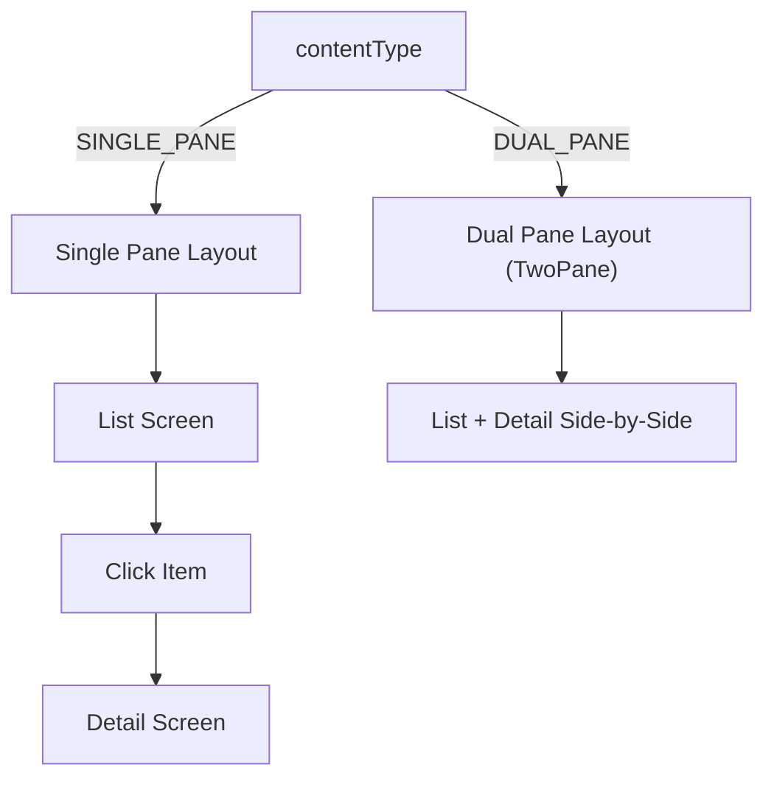
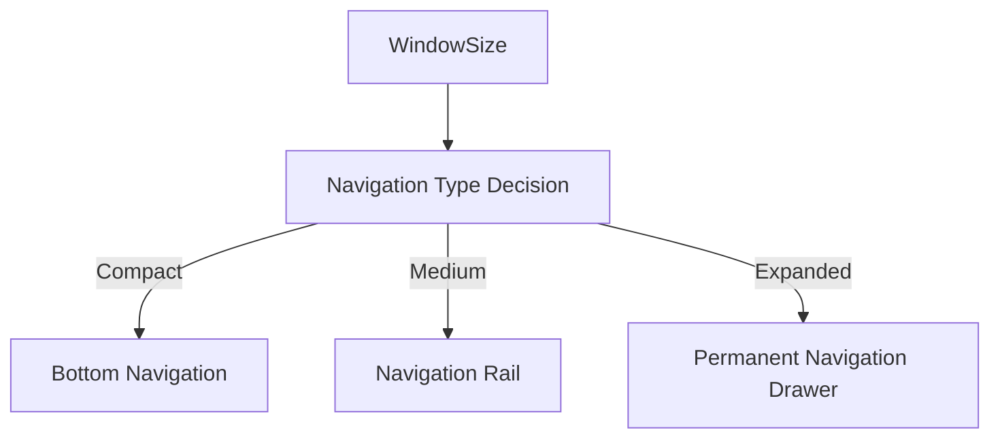
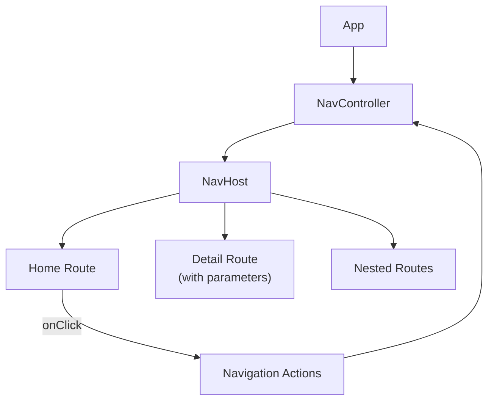
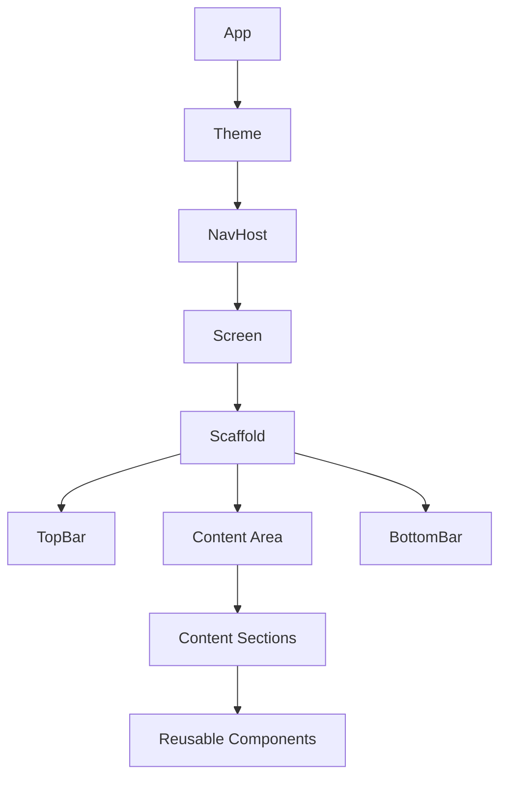
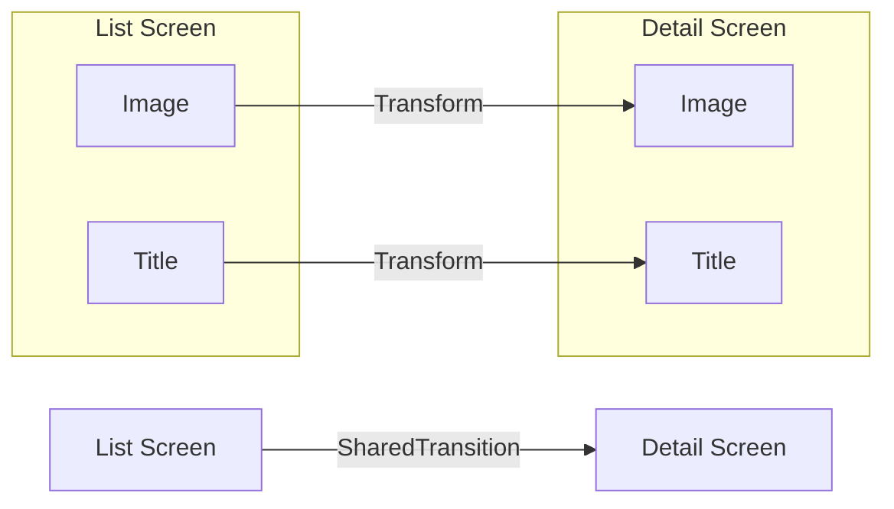
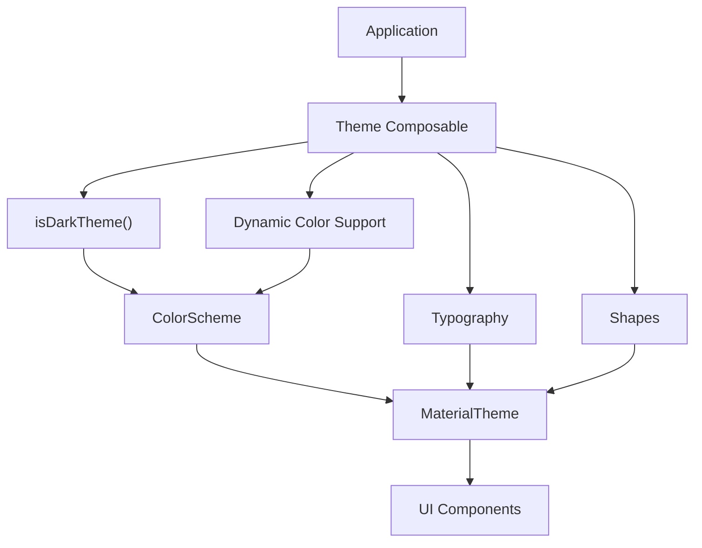
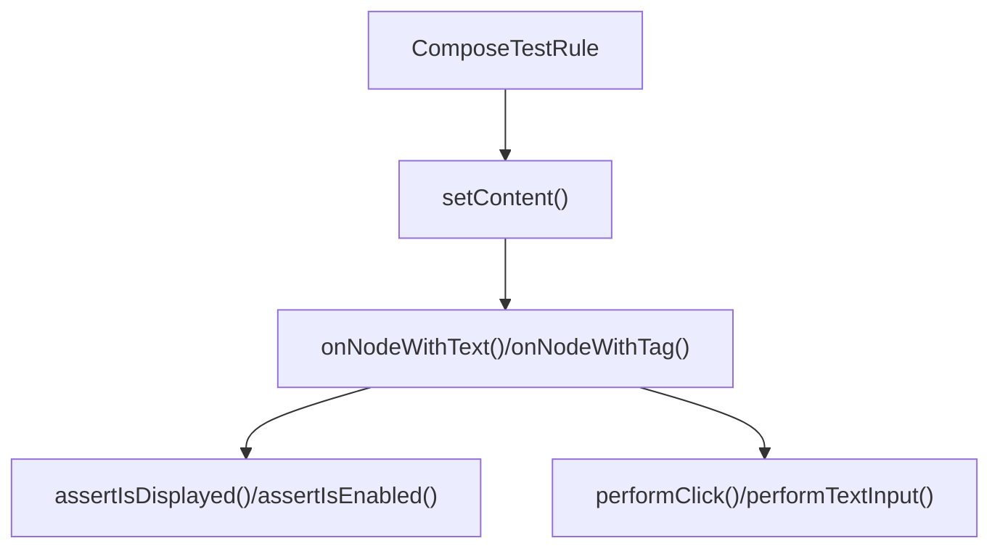

<!-- source: DeepWiki mcp.deepwiki.com · repo android/compose-samples · page 5 Shared Architecture Patterns · fetched 2026-10-23 -->

# Shared Architecture Patterns

<details>
<summary>Relevant source files</summary>

The following files were used as context for generating this wiki page:

- [JetNews/app/src/main/java/com/example/jetnews/ui/JetnewsApp.kt](JetNews/app/src/main/java/com/example/jetnews/ui/JetnewsApp.kt)
- [JetNews/app/src/main/java/com/example/jetnews/ui/article/ArticleScreen.kt](JetNews/app/src/main/java/com/example/jetnews/ui/article/ArticleScreen.kt)
- [JetNews/app/src/main/java/com/example/jetnews/ui/article/PostContent.kt](JetNews/app/src/main/java/com/example/jetnews/ui/article/PostContent.kt)
- [JetNews/app/src/main/java/com/example/jetnews/ui/home/PostCardTop.kt](JetNews/app/src/main/java/com/example/jetnews/ui/home/PostCardTop.kt)
- [JetNews/app/src/main/java/com/example/jetnews/ui/home/PostCardYourNetwork.kt](JetNews/app/src/main/java/com/example/jetnews/ui/home/PostCardYourNetwork.kt)
- [JetNews/app/src/main/java/com/example/jetnews/ui/home/PostCards.kt](JetNews/app/src/main/java/com/example/jetnews/ui/home/PostCards.kt)
- [JetNews/app/src/main/java/com/example/jetnews/ui/interests/InterestsScreen.kt](JetNews/app/src/main/java/com/example/jetnews/ui/interests/InterestsScreen.kt)
- [JetNews/app/src/main/java/com/example/jetnews/ui/interests/SelectTopicButton.kt](JetNews/app/src/main/java/com/example/jetnews/ui/interests/SelectTopicButton.kt)
- [JetNews/app/src/main/res/values/strings.xml](JetNews/app/src/main/res/values/strings.xml)
- [Jetcaster/core/data/src/main/java/com/example/jetcaster/core/data/repository/EpisodeStore.kt](Jetcaster/core/data/src/main/java/com/example/jetcaster/core/data/repository/EpisodeStore.kt)
- [Jetcaster/core/designsystem/src/main/java/com/example/jetcaster/designsystem/component/PodcastImage.kt](Jetcaster/core/designsystem/src/main/java/com/example/jetcaster/designsystem/component/PodcastImage.kt)
- [Jetcaster/core/designsystem/src/main/java/com/example/jetcaster/designsystem/theme/Type.kt](Jetcaster/core/designsystem/src/main/java/com/example/jetcaster/designsystem/theme/Type.kt)
- [Jetcaster/core/designsystem/src/main/java/com/example/jetcaster/designsystem/theme/Typography.kt](Jetcaster/core/designsystem/src/main/java/com/example/jetcaster/designsystem/theme/Typography.kt)
- [Jetcaster/core/designsystem/src/main/res/font/roboto_flex.ttf](Jetcaster/core/designsystem/src/main/res/font/roboto_flex.ttf)
- [Jetcaster/mobile/src/main/java/com/example/jetcaster/ui/home/Home.kt](Jetcaster/mobile/src/main/java/com/example/jetcaster/ui/home/Home.kt)
- [Jetcaster/mobile/src/main/java/com/example/jetcaster/ui/home/HomeViewModel.kt](Jetcaster/mobile/src/main/java/com/example/jetcaster/ui/home/HomeViewModel.kt)
- [Jetcaster/mobile/src/main/java/com/example/jetcaster/ui/home/category/PodcastCategory.kt](Jetcaster/mobile/src/main/java/com/example/jetcaster/ui/home/category/PodcastCategory.kt)
- [Jetcaster/mobile/src/main/java/com/example/jetcaster/ui/home/discover/Discover.kt](Jetcaster/mobile/src/main/java/com/example/jetcaster/ui/home/discover/Discover.kt)
- [Jetcaster/mobile/src/main/java/com/example/jetcaster/ui/home/library/Library.kt](Jetcaster/mobile/src/main/java/com/example/jetcaster/ui/home/library/Library.kt)
- [Jetcaster/mobile/src/main/java/com/example/jetcaster/ui/player/PlayerScreen.kt](Jetcaster/mobile/src/main/java/com/example/jetcaster/ui/player/PlayerScreen.kt)
- [Jetcaster/mobile/src/main/java/com/example/jetcaster/ui/podcast/PodcastDetailsScreen.kt](Jetcaster/mobile/src/main/java/com/example/jetcaster/ui/podcast/PodcastDetailsScreen.kt)
- [Jetcaster/mobile/src/main/java/com/example/jetcaster/ui/podcast/PodcastDetailsViewModel.kt](Jetcaster/mobile/src/main/java/com/example/jetcaster/ui/podcast/PodcastDetailsViewModel.kt)
- [Jetcaster/mobile/src/main/java/com/example/jetcaster/ui/theme/Theme.kt](Jetcaster/mobile/src/main/java/com/example/jetcaster/ui/theme/Theme.kt)
- [Jetcaster/mobile/src/main/java/com/example/jetcaster/ui/tooling/DevicePreviews.kt](Jetcaster/mobile/src/main/java/com/example/jetcaster/ui/tooling/DevicePreviews.kt)
- [Reply/app/src/main/AndroidManifest.xml](Reply/app/src/main/AndroidManifest.xml)
- [Reply/app/src/main/java/com/example/reply/ui/EmptyComingSoon.kt](Reply/app/src/main/java/com/example/reply/ui/EmptyComingSoon.kt)
- [Reply/app/src/main/java/com/example/reply/ui/MainActivity.kt](Reply/app/src/main/java/com/example/reply/ui/MainActivity.kt)
- [Reply/app/src/main/java/com/example/reply/ui/ReplyApp.kt](Reply/app/src/main/java/com/example/reply/ui/ReplyApp.kt)
- [Reply/app/src/main/java/com/example/reply/ui/ReplyHomeViewModel.kt](Reply/app/src/main/java/com/example/reply/ui/ReplyHomeViewModel.kt)
- [Reply/app/src/main/java/com/example/reply/ui/ReplyListContent.kt](Reply/app/src/main/java/com/example/reply/ui/ReplyListContent.kt)
- [Reply/app/src/main/java/com/example/reply/ui/components/ReplyAppBars.kt](Reply/app/src/main/java/com/example/reply/ui/components/ReplyAppBars.kt)
- [Reply/app/src/main/java/com/example/reply/ui/components/ReplyEmailListItem.kt](Reply/app/src/main/java/com/example/reply/ui/components/ReplyEmailListItem.kt)
- [Reply/app/src/main/java/com/example/reply/ui/components/ReplyEmailThreadItem.kt](Reply/app/src/main/java/com/example/reply/ui/components/ReplyEmailThreadItem.kt)
- [Reply/app/src/main/java/com/example/reply/ui/components/ReplyProfileImage.kt](Reply/app/src/main/java/com/example/reply/ui/components/ReplyProfileImage.kt)
- [Reply/app/src/main/java/com/example/reply/ui/navigation/ReplyNavigationActions.kt](Reply/app/src/main/java/com/example/reply/ui/navigation/ReplyNavigationActions.kt)
- [Reply/app/src/main/java/com/example/reply/ui/navigation/ReplyNavigationComponents.kt](Reply/app/src/main/java/com/example/reply/ui/navigation/ReplyNavigationComponents.kt)
- [Reply/app/src/main/java/com/example/reply/ui/theme/Color.kt](Reply/app/src/main/java/com/example/reply/ui/theme/Color.kt)
- [Reply/app/src/main/java/com/example/reply/ui/theme/Theme.kt](Reply/app/src/main/java/com/example/reply/ui/theme/Theme.kt)
- [Reply/app/src/main/java/com/example/reply/ui/theme/Type.kt](Reply/app/src/main/java/com/example/reply/ui/theme/Type.kt)
- [Reply/app/src/main/java/com/example/reply/ui/utils/WindowStateUtils.kt](Reply/app/src/main/java/com/example/reply/ui/utils/WindowStateUtils.kt)
- [Reply/app/src/main/res/values/strings.xml](Reply/app/src/main/res/values/strings.xml)

</details>


This page documents the common architectural patterns and design approaches used across the Android Compose sample applications. Understanding these shared patterns helps developers learn consistent approaches to building Compose-based applications and provides a foundation for exploring the individual sample applications in the repository.

For information about specific sample applications, see [Sample Applications](#4).

## UI State Management

All sample applications in the repository follow consistent patterns for managing UI state, which helps create maintainable and testable code.

### MVVM Architecture with StateFlow

The core UI state management approach uses the MVVM (Model-View-ViewModel) pattern combined with Kotlin Flows:



The ViewModels expose UI state via `StateFlow` or `LiveData`, and composable functions collect this state using `collectAsStateWithLifecycle()`. This pattern is consistent across all samples.

Sources: [JetNews/app/src/main/java/com/example/jetnews/ui/interests/InterestsScreen.kt:179-214](JetNews/app/src/main/java/com/example/jetnews/ui/interests/InterestsScreen.kt:179-214), [Reply/app/src/main/java/com/example/reply/ui/ReplyApp.kt:49-62](Reply/app/src/main/java/com/example/reply/ui/ReplyApp.kt:49-62), [Jetsnack/app/src/main/java/com/example/jetsnack/ui/home/cart/Cart.kt:92-109](Jetsnack/app/src/main/java/com/example/jetsnack/ui/home/cart/Cart.kt:92-109)

### State Hoisting Pattern

The samples consistently use state hoisting, separating state management from UI rendering, which improves testability and reusability:

```kotlin
// Pattern used across all composables:
@Composable
fun SomeScreen(
    uiState: UiState,               // State passed in, not managed internally
    onSomeAction: () -> Unit,       // Events passed up, not handled internally
    modifier: Modifier = Modifier
) {
    // UI rendering based on provided state
}
```

For example, in JetNews's `ArticleScreen.kt`, state is passed in rather than managed internally:



Sources: [JetNews/app/src/main/java/com/example/jetnews/ui/article/ArticleScreen.kt:81-92](JetNews/app/src/main/java/com/example/jetnews/ui/article/ArticleScreen.kt:81-92), [Jetsnack/app/src/main/java/com/example/jetsnack/ui/snackdetail/SnackDetail.kt:146-154](Jetsnack/app/src/main/java/com/example/jetsnack/ui/snackdetail/SnackDetail.kt:146-154)

## Adaptive UI and Responsive Design

The samples implement various approaches to handle different screen sizes and device configurations:

### Window Size-Based Adaptation



The samples detect screen size and device features to determine the appropriate UI:

```kotlin
// Pattern from Reply app
val contentType = when (windowSize.widthSizeClass) {
    WindowWidthSizeClass.Compact -> ReplyContentType.SINGLE_PANE
    WindowWidthSizeClass.Medium -> if (foldingDevicePosture != DevicePosture.NormalPosture) {
        ReplyContentType.DUAL_PANE
    } else {
        ReplyContentType.SINGLE_PANE
    }
    WindowWidthSizeClass.Expanded -> ReplyContentType.DUAL_PANE
    else -> ReplyContentType.SINGLE_PANE
}
```

Sources: [Reply/app/src/main/java/com/example/reply/ui/ReplyApp.kt:76-85](Reply/app/src/main/java/com/example/reply/ui/ReplyApp.kt:76-85), [JetNews/app/src/main/java/com/example/jetnews/ui/JetnewsApp.kt:53-55](JetNews/app/src/main/java/com/example/jetnews/ui/JetnewsApp.kt:53-55)

### Content Adaptation Strategies

#### Single-Pane vs. Dual-Pane



The Reply app demonstrates this adaptation clearly:

```kotlin
if (contentType == ReplyContentType.DUAL_PANE) {
    TwoPane(
        first = { ReplyEmailList(...) },
        second = { ReplyEmailDetail(...) },
        strategy = HorizontalTwoPaneStrategy(splitFraction = 0.5f, gapWidth = 16.dp),
        displayFeatures = displayFeatures
    )
} else {
    Box(modifier = modifier.fillMaxSize()) {
        ReplySinglePaneContent(...)
    }
}
```

#### Navigation Style Adaptation



Sources: [Reply/app/src/main/java/com/example/reply/ui/ReplyListContent.kt:60-130](Reply/app/src/main/java/com/example/reply/ui/ReplyListContent.kt:60-130), [Reply/app/src/main/java/com/example/reply/ui/navigation/ReplyNavigationComponents.kt:101-116](Reply/app/src/main/java/com/example/reply/ui/navigation/ReplyNavigationComponents.kt:101-116)

### Custom Adaptive Layouts

Some samples implement custom layout logic for complex adaptation scenarios:

```kotlin
// InterestsAdaptiveContentLayout from JetNews
Layout(modifier = modifier, content = content) { measurables, outerConstraints ->
    // Determine columns based on available width
    val columns = if (outerConstraints.maxWidth < multipleColumnsBreakPointPx) 1 else 2
    
    // Calculate item width based on columns
    val itemWidth = if (columns == 1) {
        outerConstraints.maxWidth
    } else {
        val maxWidthWithSpaces = outerConstraints.maxWidth - (columns - 1) * itemSpacingPx
        (maxWidthWithSpaces / columns).coerceIn(0, itemMaxWidthPx)
    }
    
    // Implement custom layout logic...
}
```

Sources: [JetNews/app/src/main/java/com/example/jetnews/ui/interests/InterestsScreen.kt:435-498](JetNews/app/src/main/java/com/example/jetnews/ui/interests/InterestsScreen.kt:435-498)

## Navigation Patterns

The samples implement consistent navigation approaches:

### NavHost + Route-Based Navigation



The navigation setup follows this pattern:

```kotlin
NavHost(
    navController = navController,
    startDestination = startDestination
) {
    composable(route = "route1") { backStackEntry ->
        // Screen 1
    }
    composable(
        route = "route2/{paramId}",
        arguments = listOf(navArgument("paramId") { type = NavType.StringType })
    ) { backStackEntry ->
        // Screen 2
    }
}
```

Sources: [Jetsnack/app/src/main/java/com/example/jetsnack/ui/JetsnackApp.kt:69-101](Jetsnack/app/src/main/java/com/example/jetsnack/ui/JetsnackApp.kt:69-101), [JetNews/app/src/main/java/com/example/jetnews/ui/JetnewsApp.kt:77-85](JetNews/app/src/main/java/com/example/jetnews/ui/JetnewsApp.kt:77-85)

### Navigation Actions Pattern

Navigation actions are abstracted into dedicated classes or functions:

```kotlin
// Pattern used in multiple samples
class NavigationActions(private val navController: NavController) {
    fun navigateToDestination(route: String) {
        navController.navigate(route) {
            // Navigation options...
            popUpTo(navController.graph.findStartDestination().id) {
                saveState = true
            }
            launchSingleTop = true
            restoreState = true
        }
    }
}
```

This abstraction simplifies navigation logic and keeps UI components focused on rendering rather than navigation details.

Sources: [Reply/app/src/main/java/com/example/reply/ui/navigation/ReplyNavigationActions.kt](Reply/app/src/main/java/com/example/reply/ui/navigation/ReplyNavigationActions.kt)

## Component Architecture

The samples follow consistent patterns for structuring components:

### Component Hierarchy



This hierarchy implements clear separation of concerns:

1. **App Container**: Sets up the app environment
2. **Theme**: Applies Material theming
3. **Navigation**: Handles screen transitions
4. **Screens**: Represent complete destinations
5. **UI Components**: Reusable pieces that make up screens

Sources: [JetNews/app/src/main/java/com/example/jetnews/ui/JetnewsApp.kt:36-87](JetNews/app/src/main/java/com/example/jetnews/ui/JetnewsApp.kt:36-87), [Jetsnack/app/src/main/java/com/example/jetsnack/ui/JetsnackApp.kt:60-105](Jetsnack/app/src/main/java/com/example/jetsnack/ui/JetsnackApp.kt:60-105)

### Stateless UI Components

Components are designed to be as stateless as possible:

```kotlin
// Pattern from multiple samples
@Composable
fun MyComponent(
    state: MyState,                  // State passed in
    onEvent: (Event) -> Unit,        // Events passed up
    modifier: Modifier = Modifier
) {
    // UI rendering based on state
}
```

This approach:
- Makes components more reusable and testable
- Keeps state management logic separated from UI rendering
- Facilitates easier testing

Sources: [JetNews/app/src/main/java/com/example/jetnews/ui/article/ArticleScreen.kt:81-92](JetNews/app/src/main/java/com/example/jetnews/ui/article/ArticleScreen.kt:81-92), [Jetchat/app/src/main/java/com/example/compose/jetchat/conversation/UserInput.kt:141-145](Jetchat/app/src/main/java/com/example/compose/jetchat/conversation/UserInput.kt:141-145)

## Animation and Transitions

The samples utilize advanced animation patterns:

### Shared Element Transitions



Jetsnack demonstrates sophisticated shared element transitions between list and detail screens:

```kotlin
// SharedTransition pattern
with(sharedTransitionScope) {
    SnackImage(
        modifier = Modifier
            .sharedBounds(
                rememberSharedContentState(
                    key = SnackSharedElementKey(
                        snackId = snack.id,
                        origin = origin,
                        type = SnackSharedElementType.Image
                    )
                ),
                animatedVisibilityScope = animatedVisibilityScope,
                boundsTransform = snackDetailBoundsTransform
            )
    )
}
```

Sources: [Jetsnack/app/src/main/java/com/example/jetsnack/ui/components/Snacks.kt:230-247](Jetsnack/app/src/main/java/com/example/jetsnack/ui/components/Snacks.kt:230-247), [Jetsnack/app/src/main/java/com/example/jetsnack/ui/snackdetail/SnackDetail.kt:477-522](Jetsnack/app/src/main/java/com/example/jetsnack/ui/snackdetail/SnackDetail.kt:477-522)

### Animated State Changes

The samples consistently use state-based animations:

```kotlin
// Pattern used across samples
val animatedColor by animateColorAsState(
    targetValue = if (isSelected) selectedColor else unselectedColor,
    label = "color"
)

val animatedSize by animateDpAsState(
    targetValue = if (isExpanded) 200.dp else 100.dp,
    animationSpec = spring(),
    label = "size"
)
```

This declarative animation approach ties visual changes directly to state changes.

Sources: [Jetsnack/app/src/main/java/com/example/jetsnack/ui/components/Filters.kt:110-122](Jetsnack/app/src/main/java/com/example/jetsnack/ui/components/Filters.kt:110-122), [Jetchat/app/src/main/java/com/example/compose/jetchat/conversation/UserInput.kt:529-543](Jetchat/app/src/main/java/com/example/compose/jetchat/conversation/UserInput.kt:529-543)

## Material 3 Implementation

The samples follow consistent Material 3 theming approaches:

### Theme Structure



Samples implement consistent theming with light/dark mode support and dynamic colors:

```kotlin
// Theme implementation pattern
@Composable
fun AppTheme(
    darkTheme: Boolean = isSystemInDarkTheme(),
    dynamicColor: Boolean = true,
    content: @Composable () -> Unit
) {
    val colorScheme = when {
        dynamicColor && Build.VERSION.SDK_INT >= Build.VERSION_CODES.S -> {
            val context = LocalContext.current
            if (darkTheme) dynamicDarkColorScheme(context) else dynamicLightColorScheme(context)
        }
        darkTheme -> darkColorScheme
        else -> lightColorScheme
    }
    
    MaterialTheme(
        colorScheme = colorScheme,
        typography = typography,
        shapes = shapes,
        content = content
    )
}
```

Sources: [Reply/app/src/main/java/com/example/reply/ui/theme/Theme.kt:113-209](Reply/app/src/main/java/com/example/reply/ui/theme/Theme.kt:113-209), [JetNews/app/src/main/java/com/example/jetnews/ui/theme/JetnewsTheme.kt](JetNews/app/src/main/java/com/example/jetnews/ui/theme/JetnewsTheme.kt)

## Testing Approaches

The samples demonstrate consistent testing patterns for Compose UIs:

### UI Testing with ComposeTestRule



Examples from Jetchat's tests show this pattern:

```kotlin
// Pattern used in UI tests
@Test
fun userInputTest() {
    composeTestRule.setContent {
        JetchatTheme {
            ConversationContent(
                uiState = exampleUiState,
                navigateToProfile = { },
                onNavIconPressed = { }
            )
        }
    }
    
    // Find a node and perform actions/assertions
    composeTestRule.onNodeWithText("Message").performTextInput("Hello")
    composeTestRule.onNodeWithText("Send").performClick()
    composeTestRule.onNodeWithText("Hello").assertIsDisplayed()
}
```

Sources: [Jetchat/app/src/androidTest/java/com/example/compose/jetchat/UserInputTest.kt:54-66](Jetchat/app/src/androidTest/java/com/example/compose/jetchat/UserInputTest.kt:54-66), [Jetchat/app/src/androidTest/java/com/example/compose/jetchat/ConversationTest.kt:51-62](Jetchat/app/src/androidTest/java/com/example/compose/jetchat/ConversationTest.kt:51-62)

## Conclusion

The Jetpack Compose samples demonstrate a consistent set of architectural patterns:

1. **UI State Management**: MVVM with StateFlow/collectAsStateWithLifecycle
2. **Component Design**: Stateless components with state hoisting
3. **Responsive UI**: Window size detection with adaptive layouts
4. **Navigation**: NavHost with routes and navigation actions
5. **Animation**: Shared element transitions and state-based animations
6. **Material Design**: Material 3 with dynamic theming
7. **Testing**: ComposeTestRule with declarative test assertions

These patterns work together to create maintainable, testable, and robust UI implementations. By following these consistent patterns across all sample applications, the codebase demonstrates best practices for building modern Android apps with Jetpack Compose.

Sources: [JetNews/app/src/main/java/com/example/jetnews/ui/JetnewsApp.kt:36-87](JetNews/app/src/main/java/com/example/jetnews/ui/JetnewsApp.kt:36-87), [Reply/app/src/main/java/com/example/reply/ui/ReplyApp.kt:49-109](Reply/app/src/main/java/com/example/reply/ui/ReplyApp.kt:49-109), [Jetsnack/app/src/main/java/com/example/jetsnack/ui/JetsnackApp.kt:60-105](Jetsnack/app/src/main/java/com/example/jetsnack/ui/JetsnackApp.kt:60-105)

---

