<!-- source: DeepWiki mcp.deepwiki.com · repo android/compose-samples · page 5.2 Adaptive and Responsive UI Design · fetched 2026-10-23 -->

# Adaptive and Responsive UI Design

<details>
<summary>Relevant source files</summary>

The following files were used as context for generating this wiki page:

- [JetNews/app/src/main/java/com/example/jetnews/ui/JetnewsApp.kt](JetNews/app/src/main/java/com/example/jetnews/ui/JetnewsApp.kt)
- [JetNews/app/src/main/java/com/example/jetnews/ui/article/ArticleScreen.kt](JetNews/app/src/main/java/com/example/jetnews/ui/article/ArticleScreen.kt)
- [JetNews/app/src/main/java/com/example/jetnews/ui/article/PostContent.kt](JetNews/app/src/main/java/com/example/jetnews/ui/article/PostContent.kt)
- [JetNews/app/src/main/java/com/example/jetnews/ui/home/PostCardTop.kt](JetNews/app/src/main/java/com/example/jetnews/ui/home/PostCardTop.kt)
- [JetNews/app/src/main/java/com/example/jetnews/ui/home/PostCardYourNetwork.kt](JetNews/app/src/main/java/com/example/jetnews/ui/home/PostCardYourNetwork.kt)
- [JetNews/app/src/main/java/com/example/jetnews/ui/home/PostCards.kt](JetNews/app/src/main/java/com/example/jetnews/ui/home/PostCards.kt)
- [JetNews/app/src/main/java/com/example/jetnews/ui/interests/InterestsScreen.kt](JetNews/app/src/main/java/com/example/jetnews/ui/interests/InterestsScreen.kt)
- [JetNews/app/src/main/java/com/example/jetnews/ui/interests/SelectTopicButton.kt](JetNews/app/src/main/java/com/example/jetnews/ui/interests/SelectTopicButton.kt)
- [JetNews/app/src/main/res/values/strings.xml](JetNews/app/src/main/res/values/strings.xml)
- [Jetcaster/core/data/src/main/java/com/example/jetcaster/core/data/repository/EpisodeStore.kt](Jetcaster/core/data/src/main/java/com/example/jetcaster/core/data/repository/EpisodeStore.kt)
- [Jetcaster/core/designsystem/src/main/java/com/example/jetcaster/designsystem/component/PodcastImage.kt](Jetcaster/core/designsystem/src/main/java/com/example/jetcaster/designsystem/component/PodcastImage.kt)
- [Jetcaster/core/designsystem/src/main/java/com/example/jetcaster/designsystem/theme/Type.kt](Jetcaster/core/designsystem/src/main/java/com/example/jetcaster/designsystem/theme/Type.kt)
- [Jetcaster/core/designsystem/src/main/java/com/example/jetcaster/designsystem/theme/Typography.kt](Jetcaster/core/designsystem/src/main/java/com/example/jetcaster/designsystem/theme/Typography.kt)
- [Jetcaster/core/designsystem/src/main/res/font/roboto_flex.ttf](Jetcaster/core/designsystem/src/main/res/font/roboto_flex.ttf)
- [Jetcaster/mobile/src/main/java/com/example/jetcaster/ui/home/Home.kt](Jetcaster/mobile/src/main/java/com/example/jetcaster/ui/home/Home.kt)
- [Jetcaster/mobile/src/main/java/com/example/jetcaster/ui/home/HomeViewModel.kt](Jetcaster/mobile/src/main/java/com/example/jetcaster/ui/home/HomeViewModel.kt)
- [Jetcaster/mobile/src/main/java/com/example/jetcaster/ui/home/category/PodcastCategory.kt](Jetcaster/mobile/src/main/java/com/example/jetcaster/ui/home/category/PodcastCategory.kt)
- [Jetcaster/mobile/src/main/java/com/example/jetcaster/ui/home/discover/Discover.kt](Jetcaster/mobile/src/main/java/com/example/jetcaster/ui/home/discover/Discover.kt)
- [Jetcaster/mobile/src/main/java/com/example/jetcaster/ui/home/library/Library.kt](Jetcaster/mobile/src/main/java/com/example/jetcaster/ui/home/library/Library.kt)
- [Jetcaster/mobile/src/main/java/com/example/jetcaster/ui/player/PlayerScreen.kt](Jetcaster/mobile/src/main/java/com/example/jetcaster/ui/player/PlayerScreen.kt)
- [Jetcaster/mobile/src/main/java/com/example/jetcaster/ui/podcast/PodcastDetailsScreen.kt](Jetcaster/mobile/src/main/java/com/example/jetcaster/ui/podcast/PodcastDetailsScreen.kt)
- [Jetcaster/mobile/src/main/java/com/example/jetcaster/ui/podcast/PodcastDetailsViewModel.kt](Jetcaster/mobile/src/main/java/com/example/jetcaster/ui/podcast/PodcastDetailsViewModel.kt)
- [Jetcaster/mobile/src/main/java/com/example/jetcaster/ui/theme/Theme.kt](Jetcaster/mobile/src/main/java/com/example/jetcaster/ui/theme/Theme.kt)
- [Jetcaster/mobile/src/main/java/com/example/jetcaster/ui/tooling/DevicePreviews.kt](Jetcaster/mobile/src/main/java/com/example/jetcaster/ui/tooling/DevicePreviews.kt)
- [Reply/app/src/main/AndroidManifest.xml](Reply/app/src/main/AndroidManifest.xml)
- [Reply/app/src/main/java/com/example/reply/ui/EmptyComingSoon.kt](Reply/app/src/main/java/com/example/reply/ui/EmptyComingSoon.kt)
- [Reply/app/src/main/java/com/example/reply/ui/MainActivity.kt](Reply/app/src/main/java/com/example/reply/ui/MainActivity.kt)
- [Reply/app/src/main/java/com/example/reply/ui/ReplyApp.kt](Reply/app/src/main/java/com/example/reply/ui/ReplyApp.kt)
- [Reply/app/src/main/java/com/example/reply/ui/ReplyHomeViewModel.kt](Reply/app/src/main/java/com/example/reply/ui/ReplyHomeViewModel.kt)
- [Reply/app/src/main/java/com/example/reply/ui/ReplyListContent.kt](Reply/app/src/main/java/com/example/reply/ui/ReplyListContent.kt)
- [Reply/app/src/main/java/com/example/reply/ui/components/ReplyAppBars.kt](Reply/app/src/main/java/com/example/reply/ui/components/ReplyAppBars.kt)
- [Reply/app/src/main/java/com/example/reply/ui/components/ReplyEmailListItem.kt](Reply/app/src/main/java/com/example/reply/ui/components/ReplyEmailListItem.kt)
- [Reply/app/src/main/java/com/example/reply/ui/components/ReplyEmailThreadItem.kt](Reply/app/src/main/java/com/example/reply/ui/components/ReplyEmailThreadItem.kt)
- [Reply/app/src/main/java/com/example/reply/ui/components/ReplyProfileImage.kt](Reply/app/src/main/java/com/example/reply/ui/components/ReplyProfileImage.kt)
- [Reply/app/src/main/java/com/example/reply/ui/navigation/ReplyNavigationActions.kt](Reply/app/src/main/java/com/example/reply/ui/navigation/ReplyNavigationActions.kt)
- [Reply/app/src/main/java/com/example/reply/ui/navigation/ReplyNavigationComponents.kt](Reply/app/src/main/java/com/example/reply/ui/navigation/ReplyNavigationComponents.kt)
- [Reply/app/src/main/java/com/example/reply/ui/theme/Color.kt](Reply/app/src/main/java/com/example/reply/ui/theme/Color.kt)
- [Reply/app/src/main/java/com/example/reply/ui/theme/Theme.kt](Reply/app/src/main/java/com/example/reply/ui/theme/Theme.kt)
- [Reply/app/src/main/java/com/example/reply/ui/theme/Type.kt](Reply/app/src/main/java/com/example/reply/ui/theme/Type.kt)
- [Reply/app/src/main/java/com/example/reply/ui/utils/WindowStateUtils.kt](Reply/app/src/main/java/com/example/reply/ui/utils/WindowStateUtils.kt)
- [Reply/app/src/main/res/values/strings.xml](Reply/app/src/main/res/values/strings.xml)

</details>


## Purpose and Scope

This document covers how the sample applications adapt their user interfaces to different screen sizes, window dimensions, and device postures. It focuses on the patterns and utilities used to detect device characteristics and adjust layouts, navigation components, and content presentation accordingly.

**Related topics:** For navigation architecture patterns (NavHost, routes, back stack management), see [Navigation Patterns](#5.3). For UI state management approaches, see [UI State Management Patterns](#5.1).

## Core Concepts

The samples use several key abstractions to enable adaptive UI:

| Concept | Purpose | Primary Types |
|---------|---------|---------------|
| **WindowSizeClass** | Categorizes window dimensions into discrete buckets | `WindowWidthSizeClass`: COMPACT, MEDIUM, EXPANDED<br/>`WindowHeightSizeClass`: COMPACT, MEDIUM, EXPANDED |
| **DevicePosture** | Describes physical state of foldable devices | `NormalPosture`, `BookPosture`, `Separating` (tabletop) |
| **ContentType** | Determines how many content panes to display | `SINGLE_PANE` (one screen), `DUAL_PANE` (list + detail) |
| **NavigationType** | Specifies which navigation component to use | `BOTTOM_NAVIGATION`, `NAVIGATION_RAIL`, `PERMANENT_NAVIGATION_DRAWER` |

Sources: [Reply/app/src/main/java/com/example/reply/ui/utils/WindowStateUtils.kt:24-33](), [Reply/app/src/main/java/com/example/reply/ui/ReplyApp.kt:43-48]()

## Window Size Class Detection

### Material 3 WindowSizeClass API

All samples use the Material 3 `calculateWindowSizeClass()` function to determine the current window dimensions. This API categorizes screen sizes into three width classes and three height classes.

**Reply WindowSizeClass Usage**

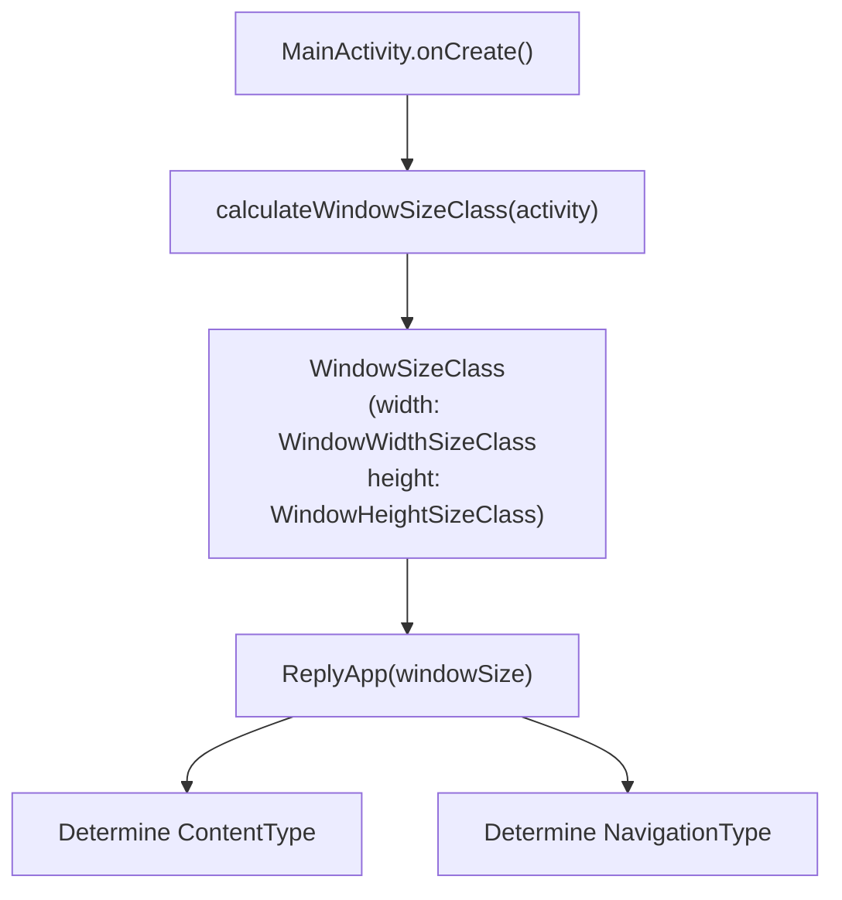

Sources: [Reply/app/src/main/java/com/example/reply/ui/MainActivity.kt:42-48]()

### WindowSizeClass to ContentType Mapping

The Reply sample demonstrates a sophisticated mapping from window size to content presentation:

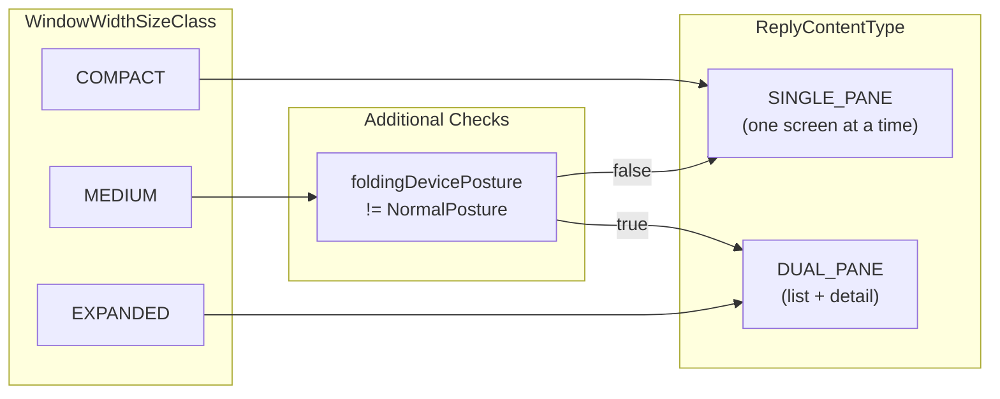

Sources: [Reply/app/src/main/java/com/example/reply/ui/ReplyApp.kt:76-85]()

### JetNews Simple Boolean Approach

JetNews uses a simpler pattern, converting `WindowWidthSizeClass` to a boolean `isExpandedScreen` flag:

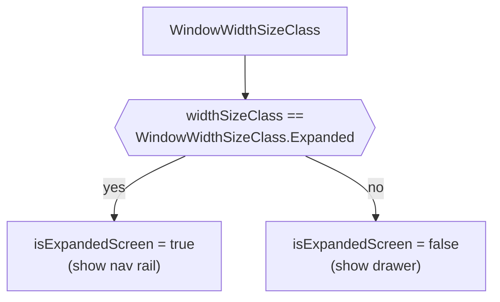

The `isExpandedScreen` boolean is then threaded through the composable hierarchy to control UI decisions:

- **Navigation Icon**: Hidden when expanded [JetNews/app/src/main/java/com/example/jetnews/ui/interests/InterestsScreen.kt:134-143]()
- **Tab Row Type**: `ScrollableTabRow` when expanded, `TabRow` when compact [JetNews/app/src/main/java/com/example/jetnews/ui/interests/InterestsScreen.kt:357-380]()
- **Bottom Bar**: Hidden when expanded [JetNews/app/src/main/java/com/example/jetnews/ui/article/ArticleScreen.kt:112-122]()

Sources: [JetNews/app/src/main/java/com/example/jetnews/ui/JetnewsApp.kt:50-51]()

## Device Posture Detection

### FoldingFeature and DevicePosture

Foldable devices can fold in different ways that impact layout decisions. The samples detect these postures using the `FoldingFeature` API from Jetpack WindowManager.

**DevicePosture Sealed Interface**

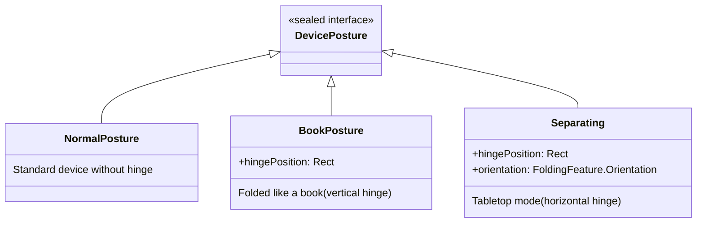

Sources: [Reply/app/src/main/java/com/example/reply/ui/utils/WindowStateUtils.kt:24-33]()

### Posture Detection Flow

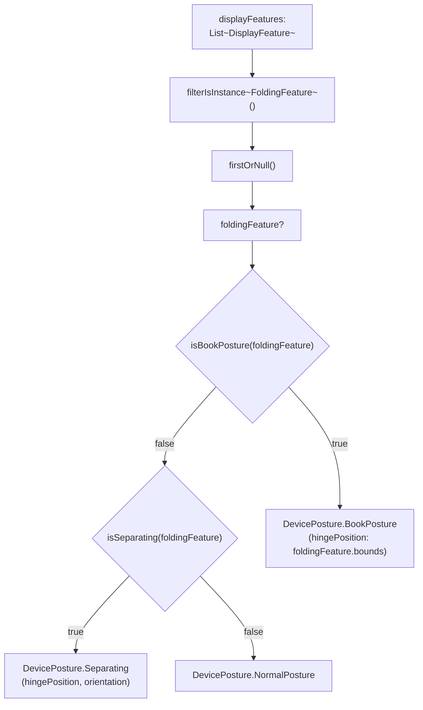

**Helper Functions**

The utility functions check specific `FoldingFeature` properties:

- `isBookPosture()`: Checks if `state == FoldingFeature.State.HALF_OPENED` and `orientation == VERTICAL` [Reply/app/src/main/java/com/example/reply/ui/utils/WindowStateUtils.kt:36-45]()
- `isSeparating()`: Checks if `state == FoldingFeature.State.HALF_OPENED` and `isSeparating == true` [Reply/app/src/main/java/com/example/reply/ui/utils/WindowStateUtils.kt:47-56]()

Sources: [Reply/app/src/main/java/com/example/reply/ui/ReplyApp.kt:64-74]()

## Navigation Adaptation Patterns

### NavigationSuiteType Decision Logic

The Reply sample uses `NavigationSuiteScaffoldLayout` with dynamic `NavigationSuiteType` selection based on window properties:

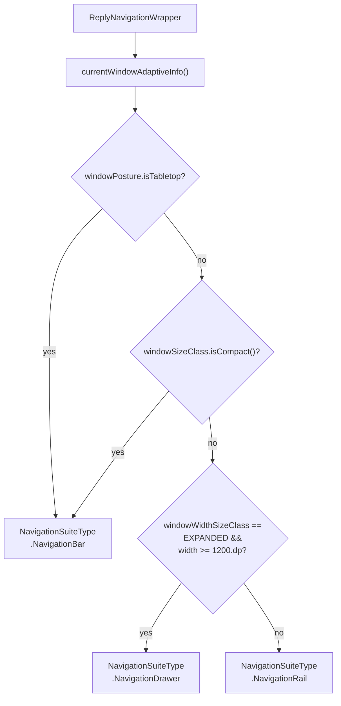

Sources: [Reply/app/src/main/java/com/example/reply/ui/navigation/ReplyNavigationComponents.kt:95-101]()

### Navigation Component Implementation Matrix

| NavigationSuiteType | Implementation | When Used | Key Features |
|---------------------|----------------|-----------|--------------|
| **NavigationBar** | `ReplyBottomNavigationBar` | Compact screens, Tabletop posture | Bottom-aligned, 4 destinations, no labels |
| **NavigationRail** | `ReplyNavigationRail` | Medium width, standard posture | Vertical sidebar, menu button, FAB |
| **NavigationDrawer** | `PermanentNavigationDrawerContent` | Expanded width (≥1200dp) | Full drawer, app name, extended FAB |

**NavigationRail Example Structure**

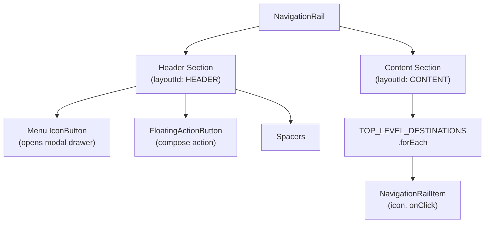

Sources: [Reply/app/src/main/java/com/example/reply/ui/navigation/ReplyNavigationComponents.kt:171-232]()

### JetNews Drawer vs NavRail

JetNews uses a simpler modal drawer + navigation rail pattern:

- **Compact**: `ModalNavigationDrawer` with `AppDrawer` content, opened via hamburger icon
- **Expanded**: `AppNavRail` always visible, drawer disabled via `gesturesEnabled = false`

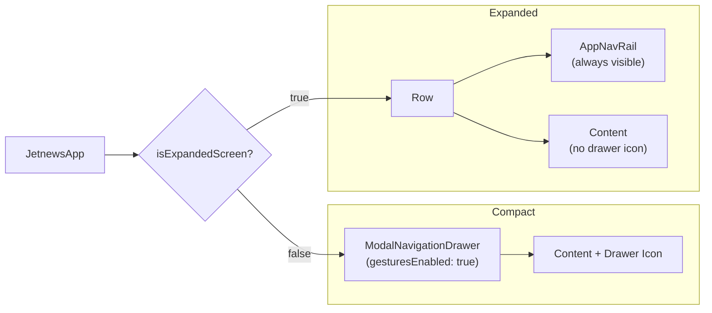

Sources: [JetNews/app/src/main/java/com/example/jetnews/ui/JetnewsApp.kt:50-83]()

## Content Layout Adaptation

### Single Pane vs Dual Pane

The Reply sample switches between single-pane and dual-pane layouts based on `ReplyContentType`:

**ReplyContentType.DUAL_PANE**

Uses `TwoPane` from Accompanist to display email list and detail side-by-side:

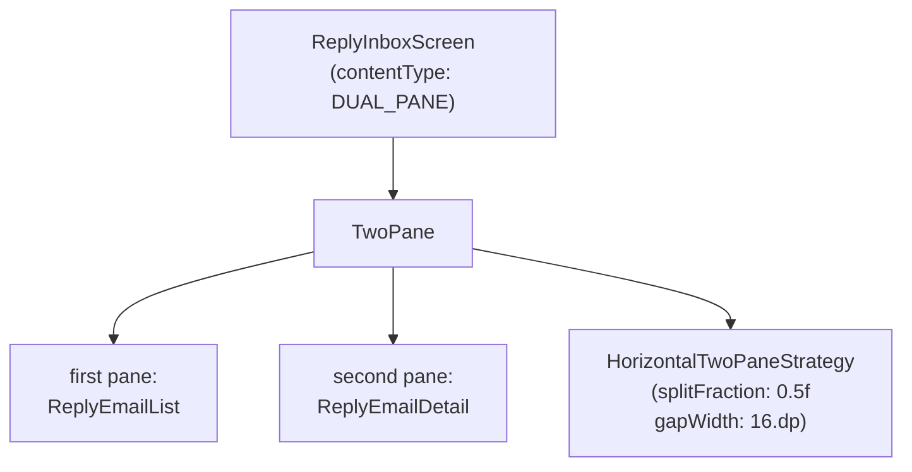

Sources: [Reply/app/src/main/java/com/example/reply/ui/ReplyListContent.kt:82-102]()

**ReplyContentType.SINGLE_PANE**

Shows either the list or the detail, controlled by `isDetailOnlyOpen` state:

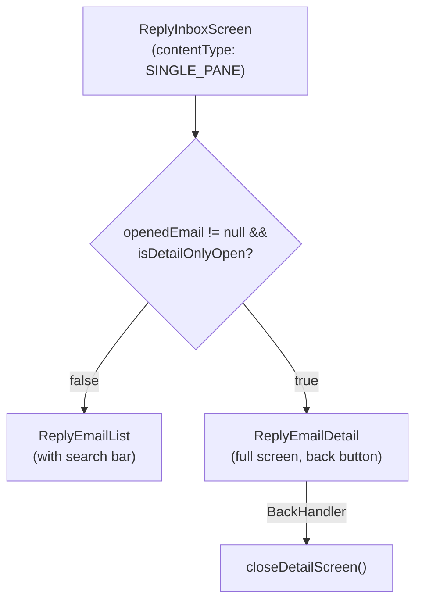

Sources: [Reply/app/src/main/java/com/example/reply/ui/ReplyListContent.kt:135-161]()

### Jetcaster SupportingPaneScaffold

Jetcaster uses Material 3 Adaptive's `SupportingPaneScaffold` for more sophisticated dual-pane layouts with custom directives.

**Custom PaneScaffoldDirective**

Jetcaster implements `calculateScaffoldDirective()` to override default behavior and limit to 1 horizontal pane when either width or height is compact:

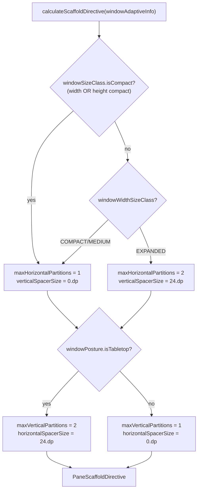

Sources: [Jetcaster/mobile/src/main/java/com/example/jetcaster/ui/home/Home.kt:133-182]()

**SupportingPaneScaffold Structure**

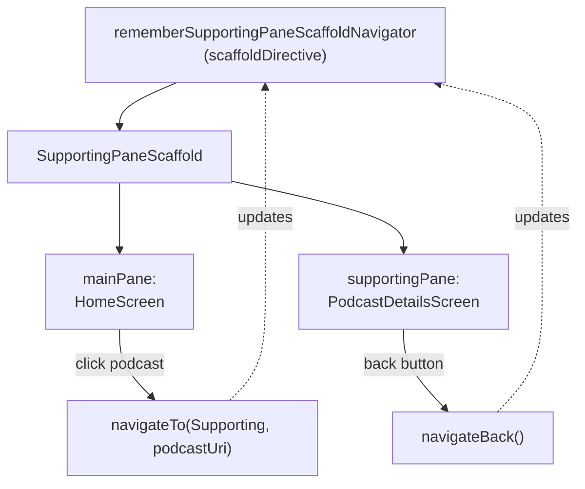

Sources: [Jetcaster/mobile/src/main/java/com/example/jetcaster/ui/home/Home.kt:241-307]()

## Jetcaster Player Screen Posture Handling

The Jetcaster player screen demonstrates advanced posture-aware layout switching:

### Layout Selection Logic

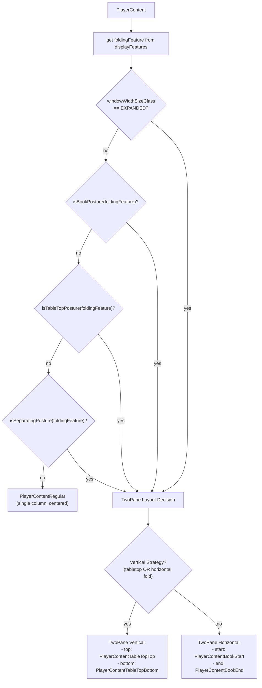

Sources: [Jetcaster/mobile/src/main/java/com/example/jetcaster/ui/player/PlayerScreen.kt:258-333]()

### Posture-Specific Layouts

| Layout Mode | Condition | Structure | Use Case |
|-------------|-----------|-----------|----------|
| **Regular** | Phone or no fold | Single column: image → title → controls | Standard phone usage |
| **Tabletop** | Horizontal fold, half-opened | Vertical TwoPane: image in top half, controls in bottom half | Device on table, viewing angle |
| **Book** | Vertical fold or Expanded width | Horizontal TwoPane: info in left pane, controls in right pane | Foldable opened like book |

**Tabletop Mode Details**

In tabletop mode, the player splits content to avoid the hinge:

- **Top Pane**: `PlayerContentTableTopTop` shows only the podcast image, using `WindowInsets.systemBars.only(Horizontal + Top)` [Jetcaster/mobile/src/main/java/com/example/jetcaster/ui/player/PlayerScreen.kt:441-446]()
- **Bottom Pane**: `PlayerContentTableTopBottom` shows title, description, and playback controls, using `WindowInsets.systemBars.only(Horizontal + Bottom)` [Jetcaster/mobile/src/main/java/com/example/jetcaster/ui/player/PlayerScreen.kt:469-473]()

Sources: [Jetcaster/mobile/src/main/java/com/example/jetcaster/ui/player/PlayerScreen.kt:430-509]()

## JetNews InterestsScreen Adaptive Layout

The InterestsScreen demonstrates custom adaptive layout logic without using `TwoPane`:

### InterestsAdaptiveContentLayout

This custom `Layout` composable implements a responsive grid that adjusts column count based on available width:

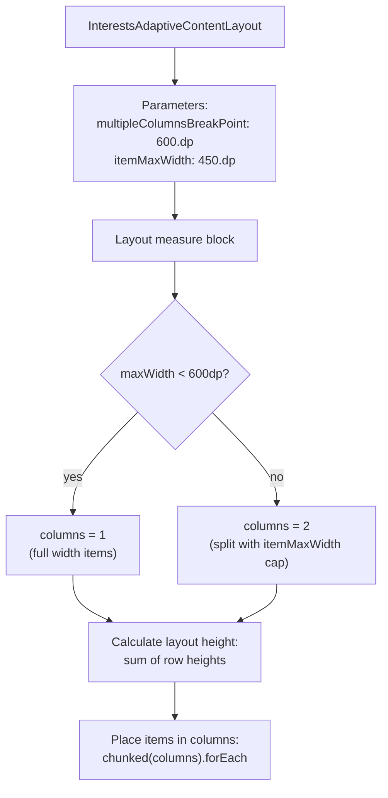

**Column Width Calculation**

For 2-column layout:
```
itemWidth = min(
    (maxWidth - spacing) / 2,
    itemMaxWidth
)
```

Sources: [JetNews/app/src/main/java/com/example/jetnews/ui/interests/InterestsScreen.kt:420-483]()

### Tab Row Adaptation

The InterestsScreen also switches tab row types based on screen size:

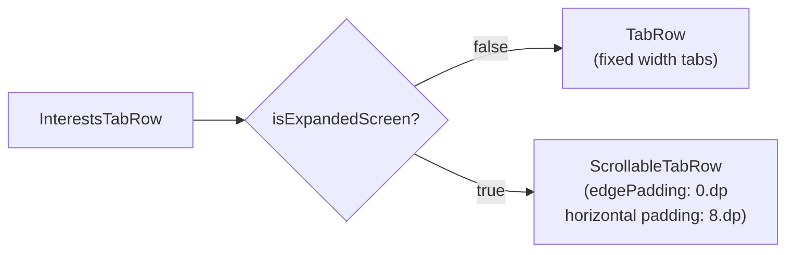

Sources: [JetNews/app/src/main/java/com/example/jetnews/ui/interests/InterestsScreen.kt:357-380]()

## Implementation Checklist

When implementing adaptive UI in a Compose application:

### 1. Window Size Detection
- [ ] Call `calculateWindowSizeClass()` in activity [Reply/app/src/main/java/com/example/reply/ui/MainActivity.kt:48]()
- [ ] Pass `WindowSizeClass` through composable hierarchy
- [ ] Define threshold logic (e.g., map `WindowWidthSizeClass` to custom types)

### 2. Foldable Support (Optional)
- [ ] Call `calculateDisplayFeatures()` in activity [Reply/app/src/main/java/com/example/reply/ui/MainActivity.kt:49]()
- [ ] Implement `DevicePosture` detection logic [Reply/app/src/main/java/com/example/reply/ui/utils/WindowStateUtils.kt:24-58]()
- [ ] Use posture in layout decisions

### 3. Navigation Adaptation
- [ ] Define navigation type enum (bottom/rail/drawer)
- [ ] Implement decision logic based on window size [Reply/app/src/main/java/com/example/reply/ui/navigation/ReplyNavigationComponents.kt:95-101]()
- [ ] Create separate composables for each navigation type
- [ ] Handle modal drawer state for rail mode [Reply/app/src/main/java/com/example/reply/ui/navigation/ReplyNavigationComponents.kt:110-120]()

### 4. Content Layout Adaptation
- [ ] Define content type enum (single/dual pane)
- [ ] Use `TwoPane` or custom logic for multi-pane layouts [Reply/app/src/main/java/com/example/reply/ui/ReplyListContent.kt:83-101]()
- [ ] Implement conditional rendering for single-pane mode [Reply/app/src/main/java/com/example/reply/ui/ReplyListContent.kt:143-160]()
- [ ] Handle state synchronization between panes

### 5. Testing
- [ ] Create `@Preview` annotations with different window sizes [Reply/app/src/main/java/com/example/reply/ui/MainActivity.kt:72-134]()
- [ ] Test transitions between size classes
- [ ] Verify fold/unfold behavior on foldable emulators

Sources: [Reply/app/src/main/java/com/example/reply/ui/MainActivity.kt:42-68](), [Jetcaster/mobile/src/main/java/com/example/jetcaster/ui/home/Home.kt:239-249](), [JetNews/app/src/main/java/com/example/jetnews/ui/JetnewsApp.kt:37-83]()

---

