<!-- source: DeepWiki mcp.deepwiki.com · repo android/compose-samples · page 5.3 Navigation Patterns · fetched 2026-10-23 -->

# Navigation Patterns

Relevant source files

The following files were used as context for generating this wiki page:

- [JetNews/app/src/main/java/com/example/jetnews/ui/JetnewsApp.kt](JetNews/app/src/main/java/com/example/jetnews/ui/JetnewsApp.kt)
- [JetNews/app/src/main/java/com/example/jetnews/ui/article/ArticleScreen.kt](JetNews/app/src/main/java/com/example/jetnews/ui/article/ArticleScreen.kt)
- [JetNews/app/src/main/java/com/example/jetnews/ui/article/PostContent.kt](JetNews/app/src/main/java/com/example/jetnews/ui/article/PostContent.kt)
- [JetNews/app/src/main/java/com/example/jetnews/ui/home/PostCardTop.kt](JetNews/app/src/main/java/com/example/jetnews/ui/home/PostCardTop.kt)
- [JetNews/app/src/main/java/com/example/jetnews/ui/home/PostCardYourNetwork.kt](JetNews/app/src/main/java/com/example/jetnews/ui/home/PostCardYourNetwork.kt)
- [JetNews/app/src/main/java/com/example/jetnews/ui/home/PostCards.kt](JetNews/app/src/main/java/com/example/jetnews/ui/home/PostCards.kt)
- [JetNews/app/src/main/java/com/example/jetnews/ui/interests/InterestsScreen.kt](JetNews/app/src/main/java/com/example/jetnews/ui/interests/InterestsScreen.kt)
- [JetNews/app/src/main/java/com/example/jetnews/ui/interests/SelectTopicButton.kt](JetNews/app/src/main/java/com/example/jetnews/ui/interests/SelectTopicButton.kt)
- [JetNews/app/src/main/res/values/strings.xml](JetNews/app/src/main/res/values/strings.xml)
- [Jetsnack/app/src/main/java/com/example/jetsnack/model/Filter.kt](Jetsnack/app/src/main/java/com/example/jetsnack/model/Filter.kt)
- [Jetsnack/app/src/main/java/com/example/jetsnack/model/SnackbarManager.kt](Jetsnack/app/src/main/java/com/example/jetsnack/model/SnackbarManager.kt)
- [Jetsnack/app/src/main/java/com/example/jetsnack/ui/JetsnackApp.kt](Jetsnack/app/src/main/java/com/example/jetsnack/ui/JetsnackApp.kt)
- [Jetsnack/app/src/main/java/com/example/jetsnack/ui/SnackSharedElementKey.kt](Jetsnack/app/src/main/java/com/example/jetsnack/ui/SnackSharedElementKey.kt)
- [Jetsnack/app/src/main/java/com/example/jetsnack/ui/components/Filters.kt](Jetsnack/app/src/main/java/com/example/jetsnack/ui/components/Filters.kt)
- [Jetsnack/app/src/main/java/com/example/jetsnack/ui/components/GradientTintedIconButton.kt](Jetsnack/app/src/main/java/com/example/jetsnack/ui/components/GradientTintedIconButton.kt)
- [Jetsnack/app/src/main/java/com/example/jetsnack/ui/components/QuantitySelector.kt](Jetsnack/app/src/main/java/com/example/jetsnack/ui/components/QuantitySelector.kt)
- [Jetsnack/app/src/main/java/com/example/jetsnack/ui/components/Snackbar.kt](Jetsnack/app/src/main/java/com/example/jetsnack/ui/components/Snackbar.kt)
- [Jetsnack/app/src/main/java/com/example/jetsnack/ui/components/Snacks.kt](Jetsnack/app/src/main/java/com/example/jetsnack/ui/components/Snacks.kt)
- [Jetsnack/app/src/main/java/com/example/jetsnack/ui/home/DestinationBar.kt](Jetsnack/app/src/main/java/com/example/jetsnack/ui/home/DestinationBar.kt)
- [Jetsnack/app/src/main/java/com/example/jetsnack/ui/home/Feed.kt](Jetsnack/app/src/main/java/com/example/jetsnack/ui/home/Feed.kt)
- [Jetsnack/app/src/main/java/com/example/jetsnack/ui/home/FilterScreen.kt](Jetsnack/app/src/main/java/com/example/jetsnack/ui/home/FilterScreen.kt)
- [Jetsnack/app/src/main/java/com/example/jetsnack/ui/home/Home.kt](Jetsnack/app/src/main/java/com/example/jetsnack/ui/home/Home.kt)
- [Jetsnack/app/src/main/java/com/example/jetsnack/ui/home/Profile.kt](Jetsnack/app/src/main/java/com/example/jetsnack/ui/home/Profile.kt)
- [Jetsnack/app/src/main/java/com/example/jetsnack/ui/home/cart/Cart.kt](Jetsnack/app/src/main/java/com/example/jetsnack/ui/home/cart/Cart.kt)
- [Jetsnack/app/src/main/java/com/example/jetsnack/ui/home/cart/SwipeDismissItem.kt](Jetsnack/app/src/main/java/com/example/jetsnack/ui/home/cart/SwipeDismissItem.kt)
- [Jetsnack/app/src/main/java/com/example/jetsnack/ui/home/search/Categories.kt](Jetsnack/app/src/main/java/com/example/jetsnack/ui/home/search/Categories.kt)
- [Jetsnack/app/src/main/java/com/example/jetsnack/ui/home/search/Results.kt](Jetsnack/app/src/main/java/com/example/jetsnack/ui/home/search/Results.kt)
- [Jetsnack/app/src/main/java/com/example/jetsnack/ui/home/search/Search.kt](Jetsnack/app/src/main/java/com/example/jetsnack/ui/home/search/Search.kt)
- [Jetsnack/app/src/main/java/com/example/jetsnack/ui/home/search/Suggestions.kt](Jetsnack/app/src/main/java/com/example/jetsnack/ui/home/search/Suggestions.kt)
- [Jetsnack/app/src/main/java/com/example/jetsnack/ui/snackdetail/SnackDetail.kt](Jetsnack/app/src/main/java/com/example/jetsnack/ui/snackdetail/SnackDetail.kt)
- [Reply/app/src/main/AndroidManifest.xml](Reply/app/src/main/AndroidManifest.xml)
- [Reply/app/src/main/java/com/example/reply/ui/EmptyComingSoon.kt](Reply/app/src/main/java/com/example/reply/ui/EmptyComingSoon.kt)
- [Reply/app/src/main/java/com/example/reply/ui/MainActivity.kt](Reply/app/src/main/java/com/example/reply/ui/MainActivity.kt)
- [Reply/app/src/main/java/com/example/reply/ui/ReplyApp.kt](Reply/app/src/main/java/com/example/reply/ui/ReplyApp.kt)
- [Reply/app/src/main/java/com/example/reply/ui/ReplyHomeViewModel.kt](Reply/app/src/main/java/com/example/reply/ui/ReplyHomeViewModel.kt)
- [Reply/app/src/main/java/com/example/reply/ui/ReplyListContent.kt](Reply/app/src/main/java/com/example/reply/ui/ReplyListContent.kt)
- [Reply/app/src/main/java/com/example/reply/ui/components/ReplyAppBars.kt](Reply/app/src/main/java/com/example/reply/ui/components/ReplyAppBars.kt)
- [Reply/app/src/main/java/com/example/reply/ui/components/ReplyEmailListItem.kt](Reply/app/src/main/java/com/example/reply/ui/components/ReplyEmailListItem.kt)
- [Reply/app/src/main/java/com/example/reply/ui/components/ReplyEmailThreadItem.kt](Reply/app/src/main/java/com/example/reply/ui/components/ReplyEmailThreadItem.kt)
- [Reply/app/src/main/java/com/example/reply/ui/components/ReplyProfileImage.kt](Reply/app/src/main/java/com/example/reply/ui/components/ReplyProfileImage.kt)
- [Reply/app/src/main/java/com/example/reply/ui/navigation/ReplyNavigationActions.kt](Reply/app/src/main/java/com/example/reply/ui/navigation/ReplyNavigationActions.kt)
- [Reply/app/src/main/java/com/example/reply/ui/navigation/ReplyNavigationComponents.kt](Reply/app/src/main/java/com/example/reply/ui/navigation/ReplyNavigationComponents.kt)
- [Reply/app/src/main/java/com/example/reply/ui/theme/Color.kt](Reply/app/src/main/java/com/example/reply/ui/theme/Color.kt)
- [Reply/app/src/main/java/com/example/reply/ui/theme/Theme.kt](Reply/app/src/main/java/com/example/reply/ui/theme/Theme.kt)
- [Reply/app/src/main/java/com/example/reply/ui/theme/Type.kt](Reply/app/src/main/java/com/example/reply/ui/theme/Type.kt)
- [Reply/app/src/main/java/com/example/reply/ui/utils/WindowStateUtils.kt](Reply/app/src/main/java/com/example/reply/ui/utils/WindowStateUtils.kt)
- [Reply/app/src/main/res/values/strings.xml](Reply/app/src/main/res/values/strings.xml)

This page documents the navigation architectures and patterns used across the Jetpack Compose sample applications. Each sample demonstrates different navigation strategies suited to their UI requirements: drawer navigation with adaptive layouts (JetNews), nested navigation with bottom bar (Jetsnack), and fully adaptive navigation suites (Reply). For state management patterns that work alongside navigation, see [UI State Management Patterns](#5.1). For adaptive UI design techniques, see [Adaptive and Responsive UI Design](#5.2).

## Navigation Architecture Overview

The samples demonstrate three distinct navigation architectures, each optimized for different app structures and device form factors:

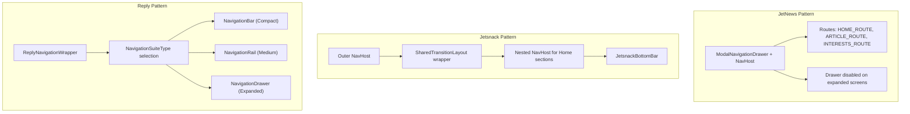

**Sources:** [JetNews/app/src/main/java/com/example/jetnews/ui/JetnewsApp.kt:36-84](), [Jetsnack/app/src/main/java/com/example/jetsnack/ui/JetsnackApp.kt:62-105](), [Reply/app/src/main/java/com/example/reply/ui/ReplyApp.kt:50-111]()

## JetNews: Drawer Navigation with Adaptive Layouts

### Navigation Structure

JetNews implements a single-level navigation graph with a modal navigation drawer that adapts based on screen size. On expanded screens, the drawer becomes a permanent navigation rail.

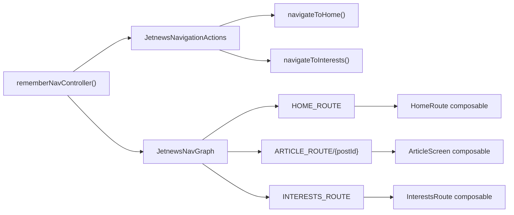

The navigation drawer behavior is controlled by `rememberSizeAwareDrawerState()`, which returns a locked-closed `DrawerState` on expanded screens to prevent drawer gestures.

**Sources:** [JetNews/app/src/main/java/com/example/jetnews/ui/JetnewsApp.kt:36-103]()

### Navigation Implementation

| Component | Type | Purpose |
|-----------|------|---------|
| `JetnewsApp` | `@Composable` | Root composable, configures drawer and navigation |
| `JetnewsNavigationActions` | Class | Encapsulates navigation commands |
| `JetnewsNavGraph` | `@Composable` | Defines navigation routes and destinations |
| `rememberSizeAwareDrawerState` | Function | Returns adaptive drawer state |
| `ModalNavigationDrawer` | Material3 Component | Container for drawer navigation |
| `AppNavRail` | `@Composable` | Permanent navigation rail for expanded screens |

**Sources:** [JetNews/app/src/main/java/com/example/jetnews/ui/JetnewsApp.kt:36-103]()

### Drawer and Rail Adaptive Pattern

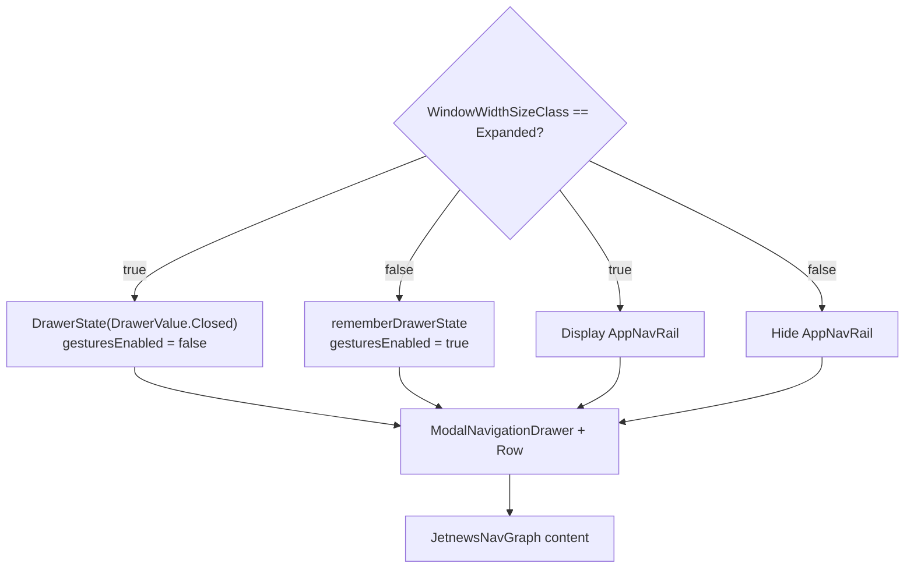

The key technique is creating a non-remembered `DrawerState(DrawerValue.Closed)` for expanded screens, which prevents state tracking and ensures the drawer stays closed.

**Sources:** [JetNews/app/src/main/java/com/example/jetnews/ui/JetnewsApp.kt:86-103]()

### Navigation to Articles

Article navigation uses a string-based route with a `postId` parameter:

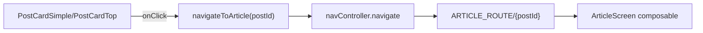

**Sources:** [JetNews/app/src/main/java/com/example/jetnews/ui/home/PostCards.kt:92-130]()

## Jetsnack: Nested Navigation with Shared Transitions

### Two-Level Navigation Hierarchy

Jetsnack implements a sophisticated two-level navigation structure where the outer `NavHost` manages top-level destinations (Home, SnackDetail), and an inner `NavHost` manages home sections (Feed, Search, Cart, Profile).

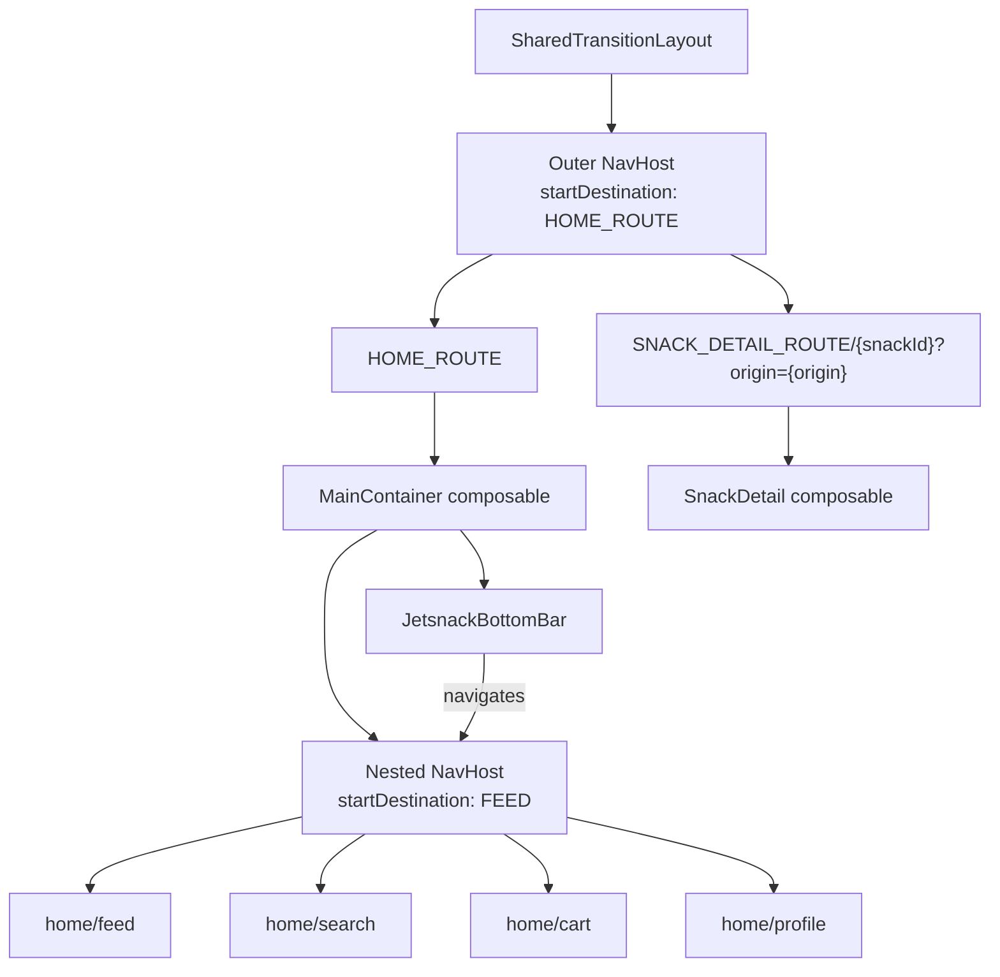

This pattern allows the bottom bar to remain visible across home sections while detail screens can occupy the full screen.

**Sources:** [Jetsnack/app/src/main/java/com/example/jetsnack/ui/JetsnackApp.kt:62-105](), [Jetsnack/app/src/main/java/com/example/jetsnack/ui/JetsnackApp.kt:107-167]()

### Home Sections Navigation

The home sections are defined in the `HomeSections` enum and registered using `addHomeGraph()`:

| Section | Route | Icon | Deep Link Support |
|---------|-------|------|-------------------|
| FEED | `home/feed` | `ic_home` | No |
| SEARCH | `home/search` | `ic_search` | No |
| CART | `home/cart` | `ic_shopping_cart` | Yes (`https://jetsnack.example.com/home/cart`) |
| PROFILE | `home/profile` | `ic_account_circle` | No |

**Sources:** [Jetsnack/app/src/main/java/com/example/jetsnack/ui/home/Home.kt:156-161](), [Jetsnack/app/src/main/java/com/example/jetsnack/ui/home/Home.kt:127-154]()

### Custom Composable Extension for CompositionLocals

Jetsnack uses a custom `composableWithCompositionLocal()` extension to provide `LocalNavAnimatedVisibilityScope` to nested composables:

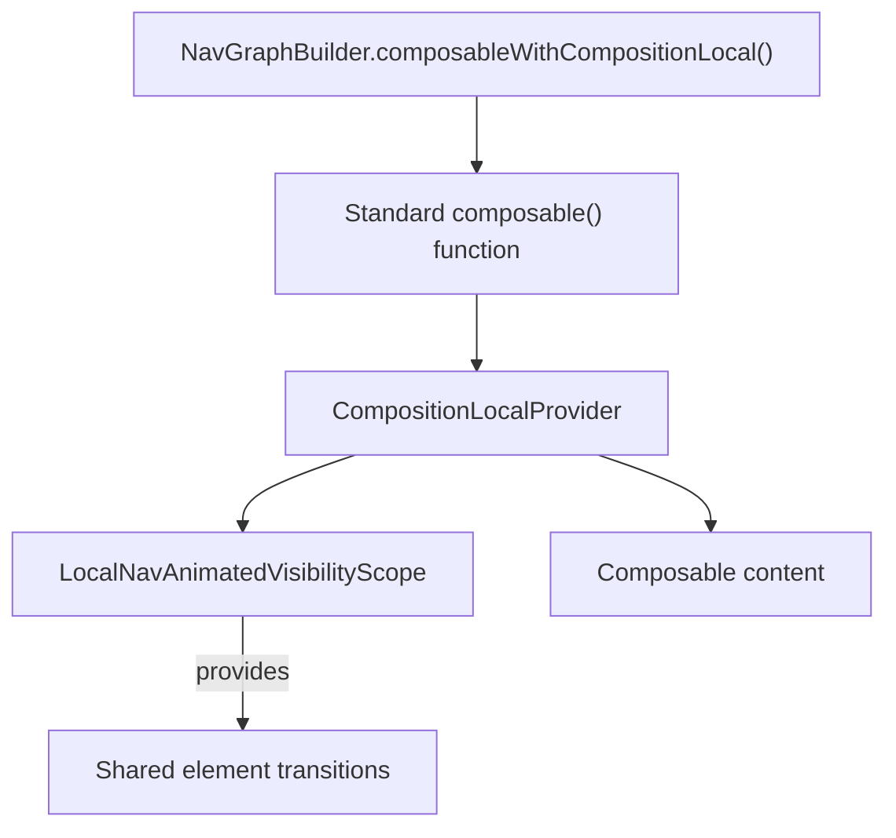

This pattern enables nested composables to access the `AnimatedVisibilityScope` required for shared element transitions without prop drilling.

**Sources:** [Jetsnack/app/src/main/java/com/example/jetsnack/ui/home/Home.kt:86-125]()

### Bottom Bar Navigation Pattern

The `JetsnackBottomBar` uses a custom animated layout that resizes navigation items based on selection:

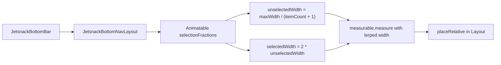

Each item animates its width between 1 slot (unselected) and 2 slots (selected), creating a visual emphasis on the current section.

**Sources:** [Jetsnack/app/src/main/java/com/example/jetsnack/ui/home/Home.kt:233-307]()

### Navigation with Shared Elements

Jetsnack's navigation to detail screens passes both the `snackId` and `origin` to enable context-aware shared element transitions:

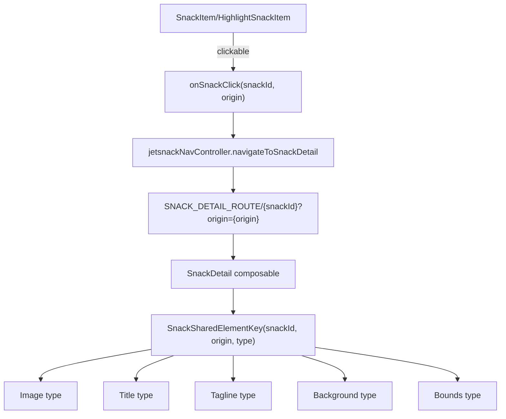

The `origin` parameter identifies the source collection, allowing different transition behaviors based on context (e.g., from feed vs. from cart).

**Sources:** [Jetsnack/app/src/main/java/com/example/jetsnack/ui/components/Snacks.kt:190-257](), [Jetsnack/app/src/main/java/com/example/jetsnack/ui/snackdetail/SnackDetail.kt:145-191]()

## Reply: Adaptive Navigation Suite

### Navigation Suite Type Selection

Reply implements fully adaptive navigation that selects the appropriate navigation component based on window size and device posture:

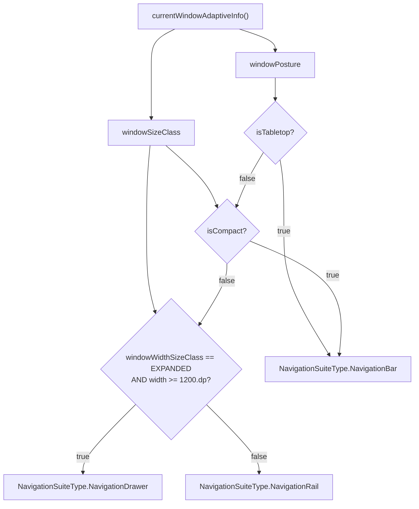

This decision tree ensures optimal navigation UI for each form factor, including special handling for foldable devices in tabletop mode.

**Sources:** [Reply/app/src/main/java/com/example/reply/ui/navigation/ReplyNavigationComponents.kt:90-108]()

### Navigation Component Mapping

| NavigationSuiteType | Screen Size | UI Component | Position |
|---------------------|-------------|--------------|----------|
| `NavigationBar` | Compact, Tabletop | `ReplyBottomNavigationBar` | Bottom |
| `NavigationRail` | Medium | `ReplyNavigationRail` | Left side |
| `NavigationDrawer` | Expanded (≥1200dp) | `PermanentNavigationDrawerContent` | Left side (permanent) |

**Sources:** [Reply/app/src/main/java/com/example/reply/ui/navigation/ReplyNavigationComponents.kt:139-167]()

### Modal Drawer Overlay

Reply layers a `ModalNavigationDrawer` over the navigation suite system to provide temporary navigation access on medium screens via the rail's menu button:

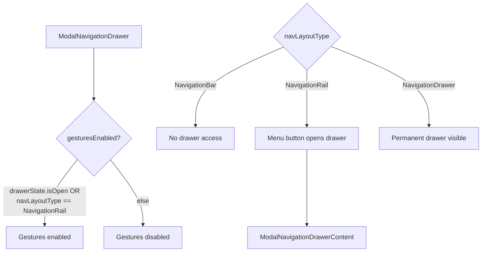

The drawer is gesture-enabled only when already open or when using the navigation rail, preventing conflicts with permanent navigation on large screens.

**Sources:** [Reply/app/src/main/java/com/example/reply/ui/navigation/ReplyNavigationComponents.kt:110-168]()

### Type-Safe Navigation with Kotlin Serialization

Reply uses Kotlin serialization for type-safe navigation destinations:

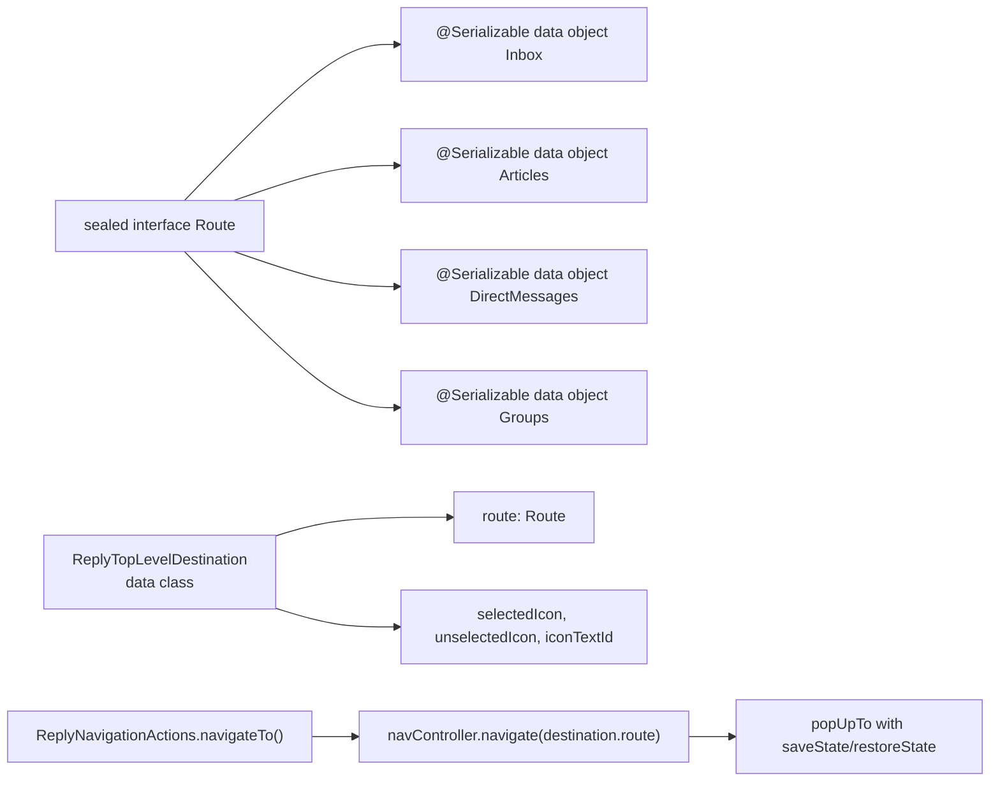

This pattern provides compile-time safety for navigation routes and eliminates string-based route definitions.

**Sources:** [Reply/app/src/main/java/com/example/reply/ui/navigation/ReplyNavigationActions.kt:24-50]()

### Navigation Content Positioning

The `ReplyNavigationContentPosition` enum controls vertical alignment of navigation items:

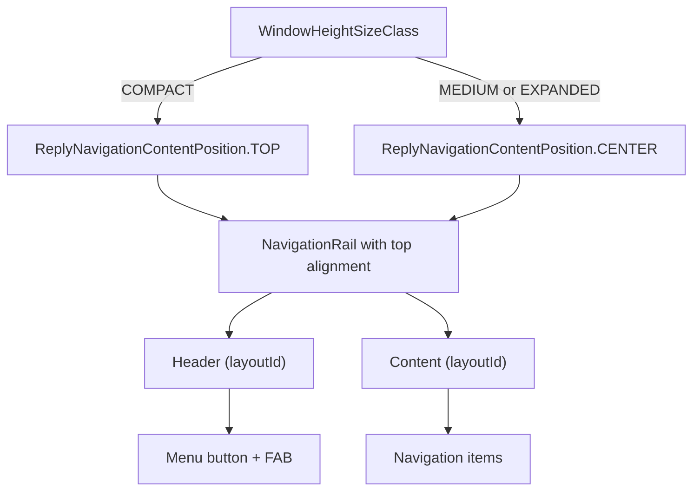

This adaptive positioning ensures navigation remains accessible in compact vertical spaces (e.g., landscape orientation).

**Sources:** [Reply/app/src/main/java/com/example/reply/ui/navigation/ReplyNavigationComponents.kt:102-108](), [Reply/app/src/main/java/com/example/reply/ui/navigation/ReplyNavigationComponents.kt:171-233]()

## Navigation State Preservation

### JetNews Navigation State

JetNews navigation actions use standard Navigation Component patterns with `popUpTo` for back stack management:

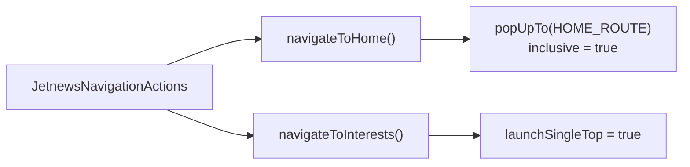

**Sources:** The navigation actions implementation is referenced but not shown in the provided files. The pattern is inferred from [JetNews/app/src/main/java/com/example/jetnews/ui/JetnewsApp.kt:40-42]().

### Reply State Preservation

Reply implements comprehensive state preservation for back stack navigation:

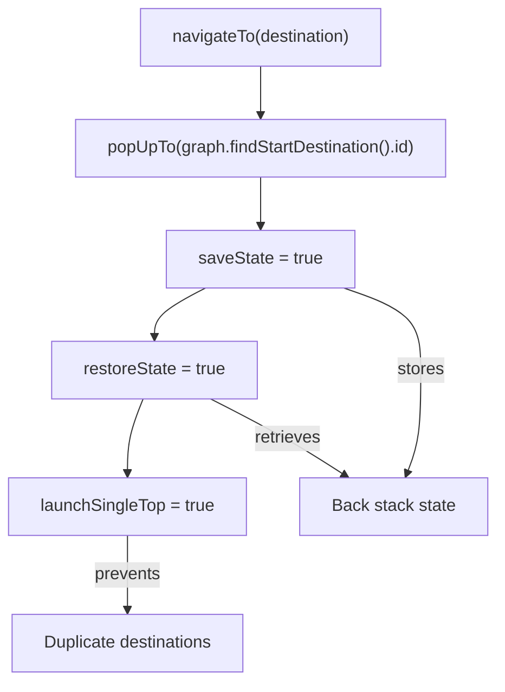

This pattern ensures that when users switch between top-level destinations (Inbox, Articles, DMs, Groups), their previous position and scroll state are preserved.

**Sources:** [Reply/app/src/main/java/com/example/reply/ui/navigation/ReplyNavigationActions.kt:35-49]()

## Deep Link Support

### Jetsnack Deep Link Configuration

Jetsnack implements deep linking for the Cart destination:

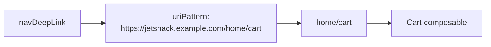

When this URI is opened, the app navigates directly to the cart screen within the nested navigation hierarchy.

**Sources:** [Jetsnack/app/src/main/java/com/example/jetsnack/ui/home/Home.kt:140-150]()

## Navigation Parameter Patterns

### JetNews Article Parameters

JetNews passes article IDs as string route parameters:

| Parameter | Type | Source | Example |
|-----------|------|--------|---------|
| `postId` | String | Post.id | `"article/post3"` |

**Sources:** The parameter pattern is inferred from [JetNews/app/src/main/java/com/example/jetnews/ui/home/PostCards.kt:92]().

### Jetsnack Detail Parameters

Jetsnack uses typed parameters with optional origin:

| Parameter | Type | Requirement | Purpose |
|-----------|------|-------------|---------|
| `snackId` | Long | Required | Identifies the snack |
| `origin` | String | Optional | Identifies source collection for transitions |

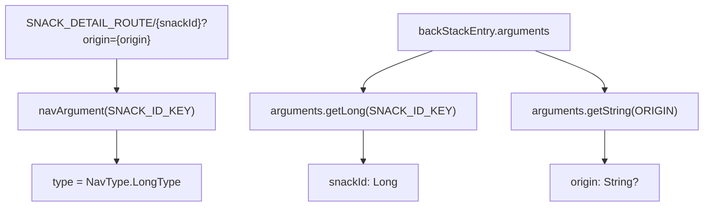

**Sources:** [Jetsnack/app/src/main/java/com/example/jetsnack/ui/JetsnackApp.kt:81-100]()

## Shared Element Transition Integration

### SharedTransitionLayout Wrapper

Jetsnack wraps its navigation in `SharedTransitionLayout` to enable shared element transitions:

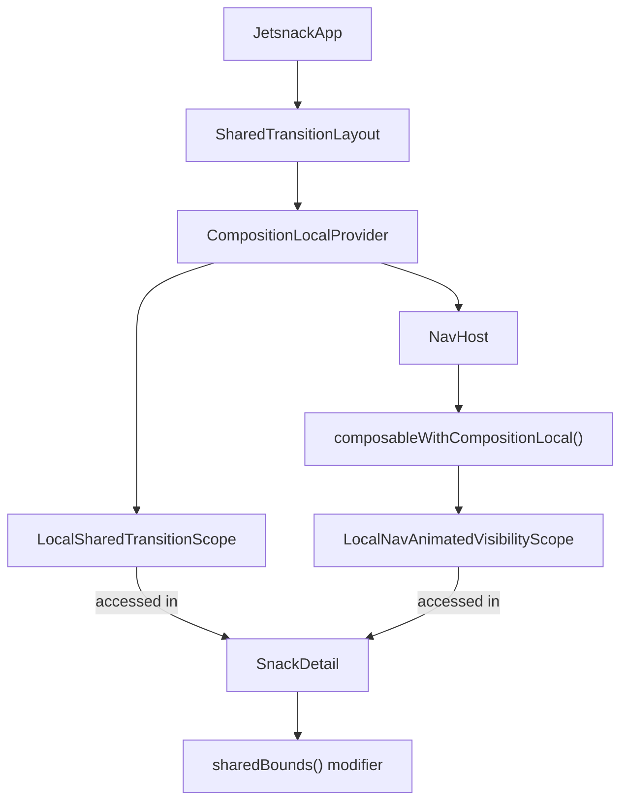

This architecture makes the `SharedTransitionScope` available throughout the navigation graph via composition locals.

**Sources:** [Jetsnack/app/src/main/java/com/example/jetsnack/ui/JetsnackApp.kt:65-103](), [Jetsnack/app/src/main/java/com/example/jetsnack/ui/JetsnackApp.kt:169-170]()

### Shared Element Keys

Jetsnack uses structured keys to identify shared elements across screens:

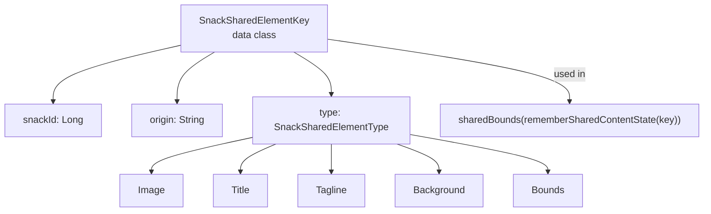

The `origin` field allows the same snack to have different shared element transitions based on where the navigation originated.

**Sources:** [Jetsnack/app/src/main/java/com/example/jetsnack/ui/SnackSharedElementKey.kt:1-30]()

## Navigation Testing Patterns

Navigation testing requires proper setup of the navigation controller and destinations. While the provided files don't include explicit test files, the testing infrastructure can be inferred from test utility patterns.

### Test Navigation Setup Pattern

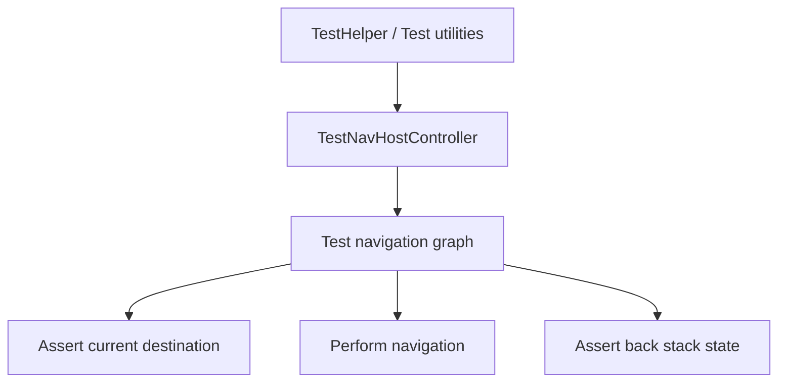

**Sources:** Testing patterns are inferred from the navigation structure in the main application files.

---

