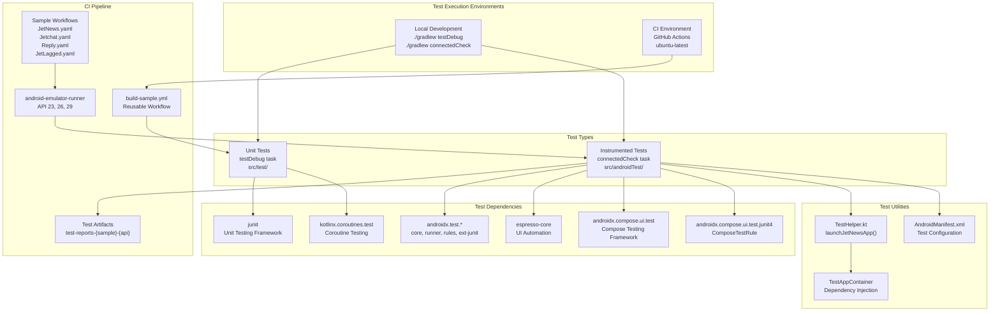
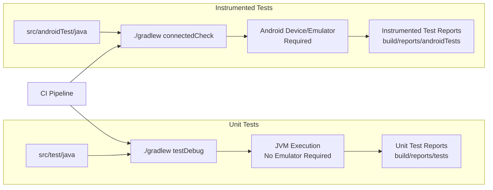
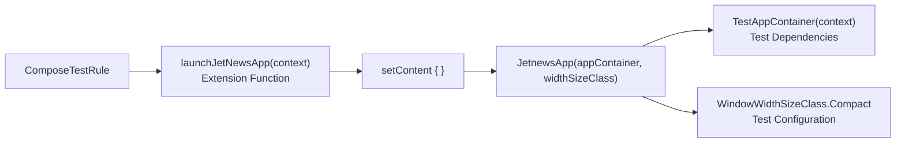
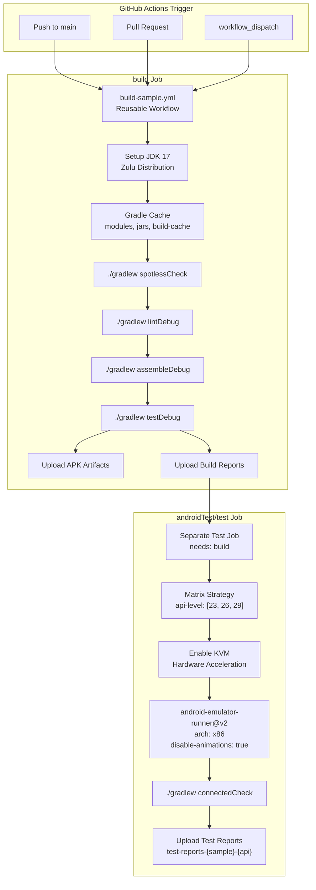
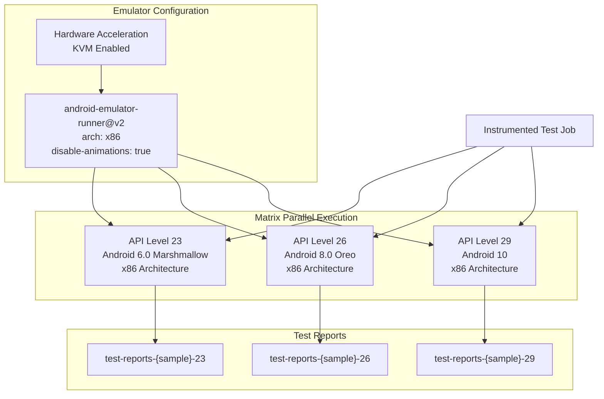

<!-- source: DeepWiki mcp.deepwiki.com · repo android/compose-samples · page 6 Testing Infrastructure · fetched 2026-10-23 -->

# Testing Infrastructure

<details>
<summary>Relevant source files</summary>

The following files were used as context for generating this wiki page:

- [.github/workflows/JetLagged.yaml](.github/workflows/JetLagged.yaml)
- [.github/workflows/JetNews.yaml](.github/workflows/JetNews.yaml)
- [.github/workflows/Jetcaster.yaml](.github/workflows/Jetcaster.yaml)
- [.github/workflows/Jetchat.yaml](.github/workflows/Jetchat.yaml)
- [.github/workflows/Jetsnack.yaml](.github/workflows/Jetsnack.yaml)
- [.github/workflows/Release.yml](.github/workflows/Release.yml)
- [.github/workflows/Reply.yaml](.github/workflows/Reply.yaml)
- [.github/workflows/build-sample.yml](.github/workflows/build-sample.yml)
- [.github/workflows/default-check.yml](.github/workflows/default-check.yml)
- [.github/workflows/update_deps.yml](.github/workflows/update_deps.yml)
- [JetNews/app/src/androidTest/java/com/example/jetnews/TestHelper.kt](JetNews/app/src/androidTest/java/com/example/jetnews/TestHelper.kt)
- [JetNews/app/src/main/AndroidManifest.xml](JetNews/app/src/main/AndroidManifest.xml)

</details>


This document describes the testing infrastructure in the Compose-Samples repository, including test dependencies, execution environments, CI integration, and test utilities. The infrastructure supports both unit tests and instrumented tests across multiple Android API levels.

## Overview

The testing infrastructure in Compose-Samples provides a standardized approach across all sample applications. Every sample implements the same test dependency matrix and follows consistent patterns for test execution both locally and in CI environments.

The infrastructure consists of:

1. **Test Dependencies** - Shared testing libraries (JUnit, Espresso, Compose Test)
2. **Test Utilities** - Helper classes like `TestHelper` and `TestAppContainer`
3. **Local Test Execution** - Unit tests via `testDebug` Gradle task
4. **Instrumented Test Execution** - UI tests via `connectedCheck` on emulators
5. **CI Integration** - GitHub Actions workflows with matrix testing across API levels

Sources:
- [.github/workflows/build-sample.yml:1-96]()
- [.github/workflows/JetNews.yaml:1-82]()
- [JetNews/app/src/androidTest/java/com/example/jetnews/TestHelper.kt:1-35]()

## Testing Infrastructure Architecture

**Diagram: Complete Testing Infrastructure**



The testing infrastructure spans local development and CI environments. All samples use the same core test dependencies, with tests organized into unit tests (`src/test/`) and instrumented tests (`src/androidTest/`). The CI pipeline executes tests across multiple Android API levels using emulators.

Sources:
- [.github/workflows/build-sample.yml:32-96]()
- [.github/workflows/JetNews.yaml:32-82]()
- [JetNews/app/src/androidTest/java/com/example/jetnews/TestHelper.kt:17-35]()

## Test Dependencies

All samples share a consistent set of test dependencies defined in their `build.gradle.kts` files. These dependencies are managed through the version catalog system (`libs.versions.toml`).

**Table: Standard Test Dependencies**

| Dependency | Scope | Purpose |
|-----------|-------|---------|
| `junit` | `testImplementation` | Unit testing framework |
| `androidx.test.core` | `androidTestImplementation` | Core testing utilities |
| `androidx.test.runner` | `androidTestImplementation` | Test runner for instrumented tests |
| `androidx.test.rules` | `androidTestImplementation` | Test rules like `ActivityScenarioRule` |
| `androidx.test.ext:junit` | `androidTestImplementation` | AndroidX JUnit extensions |
| `espresso-core` | `androidTestImplementation` | UI testing and automation |
| `kotlinx.coroutines.test` | `testImplementation` | Coroutine testing utilities |
| `androidx.compose.ui.test` | `androidTestImplementation` | Compose testing framework |
| `androidx.compose.ui.test.junit4` | `androidTestImplementation` | `ComposeTestRule` integration |
| `androidx.compose.ui.tooling` | `debugImplementation` | Compose preview support |
| `androidx.compose.ui.test.manifest` | `debugImplementation` | Test manifest for UI tests |

Debug-only dependencies (`debugImplementation`) are required for Compose testing to work properly. The `androidx.compose.ui.test.manifest` provides the necessary manifest entries for running Compose UI tests.

Sources:
- [.github/workflows/build-sample.yml:80-82]()
- [JetNews/app/src/main/AndroidManifest.xml:1-58]()

## Test Types

The repository implements two distinct test types with different execution characteristics.

**Diagram: Test Type Execution Flow**



### Unit Tests

Unit tests run on the JVM without requiring an Android device or emulator. They execute quickly and are ideal for testing business logic, ViewModels, and repository layers.

- **Location:** `src/test/java`
- **Execution:** `./gradlew testDebug`
- **Environment:** Local JVM
- **Dependencies:** `junit`, `kotlinx.coroutines.test`

### Instrumented Tests

Instrumented tests run on an Android device or emulator. They are used for testing UI components, navigation, and Android-specific APIs.

- **Location:** `src/androidTest/java`
- **Execution:** `./gradlew connectedCheck`
- **Environment:** Android device/emulator
- **Dependencies:** AndroidX Test, Espresso, Compose Test

Sources:
- [.github/workflows/build-sample.yml:80-82]()
- [.github/workflows/JetNews.yaml:67-74]()

## Test Utilities

The repository provides reusable test utilities that simplify test setup and execution.

### TestHelper

The `TestHelper` class provides extension functions for launching app content with test dependencies. This is demonstrated in JetNews with the `launchJetNewsApp` function.

**Diagram: TestHelper Usage Pattern**



The `launchJetNewsApp` function encapsulates test setup:
- Creates a `TestAppContainer` with fake repositories
- Sets a specific `WindowWidthSizeClass` for consistent testing
- Initializes the app's Compose content in the test rule

Sources:
- [JetNews/app/src/androidTest/java/com/example/jetnews/TestHelper.kt:17-35]()

### TestAppContainer

`TestAppContainer` provides test-specific implementations of dependencies, replacing production repositories with fake implementations that provide predictable test data.

**Table: AppContainer Implementations**

| Container | Purpose | Repository Implementations | Usage |
|-----------|---------|---------------------------|-------|
| `AppContainerImpl` | Production | Real repositories with network/database access | Used in release builds |
| `TestAppContainer` | Testing | `BlockingFakePostsRepository`, `FakeInterestsRepository` | Used in instrumented tests |

The test container pattern enables:
1. **Predictable test data** - No network variability
2. **Faster test execution** - No real network or database operations
3. **Isolation** - Tests don't depend on external services

Sources:
- [JetNews/app/src/androidTest/java/com/example/jetnews/TestHelper.kt:27-33]()

### ComposeTestRule

All Compose UI tests use `ComposeTestRule` to render and interact with Compose content.

**Table: ComposeTestRule API**

| Method | Purpose | Example |
|--------|---------|---------|
| `setContent {}` | Renders Compose content | `composeTestRule.setContent { MyScreen() }` |
| `onNodeWithText()` | Finds node by text | `onNodeWithText("Send").performClick()` |
| `onNodeWithContentDescription()` | Finds node by content description | `onNodeWithContentDescription("Menu").performClick()` |
| `onNode()` | Finds node with custom matcher | `onNode(hasSetTextAction()).performTextInput("text")` |
| `performClick()` | Simulates click | `onNodeWithText("Button").performClick()` |
| `performTextInput()` | Simulates text input | `onNode(matcher).performTextInput("text")` |
| `assertIsDisplayed()` | Verifies visibility | `onNodeWithText("Text").assertIsDisplayed()` |
| `assertIsEnabled()` | Verifies enabled state | `onNodeWithText("Button").assertIsEnabled()` |

Sources:
- [Jetchat/app/src/androidTest/java/com/example/compose/jetchat/UserInputTest.kt:47-52]()
- [Jetchat/app/src/androidTest/java/com/example/compose/jetchat/ConversationTest.kt:146-158]()

## CI Integration

The testing infrastructure is tightly integrated with the CI/CD pipeline through GitHub Actions workflows. All samples follow a consistent pattern for test execution in CI.

**Diagram: CI Testing Pipeline**



### Reusable Build Workflow

The `build-sample.yml` workflow is a reusable workflow that handles the build and unit test phase for all samples. It accepts inputs for sample name, path, and module.

**Table: build-sample.yml Workflow Steps**

| Step | Command | Purpose |
|------|---------|---------|
| Checkout | `actions/checkout@v5` | Clones repository with full history for Spotless |
| Copy CI properties | `cp .github/ci-gradle.properties ~/.gradle/` | Configures Gradle for CI environment |
| Setup JDK | `actions/setup-java@v5` | Installs JDK 17 (Zulu distribution) |
| Generate cache key | `./scripts/checksum.sh` | Creates cache key based on dependencies |
| Cache Gradle | `actions/cache@v4` | Caches Gradle modules and build cache |
| Check formatting | `./gradlew spotlessCheck` | Enforces code style |
| Check lint | `./gradlew lintDebug` | Runs Android lint |
| Build debug | `./gradlew assembleDebug` | Compiles debug APK |
| Run local tests | `./gradlew testDebug` | Executes unit tests |
| Upload APKs | `actions/upload-artifact@v4` | Saves build outputs |
| Upload reports | `actions/upload-artifact@v4` | Saves test reports (runs always) |

Sources:
- [.github/workflows/build-sample.yml:1-96]()

### Sample-Specific Test Jobs

Each sample workflow (e.g., `JetNews.yaml`, `Jetchat.yaml`) calls the reusable build workflow and optionally includes an instrumented test job. Four samples include instrumented tests: JetNews, Jetchat, Reply, and JetLagged.

**Table: Samples with Instrumented Tests**

| Sample | Workflow File | Test Job | API Levels |
|--------|--------------|----------|------------|
| JetNews | `JetNews.yaml` | `androidTest` | 23, 26, 29 |
| Jetchat | `Jetchat.yaml` | `test` | 23, 26, 29 |
| Reply | `Reply.yaml` | `test` | 23, 26, 29 |
| JetLagged | `JetLagged.yaml` | `test` | 23, 26, 29 |
| Jetsnack | `Jetsnack.yaml` | (none) | N/A |
| Jetcaster | `Jetcaster.yaml` | (none) | N/A |

Sources:
- [.github/workflows/JetNews.yaml:1-82]()
- [.github/workflows/Jetchat.yaml:1-78]()
- [.github/workflows/Reply.yaml:1-79]()
- [.github/workflows/JetLagged.yaml:1-79]()
- [.github/workflows/Jetsnack.yaml:1-26]()
- [.github/workflows/Jetcaster.yaml:1-27]()

### Matrix Testing Strategy

The instrumented test jobs use a matrix strategy to run tests across three Android API levels: 23 (Marshmallow), 26 (Oreo), and 29 (Android 10).

**Diagram: Matrix Test Execution**



The matrix strategy runs tests in parallel across API levels, reducing overall CI execution time. Each test run produces separate reports uploaded as artifacts with API-level-specific naming.

Key emulator configuration:
- **Architecture:** x86 (faster than ARM on x86 CI runners)
- **Animations:** Disabled for faster, more reliable tests
- **Hardware Acceleration:** KVM enabled for performance

Sources:
- [.github/workflows/JetNews.yaml:36-82]()
- [.github/workflows/Jetchat.yaml:35-78]()

### Test Report Artifacts

Test reports are uploaded as GitHub Actions artifacts for debugging failures. The `if: always()` condition ensures reports are uploaded even when tests fail.

**Table: Test Artifact Naming**

| Artifact Type | Source Job | Naming Pattern | Path |
|--------------|------------|----------------|------|
| Build outputs | `build` | `build-outputs` | `{path}/{module}/build/outputs` |
| Build reports | `build` | `build-reports` | `{path}/{module}/build/reports` |
| Test reports | `androidTest`/`test` | `test-reports-{sample}-{api}` | `{path}/app/build/reports/androidTests` |

Sources:
- [.github/workflows/build-sample.yml:84-95]()
- [.github/workflows/JetNews.yaml:76-82]()

## Test Execution

Tests can be executed both locally during development and in the CI environment. The execution process differs between unit tests and instrumented tests.

### Local Execution

**Unit Tests:**
```bash
cd {sample-directory}
./gradlew testDebug
```

Unit tests execute on the local JVM without requiring an Android device or emulator. Results are available at `app/build/reports/tests/testDebugUnitTest/index.html`.

**Instrumented Tests:**
```bash
cd {sample-directory}
./gradlew connectedCheck
```

Instrumented tests require a connected Android device or running emulator. Results are available at `app/build/reports/androidTests/connected/index.html`.

Sources:
- [.github/workflows/build-sample.yml:80-82]()

### CI Execution

In CI, tests execute on Ubuntu runners with specific configuration:

**Table: CI Environment Configuration**

| Configuration | Value | Purpose |
|--------------|-------|---------|
| Runner | `ubuntu-latest` | Provides Linux environment with KVM support |
| JDK | 17 (Zulu distribution) | Matches local development requirements |
| Gradle cache | Enabled | Speeds up builds by caching dependencies |
| KVM permissions | Enabled | Enables hardware acceleration for emulators |
| Emulator architecture | x86 | Faster on x86 CI runners |
| Animation | Disabled | More reliable, faster tests |
| Timeout | 30 minutes | Prevents hung jobs |

The CI pipeline enforces a specific execution order:
1. **Code formatting** (`spotlessCheck`) - Fails fast on style violations
2. **Static analysis** (`lintDebug`) - Catches potential issues
3. **Compilation** (`assembleDebug`) - Verifies code compiles
4. **Unit tests** (`testDebug`) - Fast, JVM-based tests
5. **Instrumented tests** (`connectedCheck`) - Slower, emulator-based tests (separate job)

Sources:
- [.github/workflows/build-sample.yml:47-82]()
- [.github/workflows/JetNews.yaml:43-74]()

### Debug Tools

Debug builds include additional dependencies for testing and development:

**Table: Debug Dependencies**

| Dependency | Purpose |
|-----------|---------|
| `androidx.compose.ui.tooling` | Enables Compose Preview functionality in Android Studio |
| `androidx.compose.ui.test.manifest` | Provides manifest entries required for Compose UI tests |

The test manifest is required for instrumented tests that use `ComposeTestRule`. Without it, tests will fail with manifest-related errors.

Sources:
- [JetNews/app/src/main/AndroidManifest.xml:1-58]()

## Sample Test Coverage

Test coverage varies across samples based on their complexity and demonstration goals.

**Table: Test Coverage by Sample**

| Sample | Unit Tests | Instrumented Tests | CI Execution | Key Test Areas |
|--------|-----------|-------------------|--------------|----------------|
| JetNews | Yes | Yes | Yes | Home screen, navigation, snackbar state |
| Jetchat | Yes | Yes | Yes | UserInput, Conversation, Navigation |
| Reply | Yes | Yes | Yes | Adaptive UI, navigation suite |
| JetLagged | Yes | Yes | Yes | Custom graphics, navigation drawer |
| Jetsnack | Yes | No | Build only | (No instrumented tests) |
| Jetcaster | Yes | No | Build only | (No instrumented tests) |

Jetsnack and Jetcaster include build and unit test execution in CI but do not have instrumented test jobs. This may be due to sample complexity or demonstration focus.

Sources:
- [.github/workflows/JetNews.yaml:1-82]()
- [.github/workflows/Jetchat.yaml:1-78]()
- [.github/workflows/Jetsnack.yaml:1-26]()
- [.github/workflows/Jetcaster.yaml:1-27]()

## Testing Best Practices

The Compose-Samples repository demonstrates several testing best practices:

### 1. Test Tag Usage

Using test tags to easily identify components in tests:

```markdown
| Test Tag Approach | Purpose | Example |
|-------------------|---------|---------|
| `testTag()` modifier | Mark composables for easy finding in tests | `Modifier.testTag(ConversationTestTag)` |
| Semantic properties | Add custom semantic properties | `keyboardShownProperty = keyboardShown` |
| Content descriptions | Use meaningful descriptions for accessibility and testing | `contentDescription = stringResource(id = R.string.textfield_desc)` |
```

### 2. Test Helper Functions

Creating helper functions to simplify test code and improve readability:

```markdown
| Helper Function | Purpose | Example |
|-----------------|---------|---------|
| `findJumpToBottom()` | Find the jump to bottom button | `composeTestRule.onNodeWithText(...)` |
| `findTextInputField()` | Find the text input field | `composeTestRule.onNode(hasSetTextAction() and ...)` |
| `openEmojiSelector()` | Open the emoji selector | `composeTestRule.onNodeWithContentDescription(...).performClick()` |
| `launchJetNewsApp()` | Launch the app with test dependencies | `setContent { JetnewsApp(appContainer = TestAppContainer(...)) }` |
```

### 3. Testing Edge Cases

The sample applications demonstrate testing edge cases and complex scenarios:

- Testing scroll position after theme changes
- Testing keyboard visibility when opening emoji selector
- Testing snackbar appearance with error states
- Testing navigation with back stack management

Sources:
- [Jetchat/app/src/main/java/com/example/compose/jetchat/conversation/Conversation.kt:280]()
- [Jetchat/app/src/androidTest/java/com/example/compose/jetchat/UserInputTest.kt:159-166]()
- [Jetchat/app/src/androidTest/java/com/example/compose/jetchat/ConversationTest.kt:146-158]()
- [JetNews/app/src/androidTest/java/com/example/jetnews/TestHelper.kt:27-34]()

## Summary

The testing approach in the Compose-Samples repository demonstrates a comprehensive strategy for testing Jetpack Compose applications, focusing on:

1. **UI Component Testing** - Testing individual UI components in isolation
2. **Interaction Testing** - Validating user interactions work correctly
3. **Navigation Testing** - Ensuring proper navigation flows
4. **State Management Testing** - Verifying UI updates based on state changes
5. **Integration Testing** - Testing components working together in user journeys

By following these testing patterns, developers can build robust and reliable Compose applications with confidence that the UI behaves as expected across different scenarios and user interactions.