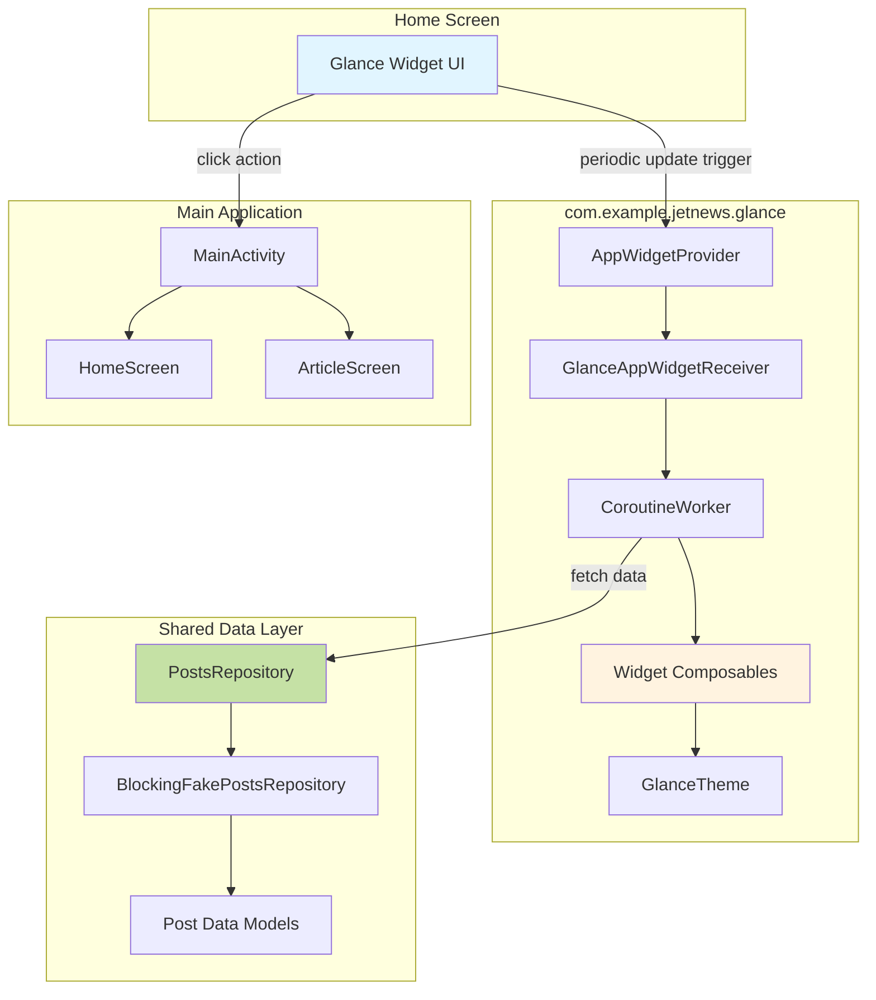
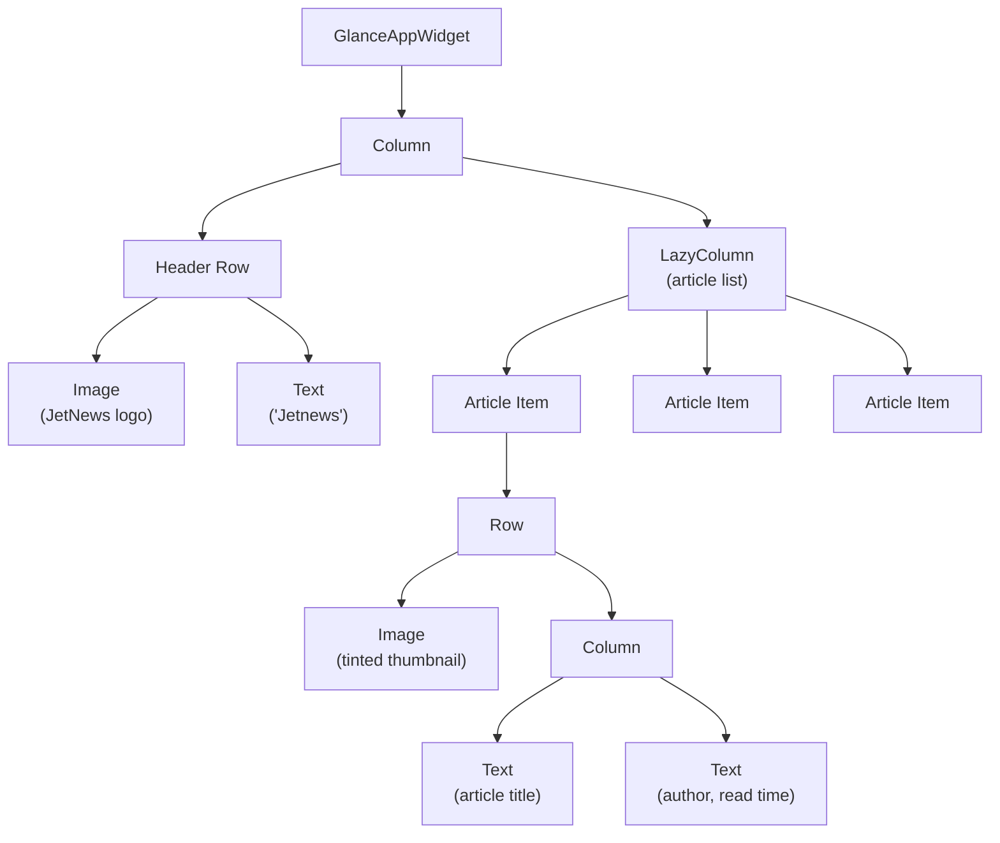
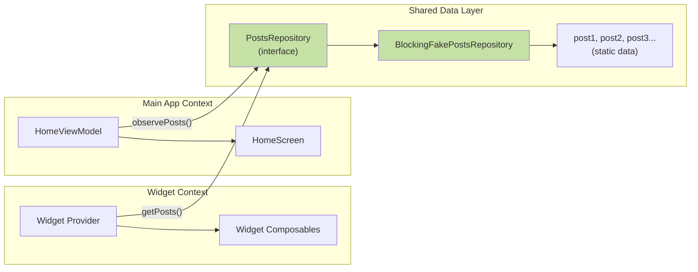
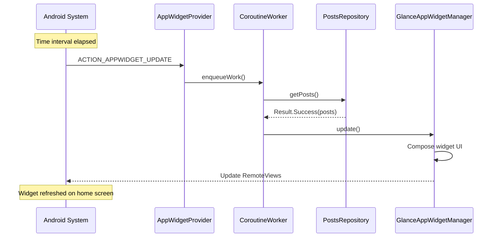
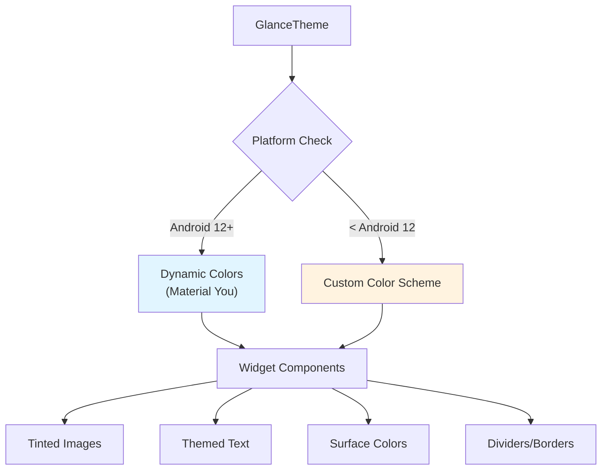
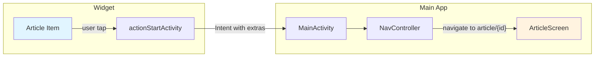
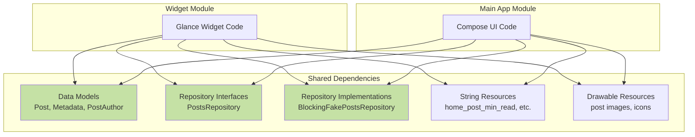
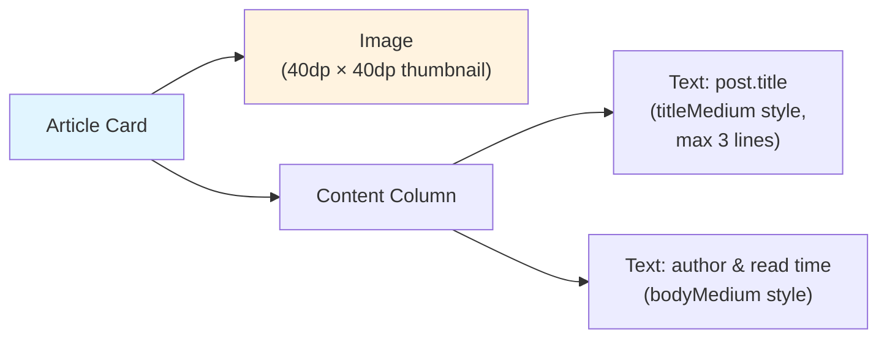

<!-- source: DeepWiki mcp.deepwiki.com · repo android/compose-samples · extra page JetNews Glance Widget · fetched 2026-10-23 -->

# JetNews Glance Widget

<details>
<summary>Relevant source files</summary>

The following files were used as context for generating this wiki page:

- [JetNews/README.md](JetNews/README.md)
- [JetNews/app/src/main/java/com/example/jetnews/ui/JetnewsApp.kt](JetNews/app/src/main/java/com/example/jetnews/ui/JetnewsApp.kt)
- [JetNews/app/src/main/java/com/example/jetnews/ui/article/ArticleScreen.kt](JetNews/app/src/main/java/com/example/jetnews/ui/article/ArticleScreen.kt)
- [JetNews/app/src/main/java/com/example/jetnews/ui/article/PostContent.kt](JetNews/app/src/main/java/com/example/jetnews/ui/article/PostContent.kt)
- [JetNews/app/src/main/java/com/example/jetnews/ui/home/PostCardTop.kt](JetNews/app/src/main/java/com/example/jetnews/ui/home/PostCardTop.kt)
- [JetNews/app/src/main/java/com/example/jetnews/ui/home/PostCardYourNetwork.kt](JetNews/app/src/main/java/com/example/jetnews/ui/home/PostCardYourNetwork.kt)
- [JetNews/app/src/main/java/com/example/jetnews/ui/home/PostCards.kt](JetNews/app/src/main/java/com/example/jetnews/ui/home/PostCards.kt)
- [JetNews/app/src/main/java/com/example/jetnews/ui/interests/InterestsScreen.kt](JetNews/app/src/main/java/com/example/jetnews/ui/interests/InterestsScreen.kt)
- [JetNews/app/src/main/java/com/example/jetnews/ui/interests/SelectTopicButton.kt](JetNews/app/src/main/java/com/example/jetnews/ui/interests/SelectTopicButton.kt)
- [JetNews/app/src/main/res/values/strings.xml](JetNews/app/src/main/res/values/strings.xml)
- [Jetcaster/README.md](Jetcaster/README.md)
- [Jetcaster/docs/tabletop.png](Jetcaster/docs/tabletop.png)
- [Jetchat/README.md](Jetchat/README.md)
- [Jetchat/screenshots/widget.png](Jetchat/screenshots/widget.png)
- [Jetchat/screenshots/widget_discoverability.png](Jetchat/screenshots/widget_discoverability.png)
- [Jetsnack/README.md](Jetsnack/README.md)
- [README.md](README.md)
- [readme/jetcaster-hero.png](readme/jetcaster-hero.png)

</details>


## Purpose and Overview

This document describes the JetNews Glance Widget implementation, which demonstrates how to create Android home screen widgets using Jetpack Glance. Glance enables developers to build widget UIs using Compose-style declarative code, making widget development more accessible and maintainable.

The widget displays a list of news articles from JetNews directly on the home screen, providing users with quick access to content without launching the full application.

For information about the main JetNews UI screens and navigation, see [JetNews UI Architecture](#4.1.1). For the overall JetNews application structure and architecture patterns, see [JetNews](#4.1).

## Implementation Location

The widget code is located in the `com.example.jetnews.glance` package, separate from the main UI code but sharing the same data repositories to enable code reuse.

Sources: [JetNews/README.md:74-89]()

## Key Features

The JetNews Glance Widget demonstrates several important widget development patterns:

- **Glance UI Components**: Uses `Row`, `Column`, and `LazyColumn` to arrange widget content
- **Data Integration**: Reuses the app's existing repository layer to fetch article data
- **Periodic Updates**: Configured with `android:updatePeriodMillis` for automatic refresh
- **Material 3 Theming**: Implements `GlanceTheme` with dynamic color support on Android 12+
- **Image Tinting**: Applies theme colors to images for visual consistency
- **Click Actions**: Uses `actionStartActivity` to launch the main app when users tap articles

Sources: [JetNews/README.md:80-88]()

## Architecture Overview



Sources: [JetNews/README.md:74-89]()

## Glance Composables and Layout

### Widget UI Components

Glance provides composables that mirror Jetpack Compose APIs but are specifically designed for the widget rendering environment:

| Glance Composable | Purpose | Compose Equivalent |
|-------------------|---------|-------------------|
| `Column` | Vertical layout container | `androidx.compose.foundation.layout.Column` |
| `Row` | Horizontal layout container | `androidx.compose.foundation.layout.Row` |
| `LazyColumn` | Scrollable vertical list | `androidx.compose.foundation.lazy.LazyColumn` |
| `Image` | Display graphics | `androidx.compose.foundation.Image` |
| `Text` | Display text content | `androidx.compose.material3.Text` |
| `Button` | Interactive element | `androidx.compose.material3.Button` |

### Widget Layout Structure



Sources: [JetNews/README.md:80-81]()

## Data Integration

### Repository Access Pattern

The widget accesses article data through the same repository layer used by the main application, demonstrating proper architectural separation:



The widget uses the `BlockingFakePostsRepository` implementation, which provides static sample articles defined in the `com.example.jetnews.data.posts.impl` package. The repository returns `Post` objects with structured data including title, author, read time, and image resources.

Sources: [JetNews/README.md:82](), [JetNews/app/src/main/java/com/example/jetnews/ui/article/ArticleScreen.kt:59-60](), [JetNews/app/src/main/java/com/example/jetnews/ui/home/PostCards.kt:49-50]()

### Post Data Model

The widget displays `Post` objects with the following key properties:
- `id`: Unique identifier
- `title`: Article title
- `metadata`: Contains `author` (with `name` property) and `readTimeMinutes`
- `imageId`: Resource ID for article image
- `imageThumbId`: Resource ID for thumbnail

Sources: [JetNews/app/src/main/java/com/example/jetnews/ui/article/PostContent.kt:70-76](), [JetNews/app/src/main/java/com/example/jetnews/ui/home/PostCards.kt:55-67]()

## Update Mechanism

### Periodic Update Configuration

The widget is configured in XML to refresh periodically using the Android widget framework:



The `android:updatePeriodMillis` attribute in the widget provider XML configuration controls how frequently the system triggers updates. The widget then fetches fresh data from the repository and recomposes the UI.

Sources: [JetNews/README.md:83]()

### Manual Update Triggers

In addition to periodic updates, widgets can be manually refreshed when:
- The widget is first added to the home screen
- The device configuration changes (e.g., orientation, locale)
- The user explicitly requests a refresh
- The main app updates data and notifies the widget

## Theming and Styling

### Material 3 Theme Integration

The widget uses the `androidx.glance:glance-material3` library to provide Material Design 3 theming capabilities:



### Color Application

On Android 12+ devices with dynamic color support, the widget automatically adapts its colors based on the user's wallpaper. This provides a personalized, cohesive experience that matches the system UI.

For older Android versions, a custom `GlanceTheme` provides fallback colors that maintain brand consistency with the JetNews application.

### Image Tinting

Article thumbnails and iconography are tinted to match the current color scheme. This ensures visual harmony and maintains readability across different theme configurations.

Sources: [JetNews/README.md:84-86]()

## Click Handling and Navigation

### Activity Launch Actions

When users tap on articles in the widget, the `actionStartActivity` API launches the main JetNews application:



The action passes the article ID as an intent extra, allowing the main application to navigate directly to the specific article detail screen. This provides a seamless transition from the widget context to the full app experience.

Sources: [JetNews/README.md:87]()

### Deep Link Integration

The navigation flow uses the same `JetnewsNavigationActions` and `JetnewsNavGraph` components that power in-app navigation, ensuring consistent routing behavior.

Sources: [JetNews/app/src/main/java/com/example/jetnews/ui/JetnewsApp.kt:36-48]()

## Widget Configuration

### Required Android Manifest Declarations

A typical Glance widget requires the following manifest configuration:

```xml
<receiver android:name=".glance.JetNewsWidgetReceiver"
    android:exported="true">
    <intent-filter>
        <action android:name="android.appwidget.action.APPWIDGET_UPDATE" />
    </intent-filter>
    <meta-data
        android:name="android.appwidget.provider"
        android:resource="@xml/jetnews_widget_info" />
</receiver>
```

### Widget Provider XML

The widget info XML (typically `res/xml/jetnews_widget_info.xml`) defines:

| Attribute | Purpose |
|-----------|---------|
| `android:initialLayout` | Layout shown while widget loads |
| `android:updatePeriodMillis` | Update frequency (minimum 30 minutes) |
| `android:minWidth` | Minimum widget width in dp |
| `android:minHeight` | Minimum widget height in dp |
| `android:previewImage` | Preview shown in widget picker |
| `android:resizeMode` | Horizontal/vertical resize options |
| `android:widgetCategory` | Home screen, lock screen, or both |

## Shared Architecture Components

### Common Dependencies

The widget and main application share several architectural layers:



This architectural approach minimizes code duplication and ensures consistent data handling across both contexts.

Sources: [JetNews/README.md:82](), [JetNews/app/src/main/java/com/example/jetnews/ui/article/ArticleScreen.kt:59-60]()

## Widget vs. Main App UI Comparison

### Technical Differences

| Aspect | Main Application | Glance Widget |
|--------|------------------|---------------|
| **UI Framework** | Jetpack Compose | Jetpack Glance |
| **Rendering** | Direct composition | RemoteViews-based |
| **Layout APIs** | `Column`, `Row`, `LazyColumn` | Glance `Column`, `Row`, `LazyColumn` |
| **Theming** | `MaterialTheme` composable | `GlanceTheme` composable |
| **State Management** | `ViewModel` + `StateFlow` | Provider-managed state |
| **Navigation** | Navigation Compose | `actionStartActivity` intents |
| **Update Model** | Reactive (immediate) | Periodic (system-driven) |
| **Interactivity** | Full touch/gesture support | Limited click actions |
| **Data Source** | `PostsRepository` | `PostsRepository` (shared) |

### Visual Consistency

Despite the different rendering technologies, both contexts display articles with similar visual elements:
- Article title styled with `MaterialTheme.typography.titleMedium` or equivalent
- Author and read time formatted using the same string resource (`home_post_min_read`)
- Thumbnail images with consistent aspect ratios
- Theme-appropriate color schemes

Sources: [JetNews/README.md:74-88](), [JetNews/app/src/main/java/com/example/jetnews/ui/home/PostCards.kt:82-88](), [JetNews/app/src/main/res/values/strings.xml:39]()

## Article Display Format

### Content Presentation

Each article item in the widget displays structured information similar to the main app's `PostCardSimple` component:



The metadata string follows the format defined in `strings.xml`:
- Pattern: `home_post_min_read` → `"%1$s - %2$d min read"`
- Example: "John Doe - 5 min read"

Sources: [JetNews/app/src/main/java/com/example/jetnews/ui/home/PostCards.kt:82-88](), [JetNews/app/src/main/res/values/strings.xml:39]()

## Benefits of the Glance Approach

### Developer Experience Advantages

1. **Familiar API Surface**: Developers experienced with Jetpack Compose can immediately understand Glance composables, reducing the learning curve for widget development

2. **Code Reuse**: Sharing the data layer (`PostsRepository`, `Post` models) eliminates duplication and ensures consistency

3. **Type Safety**: Compile-time type checking for widget UI code, unlike traditional XML-based RemoteViews construction

4. **Declarative Paradigm**: UI state is described, not imperatively constructed, making the code easier to reason about and maintain

5. **Modern Theming**: Built-in Material 3 support with dynamic colors provides a polished, system-integrated appearance

6. **Testing**: Glance composables can be tested with similar tooling and patterns used for Jetpack Compose UI testing

Sources: [JetNews/README.md:74-88]()

## Summary

The JetNews Glance Widget demonstrates modern Android widget development using declarative UI principles. Key accomplishments include:

- **Compose-Style Declarative UI**: Familiar composable patterns for widget construction
- **Architectural Consistency**: Shared data models and repository layer with the main application  
- **Material 3 Theming**: Dynamic color support and theme consistency
- **Efficient Updates**: Periodic refresh mechanism with proper background work scheduling
- **Seamless Integration**: Click actions that launch the main app with proper deep linking

The implementation in the `com.example.jetnews.glance` package showcases best practices for building maintainable, visually consistent widgets that complement the main application while respecting system resource constraints and user experience expectations.

Sources: [JetNews/README.md:74-89]()

---

