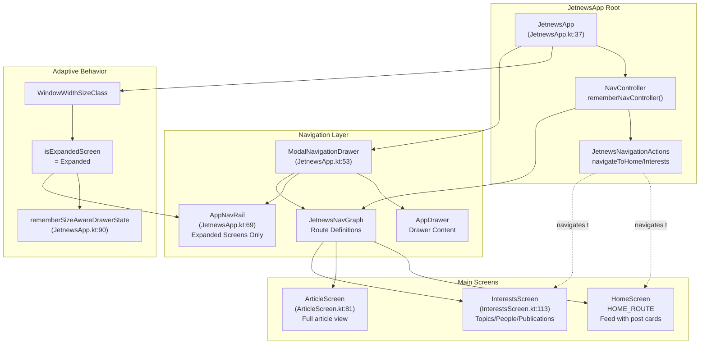
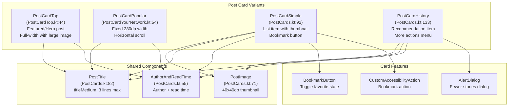
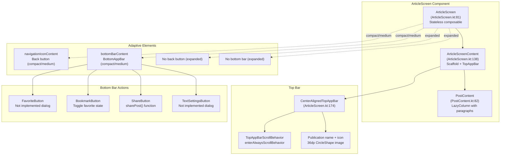
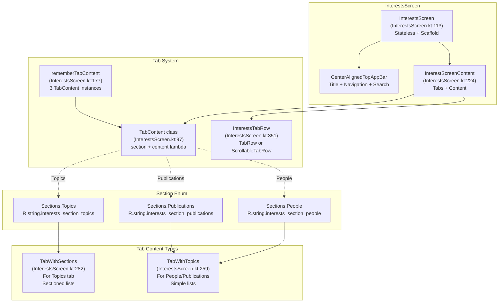
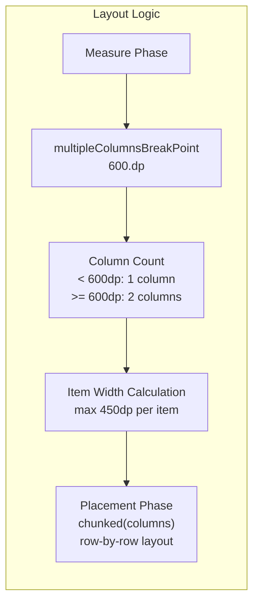
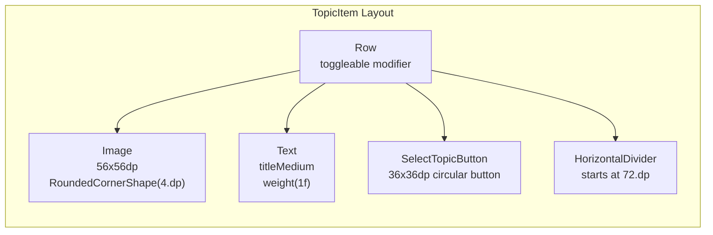

<!-- source: DeepWiki mcp.deepwiki.com · repo android/compose-samples · extra page JetNews UI Architecture · fetched 2026-10-23 -->

# JetNews UI Architecture

<details>
<summary>Relevant source files</summary>

The following files were used as context for generating this wiki page:

- [JetNews/app/src/main/java/com/example/jetnews/ui/JetnewsApp.kt](JetNews/app/src/main/java/com/example/jetnews/ui/JetnewsApp.kt)
- [JetNews/app/src/main/java/com/example/jetnews/ui/article/ArticleScreen.kt](JetNews/app/src/main/java/com/example/jetnews/ui/article/ArticleScreen.kt)
- [JetNews/app/src/main/java/com/example/jetnews/ui/article/PostContent.kt](JetNews/app/src/main/java/com/example/jetnews/ui/article/PostContent.kt)
- [JetNews/app/src/main/java/com/example/jetnews/ui/home/PostCardTop.kt](JetNews/app/src/main/java/com/example/jetnews/ui/home/PostCardTop.kt)
- [JetNews/app/src/main/java/com/example/jetnews/ui/home/PostCardYourNetwork.kt](JetNews/app/src/main/java/com/example/jetnews/ui/home/PostCardYourNetwork.kt)
- [JetNews/app/src/main/java/com/example/jetnews/ui/home/PostCards.kt](JetNews/app/src/main/java/com/example/jetnews/ui/home/PostCards.kt)
- [JetNews/app/src/main/java/com/example/jetnews/ui/interests/InterestsScreen.kt](JetNews/app/src/main/java/com/example/jetnews/ui/interests/InterestsScreen.kt)
- [JetNews/app/src/main/java/com/example/jetnews/ui/interests/SelectTopicButton.kt](JetNews/app/src/main/java/com/example/jetnews/ui/interests/SelectTopicButton.kt)
- [JetNews/app/src/main/res/values/strings.xml](JetNews/app/src/main/res/values/strings.xml)

</details>


## Purpose and Scope

This document details the UI architecture of the JetNews sample application, covering its screen composition, navigation structure, adaptive layout system, and custom UI components. This focuses specifically on the UI layer implementation and component hierarchy. For information about state management patterns in JetNews, see [UI State Management Patterns](#5.1). For navigation patterns across multiple samples, see [Navigation Patterns](#5.3).

## UI Architecture Overview

JetNews implements a Material Design 3 interface with three primary screens and an adaptive navigation system that transforms based on screen size.

### Screen and Navigation Structure



**Sources:** [JetNews/app/src/main/java/com/example/jetnews/ui/JetnewsApp.kt:36-103]()

### Adaptive Navigation Pattern

JetNews uses a size-aware navigation system that presents different UI patterns based on screen width:

| Screen Size | Navigation Component | Drawer Behavior | Layout |
|-------------|---------------------|-----------------|---------|
| Compact | `ModalNavigationDrawer` | Gesture-enabled, overlays content | Single pane |
| Medium | `ModalNavigationDrawer` | Gesture-enabled, overlays content | Single pane |
| Expanded | `AppNavRail` + locked drawer | Gestures disabled, always visible | Rail + content |

The `rememberSizeAwareDrawerState` function at [JetNews/app/src/main/java/com/example/jetnews/ui/JetnewsApp.kt:90-103]() returns either a remembered `DrawerState` for compact/medium screens or an always-closed `DrawerState` for expanded screens, preventing the drawer from opening when the nav rail is visible.

**Sources:** [JetNews/app/src/main/java/com/example/jetnews/ui/JetnewsApp.kt:37-84](), [JetNews/app/src/main/java/com/example/jetnews/ui/JetnewsApp.kt:90-103]()

## Home Screen Architecture

The Home screen displays a feed of posts using multiple card variants optimized for different content types and layout positions.

### Post Card Component Hierarchy



**Sources:** [JetNews/app/src/main/java/com/example/jetnews/ui/home/PostCardTop.kt:44-85](), [JetNews/app/src/main/java/com/example/jetnews/ui/home/PostCardYourNetwork.kt:54-99](), [JetNews/app/src/main/java/com/example/jetnews/ui/home/PostCards.kt:54-194]()

### Post Card Design Specifications

**PostCardTop** [JetNews/app/src/main/java/com/example/jetnews/ui/home/PostCardTop.kt:44-85]():
- Full-width layout with 16dp padding
- Image: minimum 180dp height, clipped with `MaterialTheme.shapes.large`
- Typography: `titleLarge` for title, `labelLarge` for author, `bodySmall` for metadata
- Used for featured/hero content at the top of the feed

**PostCardPopular** [JetNews/app/src/main/java/com/example/jetnews/ui/home/PostCardYourNetwork.kt:54-99]():
- Fixed width: 280dp (enables horizontal scrolling)
- Image: 100dp height, cropped with `ContentScale.Crop`
- Card with `MaterialTheme.shapes.medium`
- Typography: `headlineSmall` for title (2 lines max), `bodyMedium` for author, `bodySmall` for metadata
- Used in horizontal "Popular on Jetnews" section

**PostCardSimple** [JetNews/app/src/main/java/com/example/jetnews/ui/home/PostCards.kt:92-130]():
- Row layout: 40x40dp thumbnail + content + bookmark button
- Implements `CustomAccessibilityAction` for bookmark toggle at row level
- Uses `clearAndSetSemantics {}` on bookmark button to prevent double announcements
- Used for standard feed items

**PostCardHistory** [JetNews/app/src/main/java/com/example/jetnews/ui/home/PostCards.kt:133-194]():
- Similar layout to `PostCardSimple` but with "More" menu instead of bookmark
- Shows "BASED ON YOUR HISTORY" label
- AlertDialog for "Show fewer stories like this?" functionality
- Used for recommendation sections

**Sources:** [JetNews/app/src/main/java/com/example/jetnews/ui/home/PostCardTop.kt:43-86](), [JetNews/app/src/main/java/com/example/jetnews/ui/home/PostCardYourNetwork.kt:52-99](), [JetNews/app/src/main/java/com/example/jetnews/ui/home/PostCards.kt:54-194]()

## Article Screen Architecture

The Article screen displays full post content with adaptive UI elements based on screen size.

### Article Screen Structure



**Sources:** [JetNews/app/src/main/java/com/example/jetnews/ui/article/ArticleScreen.kt:79-164](), [JetNews/app/src/main/java/com/example/jetnews/ui/article/ArticleScreen.kt:166-195]()

### Article Content Rendering

The `PostContent` composable at [JetNews/app/src/main/java/com/example/jetnews/ui/article/PostContent.kt:82-95]() renders article content as a `LazyColumn` with the following structure:

1. **Header Image** - `PostHeaderImage` with minimum 180dp height, clipped to `MaterialTheme.shapes.large`
2. **Title** - `MaterialTheme.typography.headlineLarge`
3. **Subtitle** - Optional, `MaterialTheme.typography.bodyMedium`
4. **Metadata** - `PostMetadata` component with author avatar, name, date, and read time
5. **Paragraphs** - Multiple `Paragraph` components with type-specific styling

### Paragraph Type Rendering

The `Paragraph` composable at [JetNews/app/src/main/java/com/example/jetnews/ui/article/PostContent.kt:162-196]() handles different paragraph types:

| ParagraphType | TextStyle | Special Rendering | Trailing Padding |
|---------------|-----------|-------------------|------------------|
| `Caption` | `labelMedium` | Standard text | 24dp |
| `Title` | `headlineLarge` | Standard text | 24dp |
| `Subhead` | `headlineSmall` | Standard text | 16dp |
| `Text` | `bodyLarge` (28.sp lineHeight) | Standard text | 24dp |
| `Header` | `headlineMedium` | Standard text | 16dp |
| `CodeBlock` | `bodyLarge` (Monospace) | `Surface` with `codeBlockBackground` | 24dp |
| `Quote` | `bodyLarge` | Standard text | 24dp |
| `Bullet` | `bodyLarge` | Custom bullet point with `BulletParagraph` | 24dp |

**CodeBlock Rendering** [JetNews/app/src/main/java/com/example/jetnews/ui/article/PostContent.kt:198-211]():
- Wrapped in a `Surface` with `MaterialTheme.colorScheme.codeBlockBackground`
- Background color calculated as `onSurface.copy(alpha = .15f)`
- Small rounded corners: `MaterialTheme.shapes.small`
- 16dp padding

**Bullet Rendering** [JetNews/app/src/main/java/com/example/jetnews/ui/article/PostContent.kt:214-236]():
- Custom `Row` layout with 8sp circle as bullet point
- Circle aligned 1sp below bottom with `alignBy` modifier
- Text uses `ParagraphStyle(textIndent = TextIndent(firstLine = 8.sp))`

**Markup Types** [JetNews/app/src/main/java/com/example/jetnews/ui/article/PostContent.kt:282-317]():
- `MarkupType.Italic`: `FontStyle.Italic`
- `MarkupType.Link`: `TextDecoration.Underline`
- `MarkupType.Bold`: `FontWeight.Bold`
- `MarkupType.Code`: `codeBlockBackground` + `FontFamily.Monospace`

**Sources:** [JetNews/app/src/main/java/com/example/jetnews/ui/article/PostContent.kt:82-332](), [JetNews/app/src/main/java/com/example/jetnews/ui/article/ArticleScreen.kt:79-127]()

## Interests Screen Architecture

The Interests screen implements a tabbed interface with custom adaptive layouts for topic selection across three categories.

### Interests Screen Component Structure



**Sources:** [JetNews/app/src/main/java/com/example/jetnews/ui/interests/InterestsScreen.kt:81-242]()

### Tab Content Implementation

The `rememberTabContent` function at [JetNews/app/src/main/java/com/example/jetnews/ui/interests/InterestsScreen.kt:177-212]() creates three `TabContent` instances:

1. **Topics Section** - Uses `TabWithSections` to display topics grouped by category (e.g., "Android", "Programming", "Design")
2. **People Section** - Uses `TabWithTopics` to display a flat list of people
3. **Publications Section** - Uses `TabWithTopics` to display a flat list of publications

Each tab observes separate state flows from `InterestsViewModel`:
- `uiState.topics`, `uiState.people`, `uiState.publications` - Available items
- `selectedTopics`, `selectedPeople`, `selectedPublications` - Selection state
- `toggleTopicSelection()`, `togglePersonSelected()`, `togglePublicationSelected()` - Toggle events

**Sources:** [JetNews/app/src/main/java/com/example/jetnews/ui/interests/InterestsScreen.kt:177-212]()

### Adaptive Tab Row

The `InterestsTabRow` at [JetNews/app/src/main/java/com/example/jetnews/ui/interests/InterestsScreen.kt:351-381]() switches between two Material 3 tab components based on screen size:

```kotlin
when (isExpandedScreen) {
    false -> TabRow(selectedTabIndex, contentColor = primary) { /* tabs */ }
    true -> ScrollableTabRow(selectedTabIndex, contentColor = primary, edgePadding = 0.dp) { /* tabs */ }
}
```

- **Compact/Medium**: `TabRow` - Fixed width tabs that equally divide available space
- **Expanded**: `ScrollableTabRow` - Tabs can scroll horizontally, 0dp edge padding, additional 8dp horizontal padding per tab

**Sources:** [JetNews/app/src/main/java/com/example/jetnews/ui/interests/InterestsScreen.kt:350-409]()

### Custom Adaptive Content Layout

The `InterestsAdaptiveContentLayout` at [JetNews/app/src/main/java/com/example/jetnews/ui/interests/InterestsScreen.kt:421-483]() is a custom `Layout` composable that arranges topic items in responsive columns.



**Layout Algorithm** [JetNews/app/src/main/java/com/example/jetnews/ui/interests/InterestsScreen.kt:429-482]():

1. **Column Calculation**: `columns = if (maxWidth < 600.dp) 1 else 2`
2. **Item Width**: 
   - 1 column: Full available width
   - 2 columns: `(maxWidth - spacing) / 2`, capped at 450dp
3. **Measurement**: Each item measured with `itemConstraints` (calculated width)
4. **Row Height Tracking**: `rowHeights[row] = max(currentHeight, itemHeight)` to handle variable heights
5. **Placement**: Items placed in chunks of `columns`, positioned at `(xPosition, yPosition)` coordinates

This creates a responsive grid that:
- Shows 1 column on narrow screens (< 600dp)
- Shows 2 columns on wide screens (≥ 600dp)
- Respects maximum item width of 450dp
- Handles variable item heights within rows
- Uses 4dp spacing between items

**Sources:** [JetNews/app/src/main/java/com/example/jetnews/ui/interests/InterestsScreen.kt:420-483]()

### Topic Item Component

The `TopicItem` composable at [JetNews/app/src/main/java/com/example/jetnews/ui/interests/InterestsScreen.kt:313-345]() renders individual selectable topics:



**Implementation Details**:
- Uses `Modifier.toggleable()` for accessible toggle behavior
- Placeholder 56x56dp image with 4dp rounded corners
- Title uses `weight(1f)` to fill available space and break long text
- `SelectTopicButton` shows check icon when selected, plus icon when unselected
- Divider offset by 72dp to align after the image

**Sources:** [JetNews/app/src/main/java/com/example/jetnews/ui/interests/InterestsScreen.kt:312-345]()

## Custom UI Components

### SelectTopicButton

The `SelectTopicButton` at [JetNews/app/src/main/java/com/example/jetnews/ui/interests/SelectTopicButton.kt:37-67]() is a custom stateless selection indicator:

**Visual States**:

| State | Background | Border | Icon | Icon Color |
|-------|-----------|--------|------|------------|
| Unselected | `colorScheme.onPrimary` | `onSurface.copy(alpha=0.1f)` | `ic_add` | `colorScheme.primary` |
| Selected | `colorScheme.primary` | `colorScheme.primary` | `ic_check` | `colorScheme.onPrimary` |

**Specifications**:
- Size: 36x36dp circular `Surface`
- Shape: `CircleShape`
- Border: 1dp `BorderStroke`
- Icon padding: 8dp
- No content description (toggleable at parent level)

**Sources:** [JetNews/app/src/main/java/com/example/jetnews/ui/interests/SelectTopicButton.kt:36-67]()

### Accessibility Implementation

JetNews implements several accessibility best practices:

**Custom Accessibility Actions** [JetNews/app/src/main/java/com/example/jetnews/ui/home/PostCards.kt:92-130]():
```kotlin
Row(
    modifier = Modifier
        .clickable(onClick = { navigateToArticle(post.id) })
        .semantics {
            customActions = listOf(
                CustomAccessibilityAction(
                    label = bookmarkAction,
                    action = { onToggleFavorite(); true }
                )
            )
        }
)
```
This defines the bookmark action at the row level, allowing accessibility services to present it as a secondary action.

**Clearing Button Semantics** [JetNews/app/src/main/java/com/example/jetnews/ui/home/PostCards.kt:125-127]():
```kotlin
BookmarkButton(
    modifier = Modifier.clearAndSetSemantics {}
)
```
Removes button-level semantics to prevent double announcements since the action is defined at the parent level.

**Semantic Headings** [JetNews/app/src/main/java/com/example/jetnews/ui/interests/InterestsScreen.kt:285-290]():
```kotlin
Text(
    text = section,
    modifier = Modifier.semantics { heading() }
)
```
Marks section titles as headings for screen reader navigation.

**Merged Semantics** [JetNews/app/src/main/java/com/example/jetnews/ui/article/PostContent.kt:128-131]():
```kotlin
Row(
    modifier = modifier.semantics(mergeDescendants = true) {}
)
```
Treats the entire metadata row as a single semantic element for accessibility services.

**Sources:** [JetNews/app/src/main/java/com/example/jetnews/ui/home/PostCards.kt:92-130](), [JetNews/app/src/main/java/com/example/jetnews/ui/interests/InterestsScreen.kt:285-290](), [JetNews/app/src/main/java/com/example/jetnews/ui/article/PostContent.kt:127-159]()

## Material Design 3 Typography Usage

JetNews consistently applies Material Design 3 typography scale:

| Component | Typography Token | Usage |
|-----------|------------------|-------|
| Article title | `headlineLarge` | Main article title, prominent display |
| Post card title (featured) | `titleLarge` | PostCardTop title |
| Post card title (popular) | `headlineSmall` | PostCardPopular title |
| Post card title (simple) | `titleMedium` | PostCardSimple, TopicItem |
| Section headers | `headlineMedium` | Article paragraph headers |
| Author name | `labelLarge` | PostMetadata, PostCardTop |
| Read time / metadata | `bodySmall` | Post metadata throughout |
| Body text | `bodyLarge` | Article paragraph text (28.sp lineHeight) |
| Tab labels | `titleMedium` | Interests screen tabs |
| Interests title | `titleLarge` | Top app bar title |

The consistent typography scale creates visual hierarchy while maintaining Material Design 3 standards.

**Sources:** [JetNews/app/src/main/java/com/example/jetnews/ui/home/PostCardTop.kt:46-83](), [JetNews/app/src/main/java/com/example/jetnews/ui/home/PostCardYourNetwork.kt:72-95](), [JetNews/app/src/main/java/com/example/jetnews/ui/article/PostContent.kt:101-274](), [JetNews/app/src/main/java/com/example/jetnews/ui/interests/InterestsScreen.kt:125-407]()

---

