<!-- source: DeepWiki mcp.deepwiki.com · repo android/compose-samples · extra page Jetcaster Adaptive UI · fetched 2026-10-23 -->

# Jetcaster Adaptive UI

<details>
<summary>Relevant source files</summary>

The following files were used as context for generating this wiki page:

- [Jetcaster/core/data/src/main/java/com/example/jetcaster/core/data/repository/EpisodeStore.kt](Jetcaster/core/data/src/main/java/com/example/jetcaster/core/data/repository/EpisodeStore.kt)
- [Jetcaster/core/designsystem/src/main/java/com/example/jetcaster/designsystem/component/PodcastImage.kt](Jetcaster/core/designsystem/src/main/java/com/example/jetcaster/designsystem/component/PodcastImage.kt)
- [Jetcaster/core/designsystem/src/main/java/com/example/jetcaster/designsystem/theme/Type.kt](Jetcaster/core/designsystem/src/main/java/com/example/jetcaster/designsystem/theme/Type.kt)
- [Jetcaster/core/designsystem/src/main/java/com/example/jetcaster/designsystem/theme/Typography.kt](Jetcaster/core/designsystem/src/main/java/com/example/jetcaster/designsystem/theme/Typography.kt)
- [Jetcaster/core/designsystem/src/main/res/font/roboto_flex.ttf](Jetcaster/core/designsystem/src/main/res/font/roboto_flex.ttf)
- [Jetcaster/mobile/src/main/java/com/example/jetcaster/ui/home/Home.kt](Jetcaster/mobile/src/main/java/com/example/jetcaster/ui/home/Home.kt)
- [Jetcaster/mobile/src/main/java/com/example/jetcaster/ui/home/HomeViewModel.kt](Jetcaster/mobile/src/main/java/com/example/jetcaster/ui/home/HomeViewModel.kt)
- [Jetcaster/mobile/src/main/java/com/example/jetcaster/ui/home/category/PodcastCategory.kt](Jetcaster/mobile/src/main/java/com/example/jetcaster/ui/home/category/PodcastCategory.kt)
- [Jetcaster/mobile/src/main/java/com/example/jetcaster/ui/home/discover/Discover.kt](Jetcaster/mobile/src/main/java/com/example/jetcaster/ui/home/discover/Discover.kt)
- [Jetcaster/mobile/src/main/java/com/example/jetcaster/ui/home/library/Library.kt](Jetcaster/mobile/src/main/java/com/example/jetcaster/ui/home/library/Library.kt)
- [Jetcaster/mobile/src/main/java/com/example/jetcaster/ui/player/PlayerScreen.kt](Jetcaster/mobile/src/main/java/com/example/jetcaster/ui/player/PlayerScreen.kt)
- [Jetcaster/mobile/src/main/java/com/example/jetcaster/ui/podcast/PodcastDetailsScreen.kt](Jetcaster/mobile/src/main/java/com/example/jetcaster/ui/podcast/PodcastDetailsScreen.kt)
- [Jetcaster/mobile/src/main/java/com/example/jetcaster/ui/podcast/PodcastDetailsViewModel.kt](Jetcaster/mobile/src/main/java/com/example/jetcaster/ui/podcast/PodcastDetailsViewModel.kt)
- [Jetcaster/mobile/src/main/java/com/example/jetcaster/ui/theme/Theme.kt](Jetcaster/mobile/src/main/java/com/example/jetcaster/ui/theme/Theme.kt)
- [Jetcaster/mobile/src/main/java/com/example/jetcaster/ui/tooling/DevicePreviews.kt](Jetcaster/mobile/src/main/java/com/example/jetcaster/ui/tooling/DevicePreviews.kt)

</details>


## Purpose and Scope

This document describes Jetcaster's adaptive UI implementation, focusing on how the application adjusts its layout for different screen sizes, device postures, and form factors. The adaptive system enables dual-pane layouts on large screens and foldable devices while maintaining a single-pane experience on compact devices.

For information about Jetcaster's overall architecture and state management, see [4.6.1](#4.6.1). For cross-cutting adaptive UI patterns across multiple samples, see [5.2](#5.2).

## SupportingPaneScaffold Overview

Jetcaster's home screen uses Material 3's `SupportingPaneScaffold` to create adaptive dual-pane layouts. This scaffold automatically manages the visibility and arrangement of main and supporting panes based on screen size and device characteristics.

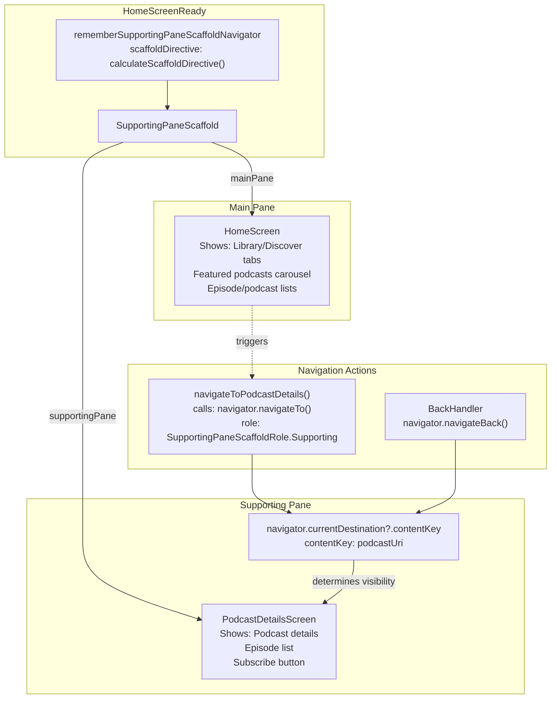

Sources: [Jetcaster/mobile/src/main/java/com/example/jetcaster/ui/home/Home.kt:239-308]()

### Main and Supporting Panes

The `SupportingPaneScaffold` manages two content areas:

| Pane | Role | Content | Visibility Logic |
|------|------|---------|------------------|
| **Main Pane** | `SupportingPaneScaffoldRole.Main` | `HomeScreen` composable with podcast feed | Always visible unless explicitly hidden by scaffold |
| **Supporting Pane** | `SupportingPaneScaffoldRole.Supporting` | `PodcastDetailsScreen` when podcast selected | Conditional on `navigator.currentDestination?.contentKey` |

The supporting pane is populated dynamically based on the `contentKey` (podcast URI) stored in the navigator's current destination. When no podcast is selected, the supporting pane remains empty.

Sources: [Jetcaster/mobile/src/main/java/com/example/jetcaster/ui/home/Home.kt:262-304]()

### Navigation Flow

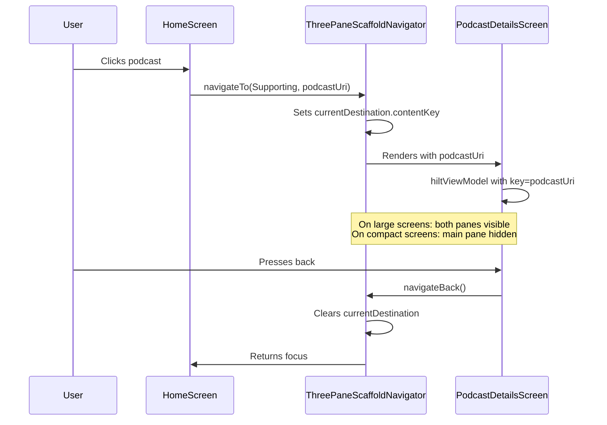

Sources: [Jetcaster/mobile/src/main/java/com/example/jetcaster/ui/home/Home.kt:273-303]()

The navigation system uses `rememberSupportingPaneScaffoldNavigator<String>()` with a string type parameter representing the podcast URI. The `navigateTo()` method accepts a `SupportingPaneScaffoldRole` and content key, storing the podcast URI for state restoration.

## Custom Scaffold Directive

Jetcaster customizes the default `PaneScaffoldDirective` behavior with `calculateScaffoldDirective()`, which modifies when dual-pane layouts are shown.

### Default Behavior vs. Custom Behavior

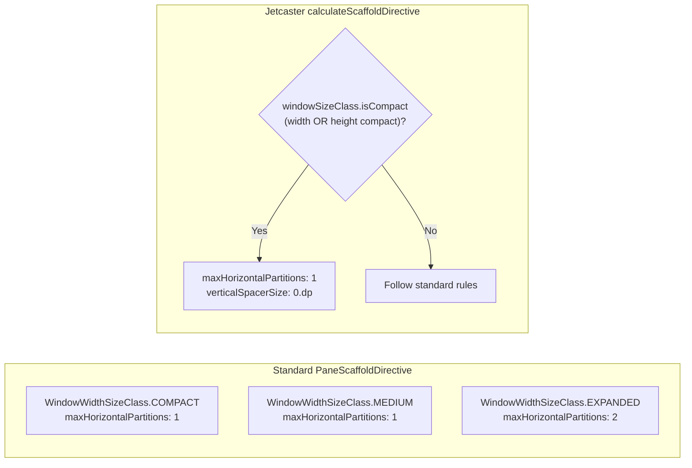

Sources: [Jetcaster/mobile/src/main/java/com/example/jetcaster/ui/home/Home.kt:133-182]()

### Implementation Details

The `calculateScaffoldDirective()` function implements a critical modification: it limits layouts to one horizontal pane if **either** width **or** height is compact, whereas the standard directive only checks width.

| Parameter | Standard Behavior | Jetcaster Custom Behavior |
|-----------|-------------------|---------------------------|
| `maxHorizontalPartitions` | Based on `WindowWidthSizeClass` only | 1 if `windowSizeClass.isCompact` (checks both dimensions) |
| `verticalSpacerSize` | 0.dp (Compact), 24.dp (Expanded) | 0.dp if either dimension compact, else 24.dp |
| `maxVerticalPartitions` | 1 (standard) | 2 if `isTabletop`, else 1 |
| `horizontalSpacerSize` | 0.dp | 24.dp if tabletop, else 0.dp |
| `defaultPanePreferredWidth` | 360.dp | 360.dp |

The `windowSizeClass.isCompact` extension function checks:

```kotlin
// Implementation in util package
fun WindowSizeClass.isCompact(): Boolean =
    windowWidthSizeClass == WindowWidthSizeClass.COMPACT ||
    windowHeightSizeClass == WindowHeightSizeClass.COMPACT
```

This ensures that devices in landscape orientation with compact height (e.g., phones in landscape) display only one pane horizontally.

Sources: [Jetcaster/mobile/src/main/java/com/example/jetcaster/ui/home/Home.kt:133-182](), [Jetcaster/mobile/src/main/java/com/example/jetcaster/util/WindowSize.kt:115]()

### Vertical Hinge Exclusion

The scaffold directive also manages vertical hinge bounds using `getExcludedVerticalBounds()`:

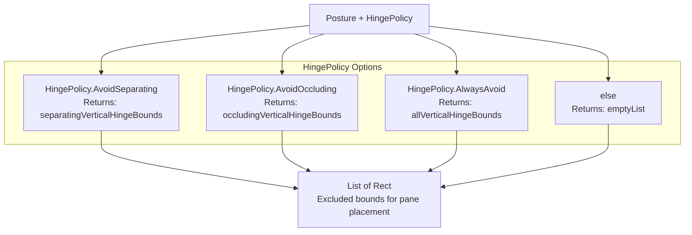

Sources: [Jetcaster/mobile/src/main/java/com/example/jetcaster/ui/home/Home.kt:187-192]()

## Device Posture Support

Jetcaster detects and responds to device postures, particularly for foldable devices in tabletop mode (half-folded with horizontal hinge).

### Posture Detection

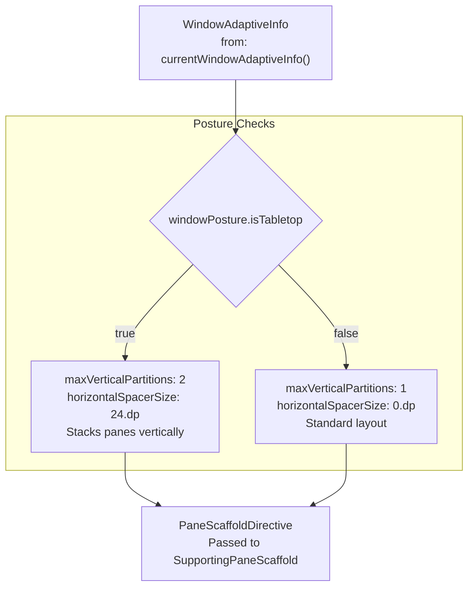

Sources: [Jetcaster/mobile/src/main/java/com/example/jetcaster/ui/home/Home.kt:164-170]()

### Tabletop Mode Layout

When a foldable device is in tabletop posture (half-folded horizontally), Jetcaster automatically adjusts to a vertical two-pane layout:

- **maxVerticalPartitions = 2**: Allows top and bottom panes
- **horizontalSpacerSize = 24.dp**: Adds spacing between panes
- Content naturally avoids the fold line

This contrasts with book posture (vertical fold) where `maxHorizontalPartitions = 2` is used instead for side-by-side panes.

Sources: [Jetcaster/mobile/src/main/java/com/example/jetcaster/ui/home/Home.kt:164-170]()

## Player Screen Adaptive Layouts

The `PlayerScreen` uses a different adaptive strategy with the Accompanist `TwoPane` component, providing three distinct layout configurations based on screen size and device posture.

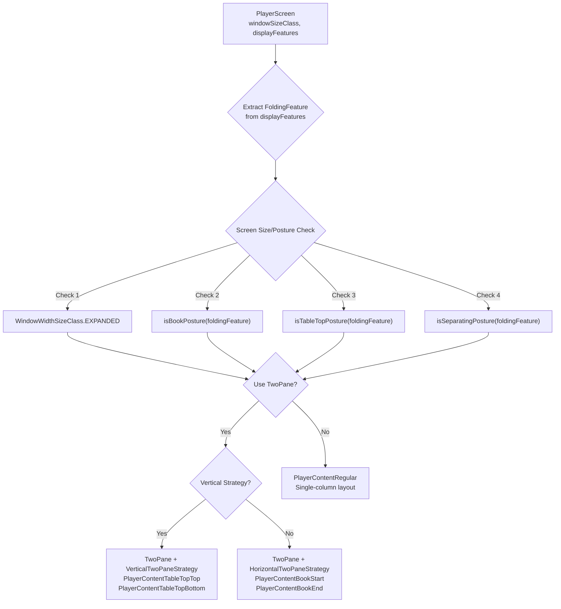

Sources: [Jetcaster/mobile/src/main/java/com/example/jetcaster/ui/player/PlayerScreen.kt:254-334]()

### Layout Configurations

| Configuration | Trigger Condition | Strategy | First Pane | Second Pane |
|---------------|-------------------|----------|------------|-------------|
| **Regular** | Compact screen, no fold | Single column | N/A | N/A |
| **Tabletop** | `isTableTopPosture()` OR horizontal separating fold | `VerticalTwoPaneStrategy(0.5f)` | `PlayerContentTableTopTop` (image) | `PlayerContentTableTopBottom` (controls) |
| **Book** | `isBookPosture()` OR `WindowWidthSizeClass.EXPANDED` OR vertical separating fold | `HorizontalTwoPaneStrategy(0.5f)` | `PlayerContentBookStart` (metadata) | `PlayerContentBookEnd` (image + controls) |

Sources: [Jetcaster/mobile/src/main/java/com/example/jetcaster/ui/player/PlayerScreen.kt:258-324]()

### Posture Detection Functions

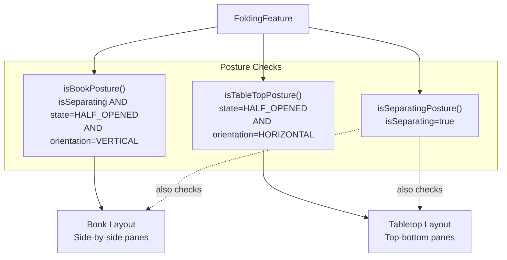

Sources: [Jetcaster/mobile/src/main/java/com/example/jetcaster/util/WindowSize.kt:27-52]()

The posture detection functions in `WindowSize.kt` examine `FoldingFeature` properties:

- **`isBookPosture()`**: Checks for `isSeparating && state == HALF_OPENED && orientation == VERTICAL`
- **`isTableTopPosture()`**: Checks for `state == HALF_OPENED && orientation == HORIZONTAL`
- **`isSeparatingPosture()`**: Simply checks `isSeparating` property

These utility functions abstract the complexity of foldable device detection and provide clear boolean results for layout decisions.

Sources: [Jetcaster/mobile/src/main/java/com/example/jetcaster/util/WindowSize.kt:27-52]()

### Regular Layout (Compact)

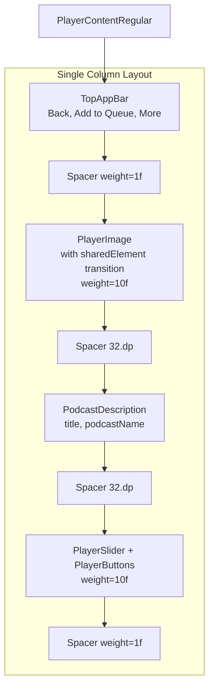

Sources: [Jetcaster/mobile/src/main/java/com/example/jetcaster/ui/player/PlayerScreen.kt:340-424]()

The regular layout uses a single `Column` with weighted spacers to distribute content vertically. The image occupies most space (`weight=10f`) with controls below.

### Tabletop Layout (Folded Horizontally)

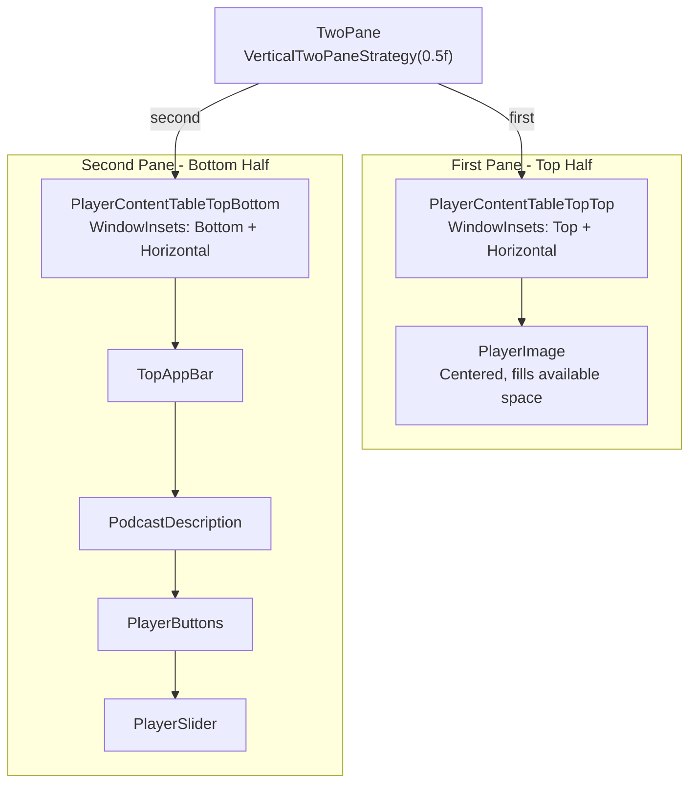

Sources: [Jetcaster/mobile/src/main/java/com/example/jetcaster/ui/player/PlayerScreen.kt:276-293](), [Jetcaster/mobile/src/main/java/com/example/jetcaster/ui/player/PlayerScreen.kt:430-509]()

The tabletop layout leverages the physical fold of the device:
- **Top pane**: Large podcast artwork viewable while device rests on surface
- **Bottom pane**: Interactive controls accessible in the lower half
- Each pane applies appropriate `WindowInsets` to avoid system UI overlaps

### Book Layout (Folded Vertically / Large Screen)

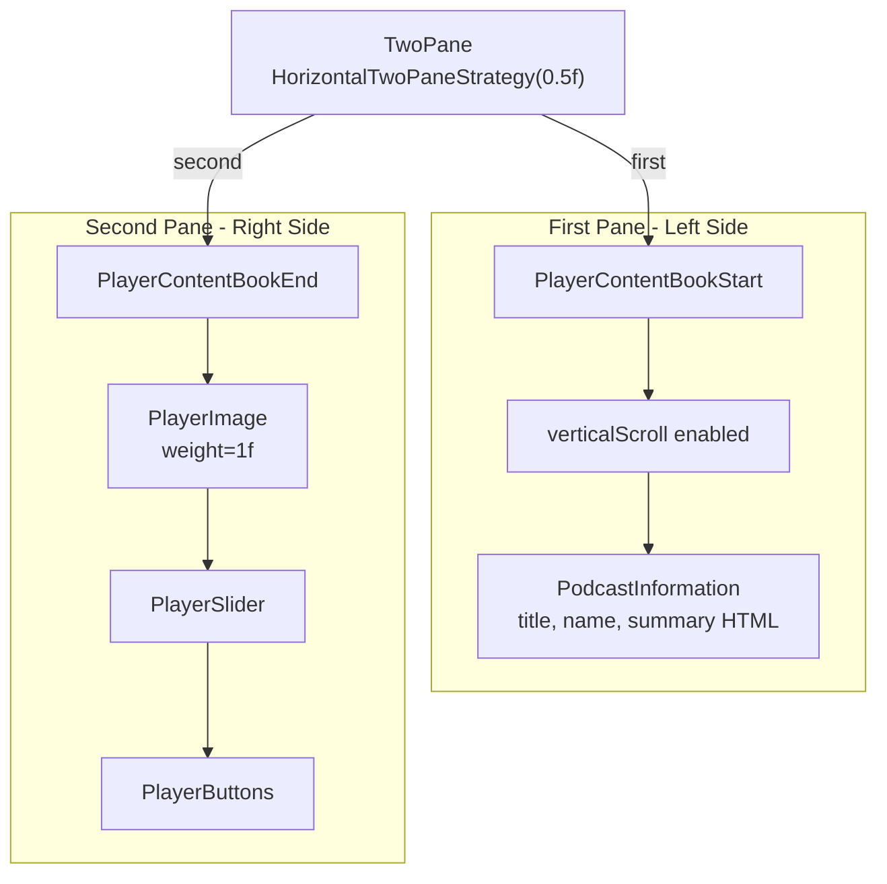

Sources: [Jetcaster/mobile/src/main/java/com/example/jetcaster/ui/player/PlayerScreen.kt:310-323](), [Jetcaster/mobile/src/main/java/com/example/jetcaster/ui/player/PlayerScreen.kt:515-573]()

The book layout splits functionality across two panes:
- **Left pane**: Scrollable podcast metadata (title, description, summary)
- **Right pane**: Visual elements (artwork) and playback controls

This layout is activated for:
- Large screens (`WindowWidthSizeClass.EXPANDED`)
- Foldable devices in book posture (vertical fold)
- Any device with a separating vertical fold

## Pane Visibility States

The `ThreePaneScaffoldNavigator` manages pane visibility through the `scaffoldValue` property, which maps pane roles to their adapted states.

```mermaid
stateDiagram-v2
    [*] --> SinglePane: Compact Screen
    SinglePane --> DualPane: Navigate to Supporting
    DualPane --> SinglePane: Back Navigation
    
    state SinglePane {
        [*] --> MainVisible
        MainVisible: Main=Expanded
        MainVisible: Supporting=Hidden
    }
    
    state DualPane {
        [*] --> BothVisible
        BothVisible: Main=Expanded
        BothVisible: Supporting=Expanded
    }
    
    state MainHidden {
        MainHidden: Main=Hidden
        MainHidden: Supporting=Expanded
        note right of MainHidden: Compact screen with<br/>supporting pane active
    }
    
    SinglePane --> MainHidden: Navigate (Compact)
    MainHidden --> SinglePane: Back
```

The `isMainPaneHidden()` extension function checks if the main pane is hidden:

```kotlin
private fun <T> ThreePaneScaffoldNavigator<T>.isMainPaneHidden(): Boolean =
    scaffoldValue[SupportingPaneScaffoldRole.Main] == PaneAdaptedValue.Hidden
```

This is used to determine whether to show a back button in the `PodcastDetailsScreen`. When the main pane is hidden (compact screen), the back button is displayed. On larger screens where both panes are visible, the back button is omitted since the user can simply select a different podcast from the main pane.

Sources: [Jetcaster/mobile/src/main/java/com/example/jetcaster/ui/home/Home.kt:125-127](), [Jetcaster/mobile/src/main/java/com/example/jetcaster/ui/home/Home.kt:301]()

## Integration with WindowAdaptiveInfo

The adaptive system relies on `WindowAdaptiveInfo` from `currentWindowAdaptiveInfo()`, which provides:

| Property | Type | Purpose |
|----------|------|---------|
| `windowSizeClass` | `WindowSizeClass` | Contains `windowWidthSizeClass` and `windowHeightSizeClass` |
| `windowPosture` | `Posture` | Contains hinge information and folding states |

The `calculateScaffoldDirective()` function consumes this information to create an appropriate `PaneScaffoldDirective`:

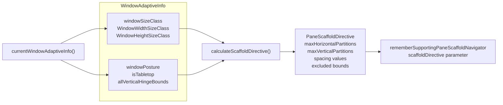

Sources: [Jetcaster/mobile/src/main/java/com/example/jetcaster/ui/home/Home.kt:247-249](), [Jetcaster/mobile/src/main/java/com/example/jetcaster/ui/home/Home.kt:133-182]()

The `WindowAdaptiveInfo` updates automatically when the device configuration changes (rotation, folding, resizing), triggering recomposition of the scaffold with updated layout parameters.

---

