<!-- source: DeepWiki mcp.deepwiki.com · repo android/compose-samples · extra page Jetcaster Redux Architecture · fetched 2026-10-23 -->

# Jetcaster Redux Architecture

<details>
<summary>Relevant source files</summary>

The following files were used as context for generating this wiki page:

- [Jetcaster/core/data/src/main/java/com/example/jetcaster/core/data/repository/EpisodeStore.kt](Jetcaster/core/data/src/main/java/com/example/jetcaster/core/data/repository/EpisodeStore.kt)
- [Jetcaster/core/designsystem/src/main/java/com/example/jetcaster/designsystem/component/PodcastImage.kt](Jetcaster/core/designsystem/src/main/java/com/example/jetcaster/designsystem/component/PodcastImage.kt)
- [Jetcaster/core/designsystem/src/main/java/com/example/jetcaster/designsystem/theme/Type.kt](Jetcaster/core/designsystem/src/main/java/com/example/jetcaster/designsystem/theme/Type.kt)
- [Jetcaster/core/designsystem/src/main/java/com/example/jetcaster/designsystem/theme/Typography.kt](Jetcaster/core/designsystem/src/main/java/com/example/jetcaster/designsystem/theme/Typography.kt)
- [Jetcaster/core/designsystem/src/main/res/font/roboto_flex.ttf](Jetcaster/core/designsystem/src/main/res/font/roboto_flex.ttf)
- [Jetcaster/mobile/src/main/java/com/example/jetcaster/ui/home/Home.kt](Jetcaster/mobile/src/main/java/com/example/jetcaster/ui/home/Home.kt)
- [Jetcaster/mobile/src/main/java/com/example/jetcaster/ui/home/HomeViewModel.kt](Jetcaster/mobile/src/main/java/com/example/jetcaster/ui/home/HomeViewModel.kt)
- [Jetcaster/mobile/src/main/java/com/example/jetcaster/ui/home/category/PodcastCategory.kt](Jetcaster/mobile/src/main/java/com/example/jetcaster/ui/home/category/PodcastCategory.kt)
- [Jetcaster/mobile/src/main/java/com/example/jetcaster/ui/home/discover/Discover.kt](Jetcaster/mobile/src/main/java/com/example/jetcaster/ui/home/discover/Discover.kt)
- [Jetcaster/mobile/src/main/java/com/example/jetcaster/ui/home/library/Library.kt](Jetcaster/mobile/src/main/java/com/example/jetcaster/ui/home/library/Library.kt)
- [Jetcaster/mobile/src/main/java/com/example/jetcaster/ui/player/PlayerScreen.kt](Jetcaster/mobile/src/main/java/com/example/jetcaster/ui/player/PlayerScreen.kt)
- [Jetcaster/mobile/src/main/java/com/example/jetcaster/ui/podcast/PodcastDetailsScreen.kt](Jetcaster/mobile/src/main/java/com/example/jetcaster/ui/podcast/PodcastDetailsScreen.kt)
- [Jetcaster/mobile/src/main/java/com/example/jetcaster/ui/podcast/PodcastDetailsViewModel.kt](Jetcaster/mobile/src/main/java/com/example/jetcaster/ui/podcast/PodcastDetailsViewModel.kt)
- [Jetcaster/mobile/src/main/java/com/example/jetcaster/ui/theme/Theme.kt](Jetcaster/mobile/src/main/java/com/example/jetcaster/ui/theme/Theme.kt)
- [Jetcaster/mobile/src/main/java/com/example/jetcaster/ui/tooling/DevicePreviews.kt](Jetcaster/mobile/src/main/java/com/example/jetcaster/ui/tooling/DevicePreviews.kt)

</details>


## Purpose and Scope

This page documents Jetcaster's Redux-style architecture, which implements unidirectional data flow using Kotlin StateFlow and follows the Model-View-ViewModel (MVVM) pattern with Redux principles. The architecture emphasizes immutable state, single source of truth, and explicit action dispatching for all state changes.

For information about Jetcaster's adaptive UI layouts, see [4.6.2](#4.6.2). For general state management patterns across all samples, see [5.1](#5.1).

## Architecture Overview

Jetcaster implements a production-ready Redux-style architecture with the following characteristics:

- **Single source of truth**: Each screen exposes a single `StateFlow<UiState>` containing all UI state
- **Immutable state**: UI state is represented by immutable data classes
- **Unidirectional data flow**: Data flows in one direction from data sources → repository → ViewModel → UI
- **Explicit actions**: All state changes are triggered by dispatching actions through a sealed interface
- **Reactive updates**: UI automatically reacts to state changes via StateFlow collection

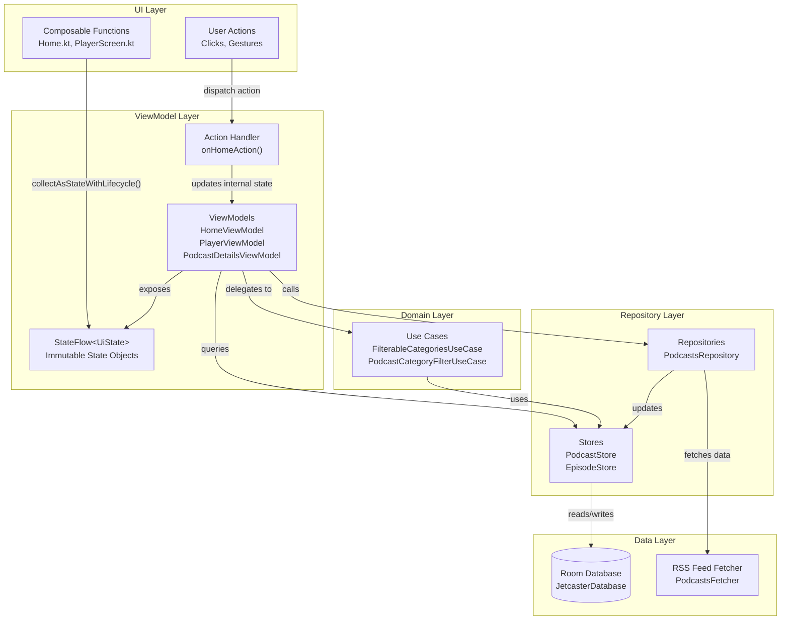

**Sources**: [Jetcaster/mobile/src/main/java/com/example/jetcaster/ui/home/HomeViewModel.kt:1-239](), [Jetcaster/mobile/src/main/java/com/example/jetcaster/ui/home/Home.kt:195-210]()

## State Management with StateFlow

### HomeViewModel State Structure

The `HomeViewModel` demonstrates the core state management pattern:

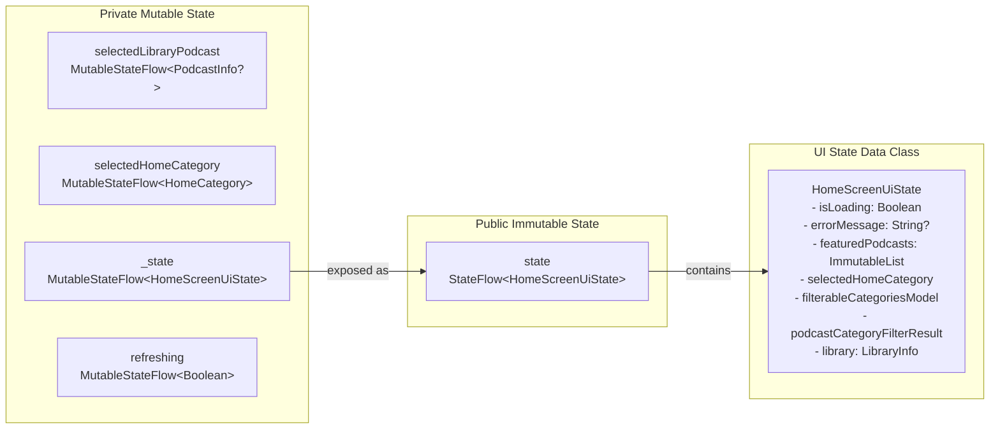

**Key Implementation Details**:

- **Line 64**: `private val selectedLibraryPodcast = MutableStateFlow<PodcastInfo?>(null)` - Private mutable state for internal use
- **Line 67**: `private val selectedHomeCategory = MutableStateFlow(HomeCategory.Discover)` - Tracks current tab selection
- **Line 76**: `private val _state = MutableStateFlow(HomeScreenUiState())` - Private backing field for UI state
- **Line 84-85**: `val state: StateFlow<HomeScreenUiState> get() = _state` - Public immutable state exposed to UI
- **Line 229-238**: `HomeScreenUiState` data class with `@Immutable` annotation ensures state immutability

**Sources**: [Jetcaster/mobile/src/main/java/com/example/jetcaster/ui/home/HomeViewModel.kt:64-85](), [Jetcaster/mobile/src/main/java/com/example/jetcaster/ui/home/HomeViewModel.kt:229-238]()

### UI State Collection

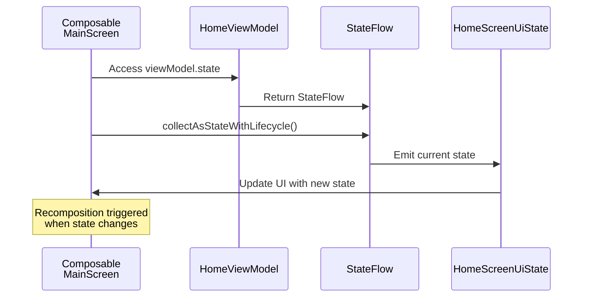

The UI observes state using `collectAsStateWithLifecycle()`:

- **Line 196**: `val homeScreenUiState by viewModel.state.collectAsStateWithLifecycle()` - Lifecycle-aware collection
- This extension function automatically starts/stops collection based on lifecycle state
- When `_state` value changes, UI automatically recomposes with new data

**Sources**: [Jetcaster/mobile/src/main/java/com/example/jetcaster/ui/home/Home.kt:195-210]()

## Action-Based State Updates

### Action Definition

Jetcaster uses sealed interfaces to define all possible user actions:

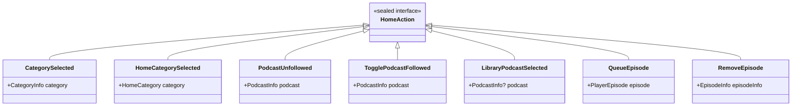

- **Lines 218-226**: Sealed interface `HomeAction` with 7 concrete action types
- Each action is a data class carrying the necessary payload
- Sealed interface ensures exhaustive when-expression handling

**Sources**: [Jetcaster/mobile/src/main/java/com/example/jetcaster/ui/home/HomeViewModel.kt:218-226]()

### Action Handling Flow

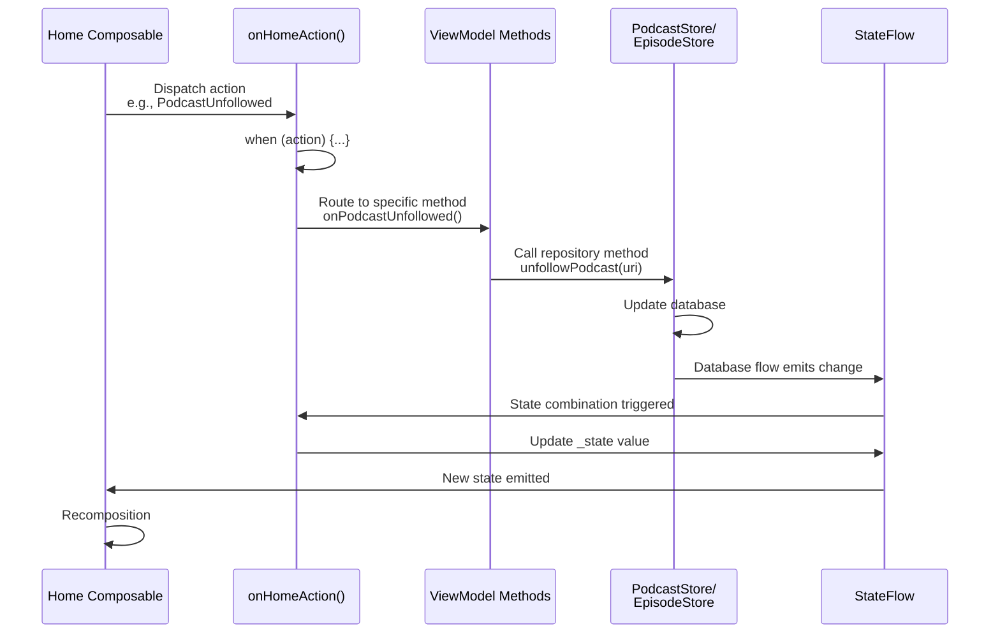

The action handler pattern:

- **Lines 161-171**: `onHomeAction(action: HomeAction)` - Central action dispatcher
- **Lines 173-205**: Private methods handle individual actions
  - `onCategorySelected()` - Updates selected category
  - `onPodcastUnfollowed()` - Delegates to `podcastStore.unfollowPodcast()`
  - `onTogglePodcastFollowed()` - Toggles subscription state
  - `onQueueEpisode()` - Adds episode to player queue
  - `deleteEpisode()` - Removes episode from store

Example action flow from UI:

```kotlin
// In Home.kt composable (Line 272)
onHomeAction = viewModel::onHomeAction

// User unfollows a podcast
onHomeAction(HomeAction.PodcastUnfollowed(podcast))

// ViewModel routes to specific handler (Lines 166)
is HomeAction.PodcastUnfollowed -> onPodcastUnfollowed(action.podcast)

// Handler updates repository (Lines 182-184)
viewModelScope.launch {
    podcastStore.unfollowPodcast(podcast.uri)
}
```

**Sources**: [Jetcaster/mobile/src/main/java/com/example/jetcaster/ui/home/HomeViewModel.kt:161-205](), [Jetcaster/mobile/src/main/java/com/example/jetcaster/ui/home/Home.kt:272]()

## Repository Pattern Implementation

### Data Layer Architecture

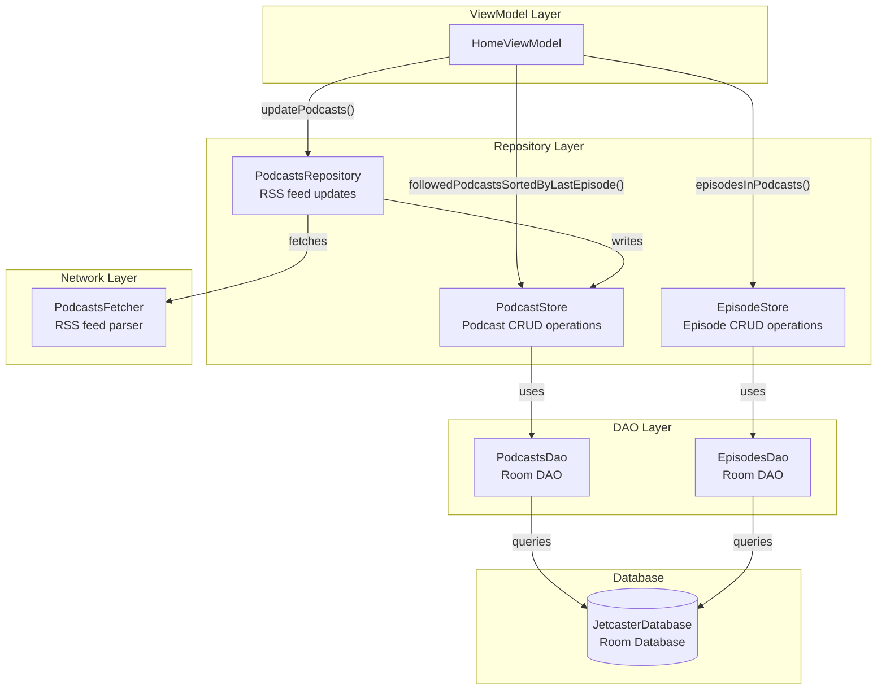

**Key Components**:

| Component | Interface/Class | Purpose | Key Methods |
|-----------|----------------|---------|-------------|
| **PodcastStore** | Interface + LocalPodcastStore | Podcast CRUD and queries | `followedPodcastsSortedByLastEpisode()`, `togglePodcastFollowed()`, `unfollowPodcast()` |
| **EpisodeStore** | Interface + LocalEpisodeStore | Episode CRUD and queries | `episodesInPodcast()`, `episodesInPodcasts()`, `addEpisodes()`, `deleteEpisode()` |
| **PodcastsRepository** | Interface + implementation | RSS feed updates and podcast management | `updatePodcasts(force: Boolean)` |

**Sources**: [Jetcaster/mobile/src/main/java/com/example/jetcaster/ui/home/HomeViewModel.kt:55-62](), [Jetcaster/core/data/src/main/java/com/example/jetcaster/core/data/repository/EpisodeStore.kt:24-60]()

### EpisodeStore Implementation

The `EpisodeStore` interface defines the contract for episode data access:

- **Lines 28**: `fun episodeWithUri(episodeUri: String): Flow<Episode>` - Returns single episode as Flow
- **Lines 33**: `fun episodeAndPodcastWithUri(episodeUri: String): Flow<EpisodeToPodcast>` - Returns episode with podcast data
- **Lines 39**: `fun episodesInPodcast(podcastUri: String, limit: Int): Flow<List<EpisodeToPodcast>>` - Returns episodes for a podcast
- **Lines 45**: `fun episodesInPodcasts(podcastUris: List<String>, limit: Int): Flow<List<EpisodeToPodcast>>` - Returns episodes for multiple podcasts
- **Lines 52**: `suspend fun addEpisodes(episodes: Collection<Episode>)` - Adds new episodes
- **Lines 57**: `suspend fun deleteEpisode(episode: Episode)` - Removes an episode

All query methods return `Flow` for reactive updates. The `LocalEpisodeStore` implementation (Lines 65-105) delegates to Room DAOs.

**Sources**: [Jetcaster/core/data/src/main/java/com/example/jetcaster/core/data/repository/EpisodeStore.kt:24-105]()

## State Combination Pattern

### Multi-Flow Combination

The `HomeViewModel` demonstrates complex state combination from multiple reactive sources:

```mermaid
graph TB
    subgraph "Input Flows"
        HC["homeCategories<br/>MutableStateFlow"]
        SHC["selectedHomeCategory<br/>MutableStateFlow"]
        SP["subscribedPodcasts<br/>Flow from Store"]
        R["refreshing<br/>MutableStateFlow"]
        SC["_selectedCategory<br/>MutableStateFlow"]
    end
    
    subgraph "Derived Flows"
        FC["filterableCategoriesUseCase<br/>flatMapLatest"]
        PCF["podcastCategoryFilterUseCase<br/>flatMapLatest"]
        LE["episodesInPodcasts<br/>flatMapLatest"]
    end
    
    subgraph "Combination"
        Combine["combine(...) { }<br/>Merges all flows"]
    end
    
    subgraph "Output"
        Output["StateFlow&lt;HomeScreenUiState&gt;"]
    end
    
    HC --> Combine
    SHC --> Combine
    SP --> Combine
    R --> Combine
    SC -->|"triggers"| FC
    SC -->|"triggers"| PCF
    SP -->|"triggers"| LE
    FC --> Combine
    PCF --> Combine
    LE --> Combine
    Combine --> Output
```

**Implementation Details**:

The `init` block (Lines 87-147) implements the state combination:

1. **Lines 81-82**: `subscribedPodcasts` - Shared flow from `PodcastStore.followedPodcastsSortedByLastEpisode()`
2. **Lines 91-107**: `combine(...)` operator merges 7 flows into single output
3. **Lines 96-98**: `flatMapLatest` creates derived flows that switch when upstream changes
4. **Lines 108-133**: Lambda receives all flow values and constructs `HomeScreenUiState`
5. **Lines 134-143**: `catch` operator handles errors by emitting error state
6. **Lines 141-143**: `collect` updates the `_state` MutableStateFlow

Key pattern: `flatMapLatest` ensures that when `_selectedCategory` changes, old use case flows are cancelled and new ones are started, preventing memory leaks and stale data.

**Sources**: [Jetcaster/mobile/src/main/java/com/example/jetcaster/ui/home/HomeViewModel.kt:81-147]()

### State Combination Flow

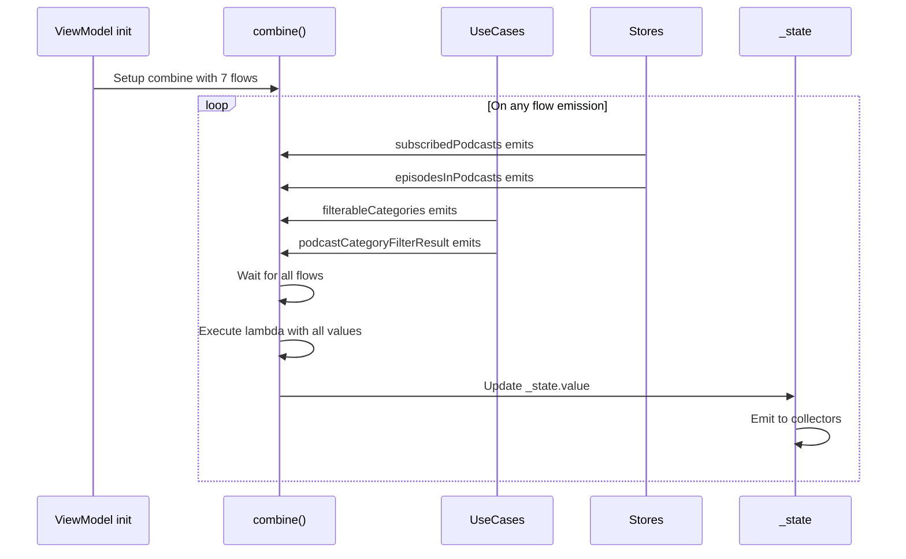

**Sources**: [Jetcaster/mobile/src/main/java/com/example/jetcaster/ui/home/HomeViewModel.kt:87-144]()

## Dependency Injection with Hilt

### ViewModel Injection

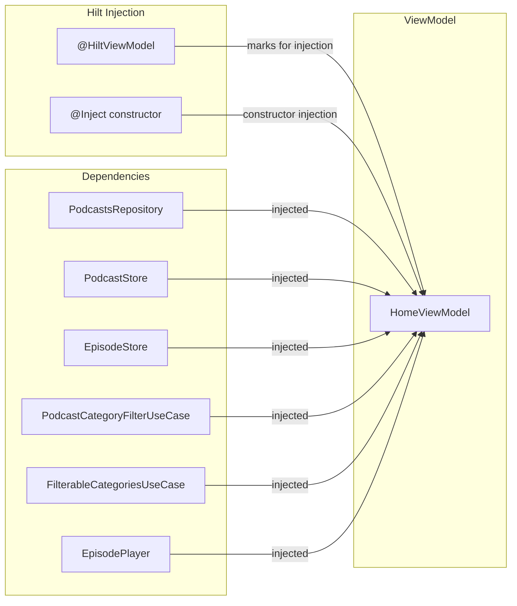

**HomeViewModel Injection**:

- **Line 54**: `@HiltViewModel` - Marks class for Hilt-managed ViewModel injection
- **Line 55**: `@Inject constructor(...)` - Constructor injection with 6 dependencies
- Dependencies are automatically provided by Hilt dependency graph
- No manual factory creation needed

**PodcastDetailsViewModel Assisted Injection**:

For ViewModels that require runtime parameters (like `podcastUri`), Jetcaster uses Assisted Injection:

- **Line 50**: `@HiltViewModel(assistedFactory = PodcastDetailsViewModel.Factory::class)`
- **Line 55**: `@Assisted private val podcastUri: String` - Runtime parameter
- **Lines 92-95**: `@AssistedFactory` interface defines factory contract
- **Lines 285-290** in `PodcastDetailsScreen.kt`: Usage with `hiltViewModel` passing key and factory

**Sources**: [Jetcaster/mobile/src/main/java/com/example/jetcaster/ui/home/HomeViewModel.kt:54-62](), [Jetcaster/mobile/src/main/java/com/example/jetcaster/ui/podcast/PodcastDetailsViewModel.kt:50-95](), [Jetcaster/mobile/src/main/java/com/example/jetcaster/ui/podcast/PodcastDetailsScreen.kt:285-290]()

## Complete Data Flow Example

### Following a Podcast

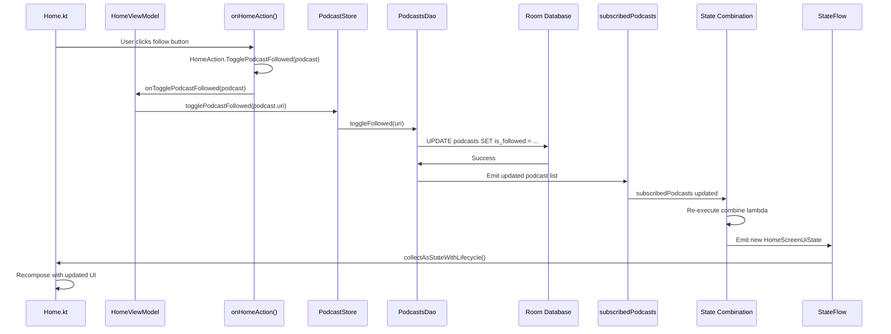

**Step-by-Step Flow**:

1. User clicks follow button on podcast card
2. UI dispatches `HomeAction.TogglePodcastFollowed(podcast)` via `onHomeAction` callback
3. ViewModel's `onHomeAction()` routes to `onTogglePodcastFollowed()` (Line 187)
4. ViewModel calls `podcastStore.togglePodcastFollowed(podcast.uri)` in coroutine (Line 189)
5. Store updates Room database via DAO
6. Database change triggers `subscribedPodcasts` flow to emit new list (Line 81)
7. `combine` operator in init block receives new podcast list (Line 94)
8. Lambda constructs new `HomeScreenUiState` with updated podcasts (Lines 125-133)
9. New state emitted to `_state` MutableStateFlow (Line 142)
10. UI's `collectAsStateWithLifecycle()` receives new state (Line 196)
11. Composable recomposes showing updated follow status

**Sources**: [Jetcaster/mobile/src/main/java/com/example/jetcaster/ui/home/HomeViewModel.kt:187-190](), [Jetcaster/mobile/src/main/java/com/example/jetcaster/ui/home/HomeViewModel.kt:81-144](), [Jetcaster/mobile/src/main/java/com/example/jetcaster/ui/home/Home.kt:196]()

## Immutability and Thread Safety

### Immutable Collections

Jetcaster uses `kotlinx-collections-immutable` library to ensure true immutability:

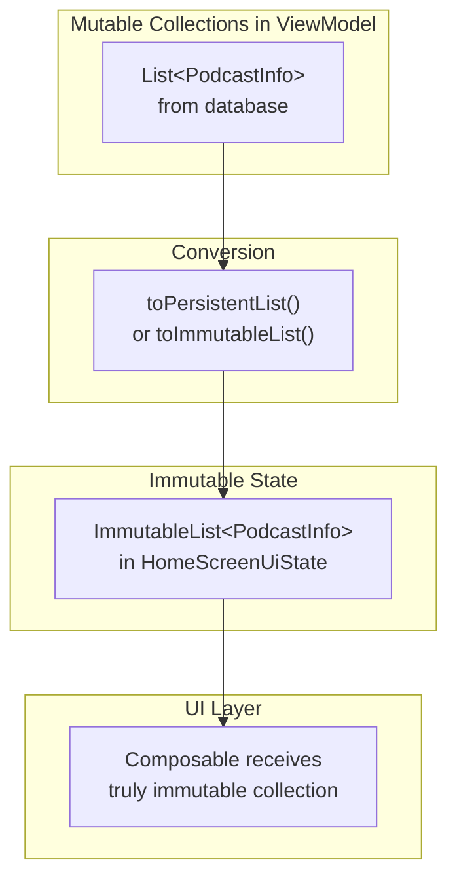

**Implementation**:

- **Line 232**: `featuredPodcasts: ImmutableList<PodcastInfo> = persistentListOf()` - State uses `ImmutableList` type
- **Line 129**: `podcasts.map { it.asExternalModel() }.toPersistentList()` - Convert to immutable collection
- `ImmutableList` from `kotlinx-collections-immutable` provides structural sharing for efficient copies
- Prevents accidental mutation in UI layer
- Enables safe state comparison for recomposition optimization

### Thread Safety

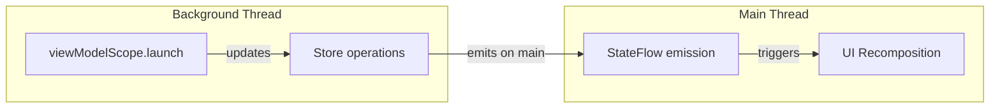

- All ViewModel operations run in `viewModelScope` (Lines 150, 183, 189, 203)
- StateFlow emissions automatically occur on main dispatcher
- Room flows emit on main thread by default
- Coroutines handle thread switching automatically
- No manual threading code required

**Sources**: [Jetcaster/mobile/src/main/java/com/example/jetcaster/ui/home/HomeViewModel.kt:229-238](), [Jetcaster/mobile/src/main/java/com/example/jetcaster/ui/home/HomeViewModel.kt:129](), [Jetcaster/mobile/src/main/java/com/example/jetcaster/ui/home/HomeViewModel.kt:150-205]()

## Comparison with Other ViewModels

### PodcastDetailsViewModel Pattern

The `PodcastDetailsViewModel` follows the same Redux pattern with variations:

| Aspect | HomeViewModel | PodcastDetailsViewModel |
|--------|---------------|-------------------------|
| **State Type** | `HomeScreenUiState` | Sealed interface `PodcastUiState` with `Loading` and `Ready` states |
| **State Creation** | `combine()` with 7 flows | `combine()` with 2 flows |
| **State Sharing** | `SharingStarted.WhileSubscribed()` | `SharingStarted.WhileSubscribed(5_000)` with 5s timeout |
| **Runtime Parameters** | None | `podcastUri` via `@Assisted` injection |
| **Actions** | `HomeAction` sealed interface | Direct methods (`toggleSubscribe`, `onQueueEpisode`) |
| **Use Case** | Multi-tab home screen with complex state | Single podcast details with episodes list |

**Key Difference**: `PodcastDetailsViewModel` uses sealed interface for UI state to explicitly represent loading state:

- **Lines 42-45**: `sealed interface PodcastUiState` with `Loading` and `Ready` states
- **Lines 93-98** in `PodcastDetailsScreen.kt`: UI switches on state type
- Provides type-safe loading state handling

**Sources**: [Jetcaster/mobile/src/main/java/com/example/jetcaster/ui/podcast/PodcastDetailsViewModel.kt:41-74](), [Jetcaster/mobile/src/main/java/com/example/jetcaster/ui/podcast/PodcastDetailsScreen.kt:92-113]()

## Architecture Benefits

### Advantages of This Pattern

| Benefit | Implementation | Example |
|---------|----------------|---------|
| **Testability** | ViewModels have no Android dependencies, all dependencies injected | Can test state combination logic without UI |
| **Predictability** | All state changes go through explicit actions | Easy to trace why state changed |
| **Type Safety** | Sealed interfaces ensure exhaustive handling | Compiler enforces handling all action types |
| **Reactivity** | StateFlow provides automatic UI updates | No manual view updates needed |
| **Memory Safety** | `flatMapLatest` cancels old flows | Prevents memory leaks from abandoned operations |
| **Lifecycle Safety** | `collectAsStateWithLifecycle()` handles lifecycle | Collection stops when UI not visible |
| **Single Source of Truth** | One StateFlow per screen | No state synchronization issues |
| **Immutability** | Data classes + ImmutableList | Safe concurrent access, efficient diffing |

### Scalability Considerations

The pattern scales well because:

1. **Clear Boundaries**: Each layer has specific responsibilities
2. **Composable Flows**: Multiple small flows combine into complex state
3. **Action Encapsulation**: Adding new features means adding actions
4. **Repository Abstraction**: Data sources can change without affecting ViewModels
5. **Dependency Injection**: Easy to swap implementations for testing

**Sources**: [Jetcaster/mobile/src/main/java/com/example/jetcaster/ui/home/HomeViewModel.kt:1-239](), [Jetcaster/mobile/src/main/java/com/example/jetcaster/ui/home/Home.kt:195-210]()

---

