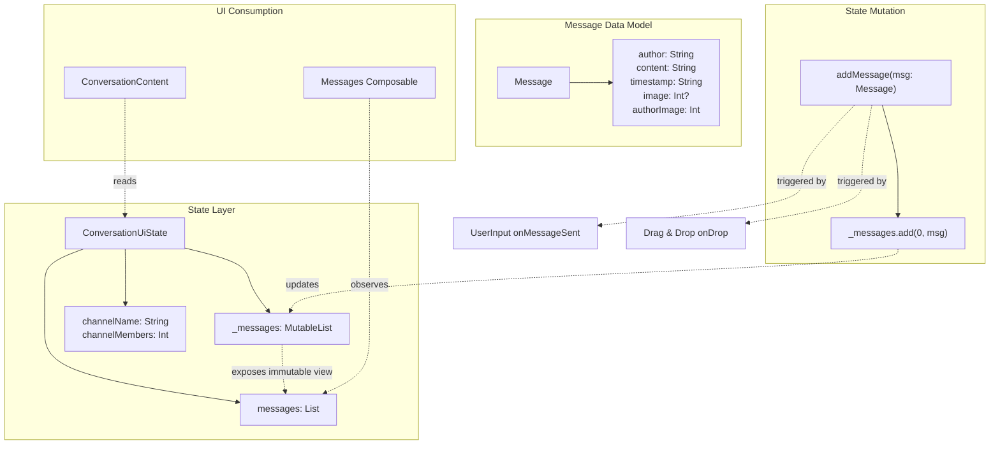
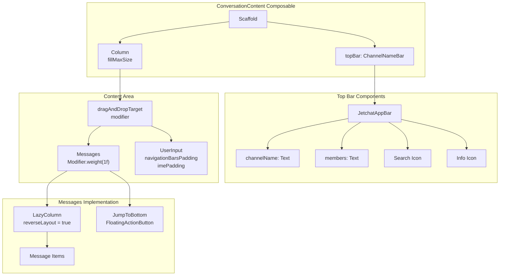
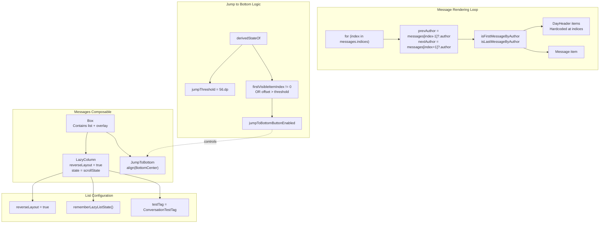
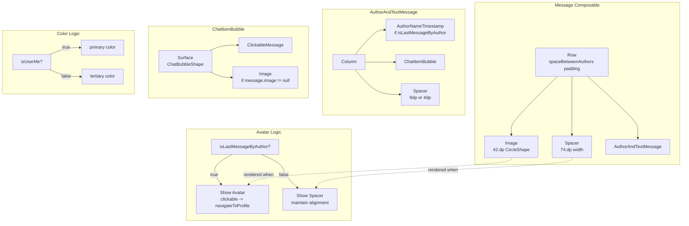
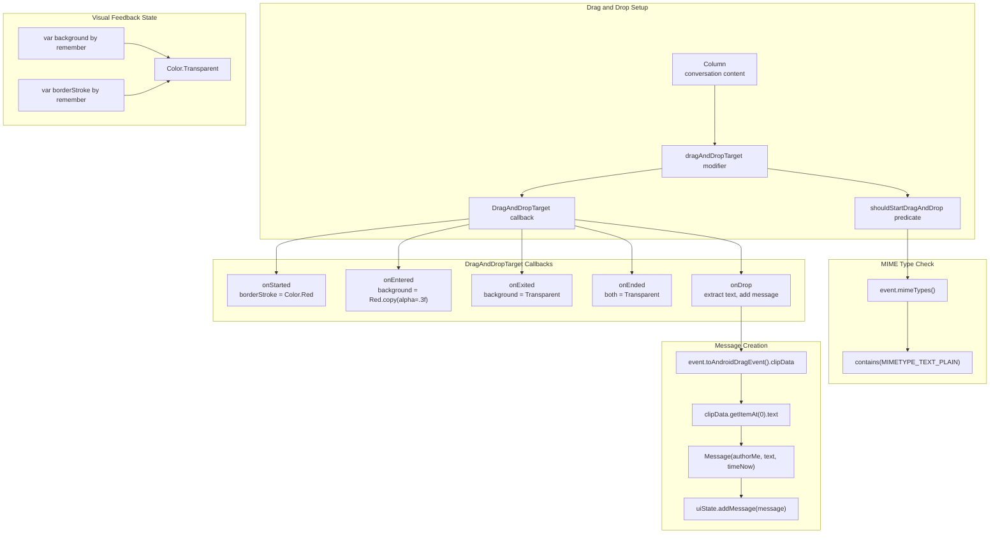
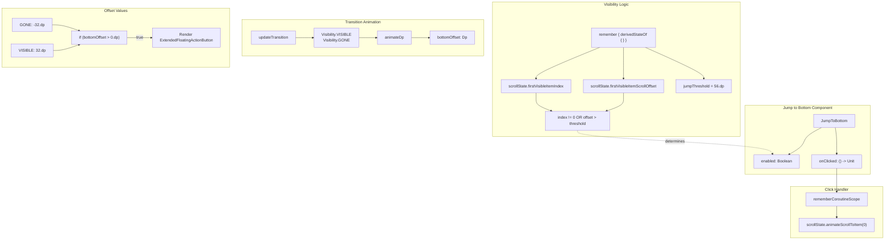
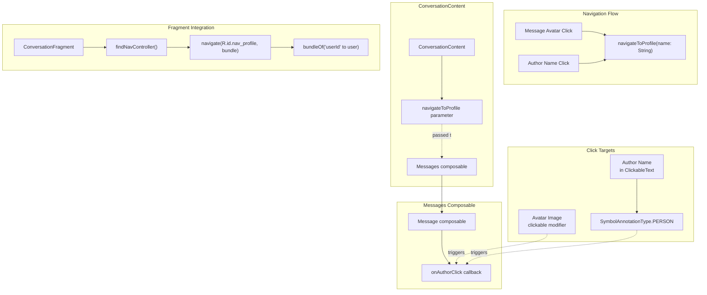
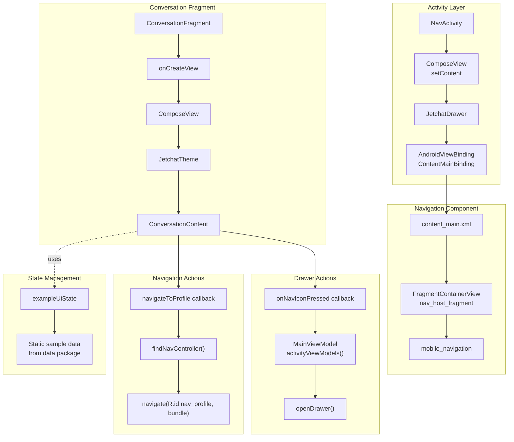

<!-- source: DeepWiki mcp.deepwiki.com · repo android/compose-samples · extra page Jetchat Conversation Architecture · fetched 2026-10-23 -->

# Jetchat Conversation Architecture

<details>
<summary>Relevant source files</summary>

The following files were used as context for generating this wiki page:

- [Jetchat/app/src/androidTest/java/com/example/compose/jetchat/ConversationTest.kt](Jetchat/app/src/androidTest/java/com/example/compose/jetchat/ConversationTest.kt)
- [Jetchat/app/src/androidTest/java/com/example/compose/jetchat/NavigationTest.kt](Jetchat/app/src/androidTest/java/com/example/compose/jetchat/NavigationTest.kt)
- [Jetchat/app/src/androidTest/java/com/example/compose/jetchat/UserInputTest.kt](Jetchat/app/src/androidTest/java/com/example/compose/jetchat/UserInputTest.kt)
- [Jetchat/app/src/main/java/com/example/compose/jetchat/MainViewModel.kt](Jetchat/app/src/main/java/com/example/compose/jetchat/MainViewModel.kt)
- [Jetchat/app/src/main/java/com/example/compose/jetchat/NavActivity.kt](Jetchat/app/src/main/java/com/example/compose/jetchat/NavActivity.kt)
- [Jetchat/app/src/main/java/com/example/compose/jetchat/components/AnimatingFabContent.kt](Jetchat/app/src/main/java/com/example/compose/jetchat/components/AnimatingFabContent.kt)
- [Jetchat/app/src/main/java/com/example/compose/jetchat/components/JetchatAppBar.kt](Jetchat/app/src/main/java/com/example/compose/jetchat/components/JetchatAppBar.kt)
- [Jetchat/app/src/main/java/com/example/compose/jetchat/components/JetchatDrawer.kt](Jetchat/app/src/main/java/com/example/compose/jetchat/components/JetchatDrawer.kt)
- [Jetchat/app/src/main/java/com/example/compose/jetchat/components/JetchatScaffold.kt](Jetchat/app/src/main/java/com/example/compose/jetchat/components/JetchatScaffold.kt)
- [Jetchat/app/src/main/java/com/example/compose/jetchat/conversation/Conversation.kt](Jetchat/app/src/main/java/com/example/compose/jetchat/conversation/Conversation.kt)
- [Jetchat/app/src/main/java/com/example/compose/jetchat/conversation/ConversationFragment.kt](Jetchat/app/src/main/java/com/example/compose/jetchat/conversation/ConversationFragment.kt)
- [Jetchat/app/src/main/java/com/example/compose/jetchat/conversation/ConversationUiState.kt](Jetchat/app/src/main/java/com/example/compose/jetchat/conversation/ConversationUiState.kt)
- [Jetchat/app/src/main/java/com/example/compose/jetchat/conversation/JumpToBottom.kt](Jetchat/app/src/main/java/com/example/compose/jetchat/conversation/JumpToBottom.kt)
- [Jetchat/app/src/main/java/com/example/compose/jetchat/conversation/UserInput.kt](Jetchat/app/src/main/java/com/example/compose/jetchat/conversation/UserInput.kt)
- [Jetchat/app/src/main/java/com/example/compose/jetchat/profile/Profile.kt](Jetchat/app/src/main/java/com/example/compose/jetchat/profile/Profile.kt)
- [Jetchat/app/src/main/java/com/example/compose/jetchat/profile/ProfileFragment.kt](Jetchat/app/src/main/java/com/example/compose/jetchat/profile/ProfileFragment.kt)
- [Jetchat/app/src/main/java/com/example/compose/jetchat/profile/ProfileViewModel.kt](Jetchat/app/src/main/java/com/example/compose/jetchat/profile/ProfileViewModel.kt)
- [Jetchat/app/src/main/res/layout/content_main.xml](Jetchat/app/src/main/res/layout/content_main.xml)

</details>


This document describes the architecture of the conversation screen in the Jetchat sample application, including state management through `ConversationUiState`, the reverse-layout message list implementation, drag-and-drop support for adding messages, and profile navigation integration. For information about the user input system (text field, emoji selector, and recording functionality), see [Jetchat User Input System](#4.4.1). For overall Jetchat architectural patterns and Fragment integration, see [Jetchat](#4.4).

## Overview

The conversation screen displays a chat interface with messages displayed in reverse chronological order. The architecture separates concerns into state management (`ConversationUiState`), UI rendering (`ConversationContent` and `Messages`), and navigation logic. Messages are displayed in a `LazyColumn` with reverse layout, allowing new messages to appear at the bottom while maintaining scroll position. The screen supports drag-and-drop for adding messages and provides a "jump to bottom" button when the user scrolls up.

**Sources:** [Jetchat/app/src/main/java/com/example/compose/jetchat/conversation/Conversation.kt:96-218](), [Jetchat/app/src/main/java/com/example/compose/jetchat/conversation/ConversationUiState.kt:1-40]()

## State Management Architecture



The state management system uses `ConversationUiState` as the single source of truth for conversation data. The class maintains an internal mutable list that is exposed as an immutable `List<Message>` to consumers, ensuring unidirectional data flow.

**Sources:** [Jetchat/app/src/main/java/com/example/compose/jetchat/conversation/ConversationUiState.kt:23-30]()

### ConversationUiState Implementation

The `ConversationUiState` class at [Jetchat/app/src/main/java/com/example/compose/jetchat/conversation/ConversationUiState.kt:23-30]() manages conversation state:

| Property | Type | Purpose |
|----------|------|---------|
| `channelName` | `String` | Display name of the conversation channel |
| `channelMembers` | `Int` | Number of members in the channel |
| `_messages` | `MutableList<Message>` | Internal mutable message list (private) |
| `messages` | `List<Message>` | Public immutable view of messages |

The `addMessage(msg: Message)` method adds new messages to the **beginning** of the list (`_messages.add(0, msg)`), which is critical for the reverse-layout list implementation where index 0 represents the most recent message.

**Sources:** [Jetchat/app/src/main/java/com/example/compose/jetchat/conversation/ConversationUiState.kt:23-30]()

### Message Data Model

The `Message` data class at [Jetchat/app/src/main/java/com/example/compose/jetchat/conversation/ConversationUiState.kt:32-39]() represents individual messages:

```kotlin
@Immutable
data class Message(
    val author: String,
    val content: String,
    val timestamp: String,
    val image: Int? = null,
    val authorImage: Int = if (author == "me") R.drawable.ali else R.drawable.someone_else
)
```

The `@Immutable` annotation indicates to Compose that instances are immutable, enabling optimizations. The `authorImage` provides a default based on the author name, automatically assigning different avatars for "me" vs other users.

**Sources:** [Jetchat/app/src/main/java/com/example/compose/jetchat/conversation/ConversationUiState.kt:32-39]()

## Conversation Screen Structure



The `ConversationContent` composable at [Jetchat/app/src/main/java/com/example/compose/jetchat/conversation/Conversation.kt:104-218]() structures the conversation screen using a `Scaffold` with a pinned top bar and a content area that includes both the message list and user input.

**Sources:** [Jetchat/app/src/main/java/com/example/compose/jetchat/conversation/Conversation.kt:104-218]()

### Scaffold Configuration

The `Scaffold` configuration demonstrates important window inset handling:

```kotlin
Scaffold(
    topBar = { ChannelNameBar(...) },
    contentWindowInsets = ScaffoldDefaults
        .contentWindowInsets
        .exclude(WindowInsets.navigationBars)
        .exclude(WindowInsets.ime),
    modifier = modifier.nestedScroll(scrollBehavior.nestedScrollConnection)
)
```

The content window insets **exclude** both navigation bars and IME (keyboard) insets because the `UserInput` composable handles these explicitly with its own `navigationBarsPadding()` and `imePadding()` modifiers. This allows the user input area to draw behind the navigation bar with proper padding, creating visual elevation.

**Sources:** [Jetchat/app/src/main/java/com/example/compose/jetchat/conversation/Conversation.kt:167-182]()

### Channel Name Bar

The `ChannelNameBar` at [Jetchat/app/src/main/java/com/example/compose/jetchat/conversation/Conversation.kt:220-275]() displays channel information in the top bar:

- **Channel name** displayed as `titleMedium` text
- **Member count** formatted using string resource with member number
- **Search icon** and **Info icon** actions (currently show "not available" popup)
- **Scroll behavior** integration for pinned top bar with nested scroll

**Sources:** [Jetchat/app/src/main/java/com/example/compose/jetchat/conversation/Conversation.kt:220-275]()

## Reverse-Layout Message List Architecture



The message list uses `reverseLayout = true` in the `LazyColumn`, which inverts the coordinate system so that item 0 appears at the bottom. This approach enables new messages to appear at the bottom without requiring manual scroll position management when messages are added.

**Sources:** [Jetchat/app/src/main/java/com/example/compose/jetchat/conversation/Conversation.kt:280-347]()

### Message Grouping Algorithm

The message rendering logic at [Jetchat/app/src/main/java/com/example/compose/jetchat/conversation/Conversation.kt:292-319]() implements visual grouping:

```kotlin
for (index in messages.indices) {
    val prevAuthor = messages.getOrNull(index - 1)?.author
    val nextAuthor = messages.getOrNull(index + 1)?.author
    val content = messages[index]
    val isFirstMessageByAuthor = prevAuthor != content.author
    val isLastMessageByAuthor = nextAuthor != content.author
    
    // Day headers at specific indices
    if (index == messages.size - 1) {
        item { DayHeader("20 Aug") }
    } else if (index == 2) {
        item { DayHeader("Today") }
    }
    
    item {
        Message(
            onAuthorClick = { name -> navigateToProfile(name) },
            msg = content,
            isUserMe = content.author == authorMe,
            isFirstMessageByAuthor = isFirstMessageByAuthor,
            isLastMessageByAuthor = isLastMessageByAuthor
        )
    }
}
```

The algorithm determines whether to show the author avatar and name by checking if the previous/next message has a different author. Messages from the same author are visually grouped together, with the avatar only shown on the last message in a group (bottom of the group in reverse layout).

**Sources:** [Jetchat/app/src/main/java/com/example/compose/jetchat/conversation/Conversation.kt:292-319]()

### Message Rendering Components



The `Message` composable at [Jetchat/app/src/main/java/com/example/compose/jetchat/conversation/Conversation.kt:349-395]() renders individual messages with conditional avatar display and proper spacing.

**Sources:** [Jetchat/app/src/main/java/com/example/compose/jetchat/conversation/Conversation.kt:349-419]()

### Chat Bubble Styling

The chat bubbles use `ChatBubbleShape` defined as `RoundedCornerShape(4.dp, 20.dp, 20.dp, 20.dp)` at [Jetchat/app/src/main/java/com/example/compose/jetchat/conversation/Conversation.kt:442](), creating an asymmetric shape with one sharp corner. Background colors differentiate user messages (primary color) from other messages (surfaceVariant color).

**Sources:** [Jetchat/app/src/main/java/com/example/compose/jetchat/conversation/Conversation.kt:442](), [Jetchat/app/src/main/java/com/example/compose/jetchat/conversation/Conversation.kt:473-508]()

## Drag and Drop Integration



The drag-and-drop implementation at [Jetchat/app/src/main/java/com/example/compose/jetchat/conversation/Conversation.kt:128-165]() allows users to drop text content into the conversation, automatically creating new messages.

**Sources:** [Jetchat/app/src/main/java/com/example/compose/jetchat/conversation/Conversation.kt:128-194]()

### Drag and Drop Callback Implementation

The `DragAndDropTarget` object defines the drag-and-drop lifecycle:

| Callback | Purpose | Visual Effect |
|----------|---------|---------------|
| `onStarted` | Drag operation begins | Sets red border |
| `onEntered` | Drag enters the target area | Sets red semi-transparent background |
| `onExited` | Drag exits the target area | Removes background tint |
| `onEnded` | Drag operation ends | Clears all visual feedback |
| `onDrop` | User drops content | Extracts text and adds as message |

The `onDrop` implementation at [Jetchat/app/src/main/java/com/example/compose/jetchat/conversation/Conversation.kt:130-142]() converts the Compose drag event to an Android drag event, extracts the clip data, and creates a new `Message` with the dropped text. The message is added to the state with the current user as the author.

**Sources:** [Jetchat/app/src/main/java/com/example/compose/jetchat/conversation/Conversation.kt:128-165]()

## Jump to Bottom Functionality



The "Jump to Bottom" button at [Jetchat/app/src/main/java/com/example/compose/jetchat/conversation/JumpToBottom.kt:1-85]() appears when the user scrolls away from the most recent messages, providing quick navigation back to the bottom of the conversation.

**Sources:** [Jetchat/app/src/main/java/com/example/compose/jetchat/conversation/Conversation.kt:322-346](), [Jetchat/app/src/main/java/com/example/compose/jetchat/conversation/JumpToBottom.kt:44-78]()

### Visibility Calculation

The button visibility is determined using `derivedStateOf` at [Jetchat/app/src/main/java/com/example/compose/jetchat/conversation/Conversation.kt:329-334]():

```kotlin
val jumpToBottomButtonEnabled by remember {
    derivedStateOf {
        scrollState.firstVisibleItemIndex != 0 ||
            scrollState.firstVisibleItemScrollOffset > jumpThreshold
    }
}
```

The button appears when either:
1. The first visible item is not index 0 (not at the bottom due to reverse layout)
2. The scroll offset exceeds the 56dp threshold

Using `derivedStateOf` ensures the calculation only recomposes when the scroll state actually changes, optimizing performance.

**Sources:** [Jetchat/app/src/main/java/com/example/compose/jetchat/conversation/Conversation.kt:329-334]()

### Animation Implementation

The `JumpToBottom` composable uses a `Transition` to animate the button's appearance:

- **VISIBLE state:** `bottomOffset = 32.dp` (visible above the bottom edge)
- **GONE state:** `bottomOffset = -32.dp` (hidden below the bottom edge)
- The button only renders when `bottomOffset > 0.dp`, preventing off-screen rendering

The animation provides smooth visual feedback as the button slides in and out based on scroll position.

**Sources:** [Jetchat/app/src/main/java/com/example/compose/jetchat/conversation/JumpToBottom.kt:45-78]()

## Profile Navigation Integration



Profile navigation is integrated at multiple levels, allowing users to view a participant's profile by clicking either their avatar or their name in message content.

**Sources:** [Jetchat/app/src/main/java/com/example/compose/jetchat/conversation/Conversation.kt:106-108](), [Jetchat/app/src/main/java/com/example/compose/jetchat/conversation/ConversationFragment.kt:47-54]()

### Navigation Parameter Threading

The `navigateToProfile` callback is threaded through the composable hierarchy:

1. **ConversationFragment** (at [Jetchat/app/src/main/java/com/example/compose/jetchat/conversation/ConversationFragment.kt:47-54]()) creates the callback that uses `NavController` to navigate
2. **ConversationContent** receives it as a parameter
3. **Messages** composable receives it from ConversationContent
4. **Message** composable receives it as `onAuthorClick`
5. **Avatar Image** and **ClickableMessage** both trigger the callback

**Sources:** [Jetchat/app/src/main/java/com/example/compose/jetchat/conversation/ConversationFragment.kt:47-54](), [Jetchat/app/src/main/java/com/example/compose/jetchat/conversation/Conversation.kt:280]()

### ClickableText Person Annotations

The `ClickableMessage` composable at [Jetchat/app/src/main/java/com/example/compose/jetchat/conversation/Conversation.kt:510-536]() handles clicks on annotated text:

```kotlin
ClickableText(
    text = styledMessage,
    onClick = {
        styledMessage
            .getStringAnnotations(start = it, end = it)
            .firstOrNull()
            ?.let { annotation ->
                when (annotation.tag) {
                    SymbolAnnotationType.LINK.name -> uriHandler.openUri(annotation.item)
                    SymbolAnnotationType.PERSON.name -> authorClicked(annotation.item)
                    else -> Unit
                }
            }
    }
)
```

When the user clicks on text annotated with `SymbolAnnotationType.PERSON`, the `authorClicked` callback (which is the `navigateToProfile` function) is invoked with the person's name. This allows @-mentions within message content to be clickable for profile navigation.

**Sources:** [Jetchat/app/src/main/java/com/example/compose/jetchat/conversation/Conversation.kt:510-536]()

## Fragment and Activity Integration



The conversation screen integrates with the traditional Android Navigation Component through a Fragment wrapper, demonstrating the hybrid Compose-View architecture pattern used throughout Jetchat.

**Sources:** [Jetchat/app/src/main/java/com/example/compose/jetchat/conversation/ConversationFragment.kt:35-62](), [Jetchat/app/src/main/java/com/example/compose/jetchat/NavActivity.kt:47-117]()

### ConversationFragment Implementation

`ConversationFragment` at [Jetchat/app/src/main/java/com/example/compose/jetchat/conversation/ConversationFragment.kt:35-62]() serves as the bridge between the Navigation Component and Compose:

```kotlin
class ConversationFragment : Fragment() {
    private val activityViewModel: MainViewModel by activityViewModels()

    override fun onCreateView(
        inflater: LayoutInflater,
        container: ViewGroup?,
        savedInstanceState: Bundle?
    ): View = ComposeView(inflater.context).apply {
        layoutParams = LayoutParams(MATCH_PARENT, MATCH_PARENT)

        setContent {
            JetchatTheme {
                ConversationContent(
                    uiState = exampleUiState,
                    navigateToProfile = { user ->
                        val bundle = bundleOf("userId" to user)
                        findNavController().navigate(R.id.nav_profile, bundle)
                    },
                    onNavIconPressed = {
                        activityViewModel.openDrawer()
                    }
                )
            }
        }
    }
}
```

The fragment:
- Creates a `ComposeView` programmatically rather than using XML
- Uses `activityViewModels()` to share `MainViewModel` with the activity for drawer control
- Implements navigation using `findNavController()` for profile navigation
- Passes `exampleUiState` (static sample data) rather than live data

**Sources:** [Jetchat/app/src/main/java/com/example/compose/jetchat/conversation/ConversationFragment.kt:35-62]()

### Navigation Graph Integration

The conversation fragment is defined in the navigation graph at `mobile_navigation.xml` (referenced in [Jetchat/app/src/main/res/layout/content_main.xml:32]()) with the destination ID `R.id.nav_home`. The navigation graph handles:

- **Fragment transactions** when navigating between conversation and profile screens
- **Back stack management** for proper back button behavior
- **Argument passing** through bundles for profile user IDs

**Sources:** [Jetchat/app/src/main/res/layout/content_main.xml:26-33]()

## Testing Architecture

The conversation screen has comprehensive test coverage for its key interactions:

### ConversationTest

[Jetchat/app/src/androidTest/java/com/example/compose/jetchat/ConversationTest.kt:43-167]() tests core functionality:

| Test | Purpose | Verification |
|------|---------|-------------|
| `app_launches` | Verifies initial state | Checks `ConversationTestTag` is displayed |
| `userScrollsUp_jumpToBottomAppears` | Tests jump button visibility | Swipes up, verifies button appears |
| `jumpToBottom_snapsToBottomAndDisappears` | Tests jump button action | Clicks button, verifies it disappears |
| `jumpToBottom_snapsToBottomAfterUserInteracted` | Tests scroll persistence | Verifies button stays hidden after snapping |
| `changeTheme_scrollIsPersisted` | Tests state across recomposition | Changes theme, verifies scroll position maintained |

The test uses a custom `conversationTestUiState` with doubled messages to ensure the list is long enough for scrolling on tablets.

**Sources:** [Jetchat/app/src/androidTest/java/com/example/compose/jetchat/ConversationTest.kt:43-167]()

### NavigationTest

[Jetchat/app/src/androidTest/java/com/example/compose/jetchat/NavigationTest.kt:38-109]() verifies navigation integration:

- **Profile navigation and back:** Ensures profile screen is displayed and back button returns to conversation
- **Drawer backstack handling:** Tests regression case where navigating through drawer maintains proper backstack

The navigation tests directly query the `NavController` to verify destination IDs, providing integration-level verification of Fragment navigation.

**Sources:** [Jetchat/app/src/androidTest/java/com/example/compose/jetchat/NavigationTest.kt:38-109]()

## Summary

The Jetchat conversation architecture demonstrates several key patterns:

1. **State Management:** `ConversationUiState` provides a single source of truth with mutable internal state exposed through immutable public properties
2. **Reverse Layout:** `LazyColumn` with `reverseLayout = true` naturally handles new messages appearing at the bottom
3. **Message Grouping:** Adjacent messages from the same author are visually grouped by conditionally showing avatars
4. **Drag and Drop:** Full drag-and-drop lifecycle support with visual feedback states
5. **Jump to Bottom:** Derived state with animated transitions for smooth UX
6. **Navigation Integration:** Callback threading from Fragment through Compose hierarchy to clickable elements
7. **Fragment Bridge:** Demonstrates Compose integration with traditional Navigation Component

This architecture balances modern Compose patterns with integration into the existing Fragment-based navigation system, providing a template for incremental Compose adoption in existing Android applications.

**Sources:** [Jetchat/app/src/main/java/com/example/compose/jetchat/conversation/Conversation.kt:1-564](), [Jetchat/app/src/main/java/com/example/compose/jetchat/conversation/ConversationUiState.kt:1-40](), [Jetchat/app/src/main/java/com/example/compose/jetchat/conversation/ConversationFragment.kt:1-62]()

---

