<!-- source: DeepWiki mcp.deepwiki.com · repo android/compose-samples · extra page Jetchat User Input System · fetched 2026-10-23 -->

# Jetchat User Input System

<details>
<summary>Relevant source files</summary>

The following files were used as context for generating this wiki page:

- [Jetchat/app/src/androidTest/java/com/example/compose/jetchat/ConversationTest.kt](Jetchat/app/src/androidTest/java/com/example/compose/jetchat/ConversationTest.kt)
- [Jetchat/app/src/androidTest/java/com/example/compose/jetchat/NavigationTest.kt](Jetchat/app/src/androidTest/java/com/example/compose/jetchat/NavigationTest.kt)
- [Jetchat/app/src/androidTest/java/com/example/compose/jetchat/UserInputTest.kt](Jetchat/app/src/androidTest/java/com/example/compose/jetchat/UserInputTest.kt)
- [Jetchat/app/src/main/java/com/example/compose/jetchat/MainViewModel.kt](Jetchat/app/src/main/java/com/example/compose/jetchat/MainViewModel.kt)
- [Jetchat/app/src/main/java/com/example/compose/jetchat/NavActivity.kt](Jetchat/app/src/main/java/com/example/compose/jetchat/NavActivity.kt)
- [Jetchat/app/src/main/java/com/example/compose/jetchat/components/AnimatingFabContent.kt](Jetchat/app/src/main/java/com/example/compose/jetchat/components/AnimatingFabContent.kt)
- [Jetchat/app/src/main/java/com/example/compose/jetchat/components/JetchatAppBar.kt](Jetchat/app/src/main/java/com/example/compose/jetchat/components/JetchatAppBar.kt)
- [Jetchat/app/src/main/java/com/example/compose/jetchat/components/JetchatDrawer.kt](Jetchat/app/src/main/java/com/example/compose/jetchat/components/JetchatDrawer.kt)
- [Jetchat/app/src/main/java/com/example/compose/jetchat/components/JetchatScaffold.kt](Jetchat/app/src/main/java/com/example/compose/jetchat/components/JetchatScaffold.kt)
- [Jetchat/app/src/main/java/com/example/compose/jetchat/conversation/Conversation.kt](Jetchat/app/src/main/java/com/example/compose/jetchat/conversation/Conversation.kt)
- [Jetchat/app/src/main/java/com/example/compose/jetchat/conversation/ConversationFragment.kt](Jetchat/app/src/main/java/com/example/compose/jetchat/conversation/ConversationFragment.kt)
- [Jetchat/app/src/main/java/com/example/compose/jetchat/conversation/ConversationUiState.kt](Jetchat/app/src/main/java/com/example/compose/jetchat/conversation/ConversationUiState.kt)
- [Jetchat/app/src/main/java/com/example/compose/jetchat/conversation/JumpToBottom.kt](Jetchat/app/src/main/java/com/example/compose/jetchat/conversation/JumpToBottom.kt)
- [Jetchat/app/src/main/java/com/example/compose/jetchat/conversation/UserInput.kt](Jetchat/app/src/main/java/com/example/compose/jetchat/conversation/UserInput.kt)
- [Jetchat/app/src/main/java/com/example/compose/jetchat/profile/Profile.kt](Jetchat/app/src/main/java/com/example/compose/jetchat/profile/Profile.kt)
- [Jetchat/app/src/main/java/com/example/compose/jetchat/profile/ProfileFragment.kt](Jetchat/app/src/main/java/com/example/compose/jetchat/profile/ProfileFragment.kt)
- [Jetchat/app/src/main/java/com/example/compose/jetchat/profile/ProfileViewModel.kt](Jetchat/app/src/main/java/com/example/compose/jetchat/profile/ProfileViewModel.kt)
- [Jetchat/app/src/main/res/layout/content_main.xml](Jetchat/app/src/main/res/layout/content_main.xml)

</details>


## Purpose and Scope

This document describes the user input system in the Jetchat sample application, specifically the `UserInput` composable and its associated components that handle text entry, emoji selection, and voice recording in the chat interface. The system demonstrates advanced Compose patterns including state management, focus handling, keyboard coordination, and animated UI transitions.

For information about the conversation screen architecture and message display, see [Jetchat Conversation Architecture](#4.4.2). For broader navigation and fragment integration patterns, see [Jetchat](#4.4).

Sources: [Jetchat/app/src/main/java/com/example/compose/jetchat/conversation/UserInput.kt:1-793]()

## Component Architecture

The user input system is composed of several nested composables that work together to provide a complete message composition interface. The `UserInput` composable serves as the main container that orchestrates text input, selector buttons, and expandable panels.

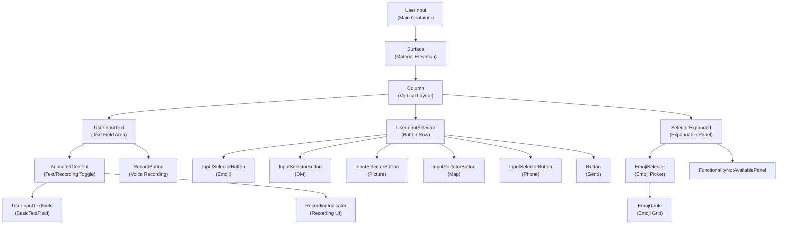

Sources: [Jetchat/app/src/main/java/com/example/compose/jetchat/conversation/UserInput.kt:135-195](), [Jetchat/app/src/main/java/com/example/compose/jetchat/conversation/UserInput.kt:267-344](), [Jetchat/app/src/main/java/com/example/compose/jetchat/conversation/UserInput.kt:212-236]()

## State Management

The `UserInput` composable manages several key state variables that control the behavior and appearance of the input system:

| State Variable | Type | Saved | Purpose |
|---------------|------|-------|---------|
| `currentInputSelector` | `InputSelector` | Yes (rememberSaveable) | Tracks which extended selector panel is visible |
| `textState` | `TextFieldValue` | Yes (with custom Saver) | Stores text content, selection, and composition |
| `textFieldFocusState` | `Boolean` | No | Tracks whether text field has focus |
| `isRecordingMessage` | `Boolean` | No | Indicates voice recording is active |
| `swipeOffset` | `Float` | No | Tracks swipe distance for cancel gesture |

The `InputSelector` enum defines the available input modes:

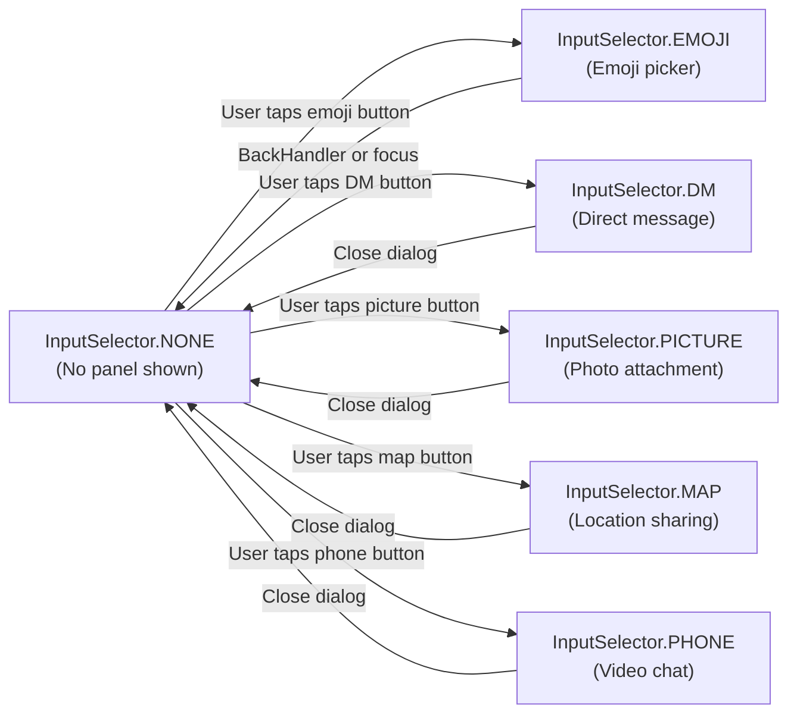

Sources: [Jetchat/app/src/main/java/com/example/compose/jetchat/conversation/UserInput.kt:113-120](), [Jetchat/app/src/main/java/com/example/compose/jetchat/conversation/UserInput.kt:136-142](), [Jetchat/app/src/main/java/com/example/compose/jetchat/conversation/UserInput.kt:144-146]()

## Input Mode Coordination

The system coordinates between multiple input modes (keyboard, emoji selector, voice recording) ensuring only one is active at a time:

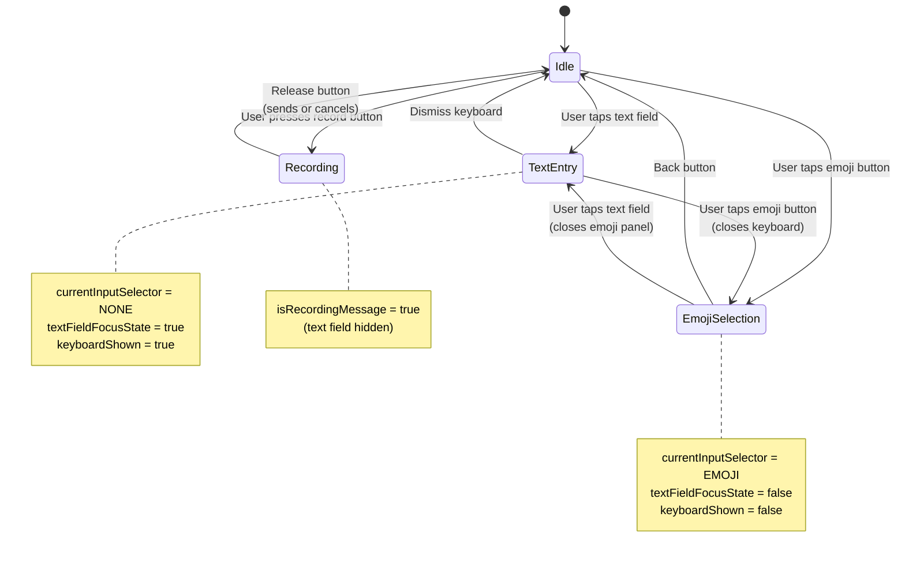

The coordination logic at [Jetchat/app/src/main/java/com/example/compose/jetchat/conversation/UserInput.kt:157-165]() ensures that when the text field receives focus, any open selector panel is closed:

```kotlin
onTextFieldFocused = { focused ->
    if (focused) {
        currentInputSelector = InputSelector.NONE
        resetScroll()
    }
    textFieldFocusState = focused
}
```

Sources: [Jetchat/app/src/main/java/com/example/compose/jetchat/conversation/UserInput.kt:153-174](), [Jetchat/app/src/main/java/com/example/compose/jetchat/conversation/UserInput.kt:393-456]()

## Text Input Implementation

### UserInputText Composable

The `UserInputText` composable at [Jetchat/app/src/main/java/com/example/compose/jetchat/conversation/UserInput.kt:393-456]() provides a `Row` containing the text field and record button. It uses `AnimatedContent` to toggle between the text field and recording indicator:

| Component | Visibility | Purpose |
|-----------|------------|---------|
| `UserInputTextField` | `isRecordingMessage == false` | Displays `BasicTextField` for text entry |
| `RecordingIndicator` | `isRecordingMessage == true` | Shows recording animation and timer |
| `RecordButton` | Always visible | Initiates voice recording on press |

### UserInputTextField Composable

The actual text field is implemented using `BasicTextField` at [Jetchat/app/src/main/java/com/example/compose/jetchat/conversation/UserInput.kt:469-491]():

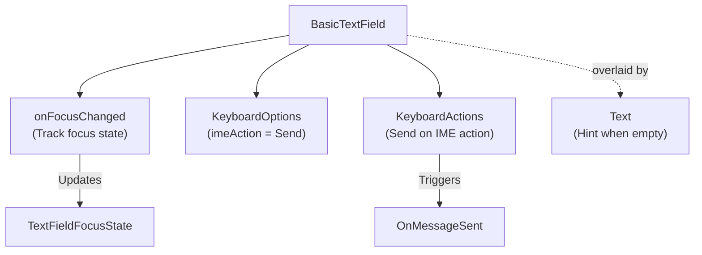

Key implementation details:

- **Single line constraint**: `maxLines = 1` at [Jetchat/app/src/main/java/com/example/compose/jetchat/conversation/UserInput.kt:488]()
- **IME action**: Set to `ImeAction.Send` at [Jetchat/app/src/main/java/com/example/compose/jetchat/conversation/UserInput.kt:483]()
- **Placeholder text**: Shown when `textFieldValue.text.isEmpty() && !focusState` at [Jetchat/app/src/main/java/com/example/compose/jetchat/conversation/UserInput.kt:495-503]()
- **Focus change tracking**: Uses `lastFocusState` to avoid duplicate events at [Jetchat/app/src/main/java/com/example/compose/jetchat/conversation/UserInput.kt:468-480]()

Sources: [Jetchat/app/src/main/java/com/example/compose/jetchat/conversation/UserInput.kt:459-504]()

## Text Field Value Management

The system uses `TextFieldValue` instead of plain `String` to preserve cursor position and text selection. The `addText` extension function at [Jetchat/app/src/main/java/com/example/compose/jetchat/conversation/UserInput.kt:197-209]() demonstrates proper text insertion:

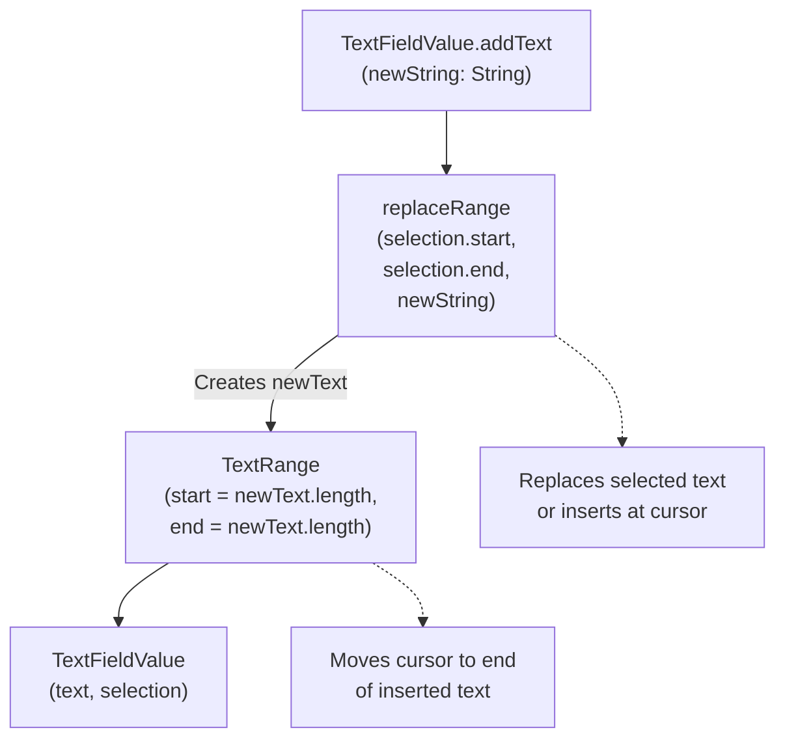

This function is called when emojis are selected from the emoji picker, inserting them at the current cursor position and moving the cursor to the end of the inserted text.

Sources: [Jetchat/app/src/main/java/com/example/compose/jetchat/conversation/UserInput.kt:197-209]()

## Emoji Selector System

### EmojiSelector Composable

The emoji selector at [Jetchat/app/src/main/java/com/example/compose/jetchat/conversation/UserInput.kt:572-608]() provides a tabbed interface for emojis and stickers:

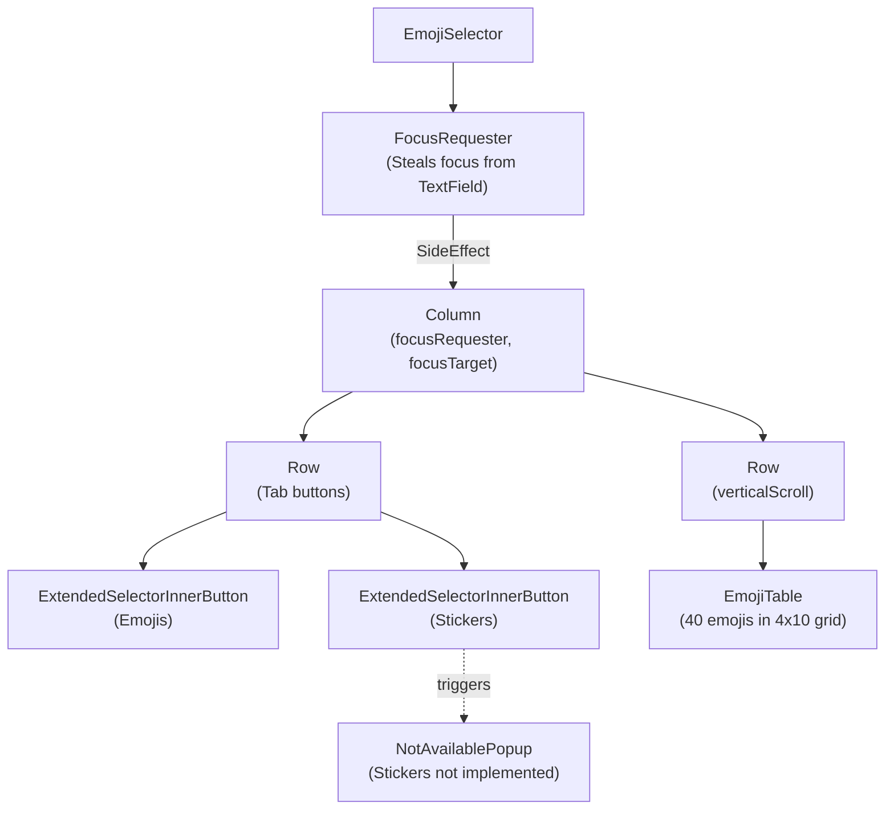

The focus management at [Jetchat/app/src/main/java/com/example/compose/jetchat/conversation/UserInput.kt:216-222]() is critical:

```kotlin
val focusRequester = remember { FocusRequester() }
// If the selector is shown, always request focus to trigger a TextField.onFocusChange.
SideEffect {
    if (currentSelector == InputSelector.EMOJI) {
        focusRequester.requestFocus()
    }
}
```

This ensures the text field loses focus when the emoji selector appears, which dismisses the keyboard.

### EmojiTable Implementation

The emoji grid at [Jetchat/app/src/main/java/com/example/compose/jetchat/conversation/UserInput.kt:635-659]() displays 40 emojis in a 4×10 layout:

| Property | Value | Location |
|----------|-------|----------|
| Rows | 4 | [UserInput.kt:637]() |
| Columns | 10 (EMOJI_COLUMNS) | [UserInput.kt:642](), [UserInput.kt:661]() |
| Total emojis | 40 | Defined at [UserInput.kt:663-792]() |
| Click handler | `onTextAdded(emoji)` | [UserInput.kt:646]() |
| Min touch target | 42.dp × 42.dp | [UserInput.kt:647]() |

Sources: [Jetchat/app/src/main/java/com/example/compose/jetchat/conversation/UserInput.kt:572-608](), [Jetchat/app/src/main/java/com/example/compose/jetchat/conversation/UserInput.kt:635-659](), [Jetchat/app/src/main/java/com/example/compose/jetchat/conversation/UserInput.kt:216-222]()

## Selector Expanded Panel

The `SelectorExpanded` composable at [Jetchat/app/src/main/java/com/example/compose/jetchat/conversation/UserInput.kt:212-236]() manages the expandable panel that appears below the input selector buttons:

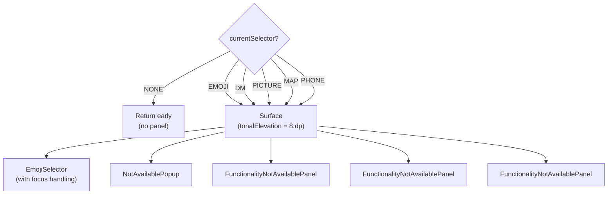

Only the emoji selector is fully implemented; other modes show placeholder UIs at [Jetchat/app/src/main/java/com/example/compose/jetchat/conversation/UserInput.kt:227-234]().

Sources: [Jetchat/app/src/main/java/com/example/compose/jetchat/conversation/UserInput.kt:212-236](), [Jetchat/app/src/main/java/com/example/compose/jetchat/conversation/UserInput.kt:239-264]()

## Input Selector Buttons

The `UserInputSelector` composable at [Jetchat/app/src/main/java/com/example/compose/jetchat/conversation/UserInput.kt:267-344]() displays a horizontal row of action buttons:

| Button | Icon Resource | Selector | Description |
|--------|--------------|----------|-------------|
| Emoji | `ic_mood` | `InputSelector.EMOJI` | Opens emoji picker |
| DM | `ic_alternate_email` | `InputSelector.DM` | Direct message (not implemented) |
| Picture | `ic_insert_photo` | `InputSelector.PICTURE` | Photo attachment (not implemented) |
| Map | `ic_place` | `InputSelector.MAP` | Location sharing (not implemented) |
| Phone | `ic_duo` | `InputSelector.PHONE` | Video chat (not implemented) |
| Send | Text button | N/A | Sends message |

### InputSelectorButton Styling

Each button is implemented by `InputSelectorButton` at [Jetchat/app/src/main/java/com/example/compose/jetchat/conversation/UserInput.kt:347-380]() with visual feedback for selection:

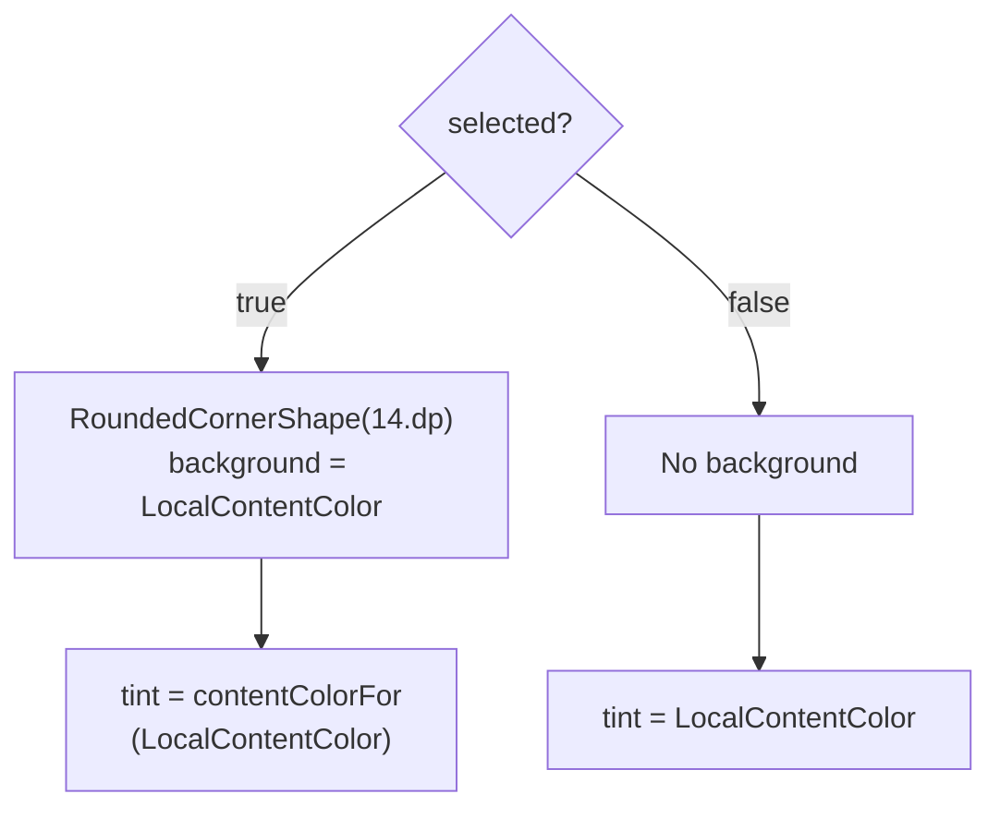

Sources: [Jetchat/app/src/main/java/com/example/compose/jetchat/conversation/UserInput.kt:267-344](), [Jetchat/app/src/main/java/com/example/compose/jetchat/conversation/UserInput.kt:347-380]()

## Send Button State

The send button at [Jetchat/app/src/main/java/com/example/compose/jetchat/conversation/UserInput.kt:330-342]() is enabled only when there is text to send:

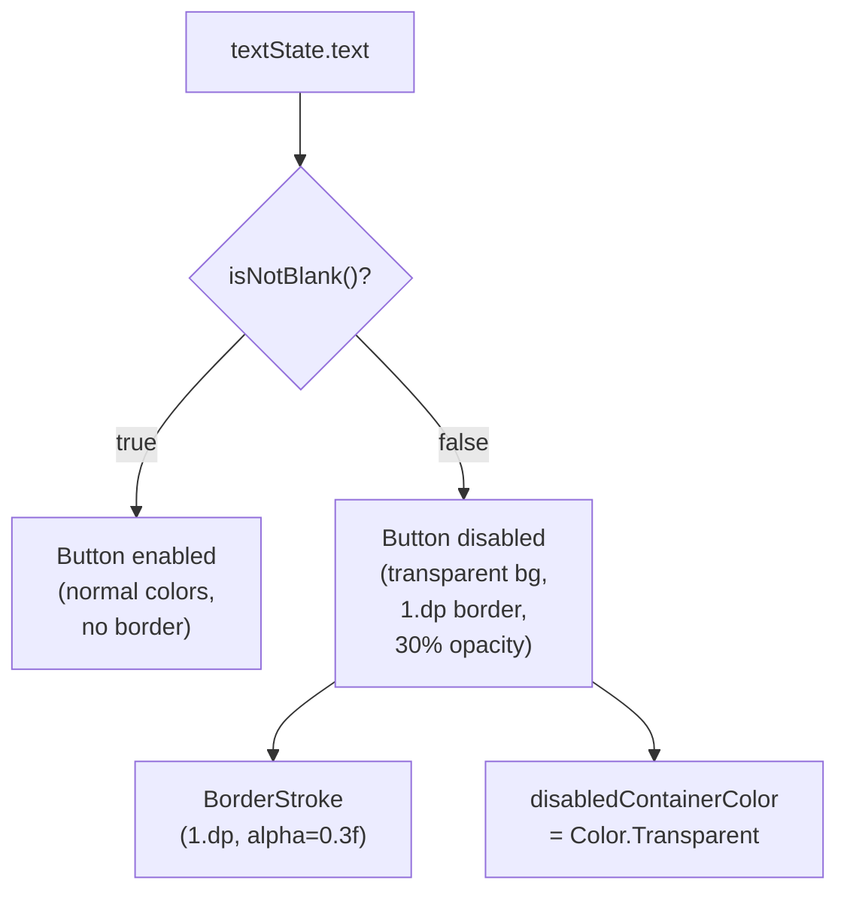

Sources: [Jetchat/app/src/main/java/com/example/compose/jetchat/conversation/UserInput.kt:312-342]()

## Voice Recording System

### RecordButton Implementation

The `RecordButton` is implemented in a separate file but integrated at [Jetchat/app/src/main/java/com/example/compose/jetchat/conversation/UserInput.kt:437-454]() with sophisticated gesture handling:

| Callback | Trigger | Return Value | Purpose |
|----------|---------|--------------|---------|
| `onStartRecording` | Press down | `Boolean` (consumed) | Initiates recording if not already recording |
| `onFinishRecording` | Release | N/A | Completes recording and sends message |
| `onCancelRecording` | Swipe threshold exceeded | N/A | Cancels recording without sending |
| `onSwipeOffsetChange` | Drag during press | N/A | Updates swipe distance for cancel feedback |

### RecordingIndicator UI

When recording, the `RecordingIndicator` at [Jetchat/app/src/main/java/com/example/compose/jetchat/conversation/UserInput.kt:507-569]() displays:

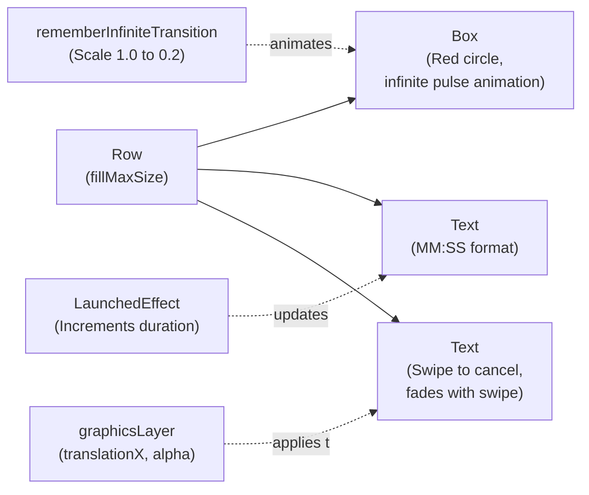

The timer is implemented with a `LaunchedEffect` at [Jetchat/app/src/main/java/com/example/compose/jetchat/conversation/UserInput.kt:508-514]() that increments every second. The pulsing red dot uses an infinite animation at [Jetchat/app/src/main/java/com/example/compose/jetchat/conversation/UserInput.kt:519-540]().

Sources: [Jetchat/app/src/main/java/com/example/compose/jetchat/conversation/UserInput.kt:437-454](), [Jetchat/app/src/main/java/com/example/compose/jetchat/conversation/UserInput.kt:507-569]()

## BackHandler Integration

The system uses `BackHandler` at [Jetchat/app/src/main/java/com/example/compose/jetchat/conversation/UserInput.kt:140-142]() to dismiss the selector panel when the user presses the back button:

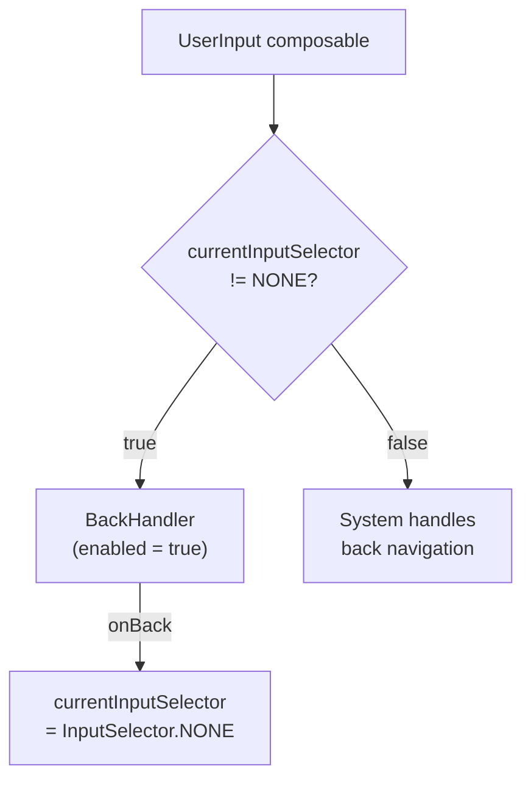

This ensures that when an extended selector (like the emoji picker) is visible, pressing back dismisses it rather than navigating away from the conversation screen.

Sources: [Jetchat/app/src/main/java/com/example/compose/jetchat/conversation/UserInput.kt:140-142]()

## Keyboard Coordination

The system tracks keyboard visibility through a custom semantics property at [Jetchat/app/src/main/java/com/example/compose/jetchat/conversation/UserInput.kt:387-388]():

```kotlin
val KeyboardShownKey = SemanticsPropertyKey<Boolean>("KeyboardShownKey")
var SemanticsPropertyReceiver.keyboardShownProperty by KeyboardShownKey
```

This property is set on the text field at [Jetchat/app/src/main/java/com/example/compose/jetchat/conversation/UserInput.kt:429-432]():

```kotlin
Modifier.fillMaxWidth().semantics {
    contentDescription = a11ylabel
    keyboardShownProperty = keyboardShown
}
```

The `keyboardShown` parameter is computed as:
```
keyboardShown = currentInputSelector == InputSelector.NONE && textFieldFocusState
```

This logic at [Jetchat/app/src/main/java/com/example/compose/jetchat/conversation/UserInput.kt:157]() ensures the keyboard is only shown when no selector panel is active and the text field has focus.

Sources: [Jetchat/app/src/main/java/com/example/compose/jetchat/conversation/UserInput.kt:387-388](), [Jetchat/app/src/main/java/com/example/compose/jetchat/conversation/UserInput.kt:157](), [Jetchat/app/src/main/java/com/example/compose/jetchat/conversation/UserInput.kt:429-432]()

## Message Sending Flow

Messages can be sent through three paths:

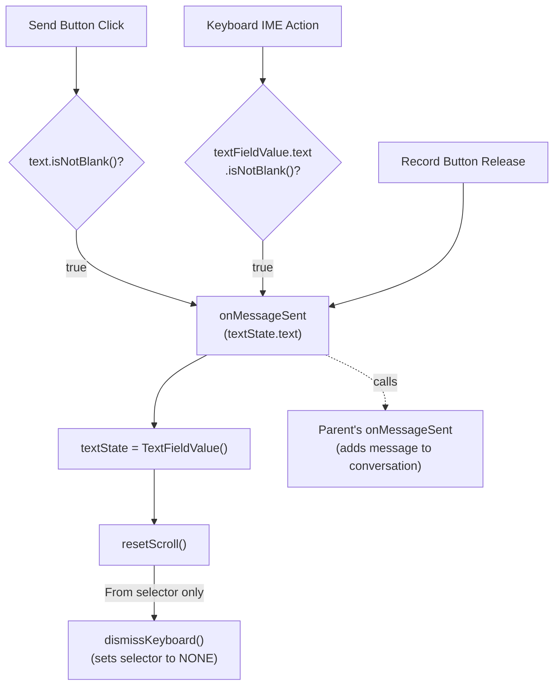

The flow differs slightly between the three paths:

1. **Send button** at [Jetchat/app/src/main/java/com/example/compose/jetchat/conversation/UserInput.kt:178-185](): Sends, resets, scrolls, and dismisses keyboard
2. **IME action** at [Jetchat/app/src/main/java/com/example/compose/jetchat/conversation/UserInput.kt:485-487](): Only sends if text is not blank
3. **Message send from selector** at [Jetchat/app/src/main/java/com/example/compose/jetchat/conversation/UserInput.kt:166-172](): Sends, resets, and scrolls (no keyboard dismiss needed)

Sources: [Jetchat/app/src/main/java/com/example/compose/jetchat/conversation/UserInput.kt:166-185](), [Jetchat/app/src/main/java/com/example/compose/jetchat/conversation/UserInput.kt:485-487]()

## Integration with Conversation Screen

The `UserInput` composable is integrated into the conversation screen at [Jetchat/app/src/main/java/com/example/compose/jetchat/conversation/Conversation.kt:201-215]():

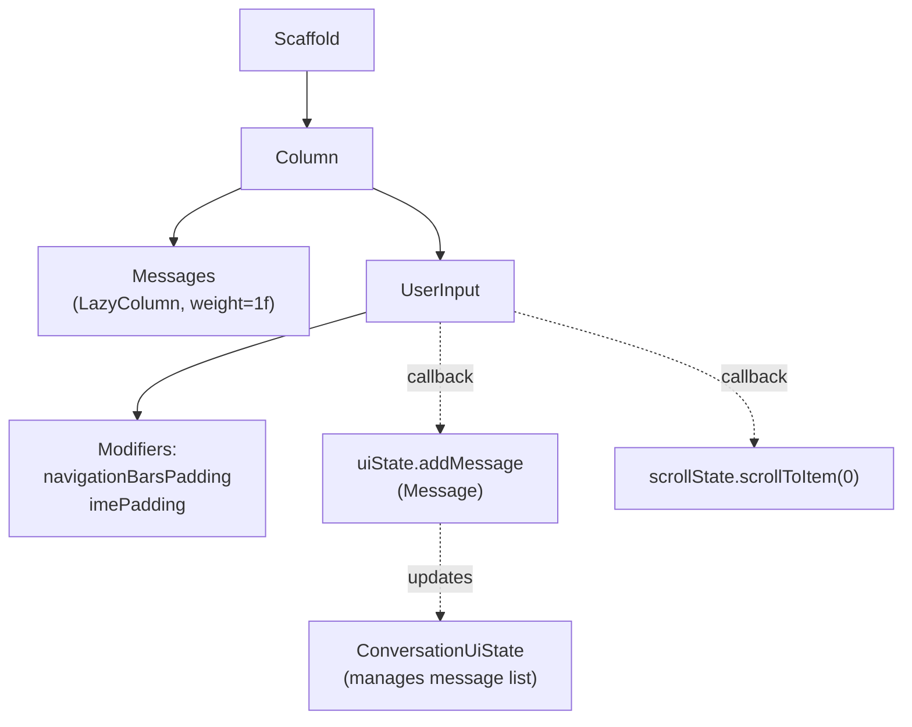

The `UserInput` is positioned at the bottom with `navigationBarsPadding()` and `imePadding()` to handle system insets properly, ensuring it appears above the navigation bar and adjusts when the keyboard appears.

Sources: [Jetchat/app/src/main/java/com/example/compose/jetchat/conversation/Conversation.kt:201-215]()

## Testing

The user input system is tested in [Jetchat/app/src/androidTest/java/com/example/compose/jetchat/UserInputTest.kt:1-164](). Key test scenarios include:

| Test | File Location | Validates |
|------|---------------|-----------|
| `emojiSelector_isClosedWithBack` | [UserInputTest.kt:70-91]() | BackHandler dismisses emoji selector |
| `extendedUserInputShown_textFieldClicked_extendedUserInputHides` | [UserInputTest.kt:94-102]() | Text field focus closes selector |
| `keyboardShown_emojiSelectorOpened_keyboardHides` | [UserInputTest.kt:105-120]() | Opening selector hides keyboard |
| `sendButton_enableToggles` | [UserInputTest.kt:124-134]() | Send button enabled state |

The tests use custom semantics matchers to verify keyboard state through the `KeyboardShownKey` property at [UserInputTest.kt:76](), [UserInputTest.kt:113](), and [UserInputTest.kt:119]().

Sources: [Jetchat/app/src/androidTest/java/com/example/compose/jetchat/UserInputTest.kt:1-164]()

## Summary

The Jetchat user input system demonstrates several advanced Compose patterns:

- **State coordination**: Managing multiple input modes (keyboard, selectors, recording) with proper focus handling
- **Text field management**: Using `TextFieldValue` to preserve cursor position and selection
- **BackHandler integration**: Intercepting back navigation to dismiss expanded panels
- **Keyboard coordination**: Using custom semantics properties to track keyboard visibility
- **Gesture handling**: Implementing swipe-to-cancel for voice recording
- **Accessibility**: Providing content descriptions and semantic properties for testing
- **Animation**: Using `AnimatedContent` for smooth transitions between UI states

The system is fully integrated with the conversation screen through callback parameters that allow the parent to handle message sending and scroll management.

---

