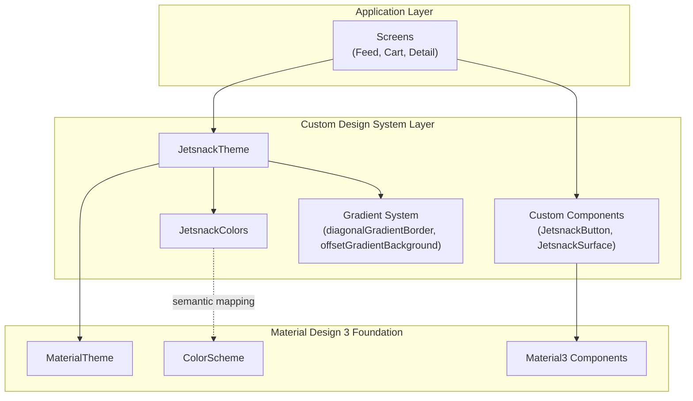
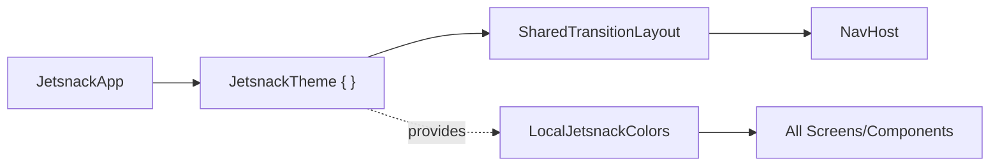
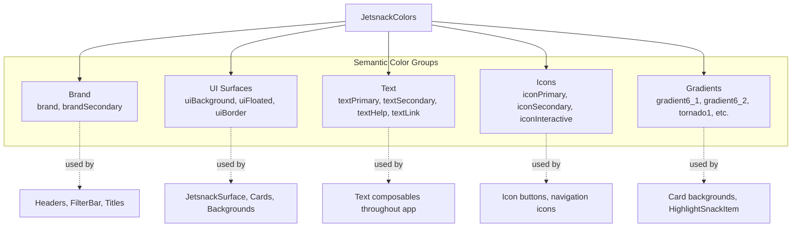
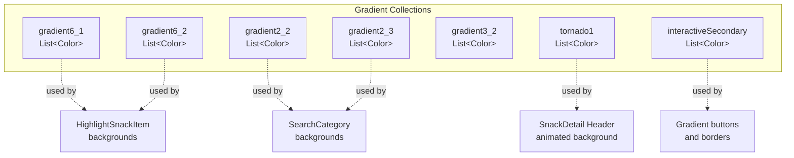
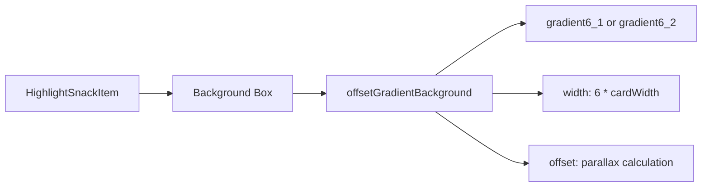
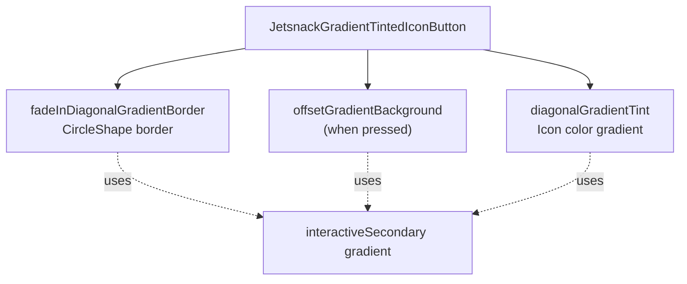
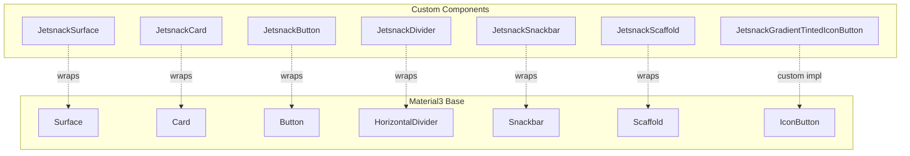
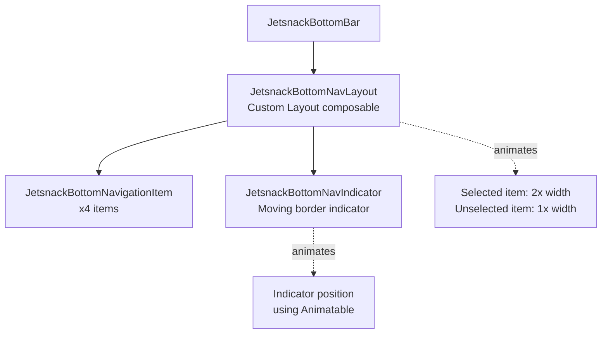
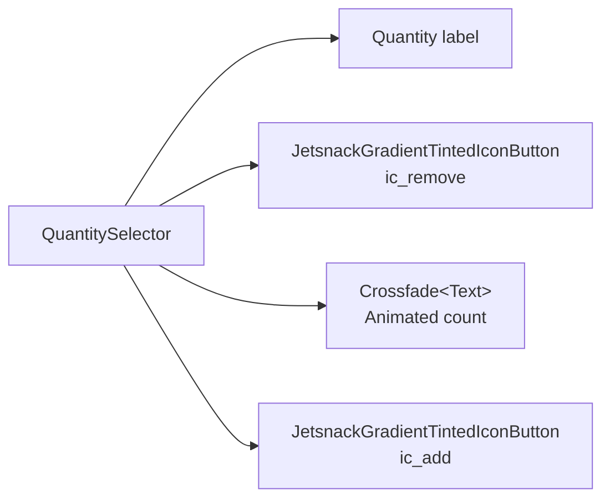
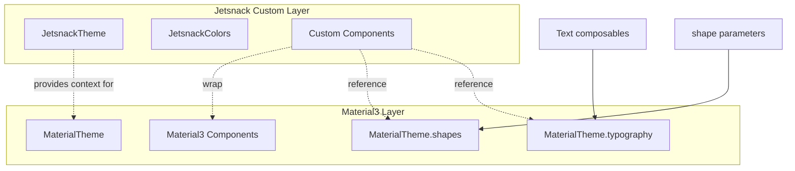

<!-- source: DeepWiki mcp.deepwiki.com · repo android/compose-samples · extra page Jetsnack Custom Design System · fetched 2026-10-23 -->

# Jetsnack Custom Design System

<details>
<summary>Relevant source files</summary>

The following files were used as context for generating this wiki page:

- [Jetsnack/app/src/main/java/com/example/jetsnack/model/Filter.kt](Jetsnack/app/src/main/java/com/example/jetsnack/model/Filter.kt)
- [Jetsnack/app/src/main/java/com/example/jetsnack/model/SnackbarManager.kt](Jetsnack/app/src/main/java/com/example/jetsnack/model/SnackbarManager.kt)
- [Jetsnack/app/src/main/java/com/example/jetsnack/ui/JetsnackApp.kt](Jetsnack/app/src/main/java/com/example/jetsnack/ui/JetsnackApp.kt)
- [Jetsnack/app/src/main/java/com/example/jetsnack/ui/SnackSharedElementKey.kt](Jetsnack/app/src/main/java/com/example/jetsnack/ui/SnackSharedElementKey.kt)
- [Jetsnack/app/src/main/java/com/example/jetsnack/ui/components/Filters.kt](Jetsnack/app/src/main/java/com/example/jetsnack/ui/components/Filters.kt)
- [Jetsnack/app/src/main/java/com/example/jetsnack/ui/components/GradientTintedIconButton.kt](Jetsnack/app/src/main/java/com/example/jetsnack/ui/components/GradientTintedIconButton.kt)
- [Jetsnack/app/src/main/java/com/example/jetsnack/ui/components/QuantitySelector.kt](Jetsnack/app/src/main/java/com/example/jetsnack/ui/components/QuantitySelector.kt)
- [Jetsnack/app/src/main/java/com/example/jetsnack/ui/components/Snackbar.kt](Jetsnack/app/src/main/java/com/example/jetsnack/ui/components/Snackbar.kt)
- [Jetsnack/app/src/main/java/com/example/jetsnack/ui/components/Snacks.kt](Jetsnack/app/src/main/java/com/example/jetsnack/ui/components/Snacks.kt)
- [Jetsnack/app/src/main/java/com/example/jetsnack/ui/home/DestinationBar.kt](Jetsnack/app/src/main/java/com/example/jetsnack/ui/home/DestinationBar.kt)
- [Jetsnack/app/src/main/java/com/example/jetsnack/ui/home/Feed.kt](Jetsnack/app/src/main/java/com/example/jetsnack/ui/home/Feed.kt)
- [Jetsnack/app/src/main/java/com/example/jetsnack/ui/home/FilterScreen.kt](Jetsnack/app/src/main/java/com/example/jetsnack/ui/home/FilterScreen.kt)
- [Jetsnack/app/src/main/java/com/example/jetsnack/ui/home/Home.kt](Jetsnack/app/src/main/java/com/example/jetsnack/ui/home/Home.kt)
- [Jetsnack/app/src/main/java/com/example/jetsnack/ui/home/Profile.kt](Jetsnack/app/src/main/java/com/example/jetsnack/ui/home/Profile.kt)
- [Jetsnack/app/src/main/java/com/example/jetsnack/ui/home/cart/Cart.kt](Jetsnack/app/src/main/java/com/example/jetsnack/ui/home/cart/Cart.kt)
- [Jetsnack/app/src/main/java/com/example/jetsnack/ui/home/cart/SwipeDismissItem.kt](Jetsnack/app/src/main/java/com/example/jetsnack/ui/home/cart/SwipeDismissItem.kt)
- [Jetsnack/app/src/main/java/com/example/jetsnack/ui/home/search/Categories.kt](Jetsnack/app/src/main/java/com/example/jetsnack/ui/home/search/Categories.kt)
- [Jetsnack/app/src/main/java/com/example/jetsnack/ui/home/search/Results.kt](Jetsnack/app/src/main/java/com/example/jetsnack/ui/home/search/Results.kt)
- [Jetsnack/app/src/main/java/com/example/jetsnack/ui/home/search/Search.kt](Jetsnack/app/src/main/java/com/example/jetsnack/ui/home/search/Search.kt)
- [Jetsnack/app/src/main/java/com/example/jetsnack/ui/home/search/Suggestions.kt](Jetsnack/app/src/main/java/com/example/jetsnack/ui/home/search/Suggestions.kt)
- [Jetsnack/app/src/main/java/com/example/jetsnack/ui/snackdetail/SnackDetail.kt](Jetsnack/app/src/main/java/com/example/jetsnack/ui/snackdetail/SnackDetail.kt)

</details>


## Purpose and Scope

This document details Jetsnack's custom design system implementation, which wraps and extends Material Design 3 with application-specific theming, color semantics, gradient systems, and custom UI components. The design system provides a cohesive visual language centered around snack/food ordering aesthetics while maintaining Compose best practices.

For information about Jetsnack's shared element transitions, see [4.2.2](#4.2.2). For general UI component structure, see [4.2](#4.2).

## Design System Architecture

Jetsnack implements a custom design system that layers on top of Material Design 3 rather than replacing it. The system consists of three primary layers:



**Design System Architecture**

The custom design system provides semantic color names aligned with the application domain (e.g., `brand`, `uiBackground`, `textSecondary`) rather than generic Material color roles. This allows UI code to express intent clearly while maintaining theme flexibility.

Sources: [Jetsnack/app/src/main/java/com/example/jetsnack/ui/snackdetail/SnackDetail.kt:180](), [Jetsnack/app/src/main/java/com/example/jetsnack/ui/components/Snacks.kt:110](), [Jetsnack/app/src/main/java/com/example/jetsnack/ui/JetsnackApp.kt:63]()

## JetsnackTheme Composable

The `JetsnackTheme` composable is the entry point to the design system, wrapping the entire application at the root level. It establishes the custom color palette and provides it through composition locals.



**JetsnackTheme Composition Structure**

The theme is accessed throughout the codebase via `JetsnackTheme.colors`, which provides a `JetsnackColors` instance containing all semantic color properties.

Sources: [Jetsnack/app/src/main/java/com/example/jetsnack/ui/JetsnackApp.kt:63-104]()

## Custom Color System

### JetsnackColors Structure

The Jetsnack color system uses a custom `JetsnackColors` class (or data structure) that defines semantic color properties specific to the application's visual language. Based on usage throughout the codebase, the color system includes the following semantic categories:

| Color Category | Properties | Usage Context |
|---------------|-----------|---------------|
| **Brand Colors** | `brand`, `brandSecondary` | Primary brand elements, headers, accents |
| **UI Surface Colors** | `uiBackground`, `uiFloated`, `uiBorder` | Background surfaces, elevated cards, borders |
| **Text Colors** | `textPrimary`, `textSecondary`, `textHelp`, `textLink` | Text hierarchy and semantics |
| **Icon Colors** | `iconPrimary`, `iconSecondary`, `iconInteractive`, `iconInteractiveInactive` | Icon states and emphasis |
| **Interactive Colors** | `interactiveSecondary` (gradient list) | Buttons, interactive elements |
| **Gradient Collections** | `gradient6_1`, `gradient6_2`, `gradient2_2`, `gradient2_3`, `gradient3_2`, `tornado1` | Decorative backgrounds, card headers |
| **Semantic Colors** | `error` | Error states, destructive actions |



**JetsnackColors Semantic Structure**

The color system also includes a dark mode check via `isDark` property, allowing components to adapt their rendering based on theme mode.

Sources: [Jetsnack/app/src/main/java/com/example/jetsnack/ui/snackdetail/SnackDetail.kt:180](), [Jetsnack/app/src/main/java/com/example/jetsnack/ui/components/Snacks.kt:110-156](), [Jetsnack/app/src/main/java/com/example/jetsnack/ui/home/Home.kt:169-230](), [Jetsnack/app/src/main/java/com/example/jetsnack/ui/components/GradientTintedIconButton.kt:64]()

### Color Usage Patterns

Color properties are accessed via `JetsnackTheme.colors.<property>` throughout the UI layer:

- **Brand emphasis**: `JetsnackTheme.colors.brand` is used for collection titles, filter icons, important UI accents ([Jetsnack/app/src/main/java/com/example/jetsnack/ui/components/Snacks.kt:110]())
- **Surface backgrounds**: `JetsnackTheme.colors.uiBackground` for main backgrounds ([Jetsnack/app/src/main/java/com/example/jetsnack/ui/snackdetail/SnackDetail.kt:180]())
- **Text hierarchy**: `textSecondary` for main content, `textHelp` for supporting text, `textPrimary` for emphasis ([Jetsnack/app/src/main/java/com/example/jetsnack/ui/snackdetail/SnackDetail.kt:415-435]())
- **Interactive states**: `iconInteractive` for active icons, `iconInteractiveInactive` for inactive state ([Jetsnack/app/src/main/java/com/example/jetsnack/ui/home/Home.kt:194-199]())

## Gradient System

Jetsnack's design system includes an extensive gradient system for visual interest and brand personality. Gradients are used in card backgrounds, interactive elements, and decorative headers.

### Gradient Collections

The gradient system provides pre-defined gradient collections accessible through `JetsnackTheme.colors`:



**Gradient Collection Usage**

Gradients typically contain 2-4 colors and are applied through custom modifiers (see below).

Sources: [Jetsnack/app/src/main/java/com/example/jetsnack/ui/components/Snacks.kt:153-156](), [Jetsnack/app/src/main/java/com/example/jetsnack/ui/snackdetail/SnackDetail.kt:201](), [Jetsnack/app/src/main/java/com/example/jetsnack/ui/components/GradientTintedIconButton.kt:48]()

### Gradient Modifiers

The design system provides three key gradient modifiers for applying gradients to components:

| Modifier | Purpose | Typical Usage |
|----------|---------|---------------|
| `diagonalGradientBorder` | Applies gradient as a border stroke | Icon button borders, filter chip borders |
| `fadeInDiagonalGradientBorder` | Conditional gradient border with fade | Filter chips (shows border when not selected) |
| `offsetGradientBackground` | Gradient background with offset/parallax | Card backgrounds, pressed button states |
| `diagonalGradientTint` | Applies gradient as icon/content tint | Icon button icon tinting |

#### Example: HighlightSnackItem Gradient Background

The `HighlightSnackItem` component demonstrates parallax gradient backgrounds that scroll with the horizontal list:



**HighlightSnackItem Gradient Implementation**

The gradient spans 6 card widths and scrolls at 1/3 speed of the list, creating a parallax effect.

Sources: [Jetsnack/app/src/main/java/com/example/jetsnack/ui/components/Snacks.kt:350-362]()

#### Example: GradientTintedIconButton

The `JetsnackGradientTintedIconButton` component combines multiple gradient modifiers for a rich interactive appearance:



**JetsnackGradientTintedIconButton Gradient Layers**

Sources: [Jetsnack/app/src/main/java/com/example/jetsnack/ui/components/GradientTintedIconButton.kt:43-97]()

## Custom Component Library

The design system includes wrapped Material components that apply Jetsnack styling conventions. These components ensure consistency across the application and simplify theme application.

### Core Components



**Custom Component Inheritance Structure**

### JetsnackSurface

`JetsnackSurface` wraps Material3's `Surface` with default color parameters from `JetsnackTheme.colors`. Used as the base for most composable containers.

**Usage locations:**
- Background for `Feed`, `Search`, `Cart` screens
- Container for filter chips, buttons, cards
- Bottom bar backgrounds

Sources: [Jetsnack/app/src/main/java/com/example/jetsnack/ui/home/Home.kt:175-179](), [Jetsnack/app/src/main/java/com/example/jetsnack/ui/components/Snacks.kt:191-256]()

### JetsnackButton

`JetsnackButton` is a styled button component with Jetsnack brand appearance, typically used for primary actions.

**Key usage:**
- "Add to cart" button in `SnackDetail` ([Jetsnack/app/src/main/java/com/example/jetsnack/ui/snackdetail/SnackDetail.kt:585-595]())
- Checkout button in `Cart` ([Jetsnack/app/src/main/java/com/example/jetsnack/ui/home/cart/Cart.kt:485-494]())

Sources: [Jetsnack/app/src/main/java/com/example/jetsnack/ui/snackdetail/SnackDetail.kt:585-595](), [Jetsnack/app/src/main/java/com/example/jetsnack/ui/home/cart/Cart.kt:485-494]()

### JetsnackDivider

`JetsnackDivider` provides consistent divider styling throughout the app, using theme colors and standardized thickness.

**Usage patterns:**
- Separating cart items ([Jetsnack/app/src/main/java/com/example/jetsnack/ui/home/cart/Cart.kt:395-400]())
- Below title sections in `SnackDetail` ([Jetsnack/app/src/main/java/com/example/jetsnack/ui/snackdetail/SnackDetail.kt:465]())
- Between collection sections in feed ([Jetsnack/app/src/main/java/com/example/jetsnack/ui/home/Feed.kt:127]())

Sources: [Jetsnack/app/src/main/java/com/example/jetsnack/ui/home/cart/Cart.kt:395-400](), [Jetsnack/app/src/main/java/com/example/jetsnack/ui/snackdetail/SnackDetail.kt:465]()

### JetsnackCard

`JetsnackCard` wraps Material3's `Card` with theme-appropriate defaults, used for elevated content containers.

Sources: [Jetsnack/app/src/main/java/com/example/jetsnack/ui/components/Snacks.kt:282-438]()

### JetsnackGradientTintedIconButton

Custom icon button implementation with gradient styling. Unlike other components, this doesn't wrap a Material component but builds from primitives with gradient modifiers.

**Features:**
- Gradient border using `fadeInDiagonalGradientBorder`
- Pressed state background using `offsetGradientBackground`
- Gradient icon tint using `diagonalGradientTint`
- Blend mode adaptation for dark/light themes

**Usage:**
- Quantity selector increment/decrement buttons ([Jetsnack/app/src/main/java/com/example/jetsnack/ui/components/QuantitySelector.kt:53-78]())

Sources: [Jetsnack/app/src/main/java/com/example/jetsnack/ui/components/GradientTintedIconButton.kt:43-97](), [Jetsnack/app/src/main/java/com/example/jetsnack/ui/components/QuantitySelector.kt:53-78]()

### JetsnackSnackbar

Custom snackbar styling using `JetsnackTheme.colors` for background, content, and action colors.

Sources: [Jetsnack/app/src/main/java/com/example/jetsnack/ui/components/Snackbar.kt:33-51]()

## Custom Layouts and UI Patterns

Beyond wrapped components, Jetsnack implements custom layout patterns that are part of the design system's visual language.

### Custom Bottom Navigation

The `JetsnackBottomBar` implements a custom bottom navigation with animated width changes and a moving indicator. This deviates from Material3's NavigationBar to achieve a unique brand expression.



**Custom Bottom Navigation Architecture**

**Key features:**
- Selected tab expands to 2x width of unselected tabs
- Animated indicator (border) slides between tabs
- Icon and text scale/fade based on selection state
- Uses `spatialExpressiveSpring` for motion

Sources: [Jetsnack/app/src/main/java/com/example/jetsnack/ui/home/Home.kt:164-230](), [Jetsnack/app/src/main/java/com/example/jetsnack/ui/home/Home.kt:233-307](), [Jetsnack/app/src/main/java/com/example/jetsnack/ui/home/Home.kt:310-331]()

### QuantitySelector

The `QuantitySelector` composable is a custom control for adjusting item quantities, using gradient-styled buttons and a crossfade-animated count display.



**QuantitySelector Component Structure**

The count value uses `Crossfade` animation when changing, providing smooth transitions between numbers.

Sources: [Jetsnack/app/src/main/java/com/example/jetsnack/ui/components/QuantitySelector.kt:42-80]()

### FilterChip

Custom filter chip implementation with animated background color, gradient borders, and pressed state gradient overlays.

**States:**
- Unselected: gradient border, transparent background
- Selected: solid `brandSecondary` background, no border
- Pressed: gradient overlay on top of background

Sources: [Jetsnack/app/src/main/java/com/example/jetsnack/ui/components/Filters.kt:103-161]()

## Integration with Material Design 3

While Jetsnack implements a custom design system, it maintains compatibility with Material Design 3 for underlying functionality:

### Material3 Usage Points



**Material3 Integration Points**

**Typography**: All `Text` composables use `MaterialTheme.typography` styles (e.g., `titleLarge`, `bodyMedium`, `labelSmall`). The custom design system does not override Material typography but works alongside it.

Examples:
- [Jetsnack/app/src/main/java/com/example/jetsnack/ui/snackdetail/SnackDetail.kt:308]() - `MaterialTheme.typography.labelSmall`
- [Jetsnack/app/src/main/java/com/example/jetsnack/ui/components/Snacks.kt:109]() - `MaterialTheme.typography.titleLarge`
- [Jetsnack/app/src/main/java/com/example/jetsnack/ui/home/cart/Cart.kt:324]() - `MaterialTheme.typography.titleMedium`

**Shapes**: Material shape tokens are used for component shapes:
- `MaterialTheme.shapes.medium` for cards and surfaces
- `MaterialTheme.shapes.small` for filter chips
- Custom shapes like `CircleShape` and `RoundedCornerShape` where needed

Sources: [Jetsnack/app/src/main/java/com/example/jetsnack/ui/components/Snacks.kt:192](), [Jetsnack/app/src/main/java/com/example/jetsnack/ui/components/Filters.kt:96]()

**Component Wrapping**: Custom components wrap Material3 implementations:
- `JetsnackSurface` wraps `Surface`
- `JetsnackButton` wraps `Button` (implied)
- `JetsnackSnackbar` wraps `Snackbar`

## Animation Springs

The design system defines two custom spring animation specifications used throughout the app for consistent motion design:

```kotlin
fun <T> spatialExpressiveSpring() = spring<T>(
    dampingRatio = 0.8f,
    stiffness = 380f,
)

fun <T> nonSpatialExpressiveSpring() = spring<T>(
    dampingRatio = 1f,
    stiffness = 1600f,
)
```

**Usage:**
- `spatialExpressiveSpring`: For spatial transitions (position, size, bounds) in shared element transitions, bottom bar animations
- `nonSpatialExpressiveSpring`: For non-spatial properties (opacity, color) and quick UI responses

These springs are referenced throughout navigation transitions, shared element animations, and interactive component animations.

Sources: [Jetsnack/app/src/main/java/com/example/jetsnack/ui/snackdetail/SnackDetail.kt:130-138](), [Jetsnack/app/src/main/java/com/example/jetsnack/ui/home/Home.kt:180]()

## Design System Component Map

The following table maps screens to their primary design system component usage:

| Screen/Component | Custom Components Used | Gradient Usage | Key Colors |
|-----------------|----------------------|----------------|-----------|
| **SnackDetail** | `JetsnackButton`, `JetsnackDivider`, `JetsnackSurface`, `QuantitySelector` | `tornado1` (animated header background) | `uiBackground`, `textSecondary`, `textHelp`, `textPrimary`, `iconInteractive` |
| **Feed** | `JetsnackSurface`, `JetsnackDivider`, `FilterBar`, `SnackCollection` | `gradient6_1`, `gradient6_2` (highlight cards) | `brand`, `textSecondary`, `textPrimary`, `uiBorder` |
| **Cart** | `JetsnackButton`, `JetsnackDivider`, `JetsnackSurface`, `SnackImage`, `QuantitySelector` | None | `brand`, `uiBackground`, `error`, `textSecondary` |
| **Search** | `JetsnackSurface`, `JetsnackButton`, `JetsnackDivider` | `gradient2_2`, `gradient2_3` (category cards) | `uiFloated`, `textSecondary`, `textHelp`, `brand` |
| **FilterScreen** | `FilterChip`, `JetsnackSurface` | `interactiveSecondary` (chip borders) | `brandSecondary`, `uiFloated`, `brand`, `textSecondary` |
| **Bottom Navigation** | `JetsnackBottomBar`, `JetsnackBottomNavIndicator` | None | `iconPrimary`, `iconInteractive`, `iconInteractiveInactive` |

Sources: [Jetsnack/app/src/main/java/com/example/jetsnack/ui/snackdetail/SnackDetail.kt:1-616](), [Jetsnack/app/src/main/java/com/example/jetsnack/ui/home/Feed.kt:1-148](), [Jetsnack/app/src/main/java/com/example/jetsnack/ui/home/cart/Cart.kt:1-515](), [Jetsnack/app/src/main/java/com/example/jetsnack/ui/home/search/Search.kt:1-264](), [Jetsnack/app/src/main/java/com/example/jetsnack/ui/home/FilterScreen.kt:1-322](), [Jetsnack/app/src/main/java/com/example/jetsnack/ui/home/Home.kt:164-230]()

---

