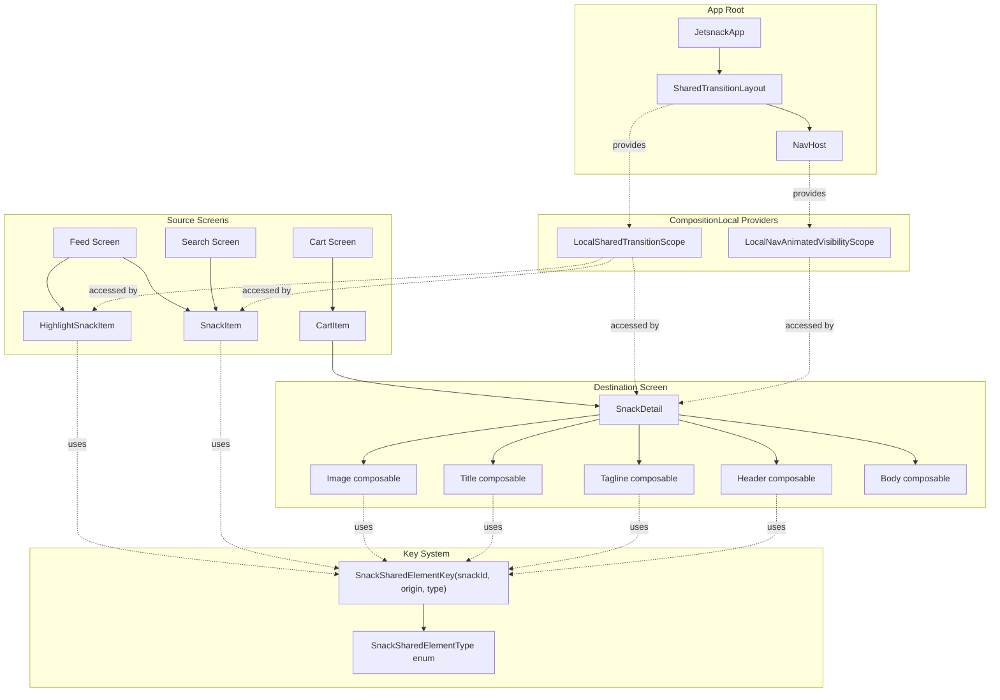
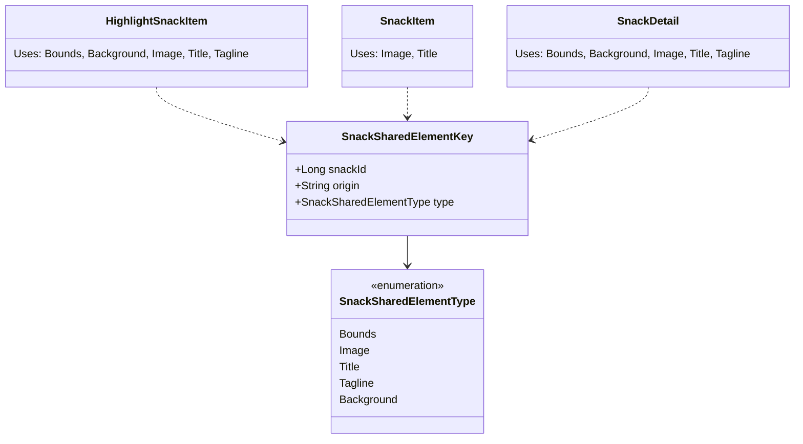
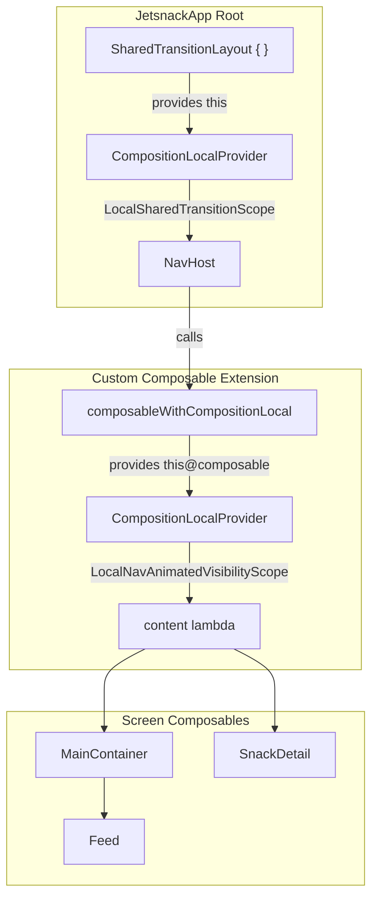
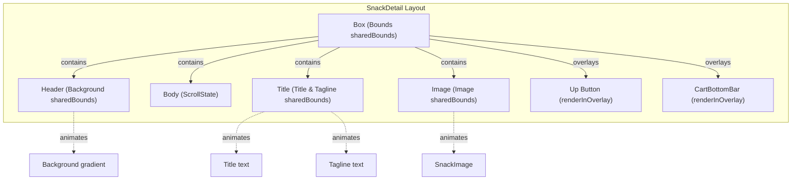
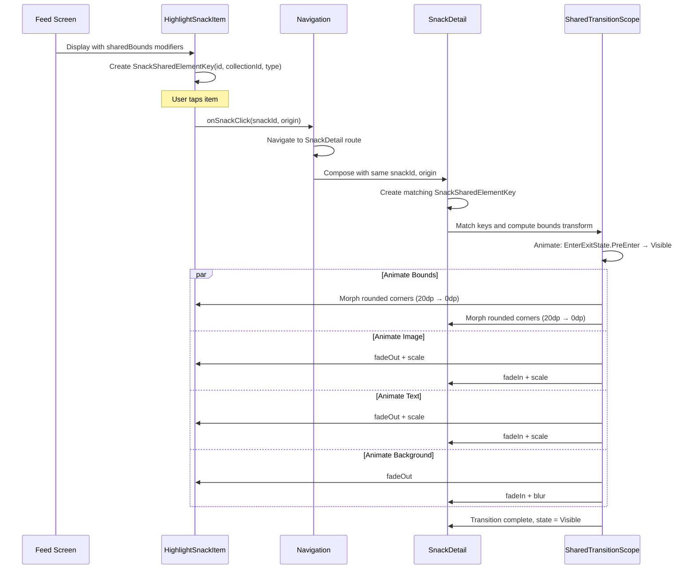
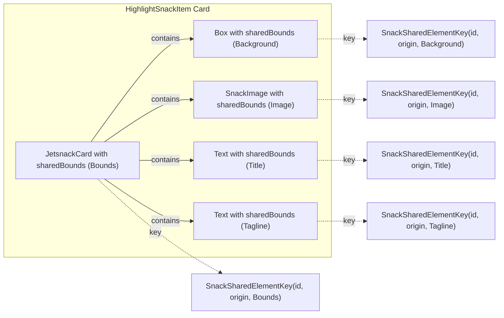
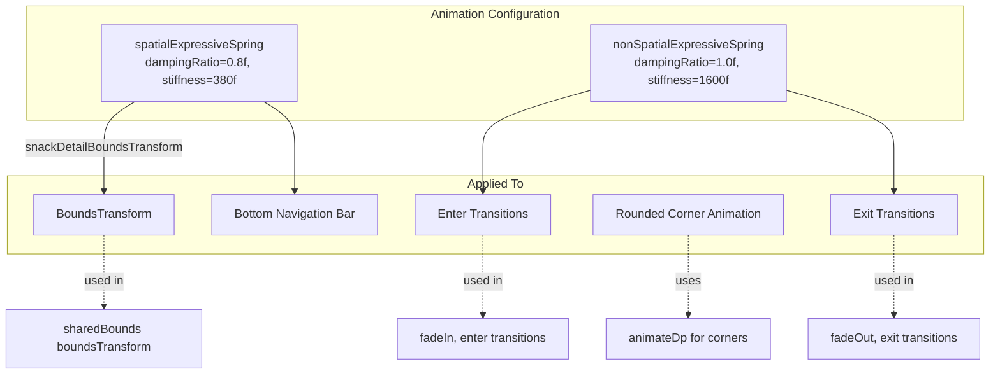
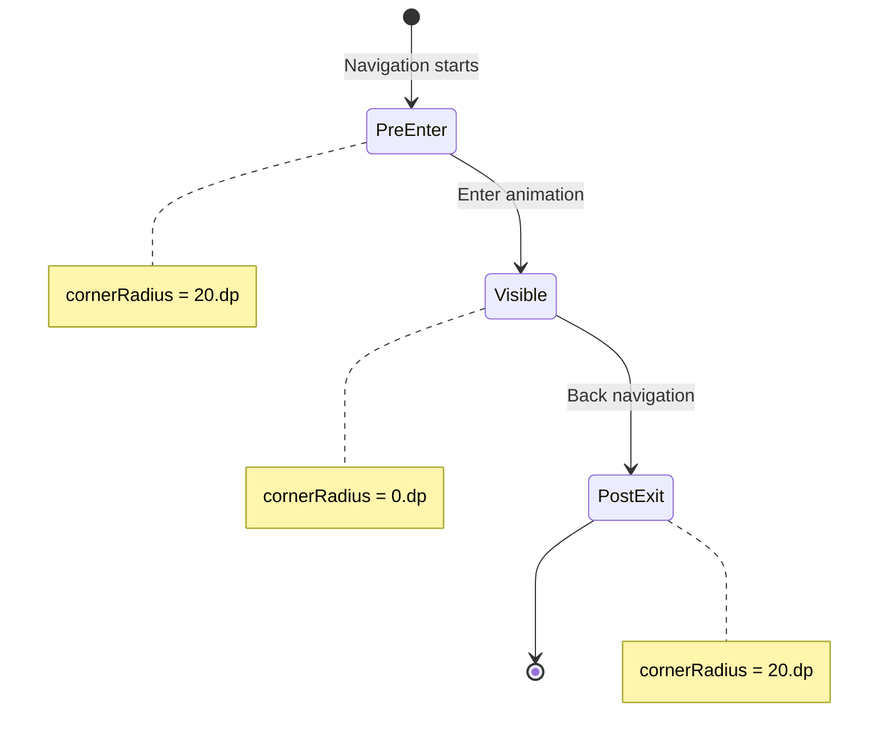
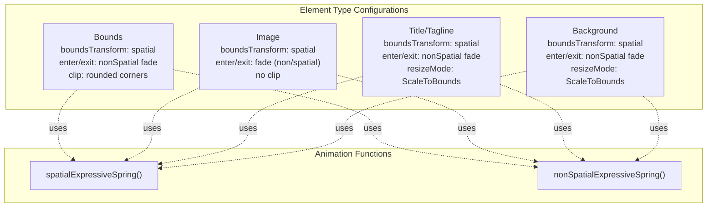
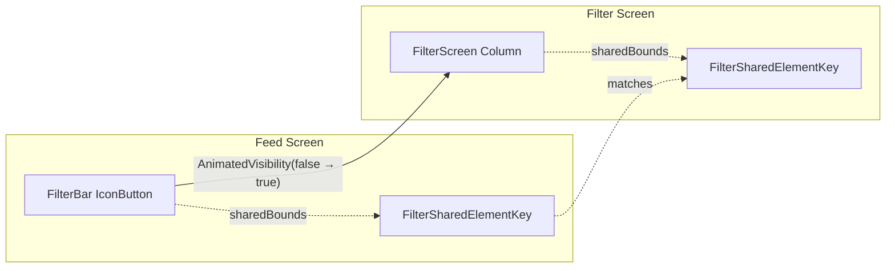

<!-- source: DeepWiki mcp.deepwiki.com · repo android/compose-samples · extra page Jetsnack Shared Element Transitions · fetched 2026-10-23 -->

# Jetsnack Shared Element Transitions

<details>
<summary>Relevant source files</summary>

The following files were used as context for generating this wiki page:

- [Jetsnack/app/src/main/java/com/example/jetsnack/model/Filter.kt](Jetsnack/app/src/main/java/com/example/jetsnack/model/Filter.kt)
- [Jetsnack/app/src/main/java/com/example/jetsnack/model/SnackbarManager.kt](Jetsnack/app/src/main/java/com/example/jetsnack/model/SnackbarManager.kt)
- [Jetsnack/app/src/main/java/com/example/jetsnack/ui/JetsnackApp.kt](Jetsnack/app/src/main/java/com/example/jetsnack/ui/JetsnackApp.kt)
- [Jetsnack/app/src/main/java/com/example/jetsnack/ui/SnackSharedElementKey.kt](Jetsnack/app/src/main/java/com/example/jetsnack/ui/SnackSharedElementKey.kt)
- [Jetsnack/app/src/main/java/com/example/jetsnack/ui/components/Filters.kt](Jetsnack/app/src/main/java/com/example/jetsnack/ui/components/Filters.kt)
- [Jetsnack/app/src/main/java/com/example/jetsnack/ui/components/GradientTintedIconButton.kt](Jetsnack/app/src/main/java/com/example/jetsnack/ui/components/GradientTintedIconButton.kt)
- [Jetsnack/app/src/main/java/com/example/jetsnack/ui/components/QuantitySelector.kt](Jetsnack/app/src/main/java/com/example/jetsnack/ui/components/QuantitySelector.kt)
- [Jetsnack/app/src/main/java/com/example/jetsnack/ui/components/Snackbar.kt](Jetsnack/app/src/main/java/com/example/jetsnack/ui/components/Snackbar.kt)
- [Jetsnack/app/src/main/java/com/example/jetsnack/ui/components/Snacks.kt](Jetsnack/app/src/main/java/com/example/jetsnack/ui/components/Snacks.kt)
- [Jetsnack/app/src/main/java/com/example/jetsnack/ui/home/DestinationBar.kt](Jetsnack/app/src/main/java/com/example/jetsnack/ui/home/DestinationBar.kt)
- [Jetsnack/app/src/main/java/com/example/jetsnack/ui/home/Feed.kt](Jetsnack/app/src/main/java/com/example/jetsnack/ui/home/Feed.kt)
- [Jetsnack/app/src/main/java/com/example/jetsnack/ui/home/FilterScreen.kt](Jetsnack/app/src/main/java/com/example/jetsnack/ui/home/FilterScreen.kt)
- [Jetsnack/app/src/main/java/com/example/jetsnack/ui/home/Home.kt](Jetsnack/app/src/main/java/com/example/jetsnack/ui/home/Home.kt)
- [Jetsnack/app/src/main/java/com/example/jetsnack/ui/home/Profile.kt](Jetsnack/app/src/main/java/com/example/jetsnack/ui/home/Profile.kt)
- [Jetsnack/app/src/main/java/com/example/jetsnack/ui/home/cart/Cart.kt](Jetsnack/app/src/main/java/com/example/jetsnack/ui/home/cart/Cart.kt)
- [Jetsnack/app/src/main/java/com/example/jetsnack/ui/home/cart/SwipeDismissItem.kt](Jetsnack/app/src/main/java/com/example/jetsnack/ui/home/cart/SwipeDismissItem.kt)
- [Jetsnack/app/src/main/java/com/example/jetsnack/ui/home/search/Categories.kt](Jetsnack/app/src/main/java/com/example/jetsnack/ui/home/search/Categories.kt)
- [Jetsnack/app/src/main/java/com/example/jetsnack/ui/home/search/Results.kt](Jetsnack/app/src/main/java/com/example/jetsnack/ui/home/search/Results.kt)
- [Jetsnack/app/src/main/java/com/example/jetsnack/ui/home/search/Search.kt](Jetsnack/app/src/main/java/com/example/jetsnack/ui/home/search/Search.kt)
- [Jetsnack/app/src/main/java/com/example/jetsnack/ui/home/search/Suggestions.kt](Jetsnack/app/src/main/java/com/example/jetsnack/ui/home/search/Suggestions.kt)
- [Jetsnack/app/src/main/java/com/example/jetsnack/ui/snackdetail/SnackDetail.kt](Jetsnack/app/src/main/java/com/example/jetsnack/ui/snackdetail/SnackDetail.kt)

</details>


## Purpose and Scope

This document explains the shared element transition system in the Jetsnack sample application. It covers how snack items animate smoothly when navigating from the feed/search/cart screens to the detail screen, including the key-based identification system, animation specifications, and coordinate space transformations.

For information about Jetsnack's custom design system (colors, theming), see [4.2.1](#4.2.1). For general navigation patterns across samples, see [5.3](#5.3).

---

## System Architecture Overview

Jetsnack implements shared element transitions using Compose's `SharedTransitionLayout` API (Experimental as of the implementation). The system enables five distinct UI elements to transition between screens: bounds container, snack image, title text, tagline text, and background gradient.

### High-Level Architecture



**Sources:** [Jetsnack/app/src/main/java/com/example/jetsnack/ui/JetsnackApp.kt:62-105](), [Jetsnack/app/src/main/java/com/example/jetsnack/ui/SnackSharedElementKey.kt:1-30]()

---

## Shared Element Key System

### SnackSharedElementKey Structure

The transition system uses a data class `SnackSharedElementKey` to uniquely identify each participating UI element across navigation boundaries.



| Field | Type | Purpose |
|-------|------|---------|
| `snackId` | `Long` | Unique identifier for the snack item |
| `origin` | `String` | Source screen identifier (collection ID or "cart", "search", "details") |
| `type` | `SnackSharedElementType` | Which UI element is being transitioned |

The `origin` parameter is critical for handling multiple instances of the same snack across different collections, ensuring the correct item animates even when the same snack appears in multiple lists.

**Sources:** [Jetsnack/app/src/main/java/com/example/jetsnack/ui/SnackSharedElementKey.kt:19-27]()

---

## CompositionLocal Setup

Jetsnack uses two `CompositionLocal` providers to propagate scope information down the composition tree:



### CompositionLocal Definitions

Both scopes are nullable and must be validated at usage sites:

```kotlin
val LocalNavAnimatedVisibilityScope = compositionLocalOf<AnimatedVisibilityScope?> { null }
val LocalSharedTransitionScope = compositionLocalOf<SharedTransitionScope?> { null }
```

### Usage Pattern

Every composable participating in transitions must retrieve both scopes:

```kotlin
val sharedTransitionScope = LocalSharedTransitionScope.current
    ?: throw IllegalStateException("No Scope found")
val animatedVisibilityScope = LocalNavAnimatedVisibilityScope.current
    ?: throw IllegalStateException("No Scope found")
```

**Sources:** [Jetsnack/app/src/main/java/com/example/jetsnack/ui/JetsnackApp.kt:169-170](), [Jetsnack/app/src/main/java/com/example/jetsnack/ui/home/Home.kt:86-125](), [Jetsnack/app/src/main/java/com/example/jetsnack/ui/snackdetail/SnackDetail.kt:148-151]()

---

## Shared Element Types

### Type Mapping Table

| Type | Visual Element | Transition Behavior | Used In |
|------|---------------|---------------------|---------|
| `Bounds` | Container card shape | Morphs shape with rounded corner animation | HighlightSnackItem → SnackDetail |
| `Image` | Snack product image | Scales and translates | All item types → SnackDetail |
| `Title` | Snack name text | Fades, scales, translates | HighlightSnackItem, SnackItem → SnackDetail |
| `Tagline` | Snack description text | Fades, scales, translates | HighlightSnackItem → SnackDetail |
| `Background` | Gradient background | Scales, fades, blurs | HighlightSnackItem → SnackDetail |

### Element Hierarchy in SnackDetail



**Sources:** [Jetsnack/app/src/main/java/com/example/jetsnack/ui/snackdetail/SnackDetail.kt:161-191]()

---

## Feed-to-Detail Transition Flow

### Transition Sequence Diagram



### Code Flow for HighlightSnackItem → SnackDetail

#### Source: HighlightSnackItem

The highlighted snack card on the feed screen defines all five shared elements:



**Sources:** [Jetsnack/app/src/main/java/com/example/jetsnack/ui/components/Snacks.kt:260-438]()

#### Destination: SnackDetail

The detail screen defines matching shared element keys for seamless transition:

**Sources:** [Jetsnack/app/src/main/java/com/example/jetsnack/ui/snackdetail/SnackDetail.kt:145-191](), [Jetsnack/app/src/main/java/com/example/jetsnack/ui/snackdetail/SnackDetail.kt:194-249](), [Jetsnack/app/src/main/java/com/example/jetsnack/ui/snackdetail/SnackDetail.kt:388-468](), [Jetsnack/app/src/main/java/com/example/jetsnack/ui/snackdetail/SnackDetail.kt:471-515]()

---

## Animation Specifications

### Spring Animation Functions

Jetsnack defines two custom spring animation functions for different motion types:

| Function | Damping Ratio | Stiffness | Usage |
|----------|--------------|-----------|--------|
| `spatialExpressiveSpring()` | 0.8f | 380f | Position, size changes (bounds, layout) |
| `nonSpatialExpressiveSpring()` | 1.0f | 1600f | Opacity, color changes (fade in/out) |



### BoundsTransform Definition

The global bounds transform ensures all spatial transitions use the same spring physics:

```kotlin
val snackDetailBoundsTransform = BoundsTransform { _, _ ->
    spatialExpressiveSpring()
}
```

**Sources:** [Jetsnack/app/src/main/java/com/example/jetsnack/ui/snackdetail/SnackDetail.kt:130-142]()

---

## Advanced Transition Techniques

### Rounded Corner Animation

The `Bounds` shared element animates corner radius during transitions using `EnterExitState`:



The animation is defined in both the source and destination:

**Source (HighlightSnackItem):**
- PreEnter: 0.dp
- Visible: 20.dp
- PostExit: 20.dp

**Destination (SnackDetail):**
- PreEnter: 20.dp
- Visible: 0.dp
- PostExit: 20.dp

This creates a smooth morph from rounded card corners to full-screen (no corners) and back.

**Sources:** [Jetsnack/app/src/main/java/com/example/jetsnack/ui/snackdetail/SnackDetail.kt:152-159](), [Jetsnack/app/src/main/java/com/example/jetsnack/ui/components/Snacks.kt:274-281]()

### Overlay Rendering for UI Chrome

Non-content UI elements (back button, bottom bar) use `renderInSharedTransitionScopeOverlay` to render above the transition:

```kotlin
Modifier
    .renderInSharedTransitionScopeOverlay(zIndexInOverlay = 3f)
    .animateEnterExit(
        enter = scaleIn(tween(300, delayMillis = 300)),
        exit = scaleOut(tween(20))
    )
```

This ensures these elements don't participate in the shared element animation but still animate in/out appropriately.

**Sources:** [Jetsnack/app/src/main/java/com/example/jetsnack/ui/snackdetail/SnackDetail.kt:259-266](), [Jetsnack/app/src/main/java/com/example/jetsnack/ui/snackdetail/SnackDetail.kt:558-567]()

### skipToLookaheadSize for Layout Stability

The `Body` composable uses `skipToLookaheadSize()` to prevent layout thrashing during transitions:

```kotlin
Column(modifier = Modifier.skipToLookaheadSize()) {
    // Scrollable content
}
```

This modifier tells the layout system to immediately use the final target size during lookahead, preventing unnecessary intermediate layouts that would cause jank.

**Sources:** [Jetsnack/app/src/main/java/com/example/jetsnack/ui/snackdetail/SnackDetail.kt:286](), [Jetsnack/app/src/main/java/com/example/jetsnack/ui/snackdetail/SnackDetail.kt:321](), [Jetsnack/app/src/main/java/com/example/jetsnack/ui/snackdetail/SnackDetail.kt:343](), [Jetsnack/app/src/main/java/com/example/jetsnack/ui/snackdetail/SnackDetail.kt:461]()

### ResizeMode Configuration

Different shared elements use different resize modes:

| Element | ResizeMode | Reason |
|---------|-----------|--------|
| Title | `ScaleToBounds()` | Text should scale uniformly |
| Tagline | `ScaleToBounds()` | Text should scale uniformly |
| Background | `ScaleToBounds()` | Gradient should stretch/compress |
| Image | Default (RemeasureToBounds) | Image content should reflow |
| Bounds | Default (RemeasureToBounds) | Container should reflow content |

**Sources:** [Jetsnack/app/src/main/java/com/example/jetsnack/ui/components/Snacks.kt:250](), [Jetsnack/app/src/main/java/com/example/jetsnack/ui/components/Snacks.kt:346](), [Jetsnack/app/src/main/java/com/example/jetsnack/ui/components/Snacks.kt:408](), [Jetsnack/app/src/main/java/com/example/jetsnack/ui/components/Snacks.kt:432]()

---

## Transition Configuration Summary

### Complete Modifier Chain Example

Here's a complete example of a `sharedBounds` modifier from SnackDetail's outer Box:

```kotlin
.sharedBounds(
    rememberSharedContentState(
        key = SnackSharedElementKey(
            snackId = snack.id,
            origin = origin,
            type = SnackSharedElementType.Bounds
        )
    ),
    animatedVisibilityScope,
    clipInOverlayDuringTransition = OverlayClip(RoundedCornerShape(roundedCornerAnim)),
    boundsTransform = snackDetailBoundsTransform,
    exit = fadeOut(nonSpatialExpressiveSpring()),
    enter = fadeIn(nonSpatialExpressiveSpring())
)
```

### Transition Configuration Matrix



**Sources:** [Jetsnack/app/src/main/java/com/example/jetsnack/ui/snackdetail/SnackDetail.kt:164-178]()

---

## Navigation Integration

### Custom Navigation Composable Extension

Jetsnack extends `NavGraphBuilder` with `composableWithCompositionLocal` to inject `LocalNavAnimatedVisibilityScope`:

```kotlin
fun NavGraphBuilder.composableWithCompositionLocal(
    route: String,
    // ... other parameters
    content: @Composable AnimatedContentScope.(NavBackStackEntry) -> Unit
) {
    composable(...) {
        CompositionLocalProvider(
            LocalNavAnimatedVisibilityScope provides this@composable
        ) {
            content(it)
        }
    }
}
```

This pattern ensures every destination receives the `AnimatedVisibilityScope` from the `NavHost`'s `composable` lambda receiver.

**Sources:** [Jetsnack/app/src/main/java/com/example/jetsnack/ui/home/Home.kt:86-125]()

---

## Filter Screen Shared Element

In addition to snack transitions, Jetsnack implements a separate shared element for the filter button/screen:



This uses a single object key `FilterSharedElementKey` since there's only one filter UI that transitions. The filter button morphs into the filter modal dialog.

**Sources:** [Jetsnack/app/src/main/java/com/example/jetsnack/ui/SnackSharedElementKey.kt:29](), [Jetsnack/app/src/main/java/com/example/jetsnack/ui/components/Filters.kt:77-81](), [Jetsnack/app/src/main/java/com/example/jetsnack/ui/home/FilterScreen.kt:112-117]()

---

