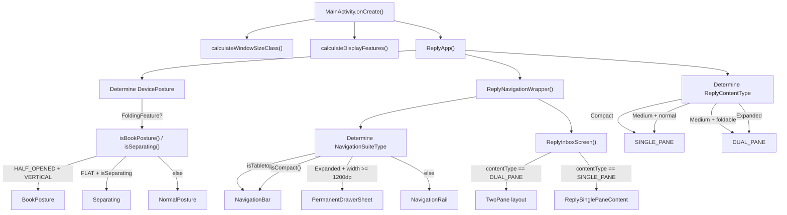
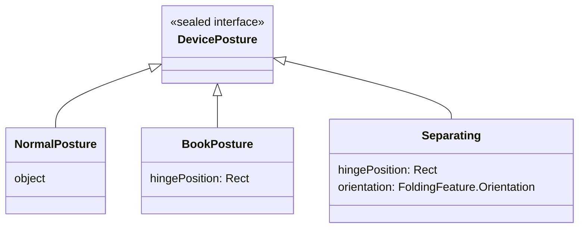
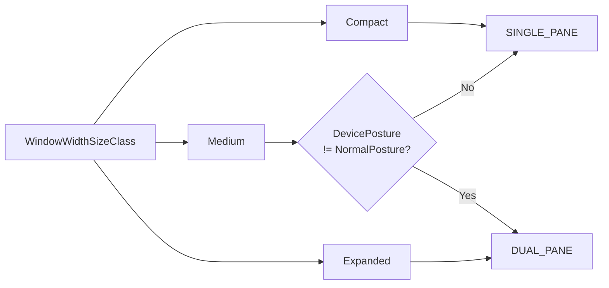
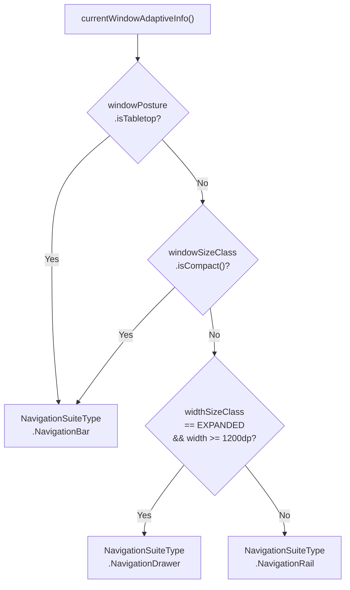
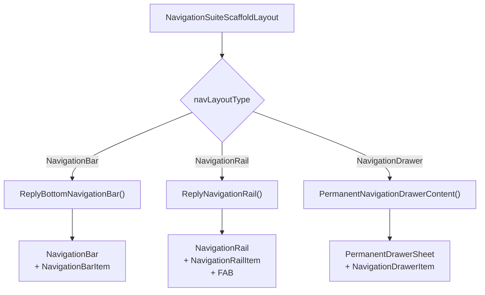
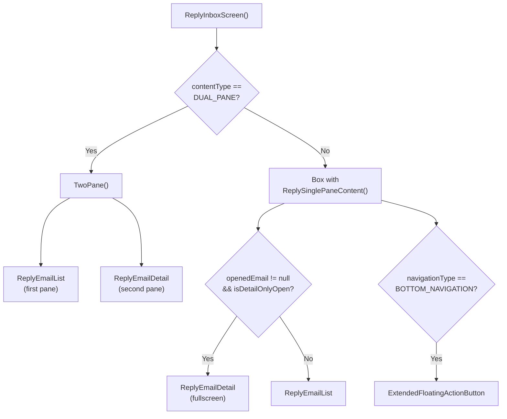
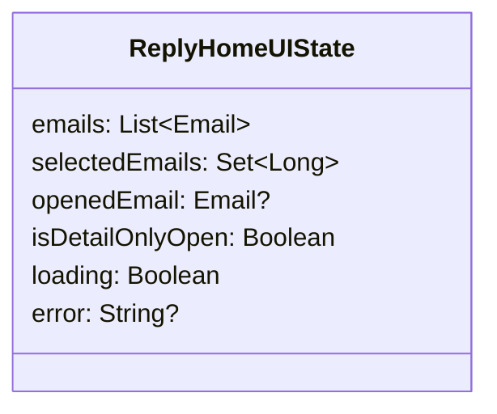
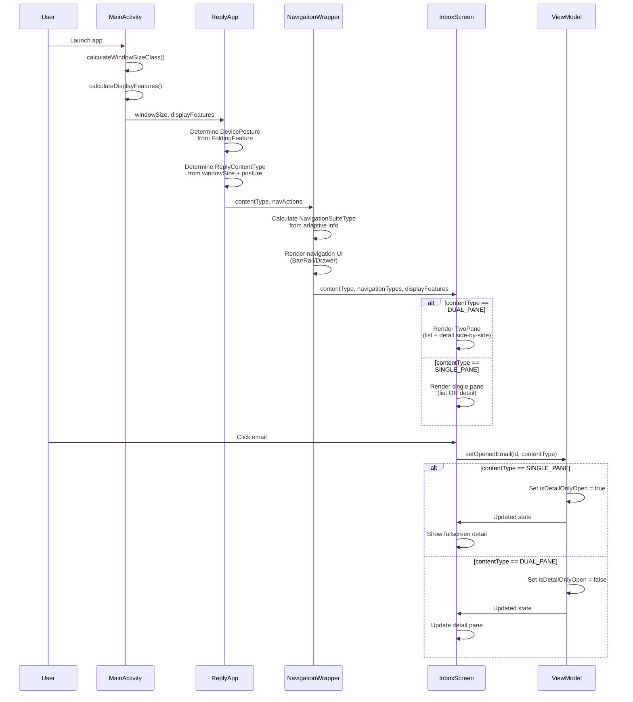

<!-- source: DeepWiki mcp.deepwiki.com · repo android/compose-samples · extra page Reply Adaptive Layout System · fetched 2026-10-23 -->

# Reply Adaptive Layout System

Relevant source files

The following files were used as context for generating this wiki page:

- [Reply/app/src/main/AndroidManifest.xml](Reply/app/src/main/AndroidManifest.xml)
- [Reply/app/src/main/java/com/example/reply/ui/EmptyComingSoon.kt](Reply/app/src/main/java/com/example/reply/ui/EmptyComingSoon.kt)
- [Reply/app/src/main/java/com/example/reply/ui/MainActivity.kt](Reply/app/src/main/java/com/example/reply/ui/MainActivity.kt)
- [Reply/app/src/main/java/com/example/reply/ui/ReplyApp.kt](Reply/app/src/main/java/com/example/reply/ui/ReplyApp.kt)
- [Reply/app/src/main/java/com/example/reply/ui/ReplyHomeViewModel.kt](Reply/app/src/main/java/com/example/reply/ui/ReplyHomeViewModel.kt)
- [Reply/app/src/main/java/com/example/reply/ui/ReplyListContent.kt](Reply/app/src/main/java/com/example/reply/ui/ReplyListContent.kt)
- [Reply/app/src/main/java/com/example/reply/ui/components/ReplyAppBars.kt](Reply/app/src/main/java/com/example/reply/ui/components/ReplyAppBars.kt)
- [Reply/app/src/main/java/com/example/reply/ui/components/ReplyEmailListItem.kt](Reply/app/src/main/java/com/example/reply/ui/components/ReplyEmailListItem.kt)
- [Reply/app/src/main/java/com/example/reply/ui/components/ReplyEmailThreadItem.kt](Reply/app/src/main/java/com/example/reply/ui/components/ReplyEmailThreadItem.kt)
- [Reply/app/src/main/java/com/example/reply/ui/components/ReplyProfileImage.kt](Reply/app/src/main/java/com/example/reply/ui/components/ReplyProfileImage.kt)
- [Reply/app/src/main/java/com/example/reply/ui/navigation/ReplyNavigationActions.kt](Reply/app/src/main/java/com/example/reply/ui/navigation/ReplyNavigationActions.kt)
- [Reply/app/src/main/java/com/example/reply/ui/navigation/ReplyNavigationComponents.kt](Reply/app/src/main/java/com/example/reply/ui/navigation/ReplyNavigationComponents.kt)
- [Reply/app/src/main/java/com/example/reply/ui/theme/Color.kt](Reply/app/src/main/java/com/example/reply/ui/theme/Color.kt)
- [Reply/app/src/main/java/com/example/reply/ui/theme/Theme.kt](Reply/app/src/main/java/com/example/reply/ui/theme/Theme.kt)
- [Reply/app/src/main/java/com/example/reply/ui/theme/Type.kt](Reply/app/src/main/java/com/example/reply/ui/theme/Type.kt)
- [Reply/app/src/main/java/com/example/reply/ui/utils/WindowStateUtils.kt](Reply/app/src/main/java/com/example/reply/ui/utils/WindowStateUtils.kt)
- [Reply/app/src/main/res/values/strings.xml](Reply/app/src/main/res/values/strings.xml)

## Purpose and Scope

This document describes the adaptive layout system in the Reply email client sample application. The system demonstrates how to build responsive UI that adapts to different screen sizes (phone, tablet, desktop) and device postures (foldable states). It covers window size class detection, device posture handling for foldables, navigation suite adaptation, and content pane switching.

For information about Reply's overall architecture and other features, see [Reply](#4.3). For broader patterns across multiple samples, see [Adaptive and Responsive UI Design](#5.2).

## Overview

The Reply adaptive layout system uses three key dimensions to determine the appropriate UI configuration:

| Dimension | Source | Possible Values |
|-----------|--------|-----------------|
| **Window Size Class** | `WindowSizeClass.calculateFromSize()` | Compact, Medium, Expanded |
| **Device Posture** | `DisplayFeature` folding state | NormalPosture, BookPosture, Separating |
| **Content Type** | Derived from above two | SINGLE_PANE, DUAL_PANE |
| **Navigation Type** | Derived from window size + posture | BOTTOM_NAVIGATION, NAVIGATION_RAIL, PERMANENT_NAVIGATION_DRAWER |

The system makes real-time decisions as the device configuration changes (rotation, folding, window resizing).

**Sources:** [Reply/app/src/main/java/com/example/reply/ui/utils/WindowStateUtils.kt:1-72]()

## Adaptive Layout Decision Flow

**Sources:** [Reply/app/src/main/java/com/example/reply/ui/MainActivity.kt:37-68](), [Reply/app/src/main/java/com/example/reply/ui/ReplyApp.kt:50-111](), [Reply/app/src/main/java/com/example/reply/ui/navigation/ReplyNavigationComponents.kt:84-168]()

## Window Size Class Detection

Window size calculation occurs in `MainActivity` using Material3's experimental window size class API:

[Reply/app/src/main/java/com/example/reply/ui/MainActivity.kt:41-49]()

The `WindowSizeClass` object contains `widthSizeClass` and `heightSizeClass` properties with values from `WindowWidthSizeClass` and `WindowHeightSizeClass` enums:

- **Compact**: < 600dp width (typical phone portrait)
- **Medium**: 600-839dp width (large phone, small tablet, foldable unfolded)
- **Expanded**: ≥ 840dp width (tablet, desktop)

**Sources:** [Reply/app/src/main/java/com/example/reply/ui/MainActivity.kt:37-68]()

## Device Posture Detection

### Posture Types

The system defines three device postures in `DevicePosture`:

**Sources:** [Reply/app/src/main/java/com/example/reply/ui/utils/WindowStateUtils.kt:24-33]()

### Posture Detection Logic

The posture detection happens in `ReplyApp`:

[Reply/app/src/main/java/com/example/reply/ui/ReplyApp.kt:59-74]()

| Condition | Result Posture | Description |
|-----------|---------------|-------------|
| `state == HALF_OPENED && orientation == VERTICAL` | `BookPosture` | Device folded like a book (vertical hinge) |
| `state == FLAT && isSeparating == true` | `Separating` | Two separate display areas (tabletop or book mode) |
| Otherwise | `NormalPosture` | Regular phone/tablet operation |

The helper functions `isBookPosture()` and `isSeparating()` use Kotlin contracts to provide smart-cast guarantees:

[Reply/app/src/main/java/com/example/reply/ui/utils/WindowStateUtils.kt:35-46]()

**Sources:** [Reply/app/src/main/java/com/example/reply/ui/ReplyApp.kt:59-74](), [Reply/app/src/main/java/com/example/reply/ui/utils/WindowStateUtils.kt:35-46]()

## Content Type Determination

`ReplyContentType` determines whether the app shows a single pane (list OR detail) or dual pane (list AND detail simultaneously):

[Reply/app/src/main/java/com/example/reply/ui/ReplyApp.kt:76-85]()

This logic enables Medium-width foldable devices to use dual-pane layout when unfolded (non-normal posture), but single-pane when folded.

**Sources:** [Reply/app/src/main/java/com/example/reply/ui/ReplyApp.kt:76-85](), [Reply/app/src/main/java/com/example/reply/ui/utils/WindowStateUtils.kt:65-71]()

## Navigation Suite Adaptation

### Navigation Type Selection

`ReplyNavigationWrapper` determines the navigation UI type based on window characteristics:

[Reply/app/src/main/java/com/example/reply/ui/navigation/ReplyNavigationComponents.kt:90-108]()

The `isCompact()` helper considers both width and height:

[Reply/app/src/main/java/com/example/reply/ui/navigation/ReplyNavigationComponents.kt:79-80]()

**Sources:** [Reply/app/src/main/java/com/example/reply/ui/navigation/ReplyNavigationComponents.kt:84-108]()

### Navigation Component Mapping

The `NavigationSuiteType` is converted to `ReplyNavigationType` for backward compatibility:

[Reply/app/src/main/java/com/example/reply/ui/ReplyApp.kt:43-48]()

| Material3 NavigationSuiteType | Reply NavigationType | Visual Component |
|-------------------------------|---------------------|------------------|
| `NavigationBar` | `BOTTOM_NAVIGATION` | Bottom navigation bar |
| `NavigationRail` | `NAVIGATION_RAIL` | Side navigation rail |
| `NavigationDrawer` | `PERMANENT_NAVIGATION_DRAWER` | Permanent drawer |

### Navigation Content Position

Navigation drawer and rail content can be vertically positioned based on screen height:

[Reply/app/src/main/java/com/example/reply/ui/navigation/ReplyNavigationComponents.kt:102-108]()

| WindowHeightSizeClass | ReplyNavigationContentPosition | Visual Result |
|-----------------------|-------------------------------|---------------|
| `COMPACT` | `TOP` | Content at top |
| `MEDIUM` or `EXPANDED` | `CENTER` | Content vertically centered |

The `navigationMeasurePolicy()` custom layout function implements this positioning:

[Reply/app/src/main/java/com/example/reply/ui/navigation/ReplyNavigationComponents.kt:434-469]()

**Sources:** [Reply/app/src/main/java/com/example/reply/ui/navigation/ReplyNavigationComponents.kt:79-108](), [Reply/app/src/main/java/com/example/reply/ui/navigation/ReplyNavigationComponents.kt:434-469]()

## Navigation Component Implementations

### NavigationSuiteScaffoldLayout Integration

The wrapper uses Material3's `NavigationSuiteScaffoldLayout` to render the appropriate navigation:

[Reply/app/src/main/java/com/example/reply/ui/navigation/ReplyNavigationComponents.kt:139-167]()

The scaffold renders one of three navigation components based on `navLayoutType`:

**Sources:** [Reply/app/src/main/java/com/example/reply/ui/navigation/ReplyNavigationComponents.kt:139-167]()

### Bottom Navigation Bar

[Reply/app/src/main/java/com/example/reply/ui/navigation/ReplyNavigationComponents.kt:236-251]()

Renders `NavigationBar` with `NavigationBarItem` for each destination. Used on:
- Phones (compact width)
- Foldables in tabletop mode

### Navigation Rail

[Reply/app/src/main/java/com/example/reply/ui/navigation/ReplyNavigationComponents.kt:171-233]()

Renders `NavigationRail` with:
- Menu icon to open modal drawer
- Floating action button
- `NavigationRailItem` for each destination

Used on medium-width devices (large phones, small tablets).

### Permanent Navigation Drawer

[Reply/app/src/main/java/com/example/reply/ui/navigation/ReplyNavigationComponents.kt:254-336]()

Renders `PermanentDrawerSheet` with:
- App name header
- Extended floating action button
- `NavigationDrawerItem` for each destination
- Custom layout with `navigationMeasurePolicy()` for content positioning

Used on expanded-width devices ≥ 1200dp (tablets, desktops).

**Sources:** [Reply/app/src/main/java/com/example/reply/ui/navigation/ReplyNavigationComponents.kt:171-336]()

## Content Layout Adaptation

### Inbox Screen Layout Switching

`ReplyInboxScreen` switches between single-pane and dual-pane layouts:

[Reply/app/src/main/java/com/example/reply/ui/ReplyListContent.kt:59-132]()

**Sources:** [Reply/app/src/main/java/com/example/reply/ui/ReplyListContent.kt:59-132]()

### TwoPane Layout Configuration

For dual-pane mode, Reply uses Accompanist's `TwoPane`:

[Reply/app/src/main/java/com/example/reply/ui/ReplyListContent.kt:82-102]()

Key parameters:
- **first**: Email list on the left
- **second**: Email detail on the right  
- **strategy**: `HorizontalTwoPaneStrategy(splitFraction = 0.5f, gapWidth = 16.dp)` - 50/50 split with 16dp gap
- **displayFeatures**: Passed through for foldable hinge awareness

The `TwoPane` component automatically adjusts the split to avoid content spanning across a foldable hinge.

**Sources:** [Reply/app/src/main/java/com/example/reply/ui/ReplyListContent.kt:82-102]()

### Single-Pane Layout

In single-pane mode, `ReplySinglePaneContent` toggles between list and detail:

[Reply/app/src/main/java/com/example/reply/ui/ReplyListContent.kt:135-161]()

The `isDetailOnlyOpen` state flag controls which screen is shown:
- `true`: Show fullscreen email detail with back button
- `false`: Show email list

The `BackHandler` intercepts back gestures when detail is open:

[Reply/app/src/main/java/com/example/reply/ui/ReplyListContent.kt:143-146]()

**Sources:** [Reply/app/src/main/java/com/example/reply/ui/ReplyListContent.kt:135-161]()

## State Management for Adaptive UI

### ReplyHomeViewModel

The ViewModel manages email state and detail screen visibility:

[Reply/app/src/main/java/com/example/reply/ui/ReplyHomeViewModel.kt:30-84]()

Key functions:

| Function | Purpose |
|----------|---------|
| `setOpenedEmail(emailId, contentType)` | Opens email, sets `isDetailOnlyOpen` only for `SINGLE_PANE` |
| `closeDetailScreen()` | Resets `isDetailOnlyOpen` to false, selects first email |
| `toggleSelectedEmail(emailId)` | Manages multi-select state |

### ReplyHomeUIState

[Reply/app/src/main/java/com/example/reply/ui/ReplyHomeViewModel.kt:86-93]()

The `isDetailOnlyOpen` flag is critical for single-pane mode:
- Set to `true` only when `contentType == SINGLE_PANE` and user opens an email
- Prevents list from showing in single-pane mode
- Always `false` in dual-pane mode (both panes always visible)

### Content Type Effect

`ReplyInboxScreen` includes a `LaunchedEffect` that clears detail state when switching to single-pane:

[Reply/app/src/main/java/com/example/reply/ui/ReplyListContent.kt:69-76]()

This ensures that when a user resizes from dual-pane to single-pane (e.g., rotating a tablet), the detail screen doesn't remain stuck open.

**Sources:** [Reply/app/src/main/java/com/example/reply/ui/ReplyHomeViewModel.kt:30-93](), [Reply/app/src/main/java/com/example/reply/ui/ReplyListContent.kt:69-76]()

## Data Flow Architecture

**Sources:** [Reply/app/src/main/java/com/example/reply/ui/MainActivity.kt:37-68](), [Reply/app/src/main/java/com/example/reply/ui/ReplyApp.kt:50-111](), [Reply/app/src/main/java/com/example/reply/ui/ReplyHomeViewModel.kt:58-67]()

## Modal Drawer for Navigation Rail

When using navigation rail on medium-width devices, Reply includes a modal drawer for additional navigation options:

[Reply/app/src/main/java/com/example/reply/ui/navigation/ReplyNavigationComponents.kt:110-137]()

The drawer:
- Remains `DrawerValue.Closed` initially
- Opens when user taps menu icon in rail
- Gestures enabled only when using rail (not permanent drawer or bottom nav)
- `BackHandler` closes drawer when open

The `ModalNavigationDrawer` wraps the entire `NavigationSuiteScaffoldLayout`, with drawer content rendered by `ModalNavigationDrawerContent()`:

[Reply/app/src/main/java/com/example/reply/ui/navigation/ReplyNavigationComponents.kt:339-432]()

**Sources:** [Reply/app/src/main/java/com/example/reply/ui/navigation/ReplyNavigationComponents.kt:110-137](), [Reply/app/src/main/java/com/example/reply/ui/navigation/ReplyNavigationComponents.kt:339-432]()

## FloatingActionButton Placement

The compose FAB adapts to navigation type:

### Bottom Navigation Mode

[Reply/app/src/main/java/com/example/reply/ui/ReplyListContent.kt:113-129]()

When bottom navigation is active:
- `ExtendedFloatingActionButton` positioned at bottom-end
- Expands/collapses based on scroll state
- Uses `emailLazyListState.lastScrolledBackward` to detect scroll direction
- Always expanded when at top (`!canScrollBackward`)

### Navigation Rail Mode

[Reply/app/src/main/java/com/example/reply/ui/navigation/ReplyNavigationComponents.kt:196-207]()

When navigation rail is active:
- `FloatingActionButton` (not extended) placed in rail header
- Positioned between menu icon and navigation items

### Permanent Drawer Mode

[Reply/app/src/main/java/com/example/reply/ui/navigation/ReplyNavigationComponents.kt:281-299]()

When permanent drawer is active:
- `ExtendedFloatingActionButton` in drawer header
- Always expanded with centered text

**Sources:** [Reply/app/src/main/java/com/example/reply/ui/ReplyListContent.kt:113-129](), [Reply/app/src/main/java/com/example/reply/ui/navigation/ReplyNavigationComponents.kt:196-207](), [Reply/app/src/main/java/com/example/reply/ui/navigation/ReplyNavigationComponents.kt:281-299]()

## Preview Support

Reply includes comprehensive preview functions for different device configurations:

| Preview Function | Width x Height | Purpose |
|-----------------|----------------|---------|
| `ReplyAppPreview()` | 400dp x 900dp | Phone portrait |
| `ReplyAppPreviewTablet()` | 700dp x 500dp | Tablet landscape |
| `ReplyAppPreviewTabletPortrait()` | 500dp x 700dp | Tablet portrait |
| `ReplyAppPreviewDesktop()` | 1100dp x 600dp | Desktop/large tablet |
| `ReplyAppPreviewDesktopPortrait()` | 600dp x 1100dp | Desktop portrait |

[Reply/app/src/main/java/com/example/reply/ui/MainActivity.kt:71-134]()

These previews use `WindowSizeClass.calculateFromSize(DpSize(...))` to simulate different window sizes in Android Studio's preview pane.

**Sources:** [Reply/app/src/main/java/com/example/reply/ui/MainActivity.kt:71-134]()

## Key Dependencies

| Library | Purpose |
|---------|---------|
| `androidx.compose.material3.windowsizeclass` | `WindowSizeClass` calculation |
| `androidx.compose.material3.adaptive` | `NavigationSuiteScaffoldLayout`, adaptive info |
| `androidx.window.layout` | `DisplayFeature`, `FoldingFeature` detection |
| `com.google.accompanist.adaptive` | `TwoPane` for dual-pane layouts, display feature utilities |

**Sources:** [Reply/app/src/main/java/com/example/reply/ui/MainActivity.kt:24-35](), [Reply/app/src/main/java/com/example/reply/ui/ReplyApp.kt:19-41](), [Reply/app/src/main/java/com/example/reply/ui/ReplyListContent.kt:46-56]()

---

