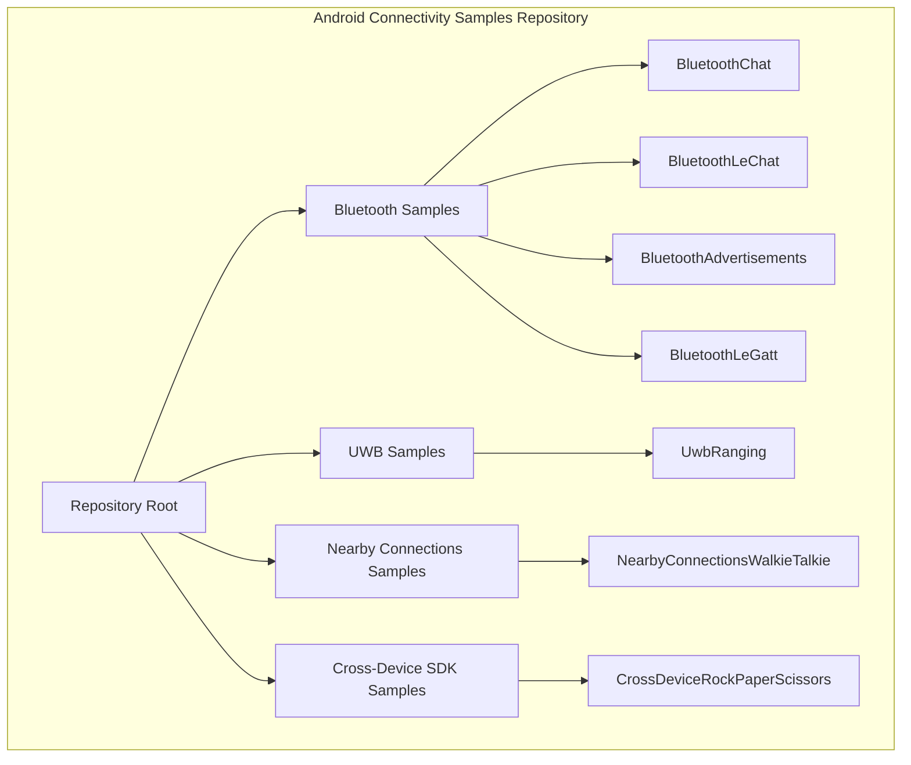
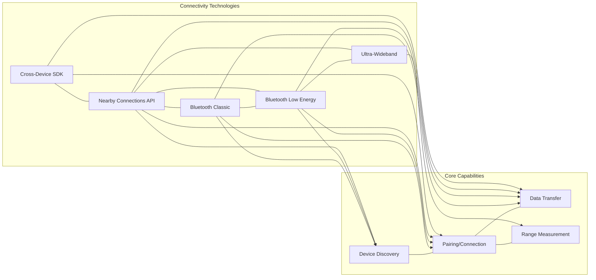
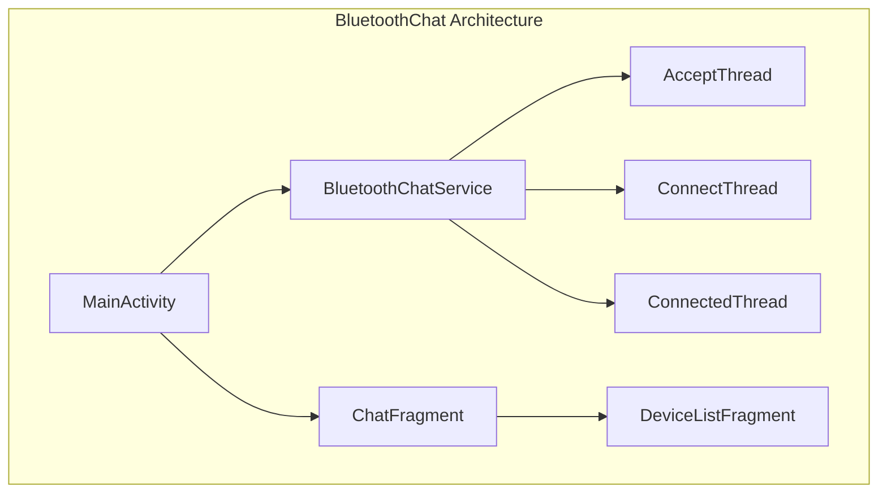
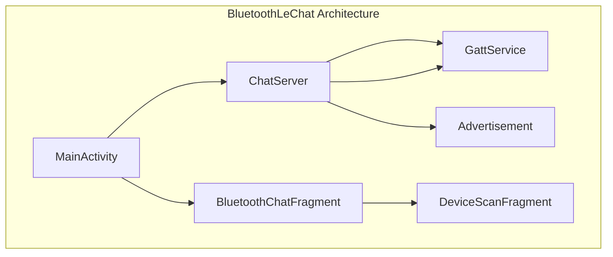
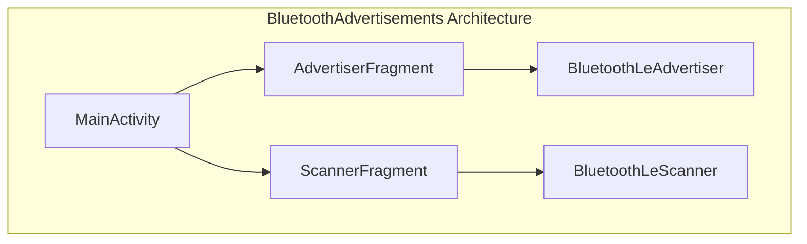
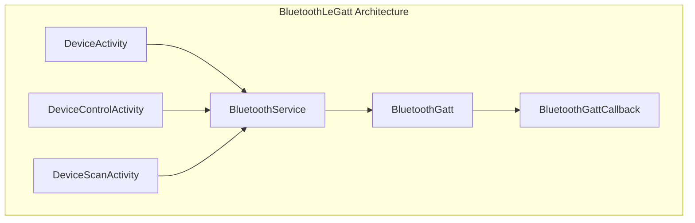
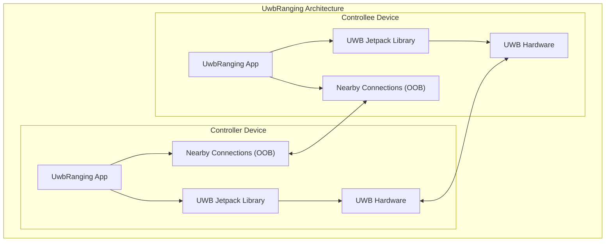
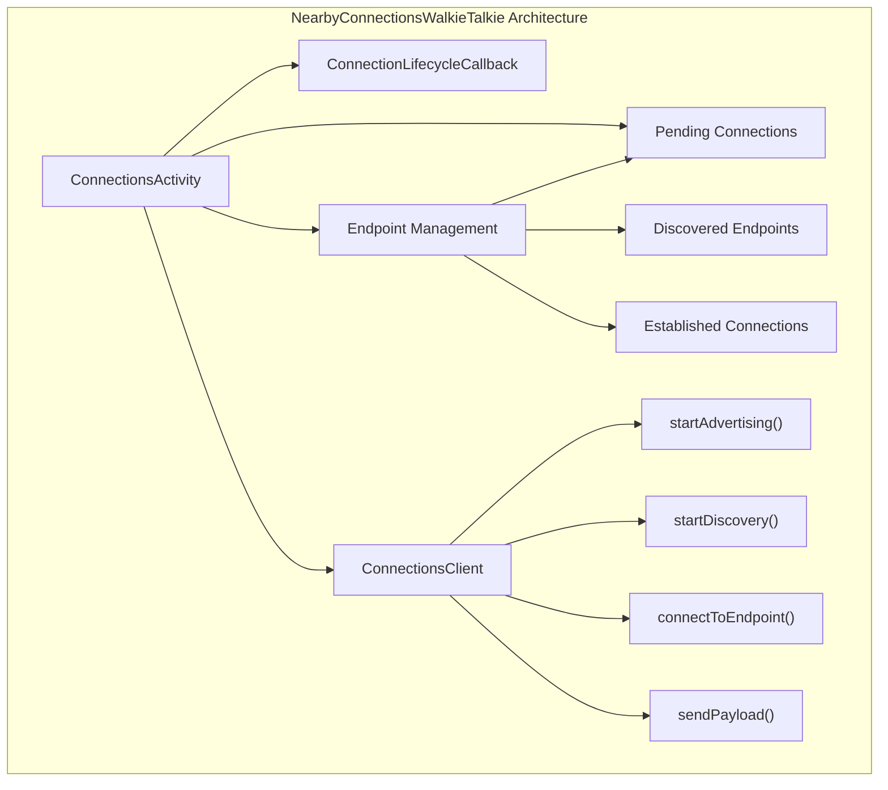
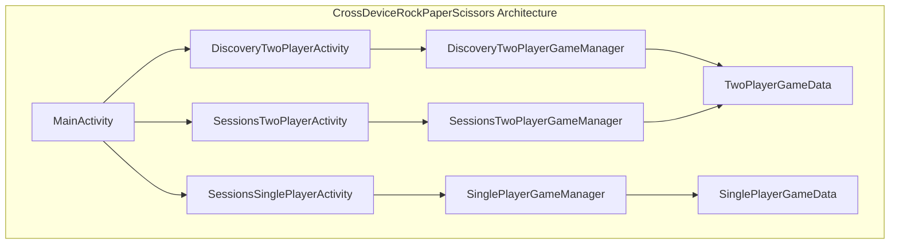
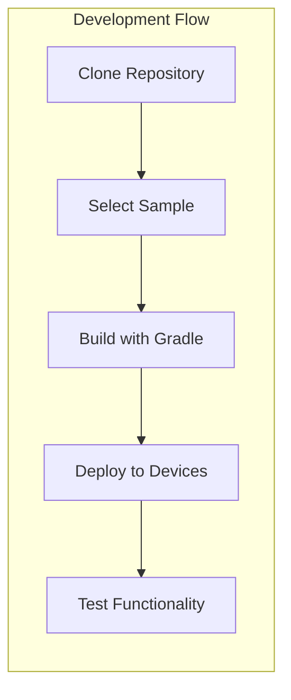

<!-- source: DeepWiki mcp.deepwiki.com · repo android/connectivity-samples · page 1 Overview · fetched 2026-10-23 -->

# Overview

Relevant source files

The following files were used as context for generating this wiki page:

- [.gitignore](.gitignore)
- [BluetoothAdvertisements/README.md](BluetoothAdvertisements/README.md)
- [BluetoothAdvertisementsKotlin/README.md](BluetoothAdvertisementsKotlin/README.md)
- [BluetoothAdvertisementsKotlin/screenshots/1-main.png](BluetoothAdvertisementsKotlin/screenshots/1-main.png)
- [BluetoothAdvertisementsKotlin/screenshots/icon-web.png](BluetoothAdvertisementsKotlin/screenshots/icon-web.png)
- [BluetoothChat/README.md](BluetoothChat/README.md)
- [BluetoothLeChat/README.md](BluetoothLeChat/README.md)
- [BluetoothLeGatt/README.md](BluetoothLeGatt/README.md)
- [CONTRIBUTING.md](CONTRIBUTING.md)
- [LICENSE](LICENSE)
- [README.md](README.md)

This technical documentation provides a comprehensive guide to the Android Connectivity Samples repository, a collection of sample applications demonstrating various device-to-device connectivity technologies on the Android platform. It serves as an entry point for developers looking to implement different connectivity solutions in their Android applications.

The repository showcases implementations of Bluetooth (classic and Low Energy), Ultra-Wideband (UWB) ranging, Google's Nearby Connections API, and the Cross-Device SDK. These samples illustrate best practices and provide working code for establishing various types of connections between Android devices.

Sources: [README.md:5-22]()

## Repository Structure

The Android Connectivity Samples repository is organized by connectivity technology, with each sample application focused on demonstrating a specific connectivity feature or use case.

**Note:** The Bluetooth samples have been migrated to the [platform-samples repository](https://github.com/android/platform-samples/tree/main/samples/connectivity/bluetooth) but are still referenced here for completeness.

Sources: [README.md:1-22](), [BluetoothAdvertisementsKotlin/README.md:1-5](), [BluetoothLeChat/README.md:1-5](), [BluetoothLeGatt/README.md:1-5]()

## Connectivity Technologies Overview

The repository demonstrates the following connectivity technologies:

| Technology | Key Features | Power Usage | Range | Bandwidth | Sample Applications |
|------------|--------------|-------------|-------|-----------|---------------------|
| Bluetooth Classic | Device discovery, pairing, data transfer | Medium-High | ~10m | Up to 3 Mbps | BluetoothChat |
| Bluetooth Low Energy | Advertising, scanning, GATT services | Low | ~10m | Up to 2 Mbps | BluetoothLeChat, BluetoothAdvertisements, BluetoothLeGatt |
| Ultra-Wideband | Precise distance and direction measurement | Medium | ~10m | N/A (not for data transfer) | UwbRanging |
| Nearby Connections | Out-of-band discovery, connection establishment | Varies | ~30m | Varies based on transport | NearbyConnectionsWalkieTalkie |
| Cross-Device SDK | Multi-device experiences | Varies | Varies | Varies | CrossDeviceRockPaperScissors |

Sources: [BluetoothChat/README.md:10-35](), [BluetoothLeChat/README.md:10-33](), [BluetoothLeGatt/README.md:10-26](), [BluetoothAdvertisementsKotlin/README.md:10-32]()

## Connectivity Technology Relationships

The following diagram illustrates how the different connectivity technologies interact and their relative positioning in terms of functionality:

In this architecture, Nearby Connections often serves as an out-of-band (OOB) channel for technologies like UWB, which require initial discovery and connection setup through another protocol before their specialized functionality can be used.

Sources: All provided files and diagrams

## Key Sample Applications

### Bluetooth Samples

#### BluetoothChat

Demonstrates two-way communication between Android devices using traditional Bluetooth RFCOMM sockets.

Key features:
- Device discovery and pairing
- Establishing RFCOMM channels
- Connection management
- Data transfer over Bluetooth

Sources: [BluetoothChat/README.md:7-35]()

#### BluetoothLeChat

Implements a two-way chat application using Bluetooth Low Energy GATT profiles.

Key features:
- BLE device scanning
- GATT server and client implementation
- BLE characteristic read/write operations
- BLE advertisements

Sources: [BluetoothLeChat/README.md:7-33]()

#### BluetoothAdvertisements

Demonstrates how to advertise small amounts of data using the Bluetooth Low Energy API and scan for those advertisements.

Key features:
- BLE advertising
- Scanning for BLE advertisements
- Data payload in advertisements
- Advertisement filtering

Sources: [BluetoothAdvertisementsKotlin/README.md:7-32]()

#### BluetoothLeGatt

Demonstrates how to use the Bluetooth LE Generic Attribute Profile (GATT) to transmit arbitrary data between devices.

Key features:
- Scanning for BLE devices
- Connecting to GATT servers
- Reading/writing GATT characteristics
- Receiving notifications from GATT servers

Sources: [BluetoothLeGatt/README.md:7-26]()

### UWB Samples

#### UwbRanging

Demonstrates the use of Ultra-Wideband (UWB) technology for precise distance and direction measurement between devices.

Key features:
- UWB device discovery
- Ranging session establishment
- Distance and angle measurement
- Use of Nearby Connections as an out-of-band channel

Sources: All provided diagrams

### Nearby Connections Samples

#### NearbyConnectionsWalkieTalkie

Real-time audio communication between devices using Google's Nearby Connections API.

Key features:
- Device discovery via Nearby Connections
- Audio capture and streaming
- Real-time communication
- Connection lifecycle management

Sources: All provided diagrams

### Cross-Device SDK Samples

#### CrossDeviceRockPaperScissors

Demonstrates Google's Cross-Device SDK for creating multi-device experiences through a simple game.

Key features:
- Cross-device discovery
- Session management
- State synchronization
- User interface coordination

Sources: All provided diagrams

## Getting Started

To use these samples, you'll need:

- Android SDK 28 or higher
- Android Build Tools v28.0.3 or higher
- Android Support Repository
- Compatible Android devices for testing (some samples require two devices)

Each sample includes its own README with specific instructions and requirements.

Sources: [README.md:8-22](), [BluetoothAdvertisementsKotlin/README.md:36-52](), [BluetoothLeChat/README.md:37-54](), [BluetoothLeGatt/README.md:28-45]()

## License and Contributions

The repository is licensed under the Apache License 2.0. Contributions are welcome. See the CONTRIBUTING.md file for details on how to contribute.

Sources: [LICENSE:1-191](), [CONTRIBUTING.md:1-36]()

---

