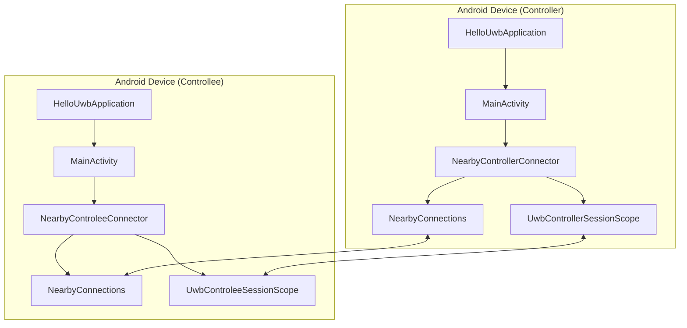
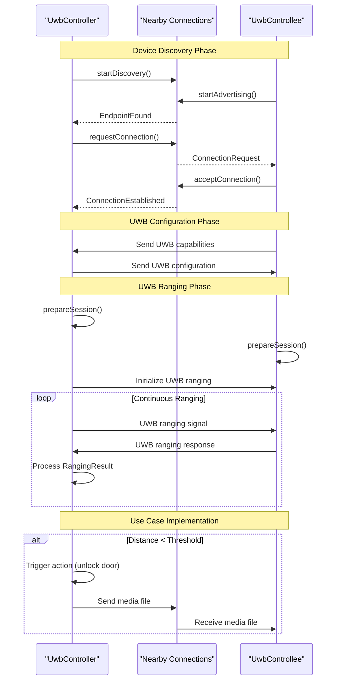
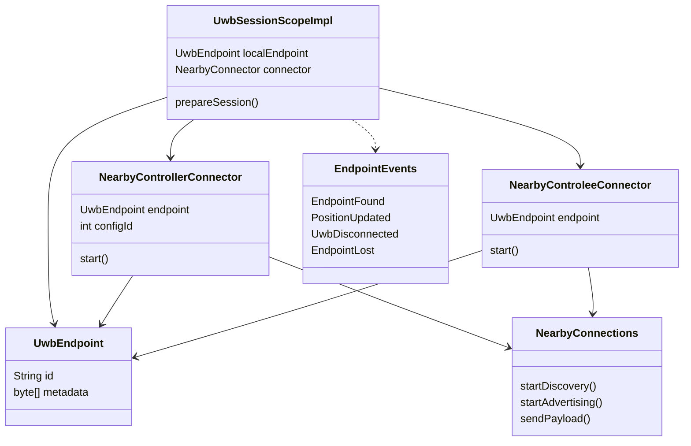
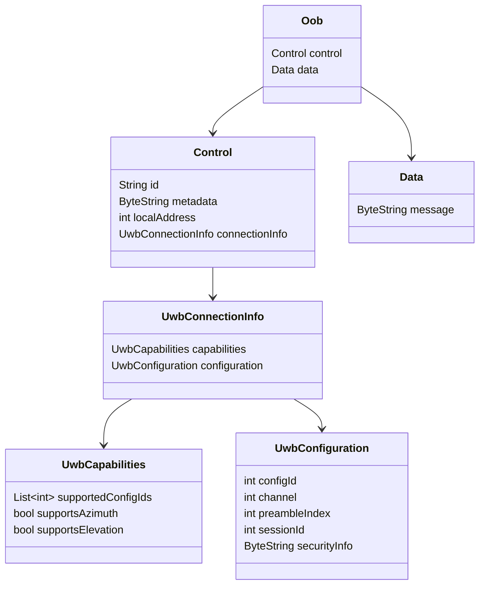

<!-- source: DeepWiki mcp.deepwiki.com · repo android/connectivity-samples · page 2 UWB Ranging · fetched 2026-10-23 -->

# UWB Ranging

Relevant source files

The following files were used as context for generating this wiki page:

- [UwbRanging/README.md](UwbRanging/README.md)
- [UwbRanging/app/src/main/AndroidManifest.xml](UwbRanging/app/src/main/AndroidManifest.xml)
- [UwbRanging/uwbranging/src/test/java/com/google/apps/uwbranging/impl/NearbyConnectionsTest.kt](UwbRanging/uwbranging/src/test/java/com/google/apps/uwbranging/impl/NearbyConnectionsTest.kt)
- [UwbRanging/uwbranging/src/test/java/com/google/apps/uwbranging/impl/NearbyControleeConnectorTest.kt](UwbRanging/uwbranging/src/test/java/com/google/apps/uwbranging/impl/NearbyControleeConnectorTest.kt)
- [UwbRanging/uwbranging/src/test/java/com/google/apps/uwbranging/impl/NearbyControllerConnectorTest.kt](UwbRanging/uwbranging/src/test/java/com/google/apps/uwbranging/impl/NearbyControllerConnectorTest.kt)
- [UwbRanging/uwbranging/src/test/java/com/google/apps/uwbranging/impl/UwbSessionScopeImplTest.kt](UwbRanging/uwbranging/src/test/java/com/google/apps/uwbranging/impl/UwbSessionScopeImplTest.kt)

## Introduction

The UWB Ranging sample demonstrates the capabilities of Ultra-wideband (UWB) technology on Android devices. This sample showcases the [Android UWB Jetpack library](https://developer.android.com/jetpack/androidx/releases/core-uwb) and its implementation for precise distance measurement between UWB-capable devices. The sample focuses on the technical foundation required to build UWB-enabled applications rather than UI design or complete end-to-end solutions.

For information about other connectivity technologies like Bluetooth or Nearby Connections, see the [Bluetooth Samples](#3) or [Nearby Connections](#4) pages respectively.

Sources: [UwbRanging/README.md:1-40]()

## Overview

UWB (Ultra-wideband) is a radio technology that operates at a high bandwidth and enables centimeter-level precision for distance measurement between devices. The UWB Ranging sample demonstrates several key features:

1. **Device compatibility checking** - Verifying if an Android device supports UWB
2. **Device discovery** - Using an out-of-band (OOB) mechanism (Nearby Connections API) to discover UWB-capable devices
3. **Simple ranging** - Measuring and displaying the distance between connected devices
4. **Device control** - Simulating use cases such as unlocking a door when a UWB device is nearby
5. **Media sharing** - Transferring files when devices are in close proximity

The sample requires two UWB-capable Android phones running Android 12 or higher, as well as the latest version of the Core Ultra Wideband (UWB) Jetpack library.

Sources: [UwbRanging/README.md:3-23]()

## System Architecture

### UWB Ranging Architecture Overview

Sources: [UwbRanging/uwbranging/src/test/java/com/google/apps/uwbranging/impl/NearbyControleeConnectorTest.kt:19-186](), [UwbRanging/uwbranging/src/test/java/com/google/apps/uwbranging/impl/NearbyControllerConnectorTest.kt:19-162]()

The UWB Ranging system follows a controller-controllee pattern, where:
- The **Controller** initiates ranging sessions and processes the ranging results
- The **Controllee** responds to ranging requests from the controller

Both devices utilize the Nearby Connections API for initial discovery and connection establishment, after which they switch to UWB for precise distance measurements.

### UWB Ranging Communication Flow

Sources: [UwbRanging/uwbranging/src/test/java/com/google/apps/uwbranging/impl/NearbyConnectionsTest.kt:19-178](), [UwbRanging/uwbranging/src/test/java/com/google/apps/uwbranging/impl/UwbSessionScopeImplTest.kt:19-143]()

## Core Components

### UWB Ranging System Components

Sources: [UwbRanging/uwbranging/src/test/java/com/google/apps/uwbranging/impl/UwbSessionScopeImplTest.kt:29-38]()

The UWB Ranging system consists of several key components:

1. **UwbEndpoint**: Represents a device participating in UWB ranging, with an ID and associated metadata.

2. **NearbyConnections**: Provides the out-of-band communication channel used for device discovery, connection establishment, and metadata exchange.

3. **NearbyControllerConnector/NearbyControleeConnector**: Manages the connection process for the controller and controllee roles respectively, using the Nearby Connections API.

4. **UwbSessionScopeImpl**: Coordinates the UWB ranging session, handling the preparation, execution, and event processing.

5. **EndpointEvents**: Defines the events that occur during UWB ranging, including endpoint discovery, position updates, and disconnections.

### Data Structures and Protocol

Sources: [UwbRanging/uwbranging/src/test/java/com/google/apps/uwbranging/impl/NearbyControleeConnectorTest.kt:65-82](), [UwbRanging/uwbranging/src/test/java/com/google/apps/uwbranging/impl/NearbyControllerConnectorTest.kt:65-81]()

The UWB ranging system uses Protocol Buffers for data exchange between devices:

1. **Control**: Contains device identification and UWB capabilities/configuration.
2. **UwbConnectionInfo**: Encapsulates UWB capabilities or configuration information.
3. **UwbCapabilities**: Describes the UWB features supported by a device.
4. **UwbConfiguration**: Defines parameters for UWB ranging sessions.
5. **Oob**: The main wrapper message containing either control information or data.
6. **Data**: Contains arbitrary message data exchanged between devices.

These protobuf messages are serialized and transmitted over the Nearby Connections API, facilitating the setup and management of UWB ranging sessions.

## Permission Requirements

The UWB Ranging application requires several permissions to function properly:

| Permission Category | Specific Permissions |
| --- | --- |
| Bluetooth | `BLUETOOTH`, `BLUETOOTH_SCAN`, `BLUETOOTH_ADVERTISE`, `BLUETOOTH_CONNECT`, `BLUETOOTH_ADMIN` |
| Location | `ACCESS_COARSE_LOCATION`, `ACCESS_FINE_LOCATION` |
| Wi-Fi | `ACCESS_WIFI_STATE`, `CHANGE_WIFI_STATE`, `NEARBY_WIFI_DEVICES` |
| UWB | `UWB_RANGING` |

The permissions are required for:
- Bluetooth permissions: Used by the Nearby Connections API for device discovery
- Location permissions: Required for Bluetooth scanning on Android
- Wi-Fi permissions: Used by Nearby Connections as a potential transport
- UWB permissions: Essential for performing the actual UWB ranging operations

Sources: [UwbRanging/app/src/main/AndroidManifest.xml:16-26]()

## Use Cases

The UWB Ranging sample demonstrates three primary use cases:

### 1. Simple Ranging

Shows the basic distance measurement capabilities of UWB technology. The application displays the distance between the controller and controllee devices with centimeter-level precision.

### 2. Device Control

Simulates a scenario where a UWB-enabled device could control access to a physical system, such as a door lock. When the controller device comes within a predefined proximity threshold of the controllee, an action is triggered (like unlocking a door).

### 3. Media Sharing

Demonstrates how to transfer media files between devices when they are in close proximity. This showcases how UWB ranging can be combined with the out-of-band communication channel (Nearby Connections) to facilitate context-aware file sharing.

Sources: [UwbRanging/README.md:13-18]()

## Technical Constraints and Limitations

- UWB technology does not provide a native way to discover devices, requiring an out-of-band (OOB) mechanism like Nearby Connections
- The sample is not an end-to-end production-ready example and lacks comprehensive security measures
- The sample requires specific hardware support: Android devices with UWB capability running Android 12 or higher
- The current Android UWB Jetpack library is still evolving and may have limitations or changes in future releases

Sources: [UwbRanging/README.md:26-33]()

## Summary

The UWB Ranging sample demonstrates the implementation of Ultra-wideband technology for precise distance measurement between Android devices. It showcases the controller-controllee architecture, utilizes the Nearby Connections API for device discovery and initial connection, and provides example use cases for UWB technology including simple ranging, device control, and media sharing.

This sample serves as a technical foundation for developers looking to understand and implement UWB-based applications on Android, focusing on the core ranging functionality rather than complete end-to-end solutions or UI design.

---

