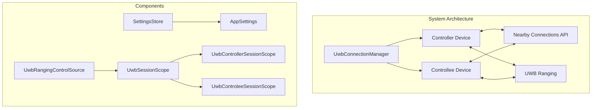
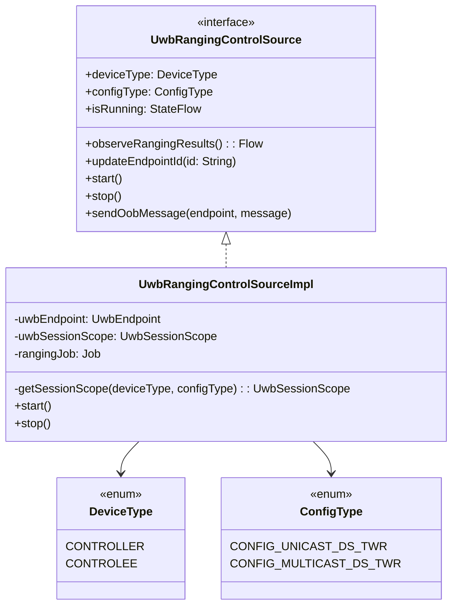
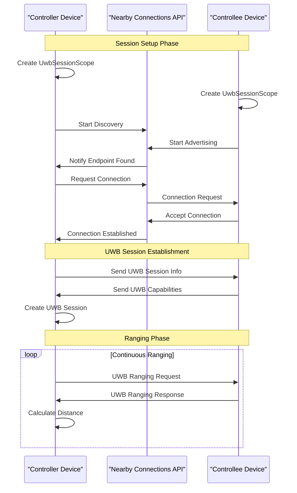
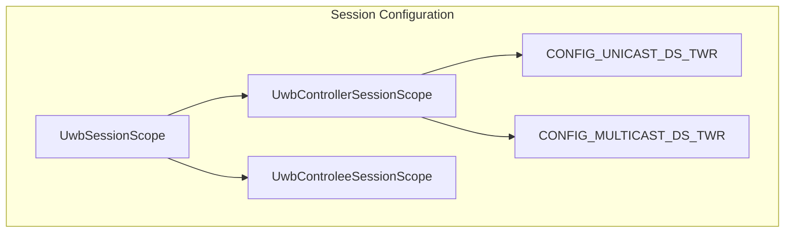
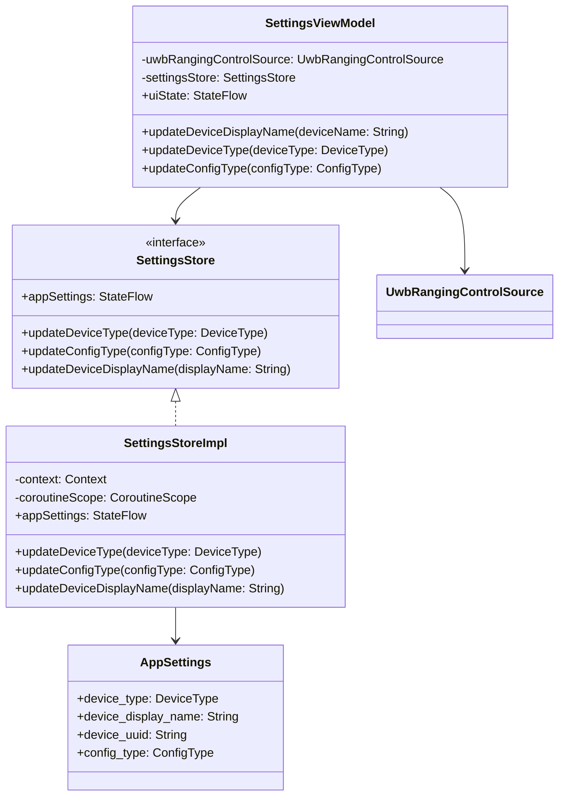
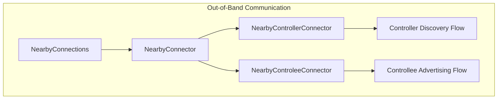
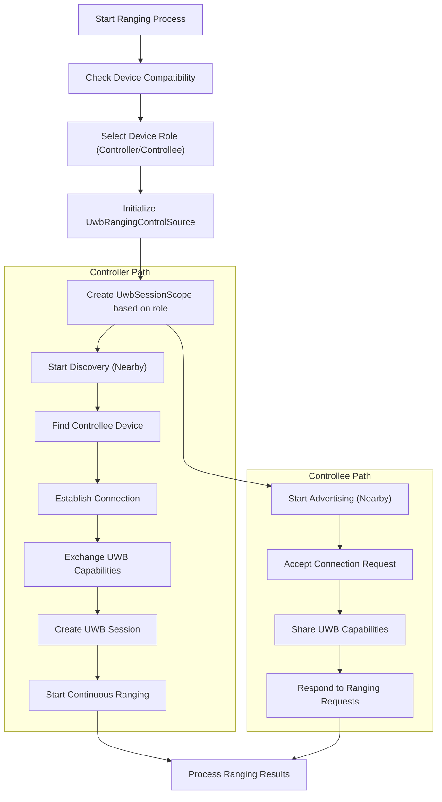
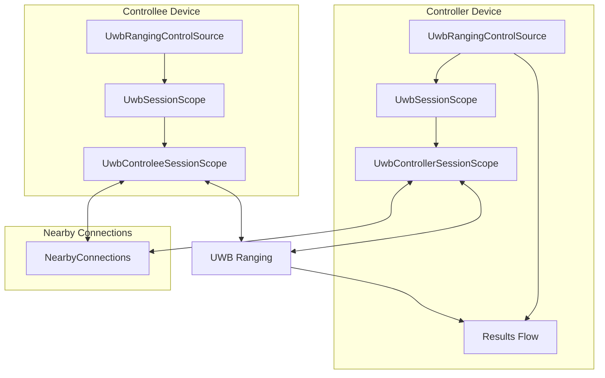

<!-- source: DeepWiki mcp.deepwiki.com · repo android/connectivity-samples · page 2.1 UWB Ranging Architecture · fetched 2026-10-23 -->

# UWB Ranging Architecture

Relevant source files

The following files were used as context for generating this wiki page:

- [UwbRanging/README.md](UwbRanging/README.md)
- [UwbRanging/app/build.gradle](UwbRanging/app/build.gradle)
- [UwbRanging/app/src/main/java/com/google/apps/hellouwb/data/SettingsStore.kt](UwbRanging/app/src/main/java/com/google/apps/hellouwb/data/SettingsStore.kt)
- [UwbRanging/app/src/main/java/com/google/apps/hellouwb/data/SettingsStoreImpl.kt](UwbRanging/app/src/main/java/com/google/apps/hellouwb/data/SettingsStoreImpl.kt)
- [UwbRanging/app/src/main/java/com/google/apps/hellouwb/data/UwbRangingControlSource.kt](UwbRanging/app/src/main/java/com/google/apps/hellouwb/data/UwbRangingControlSource.kt)
- [UwbRanging/app/src/main/java/com/google/apps/hellouwb/data/UwbRangingControlSourceImpl.kt](UwbRanging/app/src/main/java/com/google/apps/hellouwb/data/UwbRangingControlSourceImpl.kt)
- [UwbRanging/app/src/main/java/com/google/apps/hellouwb/ui/settings/SettingsRoute.kt](UwbRanging/app/src/main/java/com/google/apps/hellouwb/ui/settings/SettingsRoute.kt)
- [UwbRanging/app/src/main/java/com/google/apps/hellouwb/ui/settings/SettingsScreen.kt](UwbRanging/app/src/main/java/com/google/apps/hellouwb/ui/settings/SettingsScreen.kt)
- [UwbRanging/app/src/main/java/com/google/apps/hellouwb/ui/settings/SettingsViewModel.kt](UwbRanging/app/src/main/java/com/google/apps/hellouwb/ui/settings/SettingsViewModel.kt)
- [UwbRanging/app/src/main/proto/appsetttings.proto](UwbRanging/app/src/main/proto/appsetttings.proto)
- [UwbRanging/build.gradle](UwbRanging/build.gradle)
- [UwbRanging/uwbranging/build.gradle](UwbRanging/uwbranging/build.gradle)
- [UwbRanging/uwbranging/src/main/java/com/google/apps/uwbranging/impl/NearbyControleeConnector.kt](UwbRanging/uwbranging/src/main/java/com/google/apps/uwbranging/impl/NearbyControleeConnector.kt)

## Purpose and Scope

This document details the internal architecture of the UWB Ranging sample application, which demonstrates the use of Ultra-Wideband (UWB) technology for precise distance measurement between Android devices. The architecture is built around a controller-controllee model for ranging operations and leverages the Android UWB Jetpack library. For information about the UWB protocol itself and data structures used, see [UWB Protocol and Data Structures](#2.2).

## High-Level Architecture Overview

The UWB Ranging system demonstrates how to implement precise distance measurement between two UWB-capable Android devices. The architecture combines the Android UWB Jetpack library with an out-of-band (OOB) mechanism for device discovery.

Sources: [UwbRanging/README.md:4-18](), [UwbRanging/uwbranging/build.gradle:64-65]()

## Controller-Controllee Model

The UWB Ranging architecture is built upon a controller-controllee model where:

1. **Controller**: Initiates the ranging session and sends ranging requests
2. **Controllee**: Responds to ranging requests from the controller

This role can be configured in the application settings and affects how the UWB session is established and managed.

Sources: [UwbRanging/app/src/main/java/com/google/apps/hellouwb/data/UwbRangingControlSource.kt:26-43](), [UwbRanging/app/src/main/java/com/google/apps/hellouwb/data/UwbRangingControlSourceImpl.kt:35-123](), [UwbRanging/app/src/main/proto/appsetttings.proto:23-31]()

## Session Initialization and Management

The UWB ranging process requires proper session initialization and management to establish a connection between devices.

Sources: [UwbRanging/app/src/main/java/com/google/apps/hellouwb/data/UwbRangingControlSourceImpl.kt:101-112](), [UwbRanging/uwbranging/src/main/java/com/google/apps/uwbranging/impl/NearbyControleeConnector.kt:35-103]()

## UWB Session Configuration

The UWB ranging system supports two configuration types that dictate how the ranging session operates:

1. **CONFIG_UNICAST_DS_TWR**: Double-sided two-way ranging between two devices
2. **CONFIG_MULTICAST_DS_TWR**: Two-way ranging that supports multiple devices

These configurations can be selected in the settings menu and affect the UwbSessionScope that is created.

Sources: [UwbRanging/app/src/main/java/com/google/apps/hellouwb/data/UwbRangingControlSourceImpl.kt:60-71](), [UwbRanging/app/src/main/java/com/google/apps/hellouwb/ui/settings/SettingsScreen.kt:112-135]()

## Settings Management

The application provides a settings management system that allows users to configure device roles and UWB parameters.

Sources: [UwbRanging/app/src/main/java/com/google/apps/hellouwb/data/SettingsStore.kt:24-33](), [UwbRanging/app/src/main/java/com/google/apps/hellouwb/data/SettingsStoreImpl.kt:34-98](), [UwbRanging/app/src/main/java/com/google/apps/hellouwb/ui/settings/SettingsViewModel.kt:28-70]()

## Out-of-Band (OOB) Communication

Since UWB does not natively support device discovery, the application uses the Nearby Connections API as an out-of-band mechanism for initial device discovery and connection establishment.

Sources: [UwbRanging/README.md:10-12](), [UwbRanging/uwbranging/src/main/java/com/google/apps/uwbranging/impl/NearbyControleeConnector.kt:35-102]()

## Ranging Process Flow

The complete UWB ranging process involves several steps, from device discovery to continuous ranging:

Sources: [UwbRanging/README.md:13-17](), [UwbRanging/app/src/main/java/com/google/apps/hellouwb/data/UwbRangingControlSourceImpl.kt:101-112]()

## Data Flow in the UWB Ranging System

The following diagram illustrates how data flows through the UWB Ranging system:

Sources: [UwbRanging/app/src/main/java/com/google/apps/hellouwb/data/UwbRangingControlSourceImpl.kt:43-55](), [UwbRanging/uwbranging/src/main/java/com/google/apps/uwbranging/impl/NearbyControleeConnector.kt:42-57]()

## Integration with Application Settings

The UWB Ranging system is tightly integrated with the application settings to allow users to configure the ranging behavior:

| Setting | Description | Impact on Ranging |
|---------|-------------|------------------|
| Device Type | Sets the device as Controller or Controllee | Determines role in ranging session |
| Config Type | Sets UWB configuration (Unicast or Multicast) | Affects ranging session capabilities |
| Device Display Name | Sets device name for display | Used in OOB discovery |

Sources: [UwbRanging/app/src/main/java/com/google/apps/hellouwb/ui/settings/SettingsScreen.kt:86-135](), [UwbRanging/app/src/main/java/com/google/apps/hellouwb/ui/settings/SettingsViewModel.kt:42-56]()

## Technical Requirements

To use the UWB Ranging system, the following requirements must be met:

1. Two UWB-capable Android phones with Android 12 or higher
2. Latest version of the Core Ultra Wideband (UWB) Jetpack library (androidx.core.uwb:uwb)
3. Nearby Connections API for device discovery
4. Proper permissions for UWB and Nearby Connections usage

Sources: [UwbRanging/README.md:21-23](), [UwbRanging/app/build.gradle:81](), [UwbRanging/uwbranging/build.gradle:64]()

---

